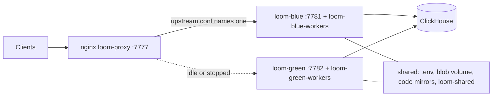

# Deployment

Loom is one server image plus ClickHouse. The image serves HTTP, MCP and the `/me`
dashboard, and runs the background workers. Its containers keep no durable state of their
own, so you can replace or add them freely: ClickHouse holds Loom's data; uploaded document originals sit on a blob volume and the code index keeps
bare git mirrors on disk. The compose files under `dev/` are the supported production
files. Every setting named here is in the generated
[configuration reference](../reference/configuration.md).

## Deployment ladder

Each rung keeps the previous one's image and schema. What changes is where ClickHouse
lives and how many containers run.

| Rung                           | Start it with                                                                                          | ClickHouse                                   | Use for                                        |
| ------------------------------ | ------------------------------------------------------------------------------------------------------ | -------------------------------------------- | ---------------------------------------------- |
| Local stack                    | `loom up` or `make dev` → `dev/docker-compose.dev.yml`                                                 | bundled ClickHouse OSS container (`loom-ch`) | evaluation, development                        |
| Loom with your ClickHouse      | `make dev-cloud` → `dev/docker-compose.cloud.yml`                                                      | ClickHouse Cloud or any reachable OSS server | teams; the production shape                    |
| Zero-downtime pair (optional)  | `./redeploy.sh`: two projects of `dev/docker-compose.colour.yml` behind `dev/docker-compose.proxy.yml` | external                                     | deploys with no refused-connection window      |
| ClickHouse Cloud backing store | either rung above with `LOOM_CH_*` pointing at a Cloud service                                         | ClickHouse Cloud (`SharedMergeTree`)         | replicated, backed-up storage without a Keeper |

Sizing (web replicas, uvicorn processes, the workers container) is in
[failure and recovery](../architecture/failure-and-recovery.md), driven by the metrics in
[monitoring](./monitoring.md#what-to-alert-on).

### Local stack

`loom up` (or `make dev`) creates `.env` from `.env.example` and
`deploy/clickhouse-config/named_collections.xml` from its template, then runs:

```bash
docker compose --env-file .env -f dev/docker-compose.dev.yml up -d --build
```

`--env-file .env` matters: compose resolves its own `.env` relative to the first `-f`
file (`dev/`), so without the flag the compose file's fallbacks apply (auth on, an
OpenAI provider with no key). The [quickstart](../getting-started/quickstart.md) walks
through the stock stack.

| Service      | Container     | Ports                          | Role                                                                                     |
| ------------ | ------------- | ------------------------------ | ---------------------------------------------------------------------------------------- |
| `clickhouse` | `loom-ch`     | `8123` (HTTP), `9000` (native) | ClickHouse OSS (pinned image), database `loom`, user `loom`, password `loomdev`.         |
| `loom`       | `loom-server` | `7777`                         | HTTP, MCP, `/me` and the background workers in one process, built from the `Dockerfile`. |

ClickHouse starts with the files in `deploy/clickhouse-config/`:

| File                                    | Why                                                                                                                     |
| --------------------------------------- | ----------------------------------------------------------------------------------------------------------------------- |
| `lemmatizers.xml` + `deploy/lemmagen3/` | The English lemmatizer behind the stemmed lexical search leg.                                                           |
| `nlp_user_settings.xml`                 | Enables ClickHouse's experimental NLP and AI SQL functions for ad-hoc queries; Loom sets the flags per statement.       |
| `merge_tree_settings.xml`               | MergeTree defaults that let lightweight `UPDATE` (tombstone paths) work on OSS.                                         |
| `keeper.xml`                            | An embedded single-node Keeper, so the `KeeperMap` task-inbox lease table works on OSS.                                 |
| `named_collections.xml`                 | Named collections for ClickHouse's `ai*` SQL functions. Git-ignored; defines none as shipped; keys come via `from_env`. |

- **Ports.** If `8123` or `9000` is taken, set `LOOM_CH_HOST_PORT` or
  `LOOM_CH_NATIVE_HOST_PORT` in `.env`. These are compose variables for the host side
  only; containers always talk to `clickhouse:8123`.
- **Volumes.** `loom-ch-data` (ClickHouse) and `loom-blob-data` (document originals,
  `LOOM_BLOB_DIR`). `make down` keeps them; `make down-all` deletes them.
- **No external systems.** The local stack runs no Langfuse or ClickStack;
  the erasure steps for them do nothing until configured.
- **From source.** `make server` runs uvicorn on `:7777` with reload against the
  ClickHouse `.env` names. Build the dashboard first with `make frontend-build`, or `/me`
  returns 503. Contributor setup is in
  [local development](../development/local-development.md).

### Loom against your own ClickHouse

```bash
cp .env.example .env    # then set LOOM_CH_*, auth and providers (below)
make dev-cloud
```

`dev/docker-compose.cloud.yml` runs two containers from one image:

| Container      | Role                                                 | Key environment                                    |
| -------------- | ---------------------------------------------------- | -------------------------------------------------- |
| `loom-server`  | web tier on `:7777`: HTTP, MCP, `/me`                | `LOOM_BACKGROUND_WORKERS=off`                      |
| `loom-workers` | background workers; `/v1/health` on internal `:7778` | `LOOM_BACKGROUND_WORKERS=on`, `LOOM_WEB_WORKERS=1` |

A long worker pass never shares an event loop with client requests, so it cannot show up
as request latency. Both containers mount the same `.env`, the blob volume and
`var/code_repos` (the code index's git mirrors). Whichever boots first applies pending
migrations ([upgrades](./upgrades.md#how-migrations-run)).

## How settings are read

- Every setting is an environment variable `LOOM_<FIELD>`. Provider keys keep their own
  names (`OPENAI_API_KEY`, `ANTHROPIC_API_KEY`, `GEMINI_API_KEY`). The server reads them
  once at startup; a change needs a restart.
- `.env` in the working directory is read by default. `LOOM_ENV_FILE` names another
  file; an empty value reads none. `.env.example` is the commented template.
- The compose file's `environment:` wins over `.env`. `dev/docker-compose.dev.yml` pins
  the ClickHouse connection, `LOOM_SELF_SIGNUP=open` and the development
  `LOOM_JWT_SECRET`, so those lines in `.env` do nothing on the local stack.
  `dev/docker-compose.cloud.yml` takes them from `.env`.
- Validate before every start. This catches quoting errors in JSON-valued settings
  without starting anything:

  ```bash
  docker compose --env-file .env -f dev/docker-compose.cloud.yml config >/dev/null
  ```

- `/v1/health` and `loom doctor` report the resolved providers, the identity mode and
  every configuration problem with its fix.

## Required environment

A deployment anyone else can reach needs at least:

```bash
LOOM_CH_HOST=...
LOOM_CH_PORT=8443                  # 8123 for plain HTTP to a self-managed server
LOOM_CH_USER=...
LOOM_CH_PASSWORD=...
LOOM_AUTH_REQUIRED=true
LOOM_IDENTITY_PROVIDER=trust-network        # or gateway
LOOM_JWT_SECRET=<32+ random bytes>          # python -c 'import secrets; print(secrets.token_urlsafe(32))'
LOOM_PLATFORM_ADMINS=alice                  # login handles / SSO emails
LOOM_REQUIRE_REAL_PROVIDERS=true            # a fake or keyless provider makes /v1/health degraded
# providers: see below
```

### ClickHouse connection

| Variable           | Default     | Set it to                                                                                |
| ------------------ | ----------- | ---------------------------------------------------------------------------------------- |
| `LOOM_CH_HOST`     | `localhost` | Your service, outside the local stack.                                                   |
| `LOOM_CH_PORT`     | `8123`      | `8443` for ClickHouse Cloud or any HTTPS endpoint.                                       |
| `LOOM_CH_SECURE`   | unset       | `true` for HTTPS on a port other than `8443` (unset infers TLS from the port).           |
| `LOOM_CH_USER`     | `loom`      | A user that may create tables in the `loom` database. Cloud's default user is `default`. |
| `LOOM_CH_PASSWORD` | `loomdev`   | A real password. The default is a development placeholder.                               |
| `LOOM_CH_DATABASE` | `loom`      | Leave it. It is only the connection's default database; see below.                       |

**The schema always lives in a database named `loom`.** The migrations ledger
(`loom._migrations`) and the server's queries address `loom.<table>` directly, whatever
`LOOM_CH_DATABASE` says. Two Loom deployments cannot share one ClickHouse service by
renaming the database; give each its own service.

### Identity and authentication

| Variable                 | Default                                | Set it when                                                                                                             |
| ------------------------ | -------------------------------------- | ----------------------------------------------------------------------------------------------------------------------- |
| `LOOM_AUTH_REQUIRED`     | `true` (the stock `.env` sets `false`) | Keep `true` for anything other people can reach.                                                                        |
| `LOOM_IDENTITY_PROVIDER` | empty (inferred)                       | Always, in a deployment: `trust-network` or `gateway`. `single-user` turns auth off whatever `LOOM_AUTH_REQUIRED` says. |
| `LOOM_SELF_SIGNUP`       | `off`                                  | `open` enables browser sign-up at `/me` (`trust-network`).                                                              |
| `LOOM_SELF_SIGNUP_ORG`   | `dev`                                  | You want signed-up accounts in your own org.                                                                            |
| `LOOM_DEFAULT_NAMESPACE` | `local`                                | Renaming the one namespace `single-user` mode serves. Ignored when auth is required.                                    |
| `LOOM_JWT_SECRET`        | the checked-in development secret      | Always, when auth is on.                                                                                                |
| `LOOM_PLATFORM_ADMINS`   | empty                                  | Naming the operators. It is the only path to `platform_admin`.                                                          |
| `LOOM_TRUSTED_CALLERS`   | empty                                  | In `gateway` mode, a subject may send `X-Loom-On-Behalf-Of` to act for an end user.                                     |

- **`LOOM_JWT_SECRET`** signs every token (HS256; RS256 is available). A deployment
  (`LOOM_DEPLOYMENT=1`, set by the compose files) with auth on refuses to start with the
  checked-in value. Only the local stack (`LOOM_INSTANCE_LABEL=deploy:dev`) may use it;
  other processes are flagged by `/v1/health` (`dev_jwt_secret`) and `loom doctor`.
- **Rotating the signing key.** Replacing `LOOM_JWT_SECRET` invalidates every issued
  token and every private-repository token and tracker-source credential encrypted under
  a key derived from it. To rotate without that, set `LOOM_JWT_SECRETS_JSON` (a
  `kid → secret` map) and `LOOM_JWT_ACTIVE_KID`: new tokens use the active kid, old ones
  verify by the `kid` in their header.
- **`LOOM_PLATFORM_ADMINS`.** Tokens and grants carry only `viewer`, `writer` or
  `admin` on namespaces. A login handle promotes that password account; an email
  promotes only an OIDC sign-in whose provider verified it (a self-signup email never
  does). `loom set-host <handle-or-email>` writes the variable into `.env` (`--append`
  extends the list); the person signs in again to pick up the role.

### Public URL and clients

| Variable               | Default          | Set it when                                                                                                             |
| ---------------------- | ---------------- | ----------------------------------------------------------------------------------------------------------------------- |
| `LOOM_PUBLIC_BASE_URL` | empty            | Always, off loopback: a non-loopback `LOOM_BIND_HOST` refuses to start without it. Empty uses the request's own `Host`. |
| `LOOM_BIND_HOST`       | `127.0.0.1`      | Loom must be reachable by others. In a container it is the address the port is published on.                            |
| `LOOM_TRUSTED_PROXIES` | `127.0.0.1`      | A proxy in front of Loom: its addresses or CIDRs. Only those peers' `X-Forwarded-For`/`-Proto` are honoured.            |
| `LOOM_ALLOW_INSECURE`  | `false`          | Never on a reachable port. Lets a non-loopback bind start with auth off or the dev JWT secret.                          |
| `LOOM_OAUTH_ENABLED`   | `false`          | You want one-click MCP connect (OAuth 2.1 browser sign-in instead of a pasted token).                                   |
| `LOOM_OAUTH_ISSUER`    | empty            | OAuth is on: the public HTTPS base URL the discovery metadata advertises. Empty derives it per request.                 |
| `LOOM_CORS_ORIGINS`    | empty (CORS off) | A browser application on another origin calls Loom directly. List exactly those origins; `*` refuses to start.          |

OAuth sign-in through your identity provider also needs `LOOM_OAUTH_LOGIN_PROVIDER=oidc`
and the `LOOM_OIDC_*` settings ([auth settings](../reference/configuration.md#auth)).

### Process and scale

| Variable                         | Default | Set it when                                                                                                  |
| -------------------------------- | ------- | ------------------------------------------------------------------------------------------------------------ |
| `LOOM_BACKGROUND_WORKERS`        | `auto`  | `off` on web replicas, `on` in the one workers container. `auto` elects one process per host by a file lock. |
| `LOOM_WEB_WORKERS`               | `1`     | A busy host: about `min(4, cores)` uvicorn processes per container.                                          |
| `LOOM_REPLICA_COUNT`             | `1`     | Several web replicas: rate limits are per replica and divided by this count.                                 |
| `LOOM_LATENCY_BUDGET_MULTIPLIER` | `1.0`   | ClickHouse is across a WAN: about `20`, or every call reports a budget violation.                            |
| `LOOM_LOG_FORMAT`                | `text`  | `json` for a log pipeline.                                                                                   |

A process started outside the compose files (`make server`, `loom serve`, a test server)
must set `LOOM_INSTANCE_LABEL=<who>:<what>:<port>` or it refuses to boot. The compose
files set `LOOM_DEPLOYMENT=1` and label their services `deploy:web`, `deploy:workers`
(with `:<colour>` in the zero-downtime pair) or `deploy:dev`, so leave `LOOM_DEPLOYMENT`
out of `.env`.

## ClickHouse requirements

| Requirement                | Why                                                                                                         | ClickHouse Cloud                                                    | Self-managed OSS                                                                                                                                                       |
| -------------------------- | ----------------------------------------------------------------------------------------------------------- | ------------------------------------------------------------------- | ---------------------------------------------------------------------------------------------------------------------------------------------------------------------- |
| Lightweight `UPDATE`       | knowledge tombstones, memory reject, bulk tombstone                                                         | native                                                              | needs the MergeTree defaults in `deploy/clickhouse-config/merge_tree_settings.xml` (25.1 or later)                                                                     |
| Keeper                     | the `KeeperMap` migration lock and the task-inbox lease table                                               | present                                                             | optional: `deploy/clickhouse-config/keeper.xml` runs one embedded node; without it the migration runner falls back to a lease row and `002_task_leases.sql` is skipped |
| Experimental NLP functions | the stemmed and lemmatized lexical columns                                                                  | flag is read-only; the runner drops it and `stem()` runs without it | `nlp_user_settings.xml` and `lemmatizers.xml` with the Lemmagen3 model in `deploy/lemmagen3/`                                                                          |
| `aiEmbed` (26.7 or later)  | only `loom reembed --in-database`                                                                           | where the service version has it                                    | needs a named collection (`named_collections.xml.template`)                                                                                                            |
| The version CI tests       | `dev/ci_start_clickhouse.sh` and `dev/docker-compose.dev.yml` pin `clickhouse/clickhouse-server:26.5.1.882` | n/a                                                                 | run that version or later                                                                                                                                              |

- **ClickHouse Cloud.** Loom's DDL uses plain `MergeTree` engines, which Cloud runs as
  `SharedMergeTree`, so replication and durability come with the service. The one
  migration that needs the NLP functions is skipped and recorded, so the lexical leg
  matches plain tokens instead of stems.
- **Self-managed OSS.** Mount `deploy/clickhouse-config/` the way
  `dev/docker-compose.dev.yml` does. Without it the server boots, but the lemmatized
  columns cannot evaluate and inserts into `loom.memory_embeddings` fail. A single OSS
  node is durable only to its own disk and has no point-in-time recovery; high
  availability on OSS is a Keeper ensemble and `ReplicatedMergeTree`, an operator
  project.
- **Vector codec.** Where the `Quantized` codec exists the runner uses it for vector
  columns; elsewhere they stay `Array(BFloat16) CODEC(NONE)`
  ([migrations](../development/migrations.md#runner-directives)).

How Loom uses ClickHouse is in [ClickHouse](../architecture/clickhouse.md).

## Providers

For ready-to-use configurations and the distinction between agent subscriptions and
server API keys, start with [Configure models and API keys](../getting-started/models-and-keys.md).

The embedder turns text into vectors. The LLM extracts facts, tags entities, judges
conflicts and writes `memory.ask` answers. Both default to fakes that need no network.

| Embedder (`LOOM_EMBEDDING_MODEL`) | Width (`LOOM_EMBEDDING_DIM`) | Needs                                                  |
| --------------------------------- | ---------------------------- | ------------------------------------------------------ |
| `fake-ngram-3072`                 | 3072                         | nothing; character n-grams, for tests and wiring only  |
| `local` / `local:bge-small`       | 384                          | the `local-embedder` extra (fastembed, CPU); see below |
| `local:bge-base`                  | 768                          | same                                                   |
| `local:minilm`                    | 384                          | same                                                   |
| `text-embedding-3-small`          | 1536                         | `OPENAI_API_KEY`                                       |
| `text-embedding-3-large`          | 3072                         | `OPENAI_API_KEY`                                       |
| `gemini-embedding-001`            | 3072                         | `GEMINI_API_KEY` (or `GOOGLE_API_KEY`)                 |

| LLM (`LOOM_LLM_PROVIDER`) | Needs                                | Default `LOOM_LLM_MODEL` |
| ------------------------- | ------------------------------------ | ------------------------ |
| `fake`                    | nothing; extraction produces nothing | `fake-echo-1`            |
| `openai`                  | `OPENAI_API_KEY`                     | `gpt-6-luna`             |
| `anthropic`               | `ANTHROPIC_API_KEY`                  | `claude-haiku-4-5`       |

- **Width.** `LOOM_EMBEDDING_DIM` must equal the model's width. It is fixed when the
  tables are created. The server probes the embedder at boot; a mismatch shows as the
  `embedding_dim_mismatch` problem.
- **Local embedder.** The image includes it only when built with a `local*` value of
  `LOOM_EMBEDDING_MODEL` (the compose files pass it as a build argument).
- **Inference.** When `LOOM_LLM_PROVIDER` is empty it is inferred once at load: from the
  model name (`gpt*`, `o1*`, `o3*`, `o4*`, `chatgpt*` → openai, `claude*` → anthropic,
  `fake*` → fake), else from the key present (`OPENAI_API_KEY`, then
  `ANTHROPIC_API_KEY`), else fake. An explicit value is never overridden. The boot log
  and `loom doctor` (`llm_provider`) say what was chosen and why.
- **Missing key.** A configured provider without its key falls back to the fake client
  and reports `embedder_key_missing` or `llm_key_missing`. With
  `LOOM_REQUIRE_REAL_PROVIDERS=true` those become errors and `/v1/health` reads
  `status: degraded`.
- **Fallback.** `LOOM_LLM_FALLBACK_MODEL` names a second model (any provider) that
  answers when the primary keeps failing after retries.
- **Changing defaults.** Run `make bench-quick` before changing the model or embedder
  ([benchmarks](../benchmarks/running.md)). A new embedder is a new vector space: run
  `loom reembed` afterwards ([maintenance](./maintenance.md#re-embed-and-re-extract)).

### Models per job

Every setting that names a model is in one file,
[`server/settings/_models.py`](../../server/settings/_models.py), one per job. Set any
of them in `.env` to move that job to another model. The provider comes from the name,
so a job can run on Claude while the rest run on GPT, as long as both keys are set. An
empty value uses `LOOM_LLM_MODEL`.

| Job                                          | Setting                                 | Default           |
| -------------------------------------------- | --------------------------------------- | ----------------- |
| Extraction, conflict judge, rerank, entities | `LOOM_LLM_MODEL`                        | provider default  |
| Answer when the primary keeps failing        | `LOOM_LLM_FALLBACK_MODEL`               | off               |
| Embeddings                                   | `LOOM_EMBEDDING_MODEL`                  | `fake-ngram-3072` |
| `memory.ask` synthesis (strong tier)         | `LOOM_MEMORY_ASK_SYNTH_MODEL`           | `LOOM_LLM_MODEL`  |
| `memory.ask` cheap tier                      | `LOOM_MEMORY_ASK_SYNTH_MODEL_CHEAP`     | off               |
| `memory.ask` mid tier                        | `LOOM_MEMORY_ASK_MID_MODEL`             | off               |
| Coding-capture durability check              | `LOOM_MEMORY_EXTRACT_VERIFY_MODELS`     | `claude-opus-5-5` |
| Profile fold                                 | `LOOM_PROFILE_CONSOLIDATION_MODEL`      | `LOOM_LLM_MODEL`  |
| Reflection distillation                      | `LOOM_REFLECTION_DISTILL_MODEL`         | `LOOM_LLM_MODEL`  |
| Session briefs                               | `LOOM_SESSION_BRIEF_LLM_MODEL`          | `gpt-6-luna`      |
| `code.ask` synthesis                         | `LOOM_CODE_ASK_LLM_MODEL`               | `LOOM_LLM_MODEL`  |
| `code.search` HyDE passage                   | `LOOM_CODE_SEARCH_HYDE_MODEL`           | off               |
| `code.search` concept expansion              | `LOOM_CODE_SEARCH_CONCEPT_EXPAND_MODEL` | off               |
| `code.bisect_candidates` rerank              | `LOOM_CODE_BISECT_LLM_RERANK_MODEL`     | `gpt-6-luna`      |
| File and module summary cards                | `LOOM_CODE_SUMMARY_MODEL`               | `LOOM_LLM_MODEL`  |
| Duplicate check rerank                       | `LOOM_TRACKER_DUPCHECK_RERANK_MODEL`    | `gpt-6-luna`      |
| Duplicate check judge                        | `LOOM_TRACKER_DUPCHECK_JUDGE_MODEL`     | `LOOM_LLM_MODEL`  |
| Sampled retrieval judge                      | `LOOM_RETRIEVAL_JUDGE_MODEL`            | `gpt-6.1-sol`     |

For example, a deployment with both keys set can run `gpt-6-luna` as `LOOM_LLM_MODEL`
and for the cheap `memory.ask` tier and HyDE, `claude-opus-5-5` for strong `memory.ask`
synthesis, and `gpt-6.1-sol` for `code.ask`.

Provider internals (retry, fallback, caching) are in
[LLM architecture](../architecture/llm-architecture.md).

### Memory behaviour

These defaults decide what a user sees first: whether a write is flagged and whether a
search abstains.

| Variable                                      | Default | Effect                                                                                                                             |
| --------------------------------------------- | ------- | ---------------------------------------------------------------------------------------------------------------------------------- |
| `LOOM_ADAPTIVE_THRESHOLDS`                    | `true`  | Derives the search and conflict gates from the embedder's cosine distribution at boot. Leave it on.                                |
| `LOOM_CONFLICT_THRESHOLD`                     | `0.85`  | Fallback cosine at or above which a write is flagged `conflicted`. `1.0` disables. A namespace can override it.                    |
| `LOOM_MEMORY_CONFLICT_JUDGE`                  | `false` | With a real LLM, turn it on: one call per flagged write labels the peers, so restatements merge instead of piling up as conflicts. |
| `LOOM_MEMORY_SEARCH_MIN_SIMILARITY`           | `0.22`  | Fallback cosine floor under which hits are dropped.                                                                                |
| `LOOM_MEMORY_SEARCH_ABSTAIN_THRESHOLD`        | `0.3`   | Fallback top-hit similarity under which a search abstains.                                                                         |
| `LOOM_MEMORY_SEARCH_TRUST_WEIGHT`             | `0.0`   | Weight of provenance (`source_class`, `verified`) in ranking; `0` is off.                                                          |
| `LOOM_MEMORY_ASK_EXCLUDE_UNVERIFIED_EXTERNAL` | `true`  | Keeps unattested `external` rows out of `memory.ask` synthesis; they still appear as hits.                                         |
| `LOOM_ENTITY_EXTRACT_ENABLED`                 | `true`  | Background LLM entity tagging. Turn it off to save LLM spend on a quiet instance.                                                  |
| `LOOM_DEFAULT_DAILY_COST_CAP_USD`             | `1.0`   | Per-namespace rolling 24-hour LLM spend cap; `0` disables. A namespace overrides it with `daily_cost_cap_usd`.                     |

The fallback gates apply when adaptive thresholds are off or the embedder is a fake. If
you pin `LOOM_ADAPTIVE_THRESHOLDS=false`, re-bench them after every embedder change.
Over the cost cap, LLM-backed workers skip the namespace; `memory.ask` and
`knowledge.synthesize` abstain with `budget_capped`; `code.search` query expansion and
`code.ask` synthesis are skipped. Plain reads and writes are never refused for cost
([cost and usage](../features/observability/cost-and-usage.md)).

### Turning on an LLM-backed worker

Several workers are off by default because they spend on the LLM
([workers reference](../reference/workers.md)).

1. Configure a real LLM provider.
2. Set the worker's `LOOM_*_ENABLED` flag on the one workers container and recreate it.
3. For per-namespace workers, opt the namespace in (`namespace.register` or the
   namespace settings): `consolidation_enabled` for `profile_consolidation` and
   `entity_communities`.

Several Looms can share one ClickHouse service and serve the same data from
their own endpoints: another network or region, or more capacity. The main Loom
does the once-per-service work (migrations, workers, mirrors); the others are
[read-replicas](read-replicas.md), started or stopped at any time, serving the
same data and ops and accepting the same tokens.

**Run exactly one workers process per deployment.** The `auto` lock at
`LOOM_SUPERVISOR_LOCK_PATH` is host-local, so with several hosts set
`LOOM_BACKGROUND_WORKERS=off` everywhere but one. A second copy of the LLM workers
doubles their scans and their spend.

### Optional planes and integrations

Each is off until configured; `.env.example` has a commented block for each.

| Area                     | Start with                                                                                                         | Read                                                                                                        |
| ------------------------ | ------------------------------------------------------------------------------------------------------------------ | ----------------------------------------------------------------------------------------------------------- |
| Code index               | `LOOM_CODE_REPO` or `LOOM_CODE_REPOS_JSON`, `LOOM_CODE_INGEST_ENABLED`, `LOOM_MCP_CODE_TOOLS`                      | [Repositories](../features/code-index/repositories.md), [code-index operations](./code-index-operations.md) |
| Tracker records          | `LOOM_TRACKER_ORG`, `LOOM_TRACKER_SOURCES_JSON`, `LOOM_TRACKER_CREDENTIALS_JSON`                                   | [Tracker](../features/tracker/overview.md)                                                                  |
| Telemetry                | `LOOM_OTEL_EXPORTER`: `ch` (the `otel_*` tables), `otlp` (a collector); empty picks `otlp` when an endpoint is set | [Telemetry](../features/observability/telemetry.md)                                                         |
| Erasure in other systems | `LOOM_LANGFUSE_URL`, `LOOM_CLICKSTACK_DATABASE` and their credentials                                              | [Retention and erasure](../features/memory/retention-and-erasure.md)                                        |

## Identity modes

**OSS supports both single-user and multi-user deployments.** The stock Docker installer
selects `single-user` and binds to `127.0.0.1`: one person, no login, with multiple agents
sharing local context. For a shared team server, opt into `trust-network` or `gateway`
with `LOOM_AUTH_REQUIRED=true`, namespace grants and [TLS](#proxy-and-tls).
Agent count and user count are independent; multiple agents do not require multi-user mode.

`LOOM_IDENTITY_PROVIDER` selects the mode. When it is empty: auth off → `single-user`;
auth on with `LOOM_SELF_SIGNUP=open` → `trust-network`; auth on otherwise → `gateway`.
An explicit `single-user` value disables authentication even when
`LOOM_AUTH_REQUIRED=true`; change both settings when enabling team access.
The model is in [identities and namespaces](../concepts/identities-and-namespaces.md#identity-modes);
claims and grants are in [tokens and grants](../guides/tokens-and-grants.md).

| Mode            | Who authenticates people                  | Tokens come from                           | Account lifecycle                   | Use for                        |
| --------------- | ----------------------------------------- | ------------------------------------------ | ----------------------------------- | ------------------------------ |
| `single-user`   | nobody                                    | none; every call is the default identity   | n/a                                 | one person on one machine      |
| `trust-network` | Loom (email + argon2id password at `/me`) | sign-in (365-day token), `loom mint-token` | first claim wins; operator releases | a team that trusts its members |
| `gateway`       | your identity layer                       | your minter, signed with the shared secret | yours                               | an organisation with SSO       |

### Trust-network: self-signup

```bash
LOOM_AUTH_REQUIRED=true
LOOM_IDENTITY_PROVIDER=trust-network
LOOM_SELF_SIGNUP=open
LOOM_JWT_SECRET=<...>
```

When switching an installed local stack, edit `~/.loom/.env` (or the checkout's `.env`)
and keep its existing random `LOOM_JWT_SECRET`; replacing it would invalidate tokens and
sealed credentials. Recreate the Loom container to load the changes, as shown in the
[quickstart](../getting-started/quickstart.md#2-open-the-dashboard). Preserve the data
volumes. Signing up does not automatically give a new account access to existing local
memories: provision the appropriate namespace grants through an operator.

People sign up at `/me`. The first person to claim a namespace name becomes its admin.
Agents sign themselves up with `loom init --agent <name>`, which returns a claim code a
person later uses to take ownership.

There is no email verification and no self-serve password reset. For a lost account the
operator runs `loom claim-release --org <org> --namespace <ns>`: it revokes the grants,
clears the owner and deactivates the namespace. The memories and the name stay, so a new
signup cannot take the name and become admin over the old data. `erasure.request` with
scope `namespace` removes the data but keeps the registry row. For a full account
lifecycle, use `gateway`.

### Single-user: laptop, no auth

```bash
LOOM_AUTH_REQUIRED=false
LOOM_IDENTITY_PROVIDER=single-user
LOOM_DEFAULT_NAMESPACE=local   # optional
```

Every call resolves to `LOOM_DEFAULT_NAMESPACE` in org `LOOM_SELF_SIGNUP_ORG` (default
`dev`). The server provisions it at boot as a real namespace with an admin grant, so it
stays administrable if auth is turned on later. Changing the setting leaves the previous
namespace's memories in place but out of view (the boot log names them).

> **Warning.** Never expose `single-user` mode to a network. Anyone who can reach the
> port is the admin of its namespace.

### Gateway: an upstream identity provider

```bash
LOOM_AUTH_REQUIRED=true
LOOM_IDENTITY_PROVIDER=gateway
LOOM_JWT_SECRET=<shared with the upstream minter>
LOOM_TRUSTED_CALLERS=oauth2-proxy,my-mcp-gateway
```

Your authentication layer (an OAuth2 proxy, an OIDC or SAML provider, a custom minter)
authenticates the person and mints a short-lived HS256 Loom token with `sub`, `org`,
`namespaces`, `roles` and `exp`, signed with the shared secret. Loom verifies it on every
call and never sees a password. A subject in `LOOM_TRUSTED_CALLERS` may send
`X-Loom-On-Behalf-Of` to act for another principal; the real caller is recorded on every
ledger row.

## Proxy and TLS

The image serves plain HTTP. Put a TLS-terminating proxy or load balancer in front.

- uvicorn honours `X-Forwarded-For` and `X-Forwarded-Proto` only from the peers in
  `LOOM_TRUSTED_PROXIES` (default `127.0.0.1`); set it to your proxy's address or
  network. `X-Forwarded-Host` is never read: client-facing URLs come from
  `LOOM_PUBLIC_BASE_URL`.
- A non-loopback `LOOM_BIND_HOST` refuses to start without `LOOM_PUBLIC_BASE_URL`, and
  with auth off or the dev JWT secret unless `LOOM_ALLOW_INSECURE=1`. With auth off, any
  request whose `Host` is not `localhost`, `127.0.0.1`, `::1` or the public URL's host
  gets `421` (DNS rebinding), and one from a page on another site (a foreign `Origin`
  or `Sec-Fetch-Site: cross-site`) gets `403`.
- In a container the server listens on every interface, so the check trusts the
  declared `LOOM_BIND_HOST`, not the socket: it must match the address the compose
  file publishes the port on.
- Raise the file-descriptor limit on anything that holds many connections; the compose
  files set `nofile` to 65536.
- `/docs`, `/redoc`, `/openapi.json` and `/v1/api/openapi.json` answer without a token.
  They describe the API and return no data. There is no setting to turn them off; deny
  those paths at the proxy if the API surface should not be visible.

Carry the choices in `deploy/proxy/nginx.conf` over to your own front end:

| Setting                                 | Why                                                                                           |
| --------------------------------------- | --------------------------------------------------------------------------------------------- |
| `client_max_body_size 64m`              | Above `LOOM_MAX_REQUEST_BYTES` (32 MiB), so Loom's own JSON 413 answers an oversized request. |
| `proxy_read_timeout 600s`               | A strong-tier `memory.ask` can run for minutes.                                               |
| `proxy_buffering off`                   | Streams responses as Loom writes them.                                                        |
| `proxy_next_upstream off`               | Never replays a POST on another upstream.                                                     |
| `X-Forwarded-For $remote_addr`          | Replaces any client-sent chain, which this hop cannot tell from a forged one.                 |
| `X-Forwarded-Proto` from the terminator | Keeps the client-facing scheme, so Loom hands clients `https://` URLs.                        |
| `access_log off`                        | The request ledger (`loom.agent_events`) is the access log.                                   |

## Container images

The repository [`Dockerfile`](../../Dockerfile) builds the one image every rung uses:

| Stage              | Produces                                                                                                                                 |
| ------------------ | ---------------------------------------------------------------------------------------------------------------------------------------- |
| `py-builder`       | the server with the `code` and `lemma` extras (plus `local-embedder` when `LOOM_EMBEDDING_MODEL=local*`)                                 |
| `frontend-builder` | the `/me` bundle in `frontend/dist/` (without it `/me` returns 503; `/v1/admin/*` still answers)                                         |
| `go-builder`       | a pinned, checksum-verified Go toolchain and scip-go for the Go compiler tier                                                            |
| `node-builder`     | pinned Node, scip-typescript and pnpm for the TypeScript compiler tier; scip-python for the Python tier                                  |
| runtime            | Python 3.12, non-root user `loom` (uid/gid 999), `git`, the `dev/` operator tools, the migrations, `bench/fixtures` for `code.calibrate` |

The runtime exposes 7777, has a built-in `/v1/health` healthcheck (30 s interval), and
runs `uvicorn server.main:app --workers ${LOOM_WEB_WORKERS:-1}`. `LOOM_UVICORN_LOOP`
(`auto`, `asyncio`, `uvloop`) and `LOOM_GRACEFUL_SHUTDOWN_S` (default 10) are read by
that command line. `LOOM_BUILD_COMMIT`, stamped at build time, is what `/v1/health`
reports as `build_commit`.

Every release publishes a multi-arch image (linux/amd64 and linux/arm64) to
`ghcr.io/clickhouse/loom`, tagged `X.Y.Z`, `X.Y` and, for a stable release, `latest`.
Images include build provenance and an SBOM. The one-line installer pins `X.Y.Z` in its
generated `.env`; pin an immutable version (or digest) in production rather than tracking
`latest` ([release process](../development/release-process.md)).

The matching GitHub Release carries `loom-stack.tar.gz`, its SHA-256 file, and
`install.sh`. The bundle is the supported source-free laptop deployment: it contains
Compose plus the ClickHouse configuration/dictionary the stack needs, while the UI and
server stay in the image. The repository serves `install.sh`; rerunning it preserves
`.env` (apart from advancing the pinned `LOOM_VERSION`) and volumes.

## Zero-downtime pair

`redeploy.sh` runs two copies ("colours") of the stack and switches traffic between them
at a proxy. It deploys the tip of `origin/main`, so an install that pins a release adapts
step 1.



- `dev/docker-compose.colour.yml`, started once per colour as its own compose project
  (`LOOM_COLOUR=blue|green`, `LOOM_COLOUR_PORT=7781|7782`), gives each colour a web
  container (`loom-<colour>`, workers `off`) and a workers container
  (`loom-<colour>-workers`, workers `auto`, no published port). The colours share
  `.env`, the blob volume, the code mirrors and a `loom-shared` volume with the
  rate-limit table and the supervisor lock.
- `dev/docker-compose.proxy.yml` runs nginx (`loom-proxy`) on host `:7777` with
  `deploy/proxy/nginx.conf`. It forwards to the colour named in
  `var/proxy/upstream.conf` (template: `deploy/proxy/upstream.conf.example`). A swap is
  a file write plus `nginx -s reload`; no port is rebound.

[`redeploy.sh`](../../redeploy.sh), run from the deploy checkout:

1. fetches `origin/main` and rebases onto it, refusing a dirty tree that is behind and
   asking before it ships changes to migrations, compose files, the proxy, the
   `Dockerfile`, `.env.example`, the dependency manifests or itself;
2. runs [`dev/redeploy_preflight.sh`](../../dev/redeploy_preflight.sh): the running
   `build_commit` against the target (exit 3 means nothing to deploy), who holds the
   port, and `loom migrate --dry-run --strict`;
3. builds and starts the idle colour while the active one serves;
4. waits, within `LOOM_REDEPLOY_READY_TIMEOUT_S` (default 180 s), for its `/v1/health`
   to report `status: ok` with an empty `schema.pending`, and for its workers container
   to be healthy;
5. rewrites `upstream.conf` and reloads nginx;
6. tags the old colour's image `loom:prev` and stops the old colour (uvicorn drains for
   up to 10 s; `docker stop -t 45`). The old containers are **stopped, not removed**;
7. checks health through `:7777` and records the deploy in `var/deployed.json`.

| Command                    | Does                                                                                     |
| -------------------------- | ---------------------------------------------------------------------------------------- |
| `./redeploy.sh`            | the sequence above; exits without a change when already at `origin/main`                 |
| `./redeploy.sh --force`    | rebuild and swap even with no new commits                                                |
| `./redeploy.sh --rollback` | start the stopped previous colour, health-check it, swap the proxy back (no schema step) |
| `./redeploy.sh --status`   | which colour serves, each colour's build, container state and workers lease              |
| `loom deploy-delta`        | after about 30 minutes: ledger and ClickHouse statement shapes on each side of the swap  |

`LOOM_PREFLIGHT_STRICT=0` turns ledger-only rows and checksum drift into a report instead
of a stop. `LOOM_PUBLIC_HEALTH_URL`, when set, is probed last.

Rollback needs no schema step because every migration is additive
([upgrades](./upgrades.md#rollback)). The stopped colour is the rollback: never run
`docker container prune` on the host
([backup and recovery](./backup-and-recovery.md#the-rollback-colour)). The new colour's
workers take the supervisor lock within one `LOOM_SUPERVISOR_LEASE_RETRY_S` of the old
one stopping.

To adopt the pair from a single container: `redeploy.sh` refuses to start while
`loom-server` holds `:7777`. Bring up `loom-blue`, stop `loom-server`, then start the
proxy (`docker compose -p loom-proxy -f dev/docker-compose.proxy.yml up -d`).

## Production checklist

| Step            | Do                                                                                                                                                                                                                                            |
| --------------- | --------------------------------------------------------------------------------------------------------------------------------------------------------------------------------------------------------------------------------------------- |
| ClickHouse      | Cloud, or OSS with `deploy/clickhouse-config/` mounted ([requirements](#clickhouse-requirements)). `LOOM_CH_*` set; TLS on. Across a WAN, `LOOM_LATENCY_BUDGET_MULTIPLIER≈20`.                                                                |
| Providers       | Real embedder and LLM with keys; `LOOM_REQUIRE_REAL_PROVIDERS=true`. Choose the embedder once. Only the LLM workers you want; check the cost cap.                                                                                             |
| Identity        | `LOOM_AUTH_REQUIRED=true` and `LOOM_IDENTITY_PROVIDER` set explicitly. Platform admins named with `loom set-host`. Know `loom claim-release` before you need it.                                                                              |
| Keys and tokens | A generated `LOOM_JWT_SECRET`; a rotation plan (`LOOM_JWT_SECRETS_JSON`). Service tokens minted with `--ttl-days` and a re-mint schedule; a token without `exp` is retired only by `loom revoke-token`.                                       |
| Proxy           | TLS terminator in front; container port not reachable directly; the nginx choices above; CORS off or listed.                                                                                                                                  |
| Web and workers | Web tier `LOOM_BACKGROUND_WORKERS=off`; exactly one workers process. `.env` validated with `docker compose … config`.                                                                                                                         |
| Deploys         | A pinned image or commit. With the pair, keep the stopped colour. Read the [upgrade procedure](./upgrades.md#upgrade-procedure) once before the first cut.                                                                                    |
| Backups         | Cloud's native backups, or `BACKUP DATABASE` / a backup tool on OSS ([choosing a backup](./backup-and-recovery.md#choosing-a-backup)). Rehearse with `./scripts/ops/backup_drill.sh`; after a restore run `python dev/verify_audit_chain.py`. |
| Monitoring      | Probe `/v1/health`; run `loom doctor` after each configuration change; wire [the alerts](./monitoring.md#what-to-alert-on); set `LOOM_OTEL_EXPORTER` and `LOOM_LOG_FORMAT=json`.                                                              |
| Size            | Scale web replicas and `LOOM_WEB_WORKERS` by signal; set `LOOM_REPLICA_COUNT` ([failure and recovery](../architecture/failure-and-recovery.md), [performance tuning](../guides/performance-tuning.md)).                                       |

## Related

- [Monitoring](./monitoring.md), [upgrades](./upgrades.md),
  [backup and recovery](./backup-and-recovery.md), [troubleshooting](./troubleshooting.md)
- [Security](../architecture/security.md): the threat model
- [Configuration reference](../reference/configuration.md): every setting
