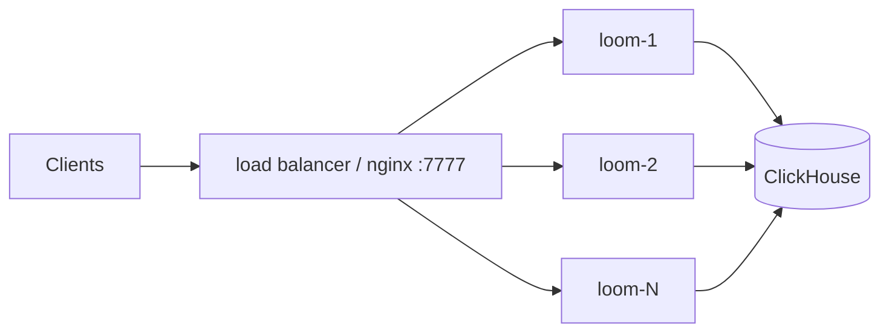
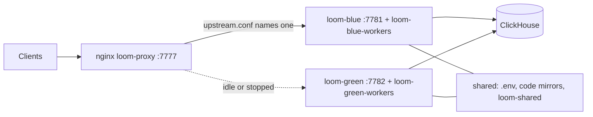

# Deployment

Loom is one server image plus ClickHouse, with the document extractor service as an
image of its own ([container images](#container-images)). The server image serves HTTP,
MCP and the dashboard, and runs the background workers. Its containers keep no durable
state of their own, so you can replace or add them freely: ClickHouse holds Loom's data,
uploaded document originals included unless their bytes are kept in an S3-compatible
bucket ([where originals are
stored](../features/knowledge.md#where-originals-are-stored)); the code index keeps bare
git mirrors on disk, a cache of the remotes ClickHouse records. A deployment moves with
ClickHouse, its env config, `LOOM_JWT_SECRET` and, while rows name objects in it, the
document bucket ([moving a deployment](./backup-and-recovery.md#moving-a-deployment)).
The compose files under `dev/` are the supported production files. Every setting named
here is in the generated [configuration reference](../reference/configuration.md).

## Deployment ladder

Each rung keeps the previous one's image and schema. What changes is where ClickHouse
lives and how many containers run. The installed stack and the local stack from a clone
run the document extractor beside Loom; the rungs below them do not, so point
`LOOM_DOCUMENT_EXTRACTOR_URL` at one you run ([container images](#container-images)).

| Rung                          | Start it with                                                                                          | ClickHouse                                         | Use for                                   |
| ----------------------------- | ------------------------------------------------------------------------------------------------------ | -------------------------------------------------- | ----------------------------------------- |
| Installed stack               | `install.sh` → `compose.yaml`                                                                          | bundled container, a self-managed server, or Cloud | evaluation, a single host                 |
| Local stack from a clone      | `loom up` or `make dev` → `compose.yaml` + `dev/docker-compose.dev.yml`                                | bundled container (`loom-ch`)                      | development                               |
| Web and workers apart         | `make dev-cloud` → `dev/docker-compose.cloud.yml`                                                      | a self-managed server or Cloud                     | teams; the production shape               |
| N identical replicas          | `dev/docker-compose.replicas.yml`: replicas behind nginx, rolled one at a time                         | a self-managed server or Cloud                     | scale-out, rolling restarts and upgrades  |
| Zero-downtime pair (optional) | `./redeploy.sh`: two projects of `dev/docker-compose.colour.yml` behind `dev/docker-compose.proxy.yml` | a self-managed server or Cloud                     | deploys with no refused-connection window |

Sizing (web replicas, uvicorn processes, the workers container) is in
[failure and recovery](../architecture/failure-and-recovery.md), driven by the metrics in
[monitoring](./monitoring.md#what-to-alert-on).

## Choosing the ClickHouse

`compose.yaml` is the one shipped stack. Its `clickhouse` service runs under the
`bundled` Compose profile, so `COMPOSE_PROFILES` in `.env` decides the target:

| Target                      | Install                                                                         | `.env`                                           |
| --------------------------- | ------------------------------------------------------------------------------- | ------------------------------------------------ |
| Bundled container (default) | `curl -fsSL …/install.sh \| sh` (`sh -s -- --bundled` to switch back to it)     | `COMPOSE_PROFILES=bundled`, no `LOOM_CH_*`       |
| Self-managed server         | `curl -fsSL …/install.sh \| sh -s -- --clickhouse http://loom@ch.internal:8123` | `COMPOSE_PROFILES=` and `LOOM_CH_*` from the URL |
| ClickHouse Cloud            | `curl -fsSL …/install.sh \| sh -s -- --clickhouse https://loom@<host>:8443`     | `COMPOSE_PROFILES=` and `LOOM_CH_*` from the URL |

- **A Keeper.** The server needs one. Without it `loom ch-setup` stops and prints how
  to add one; `--bundled` switches the install to the bundled ClickHouse instead.
- **The user.** Give Loom a user of its own (`loom` above) rather than an admin such
  as Cloud's `default`, which would let Loom manage every database and user on the
  service. The URL must name one.
- **The URL.** `http://` defaults to port 8123, `https://` to 8443 and TLS.
  Percent-encode `@`, `:`, `/` and `%` in the user or password; an empty password is
  `user:@host` or `LOOM_CH_PASSWORD=`. `LOOM_CH_URL` works in place of `--clickhouse`.
  A server on the Docker host is `host.docker.internal`: `localhost` inside the
  container is the container itself.
- **The password.** Set `LOOM_CH_PASSWORD`, or answer the prompt, which does not echo;
  one in the URL works too, but `ps` and the shell history see it. It is written only to
  `.env`, which is mode 600, double-quoted with `\`, `"` and `$` escaped so Compose reads
  it back exactly. That `.env` is for Compose: run Loom commands through
  `docker compose --project-directory ~/.loom run --rm loom loom …`, not by pointing a
  checkout's `LOOM_ENV_FILE` at it, which reads the escapes differently.
- **Setup.** With a server of your own the installer runs `loom ch-setup` before it
  starts Loom. It creates the `loom` database and the read-only `loom_reader` user
  (below), and checks the version and the grants. Run it again at any time with
  `docker compose --project-directory ~/.loom run --rm loom loom ch-setup`; what is
  already in place is left alone. A `loom_reader` whose profile or grants differ from what
  `ch-setup` gives it is rebuilt to exactly that (SELECT on `loom.*` only, the current
  caps), so a role, grant or `REVOKE` an admin adds to it does not survive a rerun; the
  installer reruns `ch-setup` on every install and upgrade. An existing `loom_reader` is
  replaced only when it has the shape `ch-setup` gives it (a password user on the settings
  profile of its own name) and logs in with `LOOM_CH_PASSWORD`; anything else of that name
  is left alone.
- **Without admin rights.** When the user cannot create the database, read the system
  tables the migrations read, hold the `loom_telemetry` grants the migrations need, or
  create the reader or its settings profile, `ch-setup` stops and prints the SQL for an
  admin, with the password as a placeholder. `loom ch-setup --print-sql` prints it
  without connecting. The SQL grants the Loom user everything the admin holds on
  `loom.*` and on `loom_telemetry.*` through `GRANT CURRENT GRANTS` (ClickHouse Cloud does
  not accept `GRANT ALL`), `SELECT` on the system tables Loom reads, and
  `READ ON REMOTE`, which `clusterAllReplicas` needs to ask every replica for its version
  (a self-managed server shows it as `REMOTE` in `SHOW GRANTS`; writes through `remote()`
  are still refused). It creates the reader with `OR REPLACE`, so check that no other
  account has that name; `ch-setup` running the SQL itself refuses one it cannot prove is
  Loom's.
- **Other users' queries.** Loom reads `system.query_log` for each request's cost and
  `system.processes` to see whether its own statements are still running, so the Loom
  user sees every user's past and running queries on that server, literals included. On
  a server Loom shares, a self-managed admin can keep both to Loom's own:
  `CREATE ROW POLICY loom_own ON system.query_log, system.processes USING user IN ('loom', 'loom_reader') TO loom`;
  ClickHouse Cloud does not allow row policies on system tables.
- **Switching.** Re-run the installer with `--clickhouse` to move an install to your own
  server; Loom starts on an empty `loom` database there. The bundled container keeps
  running on its old volume until you stop it (the installer prints the command); copy
  the data first with [backup and restore](./backup-and-recovery.md) if you need it.

Every boot runs the same checks before it connects (the oldest replica's version, the
database, the grants, a Keeper) and stops with one line naming the fix. Every Loom process
is checked, on every boot, for `CREATE TABLE`, `CREATE VIEW`, `ALTER TABLE`,
`ALTER VIEW`, `DROP TABLE`, `DROP VIEW`, `INSERT`, `SELECT`, `OPTIMIZE` and `TRUNCATE` on
`loom.*`, with boot migrations on or off: besides the migrations, it sets retention TTLs,
compacts and rebuilds provider tables. Without `SYSTEM REFRESH VIEW` on `loom.*` it boots
with a warning: purged code stays in the refreshable views until their next scheduled
refresh. `GRANT CURRENT GRANTS ON loom.*` from an admin covers all of them. The process
that migrates also needs `CREATE DATABASE`, `CREATE TABLE`, `CREATE VIEW`, `INSERT` and
`SELECT` on `loom_telemetry.*` (`GRANT CURRENT GRANTS ON loom_telemetry.*`), the database
of the request SLI rollup. Only the replica-version and system-table reads and the
`loom_telemetry` grants, which only migrations need, relax while nothing is pending or
when boot migrations are off. A server that does not migrate warns without `SELECT` on
`loom_telemetry.*`: `/v1/admin/schema.status` then reports the rollup missing, the view
refresh gauges leave its refresh out, and `loom.sli.rollup_lag_s` and
`loom.sli.rollup_missed_rows` are never reported, so alerts on them cannot fire.
`loom doctor` reports the checks as `clickhouse_preflight`.

### Local stack from a clone

`loom up` (or `make dev`) creates `.env` from `.env.example` (or gives an existing one
without an extractor token one) and `deploy/clickhouse-config/named_collections.xml` from
its template, then runs:

```bash
docker compose --env-file .env -f compose.yaml -f dev/docker-compose.dev.yml --profile bundled up -d --build
```

The override builds the image from the checkout and pins Loom to the bundled ClickHouse,
because a checkout's `.env` also serves `make server` on the host. Compose reads the
`.env` beside the first `-f` file, here the root one; `--env-file .env` only says so
explicitly.

| Service      | Container        | Ports                          | Role                                                                                                |
| ------------ | ---------------- | ------------------------------ | --------------------------------------------------------------------------------------------------- |
| `clickhouse` | `loom-ch`        | `8123` (HTTP), `9000` (native) | ClickHouse OSS (pinned image), database `loom`, user `loom`, password `loomdev`.                    |
| `loom`       | `loom-server`    | `7777`                         | HTTP, MCP, the dashboard and the background workers in one process, built from the `Dockerfile`.    |
| `extractor`  | `loom-extractor` | none                           | The document extractor service, built from `extractor/Dockerfile`, on a network only `loom` shares. |

The bundled ClickHouse starts with the files in `deploy/clickhouse-config/`:

| File                                    | Why                                                                                                                     |
| --------------------------------------- | ----------------------------------------------------------------------------------------------------------------------- |
| `lemmatizers.xml` + `deploy/lemmagen3/` | The English lemmatizer for ad-hoc `lemmatize('en', …)` queries. Loom lemmatizes in Python.                              |
| `nlp_user_settings.xml`                 | The `loom_reader` user and profile (below), the per-tenant quota, and the experimental NLP and AI SQL flags.            |
| `keeper.xml`                            | An embedded single-node Keeper, so the `KeeperMap` tables work.                                                         |
| `named_collections.xml`                 | Named collections for ClickHouse's `ai*` SQL functions. Git-ignored; defines none as shipped; keys come via `from_env`. |

- **Read-only user.** Loom runs the reads a caller shapes (`code.grep`, a patterned
  `code.search`, `memory.aggregate`, `memory.record.query`) as `LOOM_CH_READER_USER`,
  which `compose.yaml` and the local stack set to `loom_reader` (set it in `.env` for
  `dev/docker-compose.cloud.yml`), so none of them can write,
  change schema or grant. It has SELECT on `loom.*` only (it cannot read
  `system.query_log`) and a read-only profile whose time, memory and rows-read caps each
  have a ceiling no statement can raise and a floor no statement can go under (time:
  0.05 s, `code.grep`'s statement floor), not even with a `SETTINGS` clause. Its password
  is `LOOM_CH_PASSWORD`. The bundled server defines it in `nlp_user_settings.xml`;
  `loom ch-setup` creates the same user and profile with SQL on any other server, from
  the current `LOOM_CH_CALLER_SHAPED_*` values. Raising one of those settings on the
  bundled server needs the XML profile raised too. Elsewhere, so no read fails on the
  profile's bounds in between: to raise a cap, change `.env`, re-run `ch-setup`, then
  recreate Loom (`up -d --force-recreate loom`); to lower one, change `.env`, recreate
  Loom, then re-run `ch-setup`. After
  changing `LOOM_CH_PASSWORD`, which the reader shares, drop the reader
  (`DROP USER loom_reader; DROP SETTINGS PROFILE loom_reader`) and re-run `ch-setup`: it
  replaces only a reader that logs in with the current password. The server probes the
  user at boot; `/v1/health` and `loom doctor` report `ch_reader_user_failing` when
  ClickHouse refuses it; before migrations have created `loom.memory` the probe reports
  nothing, and `loom doctor` says the reader user was not probed. Set empty
  (`LOOM_CH_READER_USER=` in `.env`), `ch-setup` makes no reader and the reads run as
  `LOOM_CH_USER`.
- **Ports.** If `8123` or `9000` is taken, set `LOOM_CH_HOST_PORT` or
  `LOOM_CH_NATIVE_HOST_PORT` in `.env`. These are compose variables for the host side
  only; containers always talk to `clickhouse:8123`.
- **Volumes.** `loom-ch-data` (ClickHouse) and `loom-code-repos` (the git mirrors).
  `make down` keeps them; `make down-all` deletes them.
- **No external systems.** The local stack runs no Langfuse or ClickStack;
  the erasure steps for them do nothing until configured.
- **From source.** `make server` runs uvicorn on `:7777` with reload against the
  ClickHouse `.env` names (localhost:8123 when unset). Build the dashboard first with
  `make frontend-build`, or its pages return 503. Contributor setup is in
  [local development](../development/local-development.md).

### Web and workers apart

```bash
cp .env.example .env    # then set LOOM_CH_*, auth and providers (below); COMPOSE_PROFILES=
make dev-cloud
```

`dev/docker-compose.cloud.yml` builds the image from the checkout and runs two
containers from it against the ClickHouse in `.env` (run `loom ch-setup` against it once):

| Container      | Role                                                 | Key environment                                                                   |
| -------------- | ---------------------------------------------------- | --------------------------------------------------------------------------------- |
| `loom-server`  | web tier on `:7777`: HTTP, MCP, the dashboard        | `LOOM_BACKGROUND_WORKERS=off`                                                     |
| `loom-workers` | background workers; `/v1/health` on internal `:7778` | `LOOM_BACKGROUND_WORKERS=auto`, `LOOM_WEB_WORKERS=1`, `LOOM_SERVES_TRAFFIC=false` |

A long worker pass never shares an event loop with client requests, so it cannot show up
as request latency. A single container gets the same: its lease holder runs the workers
in a child process ([N identical replicas](#n-identical-replicas)). Both containers read
the same `.env` and mount the same `var/code_repos` directory, so on one host they share
the git mirrors. Documents, keys and the workers lease are in ClickHouse, so replicas on
other hosts need not share that directory: each keeps its own mirrors, and the mount
only keeps them across a restart. `LOOM_SERVES_TRAFFIC=false` keeps the workers
container out of the replica count the rate limits are divided by. Whichever boots
first applies pending migrations ([upgrades](./upgrades.md#how-migrations-run)).

## How settings are read

- Every setting is an environment variable `LOOM_<FIELD>`. Provider keys keep their own
  names (`OPENAI_API_KEY`, `ANTHROPIC_API_KEY`, `GEMINI_API_KEY`). The server reads them
  once at startup; a change needs a restart.
- A setting marked live also takes a deployment-wide override (`loom settings set`, the
  dashboard), which wins over the environment and every file and applies within seconds
  without a restart ([runtime settings](./runtime-settings.md)).
- `.env` in the working directory is read by default. `LOOM_ENV_FILE` names another
  file; an empty value reads none. `.env.example` is the commented template.
- Settings that are not secrets can also go in a YAML settings file, the path
  `LOOM_SETTINGS_FILE` names (`loom.example.yaml`, generated, lists every setting at its default,
  `schemas/loom-settings.schema.json` its schema). The environment and `.env` win over
  it. A secret, a key given twice, an unsupported `version` or a value of the wrong
  type or outside its bounds (also one the environment overrides) stops the server
  at startup; a name no setting has is logged and ignored, so a replica of the previous
  build starts on a file that names a new setting. `LOOM_SETTINGS_FILE` can be set in
  the environment or in `.env`. Under compose it names a path inside the containers:
  mount the file into every Loom service, or they refuse to start on a file that does
  not exist. In `compose.yaml`, add `./loom.yaml:/app/config/loom.yaml:ro` to the
  `loom` service's `volumes:`. In `dev/docker-compose.cloud.yml`, add
  `../loom.yaml:/app/config/loom.yaml:ro` (its relative paths resolve from `dev/`) to
  `x-loom-common`'s `volumes:`, which both services share; a `volumes:` key on one
  service replaces that list rather than adding to it.
- The compose file's `environment:` wins over `.env`. `dev/docker-compose.dev.yml` pins
  the ClickHouse connection and `LOOM_SELF_SIGNUP=open`, so those lines in `.env` do
  nothing on the local stack. `compose.yaml` and `dev/docker-compose.cloud.yml` take
  them from `.env`.
- Validate before every start. This catches quoting errors in JSON-valued settings
  without starting anything:

  ```bash
  docker compose --env-file .env -f dev/docker-compose.cloud.yml config >/dev/null
  ```

- `/v1/health` and `loom doctor` report the resolved providers, the identity mode and
  every configuration problem with its fix.

## Required environment

A deployment anyone else can reach needs at least:

```bash
LOOM_CH_HOST=...
LOOM_CH_PORT=8443                  # 8123 for plain HTTP to a self-managed server
LOOM_CH_USER=...
LOOM_CH_PASSWORD=...
LOOM_AUTH_REQUIRED=true
LOOM_IDENTITY_PROVIDER=trust-network        # or gateway
LOOM_JWT_SECRET=<32+ random bytes>          # python -c 'import secrets; print(secrets.token_urlsafe(32))'
LOOM_PLATFORM_ADMINS=alice                  # SSO emails, or login handles once their account exists
LOOM_REQUIRE_REAL_PROVIDERS=true            # a fake or keyless provider makes /v1/health degraded
# providers: see below
```

### ClickHouse connection

| Variable           | Default     | Set it to                                                                            |
| ------------------ | ----------- | ------------------------------------------------------------------------------------ |
| `LOOM_CH_HOST`     | `localhost` | Your service, outside the local stack.                                               |
| `LOOM_CH_PORT`     | `8123`      | `8443` for ClickHouse Cloud or any HTTPS endpoint.                                   |
| `LOOM_CH_SECURE`   | unset       | `true` for HTTPS on a port other than `8443` (unset infers TLS from the port).       |
| `LOOM_CH_USER`     | `loom`      | A user that may create tables in Loom's database. Cloud's default user is `default`. |
| `LOOM_CH_PASSWORD` | `loomdev`   | A real password. The default is a development placeholder.                           |
| `LOOM_CH_DATABASE` | `loom`      | The database Loom's schema lives in; set it before the first migration, see below.   |

`LOOM_CH_DATABASE` names the database that holds every table, view and the migrations
ledger, and `LOOM_CH_TELEMETRY_DATABASE` (default `loom_telemetry`) the one that holds
the telemetry Loom derives from its own tables. Statements and migrations are written
against `loom.<table>` and `loom_telemetry.<table>`, and Loom maps both names to these
settings where each statement reaches ClickHouse (`server/core/ch_names.py`); the
KeeperMap tables' Keeper paths move with the schema (`/<database>/task_leases`). Two
deployments can share one ClickHouse service with a database pair each.

Choose the names before the first migration. A new name points Loom at an empty schema,
so while a Loom schema exists in `loom`, a server or worker process, migrating or not,
refuses to start when the named database does not exist or holds tables but no Loom
ledger. To start a second schema on
purpose, create its database empty first. A renamed schema names its own
`LOOM_CH_TELEMETRY_DATABASE`. Names start with a letter or `_`, hold letters, digits, `_`
and `-`, and are never
`default`, `system`, `information_schema`, or a name the schema uses for a table or an
alias (`memory`, say), which Loom could not tell from a database in the DDL it reads
back.

### Identity and authentication

| Variable                 | Default                                | Set it when                                                                                                             |
| ------------------------ | -------------------------------------- | ----------------------------------------------------------------------------------------------------------------------- |
| `LOOM_AUTH_REQUIRED`     | `true` (the stock `.env` sets `false`) | Keep `true` for anything other people can reach.                                                                        |
| `LOOM_IDENTITY_PROVIDER` | empty (inferred)                       | Always, in a deployment: `trust-network` or `gateway`. `single-user` turns auth off whatever `LOOM_AUTH_REQUIRED` says. |
| `LOOM_SELF_SIGNUP`       | `off`                                  | `open` enables browser sign-up in the dashboard (`trust-network`).                                                      |
| `LOOM_SELF_SIGNUP_ORG`   | `dev`                                  | You want signed-up accounts in your own org.                                                                            |
| `LOOM_DEFAULT_NAMESPACE` | `local`                                | Renaming the one namespace `single-user` mode serves. Ignored when auth is required.                                    |
| `LOOM_JWT_SECRET`        | the checked-in development secret      | Always, when auth is on.                                                                                                |
| `LOOM_PLATFORM_ADMINS`   | empty                                  | Naming the operators. It is the only path to `platform_admin`.                                                          |
| `LOOM_TRUSTED_CALLERS`   | empty                                  | In `gateway` mode, a subject may send `X-Loom-On-Behalf-Of` to act for an end user.                                     |

- **`LOOM_JWT_SECRET`** is the root secret: it signs tokens as kid `default` (HS256)
  and seals every stored credential and every signing key in `loom.signing_keys`. It is
  the one secret to carry when the deployment moves. A deployment
  (`LOOM_DEPLOYMENT=1`, set by the compose files) with auth on refuses to start with the
  checked-in value. Only the local stack (`LOOM_INSTANCE_LABEL=deploy:dev`) may use it;
  other processes are flagged by `/v1/health` (`dev_jwt_secret`) and `loom doctor`.
- **Rotating the signing key.** `loom signing-key rotate [--algorithm HS256|RS256]`
  writes a new key to ClickHouse; it starts signing `--activate-in` seconds (300) later,
  once every process has loaded it. Old tokens verify by
  the `kid` in their header until `loom signing-key retire <kid>`. No env change or
  restart is needed ([tokens and grants](../guides/tokens-and-grants.md#revoke-and-rotate)).
  Replacing `LOOM_JWT_SECRET` itself re-keys everything. Tokens it signed (kid
  `default`) stop verifying: mint new ones. The keyring keys and stored credentials
  (repository tokens, tracker-source passwords, document-source credentials, provider
  keys) sealed under it keep opening only while the old value is set as
  `LOOM_JWT_SECRET_PREVIOUS`, which never verifies a token. The order: put the new root
  in `LOOM_JWT_SECRET` and the old one in `LOOM_JWT_SECRET_PREVIOUS` in `.env`; in a
  container with that env run
  `loom secrets reseal --dry-run && loom signing-key record-root && loom deployment publish --yes`
  (the dry run checks the previous root while the old one is still recorded); recreate
  the containers; run `loom secrets reseal`; and remove `LOOM_JWT_SECRET_PREVIOUS` once
  `loom secrets reseal --check` exits 0, since a value still sealed under the old root
  stops opening without it. The keyring commands and `loom mint-token` refuse to run
  with any other root secret than the one recorded; `/v1/health` (`keyring_root_mismatch`,
  `signing_keys_unsealable`) and `loom doctor` (`signing_keyring`) flag a process that
  holds another.
- **`LOOM_PLATFORM_ADMINS`.** Tokens and grants carry only `viewer`, `writer` or
  `admin` on namespaces. A login handle promotes that password account; an email
  promotes only an OIDC sign-in whose provider verified it (a self-signup email never
  does). `loom set-host <handle-or-email>` writes the variable into `.env` (`--append`
  extends the list); the person signs in again to pick up the role. Self-signup refuses
  a listed handle as a new name, so create the account first, then list its handle.

### Public URL and clients

| Variable               | Default          | Set it when                                                                                                             |
| ---------------------- | ---------------- | ----------------------------------------------------------------------------------------------------------------------- |
| `LOOM_PUBLIC_BASE_URL` | empty            | Always, off loopback: a non-loopback `LOOM_BIND_HOST` refuses to start without it. Empty uses the request's own `Host`. |
| `LOOM_BIND_HOST`       | `127.0.0.1`      | Loom must be reachable by others. In a container it is the address the port is published on.                            |
| `LOOM_TRUSTED_PROXIES` | `127.0.0.1`      | Required behind a proxy or load balancer: its addresses or CIDRs. Only those peers' `X-Forwarded-For`/`-Proto` count.   |
| `LOOM_ALLOW_INSECURE`  | `false`          | Never on a reachable port. Lets a non-loopback bind start with auth off or the dev JWT secret.                          |
| `LOOM_OAUTH_ENABLED`   | `false`          | You want one-click MCP connect (OAuth 2.1 browser sign-in instead of a pasted token).                                   |
| `LOOM_OAUTH_ISSUER`    | empty            | OAuth is on: the public HTTPS base URL the discovery metadata advertises. Empty derives it per request.                 |
| `LOOM_CORS_ORIGINS`    | empty (CORS off) | A browser application on another origin calls Loom directly. List exactly those origins; `*` refuses to start.          |

Sign-in through your identity provider (dashboard, `loom login` and OAuth) needs
`LOOM_OAUTH_LOGIN_PROVIDER=oidc` and the `LOOM_OIDC_*` settings; [single sign-on](sso.md)
walks through it.

### Process and scale

| Variable                         | Default                     | Set it when                                                                                                                                                                                                                                                                                                                                                                                                                                         |
| -------------------------------- | --------------------------- | --------------------------------------------------------------------------------------------------------------------------------------------------------------------------------------------------------------------------------------------------------------------------------------------------------------------------------------------------------------------------------------------------------------------------------------------------- |
| `LOOM_BACKGROUND_WORKERS`        | `auto`                      | Leave it `auto` on every replica: one process per deployment, elected through ClickHouse, runs the workers. `on` skips the election, `off` never runs them.                                                                                                                                                                                                                                                                                         |
| `LOOM_WORKERS_PROCESS`           | `child`                     | `inline` runs the workers on the serving event loop (a container that serves no traffic).                                                                                                                                                                                                                                                                                                                                                           |
| `LOOM_SHUTDOWN_READY_DELAY_S`    | `15`                        | Your load balancer needs longer than 15 s (probe interval × failure threshold) to take a replica out after `/v1/health/ready` turns 503.                                                                                                                                                                                                                                                                                                            |
| `LOOM_READY_REQUIRES_MIRRORS`    | `false`                     | `true` keeps a replica unready until the mirror warm-up has queued its clones and while a clone runs or waits (a failed clone does not hold it; doctor names it). Needs `LOOM_CODE_MIRROR_WARMUP` on: without it nothing is cloned at boot.                                                                                                                                                                                                         |
| `LOOM_WEB_WORKERS`               | image: one per CPU, up to 8 | uvicorn processes per container. Unset, the image starts one per CPU the container may use (its cpuset, lowered by a `--cpus` quota), at most one per GiB of its memory and at most 8. Set a number to leave cores for ClickHouse on a shared host. The standalone stack, whose ClickHouse shares the host, defaults to 2 and the web tier of `dev/docker-compose.cloud.yml` and `dev/docker-compose.colour.yml` to 1, unless `.env` names a count. |
| `LOOM_REPLICA_COUNT`             | `1`                         | The floor of the replica count rate limits are divided by (the live serving `loom.instances` rows), and the count while those rows cannot be read.                                                                                                                                                                                                                                                                                                  |
| `LOOM_LATENCY_BUDGET_MULTIPLIER` | `1.0`                       | ClickHouse is across a WAN: about `20`, or every call reports a budget violation.                                                                                                                                                                                                                                                                                                                                                                   |
| `LOOM_LOG_FORMAT`                | `text`                      | `json` for a log pipeline.                                                                                                                                                                                                                                                                                                                                                                                                                          |

A process started outside the compose files (`make server`, `loom serve`, a test server)
must set `LOOM_INSTANCE_LABEL=<who>:<what>:<port>` or it refuses to boot. The compose
files set `LOOM_DEPLOYMENT=1` and label their services `deploy:web`, `deploy:workers`
(with `:<colour>` in the zero-downtime pair) or `deploy:dev`, so leave `LOOM_DEPLOYMENT`
out of `.env`.

## ClickHouse requirements

Loom needs no server config of its own: the table settings it relies on are set on its
tables (`032_table_settings.sql`), and `loom ch-setup` makes the database and the reader
user with SQL.

| Requirement               | Why                                                                                                                                                                                                                                                                        | ClickHouse Cloud                                                                            | Self-managed                                                                                                                                                                                            |
| ------------------------- | -------------------------------------------------------------------------------------------------------------------------------------------------------------------------------------------------------------------------------------------------------------------------- | ------------------------------------------------------------------------------------------- | ------------------------------------------------------------------------------------------------------------------------------------------------------------------------------------------------------- |
| Version 26.4 or later     | the oldest server that applies every migration (26.3 still gates `stem()`); boot refuses an older one                                                                                                                                                                      | the service's version; the oldest replica counts                                            | upgrade the server. CI tests only the latest release (`dev/clickhouse_release.sh`); a release bundle names the one that was latest when it was built                                                    |
| Grants                    | everything on `loom.*` and `loom_telemetry.*` (`GRANT ALL`, or `GRANT CURRENT GRANTS` on Cloud): the migrations create, alter and drop tables and views, and Loom rebuilds tables and refreshes views at runtime; `SELECT` on the system tables it reads; `READ ON REMOTE` | the user `ch-setup --print-sql` grants                                                      | an admin, or the same SQL                                                                                                                                                                               |
| Keeper                    | required: every lease and claim is a KeeperMap key (the migration lock, the workers lease, the task-inbox leases, the sign-in state, and the sign-up, account, grant change and run id claims); Loom refuses to start without one                                          | present                                                                                     | the bundled stack runs an embedded Keeper (`deploy/clickhouse-config/keeper.xml`); for your own server, add that file to its `config.d/` (or a `<zookeeper>` section naming your Keeper) and restart it |
| `Quantized` codec (26.8+) | codes-first vector search: a fresh install creates its vector columns coded when `LOOM_EMBEDDING_DIM` is a multiple of 8                                                                                                                                                   | with `enable_quantized_codec` on ([recommended settings](#recommended-clickhouse-settings)) | nothing to configure; an older server gets plain vectors and full-precision scans                                                                                                                       |
| `aiEmbed` (26.7+)         | only `loom reembed --in-database`                                                                                                                                                                                                                                          | where the service version has it                                                            | needs a named collection (`named_collections.xml.template`)                                                                                                                                             |

- **Newer servers.** Features past the floor are probed where they are used: the
  `Quantized` codec, `aiEmbed`, lightweight `UPDATE` (Loom falls back to a mutation where
  it is off). Before 26.8 a vector read can leave wrong entries in the query condition
  cache, so every Loom session on an older server turns the cache off when it connects.
- **Run id claims.** A claim key lives only while a `run.begin` runs; one
  left by a begin that failed or died before writing its row stays until the same user
  and session re-begin and complete that id, or an erasure of its namespace or user.
- **Run ids while Keeper fails.** While Keeper fails a narrowed
  token's `run.begin` with a new caller-supplied `run_id` gets a server-made id
  instead, so a client that makes the id itself must use the returned `run_id` (the
  Claude Code and Codex plugins switch to it once run.begin answers). Known gap: a namespace-wide caller whose claim
  hits a Keeper error while a narrowed user wins the claim on the same new id at the
  same moment can end up sharing that id with them.
- **Another ClickHouse image.** An installed release bundle runs the ClickHouse release
  that was latest when it was built, and a newer Loom release moves it; the repository's
  compose files run `latest`, as CI does. Set
  `LOOM_CLICKHOUSE_IMAGE` in `.env` to run another, such as a release tag or
  `clickhouse/clickhouse-server:head` for a build of ClickHouse master. CI does not test
  master, and Loom uses experimental features master can change. A newer server can also
  write data in a format an older release cannot read, so switching back to an older release may
  need a fresh ClickHouse volume.
- **ClickHouse Cloud.** Loom's DDL uses plain `MergeTree` engines, which Cloud runs as
  `SharedMergeTree`, so replication and durability come with the service. The
  experimental NLP flag is read-only there; the runner drops it, and `stem()` runs
  without it.
- **Self-managed.** A single node is durable only to its own disk and has no
  point-in-time recovery; high availability is a Keeper ensemble and
  `ReplicatedMergeTree`, an operator project.

How Loom uses ClickHouse is in [ClickHouse](../architecture/clickhouse.md).

### Recommended ClickHouse settings

These settings let Loom store and search compact vector codes. Make sure Loom's ClickHouse
user can have both on before the first `loom migrate` or the first server start with
`LOOM_BOOT_MIGRATE` on (the default): a fresh install codes its vector columns only if the
codec can be on at that moment.

| Setting                   | Value | What it gives Loom                                                                                                                          |
| ------------------------- | ----- | ------------------------------------------------------------------------------------------------------------------------------------------- |
| `enable_quantized_codec`  | `1`   | Vector columns stored with the `Quantized` codec (26.8+), so searches scan compact codes first and rescore the best rows at full precision. |
| `allow_suspicious_codecs` | `1`   | With `Quantized` on, `entity_vectors` keeps `LZ4` after it to compress repeated vector data.                                                |

Check what Loom's user gets with:

```sql
SELECT name, value, readonly, min, max, disallowed_values
FROM system.settings
WHERE name IN ('enable_quantized_codec', 'allow_suspicious_codecs')
```

A setting is fine at `value = 1`, read-only or not, and blocked at `value = 0` when this
user may not set it to 1 (the rules are in
[gated settings](../architecture/clickhouse.md#gated-clickhouse-settings)). No row for
`enable_quantized_codec` means the server is older than 26.8: migrations create plain
tables there and `vector_codec_rebuild.py` refuses to run.

- **Self-managed ClickHouse 26.8 or later.** Both settings are user-settable by default
  and Loom sends them with each `CREATE` that needs them, so a fresh install needs
  nothing. Check that no settings profile or constraint blocks them.
- **ClickHouse Cloud.** A service holds both read-only at 0. `enable_quantized_codec` is
  enabled for the service with a settings-profile override; `allow_suspicious_codecs` is
  enabled for Loom's user. Loom cannot change either itself. Run the query again
  afterwards: both should show `value = 1`.

If Loom was installed before the settings were on, or before the server ran 26.8, its
vector tables are plain (or `entity_vectors` lacks its chain). Turning the settings on or
upgrading the server does not change existing tables; rebuilding them does. Tables stay
plain, and cannot be coded by a rebuild, when the width the dry run prints
(`dimension <n>`) is not a multiple of 8.

Apply rebuilds during a maintenance window. Every Loom server, worker and direct table
writer must be stopped, and all in-flight writes, erasures and ClickHouse mutations must
have finished before copying starts. Keep them stopped through rebuilding, read-only
checks, rollback and cleanup: a copy can restore erased rows, and erasure does not fully
cover the rebuild and rollback copies. Before copying starts, this returns no rows (`loom`
here and in every statement below is your `LOOM_CH_DATABASE`):

```sql
SELECT table, mutation_id, command FROM system.mutations
WHERE database = 'loom' AND NOT is_done
```

A `<table>_pre_rebuild` copy left by an earlier run blocks that table's rebuild. A copy
from the current window is removed with that table's line and
`mode="--drop-pre-rebuild --yes"`, as in step 3. Once writers have run since the copy
was made, `--drop-pre-rebuild` refuses it: the live table holds changes the copy lacks
(new rows, erasure tombstones, a re-embed delete). Remove such a copy
with the read in
[what the checks after a swap find](./maintenance.md#what-the-checks-after-a-swap-find),
then `DROP TABLE loom.<table>_pre_rebuild SYNC` by hand. A mutation on
the copy since the copy started does not finish while the tool keeps its merges stopped,
and while there is one, `--drop-pre-rebuild` refuses and names `--rollback`. To keep the
new layout, run the read in
[what the checks after a swap find](./maintenance.md#what-the-checks-after-a-swap-find),
check in `system.mutations` that the live table already carries that mutation's effect,
then drop the copy by hand. To keep the change only the copy holds, run
`--rollback --yes`.

1. Check that Loom's ClickHouse user gets the settings above before starting the rebuild.
2. Rebuild each coded table with `scripts/ops/vector_codec_rebuild.py`. The tool is not in
   the image: run it from a clone of the repository at the deployed version, after
   `uv sync --locked`, with the deployment's `LOOM_*` environment (its `.env`), so
   `LOOM_CH_*` and `LOOM_EMBEDDING_DIM` match the running Loom. Run the block in bash.
   `mode` holds the action: run the block with `mode=--dry-run` to see each plan, then
   again with `mode=--yes` to rebuild. Set `cluster` to your cluster's name, or to `''` to
   check this server only:

   ```bash
   mode=--dry-run
   cluster=default
   rebuild() {
     uv run python -P -m scripts.ops.vector_codec_rebuild "$@" --cluster "$cluster" $mode
   }
   rebuild --table memory_embeddings --columns embedding,memory_key_embedding
   rebuild --table memory_chunks --columns embedding
   rebuild --table code_chunks --columns embedding
   rebuild --table entity_vectors --columns entity_embedding --chain LZ4
   rebuild --table session_summaries --columns summary_embedding
   rebuild --table conversation_embeddings --columns embedding
   rebuild --table chunks --columns embedding
   rebuild --table entity_summaries --columns summary_embedding
   rebuild --table code_answers --columns question_embedding
   rebuild --table categories --columns embedding
   rebuild --table code_summaries --columns embedding \
     --index-granularity 256 --gate-fetch-multiplier 10
   rebuild --table qa_item_embeddings --columns embedding --gate-fetch-multiplier 10
   ```

   Check the list against `CODED_TABLES` (`server/core/schema/vector_codec_ddl.py`), which
   names every coded table and its vector columns, before you run it. The
   `--gate-fetch-multiplier` values are the defaults the search legs serve. Where the
   deployment sets one (its environment, `.env`, the settings file, or a live override for
   `LOOM_MEMORY_SEARCH_FACT_CODES_FETCH_MULTIPLIER`), pass that value on its line:
   `LOOM_MEMORY_SEARCH_FACT_CODES_FETCH_MULTIPLIER` on `memory_embeddings`,
   `LOOM_CODE_SEARCH_CARDS_FETCH_MULTIPLIER` on `code_summaries`,
   `LOOM_TRACKER_EMBED_FETCH_MULTIPLIER` on `qa_item_embeddings`, and
   `LOOM_VECTOR_SEARCH_QUANTIZED_FETCH_MULTIPLIER` on the rest. Where
   `allow_suspicious_codecs` cannot be on, the tool refuses `--chain`. Skip the
   `entity_vectors` line and it stays as it is, plain or coded without the chain; or,
   where it is plain, rebuild it without `--chain` and keep quantization without the
   additional `LZ4` compression.

   An empty table is rebuilt too. A table with rows but no real vectors (only the zero
   placeholders of rows without an embedding) fails the recall gate (exit 5) and keeps its
   layout. This query, with the line's first column and the dry run's `dimension <n>`,
   counts the real vectors the gate can probe (leave out `FINAL` for `chunks`):
   `SELECT countIf(length(<column>) = <n> AND arrayExists(x -> x != 0, <column>)) FROM loom.<table> FINAL`.
   Skip this table's line while the query returns 0 on a table with rows. Placeholders
   beside real vectors do not affect the gate. The tool refuses (exit 3), `--dry-run`
   included, while a plain named column holds real vectors of a width other than
   `LOOM_EMBEDDING_DIM`, the width it codes; the re-embed that clears the refusal is in
   [the maintenance guide](./maintenance.md#compaction-and-optimize).

   To stop the block, create `ABORT_REBUILD` in `$LOOM_REBUILD_DIR` as exported in the
   shell that runs it (the tool does not read it from `.env`; default: the directory you
   run from): the running line stops before its copy or its swap, and each later rebuild
   line stops before it starts. `--drop-pre-rebuild` and `--rollback` lines do not read
   it. Ctrl-C stops only the line that is running, and bash goes on to the next. Remove
   the file before the next run.

   A run that stops (a failed gate, an abort file, an interrupt, a lost session) can leave
   `loom.<table>_rebuild`, a copy of the table's rows that erasure does not fully cover (a
   namespace erasure purges only the `code_*` copies). A run that stopped between its
   exchange and its rename leaves the old table under that name. Run the table's line with
   `mode=--dry-run` and follow the `next` it prints, as the cleanup below describes: drop
   `loom.<table>_rebuild` by hand only when `next` starts `not swapped`, or pass
   `--restart --yes` when you run that line again.

3. After the tool's checks pass, inspect the tables with read-only ClickHouse queries and
   drop the old copies: run the lines of the tables you rebuilt again with
   `mode="--drop-pre-rebuild --yes"`. Until then each rebuilt table keeps its old copy as
   `loom.<table>_pre_rebuild`, a full second copy, its merges stopped by the tool. To go
   back instead, run that table's line with `mode="--rollback --yes"`; the coded copy then
   sits in `loom.<table>_pre_rebuild`, so drop it the same way. `--rollback` compares the
   two tables first and refuses, exchanging nothing, when the live table holds a change
   it would lose. Repeat the flags the table
   was rebuilt with: the tool checks the layout it built, so `entity_vectors` needs
   `--chain LZ4` only if its rebuild had it.

   `--drop-pre-rebuild` compares the two tables before it drops the copy. When it refuses
   (exit 3), or a rebuild fails its check after the swap (exit 7), keep writers and
   erasure stopped and follow the step the run prints (`next` in its summary line), as
   [what the checks after a swap find](./maintenance.md#what-the-checks-after-a-swap-find)
   describes. Drop a `_pre_rebuild` copy by hand only after the read that section gives.

Before restarting Loom or resuming traffic, remove every leftover `<table>_rebuild` and
`<table>_pre_rebuild` copy for the tables you processed, including copies left by an
aborted run or rollback. This lists them (the `_rebuild` suffix also matches
`_pre_rebuild`):

```sql
SELECT name FROM system.tables
WHERE database = 'loom' AND endsWith(name, '_rebuild')
```

Drop a `<table>_pre_rebuild` copy with `--drop-pre-rebuild --yes` as in step 3. Before
dropping a `<table>_rebuild` twin, run that table's line with `mode=--dry-run` and follow
the `next` it prints; an earlier run may have stopped before printing one. When `next`
names `RENAME TABLE loom.<table>_rebuild TO loom.<table>_pre_rebuild`, the exchange ran
without the rename and `<table>_rebuild` is the old table, the rollback copy: run that
step instead of a drop. In that state every run of the table's line refuses with exit 3,
the same line with `--yes`, `--reuse` or `--restart` included, whatever layout or columns
it names, and so does `--drop-pre-rebuild`. When `next` asks to compare `<table>` and
`<table>_rebuild`, both are coded and either may be the old table: compare their rows
before dropping either. When `next` names `scripts.ops.table_rebuild`, the twin has
another sorting or partition key and may be that tool's old table: run its `--dry-run`
and follow its report, never a drop. When `next` names the twin a leftover never
exchanged in, no
exchange ran: rerun with `--restart --yes` or drop it. The tool tells a leftover by the
twin's UUID, which it records in `$LOOM_REBUILD_DIR`, so run every line from the same
directory. When `next` starts `not swapped`, drop the twin with
`DROP TABLE IF EXISTS loom.<table>_rebuild SYNC`; for any other `next`, drop nothing and
inspect both tables by hand.

Start Loom again after cleanup; each process reads the codec settings when it starts.

## Providers

For ready-to-use configurations and the distinction between agent subscriptions and
server API keys, start with [Configure models and API keys](../getting-started/models-and-keys.md).

The embedder turns text into vectors. The LLM extracts facts, tags entities, judges
conflicts and writes `memory.ask` answers. Both default to fakes that need no network.

| Embedder (`LOOM_EMBEDDING_MODEL`) | Width (`LOOM_EMBEDDING_DIM`) | Needs                                                  |
| --------------------------------- | ---------------------------- | ------------------------------------------------------ |
| `fake-ngram-3072`                 | 3072                         | nothing; character n-grams, for tests and wiring only  |
| `local` / `local:bge-small`       | 384                          | the `local-embedder` extra (fastembed, CPU); see below |
| `local:bge-base`                  | 768                          | same                                                   |
| `local:minilm`                    | 384                          | same                                                   |
| `text-embedding-3-small`          | 1536                         | `OPENAI_API_KEY`                                       |
| `text-embedding-3-large`          | 3072                         | `OPENAI_API_KEY`                                       |
| `gemini-embedding-001`            | 3072                         | `GEMINI_API_KEY` (or `GOOGLE_API_KEY`)                 |

| LLM (`LOOM_LLM_PROVIDER`) | Needs                                | Default `LOOM_LLM_MODEL` |
| ------------------------- | ------------------------------------ | ------------------------ |
| `fake`                    | nothing; extraction produces nothing | `fake-echo-1`            |
| `openai`                  | `OPENAI_API_KEY`                     | `gpt-6-luna`             |
| `anthropic`               | `ANTHROPIC_API_KEY`                  | `claude-haiku-4-5`       |

- **Width.** `LOOM_EMBEDDING_DIM` must equal the model's width. It is fixed when the
  tables are created. The server probes the embedder at boot; a mismatch shows as the
  `embedding_dim_mismatch` problem.
- **Local embedder.** The image includes it only when built with a `local*` value of
  `LOOM_EMBEDDING_MODEL` (the compose files pass it as a build argument).
- **Inference.** When `LOOM_LLM_PROVIDER` is empty it is inferred once at load: from the
  model name (`gpt*`, `o1*`, `o3*`, `o4*`, `chatgpt*` → openai, `claude*` → anthropic,
  `fake*` → fake), else from the key present (`OPENAI_API_KEY`, then
  `ANTHROPIC_API_KEY`), else fake. An explicit value is never overridden. The boot log
  and `loom doctor` (`llm_provider`) say what was chosen and why.
- **Missing key.** A configured provider without its key falls back to the fake client
  and reports `embedder_key_missing` or `llm_key_missing`. With
  `LOOM_REQUIRE_REAL_PROVIDERS=true` those become errors and `/v1/health` reads
  `status: degraded`.
- **Fallback.** `LOOM_LLM_FALLBACK_MODEL` names a second model (any provider) that
  answers when the primary keeps failing after retries.
- **Changing defaults.** Run `make bench-quick` before changing the model or embedder
  ([benchmarks](../benchmarks/running.md)). A new embedder is a new vector space: run
  `loom reembed` afterwards ([maintenance](./maintenance.md#re-embed-and-re-extract)).

### Models per job

Every setting that names a model is in the `Models` section of
[`server/settings/catalog.py`](../../server/settings/catalog.py), one per job. Set any
of them in `.env` to move that job to another model. The provider comes from the name,
so a job can run on Claude while the rest run on GPT, as long as both keys are set. An
empty value uses `LOOM_LLM_MODEL`.

| Job                                   | Setting                                 | Default           |
| ------------------------------------- | --------------------------------------- | ----------------- |
| Extraction, rerank, entities          | `LOOM_LLM_MODEL`                        | provider default  |
| Conflict resolver                     | `LOOM_CONFLICT_RESOLVER_MODEL`          | `gpt-6.1-sol`     |
| Answer when the primary keeps failing | `LOOM_LLM_FALLBACK_MODEL`               | off               |
| Embeddings                            | `LOOM_EMBEDDING_MODEL`                  | `fake-ngram-3072` |
| `memory.ask` synthesis (strong tier)  | `LOOM_MEMORY_ASK_SYNTH_MODEL`           | `LOOM_LLM_MODEL`  |
| `memory.ask` cheap tier               | `LOOM_MEMORY_ASK_SYNTH_MODEL_CHEAP`     | off               |
| `memory.ask` mid tier                 | `LOOM_MEMORY_ASK_MID_MODEL`             | off               |
| Coding-capture durability check       | `LOOM_MEMORY_EXTRACT_VERIFY_MODELS`     | `claude-opus-5-5` |
| Profile fold                          | `LOOM_PROFILE_CONSOLIDATION_MODEL`      | `LOOM_LLM_MODEL`  |
| Structured profiles                   | `LOOM_STRUCTURED_PROFILE_MODEL`         | `LOOM_LLM_MODEL`  |
| Reflection distillation               | `LOOM_REFLECTION_DISTILL_MODEL`         | `LOOM_LLM_MODEL`  |
| Session briefs                        | `LOOM_SESSION_BRIEF_LLM_MODEL`          | `gpt-6-luna`      |
| `code.ask` synthesis                  | `LOOM_CODE_ASK_LLM_MODEL`               | `LOOM_LLM_MODEL`  |
| `code.search` HyDE passage            | `LOOM_CODE_SEARCH_HYDE_MODEL`           | off               |
| `code.search` concept expansion       | `LOOM_CODE_SEARCH_CONCEPT_EXPAND_MODEL` | off               |
| `code.bisect_candidates` rerank       | `LOOM_CODE_BISECT_LLM_RERANK_MODEL`     | `gpt-6-luna`      |
| File and module summary cards         | `LOOM_CODE_SUMMARY_MODEL`               | `LOOM_LLM_MODEL`  |
| Duplicate check rerank                | `LOOM_TRACKER_DUPCHECK_RERANK_MODEL`    | `gpt-6-luna`      |
| Duplicate check judge                 | `LOOM_TRACKER_DUPCHECK_JUDGE_MODEL`     | `LOOM_LLM_MODEL`  |
| Sampled retrieval judge               | `LOOM_RETRIEVAL_JUDGE_MODEL`            | `gpt-6.1-sol`     |

For example, a deployment with both keys set can run `gpt-6-luna` as `LOOM_LLM_MODEL`
and for the cheap `memory.ask` tier and HyDE, `claude-opus-5-5` for strong `memory.ask`
synthesis, and `gpt-6.1-sol` for `code.ask`.

Provider internals (retry, fallback, caching) are in
[LLM architecture](../architecture/llm-architecture.md).

### Memory behaviour

These defaults decide what a user sees first: whether a write is flagged and whether a
search abstains.

| Variable                                      | Default                                                                   | Effect                                                                                                                                                                                                                                                                                                                        |
| --------------------------------------------- | ------------------------------------------------------------------------- | ----------------------------------------------------------------------------------------------------------------------------------------------------------------------------------------------------------------------------------------------------------------------------------------------------------------------------- |
| `LOOM_ADAPTIVE_THRESHOLDS`                    | `true`                                                                    | Derives the search and conflict gates from the embedder's cosine distribution at boot. Leave it on.                                                                                                                                                                                                                           |
| `LOOM_CONFLICT_THRESHOLD`                     | `0.85`                                                                    | Fallback cosine at or above which a write is flagged `conflicted`. `1.0` disables. A namespace can override it.                                                                                                                                                                                                               |
| `LOOM_MEMORY_CONFLICT_RESOLVER_ENABLED`       | `true` unless the LLM provider or the resolver model's provider is `fake` | The leader's conflict resolver judges each write that has a live peer of its type at cosine 0.60 or more, or a `conflicted` flag, once per written version: about $0.005 a judged row on `gpt-6.1-sol`, inside a quarter of the namespace's daily cost cap (`LOOM_MEMORY_CONFLICT_RESOLVER_CAP_SHARE`). `false` turns it off. |
| `LOOM_MEMORY_SEARCH_MIN_SIMILARITY`           | `0.22`                                                                    | Fallback cosine floor under which hits are dropped.                                                                                                                                                                                                                                                                           |
| `LOOM_MEMORY_SEARCH_ABSTAIN_THRESHOLD`        | `0.3`                                                                     | Fallback top-hit similarity under which a search abstains.                                                                                                                                                                                                                                                                    |
| `LOOM_MEMORY_SEARCH_TRUST_WEIGHT`             | `0.0`                                                                     | Weight of provenance (`source_class`, `verified`) in ranking; `0` is off.                                                                                                                                                                                                                                                     |
| `LOOM_MEMORY_ASK_EXCLUDE_UNVERIFIED_EXTERNAL` | `true`                                                                    | Keeps unattested `external` rows out of `memory.ask` synthesis; they still appear as hits.                                                                                                                                                                                                                                    |
| `LOOM_ENTITY_EXTRACT_ENABLED`                 | `true`                                                                    | Background LLM entity tagging. Turn it off to save LLM spend on a quiet instance.                                                                                                                                                                                                                                             |
| `LOOM_DEFAULT_DAILY_COST_CAP_USD`             | `1.0`                                                                     | Per-namespace rolling 24-hour LLM spend cap; `0` disables. A namespace overrides it with `daily_cost_cap_usd`.                                                                                                                                                                                                                |

The fallback gates apply when adaptive thresholds are off or the embedder is a fake. If
you pin `LOOM_ADAPTIVE_THRESHOLDS=false`, re-bench them after every embedder change.
Over the cost cap, LLM-backed workers skip the namespace; `memory.ask` and
`knowledge.synthesize` abstain with `budget_capped`; `code.search` query expansion and
`code.ask` synthesis are skipped. Plain reads and writes are never refused for cost
([cost and usage](../features/observability/cost-and-usage.md)).

### Turning on an LLM-backed worker

Several workers are off by default because they spend on the LLM
([workers reference](../reference/workers.md)).

1. Configure a real LLM provider.
2. Set the worker's `LOOM_*_ENABLED` flag on the one workers container and recreate it.
3. For per-namespace workers, opt the namespace in (`namespace.register` or the
   namespace settings): `consolidation_enabled` for `profile_consolidation` and
   `entity_communities`.

Any number of Looms can share one ClickHouse service behind one URL: every one
is a full replica serving the same data and ops and accepting the same tokens,
and the once-per-deployment work follows the ClickHouse leases
([running N replicas](replicas.md)).

**One workers process per deployment.** In `auto` mode the processes of every host
contend for one supervisor lease in ClickHouse (key `workers_supervisor`), so exactly one
runs the workers. Only `LOOM_DEPLOYMENT=1` processes contend for that key: outside the
deployment (an iso or branch server on the same ClickHouse) `auto` runs no workers, and
the boot log says so. `on` runs them there too, as a second copy beside the deployment's,
but never the leader's work (retention ALTERs, tracker namespace rows, the published
configuration). A replica whose configuration differs from the deployment's published one
is not ready and does not contend either. The holder renews it every `LOOM_SUPERVISOR_LEASE_TTL_S / 6` and stops
its workers once half the TTL passes without a renewal; when it dies, another `auto`
process takes over after `LOOM_SUPERVISOR_LEASE_TTL_S` (default 30 s; the timings are in
[failure and recovery](../architecture/failure-and-recovery.md#background-workers)). `LOOM_BACKGROUND_WORKERS=on` skips the election: a second `on` process doubles the
LLM workers' scans and their spend.

### Optional planes and integrations

Each is off until configured; `.env.example` has a commented block for each.

| Area                     | Start with                                                                                                         | Read                                                                                                        |
| ------------------------ | ------------------------------------------------------------------------------------------------------------------ | ----------------------------------------------------------------------------------------------------------- |
| Code index               | `LOOM_CODE_REPO` or `LOOM_CODE_REPOS_JSON`, `LOOM_CODE_INGEST_ENABLED`, `LOOM_MCP_CODE_TOOLS`                      | [Repositories](../features/code-index/repositories.md), [code-index operations](./code-index-operations.md) |
| Tracker records          | `LOOM_TRACKER_ORG`, `LOOM_TRACKER_SOURCES_JSON`, `LOOM_TRACKER_CREDENTIALS_JSON`                                   | [Tracker](../features/tracker/overview.md)                                                                  |
| Telemetry                | `LOOM_OTEL_EXPORTER`: `ch` (the `otel_*` tables), `otlp` (a collector); empty picks `otlp` when an endpoint is set | [Telemetry](../features/observability/telemetry.md)                                                         |
| Erasure in other systems | `LOOM_LANGFUSE_URL`, `LOOM_CLICKSTACK_DATABASE` and their credentials                                              | [Retention and erasure](../features/memory/retention-and-erasure.md)                                        |

### Memory and documents only

The code plane's ops are served by default (`LOOM_CODE_INTEL_ENABLED=true`), even with no
repository configured. A deployment that serves memory, documents and conversations, and
no code index, turns them off with `LOOM_CODE_INTEL_ENABLED=false`. What that changes,
and what it leaves:

- Boot still applies every migration. An empty table costs nothing to serve, and erasure
  covers every table whatever is in use.
- Every `code.*` operation but `code.repo.remove` answers a precondition error. Retire any
  code index before turning the switch off: [code-index
  operations](./code-index-operations.md#rollout-and-shutdown) covers retirement, erasure
  and what stays on disk. The dashboard's code pages show the precondition error.
- The server's default MCP tool list (`LOOM_MCP_TOOLSET=core`, `LOOM_MCP_CODE_TOOLS` off)
  leaves the code tools out, but any client entry whose toolset includes `coding`, `tracker`
  (`code.bisect_candidates`, `code.pr_check`, `code.impact`) or `assistant` (`code.search`,
  `code.symbol`) lists code tools that refuse. The plugins, `loom install` for Claude Code
  and Codex, the lines `loom up` and `loom init` print, and the dashboard's Claude Code,
  Codex and Cursor snippets ask for `coding`. Point those entries at `core` (with `tasks`
  added where agents use the task inbox): the Claude Code plugin's `toolset` option
  ([options](../features/integrations/claude-code.md#install)),
  `loom install --toolset core`, or for the Codex plugin a `[mcp_servers.loom]` override in
  `~/.codex/config.toml` that keeps the plugin's `http_headers_helper` line, since the
  override replaces the entry whole
  ([the server](../features/integrations/codex.md#the-server)).
- The plugin hooks find a session's repository through `code.repos`, which is refused, and
  ask again about once a minute. The session-start primer then adds a code-index line that
  points the agent at the `loom_code_*` tools; set `LOOM_CODE_MAP=false` in the environment
  the agent runs its hooks with to leave it out.
- The switch also stops the coverage workers (`code_coverage_notify`, which delivers
  coverage watches, and `code_coverage_import`). Every other code and tracker worker has its
  own `LOOM_*_ENABLED` setting, which this switch does not change; with no repository and no
  tracker source configured, they find nothing to do: each pass reads a few rows and ends.
  The git mirror warm-up and host loop do not run, and boot probes the repository-job
  sandbox only when `LOOM_CODE_INGEST_ENABLED` or `LOOM_CODE_SANDBOX_REQUIRED` is on. Every
  process still re-reads the repository registry while `LOOM_CODE_SELF_SERVICE_ENABLED` is
  on and the tracker sources while `LOOM_TRACKER_SELF_SERVICE_ENABLED` is on: one small read
  per interval (`LOOM_CODE_REPOS_REFRESH_SECONDS`, `LOOM_TRACKER_SOURCES_REFRESH_SECONDS`).
- `memory.*`, `knowledge.*`, `conversation.*`, `context.pack` and `search.query`
  (`loom_search` over MCP) serve as on any deployment; `search.query` has no code or tracker
  results to add.

## Identity modes

**OSS supports both single-user and multi-user deployments.** The stock Docker installer
selects `single-user` and binds to `127.0.0.1`: one person, no login, with multiple agents
sharing local context. For a shared team server, opt into `trust-network` or `gateway`
with `LOOM_AUTH_REQUIRED=true`, namespace grants and [TLS](#proxy-and-tls).
Agent count and user count are independent; multiple agents do not require multi-user mode.

`LOOM_IDENTITY_PROVIDER` selects the mode. When it is empty: auth off → `single-user`;
auth on with `LOOM_SELF_SIGNUP=open` → `trust-network`; auth on otherwise → `gateway`.
An explicit `single-user` value disables authentication even when
`LOOM_AUTH_REQUIRED=true`; change both settings when enabling team access.
The model is in [identities and namespaces](../concepts/identities-and-namespaces.md#identity-modes);
claims and grants are in [tokens and grants](../guides/tokens-and-grants.md).

| Mode            | Who authenticates people                          | Tokens come from                           | Account lifecycle                   | Use for                        |
| --------------- | ------------------------------------------------- | ------------------------------------------ | ----------------------------------- | ------------------------------ |
| `single-user`   | nobody                                            | none; every call is the default identity   | n/a                                 | one person on one machine      |
| `trust-network` | Loom (email + argon2id password in the dashboard) | sign-in (365-day token), `loom mint-token` | first claim wins; operator releases | a team that trusts its members |
| `gateway`       | your identity layer                               | your minter, signed with the shared secret | yours                               | an organisation with SSO       |

### Trust-network: self-signup

```bash
LOOM_AUTH_REQUIRED=true
LOOM_IDENTITY_PROVIDER=trust-network
LOOM_SELF_SIGNUP=open
LOOM_JWT_SECRET=<...>
```

When switching an installed local stack, edit `~/.loom/.env` (or the checkout's `.env`)
and keep its existing random `LOOM_JWT_SECRET`; replacing it would invalidate tokens and
sealed credentials. Recreate the Loom container to load the changes, as shown in the
[quickstart](../getting-started/quickstart.md#2-open-the-dashboard). Preserve the data
volumes. Signing up does not automatically give a new account access to existing local
memories: provision the appropriate namespace grants through an operator.

People sign up in the dashboard. The first person to claim a namespace name becomes its
admin. Sign-up refuses a name that is already in use, registered or not, with the same
answer as a registered one ([what a new name may claim](../architecture/security.md#what-a-new-name-may-claim)).
Agents sign themselves up with `loom init --agent <name>`, which returns a claim code a
person later enters once at `/oauth/agent-claim`, with a password of their own, to take ownership.
An agent account whose password is a plain hash of its code and that has no claim tag is
unclaimed even when a person has signed in with that code: its owner claims it at that page
with the same code at once, since whoever holds the code and claims first wins. The claim
ends every token minted under the account before it; mint those again. See
[agent claims](../architecture/security.md#identity-modes).

There is no email verification and no self-serve password reset. For a lost account the
operator runs `loom claim-release --org <org> --namespace <ns>`: it revokes the grants,
clears the owner and deactivates the namespace. The memories and the name stay, so a new
signup cannot take the name and become admin over the old data. `erasure.request` with
scope `namespace` removes the data but keeps the registry row. For a full account
lifecycle, use `gateway`.

### Single-user: laptop, no auth

```bash
LOOM_AUTH_REQUIRED=false
LOOM_IDENTITY_PROVIDER=single-user
LOOM_DEFAULT_NAMESPACE=local   # optional
```

Every call resolves to `LOOM_DEFAULT_NAMESPACE` in org `LOOM_SELF_SIGNUP_ORG` (default
`dev`). The server provisions it at boot as a real namespace with an admin grant, so it
stays administrable if auth is turned on later. Changing the setting leaves the previous
namespace's memories in place but out of view (the boot log names them).

> **Warning.** Never expose `single-user` mode to a network. Anyone who can reach the
> port is the admin of its namespace.

### Gateway: an upstream identity provider

```bash
LOOM_AUTH_REQUIRED=true
LOOM_IDENTITY_PROVIDER=gateway
LOOM_JWT_SECRET=<shared with the upstream minter>
LOOM_TRUSTED_CALLERS=oauth2-proxy,my-mcp-gateway
```

Your authentication layer (an OAuth2 proxy, an OIDC or SAML provider, a custom minter)
authenticates the person and mints a short-lived HS256 Loom token with `sub`, `org`,
`namespaces`, `roles` and `exp`, signed with the shared secret. Loom verifies it on every
call and never sees a password. A subject in `LOOM_TRUSTED_CALLERS` may send
`X-Loom-On-Behalf-Of` to act for another principal; the real caller is recorded on every
ledger row.

## Proxy and TLS

The image serves plain HTTP. Put a TLS-terminating proxy or load balancer in front.

- Loom sends `Strict-Transport-Security` itself, with `max-age` from
  `LOOM_HSTS_MAX_AGE_SECONDS` (default `31536000`, one year); a browser honours it only
  over HTTPS. It covers the whole host name on every port, so give Loom its own host name,
  or set `0` when the name is shared with a service that must stay reachable over plain
  HTTP. Set `0` too to let the terminator send its own, with `includeSubDomains` or
  `preload` if the domain wants them. Frame denial and `Referrer-Policy` come from Loom
  too ([response headers](../architecture/security.md#response-headers)).
- uvicorn honours `X-Forwarded-For` and `X-Forwarded-Proto` only from the peers in
  `LOOM_TRUSTED_PROXIES` (default `127.0.0.1`); set it to your proxy's address or
  network. `X-Forwarded-Host` is never read: client-facing URLs come from
  `LOOM_PUBLIC_BASE_URL`.
- Behind a load balancer (several replicas behind one URL) `LOOM_TRUSTED_PROXIES` is
  required: set it to the balancer's addresses or CIDRs. Left at the default, every
  request arrives from the balancer's address, so all clients share one sign-up and
  sign-in limit (`signup.agent` allows 5 an hour for the whole deployment) and one
  caller's failed sign-ins lock everyone out. `loom doctor` warns (`trusted_proxies`)
  when the setting is the default and a day's sign-in and sign-up attempts all came
  from one non-loopback address.
- With `compose.yaml` or `dev/docker-compose.cloud.yml` and a proxy on
  the host, the proxy reaches Loom through the published port, so Loom sees the Docker
  network's gateway as the peer, not `127.0.0.1`. Set `LOOM_TRUSTED_PROXIES` to that
  gateway, which
  `docker network inspect <project>_default -f '{{range .IPAM.Config}}{{.Gateway}}{{end}}'`
  prints. Left at the default, forwarded headers are dropped, URLs say `http://` and
  every client shares the proxy's address for rate limits and sign-in lockouts. Every
  process on the host also arrives from that gateway, so trust it only on a host you
  control.
- A non-loopback `LOOM_BIND_HOST` refuses to start without `LOOM_PUBLIC_BASE_URL`, and,
  unless `LOOM_ALLOW_INSECURE=1`, with auth off, `LOOM_MCP_AUTH_MODE=open` (every MCP tool
  would run with no principal), the dev JWT secret, or a key below the minimum size (an
  HMAC `LOOM_JWT_SECRET` shorter than 32 bytes, or an RSA root,
  `LOOM_JWT_PUBLIC_KEYS_JSON` or inline end-user issuer key under 2048 bits; only the
  length is checked; a key fetched from `jwks_url` is not checked). With auth off, any
  request whose `Host` is not a loopback host or the public URL's host gets `421` (DNS
  rebinding). A request from a page on another origin (an `Origin` that is not the
  server's own, or a `Sec-Fetch-Site` of `cross-site` or `same-site`) gets `403` unless
  `LOOM_CORS_ORIGINS` lists that origin: every request with auth off except following a
  link to a page, and every non-GET request with auth on, since in proxy mode the proxy
  adds the bearer itself. With `LOOM_PUBLIC_BASE_URL` set the `Origin` must be exactly
  that scheme, host and port; without it, an `Origin` with the request's `Host` (host and
  port, any scheme) counts. A proxy that rewrites `Host` needs `LOOM_PUBLIC_BASE_URL` set
  for the dashboard's own calls to count as same-origin.
- In a container the server listens on every interface, so the check trusts the
  declared `LOOM_BIND_HOST`, not the socket: it must match the address the compose
  file publishes the port on.
- Raise the file-descriptor limit on anything that holds many connections; the compose
  files set `nofile` to 65536.
- `/docs`, `/redoc`, `/openapi.json` and `/v1/api/openapi.json` answer without a token.
  They describe the API and return no data. There is no setting to turn them off; deny
  those paths at the proxy if the API surface should not be visible.

Carry the choices in `deploy/proxy/nginx.conf` over to your own front end:

| Setting                                 | Why                                                                                           |
| --------------------------------------- | --------------------------------------------------------------------------------------------- |
| `client_max_body_size 64m`              | Above `LOOM_MAX_REQUEST_BYTES` (32 MiB), so Loom's own JSON 413 answers an oversized request. |
| `proxy_read_timeout 600s`               | A strong-tier `memory.ask` can run for minutes.                                               |
| `proxy_buffering off`                   | Streams responses as Loom writes them.                                                        |
| `proxy_next_upstream off`               | Never replays a POST on another upstream.                                                     |
| `X-Forwarded-For $remote_addr`          | Replaces any client-sent chain, which this hop cannot tell from a forged one.                 |
| `X-Forwarded-Proto` from the terminator | Keeps the client-facing scheme, so Loom hands clients `https://` URLs.                        |
| `access_log off`                        | The request ledger (`loom.agent_events`) is the access log.                                   |

## Container images

The repository [`Dockerfile`](../../Dockerfile) builds the server image every rung uses:

| Stage              | Produces                                                                                                                                 |
| ------------------ | ---------------------------------------------------------------------------------------------------------------------------------------- |
| `py-builder`       | the server with the `code` and `lemma` extras (plus `local-embedder` when `LOOM_EMBEDDING_MODEL=local*`)                                 |
| `frontend-builder` | the dashboard bundle in `frontend/dist/` (without it its pages return 503; `/v1/admin/*` still answers)                                  |
| `go-builder`       | a pinned, checksum-verified Go toolchain and scip-go for the Go compiler tier                                                            |
| `node-builder`     | pinned Node, scip-typescript and pnpm for the TypeScript compiler tier; scip-python for the Python tier                                  |
| runtime            | Python 3.12, non-root user `loom` (uid/gid 999), `git`, the `dev/` operator tools, the migrations, `bench/fixtures` for `code.calibrate` |

The runtime exposes 7777, has a built-in `/v1/health` healthcheck (30 s interval), and
runs `scripts/serve.sh`, which starts `uvicorn server.main:app` with `LOOM_WEB_WORKERS`
processes (unset: one per CPU the container may use, at most one per GiB of memory and at most 8). `LOOM_UVICORN_LOOP`
(`asyncio`, `auto`, `uvloop`) and `LOOM_GRACEFUL_SHUTDOWN_S` (default 10) are read by
that script. Unset, the loop is `asyncio`, in `loom serve` and `make server` too: the
workers and the code ops spawn git, and uvloop forks the whole process for each spawn,
holding its event loop for tens of milliseconds once the heap is a few GB.
`LOOM_BUILD_COMMIT`, stamped at build time, is what `/v1/health` reports as
`build_commit`.

The web processes share small files (rate-limit table, runtime overrides, graph marks) in
`/run/loom`, which the compose files mount as a tmpfs owned by the image's user. With a
plain `docker run`, mount it the same way, `--tmpfs /run/loom:uid=999,gid=999,mode=0700`:
a bare `--tmpfs /run/loom` is root's and open to everyone, so the server passes it over
for `/tmp/loom-<uid>` in the container's writable layer. There, as without a tmpfs, the
files stay in the writable layer, and a restarted container
does not remove an earlier one's; remove the container (`docker run --rm`) rather than
restarting it. With a read-only root filesystem and no tmpfs, several web processes have
nowhere to share: with `LOOM_WEB_WORKERS` unset `scripts/serve.sh` starts one and says
so, and with it set above 1, or with `LOOM_RUNTIME_DIR` pinned to a directory it cannot
use, it stops and says why. Mount the tmpfs, or pin `LOOM_RUNTIME_DIR` to a writable
directory only the server's user can enter (mode 0700: a looser one is refused, not
changed).

Every release publishes a multi-arch image (linux/amd64 and linux/arm64) to
`ghcr.io/clickhouse/loom`, tagged `X.Y.Z`, `X.Y` and, for a stable release, `latest`.
Both images (`loom` and `loom-extractor`, below) include build provenance and an SBOM, and
carry a keyless signature from the release workflow (a release published before the workflow
signed carries none). Check one with cosign 3 or later:

```bash
cosign verify ghcr.io/clickhouse/loom:X.Y.Z \
  --certificate-identity https://github.com/ClickHouse/loom/.github/workflows/release.yml@refs/tags/vX.Y.Z \
  --certificate-oidc-issuer https://token.actions.githubusercontent.com
```

The signature is on each image's multi-arch index, so verify the tag or the index digest
(the `Digest:` line of `docker buildx imagetools inspect ghcr.io/clickhouse/loom:X.Y.Z`), not
one architecture's. The one-line installer pins `X.Y.Z` in its generated `.env`; pin an immutable
version (or that index digest) in production rather than tracking `latest`
([release process](../development/release-process.md)).

The document extractor service (the parsers, apart from the server: [document
extraction](../architecture/document-extraction.md)) is an image of its own, built by
[`extractor/Dockerfile`](../../extractor/Dockerfile) from `extractor/uv.lock` and
published as `ghcr.io/clickhouse/loom-extractor` with the same tags. It runs as uid
10001, which owns nothing in the image, listens on 8790 and has a `/healthz`
healthcheck. `compose.yaml` runs it as the `extractor` service, at `LOOM_VERSION` like
the server: on a network of its own that is internal (no route out) and that only the
`loom` service shares, with no published port, a read-only root filesystem, every
capability dropped, `no-new-privileges` and a memory, CPU and process bound. That
network lets the service's process reach `loom`; each extraction's process can make no
socket at all, so the one a hostile file could take over reaches neither `loom` nor
anything else while extractions run one at a time, as the compose stack runs them
([document extraction](../architecture/document-extraction.md#the-service-boundary)).
The service gets one variable, the token; the server reads `LOOM_DOCUMENT_EXTRACTOR_URL`
(`http://extractor:8790`) and `LOOM_DOCUMENT_EXTRACTOR_TOKEN` from `.env`, which the
installer writes, a new token per install, and adds to an install from before the
service (a URL already there is kept). `LOOM_EXTRACTOR_IMAGE_REPOSITORY` names another
image, as `LOOM_IMAGE_REPOSITORY` does the server's. The development stack (`make dev`)
builds it from the checkout. The stacks that bring their own ClickHouse
(`dev/docker-compose.cloud.yml`, `dev/docker-compose.replicas.yml`, the blue/green
colours) run none: point `LOOM_DOCUMENT_EXTRACTOR_URL` and
`LOOM_DOCUMENT_EXTRACTOR_TOKEN` at an extractor you run, or the server reports every
format unavailable.

The matching GitHub Release carries `loom-stack.tar.gz`, its SHA-256 file, and
`install.sh`. The bundle is the supported source-free laptop deployment: it contains
Compose plus the ClickHouse configuration/dictionary the stack needs, while the UI and
server stay in the image. Each release's `install.sh` installs that release; rerunning it
preserves `.env` (apart from advancing the pinned `LOOM_VERSION` and giving an `.env` without
an extractor token one, and the extractor URL unless it names its own) and volumes. An older
release's `install.sh` run over a newer install refuses; a downgrade on purpose follows
[downgrading an installer install](./upgrades.md#downgrading-an-installer-install).

## N identical replicas

Every replica runs the same image and the same environment, with
`LOOM_BACKGROUND_WORKERS=auto`, and keeps nothing on disk another replica needs:
documents, keys, configuration and the worker lease are in ClickHouse, and each replica
clones its own git mirrors. A load balancer sends any request to any replica; no
session is sticky.



The replica that holds the `workers_supervisor` lease runs the background workers in a
child process, so it answers requests as fast as the others. When it stops, another
replica takes the lease.

`dev/docker-compose.replicas.yml` is the reference: two replicas behind nginx
(`deploy/proxy/replicas.conf`), ClickHouse from `.env`, no shared volumes. Its nginx is
not readiness-gated: open-source nginx has passive checks only, so it skips a replica
whose connect is refused but keeps routing to one that is up and not ready (keys not
loaded, configuration drift, warm-up) or draining. In production, put the replicas
behind a balancer that probes `/v1/health/ready`: a Kubernetes readiness probe, HAProxy,
Envoy, a cloud load balancer's target group or nginx Plus.

| Probe     | Path               | Configure                                                                                         |
| --------- | ------------------ | ------------------------------------------------------------------------------------------------- |
| Startup   | `/v1/health/ready` | Allow 900 s: a boot can wait that long on another replica's migration lease.                      |
| Liveness  | `/v1/health/live`  | After startup only. No ClickHouse call, so a ClickHouse outage does not restart healthy replicas. |
| Readiness | `/v1/health/ready` | Every 5 s. 503 lists the failing checks; `/v1/health` shows the same list under `readiness`.      |

Kubernetes (the container's probes; the [Helm chart](./kubernetes.md) sets them):

```yaml
startupProbe:
  httpGet: { path: /v1/health/ready, port: 7777 }
  periodSeconds: 10
  failureThreshold: 90 # 900 s
livenessProbe:
  httpGet: { path: /v1/health/live, port: 7777 }
  periodSeconds: 10
  failureThreshold: 3
readinessProbe:
  httpGet: { path: /v1/health/ready, port: 7777 }
  periodSeconds: 5
  failureThreshold: 2
```

HAProxy:

```text
backend loom
  option httpchk GET /v1/health/ready
  http-check expect status 200
  default-server inter 5s fall 2 rise 1
  server loom-1 loom-1:7777 check
  server loom-2 loom-2:7777 check
```

Envoy (on the cluster):

```yaml
health_checks:
  - timeout: 3s
    interval: 5s
    unhealthy_threshold: 2
    healthy_threshold: 1
    http_health_check: { path: /v1/health/ready }
```

With a 5 s interval and 2 failures, a draining replica is out of rotation in about
10 s, inside the 15 s `LOOM_SHUTDOWN_READY_DELAY_S`.

A stop is a drain. On SIGTERM a replica answers 503 on `/v1/health/ready` and keeps
serving for `LOOM_SHUTDOWN_READY_DELAY_S` (15 s), closing each kept-alive connection after
its response. Then uvicorn closes the port and waits up to `LOOM_GRACEFUL_SHUTDOWN_S`
(10 s) for requests in flight, the lifespan drains get at most 40 s, and the process
retires its provider participant row last. Give the container 75 s
(`stop_grace_period: 75s`, Kubernetes `terminationGracePeriodSeconds: 75`).

Behind a load balancer, set `LOOM_TRUSTED_PROXIES` to its address, or every client counts
as the balancer for the sign-in limits.

## Zero-downtime pair

`redeploy.sh` runs two copies ("colours") of the stack and switches traffic between them
at a proxy. It deploys the tip of `origin/main`, so an install that pins a release adapts
step 1.



- `dev/docker-compose.colour.yml`, started once per colour as its own compose project
  (`LOOM_COLOUR=blue|green`, `LOOM_COLOUR_PORT=7781|7782`), gives each colour a web
  container (`loom-<colour>`, workers `off`) and a workers container
  (`loom-<colour>-workers`, workers `auto`, no published port). The colours share
  `.env`, the code mirrors and a `loom-shared` volume with
  the rate-limit table. The supervisor lease is in ClickHouse.
- `dev/docker-compose.proxy.yml` runs nginx (`loom-proxy`) on host `:7777` with
  `deploy/proxy/nginx.conf`. It forwards to the colour named in
  `var/proxy/upstream.conf` (template: `deploy/proxy/upstream.conf.example`). A swap is
  a file write plus `nginx -s reload`; no port is rebound. nginx re-resolves the colour's
  name through Docker's DNS, so a colour container that restarts on a new address is
  reached again, within about 30 s of coming back (nginx answers 502 meanwhile).

Once per host, before the first redeploy, load the AppArmor profile the colours run the
repository-job sandbox under, then check it in a throwaway container built from the
checkout about to be deployed
([repository-job sandbox](./code-index-operations.md#repository-job-sandbox) has both
commands):

```bash
sudo install -m644 deploy/apparmor/loom-repo-sandbox /etc/apparmor.d/loom-repo-sandbox
sudo apparmor_parser -r -W /etc/apparmor.d/loom-repo-sandbox
```

[`redeploy.sh`](../../redeploy.sh), run from the deploy checkout:

1. fetches `origin/main` and rebases onto it, refusing a dirty tree that is behind and
   asking before it ships changes to migrations, compose files, the proxy, the
   `Dockerfile`, `.env.example`, the dependency manifests or itself;
2. runs [`dev/apparmor_check.sh`](../../dev/apparmor_check.sh): the colour compose
   names the AppArmor profile `loom-repo-sandbox`, so the host must run AppArmor and
   have the profile loaded, or Docker would refuse to start the colour;
3. runs [`dev/redeploy_preflight.sh`](../../dev/redeploy_preflight.sh): the running
   `build_commit` against the target (exit 3 means nothing to deploy), who holds the
   port, and `loom migrate --dry-run --strict`;
4. builds and starts the idle colour while the active one serves;
5. waits, within `LOOM_REDEPLOY_READY_TIMEOUT_S` (default 180 s), for its `/v1/health`
   to report `status: ok` with an empty `schema.pending`, and for its workers container
   to be healthy;
6. runs [`dev/sandbox_probe.sh`](../../dev/sandbox_probe.sh): the repository-job
   sandbox probe in both new containers. When the sandbox does not run under the profile,
   or a container cannot be inspected, it removes the new colour's containers and exits,
   the old one still serving (until then `LOOM_CODE_SANDBOX_REQUIRED` keeps the new
   workers from running a repository job unsandboxed);
7. rewrites `upstream.conf` and reloads nginx;
8. tags the old colour's image `loom:prev` and stops the old colour (15 s not ready,
   uvicorn drains for up to 10 s, then the lifespan; `docker stop -t 75`). The old containers are **stopped, not removed**;
9. checks health through `:7777` and records the deploy in `var/deployed.json`.

| Command                    | Does                                                                                     |
| -------------------------- | ---------------------------------------------------------------------------------------- |
| `./redeploy.sh`            | the sequence above; exits without a change when already at `origin/main`                 |
| `./redeploy.sh --force`    | rebuild and swap even with no new commits                                                |
| `./redeploy.sh --rollback` | start the stopped previous colour, health-check it, swap the proxy back (no schema step) |
| `./redeploy.sh --status`   | which colour serves, each colour's build, container state and workers lease              |
| `loom deploy-delta`        | after about 30 minutes: ledger and ClickHouse statement shapes on each side of the swap  |

`LOOM_PREFLIGHT_STRICT=0` turns ledger-only rows and checksum drift into a report instead
of a stop. `LOOM_PUBLIC_HEALTH_URL`, when set, is probed last.

Rollback needs no schema step because every migration is additive
([upgrades](./upgrades.md#rollback)). The stopped colour is the rollback: never run
`docker container prune` on the host
([backup and recovery](./backup-and-recovery.md#the-rollback-colour)). The new colour's
workers take the supervisor lease within seconds of the old one stopping.

To adopt the pair from a single container: `redeploy.sh` refuses to start while
`loom-server` holds `:7777`. Bring up `loom-blue`, stop `loom-server`, then start the
proxy (`docker compose -p loom-proxy -f dev/docker-compose.proxy.yml up -d`).

## Production checklist

| Step            | Do                                                                                                                                                                                                                                                                                                   |
| --------------- | ---------------------------------------------------------------------------------------------------------------------------------------------------------------------------------------------------------------------------------------------------------------------------------------------------- |
| ClickHouse      | Cloud or a self-managed server with a Keeper, 26.4 or later, prepared with `loom ch-setup` ([requirements](#clickhouse-requirements)). `LOOM_CH_*` set; TLS on. Across a WAN, `LOOM_LATENCY_BUDGET_MULTIPLIER≈20`.                                                                                   |
| Providers       | Real embedder and LLM with keys; `LOOM_REQUIRE_REAL_PROVIDERS=true`. Choose the embedder once. Only the LLM workers you want; check the cost cap.                                                                                                                                                    |
| Identity        | `LOOM_AUTH_REQUIRED=true` and `LOOM_IDENTITY_PROVIDER` set explicitly. Platform admins named with `loom set-host`. Know `loom claim-release` before you need it.                                                                                                                                     |
| Keys and tokens | A generated `LOOM_JWT_SECRET`, stored where a moved deployment can get it; a rotation plan (`loom signing-key rotate`). Service tokens minted with `--ttl-days` and a re-mint schedule; a token without `exp` is retired only by `loom revoke-token`.                                                |
| Proxy           | TLS terminator in front; container port not reachable directly; the nginx choices above; CORS off or listed. `LOOM_TRUSTED_PROXIES` set to the proxy or load balancer.                                                                                                                               |
| Replicas        | Identical replicas with `LOOM_BACKGROUND_WORKERS=auto`; startup, liveness and readiness probes as in [N identical replicas](#n-identical-replicas); 75 s stop grace. `.env` validated with `docker compose … config`.                                                                                |
| Deploys         | A pinned image or commit. With the pair, keep the stopped colour. Read the [upgrade procedure](./upgrades.md#upgrade-procedure) once before the first cut.                                                                                                                                           |
| Host            | For the pair, an AppArmor host with `deploy/apparmor/loom-repo-sandbox` loaded and its throwaway-container check passed ([repository-job sandbox](./code-index-operations.md#repository-job-sandbox)).                                                                                               |
| Backups         | Cloud's native backups, or `BACKUP DATABASE` / a backup tool on OSS ([choosing a backup](./backup-and-recovery.md#choosing-a-backup)). Rehearse with `./scripts/ops/backup_drill.sh`; after a restore run `python dev/verify_audit_chain.py`.                                                        |
| Monitoring      | Route on `/v1/health/ready`, alert on `/v1/health`; run `loom doctor` after each configuration change; wire [the alerts](./monitoring.md#what-to-alert-on); set `LOOM_OTEL_EXPORTER` and `LOOM_LOG_FORMAT=json`.                                                                                     |
| Size            | Scale web replicas and `LOOM_WEB_WORKERS` by signal. The live `loom.instances` rows count the replicas the rate limits divide by; `LOOM_REPLICA_COUNT` is only their floor ([failure and recovery](../architecture/failure-and-recovery.md), [performance tuning](../guides/performance-tuning.md)). |

## Related

- [Monitoring](./monitoring.md), [upgrades](./upgrades.md),
  [backup and recovery](./backup-and-recovery.md), [troubleshooting](./troubleshooting.md)
- [Security](../architecture/security.md): the threat model
- [Configuration reference](../reference/configuration.md): every setting
