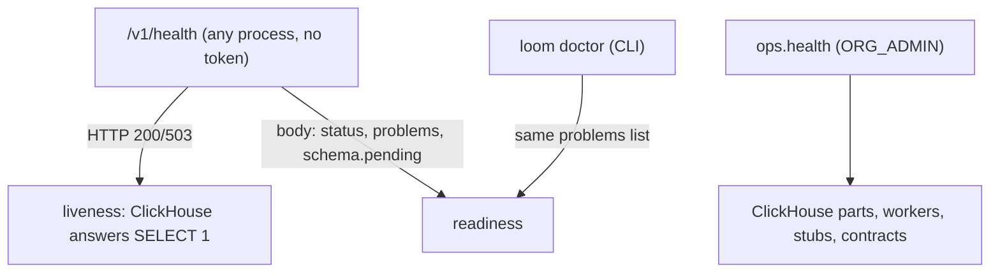

# Monitoring

This page says what to watch. Loom reports on itself through four surfaces:

| Surface                         | Scope                                      |
| ------------------------------- | ------------------------------------------ |
| `/v1/health`, `loom doctor`     | one process                                |
| `ops.health`                    | deeper checks against ClickHouse           |
| OpenTelemetry metrics and spans | written to the same ClickHouse, or to OTLP |
| `loom.agent_events`             | the request ledger, one row per operation  |

Metric names and labels are catalogued in
[telemetry](../features/observability/telemetry.md).

## Running operator commands

Operator commands are `loom` subcommands. Run them inside a container, which has the
deployment's environment:

```bash
docker exec loom-server loom doctor            # web container
docker exec loom-workers loom code stats       # workers container (split deployments)
```

From a checkout, `pip install -e .` installs the same CLI; it reads `LOOM_*` from the
environment and `.env`. `loom <command> --help` documents every flag, and the
[CLI reference](../reference/cli.md) lists them all.

Org-wide views (cost across namespaces, `ops.health`) need `ORG_ADMIN` or
`PLATFORM_ADMIN`, which only `LOOM_PLATFORM_ADMINS` grants
([deployment](./deployment.md#required-environment)). The deployment-wide `/v1/admin/*`
routes need `PLATFORM_ADMIN`; `token.mint`, `namespace.adopt` and `claim_release` need
`ORG_ADMIN` in the org they act on. A namespace `admin` reaches none of them.

## Health checks



### /v1/health

```bash
curl -s http://localhost:7777/v1/health | jq '{status, version, ch_ok, build_commit, schema, problems}'
curl -s 'http://localhost:7777/v1/health?include=workers' | jq '.workers_leader'
```

- **The HTTP status depends on ClickHouse only:** 200 when `SELECT 1` answers, 503 when
  it does not (`ch_error` names the error's kind; the text is in the server log). Use it
  as the liveness probe. A probe
  that reads only the status code (the image's healthcheck, a load balancer) then sees
  an outage instead of a 200 whose body it never parses.
- **`status`** is `degraded` when ClickHouse is down or any entry in `problems` has
  severity `error` other than `code_tier_failing`, which is about a repository's index,
  not the deployment; otherwise `ok`. A readiness check should also require
  `schema.pending` to be empty (the zero-downtime pair's swap does exactly this).
- **`problems`** is a list of `{code, severity, message, fix, source}`, worst first. The
  same list is printed by `loom doctor` and shown as the dashboard banner. `loom doctor`
  names each entry it lists in `code_tier_failing`, up to five (`code.repos` names the
  rest); a platform admin's token names each listed entry that is not restricted
  ([when a tier fails](./code-index-operations.md#when-a-tier-fails)).

| Problem code                              | Severity                                                                                            | Meaning                                                                                                                                                                                                                                                                                                                                                                                                 |
| ----------------------------------------- | --------------------------------------------------------------------------------------------------- | ------------------------------------------------------------------------------------------------------------------------------------------------------------------------------------------------------------------------------------------------------------------------------------------------------------------------------------------------------------------------------------------------------- |
| `fake_embedder`, `fake_llm`               | warn (error with `LOOM_REQUIRE_REAL_PROVIDERS=true`)                                                | a fake provider is configured                                                                                                                                                                                                                                                                                                                                                                           |
| `embedder_key_missing`, `llm_key_missing` | warn (same)                                                                                         | a real provider is configured without its key; the process runs on the fake client                                                                                                                                                                                                                                                                                                                      |
| `embedding_dim_mismatch`                  | error                                                                                               | the embedder returns a different width from `LOOM_EMBEDDING_DIM`                                                                                                                                                                                                                                                                                                                                        |
| `coded_width_mismatch`                    | error                                                                                               | a coded vector column's width differs from what its writes carry; those writes fail                                                                                                                                                                                                                                                                                                                     |
| `provider_failing:<name>`                 | error                                                                                               | the last call to that provider failed; clears on the next success                                                                                                                                                                                                                                                                                                                                       |
| `model_configuration_refused`             | error                                                                                               | the dashboard's saved model configuration fails the gateway check and is not applied; every data-plane request answers 503 `GATEWAY_REQUIRED` and the server is not ready until it is replaced                                                                                                                                                                                                          |
| `jwt_secret_empty`                        | error                                                                                               | tokens cannot be signed                                                                                                                                                                                                                                                                                                                                                                                 |
| `dev_jwt_secret`                          | warn                                                                                                | the checked-in dev secret with auth on                                                                                                                                                                                                                                                                                                                                                                  |
| `config_drift`                            | error                                                                                               | this process's root secret or MUST_MATCH settings differ from the deployment's published configuration: it is not ready ([running N replicas](replicas.md))                                                                                                                                                                                                                                             |
| `revocation_not_loaded`                   | error                                                                                               | auth on and this process never read `loom.revoked_tokens`: every bearer gets 503                                                                                                                                                                                                                                                                                                                        |
| `revocation_stale`                        | warn                                                                                                | the revocation snapshot is older than max(300 s, 10 × `LOOM_JWT_REVOCATION_CACHE_TTL_SECONDS`): a token revoked since then still authenticates here                                                                                                                                                                                                                                                     |
| `revocation_too_stale`                    | error                                                                                               | the snapshot is older than `LOOM_JWT_REVOCATION_MAX_STALE_SECONDS` (600 s): every bearer gets 503 until a refresh lands                                                                                                                                                                                                                                                                                 |
| `pending_migrations`                      | error                                                                                               | the schema lacks migrations this build expects                                                                                                                                                                                                                                                                                                                                                          |
| `instance_label_missing`                  | warn                                                                                                | a process outside the compose files has no `LOOM_INSTANCE_LABEL`                                                                                                                                                                                                                                                                                                                                        |
| `workers_lease_absent`                    | info                                                                                                | this process runs no workers (expected on every replica but the leader)                                                                                                                                                                                                                                                                                                                                 |
| `workers_lease_unreachable`               | warn                                                                                                | this process could not ask ClickHouse for the workers lease; if every process says so, nothing runs the workers                                                                                                                                                                                                                                                                                         |
| `workers_lease_given_up`                  | warn                                                                                                | this process released the workers lease and stopped contending (it is draining, or its workers child kept failing to start); another process takes them                                                                                                                                                                                                                                                 |
| `otel_erasure_index`                      | warn                                                                                                | ClickStack metrics tables lack the index erasure needs ([maintenance](./maintenance.md#clickstack-erasure-index))                                                                                                                                                                                                                                                                                       |
| `code_tier_failing`                       | warn (error when also `LOOM_CODE_TIER_FAILING_ERROR_LAG_COMMITS` behind; the fetch tier stays warn) | a code-index tier failed `LOOM_CODE_TIER_FAILING_WARN_PASSES` passes in a row or for `LOOM_CODE_TIER_FAILING_WARN_HOURS`; the fix names what its error kind needs ([when a tier fails](./code-index-operations.md#when-a-tier-fails)). It never degrades `status`; `loom.health.problems` carries it like any problem, so an alert on `severity="error"` there must exclude `code="code_tier_failing"`. |

Other body fields: `providers` (per-provider call state), `fake_embedding`, `fake_llm`,
`providers_degraded`, `embedding_dim_mismatch`, `adaptive_thresholds` (the similarity
gates derived from the embedder, with `calibration_hash` — equal on every replica serving
the same gates — and `source`: `shared` or this replica's own `probe`), `ratelimit.backend` (`shared` or
`per-process`), and `mode` (`ch`, plus `langfuse` and `clickstack` when
configured). `?include=` accepts `workers`, `langfuse`, `otel`, `embedding_cache` and
`llm_cache`; each subsystem is reported on its own and only ClickHouse decides the HTTP
status.

### loom doctor

`loom doctor` runs its checks (`python_version`, `settings_load`, `jwt_secret`,
`clickhouse_reachable`, `otel_erasure_index`, `llm_provider`), then prints the
`problems` list as `problem:<code>` lines. Every check is reported before it exits; the
exit code is 1 when any line is `FAIL`. `--json` prints `{ok, checks, problems}`. With
code intelligence on and ClickHouse reachable it also reads the failing code-index
tiers, and grades with the deployment's runtime overrides; `problem:code_tier_failing`
is at most `WARN`, as it never degrades `status`.

`--client` also checks this machine as a coding-agent client: the server URL and token
the hooks would use (`--server-url`, `--token` override them), whether the token is
accepted and can write its namespace, the Claude Code or Codex wiring, and capture jobs
that never reached the server. `loom report` prints the doctor output for a bug
report's Environment field ([filing an issue](../../CONTRIBUTING.md#filing-an-issue)).

### ops.health

`POST /v1/ops.health` (`ORG_ADMIN`) runs deeper checks against ClickHouse. Each check
returns `status` (`ok`, `warn` or `fail`), `detail` and `repair`. A failed probe's
`detail` names the error's kind (a Loom error's code and message), and each worker's
`last_error_kind` the error's class; the error's text is in the server log and in
`/v1/admin/workers.status`. `/v1/health?include=workers` cuts its worker rows the same
way when the in-process supervisor runs the workers: no `last_error`, outcome numbers
and flags only.

| Check                    | Looks at                                                              |
| ------------------------ | --------------------------------------------------------------------- |
| `clickhouse_parts`       | active parts per table, and merges that failed in the last 15 minutes |
| `workers`                | recent worker pass failures                                           |
| `embedding_stubs`        | memory embedding rows still waiting for a vector                      |
| `schema_contracts`       | high-risk tables and columns against the schema dump                  |
| `memory_schema_contract` | the persisted `loom.memory` columns against the schema dump           |
| `op_mix`                 | the recent operation mix in `loom.agent_events`                       |
| `procedure_plane`        | `loom.procedure_runs` and the procedure keys recorded on the ledger   |

### Smoke test

After a deploy, write and read one memory end to end:

```bash
export LOOM_API_KEY=$(docker exec loom-server loom mint-token --subject smoke --org dev --namespaces smoke --roles writer --ttl-days 1)
curl -s -XPOST http://localhost:7777/v1/memory.set -H "Authorization: Bearer $LOOM_API_KEY" \
  -H 'Content-Type: application/json' \
  -d '{"org":"dev","namespace":"smoke","agent":"smoke","memory_key":"k","value":"deploy smoke test"}'
curl -s -XPOST http://localhost:7777/v1/memory.search -H "Authorization: Bearer $LOOM_API_KEY" \
  -H 'Content-Type: application/json' \
  -d '{"org":"dev","namespace":"smoke","agent":"smoke","query":"smoke test"}' | jq '.results[0].content_excerpt'
```

If the search abstains, check `loom.embed.pending` and the `providers` block of
`/v1/health`: a row waiting for its vector is stored but not yet searchable.

## Worker status

Background work runs in supervised loops declared in `server/workers/registry.py`
(`_WORKERS`). The supervisor retries a failed pass with backoff, cancels a pass that
exceeds its deadline (by default min(4 × interval, 900 s), floored at 60 s), and logs
`<worker>: DEGRADED` once a worker has failed three consecutive passes. Each worker is
switched by one `LOOM_*_ENABLED` flag; the [workers reference](../reference/workers.md)
lists every worker, its flag, default and cadence.

```bash
curl -s -H "Authorization: Bearer $ADMIN_TOKEN" http://localhost:7777/v1/admin/workers.status | jq
```

Many "it never happened" reports are a worker that has not run: embedding a new row,
extracting a deferred batch, indexing a commit.

- `/v1/admin/workers.status` lists every registered worker, disabled ones included, with
  its interval and last pass. It merges this process's registry with `loom.worker_status`
  (kept 30 days), so a web-only container shows the passes the workers container ran.
  The dashboard's admin **Health** view shows the same.
- `/v1/health?include=workers` → `workers_leader.reason` says whether this process holds
  the deployment's workers lease (`workers_supervisor` in ClickHouse).
- Metrics: `loom.worker.consecutive_failures{worker}` and
  `loom.worker.partial_failures{worker}`.
- `ops.projection_failures.list` (`ORG_ADMIN`) lists secondary projections that failed
  and wait for the `projection_repair` worker; `ops.projection_failures.retry` retries
  one.
- A worker's ClickHouse statements carry `log_comment = 'worker.<name>'`
  ([query attribution](#logs-traces-and-query-attribution)).

## What to alert on

Thresholds below are starting points; set the similarity baseline from your own
deployment, since it depends on the embedder.

| Signal                                                        | Alert when                                                        | Means                                                                                                     | First step                                                                                                                                                                                                                                                                        |
| ------------------------------------------------------------- | ----------------------------------------------------------------- | --------------------------------------------------------------------------------------------------------- | --------------------------------------------------------------------------------------------------------------------------------------------------------------------------------------------------------------------------------------------------------------------------------- |
| `/v1/health` HTTP status                                      | 503                                                               | ClickHouse unreachable from this process                                                                  | [troubleshooting](./troubleshooting.md#every-operation-fails-and-v1health-returns-503)                                                                                                                                                                                            |
| `/v1/health` `status`                                         | `degraded` for 5 minutes                                          | an `error` problem other than `code_tier_failing`                                                         | read `problems[].fix`                                                                                                                                                                                                                                                             |
| `loom.search.top_similarity` mean                             | below your baseline for 30 minutes                                | retrieval got worse without failing (embedder change, fake fallback)                                      | [troubleshooting](./troubleshooting.md#search-returns-arbitrary-results-or-extraction-writes-nothing)                                                                                                                                                                             |
| `loom.embed.pending`                                          | above 100 for 15 minutes                                          | memories not yet searchable; embedder throughput or quota                                                 | provider state in `/v1/health` → `providers`                                                                                                                                                                                                                                      |
| any `loom.integrity.*`                                        | above 0                                                           | a defect that already happened and will not drain ([below](#integrity-invariants))                        | the repair column                                                                                                                                                                                                                                                                 |
| `loom.worker.consecutive_failures`                            | ≥ 3                                                               | a worker failing in a loop                                                                                | [troubleshooting](./troubleshooting.md#a-worker-fails-every-pass)                                                                                                                                                                                                                 |
| `loom.process.open_fds / loom.process.fd_limit`               | above 0.5                                                         | a descriptor leak or too many connections                                                                 | per-process series (`loom.pid`)                                                                                                                                                                                                                                                   |
| `loom.host.disk.free_bytes / loom.host.disk.total_bytes`      | below 0.10                                                        | the disk under `var/` filling (repository repacks, logs, blobs); at zero every write on the host fails    | one series per process (`loom.disk.path`)                                                                                                                                                                                                                                         |
| `loom.langfuse.breaker`                                       | = 2                                                               | score posts to Langfuse fail; scores are dropped                                                          | Langfuse reachability for `POST /api/public/scores`                                                                                                                                                                                                                               |
| `loom.code.index_lag_commits`                                 | above the per-pass commit budget for 15 minutes                   | the code index is falling behind the branch                                                               | [code index operations](./code-index-operations.md#failure-model)                                                                                                                                                                                                                 |
| `loom.code.tier_lag_seconds`                                  | above 1800 for 10 minutes                                         | a compiler tier has not reached recent merges                                                             | the "code tier lag" alert in `deploy/dashboards/code_plane.json`; set it above the slowest tier's normal cycle                                                                                                                                                                    |
| `loom.code.tier_failing`                                      | any point for 15 minutes (`severity="error"` for a page)          | a code-index tier the `code_tier_failing` problem reports, past its `LOOM_CODE_TIER_FAILING_*` thresholds | the `fix` of `code_tier_failing` in `/v1/health` ([when a tier fails](./code-index-operations.md#when-a-tier-fails))                                                                                                                                                              |
| `clickhouse_parts` in `ops.health`, or error 252              | `fail`                                                            | merges failing                                                                                            | [troubleshooting](./troubleshooting.md#writes-fail-with-too_many_parts-or-merges-are-failing)                                                                                                                                                                                     |
| `loom.audit.checkpoint_lag_windows`                           | growing                                                           | the audit checkpoint chain is behind                                                                      | the `audit_verifier` worker's passes                                                                                                                                                                                                                                              |
| `loom.auth.agents_provisioned{outcome=made}` per `loom.trust` | above the control plane's normal rate (start at 50 in 10 minutes) | a trust names new agents faster than its fleet grows: a leaked issuer key or a runaway control plane      | compare the trust's `auth.agent_provisioned` audit rows (`audit.list`) with the agents its control plane started; if they differ, `loom bot disable --name <trust>` and rotate the issuer's key                                                                                   |
| `loom.auth.trust_agents_used_ratio`                           | above 0.8                                                         | the trust nears `--max-agents`, counted over its live agents (a released one gives its place back)        | if `outcome=made` also rose faster than the fleet grows, follow the `outcome=made` row (disable the trust, rotate the key); otherwise raise it: `loom bot create --replace` with the trust's flags and a larger `--max-agents` (it ends the agents' tokens; each exchanges again) |
| `loom.auth.agents_provisioned{outcome=at_cap}`                | increase above 0 over 10 minutes                                  | new agents of the trust are refused                                                                       | if `outcome=made` also rose faster than the fleet grows, follow the `outcome=made` row (disable the trust, rotate the key); otherwise raise it: `loom bot create --replace` with the trust's flags and a larger `--max-agents` (it ends the agents' tokens; each exchanges again) |

With HyperDX, an empty result is read as 0, so a minimum-sample guard must return a
value inside the healthy range rather than no rows.

Signals that say what to scale (web replicas, provider quota, workers container, or
ClickHouse) are in [failure and recovery](../architecture/failure-and-recovery.md).

### Pipeline SLOs

Under the Postgres authority a write answers at its commit and becomes searchable once its
memory row and search document are in ClickHouse
([storage authority](../architecture/storage-authority.md#publication)). A search that
finds earlier writes not yet there waits for them, up to `LOOM_PG_PROJECTION_WAIT_MS`
(default 2000 ms), and answers 503 `PROJECTION_BEHIND` past it.

| Objective                                   | Target                                                                                                            | Signal                                                                        |
| ------------------------------------------- | ----------------------------------------------------------------------------------------------------------------- | ----------------------------------------------------------------------------- |
| A read waits for earlier writes             | p99 below half `LOOM_PG_PROJECTION_WAIT_MS`, and none ending in `deadline` outside an outage (the op answers 503) | `loom.pg.search_wait_ms` by `outcome`                                         |
| A write is in ClickHouse                    | p99 below half `LOOM_PG_PROJECTION_WAIT_MS`, so a read's wait has the other half                                  | `loom.pg.projection_lag_ms{path="flush"}`                                     |
| Nothing waits past a stopped writer's lease | oldest pending below twice `LOOM_PG_REQUEST_LEASE_SECONDS` plus `LOOM_PG_DELIVERY_IDLE_INTERVAL_SECONDS`          | `loom.pg.oldest_pending_age_s{source="memory"}`                               |
| No lag errors outside an outage             | 0                                                                                                                 | `loom.requests{loom.error_code="PROJECTION_BEHIND" or "PUBLICATION_PENDING"}` |
| Nothing ClickHouse keeps refusing           | 0 outside a restore reconcile's hold                                                                              | `loom.pg.backlog{state="parked"}`                                             |

A search's worst wait under a writer that stopped before publishing is its lease
(`LOOM_PG_REQUEST_LEASE_SECONDS`): a waiting search publishes an expired delivery itself.
That is above the default wait, so it shows as `outcome="deadline"`, not as a latency.
Readiness does not depend on any of these: every replica reads the same Postgres, so a
lag-driven readiness check would take every replica out of rotation at once.

Every process that runs the delivery workers exports the whole deployment's backlog, and
several may at once, so read the backlog gauges with `max`, not `sum`.

Alerts:

| Signal                                            | Alert when                      | Means                                                                                                                                                                     | First step                                                                                       |
| ------------------------------------------------- | ------------------------------- | ------------------------------------------------------------------------------------------------------------------------------------------------------------------------- | ------------------------------------------------------------------------------------------------ |
| `loom.pg.search_wait_ms{outcome="deadline"}` rate | above 0 for 5 minutes           | a read waited out the deadline: the op answers 503 `PROJECTION_BEHIND`, a report reads on                                                                                 | ClickHouse reachability, then `loom.pg.backlog` and the `pg_delivery` worker's passes            |
| `loom.pg.oldest_pending_age_s{source="memory"}`   | above the target for 10 minutes | the delivery worker is not keeping up, or ClickHouse refuses                                                                                                              | `GET /v1/health?include=postgres` → `postgres.backlog`, the `pg_delivery` worker status          |
| `loom.pg.backlog{state="parked"}`                 | above 0                         | a delivery ClickHouse kept refusing, or one a restore reconcile holds (its `last_error` says which)                                                                       | the delivery's `last_error` ([storage authority](../architecture/storage-authority.md#delivery)) |
| no `loom.pg.backlog` point from any process       | for 3 export periods            | the reading stopped: the backlog read fails, no delivery pass starts, or the time between two passes' starts (a pass and the interval after it) passes two export periods | the `backlog not read` warning in the `pg_delivery` and `knowledge_pg_delivery` workers' logs    |

### Integrity invariants

Each of these gauges should read 0 forever. They are computed by the process holding
the workers lease every 15 minutes and cached.

| Metric                                                          | A non-zero value means                                                          | Repair                                             |
| --------------------------------------------------------------- | ------------------------------------------------------------------------------- | -------------------------------------------------- |
| `loom.integrity.divergent_entities`                             | entities differ between `loom.memory` and `loom.memory_embeddings` for a memory | investigate the write path                         |
| `loom.integrity.orphan_vectors`                                 | embedded vectors whose memory row is gone                                       | `orphan_vector_reconcile` worker                   |
| `loom.integrity.orphan_entity_vectors`                          | entity vectors whose memory row is gone                                         | `orphan_vector_reconcile` worker                   |
| `loom.integrity.orphan_graph_namespaces`                        | namespaces with entity edges but no live memory or knowledge                    | `loom erasure-re-verify --orphan-graph --erase`    |
| `loom.integrity.live_ns_unregistered`, `live_rows_unregistered` | live memory in namespaces with no `loom.namespaces` row                         | register the namespace, or `loom namespaces-adopt` |
| `loom.integrity.dim0_with_vector`                               | rows with a vector but `embedding_dim = 0`, invisible to search                 | `loom integrity-repair --apply`                    |
| `loom.integrity.tombstone_status_drift`                         | rows with `tombstoned_at` set and another status                                | listed by `loom integrity-repair`                  |
| `loom.integrity.active_past_valid_to`                           | active rows past their own `valid_to`                                           | listed by `loom integrity-repair`                  |
| `loom.integrity.high_with_embedding`                            | high-sensitivity rows that still have a live embedding row                      | `loom sensitivity-sweep --apply`                   |

The repair commands are described in [maintenance](./maintenance.md#backfills-and-repairs).

## Metrics

Loom exports OpenTelemetry metrics every `LOOM_OTEL_METRICS_EXPORT_INTERVAL_S` seconds
(default 60). With `LOOM_OTEL_EXPORTER=ch` (the default when no OTLP endpoint is set)
they are written straight into `default.otel_metrics_sum`,
`default.otel_metrics_histogram` and `default.otel_metrics_gauge` on the same ClickHouse
service (in `LOOM_CLICKSTACK_DATABASE` when it is set, here and below), the tables
ClickStack/HyperDX reads; set `LOOM_OTEL_EXPORTER_OTLP_ENDPOINT` to
ship to a collector instead. Counters and histograms are cumulative unless
`LOOM_OTEL_METRICS_DELTA_TEMPORALITY=true`. The boot log confirms the exporter:

```text
OTel metrics initialized — emitting every 60s (cumulative temporality, gauge heartbeat …s) to default.otel_metrics_{sum,histogram,gauge}
```

Labels come from a closed set (operation, namespace, bounded enums); keys, user ids,
session ids and query text are never labels (`tests/unit/test_domain_metrics.py`
enforces it). The full catalogue, grouped by requests and cost, retrieval quality,
memory writes, backlogs, integrity and the code index, is in
[telemetry](../features/observability/telemetry.md).

Starting queries:

```sql
-- mean top similarity per namespace, last hour
SELECT Attributes['loom.namespace'] AS ns,
       round(anyLast(Sum) / greatest(anyLast(Count), 1), 3) AS mean_top_similarity
FROM default.otel_metrics_histogram
WHERE MetricName = 'loom.search.top_similarity' AND TimeUnix > now() - INTERVAL 1 HOUR
GROUP BY ns;

-- every gauge's latest value
SELECT MetricName, anyLast(Value) AS latest
FROM default.otel_metrics_gauge
WHERE TimeUnix > now() - INTERVAL 5 MINUTE
GROUP BY MetricName ORDER BY MetricName;
```

The first query reads cumulative histograms, so it is a lifetime mean per series; for a
windowed mean, difference each point against the previous point of its series (the
correction in `deploy/hyperdx_dashboards.md`, "The cumulative-counter correction").

## Dashboards

[`deploy/hyperdx_dashboards.md`](../../deploy/hyperdx_dashboards.md) is the ClickStack
and HyperDX setup guide and SQL panel cookbook; the ClickStack integration itself is
described in [ClickStack](../features/integrations/clickstack.md).

- **No collector.** Loom writes OTel rows directly into `default.otel_*` on its own
  ClickHouse, so a hosted ClickStack needs only its sources pointed at the existing
  tables (`deploy/clickstack_sources.sh` scripts that). Where no HyperDX install created
  them, apply `schemas/otel/clickstack_otel_tables.sql` once by hand; every statement is
  `IF NOT EXISTS`.
- **Two traps the panels avoid.** FastAPI instrumentation emits ASGI child spans named
  like their parent (`POST /v1/memory.get http send`), which inflates a span-name filter
  about threefold; only the parent span carries `loom.*` attributes, so filter on
  `mapContains(SpanAttributes, 'loom.operation')`. And cumulative metrics need a
  per-series delta: `sum(Value)` over a window sums running totals.
- **The code index board.** [`deploy/dashboards/code_plane.json`](../../deploy/dashboards/code_plane.json)
  is the source of truth for the "Loom — Code Plane" dashboard: every tile with its
  source and SQL, and the tiles that carry an `alert` block with threshold and reason.
  Provision from the JSON rather than editing tiles in the UI, so the next rebuild
  matches.
- If panels stay empty, check `docker logs loom-server 2>&1 | grep -i otel`. Spans are
  flushed every few seconds; metrics once per export interval. A missing table shows as
  `default.otel_traces does not exist … Self-disabling span export`.

## Logs, traces and query attribution

- **Logs.** `docker logs loom-server` and `docker logs loom-workers`.
  `LOOM_LOG_FORMAT=json` for a log pipeline, `LOOM_LOG_LEVEL` for verbosity. The boot log
  names the resolved providers and each applied migration; the supervisor logs every
  failed pass and the `DEGRADED` line.
- **The ledger.** `loom.agent_events` has one row per operation: `operation`, identity
  columns, `request_id`, `trace_id`, `latency_ms`, `success`, `error_code`, tokens,
  `upstream_cost_usd`, `model`, `consumer`, `traffic_class`, `build_commit`, `instance`
  and `instance_label`. `loom.audit_log` records who changed what, with a per-row content
  hash ([audit](../features/observability/audit.md)).
- **Traces.** Spans go to `default.otel_traces` (or the OTLP endpoint), tagged
  `loom.org`, `loom.namespace`, `loom.agent`, `loom.operation`, `loom.request_id` and
  `enduser.id`. With Langfuse configured the span tree also goes to Langfuse
  ([Langfuse](../features/integrations/langfuse.md)). Every HTTP response carries
  `X-Request-Id` (the client's, when it sends one of 1 to 64 letters, digits, `.`, `_` or `-`)
  and `X-Trace-Id`.
- **Every ClickHouse query is attributed** in its `log_comment` setting:

| `log_comment`                  | Issued by                                                         |
| ------------------------------ | ----------------------------------------------------------------- |
| `<operation> <request_id>`     | a request (HTTP or MCP)                                           |
| `worker.<name>`                | a worker pass                                                     |
| `cli.<command>[.<subcommand>]` | a `loom` command (not `loom serve`)                               |
| `untagged:<module>.<function>` | anything else; a background loop should call `set_query_tag(...)` |

With `LOOM_CH_LOG_COMMENT_STATEMENT_DIGEST=true` a statement digest follows the tag, so
match with a trailing `%`.

```sql
-- which operations cost ClickHouse the most in the last hour
SELECT splitByChar(' ', log_comment)[1] AS source,
       count() AS queries, sum(read_bytes) AS bytes, sum(query_duration_ms) AS ms
FROM system.query_log
WHERE type = 'QueryFinish' AND event_time > now() - INTERVAL 1 HOUR AND log_comment != ''
GROUP BY source ORDER BY ms DESC LIMIT 20;

-- one request end to end
SELECT * FROM loom.agent_events WHERE request_id = '<id>';
```

`LOOM_INSTANCE_LABEL` (required outside the compose files) keeps a laptop or test
server's rows separable from the deployment's own in both queries. After a colour swap,
`loom deploy-delta` compares the ledger and the statement shapes on each side of the swap.
It reads `--window-min` minutes on each side (default 60), so run it once that window has
passed, and keep your own read-back traffic out of it: requests right after a swap run on
cold caches and inflate the after-side latency.

## Rate limits and traffic classes

Every request draws from two token buckets, one per namespace and one per org (three
times the namespace size), keyed by operation class. Over the limit, the response is 429
`RATE_LIMITED` with `Retry-After` and `X-RateLimit-*` headers.

| Class              | Operations                                                                                                    | Per-namespace burst / sustained |
| ------------------ | ------------------------------------------------------------------------------------------------------------- | ------------------------------- |
| `memory`           | `memory.*`, `conversation.*` (except the exact-key reads and `memory.import`)                                 | 100 / 17 per second             |
| `memory.read`      | exact-key reads: `memory.get`, `memory.bulk_get`, `memory.history`, `working_memory.get`, …                   | 300 / 50 per second             |
| `memory.import`    | `memory.import`                                                                                               | 10 / 2 per second               |
| `knowledge.search` | `knowledge.search`                                                                                            | 20 / 3 per second               |
| `knowledge.query`  | `knowledge.query`                                                                                             | 20 / 3 per second               |
| `knowledge.read`   | the other `read_only` `knowledge.*` ops, `knowledge.inspect` aside: `knowledge.get`, `knowledge.list`, …      | 50 / 10 per second              |
| `knowledge.add`    | every other `knowledge.*` op, `knowledge.inspect`, `knowledge.synthesize` and `knowledge.dedup_list` included | 10 / 2 per second               |
| `code`             | `code.*` (except `code.outcome`, which draws from `memory`)                                                   | 60 / 10 per second              |
| `insights.query`   | `insights.query`                                                                                              | 20 / 3 per second               |
| `assistant.ask`    | `assistant.ask` and the assistant's chat route                                                                | 10 / 1 per second               |
| `default`          | everything else                                                                                               | 50 / 10 per second              |

Requests are classed as `production`, `interactive` or `bench` (token claim from
`loom mint-token --traffic-class`, else the namespace's registration, else the request's
hint); the response header `X-Loom-Traffic-Class` says which. Bench traffic gets its
own, smaller buckets (`LOOM_RATELIMIT_CLASS_FRACTIONS`) and lower ClickHouse priority,
so a benchmark cannot spend production's budget. Limits are enforced per replica; see
`LOOM_REPLICA_COUNT` in [failure and recovery](../architecture/failure-and-recovery.md).
`POST /v1/admin/ratelimit.set` with `{namespace|org, op_class, capacity, rate}` (or
`clear: true`) overrides a bucket. The override is stored in `loom.runtime_overrides`, and
every process adopts it within `LOOM_RUNTIME_OVERRIDES_REFRESH_SECONDS` (default 10); it
survives a restart. `POST /v1/admin/budget.set` stores latency-budget overrides the same
way. Bucket fill itself stays per host.

## Related

- [Troubleshooting](./troubleshooting.md): symptom-first runbooks for what these
  signals catch
- [Telemetry](../features/observability/telemetry.md): the metric and span catalogue
- [Cost and usage](../features/observability/cost-and-usage.md) and
  [audit](../features/observability/audit.md)
