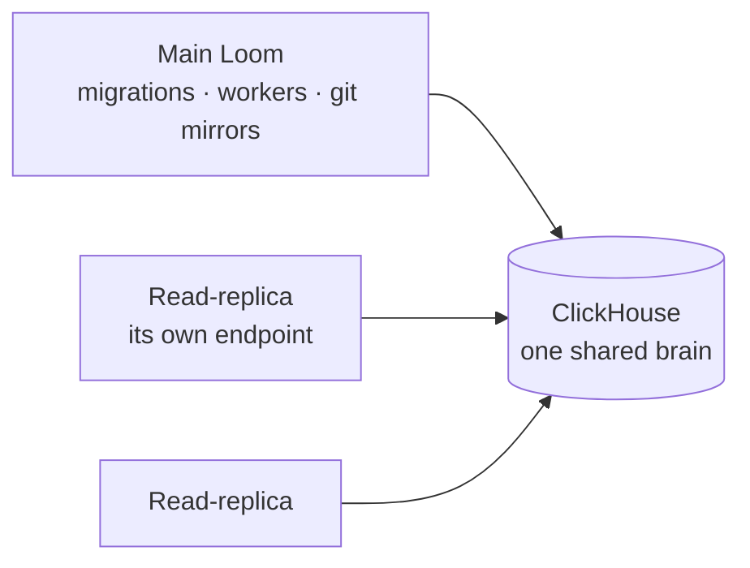

# Read-replicas: more Looms on the same brain

A read-replica is another Loom on the same ClickHouse service as your main
Loom. It serves the same memories, documents, code indexes, tracker records
and namespaces, accepts the same tokens and answers the same ops, from its own
endpoint. Start one at any time with no change to the main Loom, and stop it
whenever you like.

Typical reasons to run one:

- **Another network.** Serve the same knowledge where the main Loom must not be
  reachable: a build or CI network, a partner VPC, a public endpoint. Agents
  reviewing pull requests in CI read the code index and write their review
  memories and runs through the replica.
- **Another region.** Put an endpoint close to its users.
- **More capacity.** Spread agent traffic over several endpoints.



## What a replica does and does not do

Every Loom on the service serves the same data. The **main Loom** (any Loom
without `LOOM_READ_REPLICA`) also does the work that must happen exactly once:
it applies schema migrations, runs the background workers (code ingest,
extraction, consolidation), keeps the git mirrors and publishes its settings.
A **read-replica** (`LOOM_READ_REPLICA=true`) does none of that work.

| Concern                     | Main Loom                      | Read-replica                                                                       |
| --------------------------- | ------------------------------ | ---------------------------------------------------------------------------------- |
| Data                        | the shared service             | the same shared service                                                            |
| Tokens                      | signs with the deployment keys | the same keys: every token works on both, and a revoke on either applies to both   |
| Namespaces and roles        | by token and grant             | the same: a token sees on the replica exactly what it sees on the main Loom        |
| Writes                      | yes                            | yes, into the shared service; the main Loom's workers process them                 |
| Sign-in, signup, dashboard  | served                         | served, against the same accounts                                                  |
| Settings                    | its env, published             | the main Loom's published settings, for every setting its own env leaves unset     |
| Schema migrations           | applies them at boot           | never (`loom migrate` refuses); refuses to boot if its build expects a missing one |
| Background workers          | runs them                      | never (`LOOM_BACKGROUND_WORKERS=off`)                                              |
| Git mirrors, `code.refresh` | owns and fetches them          | none; the ops below answer with a refusal naming the main Loom                     |

The ops a replica refuses are the ones that work on the main Loom's host:
`code.refresh`, `code.reindex`, `code.scip_ingest`, `code.calibrate` and the
`code.repo.*` admin ops (add, add_branch, remove, set_access, set_source,
remote_branches). Send those to the main Loom. A merge-queue job that calls
`code.refresh` after a push keeps calling the main Loom; the replica reads the
new index as soon as the main Loom wrote it.

A provider reconfiguration on the main Loom waits for every running replica to
acknowledge the drain, as it does for every server process; a replica never
runs the rebuild itself.

## Open pull requests

The index holds the indexed branches' merged code. To answer about an open,
unmerged PR (a function it adds, a call it rewires), `code.callers`,
`code.impact` and `code.review_brief` with `open: true` overlay the PR's own
version of its changed files on the index for that one request. A caller that
holds the PR's checkout sends them:

```json
{
  "pr_number": 123500,
  "pr_files": { "src/Storages/MergeTree/MergeTreeData.cpp": "<the file at the PR's head>" },
  "pr_diff": "<the PR's unified diff>",
  "pr_head_sha": "<head commit, labels the answer>",
  "pr_base_sha": "<base commit>"
}
```

Loom parses the sent files with the ingest's parser and binds their calls
against the index, so any Loom answers, a replica included. Nothing sent is
written to the index or stored. Each Loom process keeps, for an hour, what it
derived from each file (keyed on the file's content) and the index's answer for
each name (keyed on the indexed commit). So the calls of one review parse once,
and a push that changes a few files re-parses those files alone: a
15,000-line file costs about a second the first time and nothing after a push
that leaves it unchanged.
`code.verify_citations` takes the same fields and reads `in_pr_diff` from the
sent diff. A request with only `pr_number` reads the PR from the main Loom's
git mirror; on a replica it answers from the index and says `no_git_mirror`.

Reads that need full git history run on the main Loom. With
`LOOM_READ_REPLICA_MAIN_URL` set to the main Loom's base URL, a replica sends
`code.blame_range` and `code.verify_citations` there with the caller's own
`Authorization`, `X-Loom-On-Behalf-Of` and `X-Loom-Code-Scope` headers, and
passes the answer on: the main Loom authorizes the call as if the caller had
made it, and an error it answers comes back unchanged. When the URL is unset, or
the main Loom does not answer within `LOOM_READ_REPLICA_FORWARD_TIMEOUT_SECONDS`
(60 s by default) or answers 5xx, `code.blame_range` answers that there is no
git history here and the commit checks of `code.verify_citations` are not run.
`/v1/health` reports which one applies as `replica.git_history`: `forwarded` or
`unavailable`. The replica's host must reach the main Loom's URL. Index freshness on a replica reports
the lags the main Loom published for the same commits.

## Tokens

A Loom token is a signed JWT. The keys are not in ClickHouse: they are in each
server's env, so a database reader cannot mint tokens. A replica needs the main
Loom's values of all three, because it does two jobs with them:

| Setting                 | What the replica does with it                                                                                                        | Wrong or missing                                                      |
| ----------------------- | ------------------------------------------------------------------------------------------------------------------------------------ | --------------------------------------------------------------------- |
| `LOOM_JWT_SECRETS_JSON` | Verifies each token with the key its header `kid` names, itself, without calling the main Loom. Old `kid`s verify old tokens.        | Every token is refused (401).                                         |
| `LOOM_JWT_ACTIVE_KID`   | Names the key new tokens are signed with, so a token minted on either Loom verifies on the other.                                    | Tokens minted on one Loom fail on the other.                          |
| `LOOM_JWT_SECRET`       | Opens the credentials the main Loom sealed in the shared tables: private-repository tokens, tracker-source passwords, provider keys. | Those credentials do not open: private repositories and sources fail. |

`LOOM_JWT_SECRET` seals credentials even when `LOOM_JWT_SECRETS_JSON` holds the
signing keys, so a key map does not make it unused. It is a server-side key,
not a Loom API token: a token pasted into it fails the check below.

Copy the three lines from the main Loom's env exactly as they are. When the main
Loom leaves one unset, leave it unset on the replica too: both then use the same
default, and setting any value there is a mismatch.

Give a replica the main Loom's values and every token the main Loom ever issued
works on it, with no new token for anyone. Revocations, grants and service
accounts are rows in the shared service, so a revoke on either Loom applies to
both within `LOOM_JWT_REVOCATION_CACHE_TTL_SECONDS` (30 s by default).

The main Loom publishes an HMAC fingerprint of each key (never the key). A
replica whose keys do not match refuses to boot and says which key differs,
and `/v1/health` reports `replica.token_keys_match_main`:

| Boot error says                                              | Fix                                                                                     |
| ------------------------------------------------------------ | --------------------------------------------------------------------------------------- |
| `the main Loom signs with kid 'X', which this process lacks` | Copy the main Loom's `LOOM_JWT_SECRETS_JSON`.                                           |
| `this process holds a different key for kid 'X'`             | The replica's map has the `kid` with another secret; copy the main Loom's map.          |
| `this process signs with kid 'X', which the main Loom lacks` | Copy the main Loom's `LOOM_JWT_ACTIVE_KID`.                                             |
| `LOOM_JWT_SECRET differs, so stored credentials do not open` | Copy the main Loom's `LOOM_JWT_SECRET`, or remove the line when the main Loom has none. |

Whoever holds these keys can mint a token for any identity on the deployment,
so a replica's host needs the same trust as the main Loom's.

## Settings

At boot, the main Loom's workers leader writes every setting its env sets
explicitly to `loom.deployment_config`. That covers code repositories, tracker
bindings and sources, the embedding and LLM models, and search tuning. A
replica applies each published value whose setting its own env leaves unset,
at boot and then every `LOOM_READ_REPLICA_CONFIG_REFRESH_SECONDS`, so it needs
no copy of the main Loom's `.env`. A setting in the replica's own env always
wins: tune its limits or models for its own callers there. The LLM provider and
model count as one choice: a replica whose env names neither takes the main
Loom's pair, and one that names either keeps its own.

Never published: secrets, credentials inside repository entries or URLs, and
the settings that describe one process (the ClickHouse connection, auth and
keys, process shape, rate limits, telemetry export, blob storage, the
read-replica settings). A replica that sets `LOOM_EMBEDDING_MODEL` or
`LOOM_EMBEDDING_DIM` to something other than the main Loom's value refuses to
boot, because the shared vectors were made with the main Loom's. Provider API
keys are the replica's own to set.

### Embeddings and LLM calls without a provider key

A replica embeds every search query and every memory it writes with the main
Loom's model, and makes its own LLM calls: `memory.ask` and `code.ask`
answers, reranking, the duplicate-check judge. When `LOOM_READ_REPLICA_MAIN_URL`
is set and the replica has no key for a model's provider (`OPENAI_API_KEY` for
`text-embedding-*` and `gpt*`, `ANTHROPIC_API_KEY` for `claude*`), it sends
those calls to the main Loom instead: `embedding.embed` returns the main Loom's
vectors and `llm.complete` the main Loom's completion. A replica that has its
own key for a provider keeps using it.

The replica calls both with a short-lived service token it signs itself with
the deployment keys (subject `loom-replica:<process id>`), and the ops serve no
other caller, so no other token can spend the main Loom's provider budget.
Vectors are cached under the model name, and completions a call site caches go
to the shared response cache, so a text or prompt either Loom answered before
needs no call.
A completion may take `LOOM_READ_REPLICA_LLM_TIMEOUT_SECONDS` (300 s by
default). `/v1/health` reports `replica.embeddings` and `replica.llm`: `main`,
or `own` when the replica has its own key.

While the main Loom does not answer, a keyless replica cannot embed or
complete: a read that needs a query vector drops its vector leg, and a call that
needs the main Loom fails with 503 `BACKEND_UNAVAILABLE` naming the op, rather
than running on a fake provider. A text or prompt already in the shared caches
is still answered. Every call, and a check every
`LOOM_READ_REPLICA_MAIN_PROBE_SECONDS` (30 s by default), records whether the
main Loom answered: `/v1/health` reports it as `replica.main` (`reachable`,
`checked_at`, `error`), and while it is not reachable the `main_loom_unreachable`
problem makes `status` `degraded`. The HTTP code stays 200, because the replica
still serves every read from ClickHouse.

## Start one

```bash
# The replica's .env: the shared service, the main Loom's token keys, the main Loom's URL.
LOOM_CH_HOST=...                     # the main Loom's ClickHouse service
LOOM_CH_PORT=8443                    # Cloud's HTTPS port; the default 8123 is plain HTTP
LOOM_CH_DATABASE=...                 # the main Loom's, when it is not `loom`
LOOM_CH_USER=...
LOOM_CH_PASSWORD=...
LOOM_JWT_SECRET=...                  # the main Loom's; omit when the main Loom omits it
LOOM_JWT_SECRETS_JSON=...            # the main Loom's; omit when the main Loom omits it
LOOM_JWT_ACTIVE_KID=...              # the main Loom's
LOOM_TRACKER_CREDENTIALS_JSON=...    # only when the main Loom keeps one in its env; see the table above
LOOM_READ_REPLICA_MAIN_URL=https://...  # the main Loom: blame, embeddings and LLM calls
# OPENAI_API_KEY=...                 # optional: the replica's own provider calls instead

docker compose --env-file .env -f dev/docker-compose.read-replica.yml up -d --build
curl -s localhost:7777/v1/health | jq '.read_replica, .replica'
```

`dev/docker-compose.read-replica.yml` sets `LOOM_READ_REPLICA=true`. A replica
sets `LOOM_BOOT_MIGRATE=false` and `LOOM_BACKGROUND_WORKERS=off` itself, and an
env that sets either otherwise is refused at load.

Point agents at the replica's URL with the tokens they already hold.

## Stop one

Stop the container gracefully (`docker stop`, SIGTERM); the main Loom does not
depend on it. A clean shutdown retires its provider participant row; a forced
kill (`docker rm -f`, `kill -9`) skips it. If the process dies without one (a
killed host, an OOM), the main Loom cannot prove from its own host that the
process stopped, so a provider reconfiguration waits on that row. Once you
have confirmed the process is gone, retire it with the `participant_id` its
`/v1/health` reported:

```bash
loom read-replica retire --participant <participant_id> --yes
```

## Upgrades

Upgrade the main Loom first. Its boot applies the migrations, and a replica on
a newer build refuses to start until they are applied. A replica on an older
build keeps working, because every migration is additive.

## Keeping a replica in step

A replica holds copies of the main Loom's ClickHouse login and token keys, so
a change to either on the main Loom is a change to every replica in the same
step. Settings the main Loom publishes need nothing: replicas apply them within
`LOOM_READ_REPLICA_CONFIG_REFRESH_SECONDS`.

**Rotating the signing key.** Give every replica the new key before any Loom
signs with it:

1. Add the new `kid` to `LOOM_JWT_SECRETS_JSON` on the main Loom and every
   replica, keeping the old one, and restart them.
2. Point `LOOM_JWT_ACTIVE_KID` at the new `kid` on all of them. Each one now
   holds the other's signing key, so the order does not matter.
3. Remove the old `kid` everywhere once its tokens are no longer needed.

A replica given an active `kid` the main Loom lacks, or missing the one the main
Loom signs with, refuses to boot and names the `kid`.

**Changing `LOOM_JWT_SECRET`.** It seals stored credentials, so the main Loom
cannot open them afterwards until they are entered again, and a replica with
the old value refuses to boot. Change it on the main Loom and every replica
together, then store the credentials again.

**Changing the ClickHouse password.** Set the new `LOOM_CH_PASSWORD` on every
replica in the same change; a replica with the old one cannot connect.

**Moving the main Loom.** Replicas reach it at `LOOM_READ_REPLICA_MAIN_URL`.
Keep that name stable, or update every replica when it changes; until then
`/v1/health` reports `main_loom_unreachable`.

**A replica's load on the main Loom.** What a replica serves itself is logged
under its own `LOOM_INSTANCE_LABEL`. What it sends to the main Loom is logged
there under the main Loom's label: its embeddings and completions under the
replica's service subject, and forwarded blame and citation checks under the
caller's own subject.

```sql
SELECT operation, count() AS calls
FROM loom.agent_events
WHERE subject LIKE 'loom-replica:%' AND ts > now() - INTERVAL 1 DAY
GROUP BY operation
```

The main Loom applies no rate limit to `embedding.embed` and `llm.complete`;
each replica limits its own callers, so their provider spend and quota are the
main Loom's.
