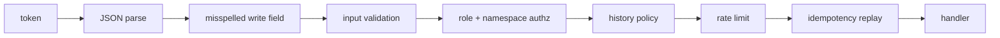

# HTTP API reference

Every Loom operation is one HTTP endpoint, `POST /v1/<operation>`, generated
from the operation registry in `server/operations/`
(`server/transport/http.py`, `build_router`). The
[Python](./python-sdk.md) and [TypeScript](./typescript-sdk.md) SDKs and the
[MCP transport](./mcp.md) wrap the same surface and run the same gates, so any
stack can reach all of Loom with HTTP and JSON. The list of operations is the
generated [operations reference](./operations.md).

Every server also serves its API reference in the browser, without a token:
`<server>/docs` (Swagger UI) and `<server>/redoc` list every operation with its request
and response schema, and `<server>/v1/api/openapi.json` is the OpenAPI document behind
them. The spec declares no authentication scheme, so the Swagger page has no token field:
its **Try it out** runs calls only on a server with auth off (the stock local stack). With
auth on, call the API with `curl`, an SDK or MCP.

## Routes

### Operations and discovery

| Method and path                                | Auth            | What it is                                                                                                                                                                                                        |
| ---------------------------------------------- | --------------- | ----------------------------------------------------------------------------------------------------------------------------------------------------------------------------------------------------------------- |
| `POST /v1/<operation>`                         | bearer          | One registry operation (`memory.set`, `memory.search`, `code.search`, `tracker.item`, …). The body is the op's input model; a 200 carries its output model.                                                       |
| `GET /v1/operations`                           | none            | Every op: `name`, `path`, `mcp_tool`, `idempotent`, `budget_p99_ms`, `shape_budgets_p99_ms`, `required_role`.                                                                                                     |
| `GET /v1/api/openapi.json`                     | none            | An OpenAPI document with the input and output JSON Schema of every op, pinned to `v1` for code generation.                                                                                                        |
| `GET /openapi.json`, `GET /docs`, `GET /redoc` | none            | The framework's own unversioned copy of the same OpenAPI document and its two browsable renderings. Pin code generation to `/v1/api/openapi.json` instead.                                                        |
| `POST /v1/ops.capabilities`                    | bearer (viewer) | The deployment's catalogue: `build_commit`, `schema_version`, `consumer_field` and, per op, `required_role`, `budget_p99_ms`, `idempotent`, `audit`, `request_fields`, `response_fields`, `mcp_tier`, `toolsets`. |
| `GET /v1/whoami`                               | bearer          | The verified token: `subject`, `org`, `namespaces`, `roles`, `is_service_account`, `kid`, `exp`, `iat`; `{"authenticated": false}` without one.                                                                   |

### Health and keys

| Method and path                            | Auth | What it is                                                                                                                                                                                                               |
| ------------------------------------------ | ---- | ------------------------------------------------------------------------------------------------------------------------------------------------------------------------------------------------------------------------ |
| `GET /v1/health`                           | none | Liveness: 200 when ClickHouse answers, 503 when it does not; the body carries subsystem state and the problem list. `?include=workers,langfuse,events,embedding_cache,llm_cache,otel,mirrors` adds per-subsystem checks. |
| `GET /v1/.well-known/jwks.json`            | none | The public keys of the keyring's RS256 signing keys; `{"keys": []}` while every key is HS256.                                                                                                                            |
| `GET /v1/.well-known/openid-configuration` | none | The OIDC discovery document of the issuer of the identity tokens Loom signs for an inference gateway (`LOOM_INFERENCE_TOKEN_AUDIENCE`); 404 while it signs none.                                                         |

The health body, its problem codes and how to use it as a readiness check are
in [Monitoring](../operations/monitoring.md).

### Streams and downloads

Two routes are `GET`-shaped because a browser or an event-stream client needs
a plain URL rather than a JSON body. Neither is a registry op.

| Method and path              | Auth            | What it is                                                                                                                                                                                                                                         |
| ---------------------------- | --------------- | -------------------------------------------------------------------------------------------------------------------------------------------------------------------------------------------------------------------------------------------------- |
| `GET /v1/knowledge.download` | bearer (viewer) | `?org=&namespace=&source_uri=` (plus `inline=true` for an inline `Content-Disposition`) streams a knowledge document's original upload, or its stored text as Markdown when no original was kept; `X-Loom-Download-Source: blob\|text` says which. |
| `GET /v1/task/watch`         | bearer          | Server-sent events over the task inbox: a wake-up hint that an inbox (`inbox=`) or a task you posted (`posted_by_me=1`) moved. Reconnect with `Last-Event-ID` to resume; bounded by `max_seconds` (≤ 600).                                         |

See [Task inbox](../features/tasks-and-decisions.md) for the watch stream.

### MCP, sign-in and OAuth

| Method and path                                                                                                                 | Auth   | What it is                                                                                                                                                               |
| ------------------------------------------------------------------------------------------------------------------------------- | ------ | ------------------------------------------------------------------------------------------------------------------------------------------------------------------------ |
| `POST /mcp`, `DELETE /mcp`                                                                                                      | bearer | The MCP endpoint (JSON-RPC over streamable HTTP); see [MCP](./mcp.md).                                                                                                   |
| `POST /v1/auth/login`                                                                                                           | none   | Dashboard sign-in with a password; answers a token.                                                                                                                      |
| `POST /v1/auth/self-signup`                                                                                                     | none   | A person claims a namespace. Off unless `LOOM_SELF_SIGNUP=open`; closed when sign-in is delegated to an OIDC provider.                                                   |
| `POST /v1/auth/agent-signup`                                                                                                    | none   | A bot signs itself up: an `agent-<slug>` namespace, a writer token, and a claim code a person later uses to take ownership. Same gates.                                  |
| `/.well-known/oauth-authorization-server`                                                                                       | none   | OAuth 2.1 discovery, served whenever auth is on.                                                                                                                         |
| `POST /oauth/device_authorization`, `GET`/`POST /oauth/device`, `POST /oauth/device/approve`                                    | none   | The device grant `loom login` uses: a code, the approval page, the approval ([tokens and grants](../guides/tokens-and-grants.md#sign-in-from-a-terminal-or-a-notebook)). |
| `POST /oauth/token`, `POST /oauth/revoke`, `GET /oauth/callback`, `GET /oauth/sso`                                              | none   | Token exchange and refresh, revocation (RFC 7009), the OIDC provider's return and the dashboard's SSO button ([single sign-on](../operations/sso.md)).                   |
| `/.well-known/oauth-protected-resource`, `POST /oauth/register`, `GET`/`POST /oauth/authorize`, `POST /oauth/authorize/approve` | none   | MCP one-click connect (the last is its consent under SSO), served only with `LOOM_OAUTH_ENABLED=true`; see [MCP](./mcp.md#oauth).                                        |

### Dashboard routes

These routes serve the dashboard: the page itself and the caller API (`/v1/me/*`, about the
authenticated caller). They are not an integration surface. They are not registry ops and can
change in any release.

| Method and path                                                                 | Auth   | What it is                                                                                                                                                                                                                                                                                                                                                 |
| ------------------------------------------------------------------------------- | ------ | ---------------------------------------------------------------------------------------------------------------------------------------------------------------------------------------------------------------------------------------------------------------------------------------------------------------------------------------------------------- |
| `GET /`, `/{page}`, `/me`, `/assets/*`, `/favicon.svg`                          | none   | The dashboard single-page app and its assets, served from `frontend/dist/` (503 when not built). `/me` is where a sign-in lands with its token in the URL fragment: it serves the page even when `LOOM_DASHBOARD_REDIRECT_URL` sends the others away. A path under `/v1`, `/mcp`, `/oauth`, `/.well-known` or any other route never answers with the page. |
| `GET /v1/me/service_accounts`, `POST /v1/me/service_accounts.create`, `.revoke` | bearer | The caller's service accounts and their tokens.                                                                                                                                                                                                                                                                                                            |
| `POST /v1/me/setup/mcp_config`                                                  | bearer | A per-client MCP configuration block with a fresh token, for **Settings → Tokens**.                                                                                                                                                                                                                                                                        |
| `POST /v1/me/set-default-namespace`                                             | bearer | Set the caller's default workspace.                                                                                                                                                                                                                                                                                                                        |
| `GET /v1/me/sharing-summary`                                                    | bearer | Memory sharing across the namespaces the caller can read, as one dashboard payload.                                                                                                                                                                                                                                                                        |

### Operator routes

The `/v1/admin/*` routes sit outside the op registry. Each runs its gate first,
the role the table names: `platform_admin` for the deployment-wide routes
(`require_admin`, `server/insights/app/admin_routes.py`), `org_admin` for the ones that
act inside the one org their body names (a platform admin passes for any org). With
auth off, every gate passes, but `settings.set` and the model routes still refuse a
non-loopback Host and a cross-site Origin, so a web page cannot reach them through DNS
rebinding. A bot registered with `--platform-admin` holds that role in every token it gets
([Bots and CI](../operations/sso.md#bots-and-ci)). The Python SDK has one method per route,
`agent.deployment.routes.<name>(body)` (`sdk/python/loom/admin_routes.py`, generated from
the same routes), and the curated `agent.deployment` methods over them.

<!-- BEGIN GENERATED: admin_routes -->
<!-- Generated by `python scripts/codegen/docs_reference.py`; edit the source, not this region. -->
<!-- prettier-ignore-start -->

| Method and path | Needs | What it is |
| --- | --- | --- |
| `POST /v1/admin/audit.summary` | `platform_admin` | Aggregate audit_log by event_type in a window. |
| `POST /v1/admin/bots.create` | `platform_admin` | Register a bot. |
| `POST /v1/admin/bots.disable` | `platform_admin` | Disable a bot: its proofs are refused and the tokens it holds revoked. |
| `POST /v1/admin/bots.list` | `platform_admin` | Every registered bot: its namespaces and roles, key or issuer, and limits. |
| `POST /v1/admin/bots.provision_agent` | `platform_admin` | Make the namespace of a trust's agent before its first exchange, as that exchange would, so grants can name the agent first. |
| `POST /v1/admin/budget.set` | `platform_admin` | Install or clear a per-operation latency-budget override. |
| `POST /v1/admin/budget.violations` | `platform_admin` | Aggregate recent `budget.violated` events (loom.events) for ops alerting. |
| `POST /v1/admin/claim_release` | `org_admin` | Release a self-signup claim: revoke its grants, clear the owner, deactivate it; the name stays reserved. |
| `POST /v1/admin/consumers` | `platform_admin` | Per-consumer calls, error rate, p50, spend and outcome feedback over each requested window — read-only aggregates over agent_events and code_search_outcome, joined by consumer name. |
| `POST /v1/admin/events.tail` | `platform_admin` | Recent rows from `loom.agent_events` for live debugging. |
| `POST /v1/admin/fleet.cost` | `platform_admin` | Top-N tenants by attributed cost over a window. |
| `GET /v1/admin/models` | `platform_admin` | The LLM and embedding settings in force and any change pending, without the saved credentials. |
| `POST /v1/admin/models` | `platform_admin` | Save the LLM and embedding setup as the next configuration; an embedding change queues a rebuild of the vector tables. |
| `POST /v1/admin/models/reset` | `platform_admin` | Go back to the model settings the environment gives. |
| `POST /v1/admin/models/retry` | `platform_admin` | Run a failed model transition again. |
| `POST /v1/admin/models/validate` | `platform_admin` | Check a model setup against the providers before saving it. |
| `POST /v1/admin/namespace.adopt` | `org_admin` | Install a new admin on a namespace that has no remaining active admin grant. |
| `POST /v1/admin/prompts.evaluate` | `platform_admin` | Compute a should-promote verdict for one prompt version. |
| `POST /v1/admin/ratelimit.set` | `platform_admin` | Install a per-(namespace\|org) rate-limit override. |
| `GET /v1/admin/revocations` | `platform_admin` | The unexpired revocations, newest first, at most `limit` (1000 by default); `?subject=` narrows them to one subject's own row, an operator cutoff's and SCIM's, `?since=` to those written since (see `loom revoke-token --list`). |
| `POST /v1/admin/revoke_subject` | `platform_admin` | Revoke every token and sign-in session of a subject, in every org and for good, and list the tokens it made revoked (see `loom revoke-token --subject`). |
| `GET /v1/admin/schema.status` | `platform_admin` | Report the gap between what migrations expect and what's in CH. |
| `POST /v1/admin/settings.history` | `platform_admin` | The recorded changes of one setting, or of every setting, newest first: who made each, the value before and after. |
| `POST /v1/admin/settings.list` | `platform_admin` | Every setting with its value in force in this process, its default, where the value came from (override, dashboard, env, env_file, settings_file, inferred, default) and whether it is live. |
| `POST /v1/admin/settings.set` | `platform_admin` | Install a deployment-wide override of a live setting ({name, value}) or remove it ({name, clear: true}); with `expected`, only while that is the value in force. |
| `POST /v1/admin/sso.adopt` | `platform_admin` | The password accounts at a domain and why any is skipped; with `apply`, links the rest (see `loom sso adopt`). |
| `POST /v1/admin/sso.link` | `platform_admin` | Point one password account at the address its owner signs in with (see `loom sso link`). |
| `POST /v1/admin/sso.password_link` | `platform_admin` | A one-time link (valid for `password_link_ttl_seconds`) that gives the email's SSO accounts a password. |
| `POST /v1/admin/sso.unlink` | `platform_admin` | Detach the email's accounts from their SSO sign-in (see `loom sso unlink`). |
| `POST /v1/admin/token.mint` | `org_admin` | Mint a Loom JWT. |
| `GET /v1/admin/workers.status` | `platform_admin` | Snapshot of each background worker's config + most recent run summary. |
<!-- prettier-ignore-end -->
<!-- END GENERATED: admin_routes -->

Monitoring use of these routes is in [Monitoring](../operations/monitoring.md),
and tokens in [Tokens and grants](../guides/tokens-and-grants.md).

There is no inbound webhook route: GitHub and tracker data are pulled by
workers, and task-inbox webhooks are outbound (`task_webhook_deliver`). There
is no `/metrics` scrape endpoint either; metrics leave over OpenTelemetry (see
[Telemetry](../features/observability/telemetry.md)).

## Request

```bash
curl -sX POST "$LOOM/v1/memory.set" \
  -H "Authorization: Bearer $LOOM_API_KEY" -H "Content-Type: application/json" \
  -d '{"org":"acme","namespace":"support","agent":"assistant",
       "memory_key":"deploy_window","value":"Deploys run Tue and Thu only; never Friday."}'
```

- **Auth.** `Authorization: Bearer <jwt>`. Required unless the deployment runs
  with `LOOM_AUTH_REQUIRED=false` or `LOOM_IDENTITY_PROVIDER=single-user`.
  Tokens come from `loom mint-token`, the dashboard, a sign-up route or OAuth;
  see [Tokens and grants](../guides/tokens-and-grants.md).
- **Identity.** `org`, `namespace` and `agent` travel in the body; `user_id`
  and `session_id` default to `"-"`. The token decides which of them the caller
  may address. `code.*` and `tracker.*` ops default `org` and `namespace` to the
  deployment's code or tracker plane when the body omits them.
- **`consumer`.** Any body may carry `consumer`, a short tag for the product or
  module calling; it is stored on the request and audit ledgers. A token minted
  with a consumer overrides it. See
  [The consumer tag](http-api.md#the-consumer-tag).
- **Body size.** A body above `LOOM_MAX_REQUEST_BYTES` (32 MiB by default) is
  refused with `413 PAYLOAD_TOO_LARGE` before it is parsed
  (`server/transport/body_limit.py`).

Discover field names from `/v1/api/openapi.json`, or once at start-up from
`ops.capabilities` (`request_fields[op]`), rather than hard-coding them.

### Gate order

A request passes these gates in order, and the first that refuses answers:



MCP `tools/call` runs the same sequence. Consequences worth knowing:

- A deployment that requires a token answers an anonymous request 401 whatever
  its body holds, and the anonymous check runs before the rate limiter, so an
  unauthenticated caller can never drain a tenant's bucket.
- An empty, blank or `"-"` `org` or `namespace` is treated as absent: a code
  or tracker op takes its plane's default, any other op the token's own org,
  and a namespace with no org to pair it with is `400 IDENTITY_INCOMPLETE`.
- An idempotent replay is looked up only after authorization and policy admit
  the call, so a stored answer never reaches another principal.
- A rate limiter or traffic classifier that fails lets the request through and
  logs the failure: an outage of that machinery degrades fairness, not
  availability.

[System overview](../architecture/system-overview.md) walks through what
each gate and the handler do.

## Headers

| Direction | Header                                        | Meaning                                                                                                                                         |
| --------- | --------------------------------------------- | ----------------------------------------------------------------------------------------------------------------------------------------------- |
| request   | `Authorization: Bearer <jwt>`                 | The token.                                                                                                                                      |
| request   | `Idempotency-Key: <string>`                   | Replay key for an idempotent op; see [Idempotency](#idempotency).                                                                               |
| request   | `X-Request-Id`                                | Your request id; echoed back and stamped on every ledger row and ClickHouse query of the call. A fresh UUID when absent.                        |
| request   | `X-Loom-On-Behalf-Of: <subject>`              | Act as another subject. Honoured only for a token whose subject is in `LOOM_TRUSTED_CALLERS`; the real caller is recorded as `impersonated_by`. |
| request   | `X-Loom-Run-Id: <run_id>`                     | Label the call's ledger rows with a run without filtering the read. A body `run_id` on a read filters to that run's rows instead.               |
| response  | `X-Request-Id`                                | Quote it in a bug report; the SDK errors carry it as `request_id` / `requestId`.                                                                |
| response  | `X-Schema-Version`                            | The data-plane schema version.                                                                                                                  |
| response  | `Server-Timing`                               | Handler time (`app`), plus ClickHouse time, statement count and bytes read (`ch`).                                                              |
| response  | `X-RateLimit-Limit` / `-Remaining` / `-Reset` | Token-bucket state for the call's namespace and op class.                                                                                       |
| response  | `Retry-After`                                 | Seconds to wait, on `429 RATE_LIMITED`, `503 OVERLOADED` and `503 AUTH_UNAVAILABLE`.                                                            |
| response  | `X-Loom-Traffic-Class`                        | The traffic class the call ran as and where it came from, `<class>;source=<source>`.                                                            |
| response  | `X-Idempotent-Replay: true`                   | The body is a stored replay, not a fresh execution.                                                                                             |
| response  | `X-Loom-Ignored-Args`                         | Body keys the op did not apply: fields the op itself declined, then keys it does not read (see below).                                          |
| response  | `X-Loom-Hint` / `X-Loom-Hint-Code`            | Advice about how the caller uses Loom, when one applies to this call. The body is unchanged; the SDKs log it once per distinct text.            |
| response  | `X-Trace-Id`                                  | The OpenTelemetry trace id of the call, when tracing is on.                                                                                     |

A browser client on another origin sees only the response headers the CORS
policy exposes when `LOOM_CORS_ORIGINS` is set: `X-Request-Id`,
`X-Schema-Version`, `Server-Timing`, the three `X-RateLimit-*` headers,
`X-Loom-Traffic-Class` and `Retry-After` (`server/main.py`).

## Unknown and removed fields

Input models ignore keys they have no field for, so Loom names them instead of
dropping them silently (`server/transport/arg_check.py`):

- A successful response carries `ignored_args` (the top-level keys the op did
  not apply) and, when one is a near miss for a real field, `did_you_mean`
  (`{"namepsace": "namespace"}`). The identity keys (`org`, `namespace`,
  `agent`, `user_id`, `session_id`, `run_id`), `consumer`, `traffic_class`,
  `explain` and the idempotency keys are never reported.
- An op that **changes state** (role `writer` or higher, or a viewer op that
  is audited or records state: any op the catalogue does not mark read-only)
  refuses a near-miss key with `422 UNKNOWN_ARGUMENT` and writes nothing: the
  write it would have made is not the one asked for.
- A field removed from the wire is treated as unknown: served, and named in
  `ignored_args`, so an older client keeps running without the feature.
- An op may report a field it reads but did not apply. That field is listed
  first in `ignored_args` and in the header, before the unread keys.
  `memory.set_from_messages` does this for `agent_learnings=true` while
  `memory_extract_agent_learnings` is off.

Operations and fields can change between releases. Nothing keeps a registry of removed
fields: `ignored_args` is how a client finds out that the server no longer reads something it
sends, and the catalogue below is how it checks what the server serves before relying on it.

## Discovering what a deployment serves

Read the catalogue once at start-up rather than probing routes and reading
404s or 422s.

| Source                                        | Carries                                                                                                |
| --------------------------------------------- | ------------------------------------------------------------------------------------------------------ |
| `POST /v1/ops.capabilities` (any token, `{}`) | `build_commit`, `schema_version` and every operation                                                   |
| `GET /v1/operations` (no token)               | every operation's name, path, MCP tool, idempotency, required role and latency budgets                 |
| `GET /v1/api/openapi.json` (no token)         | the full JSON Schemas of every request and response                                                    |
| `POST /v1/code.index_status`                  | the code plane's own catalogue and index state, with each code op's `maturity`, `reach` and `toolsets` |

`ops.capabilities` answers `build_commit`, `schema_version`, `consumer_field`
(the request field that carries the consumer tag) and `ops`, one entry per
operation with its `name` and (`server/operations/capabilities.py`,
`capability_snapshot`; `server/insights/api/models_ops.py`, `OpCapability`):

| Field                               | Meaning                                                                                                     |
| ----------------------------------- | ----------------------------------------------------------------------------------------------------------- |
| `path`, `mcp_tool`                  | the HTTP path and the MCP tool name                                                                         |
| `required_role`                     | minimum role, `VIEWER` to `PLATFORM_ADMIN`                                                                  |
| `budget_p99_ms`                     | the declared latency budget; per-shape budgets are on `GET /v1/operations` (`shape_budgets_p99_ms`)         |
| `idempotent`, `audit`               | safe to retry with an `Idempotency-Key`; whether success writes an audit row                                |
| `request_fields`, `response_fields` | the input and output fields, sorted                                                                         |
| `mcp_tier`, `toolsets`              | `core`, `code`, `extended` or `hidden` on the MCP surface, and the `?toolset=` listings that include the op |

Both SDKs wrap this: `probe(...)` compares your needs with the catalogue and
names what is missing, and `capabilities()` pairs it with what the token may
call ([Python](./python-sdk.md#calling-operations),
[TypeScript](./typescript-sdk.md#probe-before-you-rely)). Between two builds,
`scripts/codegen/wire_changelog.py <rev_a> <rev_b>` lists the operations and fields that
changed ([code generation](../development/code-generation.md#wire-changelog)).

## The consumer tag

Every operation accepts `consumer`, an identifier of up to 64 characters for the
client or product making the call (`qa-agent`, `support-bot`, a benchmark name).
It is a column on `loom.agent_events` and `loom.audit_log`, so a consumer's
calls, errors, latency, spend and outcome feedback are one `GROUP BY`; operators
read it through `POST /v1/admin/consumers`.

- A call without one is recorded under the token's subject class
  (`service-account`, `user` or `anonymous`).
- `loom mint-token --consumer NAME` binds the tag to a credential: every request
  under that token is attributed to `NAME` whatever its body says, and its
  ledger rows record the source as `claimed` rather than `self-reported`.
- Latency budgets can be set per consumer as well as per operation
  (`POST /v1/admin/budget.set` with `consumer`, or
  `LOOM_LATENCY_BUDGET_OVERRIDES_BY_CONSUMER`).
- Both SDKs take `consumer` at construction and stamp it on every body that
  does not name its own.

## Client and server versions

The server does not gate on client versions: an SDK or plugin of any version calls what the
server serves, and the catalogue above says what that is. The SDKs name themselves in
`User-Agent` and `X-Loom-SDK` (`loom-py/<version>`, `loom-ts/<version>`) for proxy logs; the
server does not read them, so attribute calls with the [consumer tag](#the-consumer-tag).
An op an SDK has no method for is still reachable by name (`call` in Python, `callRaw` in
TypeScript). The Claude Code and Codex plugins run on the client machine, so a server deploy
does not change them; update them through the client's plugin manager
(`claude plugin update loom@loom`).

## Idempotency

Ops the registry marks idempotent (`GET /v1/operations` says which) accept an
`Idempotency-Key` header (`server/core/idempotency.py`):

- The first successful response is stored in `loom.idempotency` for 24 hours,
  keyed by the caller's org and subject, the op and the key.
- A retry with the same key and the same body gets the stored body with
  `X-Idempotent-Replay: true`. The same key with a different body is
  `409 IDEMPOTENT_CONFLICT`.
- "The same body" is the op's validated input, so a key sent over HTTP replays
  over MCP (as the `_idempotency_key` argument) and back.
- The header is ignored on ops that are not idempotent.
- The cache is best-effort: two identical requests racing on different
  replicas can both execute. That is why only ops that are already safe to
  repeat take a key; the key removes duplicate work, it is not a lock.

The TypeScript SDK sends a fresh key with every idempotent op; the Python
SDK sends one with every request, and the server ignores it where the op is
not idempotent. Pass your own key to make a retry across processes replay.

## Pagination

Three shapes; each op's schema says which it takes.

| Shape  | Request                     | Response                                            | Ops                                                                                                                        |
| ------ | --------------------------- | --------------------------------------------------- | -------------------------------------------------------------------------------------------------------------------------- |
| cursor | `limit`, `cursor`           | `next_cursor` (empty when done), `has_more` on some | `knowledge.list`, `conversation.list`, `audit.list`, `memory.recall`, `memory.export_evidence`, `code.search`, `code.grep` |
| offset | `limit`, `offset`           | `total` / `truncated`, or `next_offset`             | `memory.list`, `memory.recall`, `conversation.get`, `context.fetch`, `code.impact`, `code.context_packs`                   |
| handle | `paging: true`, then `page` | `next_page`, `page_offset`, `candidates_total`      | `memory.search`: the next page is served from the ranked list the first call parked, without retrieving again              |

Cursors are opaque; pass them back unchanged. The TypeScript SDK's
`paginate` walks a cursor-paginated op for you.

## Rate limits

Every call that names a namespace draws from token buckets keyed by namespace
and **op class**: `memory`, `memory.read` (exact-key reads such as
`memory.get`), `memory.import`, `knowledge.search`, `knowledge.add`, `code` and
`default` (`server/core/ratelimit.py`, `DEFAULT_LIMITS`). Three tiers must all admit it:

| Tier      | Key                            | Default (burst / per second)                                                                                                                            |
| --------- | ------------------------------ | ------------------------------------------------------------------------------------------------------------------------------------------------------- |
| namespace | (namespace, op class)          | `memory` 100 / 17, `memory.read` 300 / 50, `memory.import` 10 / 2, `knowledge.search` 20 / 3, `knowledge.add` 10 / 2, `code` 60 / 10, `default` 50 / 10 |
| org       | (verified token org, op class) | 3 × the namespace limit, so a tenant with many namespaces cannot sustain many times one namespace's budget                                              |
| actor     | (namespace, token subject)     | `LOOM_RATELIMIT_ACTOR_FRACTION` × the namespace limit; the default 1.0 creates no actor bucket                                                          |

- The limits are deployment-wide targets: each process holds the limit divided by
  the live serving replicas in `loom.instances` (at least `LOOM_REPLICA_COUNT`, which
  is also the count while those rows cannot be read), further divided by
  `LOOM_WEB_WORKERS` unless the web workers share one bucket file (`LOOM_RATELIMIT_SHARED`).
- Traffic class `bench` draws from its own bucket sized by
  `LOOM_RATELIMIT_CLASS_FRACTIONS` (default `{"bench": 0.5}`), so a benchmark
  never spends production's budget.
- `POST /v1/admin/ratelimit.set` installs a per-namespace or per-org override
  for one op class. It is stored in `loom.runtime_overrides` and every process
  adopts it within `LOOM_RUNTIME_OVERRIDES_REFRESH_SECONDS` (default 10), so it
  survives a restart; `clear: true` removes it. Bucket fill stays per host.
- An empty bucket answers `429 RATE_LIMITED` with `Retry-After`, the
  `X-RateLimit-*` headers and `detail.retry_after_s`. Both SDKs pace on these
  headers and wait out a 429 for up to 15 s per call by default.

Rate-limit tuning for a deployment is in
[Performance tuning](../guides/performance-tuning.md).

## Errors

A non-2xx response carries one envelope, `{"detail": {"code", "message", …}}`.
Match on `code`, never on the message. The envelope, retry rules, a
common-errors table with fixes, and the generated list of every code the server
answers with (including `SCHEMA_PENDING`, `OVERLOADED` and `BACKEND_TIMEOUT`,
the three faults a caller should retry or wait out) are in the
[errors reference](./errors.md).

## Related

- [Operations reference](./operations.md): every op with its role and kind.
- [Errors reference](./errors.md).
- [MCP](./mcp.md): the same ops as MCP tools.
- [Adding an operation](../development/adding-an-operation.md): declaring an op and regenerating the derived files.
