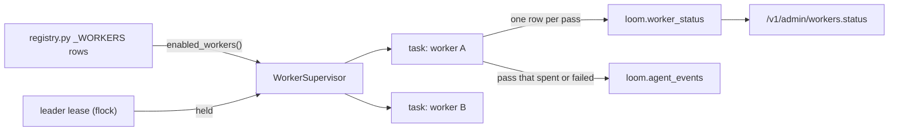

# Workers reference

A worker is a supervised background loop: one pass function run on an interval
by the worker supervisor. Workers do the work a request should not wait for:
filling missing vectors, extracting entities, verifying the audit chain,
resuming interrupted erasures, ingesting code and tracker data. The table at
the end of this page is generated from the registry, so it lists every worker
the code at this commit declares.

## How workers run



**Workers are rows.** `server/workers/registry.py` holds one `_Worker(...)` per
loop in `_WORKERS`: the name, the module that holds its `run_pass`, the settings
flag that switches it on (none means always on), the settings field that holds
its interval, and optionally a second required flag (`also_requires`), an idle
interval, a pass deadline, a first-pass hook and the tables it owns.
`enabled_workers()` turns the enabled rows into `WorkerSpec`s and imports a
worker's module only then, so a disabled worker's optional dependencies are
never loaded. Settings are read when the supervisor starts: a change to a
worker flag or interval takes effect on the next restart of the process that
runs the workers.

**One task per worker.** `WorkerSupervisor` (`server/workers/supervisor.py`)
starts one asyncio task per enabled spec and owns its loop:

- **Boot stagger.** The first pass waits `crc32(name) % interval` seconds (zero
  for intervals under 2 s), so the workers do not all query ClickHouse in the
  same boot tick. The hash is stable across processes and restarts.
- **First pass due.** A worker whose output is missing runs at once instead.
  The check is the worker's own `first_pass_due` hook, or the generic rule
  derived from its `owned_tables`: due when an owned table holds no row for a
  namespace in scope (`server/workers/first_pass.py`). The check is bounded at
  30 s and reads "not due" on any error.
- **Overdue.** A worker whose last recorded pass is older than its interval
  starts within a 300 s spread of boot instead of after its full stagger, so
  frequent restarts cannot keep pushing a daily pass back.
- **Deadline.** Each pass runs under a timeout: the row's `max_pass_seconds`,
  else four intervals clamped to between 60 s and 900 s
  (`default_max_pass_seconds`). A pass past its deadline is cancelled and
  counted as a failure.
- **Failure and backoff.** A failed pass is retried after an exponential
  backoff of 1, 2, 4 … seconds, capped at 60 s. A pass cut at its deadline, or
  a worker whose interval is longer than its deadline (the daily and weekly
  ones), waits its full interval instead: a quick retry would spend the same
  database time again. From the third consecutive failure the supervisor logs
  `<worker>: DEGRADED — N consecutive failures` at ERROR and marks the worker
  degraded in the status registry.
- **Partial passes.** A pass that finishes while one of its legs failed
  (`pass_context.note_failure`) counts toward the failure streak but keeps its
  normal interval, because the rest of its work is still wanted on time.
- **Idle interval.** A clean pass that found nothing to do
  (`pass_context.mark_idle()`) waits the row's idle interval when it has one,
  so a worker whose work arrives in bursts polls often while there is work and
  seldom while there is none.
- **Shutdown.** Stopping the server cancels each task (a pass in flight is
  cancelled, not finished), waits up to 10 s for the tasks to exit
  (`WorkerSupervisor.stop_all`), then flushes pending status rows.

Every pass runs in the `background` traffic class (lower ClickHouse priority
and capped threads, so a pass never competes with production reads on equal
terms) and tags its queries `worker.<name>` in `log_comment`.

## Which process runs the workers

`LOOM_BACKGROUND_WORKERS` decides whether a process starts the supervisor
(`server/workers/leader.py`):

| Value            | Behaviour                                                                                                                                                                                         |
| ---------------- | ------------------------------------------------------------------------------------------------------------------------------------------------------------------------------------------------- |
| `auto` (default) | The process of the deployment that holds the `workers_supervisor` lease (a Keeper key in `loom._migration_lock`) runs the supervisor; the others contend for it and take it over once it expires. |
| `on`             | Always run the supervisor (a single-process container, or a dedicated workers container).                                                                                                         |
| `off`            | Never run it (a pure web replica).                                                                                                                                                                |

One lease for the whole deployment, so N replicas with `uvicorn --workers N`
each run one copy of every worker between them, not one per process. A leader
that dies leaves its key to expire after `LOOM_SUPERVISOR_LEASE_TTL_S`.

The shipped compose files split the two roles into containers from one image.
`dev/docker-compose.cloud.yml` runs the `loom` service (container
`loom-server`, the web tier, `LOOM_BACKGROUND_WORKERS=off`) and `loom-workers` (one process, `on`, no
published port). `dev/docker-compose.colour.yml` runs `loom-<colour>` (`off`)
and `loom-<colour>-workers` (`auto`), and only the workers containers contend
for the shared lock, so during a blue/green overlap the old colour keeps the
workers until it stops and the new colour takes them within one retry
interval. **Why a separate container:** a process that runs a long pass on the
same event loop as request handling serves its keep-alive clients slower at the
tail; keeping workers off the web tier removes that cost at the price of one
more container. See [Deployment](../operations/deployment.md).

`jwt_revocation_refresh` is always on where the supervisor runs. Every process,
leader or not, also loads the token revocation list at boot, so a web replica
without workers never accepts a revoked token.

## Turning a worker on or off

1. Find the worker's switch in the **Switched on by** column below and set it
   (`LOOM_<NAME>_ENABLED=true` or `false`) on the container that runs the
   workers. A worker with a second flag (`+ LOOM_…` in the column) runs only
   when both are on: `code_backport_gaps` needs `LOOM_CODE_PR_HISTORY_ENABLED`,
   `code_coverage_notify` needs `LOOM_CODE_INTEL_ENABLED`.
2. Change its cadence, if needed, with the **Cadence setting**.
3. Restart that container, then confirm the worker's state (below).

Turning on an LLM-backed worker (`profile_consolidation`, `reflection_distill`,
`observe_extract`, `code_summary`, and the default-on `entity_extractor` and
`conversation_titler`) needs more than the flag:

1. Configure a real LLM provider. With the fake provider the worker runs on
   fake output; `loom doctor`'s `llm_provider` line warns when the resolved
   provider has no key. See [Deployment](../operations/deployment.md#providers).
2. Set the worker's flag on the one container that runs the workers.
3. For per-namespace workers, opt the namespace in through
   `namespace.register` or the namespace's settings: `consolidation_enabled`
   gates `profile_consolidation` (and selects namespaces for the non-LLM
   `entity_communities` pass, beside those whose graph was walked recently). You can roll a worker
   out to one namespace first.

Each namespace has a rolling 24-hour spend cap, `LOOM_DEFAULT_DAILY_COST_CAP_USD`
(default `1.0`; `0` disables it), overridden per namespace by
`daily_cost_cap_usd` (editable on the dashboard's **Usage** view). Over the
cap, LLM-backed workers skip the namespace, and LLM-backed request paths stop
spending instead of failing: `memory.ask` and `knowledge.synthesize` abstain
with `budget_capped`, and `code.search` query expansion and `code.ask`
synthesis are skipped. Plain reads and writes are never refused for cost.
`cost.summary` and `cost.budget_status` report spend; see
[Cost and usage](../features/observability/cost-and-usage.md).

## Seeing what the workers did

```bash
curl -s -H "Authorization: Bearer $ADMIN_TOKEN" \
  http://localhost:7777/v1/admin/workers.status | jq
```

`GET /v1/admin/workers.status` (an `admin` token) lists every registered
worker, disabled ones included, with `enabled`, its interval and, for a disabled
worker, `disabled_reason: disabled_by_setting`. It merges this process's
in-process registry with the latest `loom.worker_status` row per worker, so a
web-only container still reports the passes the workers container ran; its
`store` block says how many rows came from the table and which instances
reported them. The dashboard's admin **Health** view shows the same data, and
`/v1/health?include=workers` adds the supervisor's view of the process it asks.

Every finished pass, idle ones included, writes one `loom.worker_status` row.
A pass that spent LLM or embedder money, or failed, also writes one
`loom.agent_events` row with operation `worker.<name>.pass`, so maintenance
spend appears in the same ledger as request spend. The runbook for a worker
that keeps failing is in [Troubleshooting](../operations/troubleshooting.md).

## Reading the table

| Column              | Meaning                                                                                                                                                             |
| ------------------- | ------------------------------------------------------------------------------------------------------------------------------------------------------------------- |
| **Worker**          | The registry name. It appears in `workers.status`, in `worker.<name>` query tags and in the `DEGRADED` log line.                                                    |
| **What it does**    | The first sentence of the worker module's docstring.                                                                                                                |
| **Switched on by**  | The environment variable of the row's `enabled` field (plus `also_requires`), or "always on".                                                                       |
| **Default**         | That setting's default in `server/settings/`. A deployment's `.env` can differ; the stock stack is described in the [quickstart](../getting-started/quickstart.md). |
| **Cadence setting** | The interval's environment variable, or `<module>.<attribute>` when the interval is a constant in the worker module.                                                |
| **Default (s)**     | The interval's default in seconds (blank for a module constant).                                                                                                    |

The generator (`scripts/codegen/docs_reference.py`, `render_workers`) reads
`_WORKERS` and the settings defaults; `make lint` fails when this page is stale.
Settings that tune a worker beyond its switch and cadence (batch sizes, lease
lengths, per-worker limits) are in the
[configuration reference](./configuration.md#workers) and its per-plane
sections.

## Tests that pin the worker set

- `tests/unit/test_worker_registry_snapshot.py` builds the supervised list under
  three settings profiles (every switch at its default, every `*_enabled` flag
  on, and a production profile of switches) and compares every `WorkerSpec`
  field (order, cadence, deadline, idle interval, first-pass hook, the pass
  callable) with `tests/unit/snapshots/worker_registry.json`. Regenerate it only
  for an intended change:
  `LOOM_UPDATE_WORKER_SNAPSHOT=1 python -m pytest tests/unit/test_worker_registry_snapshot.py`.
- `tests/unit/test_worker_registry_parity.py` switches every `*_enabled` flag
  on and asserts that `worker_meta()` (what `workers.status` renders) and
  `enabled_workers()` (what the supervisor runs) name the same set.

[Adding a worker](../development/adding-a-worker.md) covers writing a pass and
adding its row.

## Workers

<!-- BEGIN GENERATED: workers -->
<!-- Generated by `python scripts/codegen/docs_reference.py`; edit the source, not this region. -->
<!-- prettier-ignore-start -->

| Worker | What it does | Switched on by | Default | Cadence setting | Default (s) |
| --- | --- | --- | --- | --- | --- |
| `audit_verifier` | Audit tamper-detection worker. | `LOOM_AUDIT_VERIFIER_ENABLED` | True | `LOOM_AUDIT_VERIFIER_INTERVAL_SECONDS` | 3600 |
| `code_backport_gaps` | Nightly set-wide backport report: for every merged trunk PR of the last `LOOM_CODE_BACKPORT_GAPS_DAYS` that the maintainers labelled for backport (`pr-must-backport*` on loom's ledger, QA's… | `LOOM_CODE_BACKPORT_GAPS_ENABLED` + `LOOM_CODE_PR_HISTORY_ENABLED` | True | `LOOM_CODE_BACKPORT_GAPS_INTERVAL_SECONDS` | 86400.0 |
| `code_coverage_import` | Daily measured-coverage import (`server.code.app.index.coverage_import`). | `LOOM_CODE_COVERAGE_IMPORT_ENABLED` + `LOOM_CODE_INTEL_ENABLED` | False | `LOOM_CODE_COVERAGE_IMPORT_INTERVAL_SECONDS` | 86400.0 |
| `code_coverage_notify` | Coverage-watch delivery. | `LOOM_CODE_COVERAGE_NOTIFY_ENABLED` + `LOOM_CODE_INTEL_ENABLED` | True | `LOOM_CODE_COVERAGE_NOTIFY_INTERVAL_SECONDS` | 60 |
| `code_crossref` | SQL <-> C++ crossref for each C++ entry whose `git_head` moved since its last run: `code_test_map` rows linking test queries to the files that register the functions and settings they use. | `LOOM_CODE_CROSSREF_ENABLED` | True | `LOOM_CODE_CROSSREF_INTERVAL_SECONDS` | 1800 |
| `code_embed_recovery` | Embedding recovery for the code plane (mirror of the memory plane's embedding worker). | `LOOM_CODE_EMBED_RECOVERY_ENABLED` | False | `LOOM_CODE_EMBED_RECOVERY_INTERVAL_SECONDS` | 30 |
| `code_graph_stats` | Weekly graph statistics: PageRank over the include graph, per-file degrees, and the test↔source map. | `LOOM_CODE_GRAPH_STATS_ENABLED` | False | `LOOM_CODE_GRAPH_STATS_INTERVAL_SECONDS` | 604800 |
| `code_ingest` | Per-merge fast-tier ingest for the code plane. | `LOOM_CODE_INGEST_ENABLED` | False | `LOOM_CODE_INGEST_INTERVAL_SECONDS` | 120 |
| `code_pr_history` | Merged-PR history sync from the GitHub REST API (cursor-resumable). | `LOOM_CODE_PR_HISTORY_ENABLED` | False | `LOOM_CODE_PR_HISTORY_INTERVAL_SECONDS` | 900 |
| `code_scip_apply` | Apply staged SCIP deltas to the compiler-grade tier. | `LOOM_CODE_SCIP_APPLY_ENABLED` | False | `LOOM_CODE_SCIP_APPLY_INTERVAL_SECONDS` | 60 |
| `code_scip_delta` | Per-merge compiler-tier freshness: scip-clang deltas. | `LOOM_CODE_SCIP_DELTA_ENABLED` | True | `LOOM_CODE_SCIP_DELTA_INTERVAL_SECONDS` | 300 |
| `code_scip_full` | C++ full re-index, one entry per pass. | `LOOM_CODE_SCIP_FULL_ENABLED` | True | `LOOM_CODE_SCIP_FULL_INTERVAL_SECONDS` | 900 |
| `code_scip_go_delta` | Per-merge compiler-tier freshness for Go. | `LOOM_CODE_SCIP_GO_DELTA_ENABLED` | True | `LOOM_CODE_SCIP_GO_DELTA_INTERVAL_SECONDS` | 900 |
| `code_scip_py_delta` | Python compiler-tier deltas per merge. | `LOOM_CODE_SCIP_PY_DELTA_ENABLED` | True | `LOOM_CODE_SCIP_PY_DELTA_INTERVAL_SECONDS` | 600 |
| `code_scip_ts_delta` | Per-merge compiler-tier freshness for TypeScript. | `LOOM_CODE_SCIP_TS_DELTA_ENABLED` | True | `LOOM_CODE_SCIP_TS_DELTA_INTERVAL_SECONDS` | 600 |
| `code_summary` | Weekly LLM file/module summary cards for code.map orientation. | `LOOM_CODE_SUMMARY_ENABLED` | False | `LOOM_CODE_SUMMARY_INTERVAL_SECONDS` | 604800 |
| `conflict_resolver` | Judge the writes the conflict check marked, one LLM call per row, up to `memory_conflict_resolver_concurrency` at once, and act on the verdicts (`memory.app.conflict_resolver`). | `LOOM_MEMORY_CONFLICT_RESOLVER_ENABLED` | False | `LOOM_MEMORY_CONFLICT_RESOLVER_INTERVAL_SECONDS` | 10.0 |
| `conversation_titler` | Conversation-titler worker. | `LOOM_CONVERSATION_TITLER_ENABLED` | True | `LOOM_CONVERSATION_TITLER_INTERVAL_SECONDS` | 1800 |
| `delete_version_check` | Finish the checks memory.delete_version owes after its tombstone. | `LOOM_DELETE_VERSION_CHECK_ENABLED` | True | `LOOM_DELETE_VERSION_CHECK_INTERVAL_SECONDS` | 60 |
| `document_blob_gc` | Document-original sweep: `loom.document_blobs` rows no live document names, and bucket objects no row names. | `LOOM_DOCUMENT_BLOB_GC_ENABLED` | True | `LOOM_DOCUMENT_BLOB_GC_INTERVAL_SECONDS` | 3600 |
| `embedding_worker` | Embedding recovery worker. | `LOOM_EMBEDDING_WORKER_ENABLED` | True | `LOOM_EMBEDDING_WORKER_INTERVAL_SECONDS` | 5 |
| `entity_communities` | Entity-communities worker (default-off). | `LOOM_ENTITY_COMMUNITIES_ENABLED` | False | `LOOM_ENTITY_COMMUNITIES_INTERVAL_SECONDS` | 21600 |
| `entity_extractor` | Entity extraction worker. | `LOOM_ENTITY_EXTRACT_ENABLED` | True | `LOOM_ENTITY_EXTRACT_INTERVAL_SECONDS` | 60 |
| `erasure_reclaim` | Erasure reclaim worker: the bytes of purged rows leave the disk. | `LOOM_ERASURE_RECLAIM_ENABLED` | True | `LOOM_ERASURE_RECLAIM_INTERVAL_SECONDS` | 3600 |
| `erasure_recovery` | Erasure Saga recovery worker. | `LOOM_ERASURE_RECOVERY_ENABLED` | True | `LOOM_ERASURE_RECOVERY_INTERVAL_SECONDS` | 60 |
| `extraction_queue` | Replays deferred `memory.set_from_messages` requests. | `LOOM_EXTRACTION_QUEUE_ENABLED` | True | `LOOM_EXTRACTION_QUEUE_INTERVAL_SECONDS` | 15 |
| `keeper_sweep` | Delete the KeeperMap keys a process died holding (`server.core.leases.DEAD_KEYS`): leases and claims an hour past their expiry, and graph projection slots a day old. | always on |  | `LOOM_KEEPER_SWEEP_INTERVAL_SECONDS` | 3600.0 |
| `mcp_session_run_sweep` | MCP session run sweeper. | always on |  | `LOOM_MCP_SESSION_RUN_SWEEP_INTERVAL_SECONDS` | 60 |
| `memory_code_links` | Code link pass: link the memories written since the last pass to the code they name (and, on the first pass or after falling behind the queue, the ones written before), then follow every… | `LOOM_MEMORY_CODE_LINKS_ENABLED` | True | `LOOM_MEMORY_CODE_LINKS_INTERVAL_SECONDS` | 60 |
| `memory_expiry_sweep` | Memory expiry sweep worker. | `LOOM_MEMORY_EXPIRY_SWEEP_ENABLED` | True | `LOOM_MEMORY_EXPIRY_SWEEP_INTERVAL_SECONDS` | 300 |
| `memory_webhook_deliver` | Memory webhooks: POST the outbox's due events to their webhooks. | `LOOM_MEMORY_WEBHOOK_DELIVER_ENABLED` | True | `LOOM_MEMORY_WEBHOOK_DELIVER_INTERVAL_SECONDS` | 5 |
| `namespace_gc` | namespace_gc worker — a registered bench namespace nobody writes to leaves. | `LOOM_NAMESPACE_GC_WORKER_ENABLED` | True | `LOOM_NAMESPACE_GC_INTERVAL_SECONDS` | 3600 |
| `oauth_signin_state_sweep` | Sign-in state that changes once, kept in ClickHouse Keeper. | always on |  | `LOOM_OAUTH_SIGNIN_STATE_SWEEP_INTERVAL_SECONDS` | 300 |
| `observe_extract` | Deferred-extraction worker for the ambient-capture (observe) plane. | `LOOM_OBSERVE_EXTRACT_ENABLED` | False | `LOOM_OBSERVE_EXTRACT_INTERVAL_SECONDS` | 300 |
| `orphan_vector_reconcile` | Orphan-vector reconcile worker. | `LOOM_ORPHAN_VECTOR_RECONCILE_ENABLED` | True | `LOOM_ORPHAN_VECTOR_RECONCILE_INTERVAL_SECONDS` | 600 |
| `profile_consolidation` | Profile-consolidation worker. | `LOOM_PROFILE_CONSOLIDATION_ENABLED` | False | `LOOM_PROFILE_CONSOLIDATION_INTERVAL_SECONDS` | 21600 |
| `projection_repair` | Projection repair worker. | `LOOM_PROJECTION_REPAIR_ENABLED` | True | `LOOM_PROJECTION_REPAIR_INTERVAL_SECONDS` | 300 |
| `recalibration` | Recalibration worker — re-runs the embedder calibration probe so threshold values stay aligned if the vendor silently revises the embedder. | `LOOM_RECALIBRATION_ENABLED` | True | `LOOM_RECALIBRATION_INTERVAL_SECONDS` | 604800 |
| `reflection_distill` | Reflection distillation worker (default-off). | `LOOM_REFLECTION_DISTILL_ENABLED` | False | `LOOM_REFLECTION_DISTILL_INTERVAL_SECONDS` | 3600 |
| `retention_reconcile` | Retention reconcile worker. | `LOOM_RETENTION_RECONCILE_ENABLED` | True | `LOOM_RETENTION_RECONCILE_INTERVAL_SECONDS` | 300 |
| `sensitivity_sweep` | Daily sensitivity sweep. | `LOOM_SENSITIVITY_SWEEP_ENABLED` | True | `LOOM_SENSITIVITY_SWEEP_INTERVAL_SECONDS` | 86400 |
| `structured_profile` | Structured-profile worker. | `LOOM_STRUCTURED_PROFILE_ENABLED` | True | `LOOM_STRUCTURED_PROFILE_INTERVAL_SECONDS` | 120 |
| `task_lease_sweep` | Task inbox sweeper. | `LOOM_TASK_LEASE_SWEEP_ENABLED` | True | `LOOM_TASK_LEASE_SWEEP_INTERVAL_SECONDS` | 60 |
| `task_webhook_deliver` | Signed webhooks for the task inbox plane (wake-up layer). | `LOOM_TASK_WEBHOOK_DELIVER_ENABLED` | True | `LOOM_TASK_WEBHOOK_DELIVER_INTERVAL_SECONDS` | 5 |
| `tracker_embed` | The `tracker_embed` pass: every thirty minutes (the leg's query-time catch-up covers the gap on the call), for EVERY configured tracker namespace (`configured_namespaces()` — the source map; a… | `LOOM_TRACKER_EMBED_ENABLED` | True | `LOOM_TRACKER_EMBED_INTERVAL_SECONDS` | 1800.0 |
| `tracker_links` | Daily issue–PR link recovery: for every issue opened in the last `LOOM_TRACKER_LINKS_ISSUE_DAYS` of each configured tracker namespace, rank the merged trunk PRs of the window after it by BM25F over… | `LOOM_TRACKER_LINKS_ENABLED` | True | `LOOM_TRACKER_LINKS_INTERVAL_SECONDS` | 86400.0 |
| `tracker_test_daily` | The per-test daily roll-up of the public CI history. | `LOOM_TRACKER_TEST_DAILY_ENABLED` | True | `LOOM_TRACKER_TEST_DAILY_INTERVAL_SECONDS` | 1800 |
| `usage_fold` | Usage fold-back worker. | `LOOM_USAGE_FOLD_ENABLED` | True | `LOOM_USAGE_FOLD_INTERVAL_SECONDS` | 300 |

<!-- prettier-ignore-end -->
<!-- END GENERATED: workers -->

## Related

- [Configuration reference](./configuration.md): every worker's tuning settings.
- [Monitoring](../operations/monitoring.md): health checks, metrics and the worker gauges.
- [Troubleshooting](../operations/troubleshooting.md): a worker failing in a loop.
- [Code index operations](../operations/code-index-operations.md): the code-plane workers and backfills.
- [Adding a worker](../development/adding-a-worker.md).
