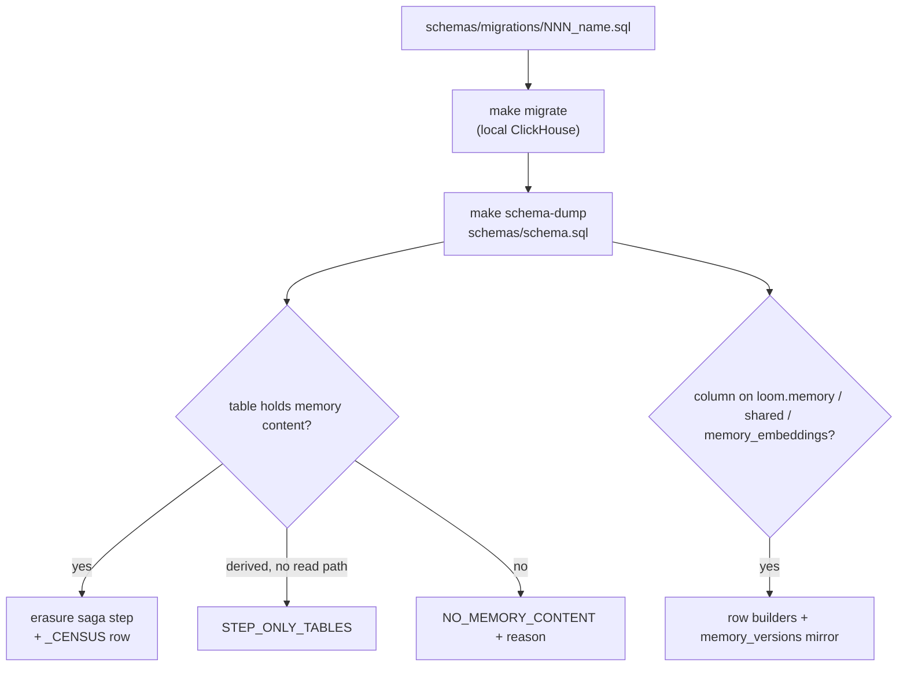

<!-- i18n: source=docs/development/adding-a-table.md blob=d8af79bee19277559de78fd0ef566e3df03ea7cb model=claude-sonnet-5-5 -->
> Esta página es una traducción automática de la [página en inglés](https://github.com/ClickHouse/loom/blob/main/docs/development/adding-a-table.md), que prevalece.
> Machine-translated from the [English page](https://github.com/ClickHouse/loom/blob/main/docs/development/adding-a-table.md), which is authoritative.

# Agregar una tabla o columna de ClickHouse

El estado de ClickHouse en Loom son tablas en las bases de datos `loom` y `loom_telemetry`; bajo la autoridad de memoria en Postgres, la memoria activa, el estado del conocimiento y los registros asociados están en Postgres. La página de [autoridad de almacenamiento](../architecture/storage-authority.md#the-tables) enumera las tablas de Postgres. El esquema de ClickHouse cambia únicamente mediante migraciones numeradas y aditivas, porque dos compilaciones sirven el mismo esquema durante un despliegue. Cada una de las reglas siguientes está respaldada por una prueba. [ClickHouse](../architecture/clickhouse.md) explica las familias de tablas.

## 1. Escribe la migración y regenera el esquema

[Migraciones](https://github.com/ClickHouse/loom/blob/main/docs/development/migrations.md) define las reglas: numeración, qué se considera aditivo, directivas del runner, reconstrucciones de la clave de ordenación, y `make schema-dump` / `make schema-check` contra el ClickHouse fijado. En resumen:

- Añade `schemas/migrations/<NNN>_<what>.sql` con el siguiente número libre. El comentario de cabecera indica para qué sirve el cambio y qué ven las filas antiguas y las compilaciones antiguas.
- Referencia las tablas como `loom.<table>` y escribe `IF NOT EXISTS` / `IF EXISTS`. La telemetría derivada de las tablas propias de Loom va en `loom_telemetry` ([por qué](../architecture/clickhouse.md)); preflight ya comprueba sus permisos, y el censo de borrado nombra la tabla con su base de datos.
- Nunca edites ni elimines una migración ya fusionada. Corrige un error con un archivo nuevo.
- Ejecuta `make migrate`, `make schema-dump` y después `python scripts/codegen/docs_reference.py` para que la [referencia del esquema](https://github.com/ClickHouse/loom/blob/main/docs/reference/schema.md) incluya la tabla.

Hasta que un despliegue aplique la migración, la protección de esquema del cliente rechaza cualquier lectura o escritura que nombre una tabla que una migración pendiente crearía, con `SCHEMA_PENDING`.

## 2. Replica todas las columnas en las rutas de escritura de ReplacingMergeTree

`loom.memory`, `loom.shared` y `loom.memory_embeddings` son tablas `ReplacingMergeTree(version)` que se leen con `FINAL`. Todo handler que escribe una nueva fila de versión (set, tombstone, restore, touch, `update_by_id`, `bulk_set`, promote, demote) arrastra **todas** las columnas persistidas. Una columna omitida en una versión posterior se lee como cero bajo `FINAL`.

Cuando añadas una columna a una de estas tablas:

1. Añádela a la lista canónica de columnas en `server/memory/store/rows.py`
   (`MEMORY_PERSISTED_COLS` o `EMBEDDING_PERSISTED_COLS`).
2. Inclúyela en los builders de ese archivo (`build_memory_version_row`, `build_revision_row`,
   `build_first_version_row`, `build_embedding_row`) y en toda proyección que los alimente
   (el `SELECT` que carga la fila existente).
3. Nunca construyas una fila de versión a mano en un handler; llama a los builders.

`tests/unit/test_memory_write_path_mirror.py` y `tests/unit/test_embedding_mirror_carry.py` comprueban las rutas de escritura secundarias.

**El espejo del historial.** `loom.memory_versions` es una réplica de solo anexado de `loom.memory`, rellenada por la vista materializada `memory_versions_mv`. `memory.history`, `memory.redact` y `namespace.rollback` la leen, porque las fusiones eliminan de `ReplacingMergeTree` las filas reemplazadas. Añade cada nueva columna de `loom.memory` a `loom.memory_versions` y al `SELECT` de la vista **en la misma migración**. `tests/unit/test_memory_versions_schema.py` compara ambas listas de columnas en `schema.sql` con `MEMORY_PERSISTED_COLS`.

Toda nueva ruta de escritura establece los valores `actor` y `source_class` asignados por el servidor (`server.memory.domain.provenance`), nunca valores tomados del cuerpo de la solicitud.

## 3. Clasificar la tabla para el borrado

El borrado es una saga (`server/erasure/app/saga.py`). Su último paso es un censo de residuos sobre todas las tablas que tocan las rutas de lectura; cualquier fila viva dentro del alcance hace fallar la saga en modo cerrado. `tests/unit/test_every_table_is_classified.py` falla ante cualquier `CREATE TABLE` de `schema.sql` que no esté en exactamente una de las tres listas de `server/erasure/store/census.py`:

| Lista               | Pon la tabla aquí cuando                                                                                                                         | También añades                                                                                                                                                   |
| ------------------- | ------------------------------------------------------------------------------------------------------------------------------------------------ | ---------------------------------------------------------------------------------------------------------------------------------------------------------------- |
| `_CENSUS`           | Puede contener contenido de memoria que sirve una ruta de lectura.                                                                               | Un paso de la saga que elimine las filas dentro del alcance, y un `Substrate(table, live, user_pred, ns_step, user_step)` que nombre ese paso para cada alcance. |
| `STEP_ONLY_TABLES`  | Un paso de la saga la modifica pero el censo no la cuenta (libros derivados, mapas de alias), con el motivo en el comentario sobre el dict.      | El paso, indexado por su nombre.                                                                                                                                 |
| `NO_MEMORY_CONTENT` | No contiene contenido de memoria dentro del alcance (contadores, cursores, cachés de datos públicos).                                            | Un motivo de una línea.                                                                                                                                          |

Para una tabla de `_CENSUS`:

- `live` es el predicado que cumple una fila viva (`tombstoned_at IS NULL`, o `"1"` cuando cuentan todas las filas); `user_pred` es `user_id = {uid:String}` cuando la tabla tiene un eje de usuario, y `None` para una tabla solo de espacio de nombres (en ese caso solo se cuenta en los borrados con alcance de espacio de nombres).
- El paso es una función en `server/erasure/store/steps_*.py`, listada con su nombre de paso en cada tabla de la saga que corresponda (`NAMESPACE_STEPS`, `USER_STEPS` en `server/erasure/app/saga_steps.py`), y `final=False` en el `Substrate` para un `MergeTree` simple (FINAL no es válido ahí).
- Una saga reanudada vuelve a ejecutar el paso propietario de cualquier tabla en la que el último censo encontró filas (`steps_to_reopen`), por lo que el paso debe ser idempotente.
- Una tabla del plano de código con clave `(org, namespace)` normalmente pertenece a `CODE_INDEX_STEP_ONLY_TABLES` (la elimina el paso `code_index.purge` de la saga); una prueba unitaria comprueba que esa tupla coincida con el esquema.

Prueba la forma de la sentencia del paso con un cliente stub, como hacen `tests/unit/test_erasure_repo.py` y `tests/unit/test_erasure_late_steps.py`.

## 4. Clasificar cualquier mutación

Un `ALTER TABLE loom.<t> UPDATE|DELETE` es una mutación de ClickHouse: reescribe las partes de forma asíncrona y no es transaccional. `tests/unit/test_clickhouse_mutation_inventory.py` cuenta todas las mutaciones visibles bajo `server/` y las compara con `_EXPECTED_MUTATIONS`. Una mutación nueva hace fallar la prueba hasta que la añades allí con un comentario que explique el motivo.

Es preferible usar una nueva fila de versión en una `ReplacingMergeTree`, una columna de tombstone o un `DELETE FROM` ligero. Nunca uses una mutación como un claim o un bloqueo del que dependa una solicitud; la bandeja de tareas hace sus claims mediante una tabla de lease `KeeperMap`.

## Lista de verificación

- [ ] Un nuevo `schemas/migrations/<NNN>_<what>.sql`, aditivo e idempotente; ningún archivo ya fusionado se edita.
- [ ] `make schema-dump` contra un ClickHouse fijado y limpio; `make schema-check` sin errores.
- [ ] `python scripts/codegen/docs_reference.py` para la referencia del esquema.
- [ ] Columnas RMT: la lista de columnas de `rows.py`, los constructores y las proyecciones; `memory_versions` y
      `memory_versions_mv` en la misma migración.
- [ ] Clasificación de borrado: `_CENSUS` + paso de saga, `STEP_ONLY_TABLES`, o
      `NO_MEMORY_CONTENT` con un motivo.
- [ ] Toda nueva mutación se incluye en el test de inventario.
- [ ] Una fila en el [diseño del almacenamiento](https://github.com/ClickHouse/loom/blob/main/docs/architecture/storage-layout.md), en la tabla de su familia
      para una tabla de ClickHouse (la sección de las tablas `_` para un nombre que empieza por `_`),
      con todas las columnas rellenas. `tests/unit/test_storage_layout_rows.py` comprueba que la
      fila existe (y, para una tabla de ClickHouse, que desaparece cuando la tabla se elimina; la fila de una tabla
      de Postgres eliminada se borra a mano), y, para una fila de ClickHouse, que su
      celda Today coincide con el esquema, su celda Erasure con el censo, y que sus citas nombran
      la tabla; mientras el volcado del esquema está pendiente, falla hasta que el volcado se incorpora.
- [ ] `make test-unit` (los tests de aditividad, numeración, espejo, clasificación e inventario).

## Relacionado

- [Migraciones](https://github.com/ClickHouse/loom/blob/main/docs/development/migrations.md)
- [ClickHouse](../architecture/clickhouse.md)
- [Retención y borrado](https://github.com/ClickHouse/loom/blob/main/docs/features/memory/retention-and-erasure.md)
- [Actualizaciones](https://github.com/ClickHouse/loom/blob/main/docs/operations/upgrades.md)
