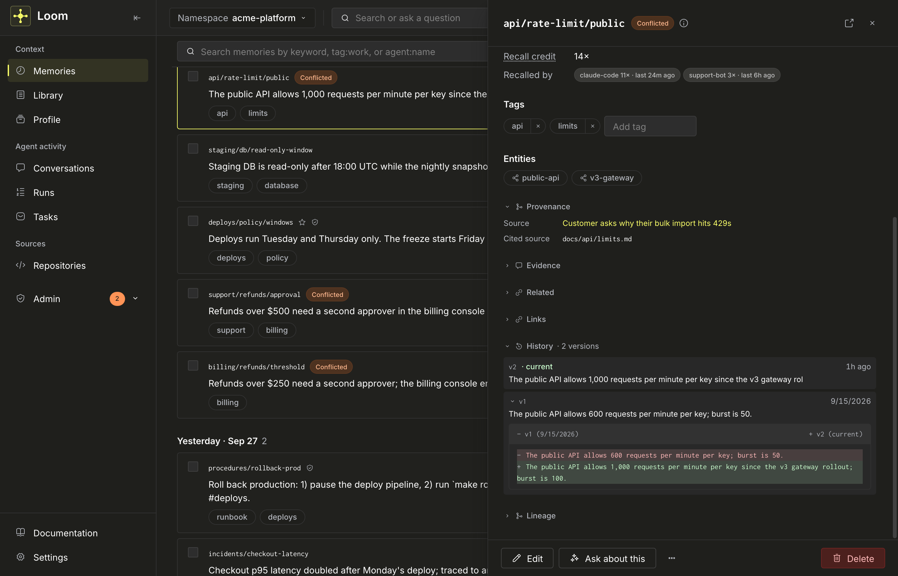

<!-- i18n: source=docs/features/memory/history-and-provenance.md blob=331db28f47c0d0f68295a93f97f4f36b6e5051ad model=claude-sonnet-5-5 -->
> Esta página es una traducción automática de la [página en inglés](https://github.com/ClickHouse/loom/blob/main/docs/features/memory/history-and-provenance.md), que prevalece.
> Machine-translated from the [English page](https://github.com/ClickHouse/loom/blob/main/docs/features/memory/history-and-provenance.md), which is authoritative.

<a id="history-and-provenance"></a>

# Historial y procedencia

Cada escritura en la memoria crea una nueva versión; nada se edita en el mismo lugar. Las versiones se conservan en un espejo de solo anexado, de modo que el historial de un hecho sobrevive a las fusiones en segundo plano. Cada fila registra quién la escribió y cómo entró en la memoria, las filas derivadas registran sus fuentes, y una persona puede certificar que una fila es verdadera. El funcionamiento del espejo de versiones se explica en [arquitectura de la memoria](../../architecture/memory-architecture.md).



<a id="operations"></a>

## Operaciones

| Operación            | Rol    | Responde                                                                                                                          |
| -------------------- | ------ | --------------------------------------------------------------------------------------------------------------------------------- |
| `memory.history`     | viewer | Todas las versiones de una clave, de la más reciente a la más antigua, incluidas las versiones eliminadas (tombstone) y las redactadas. |
| `memory.provenance`  | viewer | De dónde proviene la fila activa: traza de origen, escritor, clase de origen y la conversación de la que se extrajo.              |
| `memory.evidence`    | viewer | Los turnos de origen de los que se extrajo un hecho, con el fragmento que lo respalda y cómo se creó cada vínculo.                |
| `memory.backlinks`   | viewer | Qué apunta a una fila: versiones, resúmenes, vínculos tipados de entrada y salida, cantidad de evidencias y entidades vecinas.    |
| `memory.lineage`     | viewer | El historial de promoción de una memoria compartida: quién la promovió, desde qué filas y mediante qué revisión.                  |
| `memory.verify`      | writer | Certifica que una fila es verdadera como la persona o la cuenta de servicio que inició sesión, o revoca la certificación.        |
| `memory.redact`      | admin  | Borra el valor de una versión histórica, conservando la fila y su entrada de auditoría.                                           |
| `namespace.rollback` | admin  | Devuelve todas las cabeceras de memoria de un espacio de nombres a su versión en un momento dado.                                 |
| `namespace.snapshot` | admin  | Exporta el estado curado de un espacio de nombres como una carga útil JSON.                                                       |
| `namespace.restore`  | viewer | Importa un snapshot en un espacio de nombres nuevo, o en uno existente que el solicitante administra; nunca en una colección.     |

`namespace.snapshot` y `namespace.restore` no son herramientas MCP. Las listas de campos están en la
referencia de operaciones, en [memoria](https://github.com/ClickHouse/loom/blob/main/docs/reference/operations.md#memory) y
[espacio de nombres](https://github.com/ClickHouse/loom/blob/main/docs/reference/operations.md#namespace).

<a id="versions-memoryhistory"></a>

## Versiones: `memory.history`

`loom.memory` contiene el estado actual y se lee con `FINAL`, de modo que una fusión conserva solo la
versión más reciente de cada fila. `loom.memory_versions` es un espejo de solo anexado que llena una
vista materializada en cada inserción; es el historial que leen `memory.history`,
`memory.redact` y `namespace.rollback`.

Una fila de historial incluye `version` (la época en nanosegundos de la escritura), `written_at`, `value`,
`confidence`, `pinned`, `expires_at`, `tombstoned_at`, `redacted_at`,
`redaction_reason`, `content_sha256`, `agent`, `actor` y `source_class`. `created_at`
es la primera escritura de la fila y se repite en cada versión. `agent="*"` abarca a todos los escritores
de la clave.

```python
from loom import Agent

async with Agent(org="acme", namespace="support", agent="auditor") as agent:
    for v in await agent.memory.history("customer/4812/plan", agent_id="*"):
        print(v["written_at"], v["actor"], v["source_class"], v["value"])
```

Una lápida (tombstone) también es una versión, por lo que un borrado aparece en el historial y `memory.restore` puede
revivir la clave dentro de 14 días. Para lecturas del estado actual en un momento dado, usa `as_of` en
`memory.get`, `memory.search` y `memory.ask`
([tiempo de validez](https://github.com/ClickHouse/loom/blob/main/docs/features/memory/writing.md#validity-time-valid_at-and-valid_to)).

<a id="who-wrote-it-actor-and-source-class"></a>

## Quién lo escribió: actor y clase de fuente

El servidor registra `actor` (`human:<subject>` o `process:<subject>`) y `source_class`
en cada fila a partir del token y de la operación. Los valores de `source_class` están en
[conceptos de memoria](https://github.com/ClickHouse/loom/blob/main/docs/concepts/memory.md). Una solicitud solo puede rebajar su clase a
`external`, `imported` o `derived`.

`memory.provenance` devuelve ambos, además de:

- `source_trace` y un `source_kind` derivado de él (`conversation`, `extracted`,
  `observed`, `consolidated`, `app`, `manual`, `other`);
- el `source_resource_id` citado por quien escribió;
- el `thread_id` de la conversación y `thread_exists` (false cuando el espacio de nombres no
  registra transcripciones, o la transcripción ya no existe);
- los vínculos creados manualmente (`memory.link`) que tocan la fila.

Los resultados de búsqueda incluyen `source_class` y `verified`, que lee el término de confianza
opcional (`LOOM_MEMORY_SEARCH_TRUST_WEIGHT`).

<a id="evidence-which-turns-a-fact-came-from"></a>

## Evidencia: de qué turnos proviene un hecho

La extracción vincula cada hecho con sus turnos en `loom.memory_belief_sources`.
`memory.evidence(memory_key)` devuelve esos vínculos con el texto del turno (hasta 600
caracteres), el rol, la hora, el `span` de respaldo y la forma en que se creó el vínculo:

| `scope`   | `support_type`    | Significado                                                  |
| --------- | ----------------- | ------------------------------------------------------------ |
| `cited`   | `extracted_from`  | El extractor indicó el turno de respaldo.                    |
| `lexical` | `lexical_support` | El servidor asoció el hecho con su mejor turno.              |
| `window`  | `window`          | Nada coincidió; se vincula toda la ventana de extracción.    |
| `derived` | `derived_from`    | Linaje de consolidación: el elemento es el texto de la memoria de origen. |

La respuesta cuenta los vínculos por scope, de modo que una comprobación puede distinguir un hecho citado de
uno asociado de forma laxa. Para obtener la redacción exacta de una conversación, `memory.recall` busca en los turnos almacenados
([extracción](https://github.com/ClickHouse/loom/blob/main/docs/features/memory/extraction.md)).

<a id="lineage"></a>

## Linaje

- `memory.consolidate` y los resúmenes por período escriben un enlace `derived_from` por cada fuente en
  `loom.memory_belief_sources`; `memory.evidence` los devuelve como elementos `derived`.
- Un resumen de sesión lista las claves que comprimió (`derived_from` en un resultado de tipo `summary`).
- `memory.lineage` (`scope="shared"`) recorre la promoción de una memoria compartida: el evento, quién
  la promovió, las filas de apoyo, el candidato de aprendizajes del que proviene cuando hay una
  coincidencia (`match_confidence` `exact` o `inferred`) y los eventos de auditoría. `mechanism` es
  `review`, `import`, `auto` o `unknown`.
- `memory.backlinks` es la operación inversa: qué apunta a una fila.

`memory.delete` retira un resumen consolidado cuyas fuentes han desaparecido todas y degrada a
`conflicted` uno cuyas fuentes siguen existiendo.

<a id="attestation-memoryverify"></a>

## Atestación: `memory.verify`

`pinned` y `confidence` no indican quién comprobó un hecho. `memory.verify` lo registra: el
actor del token del llamante y el hash del contenido que atestiguó. Se direcciona la fila por
`memory_id`, o por `namespace` y `memory_key` con la identidad del escritor. Requiere permiso de
escritor sobre el espacio de nombres de la fila.

`memory.get` y `memory.get_by_id` devuelven `verification`, derivado del hash almacenado
y del hash actual de la fila:

| `verification` | Significado                                                                |
| -------------- | -------------------------------------------------------------------------- |
| `human`        | Una persona atestiguó y el contenido no ha cambiado desde entonces.        |
| `process`      | Una cuenta de servicio atestiguó y el contenido no ha cambiado desde entonces. |
| `stale`        | Alguien atestiguó, y el contenido ha cambiado desde entonces.              |
| `none`         | Nunca se atestiguó, o se revocó.                                           |

- Una edición no borra una atestación; la deja como `stale` hasta que alguien vuelva a verificar.
- `revoke=true` la borra. Volver a verificar una fila sin cambios por el mismo actor no hace nada
  (`changed=false`).
- El prefijo `human:` proviene del token, por lo que un agente no puede marcar su propia escritura como humana.
  El `actor` del cuerpo solo se lee en modo dev sin autenticación.
- Los snapshots y las restauraciones conservan las columnas de atestación; una restauración nunca elimina
  `verified_by`.

<a id="scrubbing-history-memoryredact"></a>

## Borrado de historial: `memory.redact`

`memory.redact(memory_id, version)` borra el texto de una versión histórica en todos los lugares donde se copió, y también cada versión de perfil que un modelo construyó a partir de la memoria. Registra `redacted_at` y `redaction_reason`, y conserva las filas y sus entradas de auditoría. Úsalo para un secreto o un dato personal que se filtró en una versión anterior.

| Dónde                                             | Qué ocurre                                                                                                                                                      |
| ------------------------------------------------- | --------------------------------------------------------------------------------------------------------------------------------------------------------------- |
| `loom.memory`, `loom.memory_versions`             | `value` pasa a ser `"[REDACTED]"`; `value_json`, `evidence`, `entities` y `concepts` se vacían.                                                                 |
| `loom.memory_embeddings`, `loom.memory_chunks`    | Se eliminan las filas cuyo extracto o hash de fragmento no coincide con el de la versión activa; las filas de la versión activa se conservan.                   |
| Las versiones de perfil del usuario construidas a partir de la memoria | Se borra del mismo modo cada versión cuya traza nombra la memoria, incluida la versión activa, junto con las filas derivadas de su clave.          |
| `loom.shared`, una copia promovida desde la clave | Cada versión cuyo `value` es el texto redactado pasa a ser `"[REDACTED]"`, y se eliminan sus filas de búsqueda. Una copia activa sigue promovida hasta que un administrador la degrade. |

Fuera de alcance: las etiquetas, los archivos, `content_sha256`, `loom.memory_evidence` (gestionada por el borrado definitivo), las tablas de linaje (solo ids y hashes) y el grafo de entidades. Una copia compartida se deja tal cual mientras la versión activa también contenga el texto redactado (una edición revertida byte por byte).

- Rechaza la versión activa de la memoria (`refused_head=true`): primero elimina o reescribe la clave. Un perfil activo ya borrado queda fuera de los renders, los packs y la búsqueda de perfiles hasta que el worker lo reconstruya.
- Ambos modos de bloqueo la rechazan, tanto en la clave propia de la memoria como en cualquier clave de perfil a la que alcance.
- Elimina las respuestas en caché de `memory.ask` y `code.ask` y los precedentes que citaron la clave o la clave de una copia compartida (`cache_rows_deleted`, `precedent_rows_deleted`). Para una clave de perfil a la que alcanza, la eliminación es a nivel de toda la organización: el perfil de cada usuario tiene la misma clave, así que borra todas las respuestas en caché y todos los precedentes de la organización cuya ventana contenía esa clave, en todos los espacios de nombres.
- El espacio de nombres se comprueba después de obtener el dato; un rechazo responde `redacted=false`, no 403.
- Una versión que no existe responde `redacted=false` y no borra nada, tampoco ninguna versión de perfil.
- Ejecuta un `ALTER TABLE … UPDATE` síncrono sobre las dos tablas de memoria (y sobre `loom.shared` cuando una copia aún contiene el texto) y un `DELETE` ligero sobre las filas derivadas: es una llamada administrativa.

Escrituras que compiten con la redacción de una copia compartida:

- una fila de búsqueda que el worker de embeddings escribe después de la purga, a partir de un stub que leyó antes, permanece hasta la siguiente redacción de la clave;
- una promoción de la clave pierde su fila de búsqueda hasta que se vuelva a promover;
- una degradación que leyó la copia antes del borrado escribe su marca de eliminación con el texto, que permanece hasta que esa versión se redacte de nuevo.

Una copia que una promoción posterior de su clave reemplazó, y que `loom.shared` ha fusionado y descartado desde entonces, ya no se encuentra: su fila de búsqueda, que `FINAL` ya no sirve, permanece hasta una purga posterior de la clave, y las respuestas en caché bajo una clave distinta de la redactada permanecen hasta que caducan.

Una copia cuyo valor es `"[REDACTED]"` cuenta como una que una redacción anterior ya borró, así que una memoria que contiene ese texto por sí misma y fue promovida pierde sus filas de búsqueda en la siguiente redacción de su clave.

El alcance sobre los perfiles y sus límites están en [seguridad](https://github.com/ClickHouse/loom/blob/main/docs/architecture/security.md#sensitivity).
Para eliminar los datos de una persona en todas partes, usa el [borrado definitivo](https://github.com/ClickHouse/loom/blob/main/docs/features/memory/retention-and-erasure.md#erasure).

<a id="rolling-a-namespace-back-namespacerollback"></a>

## Revertir un espacio de nombres: `namespace.rollback`

`namespace.rollback(as_of)` reinserta, para cada clave, la versión más alta anterior o igual a
`as_of` como la nueva versión principal, y marca con tombstone las claves creadas después. La reversión genera a su vez nuevas
versiones, por lo que puede deshacerse de la misma manera.

- Es una simulación por defecto (dry run) y reporta `reinstate`, `remove` y `sample`; `dry_run=false`
  la aplica.
- `memory_keys` (hasta 500) la restringe; `max_keys` (por defecto 5,000) limita una llamada y
  `truncated` indica que hay que volver a llamar.
- El `embedding_worker` vuelve a generar los embeddings de las versiones principales reinstauradas.
- Se rechaza un `as_of` anterior al historial del espacio de nombres o situado en el futuro.

```bash
curl -sX POST http://localhost:7777/v1/namespace.rollback \
  -H "Authorization: Bearer $LOOM_API_KEY" -H 'Content-Type: application/json' \
  -d '{"org":"dev","namespace":"local","as_of":"<YYYY-MM-DD>T09:00:00Z"}' \
  | jq '{reinstate, remove, truncated, sample}'
```

<a id="snapshots-namespacesnapshot-and-namespacerestore"></a>

## Snapshots: `namespace.snapshot` y `namespace.restore`

`namespace.snapshot` exporta el estado curado de un espacio de nombres como JSON: cada fila de memoria con
`version`, `content_sha256`, `actor`, `source_class`, las columnas de validez y de atestación,
la configuración por tipo, los grants y hasta `include_audit_tail_n` filas de auditoría
recientes (1,000 por defecto). `include_embeddings` es false por defecto, de modo que el destino vuelve a generar los embeddings
con su propio modelo.

`namespace.restore(target_namespace, payload)` escribe el payload de vuelta como filas de versión.
Es idempotente respecto a `snapshot_id` (una nueva ejecución responde `restored=false`). Restaura en un
espacio de nombres nuevo (quien llama pasa a ser admin; se rechaza si el nombre no tiene ninguna fila pero ya
contiene datos o grants, salvo que quien llama ya lo administre) o en uno que quien llama administra;
`rebind_agent` reasigna el escritor de cada fila. Las filas restauradas quedan como `imported`.

Un snapshot no es una copia de seguridad del despliegue; consulta
[copia de seguridad y recuperación](https://github.com/ClickHouse/loom/blob/main/docs/operations/backup-and-recovery.md).

<a id="the-audit-log"></a>

## El registro de auditoría

Cada escritura que crea o modifica la memoria deja una fila con solo el hash en `loom.audit_log`
(clave, id, hash del contenido, actor, clase de origen, veredicto; nunca el valor). Los puntos de control
horarios encadenan el registro. Consulta [auditoría](https://github.com/ClickHouse/loom/blob/main/docs/features/observability/audit.md).

<a id="limits"></a>

## Límites

- **La redacción de una versión fusionada es de mejor esfuerzo** en `loom.memory`; el mirror se depura en cualquier caso.
- **El historial solo es tan completo como el mirror.** Una columna añadida a `loom.memory` debe añadirse a `loom.memory_versions` y a su vista en la misma migración.
- **La validez es únicamente de tiempo de validez (valid-time).** `knowledge_time` reproduce `created_at` frente a las marcas de retiro (`invalid_at`) y de eliminación (`tombstoned_at`); no existe una tabla separada de tiempo de transacción.
- **`thread_exists=false` no es un error.**
- **Una reversión (rollback) no restaura las claves eliminadas de forma definitiva** (`skipped_no_head`).

<a id="related"></a>

## Relacionado

- [Escritura de memoria](https://github.com/ClickHouse/loom/blob/main/docs/features/memory/writing.md)
- [Conflictos y rechazo](https://github.com/ClickHouse/loom/blob/main/docs/features/memory/conflicts-and-refusal.md)
- [Retención y borrado](https://github.com/ClickHouse/loom/blob/main/docs/features/memory/retention-and-erasure.md)
- [Auditoría](https://github.com/ClickHouse/loom/blob/main/docs/features/observability/audit.md)
