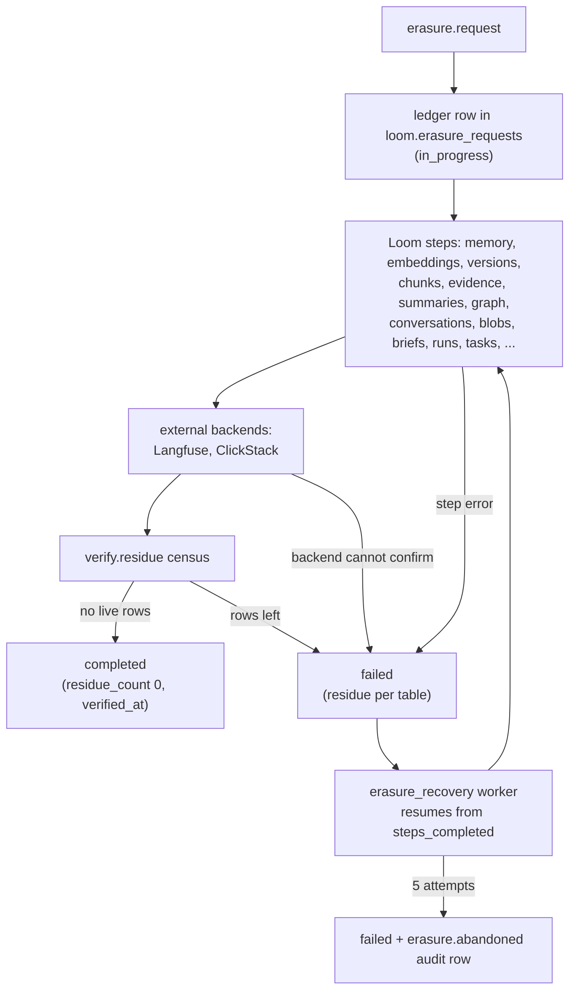

<!-- i18n: source=docs/features/memory/retention-and-erasure.md blob=193d8b98f7242dbe87366e0149f838322897ecdd model=claude-sonnet-5-5 -->
> Esta página es una traducción automática de la [página en inglés](https://github.com/ClickHouse/loom/blob/main/docs/features/memory/retention-and-erasure.md), que prevalece.
> Machine-translated from the [English page](https://github.com/ClickHouse/loom/blob/main/docs/features/memory/retention-and-erasure.md), which is authoritative.

<a id="retention-and-erasure"></a>

# Retención y borrado

Loom no elimina ninguna memoria a menos que lo solicite quien la escribió, el propietario del espacio de nombres o el operador. La memoria no tiene una vida útil por defecto. Los datos salen de tres maneras: una expiración o eliminación hecha por quien escribe, una retención que configuró un propietario u operador, y un borrado que elimina un ámbito en todos los lugares donde Loom lo guarda.

<a id="what-is-kept-and-for-how-long"></a>

## Qué se conserva y por cuánto tiempo

Ninguna tabla de memoria, embeddings, historial de versiones, conversaciones, entidades, resúmenes, memoria de trabajo o conocimiento tiene un TTL en `schemas/schema.sql`, y ningún worker retira filas por antigüedad.
Las tablas de enlaces `entity_triple_rows` y `entity_edge_rows` siguen a `entity_triples` y
`entity_edges`: sin TTL. Una eliminación definitiva (erasure) borra los enlaces de las memorias que elimina, y
`loom erasure-re-verify --completed-since … --resume` borra los enlaces huérfanos que dejó la eliminación de una compilación anterior.
Una fila sale del conjunto servido solo cuando:

- **la elimina quien la escribió**: `memory.delete`, una reescritura con la misma clave que la sustituye,
  `memory.apply`, `memory.clear`, `conflicts.resolve`, `blacklist.add(sweep=true)`;
- **quien la escribió definió una caducidad**: `ttl_seconds` o `valid_to` en `memory.set`,
  `memory.touch`, `run.complete(retain="expire")`, el `expires_in_days` de una reflexión;
- **el propietario o el operador configuró una**: consulta la [retención configurada](#configured-retention).

Las tablas operativas (telemetría, cachés, colas) tienen TTL fijos: `loom.search_trace_log`
y `loom.memory_exposures` 180 días; `loom.erasure_requests` y
`loom.policy_decisions` 90 días; `loom.memory_drops`, `loom.memory_extraction_queue`,
`loom.events` y `loom.embedding_cache` 30 días; `loom.llm_response_cache` 7 días. La
[referencia del esquema](https://github.com/ClickHouse/loom/blob/main/docs/reference/schema.md) lista el TTL de cada tabla.

Un worker elimina datos según un temporizador: `namespace_gc` purga los espacios de nombres de
`kind = 'bench'` (identificados por `LOOM_NAMESPACE_BENCH_PREFIXES` en el registro automático) sin
escrituras durante `LOOM_NAMESPACE_GC_IDLE_HOURS`, mediante una saga de eliminación definitiva. Nunca toca
otros tipos. Consulta [espacios de nombres y uso compartido](https://github.com/ClickHouse/loom/blob/main/docs/features/namespaces-and-sharing.md).

<a id="delete-is-not-erase"></a>

### Borrar no es eliminar definitivamente

Una lápida (tombstone) es una nueva versión con `tombstoned_at` definido. Las lecturas dejan de servirla de inmediato, pero
la fila y sus versiones anteriores en `loom.memory_versions` siguen en disco:

- `memory.restore` revive una clave con lápida dentro de 14 días (después responde
  `expired=true`). También revierte una sustitución automática.
- `memory.clear` (admin) pone una lápida a todas las memorias de un agente o usuario en un espacio de nombres;
  `confirm_subject` debe repetir el `user_id` o `agent` concreto (ni `'*'` ni `'-'`
  confirman). `agent="*"` con un `user_id` borra las filas de ese usuario bajo cualquier agente, y
  `user_id="*"` con un `agent` borra las filas de ese agente para todos los usuarios. Se rechaza un alcance que no nombre a nadie
  salvo `'-'`, igual que un borrado de todo el espacio de nombres. Las filas bloqueadas permanecen y se cuentan en
  `locked_skipped`. Las claves borradas se reviven del mismo modo.

Para eliminar los bytes, usa una [eliminación definitiva](#erasure). Para quitar un valor pero conservar la fila y el
rastro de auditoría, usa [`memory.redact`](https://github.com/ClickHouse/loom/blob/main/docs/features/memory/history-and-provenance.md#scrubbing-history-memoryredact).

<a id="writer-set-expiry"></a>

### Caducidad definida por el escritor

Una fila se oculta de las lecturas en el momento en que pasa su `expires_at`. Después, el worker
`memory_expiry_sweep` aplica el `on_expire` del escritor como una nueva versión:

| `on_expire`           | Efecto                                                                                                                       |
| --------------------- | ---------------------------------------------------------------------------------------------------------------------------- |
| `tombstone` (predeterminado) | Se le pone lápida, con la ventana de restauración de 14 días.                                                         |
| `demote`              | Se borra la caducidad; confianza × `LOOM_MEMORY_EXPIRY_DEMOTE_FACTOR` (0.5), nunca por debajo de `LOOM_MEMORY_EXPIRY_DEMOTE_FLOOR` (0.05). |
| `anonymize`           | El valor se reemplaza por un marcador y se descartan los embeddings; la fila permanece como prueba de que existió.           |

`memory.touch` cambia solo la caducidad de una fila, para una clave o hasta 1,000 (`memory_keys`): un
nuevo `ttl_seconds`, `clear_expiry=true` o un nuevo `on_expire`. `memory.sweep_expired`
(admin) ejecuta un barrido para un espacio de nombres bajo demanda, con `dry_run`. Una edición de otros campos
mantiene una caducidad vigente.

<a id="configured-retention"></a>

### Retención configurada

Todo está desactivado de forma predeterminada (0 = conservar siempre).

| Dónde                        | Se define con                                                                                              | Efecto                                                                                                                                                   |
| ---------------------------- | ---------------------------------------------------------------------------------------------------------- | -------------------------------------------------------------------------------------------------------------------------------------------------------- |
| Un tipo de memoria en un espacio de nombres | `retention_days` en una entrada `tag_registry` de `namespace.register`                      | Una fila que `memory.set` escribe sin caducidad vigente, `ttl_seconds` ni `clear_expiry` recibe `expires_at = now + N days`; una fila `read_only` reafirmada no recibe ninguna. |
| Filas sensibles              | `LOOM_MEMORY_SENSITIVE_RETENTION_DAYS`, `LOOM_MEMORY_SENSITIVE_ON_EXPIRE` (predeterminado `anonymize`)     | Las filas nuevas de sensibilidad `medium` / `high` reciben una caducidad; prevalece una caducidad más corta del llamante.                               |
| Las escrituras de una ejecución | `LOOM_MEMORY_RUN_COMPLETE_RETAIN` (`keep`, `demote`, `expire`), `LOOM_MEMORY_RUN_COMPLETE_EXPIRE_DAYS` (7) | Lo que `run.complete` hace con las filas de la ejecución cuando la llamada no lo indica. Las filas fijadas, verificadas, promovidas, bloqueadas, episódicas y de reflexión siempre se conservan. |
| Un espacio de nombres completo | `retention_days`, `warm_days` en `namespace.register`                                                    | Un TTL de tabla (y traslado al nivel cálido) para las filas de ese espacio de nombres.                                                                   |
| El despliegue                | `LOOM_RETENTION_<TABLE>_DAYS`, `LOOM_TIERING_<TABLE>_WARM_DAYS`                                            | Un TTL de tabla (y traslado al nivel cálido) en `audit_log`, `agent_events`, `memory`, `memory_embeddings`, `conversations`, `chunks`, `documents`.      |

Bajo la autoridad de Postgres, ninguna de las dos últimas filas pone un TTL de retención en
`memory`, `memory_embeddings` ni `documents`: eliminaría la copia en ClickHouse de filas que
Postgres aún sirve, por lo que el arranque rechaza `LOOM_RETENTION_MEMORY_DAYS`,
`LOOM_RETENTION_MEMORY_EMBEDDINGS_DAYS` y `LOOM_RETENTION_DOCUMENTS_DAYS`
([autoridad de almacenamiento](../../architecture/storage-authority.md)). El
`retention_days` de un espacio de nombres tampoco afecta a `chunks`, de modo que un documento que permanece conserva los fragmentos con los que la búsqueda lo encuentra; `LOOM_RETENTION_CHUNKS_DAYS` sigue aplicándose.

El worker `retention_reconcile` aplica las dos últimas filas como un `ALTER TABLE … MODIFY TTL` idempotente por tabla, por `(org, namespace)` cuando existen sobrescrituras, y
elimina el TTL de una tabla cuando ya no queda ningún espacio de nombres ni ventana de despliegue sobre ella. En
`loom.memory` el TTL se basa en `coalesce(expires_at, created_at)`, de modo que la caducidad del escritor
prevalece.

- **Un TTL de tabla elimina físicamente** en la siguiente fusión (merge) de la parte. No hay ventana de restauración, y las lápidas caducan junto con las filas que ocultan.
- **Un Undo se mantiene mientras se mantenga su registro.** El resolutor de conflictos respeta el Undo de una persona
  sobre una retirada mediante su fila `memory.unsupersede` en `audit_log`. Con un TTL de `audit_log`
  más corto que la vida de un par, un Undo caducado deja de mantenerse, y el resolutor puede juzgar
  y retirar ese par de nuevo.
- **El almacenamiento por niveles necesita un volumen.** `LOOM_TIERING_WARM_VOLUME_NAME` debe nombrar un volumen de la
  política de almacenamiento, y la antigüedad cálida debe ser menor que la antigüedad de retención.

<a id="erasure"></a>

## Borrado

`erasure.request` borra un ámbito en todos los lugares donde Loom lo conserva, y responde cuando puede demostrar que no queda nada del ámbito. Para borrar todo lo que un id de usuario tiene en la organización, un administrador de la organización solicita el ámbito `user_id`, que borra las filas del usuario en todos los espacios de nombres de la organización (`purge=true` las elimina en lugar de marcarlas con una lápida; lo que deja se enumera más abajo). `memory.clear` marca con una lápida las memorias de un agente o de un usuario solo en un espacio de nombres ([eliminar no es borrar](#delete-is-not-erase)).

| `scope_type`     | `scope_value`                                                               | Quién puede solicitarlo                                         |
| ---------------- | --------------------------------------------------------------------------- | --------------------------------------------------------------- |
| `user_id`        | El id de usuario, en todos los espacios de nombres de la organización       | Un administrador de la organización                             |
| `namespace`      | Un espacio de nombres                                                       | Un administrador de ese espacio de nombres (o de la organización) |
| `namespace_list` | Un arreglo JSON de 1–500 espacios de nombres, o `{"namespaces": [...], "purge": bool}` | Un administrador de la organización                             |

La op se puede invocar con un token de escritor, pero el handler exige permisos de administrador sobre el destino (de lo contrario, 403 `AUTH_INSUFFICIENT`).

Los vínculos de categoría (`loom.memory_categories`) no llevan usuario, así que un borrado de `user_id` los deja, junto con las filas de auditoría de `memory.import` que los enumeran. Para un elemento importado, la clave del vínculo es `import:` más un resumen (digest) de su texto, que permite confirmar un texto adivinado; un borrado de `namespace` elimina los vínculos.

Un borrado de `user_id` elimina los chunks literales marcados con el usuario y los chunks sin usuario (`-`) bajo alguno de los pares `(namespace, key)` del usuario, sea de quien sea la memoria a la que pertenezcan: un chunk `-` puede contener texto del usuario, y la ruta de escritura también los retira como del escritor. Los chunks marcados con otro usuario permanecen.

Un borrado de `user_id` también retira los resúmenes consolidados construidos a partir de las memorias del usuario, con la identidad que los haya escrito ([cuáles](../../architecture/memory-architecture.md#background-passes)), junto con lo derivado de ellos: su historial de versiones, sus chunks literales y vectores de entidades, las filas del grafo extraídas de ellos y las copias a nivel de espacio de nombres promovidas a partir de ellos. También elimina las respuestas de `memory.ask` en caché y los precedentes que los citaban.

<a id="the-saga"></a>

### La saga



- **Pasos con puntos de control e idempotentes.** Cada paso terminado se registra en `steps_completed`. El worker `erasure_recovery` reanuda desde su punto de control una saga que quedó en `in_progress` o `failed`. Un paso espera hasta `LOOM_ERASURE_MUTATION_WAIT_S` a su mutación y, si no termina, falla nombrándola.
- **Las fuentes de documentos se detienen antes de que se vayan los documentos.** Un borrado de espacio de nombres retira las [fuentes de documentos](https://github.com/ClickHouse/loom/blob/main/docs/features/knowledge.md#document-sources) del espacio de nombres en `knowledge_sources.retire`, su primer paso, y borra sus credenciales; luego espera a que termine el turno de sincronización de cada fuente que siga en ejecución (hasta 30 segundos en total; un turno que sigue en ejecución hace fallar el paso con `OVERLOADED`, y `erasure_recovery` reintenta la saga), de modo que ninguna sincronización vuelva a escribir un documento o una decisión extraída después de que los pasos posteriores los borren.
- **Los vínculos de código esperan al worker de vínculos.** `code_links.delete` toma el lease de cola del worker de vínculos de código, de modo que ninguna pasada publique un cursor que leyó antes del borrado: entre hosts con Keeper, dentro de un mismo proceso sin él. Espera hasta 15 minutos a que termine una pasada; pasado ese tiempo el paso falla con `LeaseBusy` y `erasure_recovery` lo reintenta.
- **Lápida o purga.** De forma predeterminada, las tablas de borrado lógico (memoria, embeddings, chunks, resúmenes, vínculos) se marcan con una lápida, y `memory.restore` todavía puede revivirlas dentro de la ventana; `erasure.list` informa esas reanimaciones como `reversals_count`. `purge=true` elimina las filas en su lugar (un `DELETE FROM` ligero en las tablas anchas). Un ámbito que contiene un espacio de nombres que alguna vez tuvo un mirror se purga entero, todos los espacios de nombres que contiene, de modo que ninguno tiene esa ventana ([fuentes de documentos](https://github.com/ClickHouse/loom/blob/main/docs/architecture/document-sources.md#the-mirror)). Un borrado de usuario encuentra lo que las memorias del usuario alimentaron a través de sus claves, así que en una purga sus filas de `loom.memory` y los resúmenes consolidados construidos a partir de ellas se marcan primero con una lápida y se eliminan en `memory.retire`, después de todos los pasos que leen esas claves; hasta entonces `memory.restore` puede revivirlos (las filas propias del usuario cuentan como una reversión, los resúmenes no), y `memory.retire` elimina lo que `memory.restore` revivió.
- **Originales subidos** de documentos de conocimiento: primero se eliminan las filas del espacio de nombres en `loom.document_blobs` y se registra `blob_erased_at`. Un borrado de usuario elimina los originales que ese usuario subió y que no comparte ningún documento activo de otro escritor, encontrados a través de `loom.blob_uploads` (una fila por subida de cada usuario final, ya que la versión del documento que nombraba un original pudo haber sido reemplazada y fusionada) y a través de sus documentos; después se van sus filas de `loom.blob_uploads`. El censo cuenta ambas tablas. Los originales guardados en un bucket compatible con S3 (`LOOM_DOCUMENT_OBJECT_STORE=s3`) se eliminan antes que sus filas: un borrado de espacio de nombres elimina todos los objetos del ámbito bajo su prefijo y el censo cuenta lo que queda allí (`objects.document_originals`); un borrado de usuario elimina todos los objetos que contienen bytes de los originales propios del usuario, los nombre una fila o no, vuelve a listar sus prefijos y hace fallar el paso si el almacén conservó alguno, luego elimina las filas y después elimina lo que esos prefijos aún contienen y ninguna fila nombra, de modo que la propia subida del usuario de esos bytes, cuya fila se llevó el borrado, también pierde su objeto. Una subida de esos bytes que siga en curso cuando se ejecuta el paso, de cualquier escritor (su objeto almacenado, su fila aún no insertada), pierde su objeto, y su fila, una vez insertada, responde `410 BLOB_GONE`. Cada lote de originales se vuelve a leer justo antes de eliminarse, así que un original que el documento de otro escritor haya nombrado desde entonces permanece; otro escritor que almacene los mismos bytes en el mismo espacio de nombres después de esa lectura puede perderlos, igual que en el almacén de ClickHouse. Una fila que nombra un objeto mientras no hay bucket configurado, o uno fuera del bucket y prefijo configurados, hace fallar el paso en lugar de dejar los bytes. En cualquiera de los dos almacenes, un borrado de usuario elimina las filas en el menor número de mutaciones en que caben sus originales (cada una enlaza tantos como un parámetro de ClickHouse puede llevar). Mover originales de ClickHouse al bucket (`loom knowledge migrate-originals`) está protegido por este ledger: no mueve un original que cubra un borrado sin terminar, y un movimiento que un borrado alcanza termina como ese borrado decida ([dónde se almacenan los originales](https://github.com/ClickHouse/loom/blob/main/docs/features/knowledge.md#where-originals-are-stored)).
- **Las cancelaciones de ingesta.** Un borrado de usuario elimina las filas de ingesta del usuario, entre ellas las cancelaciones. Una cancelación que el usuario pidió sobre el trabajo de otro escritor que sigue pendiente o en procesamiento se conserva primero como una fila sin identidad (`agent`, `user_id` y `session_id` en `'-'`, `actor` vacío), de modo que ese trabajo siga cancelado.
- **Cachés de toda la organización.** `loom.idempotency` (respuestas reproducidas) y `loom.embedding_cache` (vectores de consultas, nunca su texto) llevan la organización pero no un espacio de nombres ni un usuario final, así que un borrado en cualquiera de los dos ámbitos elimina todas las filas de la organización en ambas tablas. El costo son fallos de caché. El censo cuenta `loom.idempotency` en toda la organización pero no `loom.embedding_cache`, que cualquier búsqueda de la organización vuelve a llenar; la caché de vectores en el proceso de cada réplica expira dentro de `LOOM_EMBEDDING_CACHE_TTL_S`.
- **Aprendizajes de reglas del bot.** Las palabras de un usuario en la cola de aprendizajes viven solo en sus filas de `loom.learnings_supporters`, que un borrado de usuario elimina. Un candidato a regla que se queda sin ningún respaldo se elimina entonces si está pendiente, o conserva su decisión con la regla en blanco ([extracción](https://github.com/ClickHouse/loom/blob/main/docs/features/memory/extraction.md#rules-the-assistant-states-about-itself)). El censo cuenta esos candidatos sin respaldo en toda la organización, no solo los del usuario borrado, por lo que una saga puede fallar por un candidato que otro borrado de la organización dejó a medio paso; su paso reabierto lo limpia.

<a id="the-federated-cascade"></a>

### La cascada federada

Los datos que Loom envió a otros sistemas se borran en la misma saga. Los pasos externos fallan en modo cerrado: un backend que no puede confirmar el borrado (5xx, timeout, caída de red, una respuesta de salud de Langfuse sin versión) hace fallar el paso, y el worker reintenta. "Nada que borrar" (cero filas coincidentes, o una tabla de ClickStack que el servicio no tiene) cuenta como éxito.

| Backend    | Configurado por                                            | Borra                                                                                                     |
| ---------- | ---------------------------------------------------------- | --------------------------------------------------------------------------------------------------------- |
| Langfuse   | `LOOM_LANGFUSE_URL` + `LOOM_LANGFUSE_ADMIN_TOKEN`          | Trazas encontradas por `userId` dentro de la etiqueta de la organización, o por el par de etiquetas `org:` + `namespace:`. |
| ClickStack | `LOOM_CLICKSTACK_DATABASE`, `LOOM_CLICKSTACK_USER_ID_KEYS` | Filas OTel en el mismo servicio de ClickHouse, que coinciden con las claves de atributo del id de usuario o con el espacio de nombres. |

Un borrado de espacio de nombres en ClickStack solo coincide con una fila `loom.namespace` cuando lleva el `loom.org` de la organización que borra, de modo que las métricas propias de Loom de ops y de dominio, que no llevan organización, conservan la etiqueta del espacio de nombres ([borrado en ClickStack](https://github.com/ClickHouse/loom/blob/main/docs/features/integrations/clickstack.md#erasure)).

Un backend sin configurar registra la intención y no borra nada. Solo un borrado de `namespace_list` puede pasar `external=false`; los borrados de `user_id` y `namespace` siempre incluyen los backends. `LOOM_EXTERNAL_ERASURE_TIMEOUT_S` limita cada llamada. Configuración: [Langfuse](https://github.com/ClickHouse/loom/blob/main/docs/features/integrations/langfuse.md) y [ClickStack](https://github.com/ClickHouse/loom/blob/main/docs/features/integrations/clickstack.md).

<a id="the-residue-census"></a>

### El censo de residuos

El último paso, `verify.residue`, cuenta las filas activas del ámbito en todas las tablas que tocan las rutas de lectura. Cualquier fila restante hace fallar la saga; la fila terminal lleva `residue_count`, `residue` (por tabla), `verified_at` y `census` (todos los conteos, más abajo). Una saga reanudada vuelve a ejecutar el paso que es dueño de cualquier tabla en la que el último censo encontró filas, aunque su punto de control diga que terminó, y siempre vuelve a contar.

<a id="the-receipt"></a>

### El comprobante

`erasure.status` (y la respuesta de `erasure.request`) lleva el comprobante del censo de la última ejecución. `census` es null cuando la última fila del ledger no contiene un censo que haya contado todos los almacenes: una ejecución en curso, un censo que no pudo ejecutarse o dejó un almacén sin contar, o una fila escrita por una compilación que no guarda censo. Los campos del comprobante:

- `census`: cada sustrato que el censo contó y su conteo, incluidos los ceros. Las claves son nombres de tabla, `pg:<table>` para la autoridad de Postgres, `objects.document_originals` para el bucket de documentos en un ámbito de espacio de nombres, y `provider_rebuild_copies` sumado sobre las copias de una reconstrucción de proveedor, 0 cuando no existe ninguna (contado en todo el despliegue cuando una copia no tiene columna de organización). Un conteo son las filas que el censo cuenta como residuo en este ámbito: filas activas, o todas las filas cuando la saga purga o la tabla no conserva lápidas ([las reglas del censo](../../architecture/memory-architecture.md#erasure-saga)). `objects.document_originals` cuenta una primera página de listado, así que se lee como "al menos".
- `purge`: el modo de eliminar o marcar con lápida del ámbito (el de un solo espacio de nombres es lápida, se haya pedido lo que se haya pedido); un ámbito que contiene un mirror ([fuentes de documentos](https://github.com/ClickHouse/loom/blob/main/docs/architecture/document-sources.md#the-mirror)) se elimina digan lo que digan estos valores. Sin purga, una fila con lápida conserva sus bytes en su parte hasta que la tabla se fusiona; con purga las filas se eliminan, y sus bytes permanecen en disco hasta que una fusión o el worker de recuperación de espacio los elimina.
- El sujeto y el momento son `org`, `scope_type`, `scope_value` y `verified_at` del estado.

El comprobante es el conteo de Loom. Conserve la respuesta: `erasure.status` sirve la fila del ledger durante 89 días después de la solicitud, y la fila de auditoría `erasure.completed`, que también lleva el censo, se escribe después de la fila completada, en la medida de lo posible, y se conserva durante `LOOM_RETENTION_AUDIT_LOG_DAYS`. Cuando quien lo solicitó no recibió respuesta (una saga que terminó el worker de recuperación, una ejecutada en segundo plano, una llamada que agotó el tiempo), lea `erasure.status` dentro de los 89 días.

<a id="checking-an-erasure-yourself"></a>

#### Verificar usted mismo un borrado

Un operador que tenga la concesión de la superficie SQL de la organización con `--namespaces '*'`, o `--all` ([superficie SQL](https://github.com/ClickHouse/loom/blob/main/docs/reference/sql-surface.md#access)), puede volver a contar tres de las claves del censo, `loom.memory`, `loom.memory_versions` y `loom.conversations`, y revisar el ledger de solicitudes (la cuarta sentencia, más abajo). Enlace el id borrado y el momento del censo como parámetros. ClickHouse igualmente escribe los valores enlazados en `system.query_log`, como hace con las sentencias del propio borrado (más abajo), así que ejecute la verificación desde `clickhouse-client` en lugar de hacerlo a través de `pg_clickhouse`, cuyo texto delegado un registro de sentencias de Postgres conservaría como una copia más:

```bash
read -r uid  # the erased id, typed at the prompt so it stays out of the shell history
clickhouse-client --param_org='<org>' --param_uid="$uid" --param_at='<verified_at>' \
  --multiquery --query "
SELECT count() FROM loom.sql_v1_memories WHERE org = {org:String}
  AND user_id = {uid:String} AND created_at <= {at:DateTime64(6, 'UTC')};
SELECT count() FROM loom.sql_v1_memory_history WHERE org = {org:String}
  AND user_id = {uid:String} AND created_at <= {at:DateTime64(6, 'UTC')};
SELECT count() FROM loom.sql_v1_conversations WHERE org = {org:String}
  AND user_id = {uid:String} AND ts <= {at:DateTime64(6, 'UTC')};
SELECT count() FROM loom.sql_v1_agent_events WHERE org = {org:String}
  AND user_id = {uid:String} AND ts <= {at:DateTime64(6, 'UTC')};"
```

El filtro `org` limita al org de la eliminación una concesión que cubre más de un org (`--all`).
Cada sentencia sigue leyendo todo el alcance de la concesión antes de filtrar ([qué cuesta una lectura](https://github.com/ClickHouse/loom/blob/main/docs/reference/sql-surface.md#what-a-read-costs)), de modo que en un org grande o con una concesión `--all` una sentencia puede detenerse en los límites del usuario SQL (`LOOM_CH_ANALYSIS_MAX_ROWS_TO_READ`, `_MAX_EXECUTION_S`) con un error en lugar de un recuento; súbelos para la comprobación. Para un alcance de espacio de nombres, pasa `--param_ns='<namespace>'` y filtra las tres primeras por `namespace =
{ns:String}` en lugar de `user_id`; para un `namespace_list`, ejecútalo una vez por cada nombre en los `namespaces` de su `scope_value`; la sentencia `sql_v1_agent_events` es solo para un alcance de usuario, ya que una eliminación de espacio de nombres conserva las filas del registro de solicitudes del espacio de nombres. Cada recuento es 0 después de una eliminación completada, con estas diferencias respecto al censo: las vistas excluyen los espacios de nombres restringidos, `sql_v1_memories` excluye las filas rechazadas y con tombstone, y `sql_v1_memory_history` excluye las versiones rechazadas (conserva las que tienen tombstone), y un resumen consolidado a partir de las memorias del usuario lleva otro `user_id`, que el censo cuenta y estas consultas no. El recuento del registro de solicitudes es una comprobación aparte, fuera del recibo: una eliminación depura las filas del registro de solicitudes de un usuario a `<erased>` en lugar de borrarlas, y la vista del registro de solicitudes contiene solo su ventana ([`sql_v1_agent_events`](https://github.com/ClickHouse/loom/blob/main/docs/reference/sql-surface.md#sql_v1_agent_events)), así que confirma la depuración solo para las filas dentro de ella. Cualquier otra clave del censo es solo el recuento de Loom.

Lo que el recibo no cubre:

- copias de seguridad, recuperación a un punto en el tiempo, WAL y standbys de cualquiera de los dos servicios;
- copias hechas fuera de Loom, como una tabla creada en el Postgres propio de un org a partir de la [superficie SQL](https://github.com/ClickHouse/loom/blob/main/docs/reference/sql-surface.md);
- filas que un worker escribe después del censo a partir de una lectura que hizo antes ([autoridad de almacenamiento](../../architecture/storage-authority.md#erasure));
- un `namespace.restore` desde una instantánea tomada antes de la eliminación, que recupera filas: ejecuta la eliminación de nuevo, y su censo es el nuevo recibo;
- para un alcance de usuario, los originales de documentos en el bucket, que el censo cuenta solo para un alcance de espacio de nombres.

El id eliminado permanece donde la prueba de eliminación lo necesita: en la fila del registro (hasta que el TTL de la tabla la descarta, 90 días después de la solicitud), en la auditoría, en `loom.erasure_reversals` y en los logs propios del despliegue de las sentencias que lo nombraron (el log de mutaciones de ClickHouse, `system.query_log` y `system.text_log` para una sentencia que lo escribió, y los logs de sentencias de Postgres con `log_statement` o `log_min_duration_statement` activados).

<a id="abandoned-sagas"></a>

### Sagas abandonadas

Tras 5 intentos el worker marca la solicitud como `failed` de forma definitiva y escribe una fila de auditoría `erasure.abandoned`, con `failure_reason` y `steps_completed`. Entonces una persona debe escalar el caso. `loom erasure-re-verify` vuelve a comprobar las sagas terminales; `--resume` vuelve a ejecutar las fallidas desde su punto de control (`--skip-external` para una saga `namespace_list` cuyo paso externo sigue fallando). `--completed-since <ISO timestamp>` vuelve a comprobar las sagas completadas verificadas desde entonces en lugar de las fallidas, para las eliminaciones que ejecutó una versión anterior durante una actualización; con `--resume` borra solo los vínculos de filas huérfanas ([mantenimiento](https://github.com/ClickHouse/loom/blob/main/docs/operations/maintenance.md#erasure)). Consulta la [resolución de problemas](https://github.com/ClickHouse/loom/blob/main/docs/operations/troubleshooting.md).

<a id="operations"></a>

### Operaciones

| Op                | Rol                          | Qué hace                                                                                                                                                                                                                                                                                                                                                    |
| ----------------- | ---------------------------- | ----------------------------------------------------------------------------------------------------------------------------------------------------------------------------------------------------------------------------------------------------------------------------------------------------------------------------------------------------------- |
| `erasure.request` | writer (admin sobre el destino) | Ejecuta la saga para un alcance. `urgency` `normal` o `urgent`; `purge`; `external`.                                                                                                                                                                                                                                                                        |
| `erasure.status`  | viewer                       | El estado de una solicitud, el paso actual, el motivo del fallo y el censo. La eliminación de un usuario solo la responde un admin del org o un admin de plataforma de su org. No figura en los toolsets de MCP.                                                                                                                                              |
| `erasure.list`    | viewer                       | Solicitudes recientes (filtra por `status`), con `steps_completed_count`, `reversals_count`, `residue_count`.                                                                                                                                                                                                                                               |
| `erasure.export`  | admin                        | Los datos de un sujeto como JSON: `memory`, `knowledge`, `conversations` (turnos de transcripción y mensajes guardados), `conversation_threads`, `agent_events`, `audit_log`, cada uno limitado por `section_limit` (por defecto 10,000; `truncated` si se supera), y `conversations` también por `LOOM_ERASURE_EXPORT_CONVERSATION_MAX_BYTES` de texto. Incluye por defecto las filas con tombstone. |

`erasure.status` y `erasure.list` leen una fila del registro durante 89 días; el TTL de la tabla la descarta a los 90. Listas de campos: [referencia de operaciones](https://github.com/ClickHouse/loom/blob/main/docs/reference/operations.md#erasure).

<a id="example"></a>

### Ejemplo

```python
from loom import Agent

async with Agent(org="acme", namespace="support", agent="privacy-desk") as admin:
    out = await admin.erasure.request_user_id("u-42", requester="dpo@acme.example")
    print(out["status"], out["residue_count"], out["verified_at"])
    if out["status"] != "completed":
        print(out["failure_reason"], out["residue"])
```

El `request` del SDK no expone `purge` ni `external`; envíalos por HTTP:

```bash
curl -sX POST "$LOOM_BASE_URL/v1/erasure.request" \
  -H "Authorization: Bearer $LOOM_API_KEY" -H "Content-Type: application/json" \
  -d '{"org":"acme","scope_type":"namespace_list",
       "scope_value":"[\"bench-a\",\"bench-b\"]",
       "requester":"ops@acme.example","purge":true,"external":false}'
```

<a id="for-contributors"></a>

### Para colaboradores

Una tabla nueva que pueda contener contenido de memoria necesita un paso de la saga y una entrada del censo (un `Substrate(...)` en `server/erasure/store/census.py` `_CENSUS`), o una línea en `STEP_ONLY_TABLES` con su motivo; si no, falla una prueba unitaria. La saga es `server/erasure/app/saga.py` (`run_saga`), los backends `server/erasure/app/backends.py`, el worker `server/erasure/workers/recovery.py`.

<a id="limits"></a>

## Límites

- **No es una garantía de cumplimiento normativo.** La saga, el censo y los hashes de auditoría son primitivas de ingeniería; que cumplan o no una obligación es decisión tuya.
- **Un borrado es lento.** Cada paso espera a una mutación; calcula varios minutos en un ámbito grande. El SDK espera hasta 120 segundos la primera respuesta; después de eso, consulta periódicamente `erasure.status`.
- **No existe el ámbito `org`.** Borra los espacios de nombres de una organización con `namespace_list`.
- **No se puede restaurar desde los TTL de tabla.** Usa la expiración definida por el escritor con `on_expire` cuando el fin de vida deba ser reversible.
- **Las copias de seguridad quedan fuera de la saga**; consulta
  [copia de seguridad y recuperación](https://github.com/ClickHouse/loom/blob/main/docs/operations/backup-and-recovery.md).
- **El bucket de exportación de analítica queda fuera de la saga.** Sus archivos contienen nombres hasheados de organización, espacio de nombres y agente, y recuentos de uso, nunca contenido de la memoria; consulta
  [nombres hasheados](https://github.com/ClickHouse/loom/blob/main/docs/operations/analytics-export.md#hashed-names).

<a id="related"></a>

## Relacionado

- [Historial y procedencia](https://github.com/ClickHouse/loom/blob/main/docs/features/memory/history-and-provenance.md): `memory.history`, `memory.redact`.
- [Escritura de memoria](https://github.com/ClickHouse/loom/blob/main/docs/features/memory/writing.md): `ttl_seconds`, `valid_to`, `on_expire` en una escritura.
- [Ejecuciones](https://github.com/ClickHouse/loom/blob/main/docs/features/runs.md): `retain` en `run.complete`.
