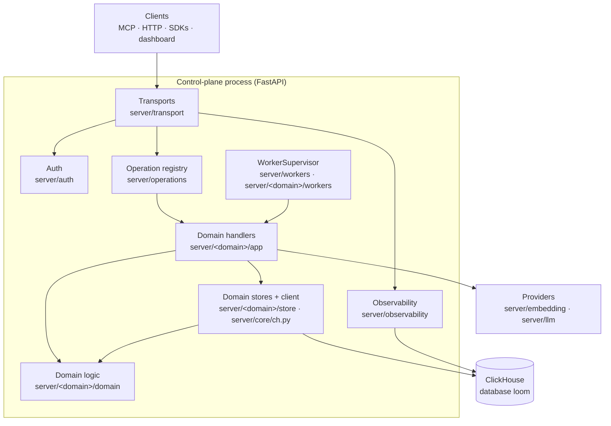
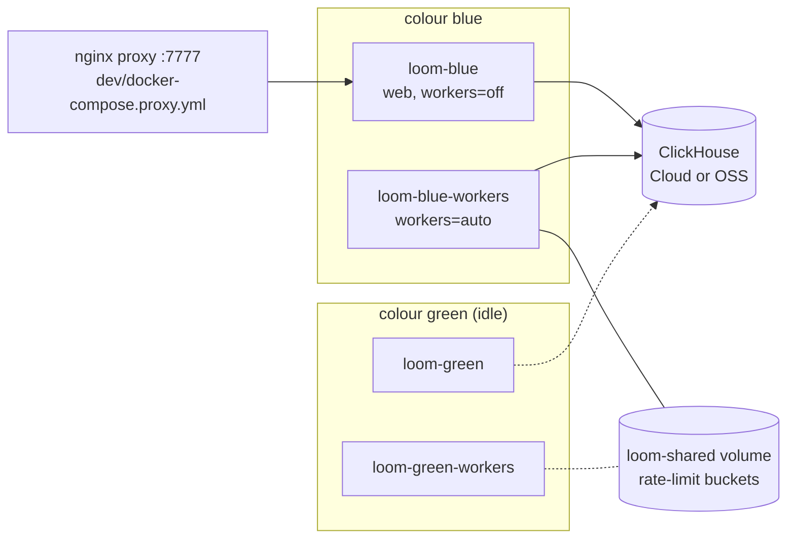

<!-- i18n: source=docs/architecture/system-overview.md blob=03fe3741579a4f9dee540c16ebdfbdab97cecb68 model=claude-sonnet-5-5 -->
> このページは[英語の原文](https://github.com/ClickHouse/loom/blob/main/docs/architecture/system-overview.md)の機械翻訳です。内容は英語の原文が優先されます。
> Machine-translated from the [English page](https://github.com/ClickHouse/loom/blob/main/docs/architecture/system-overview.md), which is authoritative.

<a id="system-overview"></a>

# システム概要

Loom は、Python サーバー（FastAPI アプリケーションとバックグラウンドワーカーのスーパーバイザー）と ClickHouse で構成され、ライブのメモリとナレッジ状態用のオプションとして Postgres を使用できます。Loom はステートフルです。Loom が保持するすべての情報（ファクトとそのベクトル、ドキュメント、会話、エンティティグラフ、コードインデックス、タスク、監査、コスト、消去の進捗）は ClickHouse に保存されます。ただし `LOOM_STORAGE_AUTHORITY=postgres` の場合は、ライブのメモリ、ナレッジ状態、およびそれに付随するレコードを Postgres が保持します（[ストレージオーソリティ](storage-authority.md#the-tables)）。サーバープロセス自体は永続的な状態を持たないため、任意の数のサーバープロセスが同じデプロイメントを処理でき、リクエストはどのプロセスにも到達できます。これらのストア以外に保持される少数の状態は、[デプロイメントトポロジー](#deployment-topology)に記載しています。

ストレージのレイアウトについては、[ClickHouse](https://github.com/ClickHouse/loom/blob/main/docs/architecture/clickhouse.md) を参照してください。

<a id="goals-and-non-goals"></a>

## 目標と非目標

| 目標                                                                                                                 | 非目標                                                                                            |
| -------------------------------------------------------------------------------------------------------------------- | ------------------------------------------------------------------------------------------------- |
| あらゆる種類の状態を 1 つのエンジンで扱う（ClickHouse が正本）：ベクトル、全文検索、グラフのエッジ、時系列、台帳。 | サーバー内でのファイル形式の扱い：`knowledge.add` は `content: str` を受け取り、パースは CLI の役割です。 |
| 1 つのワイヤーインターフェースを一度だけ宣言し、HTTP と MCP で同じように提供する。                                    | テーブルをまたぐトランザクション。派生行は主書き込みの後に追いつきます。                          |
| サーバープロセスは永続的な状態を持たない：プロセスを増やすだけでウェブ処理能力を追加できる。                         | 双時間履歴。有効性は有効時間のみで、トランザクション時間の履歴はバージョンミラーが担います。      |
| すべての行を、テナント（識別タプル）、書き込み主体（`actor`）、リクエスト（`log_comment`）に帰属させられる。         | GDPR 準拠の保証。消去と監査ハッシュはエンジニアリング上のプリミティブです。                       |
| キーなしでインストールしても起動して応答し、フェイクプロバイダーであることが報告される。                             |                                                                                                   |

<a id="components"></a>

## コンポーネント



| コンポーネント | コード | 役割 |
| ------------------ | ----------------------------------------------------- | ------------------------------------------------------------------------------------------------------------------------------------------------------------------------------------------------------------------------------------------------------------------------------------------------------------------------------------------------ |
| トランスポート | `server/transport/http.py`, `server/transport/mcp.py` | リクエストをオペレーション呼び出しに変換します。どちらもレジストリから生成されます。すべての op は `POST /v1/<name>` および MCP ツール `loom_<name>`（ドットはアンダースコアになります）として公開されます。共通の受け付け処理は `server/transport/gates.py` にあります。 |
| オペレーションレジストリ | `server/operations/` | op ごとに 1 つの `Operation`（`base.py`）を持ちます。名前、入力モデルと出力モデル、ハンドラ、`required_role`、`idempotent`、`audit`、`maturity`、スコープに関するフラグを含みます。`budget_p99_ms` は `server/settings/catalog.py` の予算テーブルから取得されます。`registry.py` の `ALL_OPERATIONS` は、各グループの `OPERATIONS` を結合したものです。 |
| ドメインパッケージ | `server/<domain>/` | プレーンごとに 1 つのパッケージ（`memory`、`code`、`tracker`、`knowledge`、`erasure`、`tasks`、`identity`、`insights`）があり、それぞれ `api/`（ワイヤモデルと `Operation` 宣言）、`app/`（ハンドラとオーケストレーション）、`domain/`（純粋なロジック）、`store/`（ClickHouse のステートメントと行ビルダー）、`workers/` を持ちます。[サーバーレイアウト](server-layout.md)を参照してください。 |
| ClickHouse クライアント | `server/core/ch.py` | 唯一のクライアントです。プーリング、デッドライン、リトライ、クエリの帰属を扱います。`server/memory/store/rows.py` にはバージョン行ビルダーがあります。 |
| ワーカー | `server/workers/` | `registry.py`（`_WORKERS`）に行として宣言されるバックグラウンドループです。それぞれが所属ドメインの `workers/` 内のモジュールであり、`supervisor.py` によって実行されます。 |
| 認証 | `server/auth/` | JWT の検証、失効、ロールと名前空間の認可、OIDC、OAuth サーバー、セルフサインアップを扱います。[セキュリティ](https://github.com/ClickHouse/loom/blob/main/docs/architecture/security.md)を参照してください。 |
| プロバイダー | `server/embedding/`, `server/llm/` | 差し替え可能なエンベッダーと LLM のクライアントで、それぞれ決定的なフェイクを備えます。[LLM アーキテクチャ](https://github.com/ClickHouse/loom/blob/main/docs/architecture/llm-architecture.md)を参照してください。 |
| オブザーバビリティ | `server/observability/` | op ごとの台帳（`loom.agent_events`）、バッチ処理されるイベントストリーム、監査行、プロバイダーのヘルス、OpenTelemetry と Langfuse へのエクスポートを扱います。 |
| ダッシュボード | `frontend/`（`frontend/dist/` から `/` で配信） | 同じ HTTP op を利用する React の UI です。ビルドされていないチェックアウトでは、そのページに 503 を返します。 |
| CLI | `server/cli/` | `loom` コマンドです。運用操作（migrate、tokens、re-embed、doctor）と、op 用のクライアントを提供します。[CLI リファレンス](https://github.com/ClickHouse/loom/blob/main/docs/reference/cli.md)を参照してください。 |

レジストリがワイヤ上のインターフェース全体です。`GET /v1/operations` はすべての op を予算とロールとともに一覧表示し、[オペレーションリファレンス](https://github.com/ClickHouse/loom/blob/main/docs/reference/operations.md)はそこから生成されます。op を追加するには、モデルを定義し、ハンドラを書き、`Operation` を宣言して、所属グループの `OPERATIONS` リストに追加します（[オペレーションの追加](https://github.com/ClickHouse/loom/blob/main/docs/development/adding-an-operation.md)）。両方のトランスポートが自動的にそれを取り込みます。

一部の HTTP ルートはレジストリの op ではありません。`/v1/health`、`/v1/whoami`、`/v1/operations`、`/v1/.well-known/jwks.json`、`/v1/.well-known/openid-configuration`、`/v1/knowledge.download`、`/v1/auth/login`、ダッシュボードの `/v1/me/*` と `/v1/admin/*` ヘルパー、そして OAuth と OIDC のエンドポイントです。これらは [HTTP API リファレンス](https://github.com/ClickHouse/loom/blob/main/docs/reference/http-api.md)に一覧があります。

<a id="dependency-direction"></a>

### 依存の方向

```text
transports → operations → <domain>/api → <domain>/app → <domain>/store → server/core/ch.py
                                              ↘ <domain>/domain ↙
```

ワーカーはトランスポートと並ぶ位置にあり、所属ドメインの `app` と `store` を呼び出します。ハンドラはプロバイダーを呼び出します。トランスポートより下のどのモジュールも、トランスポートのモジュールをインポートしません。どのパッケージがどのパッケージをインポートできるか、およびドメイン内部のレイヤーについては[サーバーレイアウト](server-layout.md)に記載されており、`tests/unit/test_package_contracts.py` がそれを検証します。

`tests/unit/test_transport_layering.py` はトランスポートのルールを検証します。`server/transport/`、`server/cli/`、`server/main.py` 以外が `server.transport` をインポートすると失敗します。そのため、下位レイヤーが必要とする要素はトランスポートより下に置かれています。MCP ツールセットのロースター（`server/operations/toolsets.py`）、レジストリ以外のルートのベアラーチェック（`server/auth/bearer.py`）、コードスコープのコンテキスト変数（`server/code/domain/scope.py`）、台帳の行ビルダー（`server/observability/ledger.py`）、レイテンシ予算（`server/observability/budgets.py`）、プレーンのデフォルト値（`server/code/app/common.py`）です。

**理由：** プロトコル（ステータスコード、JSON-RPC フレーム、ヘッダー）を知っているのはトランスポートだけです。これにより、ハンドラは同じ入力モデルで HTTP、MCP、ワーカー、テストのいずれからでも呼び出せます。

<a id="request-path"></a>

## リクエストパス

どちらのトランスポートも、`server/transport/gates.py` で一度だけ行われる同じ受け入れ判定を実行する。
違いは、認証情報と引数の読み取り方、および拒否の返し方である。HTTP はステータスと `detail` ボディで応答し、MCP は `isError` を持つ結果で応答する。

<a id="http"></a>

### HTTP

`server/transport/http.py` の `build_router()` は、op ごとに `POST /v1/<op>` ルートを 1 つ追加する。
まず `BodyLimitMiddleware` が、`LOOM_MAX_REQUEST_BYTES`（32 MiB）を超えるボディを 413 で拒否する。0 を指定すると上限は無効になる。その後、各リクエストは次のフェーズを順に通過する（`_make_endpoint`）。拒否された時点でリクエストは終了する。

| フェーズ | コード | 拒否 |
| -------------------- | -------------------------------------- | ---------- |
| 開始 | `_begin_request` | なし。`X-Request-Id`（呼び出し元の値が 1〜64 文字の英数字、`.`、`_`、`-` であればそれを、そうでなければ新しい UUID）、`X-Schema-Version`、およびクエリタグ `"<op> <request_id>"` を設定する。 |
| トークン検証 | `_extract_auth` | 401 `AUTH_INVALID`（認証が有効なのにトークンがない、未対応のスキーム、トークンの検証失敗）。失効リストが読み込まれるまでは 503 `AUTH_UNAVAILABLE`。 |
| ボディ読み取り | `_read_body` | JSON が不正な場合は 400 `VALIDATION_FAILED`。書き込み op の未知のキーがそのフィールドのいずれかに近い場合は 422 `UNKNOWN_ARGUMENT`。 |
| ID の補完 | `gates.with_single_user_identity` | なし。シングルユーザーサーバーで、トークンなしの呼び出しに対して行う。`code.*` と `tracker.*` を除くすべての op ではインストールの org を、日常的なメモリ op と検索 op ではさらにその名前空間と op のエージェントを補う（[対象の op](https://github.com/ClickHouse/loom/blob/main/docs/reference/http-api.md#request)）。名前空間を必要とするその他の op（code と tracker の op を除く）で名前空間が空または `"-"` の場合は取り除かれ、検証で不足として拒否される。HTTP のみ。 |
| 検証 | `_validate_payload` | 422 `VALIDATION_FAILED`。対象フィールドを示す。 |
| 認可 | `_authorize` → `gates.authorize` | 400 `IDENTITY_INCOMPLETE`（名前空間または org がない）、403 `AUTH_INSUFFICIENT`。 |
| コンテキストとポリシーの紐付け | `_bind_context_and_policy` | 認証コンテキストと台帳の run（`X-Loom-Run-Id`）を設定する。履歴ポリシーが `enforce` モードで拒否した場合は 403 `POLICY_FORBIDDEN`。 |
| レート制限 | `_rate_limit` → `gates.rate_limit` | `Retry-After` を伴う 429 `RATE_LIMITED`。制限対象のすべての呼び出しに `X-RateLimit-*` ヘッダーが付く。 |
| 冪等性 | `_idempotency_gate` | 保存済みの応答を再生する（`X-Idempotent-Replay: true`）。同じキーが異なるボディで再利用された場合は 409 `IDEMPOTENT_CONFLICT`。 |
| ハンドラー | `_run_handler` | ハンドラーの `HTTPException`、`LoomServerError` のコードとステータス、または 500 `INTERNAL_ERROR`。 |
| 成功後 | `_finish_success`、`post_handler_rows` | なし。台帳の行、メトリクス、`ignored_args` を含むボディ、続いて予算超過、監査、冪等性の各行。 |

この順序にしている理由：

- **ボディより先にトークン。** デプロイが拒否する匿名リクエストには、ボディを読む前に 401 を返す。台帳の行は残らず、フィールドエラーも漏れず、どのテナントのレート制限バケットにも触れない。
- **制限より先に認可。** リミッターは、検証済みトークンの org（`gates._rate_limit_org`）から取り、ボディの値だけから取ることはない。
- **受け入れの後に冪等性。** 再生キーは、呼び出し元の org、サブジェクト、op にスコープされる（`server/core/idempotency.py`、`scoped_key`）。再生が匿名の呼び出し元、別のテナント、別の op に届くことはない。

**フェイルオープンのゲート。** トラフィック分類とレートリミッターは可用性のための制御である。どちらかが例外を送出した場合、呼び出しは受け入れられ、その失敗は計数され、1 分に最大 1 回ログに記録される（`gates._fail_open`）。認証と認可はフェイルクローズである。

**未知の引数。** 入力モデルは未知のキーを無視するため、`server/transport/arg_check.py` がそれらを名指しする。応答には `ignored_args`（フィールド名に近いものがあれば `did_you_mean`）が含まれ、HTTP は `X-Loom-Ignored-Args` を設定する。どちらも、op が読み取ったが適用しなかったフィールドを先に、続いて読まれなかったキーを列挙する。書き込み op は、近い一致があれば 422 `UNKNOWN_ARGUMENT` で拒否する。ID のキーと、トランスポート自身が読むキー（`consumer`、`traffic_class`、`explain`、冪等性キー）は報告されない。

**ハンドラーの後。** 台帳の行には、呼び出しのレイテンシと、埋め込みおよび LLM の支出が記録される。予算超過の行（`budget_p99_ms` × `LOOM_LATENCY_BUDGET_MULTIPLIER` を超えた場合）、監査の行（`op.audit` の場合）、冪等性の行は、1 回のラウンドトリップで書き込まれる（`gather_best_effort`）。いずれもベストエフォートである。リクエストのすべての ClickHouse ステートメントには `log_comment = "<op> <request_id>"` が付く（[クエリの帰属](https://github.com/ClickHouse/loom/blob/main/docs/architecture/clickhouse.md#query-attribution)）。

<a id="mcp"></a>

### MCP

`POST /mcp` は JSON-RPC 2.0 である（`server/transport/mcp.py`、`_handle_request`）。`MCP_SUPPORTED_PROTOCOL_VERSIONS`（`mcp_config.py`）にあるプロトコルリビジョンに対応する。`initialize` は、クライアントのバージョンが対応していればそれをそのまま返し、そうでなければ最新のバージョンを返す。サーバー起点のイベントはない。

| メソッド | 動作 |
| ---------------------------------- | ---------- |
| `initialize` | バージョンを交渉し、`instructions` を返す。これは呼び出し元のプロファイルセクションを含むプライマーである。同じプライマーが、`loom://primer` リソース、`loom` プロンプト、`loom_activate` ツールとしても提供される。 |
| `tools/list` | 接続のツールセットに対応するロースター（URL で決まり、呼び出し元には依存しない）。 |
| `tools/call` | HTTP と同じゲートを通る 1 回の op 呼び出し。 |
| `prompts/*`、`resources/*`、`ping` | プライマー関連のサーフェスと死活確認。 |

`LOOM_MCP_AUTH_MODE` は、どのメソッドにベアラーが必要かを決める。`required`（デフォルト。通知を除くすべてのメソッド）、`discovery_only`（`tools/call` のみ）、`open` のいずれか。拒否には、保護リソースメタデータを指す `WWW-Authenticate` チャレンジが付くため、ネイティブコネクターは OAuth サーバーを見つけられる（`mcp_auth.py`）。

`tools/list` は、`LOOM_MCP_TOOLSET`（デフォルトは `core`）または `?toolset=` で選ばれたロースターを表示する（`server/operations/toolsets.py`）。ロースターは可視性だけを決める。すべての op は名前で呼び出せるが、`_MCP_HIDDEN_OPS` にある op は例外で、MCP では一覧にも呼び出しにも現れない（HTTP では引き続き提供される）。ツールセットは [MCP リファレンス](https://github.com/ClickHouse/loom/blob/main/docs/reference/mcp.md)にある。3 つのツールは手書きのディスクリプターを持つ。`loom_search`（`search.query` op を、テキストの要約と簡素なセクションとして返す）、`loom_op`（同じ経路で任意の op を名前で呼び出す。`op: "help"` で一覧を表示する。`server/transport/mcp_op.py`）、`loom_activate`（プライマー。レジストリの op ではない唯一のツール）である。

`_call_tool`（`mcp_call.py`。テレメトリ、レスポンス、失敗時の応答は `mcp_outcome.py`）は、次のフェーズを順に実行する：

1. **ツールの解決**（`_resolve_tool`）。未知または非表示のツールは、代わりに使うべきものを示す `isError` の結果になる。
2. **呼び出し元の紐付け**（`_bind_caller_identity`）。リクエスト ID を発行し、クエリタグを設定し、省略された名前空間とエージェントをトークンと呼び出し元の保存済みデフォルトから補う。明示された引数が優先される。`code.*` op のデフォルトは、デプロイの code 名前空間である。`_MCP_CROSS_AGENT_READS` の読み取りでは、`agent` のデフォルトは `*` になる。
3. **セッション run。** (org、トークンのサブジェクト、`Mcp-Session-Id`) ごとに暗黙の run が 1 つあり、呼び出し元のデフォルト名前空間に登録される。run を指定しない書き込みには、セッションの `run_id` が付く。ただし、独自の run を指定する `run.*`、デプロイの code ID として動作する `code.*`、`run_id` が行のスコープまたは紐付けを決める `working_memory.*` と `conversation.update` は除く。
4. **冪等性キー。** 冪等なツールは、引数に `_idempotency_key`（または `idempotency_key`）を取り、検証の前に取り出される。
5. **引数**（`_validated_input`）。まずスペルミスの引数の拒否、次に検証。失敗は `isError` の結果となり、フィールドエラー、未知のキーごとに意図されたと思われるフィールド、op の引数、呼び出し例が含まれる（`arg_feedback.py`）。
6. **認可**（`_authorize_call`）。共有のゲート。
7. **受け入れ**（`_admission_refusal`）：トラフィッククラス、履歴ポリシー、レート制限。短いヒントを伴う 429 の場合、トランスポートは 1 回だけ待って再確認する（最大 `LOOM_MCP_RATELIMIT_RETRY_MAX_WAIT_S`）。
8. **冪等性の再生。** 受け入れられた呼び出し元に対してのみ行う。
9. **ハンドラー。**
10. **レスポンス。** `structuredContent` はランキングと集計の詳細を省き（`lean_results.py`。`explain=true` で保持される）、`ignored_args` を含む。

**拒否は結果、失敗はエラー。** 401 以外の 4xx（`LOCKED`、`PINNED_CONFLICT`、`BLACKLISTED`、`RESOURCE_NOT_FOUND`、タスク状態コード、`RATE_LIMITED`）は、構造化ボディを持つ `isError: true` として返されるため（`mcp_refusals.py`）、クライアントはガイダンスを確認できる。401 と 5xx（`OVERLOADED`、`BACKEND_TIMEOUT`、`SCHEMA_PENDING`）は、HTTP のボディとリトライのヒントを持つ JSON-RPC エラーのままである。

書き込み 1 件（`memory.set`）と読み取り 1 件（`memory.search`）のウォークスルーは、[メモリアーキテクチャ](memory-architecture.md)にある。

<a id="roles-and-process-modes"></a>

## ロールとプロセスモード

<a id="roles"></a>

### ロール

`Role`（`server/operations/base.py`）は `VIEWER < WRITER < ADMIN < ORG_ADMIN <
PLATFORM_ADMIN` の順に並んでいます。各 op は `required_role` を宣言します。フラットトークンのロールは、そのトークンが読み取るすべての名前空間に適用されます。`loom.namespace_grants` は名前空間ごとにそのロールを引き上げられますが、引き下げることはできません。スコープ付きトークンの `ns_roles` は、そこに挙げられた名前空間に対して優先されます。グラントと `ns_roles` に指定できるのは `viewer`、`writer`、`admin` のみです。`ORG_ADMIN` と `PLATFORM_ADMIN` は、フラットトークンの `roles` にのみ存在します。詳細は[セキュリティ](https://github.com/ClickHouse/loom/blob/main/docs/architecture/security.md#authorization)と[アイデンティティと名前空間](https://github.com/ClickHouse/loom/blob/main/docs/concepts/identities-and-namespaces.md)を参照してください。

<a id="process-modes"></a>

### プロセスモード

1 つのイメージがすべてのロールを担います。プロセスの動作は設定で決まります。

| モード                | 設定                                                                         | 実行されるもの                                                                               |
| ------------------- | -------------------------------------------------------------------------------- | --------------------------------------------------------------------------------------- |
| オールインワン          | `LOOM_BACKGROUND_WORKERS=auto`（デフォルト）                                         | Web ティアと、そのデプロイメントの ClickHouse リースを保持するプロセス内のワーカー。  |
| Web レプリカ         | `LOOM_BACKGROUND_WORKERS=off`                                                    | HTTP、MCP、ダッシュボード。自身の失効スナップショットと署名キーリングを更新します。 |
| ワーカー             | `LOOM_BACKGROUND_WORKERS=auto`, `LOOM_DEPLOYMENT=1`, `LOOM_SERVES_TRAFFIC=false` | スーパーバイザーとそのワーカー。`/v1/health` は引き続き応答します。                             |
| ブランチ / A-B サーバー | `LOOM_BOOT_MIGRATE=false`, `LOOM_INSTANCE_LABEL=<who>:<what>:<port>`             | マイグレーションを適用せずに共有 ClickHouse を利用します。ここでは `auto` でもワーカーは実行されません。   |

`LOOM_WEB_WORKERS` は、コンテナあたりの uvicorn プロセス数を設定します。未設定の場合、イメージはコンテナが使用できる CPU ごとに 1 つ、ただしメモリ 1 GiB あたり最大 1 つ、かつ最大 8 つまで起動します。各プロセスは完全な lifespan を実行します。`auto` ではデプロイメントのリースによって、ワーカーを実行するプロセスが 1 つ選ばれます。`on` はリースを取得しません。各プロセスがそれぞれワーカーのコピーを実行し、`auto` のプロセスがリースを保持していない限り、他のプロセスは `workers_lease_absent` を報告します。ワーカーコンテナは `auto` で実行します。

**リーダー選出。** `server/workers/leader.py`（`decide_supervisor`、`keep_lease`）は、ClickHouse を通じてデプロイメントごとに 1 つのスーパーバイザーを選出します。キーは Keeper ロックテーブル `loom._migration_lock` 内の `workers_supervisor` です（厳密な KeeperMap のため、2 つの競合者のうち書き込みが成功するのは一方のみです）。有効期限は ClickHouse サーバーの時計で判定されます。保持者は `LOOM_SUPERVISOR_LEASE_TTL_S / 6` ごとに更新し、最後の更新から TTL の半分が経過した時点、または更新時に別の保持者が見つかった時点でワーカーを停止します。保持者が停止した場合は、`LOOM_SUPERVISOR_LEASE_TTL_S`（デフォルトは 30 秒）の経過後に、別の `auto` プロセスがリースを取得します。タイミングの詳細は[障害と復旧](failure-and-recovery.md#background-workers)にあります。正常停止ではリースが即座に解放されます。これにより、blue/green の新しい側が処理を引き継ぎます。

**ClickHouse を使う理由：** ワーカーを実行しうるプロセスはコンテナやホストをまたいで存在し、ClickHouse はそれらすべてが共有する唯一のものだからです。複数のホストが `auto` で動作しても、ワーカーを実行するのは 1 つです（[キャパシティ](failure-and-recovery.md#background-workers)）。

<a id="boot"></a>

## 起動

`server/main.py` の `lifespan` は、すべてのプロセスで次の順に実行されます（各ステップは `server/boot.py` にあります）。

1. **起動ルール。** プロセスはデプロイメント（`LOOM_DEPLOYMENT=1`。compose ファイルが設定します）であるか、空でない `LOOM_INSTANCE_LABEL` を持っている必要があります。それ以外の場合は起動を拒否します。認証を必須とするデプロイメントで、リポジトリにチェックインされた開発用の `LOOM_JWT_SECRET` を使っている場合も起動を拒否します（`require_real_signing_secret`）。例外は `LOOM_INSTANCE_LABEL=deploy:dev` のみです。
2. ClickHouse に**接続**します。
3. **マイグレーション**（`LOOM_BOOT_MIGRATE`、デフォルトで有効）。すべてのプロセスは、適用前にデプロイメントのマイグレーションロックを取得します。これは `loom._migration_lock` 内の KeeperMap キーです（`server/core/schema/migrate_lease.py`）。Keeper のないサーバー、またはマイグレーションの失敗は、起動を停止させます。`LOOM_BOOT_MIGRATE=false` の場合、プロセスは未適用のファイルをログに記録し、`/v1/health` で報告します。Postgres オーソリティの下では、最初のハートビートとリースの判定の前に、デプロイメントのセル状態を読み取ります。最初の読み取りに失敗すると起動が停止します（Postgres のマイグレーションが未適用の場合は、ゲートされた未準備の状態で起動し、読み取りが成功するまでそのままです）（[セル](https://github.com/ClickHouse/loom/blob/main/docs/architecture/cells.md#the-tenancy-check-and-placement)）。
4. **`agent_events` エミッターを開始**します。
5. **デフォルトの名前空間。** 認証が無効の場合、設定された名前空間に `loom.namespaces` の行を作成します。ただし、セルゲートがこのプロセスを拒否する場合は作成しません。
6. **ワーカーリーダーを選出**します。
7. **リーダーの職務。** 保持期間の TTL オーバーライドを、差異がある箇所に適用し、設定されたトラッカーの名前空間を登録します。
8. **トークンの状態とオーバーライド。** 失効済みトークンのスナップショット（`server/auth/revocation.py`）と署名キーリング（`server/auth/keyring.py`）を読み込みます。すべてのプロセスが、それぞれ独自のタイマーで両方を更新します。管理者のランタイムオーバーライド（`loom.runtime_overrides`：レート制限、レイテンシ予算、ライブ設定）の取り込みを `LOOM_RUNTIME_OVERRIDES_REFRESH_SECONDS` ごとに開始します。workers 子プロセスも同様に取り込みます。ライブ設定のオーバーライドはプロセス自身の `settings` に重ねて適用されるため、コードからは `settings.<field>` として読み取れます（[ランタイム設定](https://github.com/ClickHouse/loom/blob/main/docs/operations/runtime-settings.md)）。
9. リーダーで**ワーカーを開始**し、`auto` ではリースループも開始します（Postgres オーソリティの下では `on` でも開始します。この場合はセルゲートがワーカーとリースループを開始・停止します）。
10. **プロバイダーレポート。** 解決された LLM プロバイダーをログに記録し、エンベッダーの次元数を調べます。
11. **ベクトル機能。** 量子化コードの読み取り設定、パッチパーツ、および挿入時にベクトルインデックスの構築を省略できるかどうかを調べます。
12. エンベッダーから類似度のしきい値を**キャリブレーション**します（`LOOM_ADAPTIVE_THRESHOLDS`）。失敗しても起動は失敗せず、スカラー設定が適用されます。

シャットダウンは、この逆の順序で行われます。ループを停止し、ワーカーをドレインし（10 秒）、リースを解放し、Langfuse キュー、イベントエミッター、遅延書き込み（露出行、書き込み後のプロジェクション、イベントストリーム）をドレインします。ClickHouse クライアントは最後に切断されます。

`/v1/health` は ClickHouse への到達性と、`problems` のリスト（たとえば偽のプロバイダー）を報告します。503 を返すのは ClickHouse がダウンしている場合のみです。`?include=workers,langfuse,otel,embedding_cache` を付けると、サブシステムごとのチェックが追加されます。

<a id="background-processing"></a>

## バックグラウンド処理

`WorkerSupervisor` は、有効化された各ワーカーにつき 1 つの asyncio タスクを、リースホルダー上でのみ実行します。各ワーカーは `server/workers/registry.py` 内の `_Worker` 行であり、有効化フラグと実行間隔を持ちます（多くの場合 `LOOM_<NAME>_ENABLED`、`LOOM_<NAME>_INTERVAL_SECONDS`）。スーパーバイザーは最初の実行をずらし、期限を過ぎた実行をキャンセルし、バックオフ付きで再試行し、すべてのクエリに `background` トラフィッククラスの下で `worker.<name>` タグを付け、実行状態を `loom.worker_status` に記録します（`GET /v1/admin/workers.status`）。詳細は[障害と復旧](failure-and-recovery.md#worker-supervision)と、生成された[ワーカーリファレンス](https://github.com/ClickHouse/loom/blob/main/docs/reference/workers.md)を参照してください。

<a id="deployment-topology"></a>

## デプロイメントトポロジー



- **サーバープロセスは永続的な状態を持ちません。** レプリカ間で共有する状態（失効情報、署名鍵、ランタイムのオーバーライド、サインイン試行回数、グラフ書き込みマーク、スーパーバイザーのリース、消去のチェックポイント、ブラックリストのバージョン、デフォルトの authority 下の冪等性キャッシュ、記録された authority）とアップロードされたドキュメントの原本は ClickHouse に保存されます。`LOOM_DOCUMENT_OBJECT_STORE=s3` で書き込まれた原本のバイト列は、代わりに S3 互換のバケットに保存されます。Postgres authority の場合、Postgres は [ストレージ authority](storage-authority.md#the-tables) に挙げられたテーブルを保持し、その中には冪等性キャッシュ、独自の消去台帳、記録された authority のコピーが含まれます。同じ ClickHouse（その authority では Postgres も）、環境変数の設定、`LOOM_JWT_SECRET` を使い、行がバケット内のオブジェクトを指している間はそのバケットも使えば、新しい Loom ですべての機能が元に戻ります。
- **ClickHouse と Postgres の外にある状態。** コードプレーンの git ミラーは `var/code_repos` 配下にあり（キャッシュです。ミラーのないホストは再クローンします）、レート制限のバケットは `loom-shared` ボリューム上にあります。どちらも正本ではありません。また、カタログの行がバケット内のオブジェクトを指している間は、それらの原本のバイト列を保持する `LOOM_DOCUMENT_S3_BUCKET` も該当します。
- **2 つのコンテナ、1 つのイメージ。** `dev/docker-compose.cloud.yml` は `loom-server`（`LOOM_BACKGROUND_WORKERS=off`）と `loom-workers`（`auto`：リースを保持している間ワーカーを実行）を起動します。そのため、長時間のワーカー処理がリクエストとイベントループを共有することはありません。
- **ブルー/グリーンのペア。** `dev/docker-compose.colour.yml` はプロキシの背後で 2 つのカラーを実行します。`./redeploy.sh` はアイドル状態のカラーを起動し、ヘルスチェックの成功を待ってからアップストリームを切り替え、古いカラーを停止します。すべてのマイグレーションは追加のみなので、ロールバックにスキーマの手順は不要です。[デプロイ](https://github.com/ClickHouse/loom/blob/main/docs/operations/deployment.md)と[アップグレード](https://github.com/ClickHouse/loom/blob/main/docs/operations/upgrades.md)を参照してください。
- **ClickHouse。** ClickHouse Cloud、またはセルフマネージドの OSS サーバーを使用します。単一の OSS ノードは高可用性ではありません。

<a id="foundational-shapes"></a>

## 基本となる設計

4つの設計が全体を支えています。いずれかを変更する場合は設計変更として扱い、プルリクエストとこのページで議論します。

<a id="one-engine-clickhouse"></a>

### 単一のエンジン：ClickHouse

デフォルトの ClickHouse authority では、すべてのプレーン（ファクトとベクトル、BM25 とトークンのインデックス、1ホップにつき1つの上限付きクエリでたどるエンティティグラフ、コードインデックス、台帳とコスト）が ClickHouse のテーブル群です。`LOOM_STORAGE_AUTHORITY=postgres` の場合、稼働中のメモリと知識の状態は Postgres に保持されます。これは、バックアップと一貫性ドメインを1つにまとめる利点を手放す代わりに、メモリの書き込みをトランザクションで扱えるようにするものです（[2つのストアが必要な理由](storage-authority.md#why-two-stores)）。以下の「理由」と「コスト」はデフォルトの場合の説明です。

**理由：** バックアップ、アクセス境界、検索と分析のためのクエリ言語がそれぞれ1つで済み、同期ジョブなしでメモリとそのテレメトリを結合できます。ハイブリッド検索はデータの隣で SQL として実行されます。別のベクトルストアを置くと、2つ目の一貫性ドメイン、二重書き込み、ネットワークをまたぐ結果の統合が加わります。

**コスト：** トランザクション的な行更新はできません。更新可能なテーブルは `ReplacingMergeTree` で、`FINAL` を付けて読み取るため、すべての書き込み経路がすべてのカラムを引き継ぐ必要があります（[FINAL の書き込みルール](https://github.com/ClickHouse/loom/blob/main/docs/architecture/clickhouse.md#the-final-write-rule)）。また、テーブルをまたぐ書き込みはアトミックではありません（[障害と復旧](failure-and-recovery.md)）。

<a id="the-identity-tuple"></a>

### アイデンティティタプル

すべてのメモリ行は `(org, namespace, agent, user_id, session_id)` を持ちます。最初の3つは必須で、残りのデフォルトは `'-'` です。それ以外のテナントテーブルも、少なくとも `(org, namespace)` を持ちます。メモリの書き込み時には、サーバーが `actor`（`human:<subject>` / `process:<subject>`、`server.memory.app.provenance.writer_actor`）と `source_class`（`server.memory.domain.provenance.source_class_for`）を付与します。これらはリクエストボディから取られることはなく、`derived`、`external`、`imported` への宣言された格下げのみ例外です。

**理由：** テナンシー、作成者、来歴がカラムとして存在するため、すべての読み取りはソートキーでフィルタでき、各行は結合なしで、誰のものでどこから来たかを示せます。**コスト：** `actor` や `source_class` を付け忘れる新しい書き込み経路があると、帰属先を特定できない行ができます。

<a id="per-row-content-hash-audit"></a>

### 行ごとのコンテンツハッシュ監査

監査対象の書き込みは、すべて `loom.audit_log` に行を残します。その `row_hash` は、行の正規化 JSON に対する SHA-256 です（`server/observability/audit.py`）。1時間ごとのチェックポイント（`loom.audit_checkpoints`）は、閉じた各ウィンドウの行数とハッシュのダイジェストを封印し、それぞれ直前のチェックポイントにリンクします。

**行ごとにする理由：** 行から行へのチェーンは、同時書き込みがあると分岐してしまい、Loom は多数のサーバープロセスで動作します。行ごとのハッシュはコンテンツの改ざんを検出し、1つのワーカーが封印するチェックポイントチェーンは、封印済みウィンドウでの行の削除、変更、遅れて追加された行を検出します。**コスト：** ウィンドウが封印される前に削除された行は、痕跡を残しません。詳しくは[セキュリティ](https://github.com/ClickHouse/loom/blob/main/docs/architecture/security.md#audit-log)を参照してください。

<a id="five-belief-revision-operations"></a>

### 5つの信念改訂操作

メモリのライフサイクルは5つの操作からなります。Expand（`memory.set`）、Revise（`memory.update_by_id`）、Contract（`memory.delete`）、Reinforce（`memory.pin`）、Refuse（`blacklist.add`）です。これはコード上の enum ではなく設計上の視点であり、メモリプレーンでこれらのいずれにも対応しないものは疑わしいと見なします。マージ、移動、墨消しは、これらの組み合わせで表現します。詳しくは[メモリ](https://github.com/ClickHouse/loom/blob/main/docs/concepts/memory.md)を参照してください。

<a id="invariants"></a>

## 不変条件

- op が HTTP と MCP に存在するのは、その op が `ALL_OPERATIONS` に含まれている場合に限られます（MCP は op を非表示にできますが、HTTP は引き続き提供します）。
- `server/transport/`、`server/cli/`、`server/main.py` 以外から `server.transport` を import してはなりません。
- 拒否された後にゲートは実行されません。認証が有効な場合、匿名リクエストがボディパーサー、台帳、リミッター、リプレイキャッシュに到達することはありません。
- レートリミッターは、検証済みトークンの org をキーにします。リプレイは、それを生成した呼び出し元、org、op にのみ返されます。
- 認証と認可はフェイルクローズです。トラフィック分類とレート制限はフェイルオープンで、その回数はカウントされます。
- MCP では、拒否は `isError: true` を持つ結果として返されます。JSON-RPC エラーになるのは 401 と 5xx のみです。
- プロセスはデプロイメントそのものであるか、`LOOM_INSTANCE_LABEL` を持ちます。起動時のマイグレーションに失敗した場合、ワーカーが起動する前にプロセスが停止します。
- `auto` では、デプロイメント内で最大 1 つのプロセスだけがスーパーバイザーリースを保持します。
- ClickHouse は、すべてのメモリプレーンの行に対するシステムオブレコードです。
- メモリ書き込みの `actor` と `source_class` は、呼び出し元ではなくサーバーが設定します。

<a id="source-entry-points"></a>

## ソースのエントリポイント

| 対象                      | 場所                                                                                                                 |
| ------------------------- | -------------------------------------------------------------------------------------------------------------------- |
| アプリ、lifespan、ヘルスチェック | `server/main.py`、lifespan の起動・終了処理は `server/boot.py`、`GET /v1/health` は `server/health.py` |
| オペレーションの宣言      | `server/operations/base.py`（`Operation`、`Role`）、レジストリは `server/operations/registry.py`                       |
| HTTP ルートとフェーズ     | `server/transport/http.py`（`build_router`、`_make_endpoint`）、`server/transport/post_rows.py`（`post_handler_rows`） |
| 共通の受け入れ判定        | `server/transport/gates.py`                                                                                          |
| 未知の引数                | `server/transport/arg_check.py`、`server/transport/arg_feedback.py`                                                  |
| 冪等性キャッシュ          | `server/core/idempotency.py`                                                                                         |
| MCP のディスパッチと拒否  | `server/transport/mcp.py`、`mcp_call.py`（`_call_tool`）、`mcp_op.py`、`mcp_refusals.py`                              |
| ClickHouse クライアント   | `server/core/ch.py`（`get_client`、`set_query_tag`）                                                                  |
| ワーカーとリーダー        | `server/workers/registry.py`、`supervisor.py`、`leader.py`                                                           |
| マイグレーションのリース  | `server/core/schema/migrate.py`、`server/core/schema/migrate_lease.py`                                               |
| レイヤリングのゲート      | `tests/unit/test_transport_layering.py`                                                                              |

<a id="related"></a>

## 関連ドキュメント

- [ClickHouse](https://github.com/ClickHouse/loom/blob/main/docs/architecture/clickhouse.md)：テーブル、エンジン、インデックス、マイグレーション。
- [メモリアーキテクチャ](memory-architecture.md)：書き込みパスと読み取りパス。
- [障害と復旧](failure-and-recovery.md)：リトライ、修復、キャパシティ。
- [セキュリティ](https://github.com/ClickHouse/loom/blob/main/docs/architecture/security.md)：トークンと認可のゲートが何を検査するか。
- [デプロイ](https://github.com/ClickHouse/loom/blob/main/docs/operations/deployment.md)：トポロジーを支える手順。
