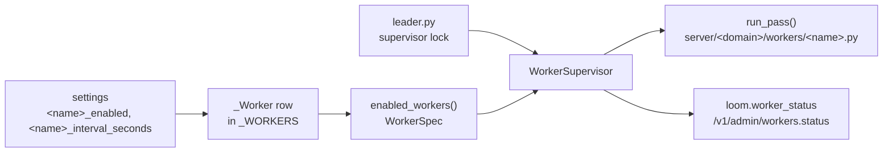

<!-- i18n: source=docs/development/adding-a-worker.md blob=caf48d881a70356a242d6cb16a1569b75e93391e model=claude-sonnet-5-5 -->
> このページは[英語の原文](https://github.com/ClickHouse/loom/blob/main/docs/development/adding-a-worker.md)の機械翻訳です。内容は英語の原文が優先されます。
> Machine-translated from the [English page](https://github.com/ClickHouse/loom/blob/main/docs/development/adding-a-worker.md), which is authoritative.

<a id="add-a-background-worker"></a>

# バックグラウンドワーカーを追加する

ワーカーは、`server/workers/registry.py` の行（`_WORKERS`）と、1 つのパス関数を持つモジュールで構成されます。`enabled_workers()` は有効な行を `WorkerSpec` に変換し、`WorkerSupervisor`（`server/workers/supervisor.py`）が各ワーカーの実行、計時、バックオフ、ドレインを行います。生成された[ワーカーリファレンス](https://github.com/ClickHouse/loom/blob/main/docs/reference/workers.md)には、すべての行が一覧されています。



<a id="1-write-the-pass"></a>

## 1. パスを書く

`server/<domain>/workers/<name>.py` に `async def run_pass()` を持つファイルを作成します。スーパーバイザーはこれを間隔ごとに 1 回呼び出し、戻り値は破棄します。小さな例が `server/tasks/workers/lease_sweep.py` です。

```python
from server.workers import pass_context
from server.workers.status import record_pass


async def run_pass() -> SweepResult:
    from server.tasks.app.sweep import sweep_once

    with record_pass("task_lease_sweep") as rec:
        counts = await sweep_once()
        rec.outcome = dict(counts)
    result = SweepResult(**counts)
    if result.total == 0:
        pass_context.mark_idle()
    else:
        log.info("task_lease_sweep: expired=%d ...", result.expired)
    return result
```

パスの契約：

- **冪等かつ有界であること。** パスは、デッドラインでキャンセルされたり、クラッシュ後に再実行されたり、デプロイ後に別の色（colour）で実行されたりすることがあります。処理する量には上限を設け、残りは次のパスに任せます。
- **デッドライン。** デフォルトは `min(4 × interval, 900 s)` で、下限は 60 s です（`default_max_pass_seconds`）。これを超えたパスはキャンセルされ、失敗として扱われます。より長いパスが必要な場合は、行に `max_pass_seconds` または `max_pass_setting` を設定します。
- **失敗。** 例外が発生するとパスは失敗します。スーパーバイザーは指数バックオフ（1 s から 60 s まで倍増）で再試行し、3 回連続で失敗するとワーカーを `degraded` にします。デッドラインで打ち切られたパスや、間隔がデッドラインを超えるワーカー（日次・週次のパス）は、代わりに間隔いっぱい待機します（`failure_hold_seconds`）。これにより、再試行が同じデータベース時間を再び消費することを避けられます。
- **部分的な失敗。** パス全体は失敗させずに一部の処理（leg）だけが失敗した場合は、`pass_context.note_failure(exc, what)` を呼び出します。これは連続失敗の回数に加算され、`loom.worker.partial_failures{worker}` に表示されます。
- **アイドル。** 処理対象が何もなかったパスは `pass_context.mark_idle()` を呼び出します。スーパーバイザーはその後 `idle_interval_seconds` の間スリープします。
- **カーソル。** ページングを行うワーカーは `pass_context.resume_cursor()` を読み取り、処理を止めた位置で `pass_context.set_cursor(value)` を呼び出します。カーソルはそのパスの `loom.worker_status` 行に保存されるため、再起動したプロセスは続きから再開します。
- **広範な `except` には理由を書きます：** `# noqa: BLE001 — <what must not fail>`。

<a id="2-attribute-its-queries"></a>

## 2. クエリを帰属させる

スーパーバイザーはすべてのパスにタグを付けます。

- ClickHouse のクエリには `log_comment` として `worker.<name>` が付きます（`server/workers/status.py` の `set_worker_identity`）。
- プロバイダーのスパンには `loom.operation=worker.<name>` が付きます。
- パスはバックグラウンドのトラフィッククラスで実行されます（`bind_background`）。
- パスで発生した LLM とエンベッダーの消費は、台帳の 1 行 `worker.<name>.pass` に記録されます。

スーパーバイザーの**外**にあるループ（タスク、スレッド、CLI ループ）は、自分でタグを付ける必要があります。付けない場合、そのクエリは `untagged:<module>.<function>` としてログに記録されます。

```python
from server.core.ch import set_query_tag

set_query_tag("worker.my_loop")
```

<a id="3-add-its-settings"></a>

## 3. 設定を追加する

スイッチと実行間隔を、`server/settings/catalog.py` の該当領域のセクション（`Memory`、`Code`、`Tracker` など）に追加します。各コメントは、生成される[設定リファレンス](https://github.com/ClickHouse/loom/blob/main/docs/reference/configuration.md)の行の説明文になります。

```python
    # Lease sweeper: return expired leases to todo, resume deferred tasks at
    # resume_at, escalate stale triage. One read per pass.
    task_lease_sweep_enabled: bool = True
    # Seconds between passes while there is work.
    task_lease_sweep_interval_seconds: int = 60
    # Seconds between passes that found nothing.
    task_lease_sweep_idle_interval_seconds: int = 300
```

ワーカーが認証情報を必要とする場合、プロバイダーで費用が発生する場合、またはオペレーターが明示的に有効にするプレーンを担当する場合は、デフォルトを **off** にします。デフォルトで on のワーカーは、ノート PC を含むすべてのスタックで動作します。

<a id="4-add-the-registry-row"></a>

## 4. レジストリ行を追加する

```python
(
    _Worker(
        "task_lease_sweep",
        "server.tasks.workers.lease_sweep",
        "task_lease_sweep_enabled",
        "task_lease_sweep_interval_seconds",
        idle_interval="task_lease_sweep_idle_interval_seconds",
    ),
)
```

| `_Worker` フィールド                   | 意味                                                                                                                                      |
| -------------------------------------- | ----------------------------------------------------------------------------------------------------------------------------------------- |
| `name`                                 | ワーカーの名前。ログタグ、台帳の操作、ステータス行に使われます。                                                                          |
| `module`                               | モジュールの完全なパス。ワーカーが有効な場合にのみインポートされるため、起動は高速なままで、オプションの依存関係はオプションのままです。 |
| `enabled`                              | ワーカーを有効にする設定フラグ。`None` の場合は常に有効です。                                                                             |
| `interval`                             | 実行間隔を秒単位で保持する設定フィールド。                                                                                                |
| `pass_attr`                            | パス関数の名前（デフォルトは `run_pass`）。                                                                                               |
| `also_requires`                        | ワーカーが必要とする 2 つ目の設定フラグ（読み取る台帳、提供するプレーン）。オフの場合、ワーカーもオフになります。                         |
| `idle_interval`                        | アイドルパスの後にスリープする時間を指定する設定フィールド。                                                                              |
| `max_pass_seconds`, `max_pass_setting` | パスのデッドライン。固定値か、設定から読み取った値を指定します。                                                                          |
| `first_pass_due`                       | モジュールの属性。開始時に一度だけ呼ばれる非同期チェックで、`True` を返すと、起動時のずらしを待たずに最初のパスを今すぐ実行します。        |
| `owned_tables`                         | `True`：モジュールが `OWNED_TABLES` と `due_scope` をエクスポートします。対象範囲内の名前空間に対し、所有するテーブルに行がない場合、最初のパスが実行対象になります。 |

**起動時のずらし。** 最初のパスのフックがない場合、最初のパスは `crc32(name) % interval` だけ待ちます。数時間しか生きないプロセス上の日次ワーカーは、そのため一度も実行されない可能性があります。そこで、ワーカーが埋めるものを宣言します。

```python
from server.workers.first_pass import OwnedTable

OWNED_TABLES = (OwnedTable("loom.qa_item_embeddings", namespace_column="namespace"),)


def due_scope() -> list[tuple[str, str]]: ...  # the (org, namespace) pairs this worker fills
```

これは `server/tracker/workers/embed.py` の宣言です。チェックはテーブルごとに 1 つのステートメントで、`FIRST_PASS_DUE_TIMEOUT_SECONDS` で上限が決まります。読み取れないテーブルは実行対象として扱われます。

<a id="5-understand-where-it-runs"></a>

## 5. 実行場所を理解する

**デプロイメントごとに 1 つのスーパーバイザー。** `server/workers/leader.py` は、ClickHouse を介してすべてのコンテナとホストにわたり 1 つのプロセスを選出します。使用するのは、Keeper ロックテーブル `loom._migration_lock` の `workers_supervisor` キーです。保持者は `LOOM_SUPERVISOR_LEASE_TTL_S / 6` ごとにリースを更新します。リースを失った保持者は自身のワーカーを停止します。保持者が停止した場合は、`LOOM_SUPERVISOR_LEASE_TTL_S`（デフォルトは 30 秒）経過後に別のプロセスが引き継ぎます。

| `LOOM_BACKGROUND_WORKERS` | 動作                                                                                                      |
| ------------------------- | ----------------------------------------------------------------------------------------------------------- |
| `auto`（デフォルト）          | リースを争い、保持している間はスーパーバイザーを実行します。デプロイメントの外（`LOOM_DEPLOYMENT` なし）では `off` になります。 |
| `on`                      | 常にスーパーバイザーを実行します。                                                                                  |
| `off`                     | Web のみ。                                                                                                   |

すべてのレプリカを `auto` で実行してください。どのレプリカもリーダーになる可能性があります。`make server` や iso server は、`on` を設定しない限りワーカーを実行しません。

**2 つのコピーが一時的に重なることがあります。** 保持者は、更新できないまま T/2 が経過するとワーカーを停止します。これは別のプロセスが T で引き継ぐより前ですが、すでに送信済みのステートメントは反映されます。また、`on` のプロセスはリースを取得しません。2 つ目のコピーが動いても問題が起きないようにしてください。具体的には、冪等な書き込み、リース付きのクレーム、ストアに保持するカーソルを使います。LLM に費用をかけるワーカーは、2 つのコピーが動いている間、費用が倍になります。

**バッチの合間に停止する。** 長いループは、書き込む各バッチの前に `pass_context.check_stop()` を呼び出します。パスが停止された場合、またはリースが失効した場合に `PassStopped` が送出され、これは `asyncio.to_thread` で実行中の処理にも届きます。`PassBudget.exhausted()` はこれを自動で呼び出します。

**ローリングアップグレード。** 古いビルドは、稼働中の新しいビルドにリースを譲ります（[障害と復旧](../architecture/failure-and-recovery.md#background-workers)を参照）。古いリーダーは停止時にリースを解放し、新しいプロセスが次のラウンドで、数秒以内にそれを取得します。

<a id="6-pin-it-in-tests"></a>

## 6. テストで固定する

- **レジストリのスナップショット。** `tests/unit/test_worker_registry_snapshot.py` は、3 つの設定プロファイル（`defaults`、`all_on`、`production`）でワーカーの一覧を構築し、すべての `WorkerSpec` フィールドを `tests/unit/snapshots/worker_registry.json` と比較します。スナップショットを再生成するのは、意図した変更の場合だけにしてください。

  ```bash
  LOOM_UPDATE_WORKER_SNAPSHOT=1 python -m pytest tests/unit/test_worker_registry_snapshot.py
  ```

  production でワーカーを実行する場合は、そのテスト内の `_PRODUCTION_FLAGS` にワーカーのフラグを追加します。

- **パリティ。** `tests/unit/test_worker_registry_parity.py` は、すべてのフラグを有効にした状態で、`worker_meta()`（`/v1/admin/workers.status` が表示する内容）と `enabled_workers()` が同じ集合を返すことを検証します。
- **パス本体。** ユニットテストでは、スタブのリポジトリまたはローカルの ClickHouse に対して `run_pass()` を呼び出します。監視下のパスの外では、`pass_context` の呼び出しはログを出力するだけです。
- **生成されるドキュメント。** `python scripts/codegen/docs_reference.py` は、[ワーカーのリファレンス](https://github.com/ClickHouse/loom/blob/main/docs/reference/workers.md)を再生成します。内容が古いままだと `make lint` は失敗します。

<a id="7-check-it-runs"></a>

## 7. 動作を確認する

- `/v1/admin/workers.status` は、このプロセスのレジストリと、ワーカーごとの最新の `loom.worker_status` 行をマージします。そのため、ワーカーコンテナで動作しているワーカーも Web ティアから確認できます。
- `/v1/health?include=workers` は、ワーカーごとのステータスと `workers_leader` を返します。後者は、応答したプロセスがロックを保持しているかどうかと、その理由を示します。
- `loom.worker.consecutive_failures{worker}` と `loom.worker.partial_failures{worker}` にアラートを設定してください（[モニタリング](https://github.com/ClickHouse/loom/blob/main/docs/operations/monitoring.md)）。

<a id="related"></a>

## 関連情報

- [Loom の拡張](https://github.com/ClickHouse/loom/blob/main/docs/development/extending-loom.md)
- [ワーカーリファレンス](https://github.com/ClickHouse/loom/blob/main/docs/reference/workers.md)
- [障害と復旧](../architecture/failure-and-recovery.md)
- [ワーカーのステータス](https://github.com/ClickHouse/loom/blob/main/docs/operations/monitoring.md#worker-status)
