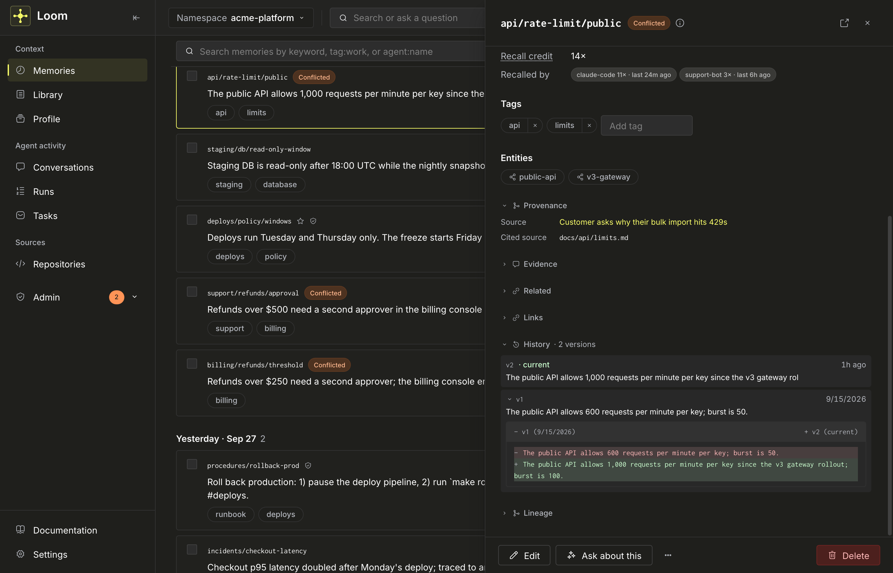

<!-- i18n: source=docs/features/memory/history-and-provenance.md blob=331db28f47c0d0f68295a93f97f4f36b6e5051ad model=claude-sonnet-5-5 -->
> このページは[英語の原文](https://github.com/ClickHouse/loom/blob/main/docs/features/memory/history-and-provenance.md)の機械翻訳です。内容は英語の原文が優先されます。
> Machine-translated from the [English page](https://github.com/ClickHouse/loom/blob/main/docs/features/memory/history-and-provenance.md), which is authoritative.

<a id="history-and-provenance"></a>

# 履歴と来歴

メモリへの書き込みはすべて新しいバージョンを作成し、その場で編集されるものはありません。バージョンは追記専用のミラーに保持されるため、バックグラウンドのマージ後も事実の履歴は残ります。各行には、誰が書き込んだか、どのようにメモリに入ったかが記録されます。派生した行にはその元になったソースが記録され、ユーザーは行が正しいことを証明（アテスト）できます。バージョンミラーの仕組みについては、[メモリアーキテクチャ](../../architecture/memory-architecture.md)を参照してください。



<a id="operations"></a>

## 操作

| 操作                 | ロール | 内容                                                                                                      |
| -------------------- | ------ | --------------------------------------------------------------------------------------------------------- |
| `memory.history`     | viewer | キーのすべてのバージョンを新しい順に返します。トゥームストーン化されたバージョンや秘匿化されたバージョンも含みます。 |
| `memory.provenance`  | viewer | 現行の行の出どころを返します。ソーストレース、書き込み者、ソースクラス、抽出元の会話です。                |
| `memory.evidence`    | viewer | ファクトの抽出元となったソースのターンを、裏付けとなる範囲と各リンクの作成方法とともに返します。          |
| `memory.backlinks`   | viewer | 行を指しているものを返します。バージョン、ダイジェスト、双方向の型付きリンク、エビデンス数、エンティティの近傍です。 |
| `memory.lineage`     | viewer | 共有メモリの昇格の経緯を返します。誰が、どの行から、どのレビューを経て昇格したかです。                    |
| `memory.verify`      | writer | ログイン中のユーザーまたはサービスアカウントとして、行が正しいことを証明します。または証明を取り消します。 |
| `memory.redact`      | admin  | 過去の1バージョンの値を消去します。行とその監査エントリは残ります。                                      |
| `namespace.rollback` | admin  | 名前空間内のすべてのメモリのヘッドを、ある時点のバージョンに戻します。                                    |
| `namespace.snapshot` | admin  | 名前空間のキュレート済みの状態を JSON ペイロードとしてエクスポートします。                                |
| `namespace.restore`  | viewer | スナップショットを新しい名前空間、または呼び出し元が管理している既存の名前空間にインポートします。コレクションにはインポートできません。 |

`namespace.snapshot` と `namespace.restore` は MCP ツールではありません。フィールドの一覧は、操作リファレンスの [メモリ](https://github.com/ClickHouse/loom/blob/main/docs/reference/operations.md#memory) と [名前空間](https://github.com/ClickHouse/loom/blob/main/docs/reference/operations.md#namespace) にあります。

<a id="versions-memoryhistory"></a>

## バージョン: `memory.history`

`loom.memory` は現在の状態を保持し、`FINAL` を付けて読み取るため、マージ後は各行の最新バージョンだけが残ります。`loom.memory_versions` は追記専用のミラーで、挿入のたびにマテリアライズドビューが書き込みます。`memory.history`、`memory.redact`、`namespace.rollback` が読み取るのはこの履歴です。

履歴の行には `version`（書き込み時のナノ秒エポック）、`written_at`、`value`、`confidence`、`pinned`、`expires_at`、`tombstoned_at`、`redacted_at`、`redaction_reason`、`content_sha256`、`agent`、`actor`、`source_class` が含まれます。`created_at` はその行が最初に書き込まれた時刻で、すべてのバージョンで同じ値になります。`agent="*"` を指定すると、そのキーのすべての書き込み元を対象にします。

```python
from loom import Agent

async with Agent(org="acme", namespace="support", agent="auditor") as agent:
    for v in await agent.memory.history("customer/4812/plan", agent_id="*"):
        print(v["written_at"], v["actor"], v["source_class"], v["value"])
```

トゥームストーンも 1 つのバージョンなので、削除は履歴に表示され、`memory.restore` で 14 日以内ならキーを復元できます。現在の状態を特定の時点で読み取るには、`memory.get`、`memory.search`、`memory.ask` の `as_of` を使います（[有効時間](https://github.com/ClickHouse/loom/blob/main/docs/features/memory/writing.md#validity-time-valid_at-and-valid_to)）。

<a id="who-wrote-it-actor-and-source-class"></a>

## 誰が書いたか：actor と source class

サーバーは、トークンと操作から、すべての行に `actor`（`human:<subject>` または `process:<subject>`）と `source_class` を記録します。`source_class` の値は[メモリの概念](https://github.com/ClickHouse/loom/blob/main/docs/concepts/memory.md)にあります。リクエストでは、クラスを `external`、`imported`、`derived` にダウングレードすることだけができます。

`memory.provenance` は、この両方に加えて次の情報を返します。

- `source_trace` と、そこから導出される `source_kind`（`conversation`、`extracted`、`observed`、`consolidated`、`app`、`manual`、`other`）
- 書き込み側が引用した `source_resource_id`
- 会話の `thread_id` と `thread_exists`（名前空間がトランスクリプトを記録しない場合、またはトランスクリプトが失われている場合は false）
- その行に関係する、作成済みのリンク（`memory.link`）

検索結果には `source_class` と `verified` が含まれます。これらは、オプションのトラスト項（`LOOM_MEMORY_SEARCH_TRUST_WEIGHT`）が参照します。

<a id="evidence-which-turns-a-fact-came-from"></a>

## エビデンス：事実の出どころとなったターン

抽出では、各事実を `loom.memory_belief_sources` 内のターンに紐づけます。`memory.evidence(memory_key)` は、それらのリンクを、ターンのテキスト（最大600文字）、ロール、時刻、裏付けとなる `span`、リンクの作成方法とともに返します。

| `scope`   | `support_type`    | 意味                                                         |
| --------- | ----------------- | ------------------------------------------------------------ |
| `cited`   | `extracted_from`  | 抽出器が裏付けとなるターンを指定した。                       |
| `lexical` | `lexical_support` | サーバーが事実を最も一致するターンに対応づけた。             |
| `window`  | `window`          | 一致するものがなく、抽出ウィンドウ全体にリンクした。         |
| `derived` | `derived_from`    | 統合の系譜：アイテムは元のメモリのテキストである。           |

レスポンスはスコープごとにリンク数を集計するため、引用された事実と、ゆるく紐づいた事実を区別して確認できます。会話の正確な文言を知りたい場合は、`memory.recall` が保存済みのターンを検索します（[抽出](https://github.com/ClickHouse/loom/blob/main/docs/features/memory/extraction.md)）。

<a id="lineage"></a>

## 系譜

- `memory.consolidate` と期間ダイジェストは、ソースごとに 1 つの `derived_from` リンクを `loom.memory_belief_sources` に書き込みます。`memory.evidence` はそれらを `derived` アイテムとして返します。
- セッションダイジェストは、圧縮したキーを一覧にします（`summary` ヒットの `derived_from`）。
- `memory.lineage`（`scope="shared"`）は、共有メモリの昇格経緯をたどります。たどる内容は、イベント、昇格した主体、裏付けとなる行、一致する場合はその元になった learnings 候補（`match_confidence` は `exact` または `inferred`）、および監査イベントです。`mechanism` は `review`、`import`、`auto`、`unknown` のいずれかです。
- `memory.backlinks` はその逆で、ある行を指しているものを返します。

`memory.delete` は、すべてのソースが失われている統合サマリーを廃止し、ソースが残っているものは `conflicted` に降格します。

<a id="attestation-memoryverify"></a>

## 証明：`memory.verify`

`pinned` と `confidence` は、誰がそのファクトを確認したかを示しません。`memory.verify` はそれを記録します。記録されるのは、呼び出し元のトークンに含まれるアクターと、そのアクターが証明したコンテンツハッシュです。行は `memory_id` で指定するか、`namespace` と `memory_key` を書き込み側の ID とともに指定します。行の名前空間に対する writer 権限が必要です。

`memory.get` と `memory.get_by_id` は `verification` を返します。これは、保存されているハッシュと行の現在のハッシュから導出されます。

| `verification` | 意味                                                           |
| -------------- | ----------------------------------------------------------------- |
| `human`        | 人が証明し、その後コンテンツは変更されていません。          |
| `process`      | サービスアカウントが証明し、その後コンテンツは変更されていません。 |
| `stale`        | 誰かが証明しましたが、その後コンテンツが変更されています。              |
| `none`         | 一度も証明されていないか、取り消されています。                                |

- 編集しても証明はクリアされません。誰かが再検証するまで、証明は `stale` になります。
- `revoke=true` を指定すると証明がクリアされます。同じアクターが変更のない行を再検証しても何も起こりません（`changed=false`）。
- `human:` プレフィックスはトークンから決まるため、エージェントが自分の書き込みを human としてマークすることはできません。本文の `actor` が読み取られるのは、認証なしの dev モードのときだけです。
- スナップショットとリストアには証明のカラムが含まれ、リストアで `verified_by` が取り除かれることはありません。

<a id="scrubbing-history-memoryredact"></a>

## 履歴の消去：`memory.redact`

`memory.redact(memory_id, version)` は、過去の 1 つのバージョンのテキストを、それがコピーされているすべての場所から消去します。あわせて、そのメモリからモデルが構築したすべてのプロファイルバージョンも消去します。`redacted_at` と `redaction_reason` を記録し、行とその監査エントリは残します。以前のバージョンに漏れたシークレットや個人情報に対して使用します。

| 場所                                              | 動作                                                                                                                                                            |
| ------------------------------------------------- | --------------------------------------------------------------------------------------------------------------------------------------------------------------- |
| `loom.memory`, `loom.memory_versions`             | `value` は `"[REDACTED]"` になります。`value_json`、`evidence`、`entities`、`concepts` は消去されます。                                                          |
| `loom.memory_embeddings`, `loom.memory_chunks`    | 抜粋またはチャンクのハッシュが現行ヘッドのものと異なる行は削除されます。現行ヘッドの行は残ります。                                                              |
| そのメモリから構築されたユーザーのプロファイルバージョン | トレースにそのメモリが含まれるすべてのバージョンが、現行ヘッドを含めて同じ方法で消去されます。そのキーの派生行も対象です。                                       |
| `loom.shared`、キーから昇格されたコピー           | `value` が消去対象のテキストであるすべてのバージョンが `"[REDACTED]"` になり、その検索行は削除されます。現行のコピーは、管理者が降格するまで昇格されたままです。 |

対象外：タグ、ファイル、`content_sha256`、`loom.memory_evidence`（消去 (erasure) の管轄）、系統テーブル（ID とハッシュのみ）、エンティティグラフ。現行ヘッドも消去対象のテキストを保持している間（編集がバイト単位で元に戻された場合）、共有コピーはそのまま残されます。

- メモリの現行ヘッドは拒否されます（`refused_head=true`）。先にキーを削除するか書き換えてください。消去された現行プロファイルは、ワーカーが再構築するまで、レンダリング、パック、プロファイル検索から除外されます。
- どちらのロックモードでも拒否されます。これはメモリ自身のキーにも、到達するすべてのプロファイルキーにも当てはまります。
- そのキー、または共有コピーのキーを引用していた、キャッシュ済みの `memory.ask` と `code.ask` の回答および先例を削除します（`cache_rows_deleted`、`precedent_rows_deleted`）。到達したプロファイルキーに対しては、削除は組織全体に及びます。すべてのユーザーのプロファイルが同じキーを持つため、そのキーをウィンドウに含んでいた組織内のすべてのキャッシュ済み回答と先例が、すべての名前空間で消去されます。
- 名前空間は取得後に検査されます。拒否された場合は 403 ではなく `redacted=false` が返されます。
- 存在しないバージョンに対しては `redacted=false` が返され、何も消去されません。プロファイルバージョンも対象外です。
- 2 つのメモリテーブル（および、コピーがまだそのテキストを保持している場合は `loom.shared`）に対して同期的な `ALTER TABLE … UPDATE` を実行し、派生行に対して軽量な `DELETE` を実行します。これは管理用の呼び出しです。

共有コピーの消去と競合する書き込み：

- 埋め込みワーカーがパージ後に書き込む検索行は、パージ前に読み取ったスタブに由来する場合、そのキーの次回の redact まで残ります。
- キーの昇格は、再度昇格されるまで検索行を失います。
- スクラブ前にコピーを読み取った降格は、テキストを含むトンブストーンを書き込み、そのバージョンが再度 redact されるまで残ります。

後続のキーの昇格によって置き換えられ、その後 `loom.shared` でマージされて消えたコピーは、もう見つかりません。`FINAL` がもう提供しないその検索行は、そのキーの後続のパージまで残り、消去対象以外のキーのもとにあるキャッシュ済みの回答は、期限切れになるまで残ります。

値が `"[REDACTED]"` のコピーは、以前の redact で消去されたものとして扱われます。そのため、そのテキスト自体を保持していて昇格されたメモリは、そのキーの次回の redact で検索行を失います。

プロファイルへの到達範囲とその制限は、[セキュリティ](https://github.com/ClickHouse/loom/blob/main/docs/architecture/security.md#sensitivity)を参照してください。個人のデータをすべての場所から削除するには、[消去 (erasure)](https://github.com/ClickHouse/loom/blob/main/docs/features/memory/retention-and-erasure.md#erasure)を使用してください。

<a id="rolling-a-namespace-back-namespacerollback"></a>

## 名前空間のロールバック：`namespace.rollback`

`namespace.rollback(as_of)` は、キーごとに `as_of` 以前の最も高いバージョンを新しいヘッドとして再挿入し、それ以降に作成されたキーには廃棄マーカー（tombstone）を付けます。ロールバック自体が新しいバージョンとして記録されるため、同じ方法で元に戻せます。

- デフォルトはドライランで、`reinstate`、`remove`、`sample` を報告します。`dry_run=false` を指定すると適用されます。
- `memory_keys`（最大 500）で対象を絞り込めます。`max_keys`（デフォルトは 5,000）は 1 回の呼び出しの上限で、`truncated` が返された場合は再度呼び出してください。
- `embedding_worker` が、復元されたヘッドを再埋め込みします。
- 名前空間の履歴より古い、または未来の `as_of` は拒否されます。

```bash
curl -sX POST http://localhost:7777/v1/namespace.rollback \
  -H "Authorization: Bearer $LOOM_API_KEY" -H 'Content-Type: application/json' \
  -d '{"org":"dev","namespace":"local","as_of":"<YYYY-MM-DD>T09:00:00Z"}' \
  | jq '{reinstate, remove, truncated, sample}'
```

<a id="snapshots-namespacesnapshot-and-namespacerestore"></a>

## スナップショット：`namespace.snapshot` と `namespace.restore`

`namespace.snapshot` は、名前空間のキュレーション済みの状態を JSON としてエクスポートします。対象は、`version`、`content_sha256`、`actor`、`source_class`、有効期間および証明（attestation）の各列を持つすべてのメモリ行、型ごとの設定、グラント、そして直近の監査行（最大 `include_audit_tail_n` 件、デフォルトは 1,000）です。`include_embeddings` はデフォルトで false のため、ターゲット側では自身のモデルで再埋め込みを行います。

`namespace.restore(target_namespace, payload)` は、ペイロードをバージョン行として書き戻します。`snapshot_id` に対して冪等です（再実行すると `restored=false` が返ります）。復元先は、新規の名前空間（呼び出し元が admin になります。行を持たないものの、すでにデータやグラントを保持している名前は、呼び出し元がすでに管理している場合を除き拒否されます）、または呼び出し元が管理している名前空間です。`rebind_agent` は、すべての行の書き込み元を再割り当てします。復元された行は `imported` になります。

スナップショットはデプロイメントのバックアップではありません。詳しくは[バックアップとリカバリ](https://github.com/ClickHouse/loom/blob/main/docs/operations/backup-and-recovery.md)を参照してください。

<a id="the-audit-log"></a>

## 監査ログ

メモリを作成または変更するすべての書き込みは、`loom.audit_log` にハッシュのみの行を 1 行残します（キー、ID、コンテンツハッシュ、アクター、ソースクラス、判定。値そのものは記録しません）。1 時間ごとのチェックポイントがログを連鎖させます。詳細は [監査](https://github.com/ClickHouse/loom/blob/main/docs/features/observability/audit.md) を参照してください。

<a id="limits"></a>

## 制限事項

- **マージされて残らなくなったバージョンの墨消しはベストエフォートです**（`loom.memory`）。ミラーはどちらの場合でも消去されます。
- **履歴はミラーと同じ範囲までしか完全になりません。** `loom.memory` にカラムを追加する場合は、同じマイグレーションで `loom.memory_versions` とそのビューにも追加する必要があります。
- **有効性は有効時間（valid-time）のみです。** `knowledge_time` は、無効化（`invalid_at`）と削除（`tombstoned_at`）のスタンプに対して `created_at` を再生します。トランザクション時間用の別テーブルはありません。
- **`thread_exists=false` はエラーではありません。**
- **ロールバックしても、完全に削除されたキーは復元されません**（`skipped_no_head`）。

<a id="related"></a>

## 関連ドキュメント

- [メモリの書き込み](https://github.com/ClickHouse/loom/blob/main/docs/features/memory/writing.md)
- [競合と拒否](https://github.com/ClickHouse/loom/blob/main/docs/features/memory/conflicts-and-refusal.md)
- [保持と消去](https://github.com/ClickHouse/loom/blob/main/docs/features/memory/retention-and-erasure.md)
- [監査](https://github.com/ClickHouse/loom/blob/main/docs/features/observability/audit.md)
