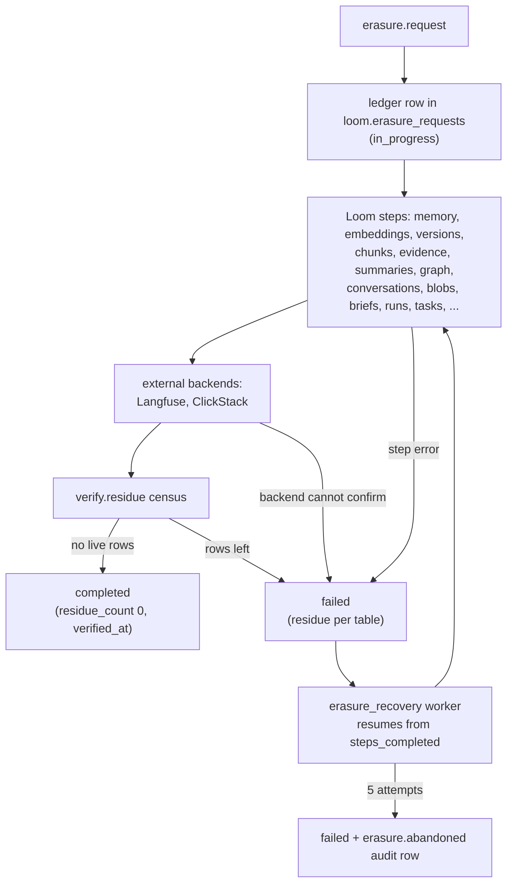

<!-- i18n: source=docs/features/memory/retention-and-erasure.md blob=193d8b98f7242dbe87366e0149f838322897ecdd model=claude-sonnet-5-5 -->
> このページは[英語の原文](https://github.com/ClickHouse/loom/blob/main/docs/features/memory/retention-and-erasure.md)の機械翻訳です。内容は英語の原文が優先されます。
> Machine-translated from the [English page](https://github.com/ClickHouse/loom/blob/main/docs/features/memory/retention-and-erasure.md), which is authoritative.

<a id="retention-and-erasure"></a>

# 保持と消去

Loom は、書き込んだ本人、名前空間の所有者、またはオペレーターが求めない限り、メモリを削除しません。メモリにはデフォルトの保存期間がありません。データが削除される経路は 3 つあります。書き込んだ本人による有効期限の設定または削除、所有者やオペレーターが設定した保持ポリシー、そして Loom が保持しているあらゆる場所からスコープを取り除く消去です。

<a id="what-is-kept-and-for-how-long"></a>

## 何がどれだけ保持されるか

`schemas/schema.sql` では、メモリ、埋め込み、バージョン履歴、会話、エンティティ、サマリー、ワーキングメモリ、ナレッジの各テーブルに TTL はなく、行を経過時間で削除するワーカーもありません。リンクテーブルの `entity_triple_rows` と `entity_edge_rows` は `entity_triples` と `entity_edges` に従い、TTL はありません。消去（erasure）は、消去対象のメモリのリンクを削除します。古いビルドの消去が残した孤立リンクは `loom erasure-re-verify --completed-since … --resume` で削除します。
行が提供対象から外れるのは、次の場合のみです。

- **書き込み側が削除した場合**：`memory.delete`、同じキーの上書きによる置き換え、`memory.apply`、`memory.clear`、`conflicts.resolve`、`blacklist.add(sweep=true)`。
- **書き込み側が有効期限を設定した場合**：`memory.set`、`memory.touch`、`run.complete(retain="expire")` の `ttl_seconds` または `valid_to`、およびリフレクションの `expires_in_days`。
- **オーナーまたはオペレーターが設定した場合**：[設定による保持](#configured-retention)を参照してください。

運用テーブル（テレメトリ、キャッシュ、キュー）には固定の TTL があります。`loom.search_trace_log` と `loom.memory_exposures` は 180 日、`loom.erasure_requests` と `loom.policy_decisions` は 90 日、`loom.memory_drops`、`loom.memory_extraction_queue`、`loom.events`、`loom.embedding_cache` は 30 日、`loom.llm_response_cache` は 7 日です。各テーブルの TTL は[スキーマリファレンス](https://github.com/ClickHouse/loom/blob/main/docs/reference/schema.md)に一覧があります。

タイマーでデータを削除するワーカーは 1 つだけです。`namespace_gc` は、`kind = 'bench'`（自動登録時に `LOOM_NAMESPACE_BENCH_PREFIXES` で照合）の名前空間のうち、`LOOM_NAMESPACE_GC_IDLE_HOURS` の間書き込みがないものを、消去サガ経由で削除します。他の kind には一切触れません。[名前空間と共有](https://github.com/ClickHouse/loom/blob/main/docs/features/namespaces-and-sharing.md)を参照してください。

<a id="delete-is-not-erase"></a>

### 削除は消去ではない

トゥームストーン（tombstone）は、`tombstoned_at` が設定された新しいバージョンです。読み取りはただちにその行を返さなくなりますが、その行と `loom.memory_versions` にある過去のバージョンはディスク上に残ります。

- `memory.restore` は、トゥームストーン化されたキーを 14 日以内であれば復元します（それ以降は `expired=true` を返します）。自動的な置き換え（supersession）も元に戻せます。
- `memory.clear`（admin）は、名前空間内のエージェントまたはユーザーのメモリをすべてトゥームストーン化します。`confirm_subject` には具体的な `user_id` または `agent` を再度指定する必要があります（`'*'` も `'-'` も確認として扱われません）。`user_id` を指定した `agent="*"` は、そのユーザーの行をすべてのエージェントにわたって消去し、`agent` を指定した `user_id="*"` は、そのエージェントの行をすべてのユーザーにわたって消去します。名前空間全体の消去と同様に、`'-'` 以外に誰も指定しないスコープは拒否されます。ロックされた行は残り、`locked_skipped` に数えられます。消去されたキーも同じ方法で復元できます。

バイト列そのものを削除するには、[消去（erasure）](#erasure)を使います。行と監査証跡は残したまま 1 つの値だけを取り除くには、[`memory.redact`](https://github.com/ClickHouse/loom/blob/main/docs/features/memory/history-and-provenance.md#scrubbing-history-memoryredact)を使います。

<a id="writer-set-expiry"></a>

### 書き込み側が設定する有効期限

行は `expires_at` を過ぎた瞬間から読み取りで非表示になります。その後、`memory_expiry_sweep` ワーカーが、書き込み側の `on_expire` を新しいバージョンとして適用します。

| `on_expire`           | 効果                                                                                                                         |
| --------------------- | ---------------------------------------------------------------------------------------------------------------------------- |
| `tombstone`（デフォルト） | トゥームストーン化されます。14 日間の復元期間があります。                                                                    |
| `demote`              | 有効期限が解除され、信頼度が `LOOM_MEMORY_EXPIRY_DEMOTE_FACTOR`（0.5）倍されます。ただし `LOOM_MEMORY_EXPIRY_DEMOTE_FLOOR`（0.05）を下回りません。 |
| `anonymize`           | 値がマーカーに置き換えられ、埋め込みが削除されます。行は存在した証拠として残ります。                                         |

`memory.touch` は行の有効期限だけを変更します。対象は 1 つのキー、または最大 1,000 件（`memory_keys`）で、新しい `ttl_seconds`、`clear_expiry=true`、新しい `on_expire` を指定できます。`memory.sweep_expired`（admin）は、名前空間に対してスイープを 1 回、オンデマンドで実行します（`dry_run` 指定可）。他のフィールドを編集しても、有効な有効期限は維持されます。

<a id="configured-retention"></a>

### 設定による保持

すべてデフォルトでは無効です（0 = 永久に保持）。

| 対象                         | 設定方法                                                                                                   | 効果                                                                                                                                                     |
| ---------------------------- | ---------------------------------------------------------------------------------------------------------- | -------------------------------------------------------------------------------------------------------------------------------------------------------- |
| 名前空間内のメモリタイプ     | `namespace.register` の `tag_registry` エントリの `retention_days`                                         | 有効な有効期限、`ttl_seconds`、`clear_expiry` のいずれも指定せずに `memory.set` が書き込んだ行は `expires_at = now + N days` になります。再度書き込まれた `read_only` 行には設定されません。 |
| 機密性の高い行               | `LOOM_MEMORY_SENSITIVE_RETENTION_DAYS`、`LOOM_MEMORY_SENSITIVE_ON_EXPIRE`（デフォルトは `anonymize`）      | 新しい `medium` / `high` 機密度の行に有効期限が設定されます。呼び出し側の有効期限のほうが短い場合は、そちらが優先されます。                              |
| 実行（run）自身の書き込み    | `LOOM_MEMORY_RUN_COMPLETE_RETAIN`（`keep`、`demote`、`expire`）、`LOOM_MEMORY_RUN_COMPLETE_EXPIRE_DAYS`（7） | 呼び出しで指定がない場合に、`run.complete` が実行の行に対して行う処理です。固定（pinned）、検証済み、昇格済み、ロック済み、エピソード、リフレクションの各行は常に保持されます。 |
| 名前空間全体                 | `namespace.register` の `retention_days`、`warm_days`                                                      | その名前空間の行に対するテーブル TTL（およびウォームティアへの移動）です。                                                                               |
| デプロイメント               | `LOOM_RETENTION_<TABLE>_DAYS`、`LOOM_TIERING_<TABLE>_WARM_DAYS`                                            | `audit_log`、`agent_events`、`memory`、`memory_embeddings`、`conversations`、`chunks`、`documents` に対するテーブル TTL（およびウォームティアへの移動）です。 |

Postgres オーソリティの構成では、最後の 2 行のいずれも `memory`、`memory_embeddings`、`documents` に保持 TTL を設定しません。設定すると、Postgres がまだ提供している行の ClickHouse 側のコピーが削除されてしまうため、起動時に `LOOM_RETENTION_MEMORY_DAYS`、`LOOM_RETENTION_MEMORY_EMBEDDINGS_DAYS`、`LOOM_RETENTION_DOCUMENTS_DAYS` は拒否されます（[ストレージオーソリティ](../../architecture/storage-authority.md)）。名前空間の `retention_days` は `chunks` からも行を削除しないため、残るドキュメントは、検索でそれを見つけるためのチャンクを保持します。`LOOM_RETENTION_CHUNKS_DAYS` は引き続き適用されます。

`retention_reconcile` ワーカーは、最後の 2 行を、テーブルごとに冪等な `ALTER TABLE … MODIFY TTL` として適用します。上書きがある場合は `(org, namespace)` ごとに適用します。名前空間にもデプロイメントの期間にも該当しなくなったテーブルは、その TTL を削除します。`loom.memory` では TTL は `coalesce(expires_at, created_at)` をキーとするため、書き込み側の有効期限が優先されます。

- **テーブル TTL は物理的に削除します。** パートの次回マージ時に削除され、復元期間はありません。トゥームストーンも、それが隠している行とともに期限切れになります。
- **Undo は、その記録が残っている間だけ有効です。** コンフリクトリゾルバーは、`audit_log` の `memory.unsupersede` 行によって、人が行った廃止の Undo を尊重します。`audit_log` の TTL がペアの存続期間より短いと、期限切れになった Undo は効力を失い、リゾルバーが同じペアを再度判定して廃止する可能性があります。
- **ティアリングにはボリュームが必要です。** `LOOM_TIERING_WARM_VOLUME_NAME` はストレージポリシー内のボリュームを指定する必要があり、ウォームの経過日数は保持の経過日数より小さくなければなりません。

<a id="erasure"></a>

## 消去

`erasure.request` は、Loom が保持するあらゆる場所から 1 つのスコープを消去し、スコープ内に何も残っていないことを示せるようになった時点で返ります。org 全体で 1 つのユーザー id が保持するものをすべて消去するには、org 管理者が `user_id` スコープを要求します。これにより、org のすべての名前空間にあるそのユーザーの行が消去されます（`purge=true` では、トゥームストーンにするのではなく削除します。残るものは以下に記載します）。`memory.clear` は、1 つの名前空間内の 1 つのエージェントまたはユーザーのメモリをトゥームストーンにするだけです（[delete は erase ではない](#delete-is-not-erase)）。

| `scope_type`     | `scope_value`                                                               | 要求できる人                                 |
| ---------------- | --------------------------------------------------------------------------- | -------------------------------------------- |
| `user_id`        | org のすべての名前空間にまたがるユーザー id                                 | org 管理者                                   |
| `namespace`      | 1 つの名前空間                                                              | その名前空間の管理者（または org 管理者）    |
| `namespace_list` | 1～500 個の名前空間の JSON 配列、または `{"namespaces": [...], "purge": bool}` | org 管理者                                   |

この op は writer トークンで呼び出せますが、ハンドラーは対象に対する管理者権限を要求します（それ以外は 403 `AUTH_INSUFFICIENT`）。

カテゴリリンク（`loom.memory_categories`）にはユーザーが含まれないため、`user_id` の消去ではそれらのリンクと、それらを列挙する `memory.import` の監査行が残ります。インポートされた項目では、リンクのキーは `import:` とそのテキストのダイジェストであり、推測したテキストの確認に使えてしまいます。`namespace` の消去ではリンクが削除されます。

`user_id` の消去は、そのユーザーが刻印された逐語チャンクと、ユーザーの `(namespace, key)` の組のいずれかに属し、ユーザーが刻印されていない（`-`）チャンクを、誰のメモリに属するかにかかわらず削除します。`-` チャンクにはユーザーのテキストが含まれうるためで、書き込みパスもそれらを書き込み側のものとして退役させます。別のユーザーが刻印されたチャンクは残ります。

`user_id` の消去は、ユーザーのメモリから作られた統合サマリーも、書き込んだ ID が何であれ退役させ（[対象となるもの](../../architecture/memory-architecture.md#background-passes)）、そこから派生したものも併せて退役させます。具体的には、バージョン履歴、逐語チャンクとエンティティベクトル、それらから抽出されたグラフ行、およびそれらから昇格された名前空間全体のコピーです。それらを引用していたキャッシュ済みの `memory.ask` の回答と先例も削除します。

<a id="the-saga"></a>

### サガ



- **チェックポイント付きの冪等なステップ。** 完了した各ステップは `steps_completed` に記録されます。`erasure_recovery` ワーカーは、`in_progress` または `failed` のまま止まったサガを、そのチェックポイントから再開します。ステップはミューテーションを最大 `LOOM_ERASURE_MUTATION_WAIT_S` だけ待ち、それを過ぎるとそのミューテーションを名指しして失敗します。
- **ドキュメントソースは、ドキュメントより先に停止します。** 名前空間の消去は、最初のステップである `knowledge_sources.retire` で、その名前空間の[ドキュメントソース](https://github.com/ClickHouse/loom/blob/main/docs/features/knowledge.md#document-sources)を退役させて認証情報を消去し、その後、実行中の各ソースの同期ターンを待ちます（合計で最大 30 秒。実行中のターンが残っていればステップは `OVERLOADED` で失敗し、`erasure_recovery` がサガを再試行します）。これにより、後続のステップがドキュメントやマイニング済みの決定を消去した後で、同期がそれらを書き戻すことはありません。
- **コードリンクはリンクワーカーを待ちます。** `code_links.delete` はコードリンクワーカーのキューリースを取得するため、消去前に読み取ったカーソルをパスが公開することはありません。Keeper がある場合はホスト間で、ない場合は 1 プロセス内で有効です。パスの完了を最大 15 分待ち、それを過ぎるとステップは `LeaseBusy` で失敗し、`erasure_recovery` が再試行します。
- **トゥームストーンかパージか。** デフォルトでは、論理削除テーブル（メモリ、埋め込み、チャンク、サマリー、リンク）はトゥームストーンになり、`memory.restore` で期間内なら復活させられます。`erasure.list` はそのような復活を `reversals_count` として報告します。`purge=true` は行を代わりに削除します（ワイドテーブルでは軽量な `DELETE FROM`）。ミラーを持ったことのある名前空間を含むスコープは、その中のすべての名前空間をまとめてパージするため、どの名前空間にもそのような期間はありません（[ドキュメントソース](https://github.com/ClickHouse/loom/blob/main/docs/architecture/document-sources.md#the-mirror)）。ユーザーの消去は、ユーザーのメモリがキーを通じて供給した先を見つけます。そのため、パージでは `loom.memory` の行と、そこから作られた統合サマリーが最初にトゥームストーンにされ、それらのキーを読むすべてのステップの後の `memory.retire` で削除されます。それまでは `memory.restore` で復活させられます（ユーザー自身の行は取り消しとして数えられ、サマリーは数えられません）。また `memory.retire` は、`memory.restore` が復活させたものを削除します。
- **アップロードされた原本**（ナレッジドキュメントの）：名前空間の `loom.document_blobs` の行が最初に削除され、`blob_erased_at` が刻印されます。ユーザーの消去は、そのユーザーがアップロードし、かつ他の書き込み者の有効なドキュメントが共有していない原本を削除します。これらは `loom.blob_uploads`（エンドユーザーごとのアップロード 1 件につき 1 行。原本を指していたドキュメントバージョンは置き換えられ、マージされている可能性があるため）と、それらのドキュメントを通じて見つけられます。その後、`loom.blob_uploads` のそれらの行が削除されます。センサスは両方のテーブルを数えます。S3 互換バケット（`LOOM_DOCUMENT_OBJECT_STORE=s3`）に保管された原本は、行より先に削除されます。名前空間の消去は、プレフィックス配下のスコープのすべてのオブジェクトを削除し、センサスはそこに残っているものを数えます（`objects.document_originals`）。ユーザーの消去は、行で指されているかどうかにかかわらず、ユーザー自身の原本のバイト列を保持するすべてのオブジェクトを削除し、それらのプレフィックスを再度一覧して、ストアに残っていればステップを失敗させます。その後、行を削除し、さらに行が指していないがそれらのプレフィックスにまだ残っているものを削除します。このため、行が削除によって失われたユーザー自身のそのバイト列のアップロードも、オブジェクトを失います。ステップの実行時点で進行中だった、どの書き込み者によるものであれ、そのバイト列のアップロード（オブジェクトは保存済みで、行はまだ入っていない）は、オブジェクトを失い、その行は、後から入った場合に `410 BLOB_GONE` で応答されます。原本の各バッチは削除の直前に再度読み込まれるため、その後に別の書き込み者のドキュメントが指すようになった原本は残ります。その読み込みの後に、同じ名前空間で同じバイト列を保存した別の書き込み者は、ClickHouse ストアの場合と同様に、それらを失う可能性があります。バケットが設定されていないのに行がオブジェクトを指している場合、または設定されたバケットとプレフィックスの外を指している場合は、バイト列を残さずステップが失敗します。どちらのストアでも、ユーザーの消去は、原本が収まる最少のミューテーション数で行を削除します（各ミューテーションは、ClickHouse のパラメーター 1 つが運べるだけ束ねます）。原本の ClickHouse からバケットへの移動（`loom knowledge migrate-originals`）は、この台帳によって保護されています。未完了の消去が対象とする原本は移動せず、消去に追い越された移動は、その消去が決めたとおりに終わります（[原本の保管場所](https://github.com/ClickHouse/loom/blob/main/docs/features/knowledge.md#where-originals-are-stored)）。
- **取り込みのキャンセル。** ユーザーの消去は、キャンセルを含め、ユーザーの取り込み行を削除します。他の書き込み者のジョブで、まだ保留中または処理中のものに対してユーザーが依頼したキャンセルは、先に ID を持たない行（`agent`、`user_id`、`session_id` が `'-'`、`actor` が空）として保持されるため、そのジョブはキャンセルされたままになります。
- **org 全体のキャッシュ。** `loom.idempotency`（再生されるレスポンス）と `loom.embedding_cache`（クエリベクトル。テキストは保持しない）は org を持つものの、名前空間もエンドユーザーも持たないため、どちらのスコープの消去でも、両テーブルの org のすべての行が削除されます。コストはキャッシュミスです。センサスは `loom.idempotency` を org 全体で数えますが、`loom.embedding_cache` は数えません。後者は org 内のどの検索でも再充填されます。各レプリカのベクトルのプロセスキャッシュは `LOOM_EMBEDDING_CACHE_TTL_S` 以内に失効します。
- **ボットルールの学習。** 学習キュー内のユーザーの言葉は、`loom.learnings_supporters` のユーザーの行にだけ存在し、ユーザーの消去がそれを削除します。その結果サポーターがいなくなったルール候補は、保留中であれば削除され、そうでなければルールを空にしたまま決定を保持します（[抽出](https://github.com/ClickHouse/loom/blob/main/docs/features/memory/extraction.md#rules-the-assistant-states-about-itself)）。センサスは、消去されたユーザーのものだけでなく、org 全体でそのようなサポーターのない候補を数えるため、org 内の別の消去が途中で残した候補が原因でサガが失敗することがあります。その場合、再開されたステップがそれを片付けます。

<a id="the-federated-cascade"></a>

### フェデレーテッドカスケード

Loom が外部に送ったデータは、同じサガの中で消去されます。外部ステップはフェイルクローズです。削除を確認できないバックエンド（5xx、タイムアウト、ネットワーク切断、バージョンのない Langfuse のヘルス応答）はステップを失敗させ、ワーカーが再試行します。「削除するものがない」（一致する行がゼロ、またはサービスにない ClickStack テーブル）は成功として扱われます。

| バックエンド | 設定                                                       | 消去対象                                                                                          |
| ------------ | ---------------------------------------------------------- | ------------------------------------------------------------------------------------------------- |
| Langfuse     | `LOOM_LANGFUSE_URL` + `LOOM_LANGFUSE_ADMIN_TOKEN`          | org のタグ内で `userId` により、または `org:` + `namespace:` のタグの組により見つかるトレース。    |
| ClickStack   | `LOOM_CLICKSTACK_DATABASE`, `LOOM_CLICKSTACK_USER_ID_KEYS` | 同じ ClickHouse サービス内の OTel 行のうち、ユーザー id 属性キーまたは名前空間に一致するもの。    |

ClickStack の名前空間の消去は、`loom.namespace` の行が、消去を行う org の `loom.org` を持つ場合にのみ一致します。そのため、org を持たない Loom 自身の op とドメインのメトリクスは、名前空間ラベルを保持します（[ClickStack の消去](https://github.com/ClickHouse/loom/blob/main/docs/features/integrations/clickstack.md#erasure)）。

未設定のバックエンドは、意図をログに記録するだけで何も削除しません。`external=false` を渡せるのは `namespace_list` の消去だけで、`user_id` と `namespace` の消去は常にバックエンドを含みます。`LOOM_EXTERNAL_ERASURE_TIMEOUT_S` が各呼び出しの上限です。セットアップ：[Langfuse](https://github.com/ClickHouse/loom/blob/main/docs/features/integrations/langfuse.md)と[ClickStack](https://github.com/ClickHouse/loom/blob/main/docs/features/integrations/clickstack.md)。

<a id="the-residue-census"></a>

### 残存物センサス

最後のステップ `verify.residue` は、読み取りパスが触れるすべてのテーブルで、スコープ内の有効な行を数えます。1 行でも残っていればサガは失敗し、終端行には `residue_count`、`residue`（テーブルごと）、`verified_at`、`census`（すべてのカウント。後述）が付きます。再開されたサガは、直近のセンサスで行が見つかったテーブルを担当するステップを、チェックポイントが完了済みと示していても再実行し、必ず再度数えます。

<a id="the-receipt"></a>

### レシート

`erasure.status`（および `erasure.request` の応答）は、直近の実行のセンサスのレシートを返します。直近の台帳行に、すべてのストアを数えたセンサスがない場合、`census` は null です。具体的には、実行中、センサスを実行できなかった、またはストアが数えられなかった場合、あるいはセンサスを保持しないビルドが書いた行です。レシートのフィールドは次のとおりです。

- `census`：センサスが数えたすべての基盤とそのカウント（ゼロを含む）。キーはテーブル名、Postgres の権威については `pg:<table>`、名前空間スコープのドキュメントバケットについては `objects.document_originals`、プロバイダー再構築のコピー全体の合計については `provider_rebuild_copies`（存在しなければ 0。コピーに org 列がない場合はデプロイメント全体で数えます）。カウントは、このスコープでセンサスが残存物として数える行です。有効な行、またはサガがパージする場合やテーブルがトゥームストーンを保持しない場合はすべての行です（[センサスのルール](../../architecture/memory-architecture.md#erasure-saga)）。`objects.document_originals` は最初の一覧ページを数えるため、「少なくとも」として読みます。
- `purge`：スコープの削除かトゥームストーンかのモード（単一の名前空間では、要求にかかわらずトゥームストーン）。ミラーを持つスコープ（[ドキュメントソース](https://github.com/ClickHouse/loom/blob/main/docs/architecture/document-sources.md#the-mirror)）は、この値にかかわらず削除されます。パージなしでは、トゥームストーンにされた行はテーブルがマージされるまでパート内にバイト列を保持します。パージありでは行は削除され、そのバイト列はマージまたはリクレイムワーカーが取り除くまでディスク上に残ります。
- 対象と時刻は、ステータスの `org`、`scope_type`、`scope_value`、`verified_at` です。

レシートは Loom による集計です。応答は保管してください。`erasure.status` は、要求から 89 日間、台帳行を返します。センサスも含む `erasure.completed` 監査行は、completed の行の後にベストエフォートで書き込まれ、`LOOM_RETENTION_AUDIT_LOG_DAYS` の間保持されます。要求者が応答を受け取っていない場合（リカバリーワーカーが完了させたサガ、デタッチして実行したもの、タイムアウトした呼び出し）は、89 日以内に `erasure.status` を読んでください。

<a id="checking-an-erasure-yourself"></a>

#### 消去を自分で確認する

`--namespaces '*'` または `--all` を付けた org の SQL サーフェスのグラントを持つオペレーターは（[SQL サーフェス](https://github.com/ClickHouse/loom/blob/main/docs/reference/sql-surface.md#access)）、センサスの 3 つのキー `loom.memory`、`loom.memory_versions`、`loom.conversations` を再集計し、リクエスト台帳（後述の 4 つ目のステートメント）を確認できます。消去された id とセンサスの時刻をパラメーターとしてバインドします。ClickHouse は、消去自身のステートメント（後述）と同様に、バインドされた値を `system.query_log` に書き込みます。そのため、確認は、プッシュダウンされたテキストが Postgres のステートメントログにもう 1 つのコピーとして残る `pg_clickhouse` 経由ではなく、`clickhouse-client` から実行してください。

```bash
read -r uid  # the erased id, typed at the prompt so it stays out of the shell history
clickhouse-client --param_org='<org>' --param_uid="$uid" --param_at='<verified_at>' \
  --multiquery --query "
SELECT count() FROM loom.sql_v1_memories WHERE org = {org:String}
  AND user_id = {uid:String} AND created_at <= {at:DateTime64(6, 'UTC')};
SELECT count() FROM loom.sql_v1_memory_history WHERE org = {org:String}
  AND user_id = {uid:String} AND created_at <= {at:DateTime64(6, 'UTC')};
SELECT count() FROM loom.sql_v1_conversations WHERE org = {org:String}
  AND user_id = {uid:String} AND ts <= {at:DateTime64(6, 'UTC')};
SELECT count() FROM loom.sql_v1_agent_events WHERE org = {org:String}
  AND user_id = {uid:String} AND ts <= {at:DateTime64(6, 'UTC')};"
```

`org` フィルタは、複数の org を対象とする grant（`--all`）を、消去対象の org に絞り込みます。各ステートメントは、フィルタする前に grant のスコープ全体を読み取ります（[読み取りのコスト](https://github.com/ClickHouse/loom/blob/main/docs/reference/sql-surface.md#what-a-read-costs)）。そのため、大きな org や `--all` の grant では、ステートメントが SQL ユーザーの上限（`LOOM_CH_ANALYSIS_MAX_ROWS_TO_READ`、`_MAX_EXECUTION_S`）に達し、件数の代わりにエラーで止まることがあります。確認の間は上限を引き上げてください。名前空間スコープの場合は `--param_ns='<namespace>'` を渡し、最初の 3 つのステートメントを `user_id` ではなく `namespace = {ns:String}` でフィルタします。`namespace_list` の場合は、`scope_value` の `namespaces` にある名前ごとに 1 回ずつ実行します。`sql_v1_agent_events` のステートメントはユーザースコープ専用です。名前空間の消去では、その名前空間のリクエスト台帳の行が残るためです。消去が完了していれば各件数は 0 になりますが、census との違いが次のようにあります。ビューは制限付きの名前空間を除外します。`sql_v1_memories` は rejected と tombstoned の行を除外し、`sql_v1_memory_history` は rejected のバージョンを除外します（tombstoned のものは残します）。また、ユーザーのメモリから統合された要約は別の `user_id` を持ち、census はそれを数えますが、これらのクエリは数えません。リクエスト台帳の件数は、レシートの外にある別の確認です。消去はユーザーのリクエスト台帳の行を削除せず、`<erased>` に書き換えます。リクエスト台帳のビューは自身のウィンドウ分しか保持しません（[`sql_v1_agent_events`](https://github.com/ClickHouse/loom/blob/main/docs/reference/sql-surface.md#sql_v1_agent_events)）。そのため、書き換えの確認はウィンドウ内の行に限られます。census のそれ以外のキーは、Loom 自身の件数だけです。

レシートがカバーしないもの：

- どちらのサービスについても、バックアップ、ポイントインタイムリカバリ、WAL、スタンバイ。
- Loom の外で作られたコピー。たとえば、[SQL サーフェス](https://github.com/ClickHouse/loom/blob/main/docs/reference/sql-surface.md)から org 自身の Postgres に作ったテーブル。
- census の後に、その前に行った読み取りに基づいてワーカーが書き込む行（[ストレージの権限](../../architecture/storage-authority.md#erasure)）。
- 消去より前に取得したスナップショットからの `namespace.restore`。行が復元されます。消去をもう一度実行してください。そのときの census が新しいレシートになります。
- ユーザースコープの場合、バケット内のドキュメントの原本。census が数えるのは名前空間スコープの場合だけです。

消去した ID は、消去の証明に必要な場所に残ります。台帳の行（テーブルの TTL によってリクエストから 90 日後に削除されるまで）、audit、`loom.erasure_reversals`、そしてその ID を指定したステートメントに関するデプロイ自身のログです（ClickHouse のミューテーションログ、それを書き込んだステートメントについては `system.query_log` と `system.text_log`、`log_statement` または `log_min_duration_statement` が有効な場合は Postgres のステートメントログ）。

<a id="abandoned-sagas"></a>

### 放棄された saga

5 回試行しても失敗した場合、ワーカーはそのリクエストを恒久的に `failed` とし、`failure_reason` と `steps_completed` を含む `erasure.abandoned` の audit 行を書き込みます。その後は人がエスカレーションする必要があります。`loom erasure-re-verify` は終了状態の saga を再確認します。`--resume` は失敗した saga をチェックポイントから再実行します（外部ステップが失敗し続ける `namespace_list` の saga には `--skip-external` を使います）。`--completed-since <ISO timestamp>` を指定すると、失敗したものの代わりに、その時刻以降に検証された完了済みの saga を再確認します。これは、アップグレード中に以前のビルドが実行した消去のためのものです。`--resume` と併用すると、孤立した行リンクだけを削除します（[メンテナンス](https://github.com/ClickHouse/loom/blob/main/docs/operations/maintenance.md#erasure)）。[トラブルシューティング](https://github.com/ClickHouse/loom/blob/main/docs/operations/troubleshooting.md)も参照してください。

<a id="operations"></a>

### オペレーション

| Op                | ロール                         | 内容                                                                                                                                                                                                                                                                                                                                                        |
| ----------------- | ---------------------------- | ----------------------------------------------------------------------------------------------------------------------------------------------------------------------------------------------------------------------------------------------------------------------------------------------------------------------------------------------------------- |
| `erasure.request` | writer（対象の admin） | 1 つのスコープに対して saga を実行します。`urgency` は `normal` または `urgent`、ほかに `purge`、`external` があります。                                                                                                                                                                                                                                                                            |
| `erasure.status`  | viewer                       | 1 件のリクエストの状態、現在のステップ、失敗の理由、census。ユーザーの消去に答えるのは、その org の org admin または platform admin だけです。MCP のツールセットには載っていません。                                                                                                                                                                                      |
| `erasure.list`    | viewer                       | 最近のリクエスト（`status` でフィルタ可能）。`steps_completed_count`、`reversals_count`、`residue_count` を含みます。                                                                                                                                                                                                                                                     |
| `erasure.export`  | admin                        | 対象者のデータを JSON で出力します。`memory`、`knowledge`、`conversations`（トランスクリプトのターンと保存されたメッセージ）、`conversation_threads`、`agent_events`、`audit_log` を含み、それぞれ `section_limit`（デフォルト 10,000。超えると `truncated`）で上限が設けられ、`conversations` はさらに `LOOM_ERASURE_EXPORT_CONVERSATION_MAX_BYTES` 分のテキストに制限されます。デフォルトでは tombstoned の行も含みます。 |

`erasure.status` と `erasure.list` は台帳の行を 89 日間読み取ります。テーブルの TTL は 90 日で削除します。フィールドの一覧は[オペレーションリファレンス](https://github.com/ClickHouse/loom/blob/main/docs/reference/operations.md#erasure)を参照してください。

<a id="example"></a>

### 例

```python
from loom import Agent

async with Agent(org="acme", namespace="support", agent="privacy-desk") as admin:
    out = await admin.erasure.request_user_id("u-42", requester="dpo@acme.example")
    print(out["status"], out["residue_count"], out["verified_at"])
    if out["status"] != "completed":
        print(out["failure_reason"], out["residue"])
```

SDK の `request` は `purge` と `external` を公開していません。これらは HTTP で送信します。

```bash
curl -sX POST "$LOOM_BASE_URL/v1/erasure.request" \
  -H "Authorization: Bearer $LOOM_API_KEY" -H "Content-Type: application/json" \
  -d '{"org":"acme","scope_type":"namespace_list",
       "scope_value":"[\"bench-a\",\"bench-b\"]",
       "requester":"ops@acme.example","purge":true,"external":false}'
```

<a id="for-contributors"></a>

### コントリビューター向け

メモリのコンテンツを保持しうる新しいテーブルには、saga のステップと census のエントリ（`server/erasure/store/census.py` の `_CENSUS` 内の `Substrate(...)` 1 つ）が必要です。そうでない場合は、理由を添えて `STEP_ONLY_TABLES` に 1 行追加します。どちらもないと、ユニットテストが失敗します。saga は `server/erasure/app/saga.py`（`run_saga`）、バックエンドは `server/erasure/app/backends.py`、ワーカーは `server/erasure/workers/recovery.py` にあります。

<a id="limits"></a>

## 制限事項

- **コンプライアンスの保証ではありません。** saga、census、監査ハッシュはエンジニアリング上のプリミティブであり、特定の義務を満たすかどうかはお客様の判断になります。
- **消去には時間がかかります。** 各ステップはミューテーションの完了を待つため、大きなスコープでは数分を見込んでください。SDK は最初の応答を最大 120 秒待ちます。それ以降は `erasure.status` をポーリングしてください。
- **`org` スコープはありません。** org の名前空間を消去するには `namespace_list` を使います。
- **テーブル TTL からは復元できません。** ライフサイクルの終了を元に戻せるようにしたい場合は、`on_expire` を使った書き込み側の有効期限を使用してください。
- **バックアップは saga の対象外です。** 詳しくは[バックアップとリカバリ](https://github.com/ClickHouse/loom/blob/main/docs/operations/backup-and-recovery.md)を参照してください。
- **分析エクスポートのバケットは saga の対象外です。** 含まれるファイルは、ハッシュ化された org、名前空間、エージェントの名前と使用回数のみで、メモリの内容は含まれません。詳しくは[ハッシュ化された名前](https://github.com/ClickHouse/loom/blob/main/docs/operations/analytics-export.md#hashed-names)を参照してください。

<a id="related"></a>

## 関連ドキュメント

- [履歴と来歴](https://github.com/ClickHouse/loom/blob/main/docs/features/memory/history-and-provenance.md)：`memory.history`、`memory.redact`。
- [メモリの書き込み](https://github.com/ClickHouse/loom/blob/main/docs/features/memory/writing.md)：書き込み時の `ttl_seconds`、`valid_to`、`on_expire`。
- [実行](https://github.com/ClickHouse/loom/blob/main/docs/features/runs.md)：`run.complete` の `retain`。
