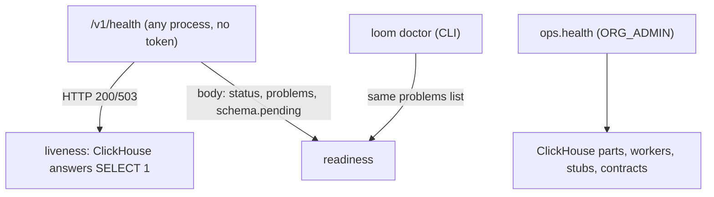

<!-- i18n: source=docs/operations/monitoring.md blob=b778428a5dabcc233847330b82b31b92a8373c9c model=claude-sonnet-5-5 -->
> このページは[英語の原文](https://github.com/ClickHouse/loom/blob/main/docs/operations/monitoring.md)の機械翻訳です。内容は英語の原文が優先されます。
> Machine-translated from the [English page](https://github.com/ClickHouse/loom/blob/main/docs/operations/monitoring.md), which is authoritative.

<a id="monitoring"></a>

# モニタリング

このページでは、何を監視すべきかを説明します。Loom は次の 4 つの手段で自身の状態を報告します。

| 手段                            | 対象範囲                                   |
| ------------------------------- | ------------------------------------------ |
| `/v1/health`, `loom doctor`     | 単一のプロセス                             |
| `ops.health`                    | ClickHouse に対するより詳細なチェック      |
| OpenTelemetry のメトリクスとスパン | 同じ ClickHouse、または OTLP に書き込まれる |
| `loom.agent_events`             | リクエストの台帳（1 つの操作につき 1 行）  |

メトリクス名とラベルの一覧は、[テレメトリ](https://github.com/ClickHouse/loom/blob/main/docs/features/observability/telemetry.md)にまとめています。

<a id="running-operator-commands"></a>

## オペレーターコマンドの実行

オペレーターコマンドは `loom` のサブコマンドです。デプロイメントの環境を持つコンテナ内で実行します。

```bash
docker exec loom-server loom doctor            # web container
docker exec loom-workers loom code stats       # workers container (split deployments)
```

チェックアウトした環境からは、`pip install -e .` で同じ CLI をインストールできます。この CLI は環境変数と `.env` から `LOOM_*` を読み取ります。`loom <command> --help` で各フラグの説明を確認できます。すべてのコマンドは[CLI リファレンス](https://github.com/ClickHouse/loom/blob/main/docs/reference/cli.md)に一覧があります。

組織全体のビュー（名前空間をまたぐコスト、`ops.health`）には `ORG_ADMIN` または `PLATFORM_ADMIN` が必要です。これらは `LOOM_PLATFORM_ADMINS` でのみ付与されます（[デプロイメント](https://github.com/ClickHouse/loom/blob/main/docs/operations/deployment.md#required-environment)）。デプロイメント全体の `/v1/admin/*` ルートには `PLATFORM_ADMIN` が必要です。`token.mint`、`namespace.adopt`、`claim_release` は、対象とする組織の `ORG_ADMIN` が必要です。名前空間の `admin` では、これらのいずれにもアクセスできません。

<a id="health-checks"></a>

## ヘルスチェック



<a id="v1health"></a>

### /v1/health エンドポイント

```bash
curl -s http://localhost:7777/v1/health | jq '{status, version, ch_ok, build_commit, schema, problems}'
curl -s 'http://localhost:7777/v1/health?include=workers' | jq '.workers_leader'
```

- **HTTP ステータスは ClickHouse のみで決まります。** `SELECT 1` に応答すれば 200、応答しなければ 503 を返します（`ch_error` にはエラーの種類が入り、テキストはサーバーログにあります）。これをライブネスプローブとして使ってください。ステータスコードだけを読むプローブ（イメージのヘルスチェックやロードバランサー）は、本文を解析しない 200 ではなく、障害を検知できます。
- **`status`** は、ClickHouse が停止している場合、または `problems` のいずれかのエントリの重大度が `error` である場合に `degraded` になります。ただし `code_tier_failing` は例外です。これはデプロイではなくリポジトリのインデックスに関する問題だからです。それ以外は `ok` です。レディネスチェックでは、あわせて `schema.pending` が空であることも条件にしてください（ゼロダウンタイムのペアの切り替えはまさにこれを行います）。
- **`problems`** は `{code, severity, message, fix, source}` のリストで、深刻なものから順に並びます。同じリストが `loom doctor` で出力され、ダッシュボードのバナーにも表示されます。`loom doctor` は `code_tier_failing` に含まれるエントリを最大 5 件まで名前で示します（残りは `code.repos` に名前が出ます）。プラットフォーム管理者のトークンでは、制限されていない各エントリが名前で示されます（[ティアが失敗したとき](https://github.com/ClickHouse/loom/blob/main/docs/operations/code-index-operations.md#when-a-tier-fails)）。

| 問題コード                                | 重大度                                                                                              | 意味                                                                                                                                                                                                                                                                                                                                                                                                    |
| ----------------------------------------- | --------------------------------------------------------------------------------------------------- | ------------------------------------------------------------------------------------------------------------------------------------------------------------------------------------------------------------------------------------------------------------------------------------------------------------------------------------------------------------------------------------------------------- |
| `fake_embedder`, `fake_llm`               | warn（`LOOM_REQUIRE_REAL_PROVIDERS=true` の場合は error）                                           | フェイクプロバイダーが設定されています                                                                                                                                                                                                                                                                                                                                                                  |
| `embedder_key_missing`, `llm_key_missing` | warn（同上）                                                                                        | 実プロバイダーが設定されているのにキーがありません。プロセスはフェイククライアントで動作します                                                                                                                                                                                                                                                                                                          |
| `embedding_dim_mismatch`                  | error                                                                                               | エンベッダーが返す次元数が `LOOM_EMBEDDING_DIM` と異なります                                                                                                                                                                                                                                                                                                                                            |
| `coded_width_mismatch`                    | error                                                                                               | コード化ベクトル列の幅が、書き込まれるデータの幅と異なります。それらの書き込みは失敗します                                                                                                                                                                                                                                                                                                              |
| `provider_failing:<name>`                 | error                                                                                               | そのプロバイダーへの直近の呼び出しが失敗しました。次に成功すると解消します                                                                                                                                                                                                                                                                                                                              |
| `model_configuration_refused`             | error                                                                                               | ダッシュボードで保存したモデル設定がゲートウェイチェックに失敗し、適用されていません。すべてのデータプレーンリクエストが 503 `GATEWAY_REQUIRED` を返し、設定を置き換えるまでサーバーはレディになりません                                                                                                                                                                                              |
| `jwt_secret_empty`                        | error                                                                                               | トークンに署名できません                                                                                                                                                                                                                                                                                                                                                                                |
| `dev_jwt_secret`                          | warn                                                                                                | 認証が有効なのに、リポジトリにチェックインされた開発用シークレットを使っています                                                                                                                                                                                                                                                                                                                        |
| `config_drift`                            | error                                                                                               | このプロセスのルートシークレットまたは MUST_MATCH 設定が、デプロイで公開されている設定と異なります。レディではありません（[N 個のレプリカの実行](https://github.com/ClickHouse/loom/blob/main/docs/operations/replicas.md)）                                                                                                                                                                              |
| `revocation_not_loaded`                   | error                                                                                               | 認証が有効なのに、このプロセスが `loom.revoked_tokens` を一度も読み込んでいません。すべてのベアラーに 503 が返ります                                                                                                                                                                                                                                                                                    |
| `revocation_stale`                        | warn                                                                                                | 失効スナップショットが max(300 秒, 10 × `LOOM_JWT_REVOCATION_CACHE_TTL_SECONDS`) より古くなっています。それ以降に失効したトークンも、ここでは認証に通ります                                                                                                                                                                                                                                            |
| `revocation_too_stale`                    | error                                                                                               | スナップショットが `LOOM_JWT_REVOCATION_MAX_STALE_SECONDS`（600 秒）より古くなっています。更新されるまで、すべてのベアラーに 503 が返ります                                                                                                                                                                                                                                                              |
| `pending_migrations`                      | error                                                                                               | このビルドが想定するマイグレーションがスキーマに適用されていません                                                                                                                                                                                                                                                                                                                                      |
| `instance_label_missing`                  | warn                                                                                                | compose ファイル外のプロセスに `LOOM_INSTANCE_LABEL` が設定されていません                                                                                                                                                                                                                                                                                                                              |
| `workers_lease_absent`                    | warn または info                                                                                    | warn: 有効なワーカーリースを保持しているプロセスがありません（`LOOM_BACKGROUND_WORKERS=on` のプロセスはリースを取らないため、そのプロセスと並んで表示されます。引き継ぎ中やコールドスタート中は、一瞬だけ表示されることがあります）。info: このプロセスはワーカーを実行しておらず、最近リースを読み取っていません                                                                                         |
| `workers_lease_unreachable`               | warn                                                                                                | このプロセスが ClickHouse にワーカーリースを問い合わせられませんでした。すべてのプロセスがこれを報告している場合、ワーカーを実行しているものはありません                                                                                                                                                                                                                                              |
| `workers_lease_given_up`                  | warn                                                                                                | このプロセスはワーカーリースを解放し、獲得の試行をやめました（ドレイン中か、ワーカーの子プロセスが起動に失敗し続けています）。別のプロセスが引き継ぎます                                                                                                                                                                                                                                              |
| `otel_erasure_index`                      | warn                                                                                                | ClickStack のメトリクステーブルに、消去に必要なインデックスがありません（[メンテナンス](https://github.com/ClickHouse/loom/blob/main/docs/operations/maintenance.md#clickstack-erasure-index)）                                                                                                                                                                                                         |
| `code_tier_failing`                       | warn（`LOOM_CODE_TIER_FAILING_ERROR_LAG_COMMITS` 分も遅れている場合は error。フェッチティアは warn のまま） | コードインデックスのティアが、`LOOM_CODE_TIER_FAILING_WARN_PASSES` 回連続、または `LOOM_CODE_TIER_FAILING_WARN_HOURS` の間、失敗しました。fix には、そのエラー種別に必要な対処が示されます（[ティアが失敗したとき](https://github.com/ClickHouse/loom/blob/main/docs/operations/code-index-operations.md#when-a-tier-fails)）。`status` を degraded にすることはありません。`loom.health.problems` には他の問題と同様に含まれるため、そこで `severity="error"` を対象にしたアラートは `code="code_tier_failing"` を除外する必要があります。 |

その他の本文フィールドは次のとおりです。`providers`（プロバイダーごとの呼び出し状態）、`fake_embedding`、`fake_llm`、`providers_degraded`、`embedding_dim_mismatch`、`adaptive_thresholds`（エンベッダーから導出された類似度のしきい値。`calibration_hash` は同じしきい値を使うすべてのレプリカで等しくなります。`source` は `shared` か、このレプリカ自身の `probe` です）、`ratelimit.backend`（`shared` または `per-process`）、`mode`（`ch`。設定されている場合は `langfuse` と `clickstack` も含まれます）。`?include=` には `workers`、`langfuse`、`otel`、`embedding_cache`、`llm_cache` を指定できます。各サブシステムは個別に報告され、HTTP ステータスを決めるのは ClickHouse だけです。

<a id="loom-doctor"></a>

### loom doctor コマンド

`loom doctor` は各チェック（`python_version`、`settings_load`、`jwt_secret`、`clickhouse_reachable`、`otel_erasure_index`、`llm_provider`）を実行し、続いて `problems` リストを `problem:<code>` の行として出力します。すべてのチェックを報告してから終了し、いずれかの行が `FAIL` の場合、終了コードは 1 になります。`--json` を指定すると `{ok, checks, problems}` を出力します。`LOOM_CELL` が設定されていて ClickHouse に到達できる場合は、[セル](https://github.com/ClickHouse/loom/blob/main/docs/architecture/cells.md)のチェック（`cell_state`、`cell_marker`、`cell_marker_everywhere`、`cell_triggers`）も実行します。これらの評価は最大でも `WARN` です。`cell_deployment` は、デプロイチェックが拒否した場合（`LOOM_PG_DSN` がない、別の記録済み権限またはデプロイがある、ClickHouse へのアクセスが拒否された）に `FAIL` になります。コードインテリジェンスが有効で ClickHouse に到達できる場合は、失敗しているコードインデックスのティアも読み取り、デプロイのランタイムオーバーライドで評価します。`problem:code_tier_failing` は `status` を degraded にしないため、最大でも `WARN` です。

`--client` を指定すると、このマシンをコーディングエージェントのクライアントとしてもチェックします。対象は、フックが使うサーバー URL とトークン（`--server-url` と `--token` で上書きできます）、トークンが受け入れられ、その名前空間に書き込めるか、Claude Code または Codex の設定、サーバーに届かなかったキャプチャジョブです。`loom report` は、バグ報告の Environment フィールド用に doctor の出力を表示します（[issue の報告](https://github.com/ClickHouse/loom/blob/main/CONTRIBUTING.md#filing-an-issue)）。

<a id="opshealth"></a>

### ops.health オペレーション

`POST /v1/ops.health`（`ORG_ADMIN`）は、ClickHouse に対してより詳細なチェックを実行します。各チェックは `status`（`ok`、`warn`、`fail`）、`detail`、`repair` を返します。失敗したプローブの `detail` にはエラーの種類（Loom エラーのコードとメッセージ）が入り、各ワーカーの `last_error_kind` にはエラーのクラスが入ります。エラーのテキストはサーバーログと `/v1/admin/workers.status` にあります。プロセス内のスーパーバイザーがワーカーを実行している場合、`/v1/health?include=workers` もワーカーの行を同じように切り詰めます。`last_error` はなく、結果の数値とフラグだけが含まれます。

| チェック                 | 確認対象                                                              |
| ------------------------ | --------------------------------------------------------------------- |
| `clickhouse_parts`       | テーブルごとのアクティブなパート数と、直近 15 分間に失敗したマージ    |
| `workers`                | 直近のワーカーパスの失敗                                              |
| `embedding_stubs`        | ベクトル待ちのメモリ埋め込み行                                        |
| `schema_contracts`       | リスクの高いテーブルとカラムを、スキーマダンプと照合した結果          |
| `memory_schema_contract` | 永続化された `loom.memory` のカラムを、スキーマダンプと照合した結果   |
| `op_mix`                 | `loom.agent_events` における直近の操作の内訳                          |
| `procedure_plane`        | `loom.procedure_runs` と、台帳に記録されたプロシージャキー            |

<a id="smoke-test"></a>

### スモークテスト

デプロイ後に、メモリを1件書き込み、読み出して、一連の動作を確認します。

```bash
export LOOM_API_KEY=$(docker exec loom-server loom mint-token --subject smoke --org dev --namespaces smoke --roles writer --ttl-days 1)
curl -s -XPOST http://localhost:7777/v1/memory.set -H "Authorization: Bearer $LOOM_API_KEY" \
  -H 'Content-Type: application/json' \
  -d '{"org":"dev","namespace":"smoke","agent":"smoke","memory_key":"k","value":"deploy smoke test"}'
curl -s -XPOST http://localhost:7777/v1/memory.search -H "Authorization: Bearer $LOOM_API_KEY" \
  -H 'Content-Type: application/json' \
  -d '{"org":"dev","namespace":"smoke","agent":"smoke","query":"smoke test"}' | jq '.results[0].content_excerpt'
```

検索が結果を返さない（abstain する）場合は、`loom.embed.pending` と `/v1/health` の `providers` ブロックを確認してください。ベクトル待ちの行は保存されていますが、まだ検索できません。

<a id="worker-status"></a>

## ワーカーのステータス

バックグラウンド処理は、`server/workers/registry.py`（`_WORKERS`）で宣言された監視付きループとして実行されます。スーパーバイザーは、失敗したパスをバックオフ付きで再試行し、期限（デフォルトは min(4 × interval, 900 s)、下限は 60 s）を超えたパスをキャンセルし、ワーカーが3回連続でパスに失敗すると `<worker>: DEGRADED` をログに出力します。各ワーカーは1つの `LOOM_*_ENABLED` フラグで切り替えられます。すべてのワーカー、そのフラグ、デフォルト値、実行間隔は[ワーカーリファレンス](https://github.com/ClickHouse/loom/blob/main/docs/reference/workers.md)に一覧があります。

```bash
curl -s -H "Authorization: Bearer $ADMIN_TOKEN" http://localhost:7777/v1/admin/workers.status | jq
```

「何も起きなかった」という報告の多くは、ワーカーが実行されていないことが原因です。たとえば、新しい行の埋め込み、遅延バッチの抽出、コミットのインデックス作成などです。

- `/v1/admin/workers.status` は、無効なものを含め、登録されているすべてのワーカーを、その間隔と最後のパスとともに一覧表示します。このプロセスのレジストリと `loom.worker_status`（30日間保持）をマージするため、Web のみのコンテナでも、workers コンテナが実行したパスを確認できます。ダッシュボードの管理者向け **Health** ビューにも同じ内容が表示されます。
- `/v1/health?include=workers` → `workers_leader.reason` は、このプロセスがデプロイメントの workers リース（ClickHouse の `workers_supervisor`）を保持しているかどうかを示します。
- メトリクス：`loom.worker.consecutive_failures{worker}` と `loom.worker.partial_failures{worker}`。
- `ops.projection_failures.list`（`ORG_ADMIN`）は、失敗して `projection_repair` ワーカーによる処理を待っているセカンダリプロジェクションを一覧表示します。`ops.projection_failures.retry` は1件を再試行します。
- ワーカーの ClickHouse ステートメントには `log_comment = 'worker.<name>'` が付与されます（[クエリの帰属](#logs-traces-and-query-attribution)）。

<a id="what-to-alert-on"></a>

## アラートの対象

以下のしきい値は出発点です。類似度のベースラインは埋め込みモデルによって変わるため、自分のデプロイメントから設定してください。

| シグナル                                                      | アラート条件                                                      | 意味                                                                                                      | 最初の対応                                                                                                                                                                                                                                                                        |
| ------------------------------------------------------------- | ----------------------------------------------------------------- | --------------------------------------------------------------------------------------------------------- | --------------------------------------------------------------------------------------------------------------------------------------------------------------------------------------------------------------------------------------------------------------------------------- |
| `/v1/health` HTTP ステータス                                  | 503                                                               | このプロセスから ClickHouse に到達できない                                                                | [トラブルシューティング](https://github.com/ClickHouse/loom/blob/main/docs/operations/troubleshooting.md#every-operation-fails-and-v1health-returns-503)                                                                                                                                                                                            |
| `/v1/health` `status`                                         | 5 分間 `degraded`                                                 | `code_tier_failing` 以外の `error` の問題                                                                 | `problems[].fix` を読む                                                                                                                                                                                                                                                           |
| `loom.search.top_similarity` の平均                           | 30 分間ベースラインを下回る                                       | 失敗せずに検索品質が低下した（埋め込みモデルの変更、フェイクへのフォールバック）                          | [トラブルシューティング](https://github.com/ClickHouse/loom/blob/main/docs/operations/troubleshooting.md#search-returns-arbitrary-results-or-extraction-writes-nothing)                                                                                                                                                                             |
| `loom.embed.pending`                                          | 15 分間 100 を超える                                              | メモリがまだ検索できない。埋め込みのスループットまたはクォータの問題                                      | `/v1/health` → `providers` のプロバイダー状態                                                                                                                                                                                                                                     |
| 任意の `loom.integrity.*`                                     | 0 を超える                                                        | すでに発生した欠陥であり、自然には解消しない（[後述](#integrity-invariants)）                             | 修復の列                                                                                                                                                                                                                                                                          |
| `loom.worker.consecutive_failures`                            | 3 以上                                                            | ワーカーがループで失敗し続けている                                                                        | [トラブルシューティング](https://github.com/ClickHouse/loom/blob/main/docs/operations/troubleshooting.md#a-worker-fails-every-pass)                                                                                                                                                                                                                 |
| `loom.process.open_fds / loom.process.fd_limit`               | 0.5 を超える                                                      | ディスクリプタのリーク、または接続が多すぎる                                                              | プロセスごとの系列（`loom.pid`）                                                                                                                                                                                                                                                  |
| `loom.host.disk.free_bytes / loom.host.disk.total_bytes`      | 0.10 を下回る                                                     | `var/` 配下のディスクが埋まりつつある（リポジトリの repack、ログ、blob）。ゼロになるとホスト上のすべての書き込みが失敗する | プロセスごとに 1 系列（`loom.disk.path`）                                                                                                                                                                                                                                         |
| `loom.langfuse.breaker`                                       | 2 に等しい                                                        | Langfuse へのスコア送信が失敗し、スコアが破棄される                                                       | `POST /api/public/scores` に対する Langfuse への到達性                                                                                                                                                                                                                            |
| `loom.code.index_lag_commits`                                 | 15 分間、1 パスあたりのコミット予算を超える                       | コードインデックスがブランチに遅れている                                                                  | [コードインデックスの運用](https://github.com/ClickHouse/loom/blob/main/docs/operations/code-index-operations.md#failure-model)                                                                                                                                                                                                                 |
| `loom.code.tier_lag_seconds`                                  | 10 分間 1800 を超える                                             | コンパイラティアが最近のマージに追いついていない                                                          | `deploy/dashboards/code_plane.json` の「code tier lag」アラート。最も遅いティアの通常サイクルより大きく設定する                                                                                                                                                                   |
| `loom.code.tier_failing`                                      | 15 分間、いずれかの点がある（ページには `severity="error"`）      | `code_tier_failing` の問題が報告するコードインデックスのティアが、`LOOM_CODE_TIER_FAILING_*` のしきい値を超えた | `/v1/health` の `code_tier_failing` の `fix`（[ティアが失敗したとき](https://github.com/ClickHouse/loom/blob/main/docs/operations/code-index-operations.md#when-a-tier-fails)）                                                                                                                                                              |
| `ops.health` の `clickhouse_parts`、またはエラー 252          | `fail`                                                            | マージが失敗している                                                                                      | [トラブルシューティング](https://github.com/ClickHouse/loom/blob/main/docs/operations/troubleshooting.md#writes-fail-with-too_many_parts-or-merges-are-failing)                                                                                                                                                                                     |
| `loom.audit.checkpoint_lag_windows`                           | 増加している                                                      | 監査チェックポイントのチェーンが遅れている                                                                | `audit_verifier` ワーカーのパス                                                                                                                                                                                                                                                   |
| `loom.trust` ごとの `loom.auth.agents_provisioned{outcome=made}` | コントロールプレーンの通常の割合を超える（10 分間で 50 を目安に開始） | トラストがフリートの成長より速く新しいエージェントを指名している。発行者キーの漏洩、またはコントロールプレーンの暴走 | トラストの `auth.agent_provisioned` 監査行（`audit.list`）を、コントロールプレーンが起動したエージェントと比較する。差異があれば `loom bot disable --name <trust>` を実行し、発行者のキーをローテーションする                                                                       |
| `loom.auth.trust_agents_used_ratio`                           | 0.8 を超える                                                      | トラストが `--max-agents` に近づいている（有効なエージェントで数え、解放されたものは枠を戻す）            | `outcome=made` もフリートの成長より速く増えている場合は、`outcome=made` の行に従う（トラストを無効化し、キーをローテーションする）。そうでなければ上限を引き上げる：トラストのフラグと大きい `--max-agents` を指定して `loom bot create --replace` を実行する（エージェントのトークンは終了し、それぞれが再度交換する） |
| `loom.auth.agents_provisioned{outcome=at_cap}`                | 10 分間で 0 を超えて増加                                          | トラストの新しいエージェントが拒否されている                                                              | `outcome=made` もフリートの成長より速く増えている場合は、`outcome=made` の行に従う（トラストを無効化し、キーをローテーションする）。そうでなければ上限を引き上げる：トラストのフラグと大きい `--max-agents` を指定して `loom bot create --replace` を実行する（エージェントのトークンは終了し、それぞれが再度交換する） |

HyperDX では空の結果は 0 として扱われるため、最小サンプル数のガードは、行を返さないのではなく、正常範囲内の値を返す必要があります。

何をスケールすべきか（Web レプリカ、プロバイダーのクォータ、ワーカーのコンテナ、または ClickHouse）を示すシグナルは、[障害と復旧](../architecture/failure-and-recovery.md)にあります。

<a id="pipeline-slos"></a>

### パイプラインの SLO

Postgres をオーソリティとする場合、書き込みはコミット時点で応答し、そのメモリ行と検索ドキュメントが ClickHouse に入った時点で検索可能になります（[ストレージオーソリティ](../architecture/storage-authority.md#publication)）。先行する書き込みがまだ反映されていない検索は、`LOOM_PG_PROJECTION_WAIT_MS`（デフォルト 2000 ms）までそれらを待ち、超過すると 503 `PROJECTION_BEHIND` を返します。

| 目標                                        | ターゲット                                                                                                        | シグナル                                                                      |
| ------------------------------------------- | ----------------------------------------------------------------------------------------------------------------- | ----------------------------------------------------------------------------- |
| 読み取りが先行する書き込みを待つ            | p99 が `LOOM_PG_PROJECTION_WAIT_MS` の半分未満であり、障害時以外に `deadline` で終わるものがない（op は 503 を返す） | `outcome` ごとの `loom.pg.search_wait_ms`                                     |
| 書き込みが ClickHouse に入る                | p99 が `LOOM_PG_PROJECTION_WAIT_MS` の半分未満。これにより読み取りの待ち時間に残り半分を充てられる                 | `loom.pg.projection_lag_ms{path="flush"}`                                     |
| 停止したライターのリースを超えて待つものがない | 最も古い保留が `LOOM_PG_REQUEST_LEASE_SECONDS` の 2 倍と `LOOM_PG_DELIVERY_IDLE_INTERVAL_SECONDS` の合計未満       | `loom.pg.oldest_pending_age_s{source="memory"}`                               |
| 障害時以外にラグのエラーがない              | 0                                                                                                                 | `loom.requests{loom.error_code="PROJECTION_BEHIND" or "PUBLICATION_PENDING"}` |
| ClickHouse が拒否し続けるものがない         | リストア reconcile が保持している間を除き 0                                                                       | `loom.pg.backlog{state="parked"}`                                             |

公開前に停止したライターのもとでの検索の最悪の待ち時間は、そのリース（`LOOM_PG_REQUEST_LEASE_SECONDS`）です。待機中の検索は、期限切れの配信を自分で公開します。これはデフォルトの待ち時間より長いため、レイテンシではなく `outcome="deadline"` として現れます。レディネスはこれらのいずれにも依存しません。すべてのレプリカが同じ Postgres を読むため、ラグに基づくレディネスチェックは、すべてのレプリカを一度にローテーションから外してしまいます。

配信ワーカーを実行するすべてのプロセスがデプロイメント全体のバックログをエクスポートし、複数のプロセスが同時に行うことがあるため、バックログのゲージは `sum` ではなく `max` で読んでください。

アラート：

| シグナル                                          | アラート条件                    | 意味                                                                                                                                                                      | 最初の対応                                                                                       |
| ------------------------------------------------- | ------------------------------- | ------------------------------------------------------------------------------------------------------------------------------------------------------------------------- | ------------------------------------------------------------------------------------------------ |
| `loom.pg.search_wait_ms{outcome="deadline"}` のレート | 5 分間 0 を超える               | 読み取りが期限まで待った。op は 503 `PROJECTION_BEHIND` を返し、レポートはそのまま読み進める                                                                              | ClickHouse への到達性、次に `loom.pg.backlog` と `pg_delivery` ワーカーのパス                    |
| `loom.pg.oldest_pending_age_s{source="memory"}`   | 10 分間ターゲットを超える       | 配信ワーカーが追いついていない、または ClickHouse が拒否している                                                                                                          | `GET /v1/health?include=postgres` → `postgres.backlog`、`pg_delivery` ワーカーのステータス       |
| `loom.pg.backlog{state="parked"}`                 | 0 を超える                      | ClickHouse が拒否し続けた配信、またはリストア reconcile が保持している配信（どちらかは `last_error` に示される）                                                          | 配信の `last_error`（[ストレージオーソリティ](../architecture/storage-authority.md#delivery)）   |
| どのプロセスからも `loom.pg.backlog` の点がない   | エクスポート 3 期間にわたって   | 読み取りが止まった。バックログの読み取りが失敗している、配信パスが開始されない、または 2 つのパスの開始間隔（パスとその後の間隔）がエクスポート 2 期間を超えている         | `pg_delivery` と `knowledge_pg_delivery` ワーカーのログにある `backlog not read` 警告            |

<a id="integrity-invariants"></a>

### 整合性の不変条件

これらのゲージはどれも常に 0 であるべきです。ワーカーのリースを保持するプロセスが 15 分ごとに計算し、キャッシュします。

| メトリクス                                                      | 0 以外の値の意味                                                                | 修復                                               |
| --------------------------------------------------------------- | ------------------------------------------------------------------------------- | -------------------------------------------------- |
| `loom.integrity.divergent_entities`                             | あるメモリについて、`loom.memory` と `loom.memory_embeddings` でエンティティが異なる | 書き込みパスを調査する                             |
| `loom.integrity.orphan_vectors`                                 | メモリ行が存在しない埋め込みベクトル                                            | `orphan_vector_reconcile` worker                   |
| `loom.integrity.orphan_entity_vectors`                          | メモリ行が存在しないエンティティベクトル                                        | `orphan_vector_reconcile` worker                   |
| `loom.integrity.orphan_graph_namespaces`                        | エンティティエッジを持つが、有効なメモリもナレッジもない名前空間                | `loom erasure-re-verify --orphan-graph --erase`    |
| `loom.integrity.live_ns_unregistered`, `live_rows_unregistered` | `loom.namespaces` の行がない名前空間内の有効なメモリ                            | 名前空間を登録するか、`loom namespaces-adopt` を実行 |
| `loom.integrity.dim0_with_vector`                               | ベクトルを持つが `embedding_dim = 0` のため、検索で見えない行                   | `loom integrity-repair --apply`                    |
| `loom.integrity.tombstone_status_drift`                         | `tombstoned_at` が設定されているのに、ステータスが別の値になっている行          | `loom integrity-repair` が一覧表示                 |
| `loom.integrity.active_past_valid_to`                           | 自身の `valid_to` を過ぎても active のままの行                                 | `loom integrity-repair` が一覧表示                 |
| `loom.integrity.high_with_embedding`                            | 有効な埋め込み行が残っている高機密度の行                                        | `loom sensitivity-sweep --apply`                   |

修復コマンドについては、[メンテナンス](https://github.com/ClickHouse/loom/blob/main/docs/operations/maintenance.md#backfills-and-repairs)を参照してください。

<a id="metrics"></a>

## メトリクス

Loom は `LOOM_OTEL_METRICS_EXPORT_INTERVAL_S` 秒ごと（デフォルトは 60）に OpenTelemetry メトリクスをエクスポートします。`LOOM_OTEL_EXPORTER=ch`（OTLP エンドポイントが設定されていない場合のデフォルト）では、同じ ClickHouse サービス上の `default.otel_metrics_sum`、`default.otel_metrics_histogram`、`default.otel_metrics_gauge` に直接書き込まれます（`LOOM_CLICKSTACK_DATABASE` が設定されている場合は、ここでも以下でもそのデータベースに書き込まれます）。これらは ClickStack/HyperDX が読み取るテーブルです。代わりにコレクターへ送信するには、`LOOM_OTEL_EXPORTER_OTLP_ENDPOINT` を設定します。カウンターとヒストグラムは、`LOOM_OTEL_METRICS_DELTA_TEMPORALITY=true` でない限り累積値です。エクスポーターの状態は起動ログで確認できます。

```text
OTel metrics initialized — emitting every 60s (cumulative temporality, gauge heartbeat …s) to default.otel_metrics_{sum,histogram,gauge}
```

ラベルは限定された集合（オペレーション、名前空間、上限のある enum）から付けられます。キー、ユーザー ID、セッション ID、クエリテキストがラベルになることはありません（`tests/unit/test_domain_metrics.py` がこれを検証しています）。リクエストとコスト、検索品質、メモリ書き込み、バックログ、整合性、コードインデックスに分類した全メトリクスの一覧は、[テレメトリ](https://github.com/ClickHouse/loom/blob/main/docs/features/observability/telemetry.md)を参照してください。

クエリの例：

```sql
-- mean top similarity per namespace, last hour
SELECT Attributes['loom.namespace'] AS ns,
       round(anyLast(Sum) / greatest(anyLast(Count), 1), 3) AS mean_top_similarity
FROM default.otel_metrics_histogram
WHERE MetricName = 'loom.search.top_similarity' AND TimeUnix > now() - INTERVAL 1 HOUR
GROUP BY ns;

-- every gauge's latest value
SELECT MetricName, anyLast(Value) AS latest
FROM default.otel_metrics_gauge
WHERE TimeUnix > now() - INTERVAL 5 MINUTE
GROUP BY MetricName ORDER BY MetricName;
```

最初のクエリは累積ヒストグラムを読み取るため、系列ごとの全期間の平均になります。ウィンドウ単位の平均を求めるには、各ポイントを同じ系列の直前のポイントとの差分にします（`deploy/hyperdx_dashboards.md` の「The cumulative-counter correction」にある補正を参照）。

<a id="dashboards"></a>

## ダッシュボード

[`deploy/hyperdx_dashboards.md`](https://github.com/ClickHouse/loom/blob/main/deploy/hyperdx_dashboards.md) は、ClickStack と HyperDX のセットアップガイドであり、SQL パネルのクックブックです。ClickStack との連携そのものについては [ClickStack](https://github.com/ClickHouse/loom/blob/main/docs/features/integrations/clickstack.md) を参照してください。

- **コレクターは不要です。** Loom は OTel の行を自身の ClickHouse の `default.otel_*` に直接書き込みます。そのため、ホスト型の ClickStack では、ソースを既存のテーブルに向けるだけで済みます（`deploy/clickstack_sources.sh` がその設定をスクリプト化しています）。HyperDX のインストールによってテーブルが作成されていない場合は、`schemas/otel/clickstack_otel_tables.sql` を一度だけ手動で適用してください。すべての文は `IF NOT EXISTS` です。
- **パネルが避けている 2 つの落とし穴。** FastAPI のインストルメンテーションは、親スパンと同じ名前の ASGI 子スパン（`POST /v1/memory.get http send`）を出力するため、スパン名によるフィルタの件数が約 3 倍に膨らみます。`loom.*` 属性を持つのは親スパンだけなので、`mapContains(SpanAttributes, 'loom.operation')` でフィルタしてください。また、累積メトリクスにはシリーズごとの差分が必要です。ウィンドウ内で `sum(Value)` を取ると、累積値の合計になってしまいます。
- **コードインデックスのボード。** [`deploy/dashboards/code_plane.json`](https://github.com/ClickHouse/loom/blob/main/deploy/dashboards/code_plane.json) は、「Loom — Code Plane」ダッシュボードの信頼できる唯一の情報源です。各タイルのソースと SQL、および `alert` ブロック（しきい値と理由）を持つタイルが記載されています。次回の再構築で同じ内容になるよう、UI でタイルを編集するのではなく、この JSON からプロビジョニングしてください。
- パネルが空のままの場合は、`docker logs loom-server 2>&1 | grep -i otel` を確認してください。スパンは数秒ごとにフラッシュされ、メトリクスはエクスポート間隔ごとに 1 回フラッシュされます。テーブルが存在しない場合は、`default.otel_traces does not exist … Self-disabling span export` と表示されます。

<a id="logs-traces-and-query-attribution"></a>

## ログ、トレース、クエリの帰属

- **ログ。** `docker logs loom-server` と `docker logs loom-workers` を使います。ログパイプラインには `LOOM_LOG_FORMAT=json` を、出力の詳細度には `LOOM_LOG_LEVEL` を指定します。起動ログには、解決されたプロバイダーと適用された各マイグレーションが記録されます。スーパーバイザーは、失敗した各パスと `DEGRADED` の行をログに出力します。
- **台帳。** `loom.agent_events` には、操作ごとに 1 行が記録されます。列は `operation`、ID 列、`request_id`、`trace_id`、`latency_ms`、`success`、`error_code`、トークン、`upstream_cost_usd`、`model`、`consumer`、`traffic_class`、`build_commit`、`instance`、`instance_label` です。`loom.audit_log` は、誰が何を変更したかを行ごとのコンテンツハッシュ付きで記録します（[監査](https://github.com/ClickHouse/loom/blob/main/docs/features/observability/audit.md)）。
- **トレース。** スパンは `default.otel_traces`（または OTLP エンドポイント）に送られ、`loom.org`、`loom.namespace`、`loom.agent`、`loom.operation`、`loom.request_id`、`enduser.id` のタグが付きます。Langfuse を設定している場合は、スパンツリーも Langfuse に送られます（[Langfuse](https://github.com/ClickHouse/loom/blob/main/docs/features/integrations/langfuse.md)）。すべての HTTP レスポンスには `X-Request-Id`（クライアントが 1〜64 文字の英数字、`.`、`_`、`-` で送信した場合はその値）と `X-Trace-Id` が付きます。
- **すべての ClickHouse クエリは** `log_comment` 設定で帰属が示されます。

| `log_comment`                  | 発行元                                                            |
| ------------------------------ | ----------------------------------------------------------------- |
| `<operation> <request_id>`     | リクエスト（HTTP または MCP）                                     |
| `worker.<name>`                | ワーカーのパス                                                    |
| `cli.<command>[.<subcommand>]` | `loom` コマンド（`loom serve` を除く）                            |
| `untagged:<module>.<function>` | それ以外。バックグラウンドループは `set_query_tag(...)` を呼び出してください |

`LOOM_CH_LOG_COMMENT_STATEMENT_DIGEST=true` を指定すると、タグの後ろにステートメントダイジェストが付くため、末尾に `%` を付けて照合します。

```sql
-- which operations cost ClickHouse the most in the last hour
SELECT splitByChar(' ', log_comment)[1] AS source,
       count() AS queries, sum(read_bytes) AS bytes, sum(query_duration_ms) AS ms
FROM system.query_log
WHERE type = 'QueryFinish' AND event_time > now() - INTERVAL 1 HOUR AND log_comment != ''
GROUP BY source ORDER BY ms DESC LIMIT 20;

-- one request end to end
SELECT * FROM loom.agent_events WHERE request_id = '<id>';
```

`LOOM_INSTANCE_LABEL`（compose ファイル以外では必須）を設定すると、どちらのクエリでも、ノート PC やテストサーバーの行をデプロイメント自身の行から分離できます。カラースワップの後、`loom deploy-delta` はスワップの前後それぞれの台帳とステートメントの形を比較します。前後それぞれ `--window-min` 分（デフォルトは 60）を読み取るため、そのウィンドウが過ぎてから実行してください。また、自分の読み戻しトラフィックは含めないでください。スワップ直後のリクエストはキャッシュが冷えた状態で実行されるため、スワップ後側のレイテンシが大きく見えます。

<a id="rate-limits-and-traffic-classes"></a>

## レート制限とトラフィッククラス

すべてのリクエストは、2 つのトークンバケットから消費されます。1 つは名前空間ごと、もう 1 つは組織ごと（名前空間のサイズの 3 倍）で、いずれも操作クラスをキーとします。上限を超えると、レスポンスは 429 `RATE_LIMITED` となり、`Retry-After` ヘッダーと `X-RateLimit-*` ヘッダーが付きます。

| クラス             | 操作                                                                                                          | 名前空間ごとのバースト / 持続レート |
| ------------------ | ------------------------------------------------------------------------------------------------------------- | ----------------------------------- |
| `memory`           | `memory.*`、`conversation.*`（完全一致キーによる読み取りと `memory.import` を除く）                           | 100 / 17 毎秒                       |
| `memory.read`      | 完全一致キーによる読み取り：`memory.get`、`memory.bulk_get`、`memory.history`、`working_memory.get`、…         | 300 / 50 毎秒                       |
| `memory.import`    | `memory.import`                                                                                               | 10 / 2 毎秒                         |
| `knowledge.search` | `knowledge.search`                                                                                            | 20 / 3 毎秒                         |
| `knowledge.query`  | `knowledge.query`                                                                                             | 20 / 3 毎秒                         |
| `knowledge.read`   | `knowledge.inspect` を除く、その他の `read_only` な `knowledge.*` 操作：`knowledge.get`、`knowledge.list`、… | 50 / 10 毎秒                        |
| `knowledge.add`    | その他すべての `knowledge.*` 操作（`knowledge.inspect`、`knowledge.synthesize`、`knowledge.dedup_list` を含む） | 10 / 2 毎秒                         |
| `code`             | `code.*`（`memory` から消費される `code.outcome` を除く）                                                     | 60 / 10 毎秒                        |
| `insights.query`   | `insights.query`                                                                                              | 20 / 3 毎秒                         |
| `assistant.ask`    | `assistant.ask` とアシスタントのチャットルート                                                                | 10 / 1 毎秒                         |
| `default`          | それ以外のすべて                                                                                              | 50 / 10 毎秒                        |

リクエストは `production`、`interactive`、`bench` のいずれかに分類されます。分類は、`loom mint-token --traffic-class` で発行したトークンのクレームが優先され、なければ名前空間の登録内容、それもなければリクエストのヒントによって決まります。どれが適用されたかは、レスポンスヘッダー `X-Loom-Traffic-Class` で確認できます。bench トラフィックには、より小さな専用バケット（`LOOM_RATELIMIT_CLASS_FRACTIONS`）と、より低い ClickHouse の優先度が割り当てられるため、ベンチマークが production の予算を消費することはありません。制限はレプリカごとに適用されます。`LOOM_REPLICA_COUNT` については[障害と復旧](../architecture/failure-and-recovery.md)を参照してください。`POST /v1/admin/ratelimit.set` に `{namespace|org, op_class, capacity, rate}`（または `clear: true`）を渡すと、バケットを上書きできます。上書きは `loom.runtime_overrides` に保存され、すべてのプロセスが `LOOM_RUNTIME_OVERRIDES_REFRESH_SECONDS`（デフォルトは 10）以内に反映します。再起動後も維持されます。`POST /v1/admin/budget.set` は、レイテンシバジェットの上書きを同じ方法で保存します。バケットの補充そのものは、引き続きホストごとに行われます。

<a id="related"></a>

## 関連ドキュメント

- [トラブルシューティング](https://github.com/ClickHouse/loom/blob/main/docs/operations/troubleshooting.md)：これらのシグナルで検知できる事象を、症状から引ける形でまとめたランブック
- [テレメトリ](https://github.com/ClickHouse/loom/blob/main/docs/features/observability/telemetry.md)：メトリクスとスパンの一覧
- [コストと使用量](https://github.com/ClickHouse/loom/blob/main/docs/features/observability/cost-and-usage.md)と[監査](https://github.com/ClickHouse/loom/blob/main/docs/features/observability/audit.md)
