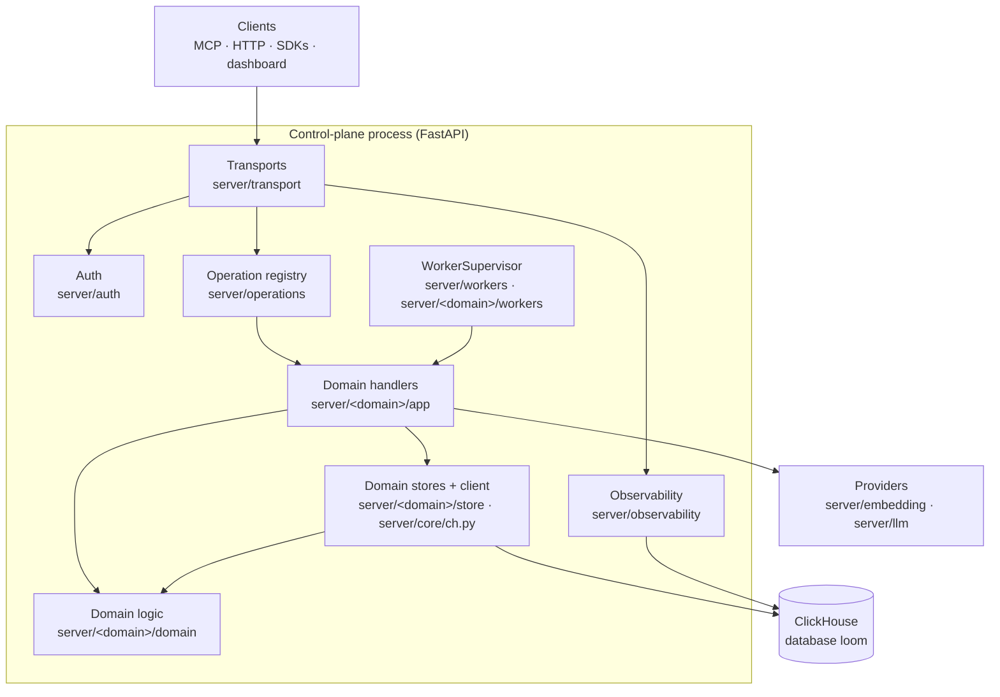
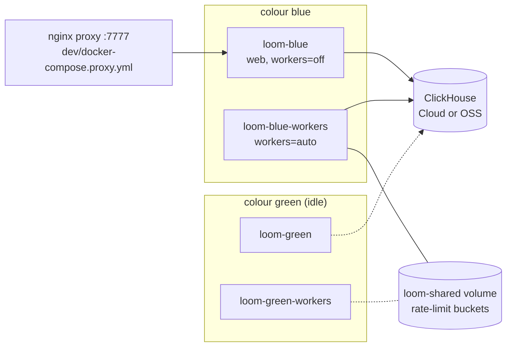

<!-- i18n: source=docs/architecture/system-overview.md blob=03fe3741579a4f9dee540c16ebdfbdab97cecb68 model=claude-sonnet-5-5 -->
> 이 페이지는 [영어 원문](https://github.com/ClickHouse/loom/blob/main/docs/architecture/system-overview.md)을 기계 번역한 것이며, 영어 원문이 기준입니다.
> Machine-translated from the [English page](https://github.com/ClickHouse/loom/blob/main/docs/architecture/system-overview.md), which is authoritative.

<a id="system-overview"></a>

# 시스템 개요

Loom은 Python 서버(FastAPI 애플리케이션과 백그라운드 워커 supervisor)와 ClickHouse로 구성되며, 실시간 메모리와 지식 상태를 위해 선택적으로 Postgres를 사용할 수 있습니다. Loom은 상태를 가집니다. Loom이 아는 모든 것(사실과 그 벡터, 문서, 대화, 엔티티 그래프, 코드 인덱스, 태스크, 감사, 비용, 삭제 진행 상황)은 ClickHouse에 저장됩니다. 다만 `LOOM_STORAGE_AUTHORITY=postgres`로 설정하면 Postgres가 실시간 메모리, 지식 상태, 그리고 그와 함께 쓰이는 레코드를 보관합니다
([스토리지 권한](https://github.com/ClickHouse/loom/blob/main/docs/architecture/storage-authority.md#the-tables)). 서버 프로세스는 자체적으로 영구 상태를 유지하지 않으므로, 여러 개의 프로세스가 같은 배포를 처리할 수 있고 요청은 어느 프로세스에든 도달할 수 있습니다. 이 저장소 밖에 보관되는 소수의 상태는 [배포 토폴로지](#deployment-topology)에 나열되어 있습니다.

스토리지 레이아웃은 [ClickHouse](clickhouse.md)에 있습니다.

<a id="goals-and-non-goals"></a>

## 목표와 비목표

| 목표                                                                                                                      | 비목표                                                                                                      |
| ------------------------------------------------------------------------------------------------------------------------- | ----------------------------------------------------------------------------------------------------------- |
| 모든 종류의 상태를 위한 하나의 엔진(ClickHouse가 기준): 벡터, 전문 검색, 그래프 엣지, 시계열, 원장.                        | 서버 내 파일 형식 처리: `knowledge.add`는 `content: str`을 받으며, 파싱은 CLI의 역할입니다.                 |
| 한 번 선언하면 HTTP와 MCP에서 동일하게 제공되는 하나의 와이어 인터페이스.                                                  | 테이블 간 트랜잭션. 파생 행은 기본 쓰기 이후에 따라잡습니다.                                                |
| 서버 프로세스는 영속 상태를 갖지 않음: 프로세스를 더 실행해 웹 처리 용량을 늘립니다.                                       | 이중 시간(bi-temporal) 이력. 유효성은 유효 시간(valid-time)만 다루며, 트랜잭션 시간 이력은 버전 미러가 담당합니다. |
| 모든 행은 테넌트(식별 튜플), 작성자(`actor`), 요청(`log_comment`)에 귀속 가능.                                             | GDPR 준수 보장. 삭제와 감사 해싱은 엔지니어링 기본 요소일 뿐입니다.                                         |
| 키 없이 설치해도 부팅되고 응답하며, 가짜 프로바이더임을 보고함.                                                            |                                                                                                             |

<a id="components"></a>

## 구성 요소



| 구성 요소 | 코드 | 역할 |
| ------------------ | ----------------------------------------------------- | ------------------------------------------------------------------------------------------------------------------------------------------------------------------------------------------------------------------------------------------------------------------------------------------------------------------------------------------------ |
| 트랜스포트 | `server/transport/http.py`, `server/transport/mcp.py` | 요청을 op 호출로 변환합니다. 둘 다 레지스트리에서 생성됩니다. 모든 op는 `POST /v1/<name>`이며 MCP 도구 `loom_<name>`입니다(점은 밑줄로 바뀝니다). 공통 승인 처리는 `server/transport/gates.py`에 있습니다. |
| Operation 레지스트리 | `server/operations/` | op마다 하나의 `Operation`이 있습니다(`base.py`). 이름, 입력 및 출력 모델, 핸들러, `required_role`, `idempotent`, `audit`, `maturity`, 범위 지정 플래그를 갖고, `budget_p99_ms`는 `server/settings/catalog.py`의 예산 표에서 가져옵니다. `registry.py`의 `ALL_OPERATIONS`는 모든 그룹의 `OPERATIONS`를 합칩니다. |
| 도메인 패키지 | `server/<domain>/` | 플레인마다 하나의 패키지(`memory`, `code`, `tracker`, `knowledge`, `erasure`, `tasks`, `identity`, `insights`)가 있으며, 각각 `api/`(와이어 모델과 `Operation` 선언), `app/`(핸들러와 오케스트레이션), `domain/`(순수 로직), `store/`(ClickHouse 구문과 행 빌더), `workers/`로 구성됩니다. [서버 레이아웃](https://github.com/ClickHouse/loom/blob/main/docs/architecture/server-layout.md)을 참고하세요. |
| ClickHouse 클라이언트 | `server/core/ch.py` | 유일한 클라이언트입니다. 풀링, 데드라인, 재시도, 쿼리 귀속을 처리합니다. `server/memory/store/rows.py`에는 버전 행 빌더가 있습니다. |
| 워커 | `server/workers/` | `registry.py`(`_WORKERS`)에 행으로 선언된 백그라운드 루프입니다. 각 루프는 해당 도메인의 `workers/`에 있는 모듈이며 `supervisor.py`가 실행합니다. |
| 인증 | `server/auth/` | JWT 검증, 폐기, 역할 및 네임스페이스 권한 부여, OIDC, OAuth 서버, 셀프 가입을 담당합니다. [보안](https://github.com/ClickHouse/loom/blob/main/docs/architecture/security.md)을 참고하세요. |
| 프로바이더 | `server/embedding/`, `server/llm/` | 교체 가능한 임베더 및 LLM 클라이언트이며, 각각 결정적인 가짜 구현을 갖습니다. [LLM 아키텍처](llm-architecture.md)를 참고하세요. |
| 관측성 | `server/observability/` | op별 원장(`loom.agent_events`), 배치 이벤트 스트림, 감사 행, 프로바이더 상태, OpenTelemetry 및 Langfuse 내보내기를 담당합니다. |
| 대시보드 | `frontend/` (`/`에서 `frontend/dist/`로 제공) | 동일한 HTTP op 위에서 동작하는 React UI입니다. 빌드하지 않은 체크아웃에서는 페이지 요청에 503으로 응답합니다. |
| CLI | `server/cli/` | `loom` 명령입니다. 운영자 작업(migrate, 토큰, re-embed, doctor)과 op용 클라이언트를 제공합니다. [CLI 레퍼런스](https://github.com/ClickHouse/loom/blob/main/docs/reference/cli.md)를 참고하세요. |

레지스트리가 와이어 표면 전체입니다. `GET /v1/operations`는 모든 op를 예산 및 역할과 함께 나열하며, [operations 레퍼런스](https://github.com/ClickHouse/loom/blob/main/docs/reference/operations.md)는 이를 바탕으로 생성됩니다. op를 추가하려면 모델을 정의하고, 핸들러를 작성하고, `Operation`을 선언한 뒤 해당 그룹의 `OPERATIONS` 목록에 추가합니다
([operation 추가하기](https://github.com/ClickHouse/loom/blob/main/docs/development/adding-an-operation.md)). 두 트랜스포트가 모두 이를 자동으로 반영합니다.

일부 HTTP 라우트는 레지스트리 op가 아닙니다. `/v1/health`, `/v1/whoami`, `/v1/operations`,
`/v1/.well-known/jwks.json`, `/v1/.well-known/openid-configuration`, `/v1/knowledge.download`, `/v1/auth/login`, 대시보드의
`/v1/me/*` 및 `/v1/admin/*` 헬퍼, 그리고 OAuth와 OIDC 엔드포인트가 그렇습니다.
[HTTP API 레퍼런스](https://github.com/ClickHouse/loom/blob/main/docs/reference/http-api.md)에 이들이 정리되어 있습니다.

<a id="dependency-direction"></a>

### 의존성 방향

```text
transports → operations → <domain>/api → <domain>/app → <domain>/store → server/core/ch.py
                                              ↘ <domain>/domain ↙
```

워커는 트랜스포트와 나란히 위치하며 자신의 도메인의 `app`과 `store`를 호출합니다. 핸들러는 프로바이더를 호출합니다. 트랜스포트보다 아래에 있는 어떤 것도 트랜스포트 모듈을 import하지 않습니다. 어떤 패키지가 어떤 패키지를 import할 수 있는지, 그리고 도메인 내부의 레이어는 [서버 레이아웃](https://github.com/ClickHouse/loom/blob/main/docs/architecture/server-layout.md)에 있으며, `tests/unit/test_package_contracts.py`가 이를 강제합니다.

`tests/unit/test_transport_layering.py`가 트랜스포트 규칙을 강제합니다. `server/transport/`, `server/cli/`, `server/main.py` 밖의 어떤 코드가 `server.transport`를 import하면 이 테스트는 실패합니다. 그래서 하위 레이어에 필요한 요소는 트랜스포트 아래에 있습니다. MCP 툴셋 목록(`server/operations/toolsets.py`), 레지스트리 외 라우트의 bearer 검사(`server/auth/bearer.py`), 코드 범위 컨텍스트 변수(`server/code/domain/scope.py`), 원장 행 빌더(`server/observability/ledger.py`), 지연 시간 예산(`server/observability/budgets.py`), 플레인 기본값(`server/code/app/common.py`)이 그것입니다.

**이유:** 프로토콜(상태 코드, JSON-RPC 프레임, 헤더)은 트랜스포트만 알고 있습니다. 그러면 핸들러는 HTTP, MCP, 워커, 테스트 어디에서든 동일한 입력 모델로 호출할 수 있습니다.

<a id="request-path"></a>

## 요청 경로

두 전송 방식 모두 `server/transport/gates.py`에서 한 번만 내려진 동일한 승인 결정을 실행합니다.
차이는 자격 증명과 인자를 읽는 방식, 그리고 거부를 표현하는 방식입니다.
HTTP는 상태 코드와 `detail` 본문으로 응답하고, MCP는 `isError`를 담은 결과로 응답합니다.

<a id="http"></a>

### HTTP

`server/transport/http.py`의 `build_router()`는 op마다 `POST /v1/<op>` 라우트를 하나씩 추가합니다.
`BodyLimitMiddleware`는 먼저 `LOOM_MAX_REQUEST_BYTES`(32 MiB)를 넘는 본문을 413으로 거부하며,
0이면 제한이 해제됩니다. 이후 각 요청은 다음 단계를 순서대로 거칩니다(`_make_endpoint`). 거부가 발생하면 요청은 거기서 끝납니다.

| 단계                 | 코드                                   | 거부                                                                                                                                                                                                                                                                                                                                                                                                   |
| -------------------- | -------------------------------------- | ------------------------------------------------------------------------------------------------------------------------------------------------------------------------------------------------------------------------------------------------------------------------------------------------------------------------------------------------------------------------------------------------------ |
| 시작                 | `_begin_request`                       | 없음. `X-Request-Id`(호출자가 보낸 값이 영문자, 숫자, `.`, `_`, `-` 1~64자이면 그 값, 아니면 새 UUID), `X-Schema-Version`, 쿼리 태그 `"<op> <request_id>"`를 설정합니다.                                                                                                                                                                                                                              |
| 토큰 검증            | `_extract_auth`                        | 401 `AUTH_INVALID`(인증이 켜져 있는데 토큰이 없음, 알 수 없는 스킴, 검증 실패 토큰); 폐기 목록이 로드되기 전에는 503 `AUTH_UNAVAILABLE`.                                                                                                                                                                                                                                                              |
| 본문 읽기            | `_read_body`                           | 잘못된 JSON이면 400 `VALIDATION_FAILED`; 쓰기 op에서 알 수 없는 키가 해당 op의 필드와 비슷하면 422 `UNKNOWN_ARGUMENT`.                                                                                                                                                                                                                                                                                |
| 신원 채우기          | `gates.with_single_user_identity`      | 없음. 단일 사용자 서버에서 토큰 없는 호출에 대해: `code.*`와 `tracker.*`를 제외한 모든 op에는 설치본의 org를, 일상적인 메모리 및 검색 op에는 네임스페이스와 해당 op의 에이전트를 채웁니다([해당 op](https://github.com/ClickHouse/loom/blob/main/docs/reference/http-api.md#request)). 네임스페이스를 요구하는 다른 op(코드 및 트래커 op 제외)에서 비어 있거나 `"-"`인 네임스페이스는 제거되며, 따라서 검증 단계에서 누락으로 거부됩니다. HTTP에만 해당합니다. |
| 검증                 | `_validate_payload`                    | 필드를 지목하는 422 `VALIDATION_FAILED`.                                                                                                                                                                                                                                                                                                                                                               |
| 인가                 | `_authorize` → `gates.authorize`       | 400 `IDENTITY_INCOMPLETE`(네임스페이스 또는 org 없음), 403 `AUTH_INSUFFICIENT`.                                                                                                                                                                                                                                                                                                                        |
| 컨텍스트 바인딩, 정책 | `_bind_context_and_policy`             | 인증 컨텍스트와 원장 실행(`X-Loom-Run-Id`)을 설정합니다; 기록 정책이 `enforce` 모드에서 거부하면 403 `POLICY_FORBIDDEN`.                                                                                                                                                                                                                                                                              |
| 속도 제한            | `_rate_limit` → `gates.rate_limit`     | `Retry-After`가 포함된 429 `RATE_LIMITED`; 제한 대상인 모든 호출에 `X-RateLimit-*` 헤더.                                                                                                                                                                                                                                                                                                               |
| 멱등성               | `_idempotency_gate`                    | 저장된 응답을 재생하거나(`X-Idempotent-Replay: true`), 같은 키가 다른 본문과 함께 재사용되면 409 `IDEMPOTENT_CONFLICT`.                                                                                                                                                                                                                                                                                 |
| 핸들러               | `_run_handler`                         | 핸들러의 `HTTPException`, `LoomServerError`의 코드와 상태, 또는 500 `INTERNAL_ERROR`.                                                                                                                                                                                                                                                                                                                  |
| 성공 후              | `_finish_success`, `post_handler_rows` | 없음. 원장 행, 메트릭, `ignored_args`가 포함된 본문을 처리한 뒤 예산 위반, 감사, 멱등성 행을 기록합니다.                                                                                                                                                                                                                                                                                               |

이 순서인 이유:

- **본문보다 토큰이 먼저.** 배포 환경이 거부하는 익명 요청은 본문을 읽기 전에 401을 받습니다.
  원장 행을 남기지 않고, 필드 오류도 알아내지 못하며, 어떤 테넌트의 속도 제한 버킷도 건드리지 않습니다.
- **제한보다 인가가 먼저.** 제한기는 본문 값만이 아니라 검증된 토큰의 org에서 할당량을 차감합니다
  (`gates._rate_limit_org`).
- **승인 후 멱등성.** 재생 키의 범위는 호출자의 org, 주체, op입니다
  (`server/core/idempotency.py`, `scoped_key`). 재생은 익명 호출자, 다른 테넌트, 다른 op에는 도달하지 않습니다.

**실패 시 열리는(fail-open) 게이트.** 트래픽 분류와 속도 제한기는 가용성 제어입니다.
둘 중 하나가 예외를 던지면 호출은 승인되고, 실패는 집계되며 분당 최대 한 번 로그에 기록됩니다
(`gates._fail_open`). 인증과 인가는 실패 시 닫힙니다.

**알 수 없는 인자.** 입력 모델은 알 수 없는 키를 무시하므로 `server/transport/arg_check.py`가
이를 지목합니다. 응답에는 `ignored_args`(그리고 비슷한 필드 이름에 대한 `did_you_mean`)가 담기고,
HTTP는 `X-Loom-Ignored-Args`를 설정합니다. 둘 다 op가 읽었지만 적용하지 않은 필드를 먼저,
그다음 읽지 않은 키를 나열합니다. 쓰기 op는 비슷한 키가 있으면 422 `UNKNOWN_ARGUMENT`로 거부합니다.
신원 키와 전송 계층이 직접 읽는 키(`consumer`, `traffic_class`, `explain`, 멱등성 키)는 보고되지 않습니다.

**핸들러 이후.** 원장 행에는 호출의 지연 시간과 임베딩 및 LLM 비용이 담깁니다.
예산 위반 행(`budget_p99_ms` × `LOOM_LATENCY_BUDGET_MULTIPLIER` 초과), 감사 행(`op.audit`일 때),
멱등성 행은 한 번의 왕복으로 기록됩니다(`gather_best_effort`). 각각 최선 노력 방식입니다.
요청의 모든 ClickHouse 문에는 `log_comment = "<op> <request_id>"`가 붙습니다([쿼리 귀속](clickhouse.md#query-attribution)).

<a id="mcp"></a>

### MCP

`POST /mcp`는 JSON-RPC 2.0입니다(`server/transport/mcp.py`, `_handle_request`). `mcp_config.py`의
`MCP_SUPPORTED_PROTOCOL_VERSIONS`에 있는 프로토콜 버전을 제공하며, `initialize`는 클라이언트의 버전이
지원되면 그대로 돌려주고 그렇지 않으면 최신 버전을 돌려줍니다. 서버가 먼저 시작하는 이벤트는 없습니다.

| 메서드                             | 동작                                                                                                                                                                                    |
| ---------------------------------- | --------------------------------------------------------------------------------------------------------------------------------------------------------------------------------------- |
| `initialize`                       | 버전을 협상하고 `instructions`를 반환합니다: 호출자의 프로필 섹션이 포함된 프라이머입니다. 같은 프라이머가 `loom://primer` 리소스, `loom` 프롬프트, `loom_activate` 도구로도 제공됩니다. |
| `tools/list`                       | 연결의 도구 세트에 해당하는 목록(URL에 따라 정해지며 호출자와는 무관합니다).                                                                                                            |
| `tools/call`                       | HTTP와 같은 게이트를 거치는 op 호출 하나.                                                                                                                                               |
| `prompts/*`, `resources/*`, `ping` | 프라이머 노출 경로와 생존 확인.                                                                                                                                                         |

`LOOM_MCP_AUTH_MODE`는 어떤 메서드에 bearer가 필요한지 결정합니다: `required`(기본값, 알림을 제외한 모든 메서드),
`discovery_only`(`tools/call`만) 또는 `open`. 거부 응답에는 보호된 리소스 메타데이터를 가리키는
`WWW-Authenticate` 챌린지가 포함되어, 네이티브 커넥터가 OAuth 서버를 찾을 수 있습니다(`mcp_auth.py`).

`tools/list`는 `LOOM_MCP_TOOLSET`(기본값 `core`) 또는 `?toolset=`으로 선택한 목록을 보여줍니다
(`server/operations/toolsets.py`). 목록은 가시성만 정할 뿐이며, 모든 op는 이름으로 호출할 수 있습니다.
단 `_MCP_HIDDEN_OPS`에 있는 op는 MCP가 나열하지도 호출하지도 않습니다(HTTP는 계속 제공합니다).
도구 세트는 [MCP 레퍼런스](https://github.com/ClickHouse/loom/blob/main/docs/reference/mcp.md)에 있습니다. 세 도구에는
직접 작성한 디스크립터가 있습니다: `loom_search`(`search.query` op로, 텍스트 요약과 간결한 섹션으로 렌더링됨),
`loom_op`(같은 경로로 이름을 지정해 아무 op나 호출하며, `op: "help"`가 목록을 보여줍니다, `server/transport/mcp_op.py`),
`loom_activate`(프라이머이며, 레지스트리 op가 아닌 유일한 도구).

`_call_tool`(`mcp_call.py`; 텔레메트리, 응답, 실패 응답은 `mcp_outcome.py`)은 다음 단계를 순서대로 실행합니다:

1. **도구 확인**(`_resolve_tool`). 알 수 없거나 숨겨진 도구는 대신 사용할 것을 알려 주는 `isError`
   결과가 됩니다.
2. **호출자 바인딩**(`_bind_caller_identity`). 요청 id를 발급하고 쿼리 태그를 설정하며,
   생략된 네임스페이스와 에이전트를 토큰과 호출자의 저장된 기본값으로 채웁니다.
   명시적인 인자가 우선합니다. `code.*` op는 배포 환경의 코드 네임스페이스를 기본값으로 사용합니다.
   `_MCP_CROSS_AGENT_READS`의 읽기는 `agent` 기본값이 `*`입니다.
3. **세션 실행.** (org, 토큰 주체, `Mcp-Session-Id`)마다 암묵적인 실행 하나가 있으며 호출자의 기본 네임스페이스에
   등록됩니다. 실행을 지정하지 않은 쓰기는 세션의 `run_id`를 받습니다. 단, 자체 실행을 지정하는 `run.*`,
   배포 환경의 코드 신원으로 동작하는 `code.*`, 그리고 `run_id`가 행의 범위를 정하거나 행에 바인딩되는
   `working_memory.*`와 `conversation.update`는 예외입니다.
4. **멱등성 키.** 멱등성 도구는 인자에서 `_idempotency_key`(또는 `idempotency_key`)를 받으며,
   이는 검증 전에 꺼내집니다.
5. **인자**(`_validated_input`). 철자가 틀린 인자에 대한 거부가 먼저이고, 그다음 검증입니다. 실패는
   필드 오류, 알 수 없는 각 키에 대해 의도했을 법한 필드, op의 인자, 예시 호출을 담은 `isError` 결과입니다(`arg_feedback.py`).
6. **인가**(`_authorize_call`), 공유 게이트.
7. **승인**(`_admission_refusal`): 트래픽 클래스, 기록 정책, 속도 제한. 짧은 힌트가 있는 429에서는
   전송 계층이 한 번 기다린 뒤 다시 확인합니다(최대 `LOOM_MCP_RATELIMIT_RETRY_MAX_WAIT_S`).
8. **멱등성 재생**, 승인된 호출자에게만 해당합니다.
9. **핸들러.**
10. **응답.** `structuredContent`는 순위 및 집계 세부 정보를 제외하며(`lean_results.py`; `explain=true`이면 유지),
    `ignored_args`를 담습니다.

**거부는 결과이고, 실패는 오류입니다.** 401을 제외한 4xx(`LOCKED`, `PINNED_CONFLICT`, `BLACKLISTED`,
`RESOURCE_NOT_FOUND`, 태스크 상태 코드, `RATE_LIMITED`)는 구조화된 본문과 함께 `isError: true`로
돌아오므로(`mcp_refusals.py`) 클라이언트가 안내를 볼 수 있습니다. 401과 5xx(`OVERLOADED`, `BACKEND_TIMEOUT`,
`SCHEMA_PENDING`)는 HTTP의 본문과 재시도 힌트를 담은 JSON-RPC 오류로 남습니다.

쓰기 하나(`memory.set`)와 읽기 하나(`memory.search`)의 단계별 설명은
[메모리 아키텍처](memory-architecture.md)에 있습니다.

<a id="roles-and-process-modes"></a>

## 역할과 프로세스 모드

<a id="roles"></a>

### 역할

`Role`(`server/operations/base.py`)의 순서는 `VIEWER < WRITER < ADMIN < ORG_ADMIN <
PLATFORM_ADMIN`입니다. 각 op는 `required_role`을 선언합니다. 플랫 토큰의 역할은 해당 토큰이 읽는 모든 네임스페이스에 적용되며, `loom.namespace_grants`는 네임스페이스에서 그 역할을 높일 수는 있어도 낮출 수는 없습니다. 범위 지정 토큰의 `ns_roles`는 해당 토큰이 지정한 네임스페이스에 대해 최종 권한을 가집니다. 그랜트와 `ns_roles`에는 `viewer`, `writer`, `admin`만 들어갈 수 있으며, `ORG_ADMIN`과 `PLATFORM_ADMIN`은 플랫 토큰의 `roles`에만 존재합니다. 자세한 내용은 [보안](https://github.com/ClickHouse/loom/blob/main/docs/architecture/security.md#authorization)과
[ID와 네임스페이스](https://github.com/ClickHouse/loom/blob/main/docs/concepts/identities-and-namespaces.md)를 참고하세요.

<a id="process-modes"></a>

### 프로세스 모드

하나의 이미지가 모든 역할을 담당합니다. 프로세스가 무엇을 하는지는 설정이 결정합니다.

| 모드                | 설정                                                                             | 실행되는 것                                                                             |
| ------------------- | -------------------------------------------------------------------------------- | --------------------------------------------------------------------------------------- |
| 올인원              | `LOOM_BACKGROUND_WORKERS=auto` (기본값)                                          | 웹 티어, 그리고 배포의 ClickHouse 리스를 보유한 프로세스 안의 워커.                     |
| 웹 레플리카         | `LOOM_BACKGROUND_WORKERS=off`                                                    | HTTP, MCP, 대시보드. 자체 폐기 스냅샷과 서명 키링을 갱신합니다.                         |
| 워커                | `LOOM_BACKGROUND_WORKERS=auto`, `LOOM_DEPLOYMENT=1`, `LOOM_SERVES_TRAFFIC=false` | 슈퍼바이저와 그 워커. `/v1/health`는 계속 응답합니다.                                   |
| 브랜치 / A-B 서버   | `LOOM_BOOT_MIGRATE=false`, `LOOM_INSTANCE_LABEL=<who>:<what>:<port>`             | 마이그레이션을 적용하지 않고 공유 ClickHouse를 서비스합니다. 여기서 `auto`는 워커를 실행하지 않습니다. |

`LOOM_WEB_WORKERS`는 컨테이너당 uvicorn 프로세스 수를 설정합니다. 설정하지 않으면 이미지는 컨테이너가 사용할 수 있는 CPU마다 하나씩, 메모리 GiB당 최대 하나, 최대 8개까지 시작합니다. 각 프로세스는 전체 lifespan을 실행하며, `auto`에서는 배포의 리스가 워커를 실행할 프로세스 하나를 정합니다. `on`은 리스를 사용하지 않습니다. 각 프로세스가 워커의 자체 사본을 실행하며, `auto` 프로세스가 리스를 보유하고 있지 않으면 나머지는 `workers_lease_absent`를 보고합니다. 워커 컨테이너는 `auto`로 실행됩니다.

**리더 선출.** `server/workers/leader.py`(`decide_supervisor`, `keep_lease`)는 ClickHouse를 통해 배포당 하나의 슈퍼바이저를 선출합니다. 키는 Keeper 락 테이블 `loom._migration_lock`의 `workers_supervisor`이며(엄격한 KeeperMap이므로 두 경쟁자 중 한쪽의 쓰기만 반영됩니다), 만료는 ClickHouse 서버의 시계를 기준으로 판단합니다. 보유자는 `LOOM_SUPERVISOR_LEASE_TTL_S / 6`마다 갱신하고, 마지막 갱신 후 TTL의 절반이 지나거나 갱신 시 다른 보유자가 확인되면 워커를 중지합니다. 보유자가 죽으면 `LOOM_SUPERVISOR_LEASE_TTL_S`(기본값 30초) 후에 다른 `auto` 프로세스가 리스를 가져갑니다. 타이밍은 [장애와 복구](failure-and-recovery.md#background-workers)에 있습니다. 정상 종료하면 리스가 즉시 해제되며, 블루/그린 쌍의 새 색상이 인계받는 방식이 이것입니다.

**ClickHouse를 쓰는 이유:** 워커를 실행할 수 있는 프로세스는 컨테이너와 호스트에 걸쳐 있고, 이들이 모두 공유하는 것은 ClickHouse뿐입니다. 여러 호스트가 `auto`를 실행할 수 있으며, 워커는 그중 하나에서만 실행됩니다([용량](failure-and-recovery.md#background-workers)).

<a id="boot"></a>

## 부팅

`server/main.py`의 `lifespan`은 모든 프로세스에서 다음 순서로 실행됩니다(각 단계는
`server/boot.py`에 있습니다).

1. **실행 규칙.** 프로세스는 배포 자체(compose 파일이 설정하는 `LOOM_DEPLOYMENT=1`)이거나 비어 있지 않은 `LOOM_INSTANCE_LABEL`을 가져야 하며, 그렇지 않으면 시작을 거부합니다. 인증을 요구하는 배포가 저장소에 포함된 개발용 `LOOM_JWT_SECRET`을 사용하는 경우에도 시작을 거부합니다
   (`require_real_signing_secret`). `LOOM_INSTANCE_LABEL=deploy:dev`만 예외입니다.
2. ClickHouse에 **연결합니다**.
3. **마이그레이션**(`LOOM_BOOT_MIGRATE`, 기본값은 켜짐). 모든 프로세스는 적용하기 전에
   배포의 마이그레이션 잠금을 획득합니다. 잠금은 `loom._migration_lock`의 KeeperMap 키입니다
   (`server/core/schema/migrate_lease.py`). Keeper가 없는 서버이거나 마이그레이션이 실패하면
   부팅이 중단됩니다. `LOOM_BOOT_MIGRATE=false`이면 프로세스는 대기 중인 파일을 로그로 남기고
   `/v1/health`에 보고합니다. Postgres 권한(authority) 하에서는 첫 하트비트와 리스 결정 전에 배포의 셀
   상태를 읽습니다. 첫 읽기가 실패하면 부팅이 중단됩니다(Postgres 마이그레이션이 대기 중이면
   게이트된 준비 안 됨 상태로 부팅하며, 읽기가 성공할 때까지 유지됩니다)
   ([셀](https://github.com/ClickHouse/loom/blob/main/docs/architecture/cells.md#the-tenancy-check-and-placement)).
4. **`agent_events` 이미터를 시작합니다.**
5. **기본 네임스페이스.** 인증이 꺼져 있으면, 셀 게이트가 이 프로세스를 거부하지 않는 한
   설정된 네임스페이스에 `loom.namespaces` 행을 부여합니다.
6. **워커 리더를 선출합니다.**
7. **리더의 작업.** 값이 다른 보존 TTL 오버라이드를 적용하고, 설정된 트래커 네임스페이스를
   등록합니다.
8. **토큰 상태와 오버라이드.** 폐기된 토큰 스냅샷(`server/auth/revocation.py`)과 서명 키링
   (`server/auth/keyring.py`)을 로드합니다. 모든 프로세스는 각자의 타이머로 둘 다 갱신합니다.
   `LOOM_RUNTIME_OVERRIDES_REFRESH_SECONDS`마다 관리자 런타임 오버라이드
   (`loom.runtime_overrides`: 속도 제한, 지연 시간 예산, 라이브 설정)를 반영하기 시작하며,
   workers 자식 프로세스도 이를 반영합니다. 라이브 설정의 오버라이드는 프로세스 자체의
   `settings` 위에 덮어씌워지므로 코드에서는 `settings.<field>`로 읽습니다
   ([런타임 설정](https://github.com/ClickHouse/loom/blob/main/docs/operations/runtime-settings.md)).
9. 리더에서 **워커를 시작하고**, `auto`에서는 리스 루프도 시작합니다(Postgres 권한 하의 `on`에서도
   마찬가지이며, 이 경우 셀 게이트가 워커를 시작하고 중지합니다).
10. **프로바이더 보고.** 확인된 LLM 프로바이더를 로그로 남기고 임베더의 차원을 조사합니다.
11. **벡터 기능.** 양자화된 코드 읽기 설정, 패치 파트, 삽입 시 벡터 인덱스 빌드를 건너뛸 수
    있는지 여부를 조사합니다.
12. 임베더를 기준으로 유사도 임계값을 **보정합니다**(`LOOM_ADAPTIVE_THRESHOLDS`). 실패해도
    부팅은 실패하지 않으며 스칼라 설정이 적용됩니다.

종료는 이 순서를 거꾸로 따릅니다. 루프를 중지하고, 워커를 비우고(10초), 리스를 해제하고,
Langfuse 큐, 이벤트 이미터, 지연된 쓰기(노출 행, 쓰기 후 프로젝션, 이벤트 스트림)를 비웁니다.
ClickHouse 클라이언트는 마지막에 연결을 해제합니다.

`/v1/health`는 ClickHouse 도달 가능 여부와 `problems` 목록(예: 가짜 프로바이더)을 보고합니다.
ClickHouse가 다운된 경우에만 503으로 응답하며,
`?include=workers,langfuse,otel,embedding_cache`를 붙이면 서브시스템별 검사가 추가됩니다.

<a id="background-processing"></a>

## 백그라운드 처리

`WorkerSupervisor`는 활성화된 워커마다 asyncio 태스크를 하나씩 실행하며, 리스 보유자에서만 실행합니다.
각 워커는 `server/workers/registry.py`의 `_Worker` 행이며, 활성화 플래그와 실행 간격을 가집니다
(대부분 `LOOM_<NAME>_ENABLED`, `LOOM_<NAME>_INTERVAL_SECONDS`). 슈퍼바이저는 첫 실행 시점을 분산시키고, 기한을 넘긴 실행을 취소하며,
백오프를 적용해 재시도하고, 모든 쿼리에 `background` 트래픽 클래스 아래 `worker.<name>` 태그를 붙이며,
실행 상태를 `loom.worker_status`에 기록합니다 (`GET /v1/admin/workers.status`). 자세한 내용은
[장애 및 복구](failure-and-recovery.md#worker-supervision)와 생성된
[워커 레퍼런스](https://github.com/ClickHouse/loom/blob/main/docs/reference/workers.md)를 참고하세요.

<a id="deployment-topology"></a>

## 배포 토폴로지



- **서버 프로세스는 영구 상태를 보유하지 않습니다.** 복제본 간에 공유되는 상태(폐기 정보, 서명 키, 런타임 재정의, 로그인 시도 횟수, 그래프 쓰기 표시, supervisor 리스, 삭제 체크포인트, 블랙리스트 버전, 기본 authority에서의 멱등성 캐시, 기록된 authority)와 업로드된 문서 원본은 ClickHouse에 저장됩니다. `LOOM_DOCUMENT_OBJECT_STORE=s3`로 기록된 문서의 바이트는 대신 S3 호환 버킷에 저장됩니다. Postgres authority에서는 Postgres가 [스토리지 authority](https://github.com/ClickHouse/loom/blob/main/docs/architecture/storage-authority.md#the-tables)에 나열된 테이블을 보유하며, 여기에는 멱등성 캐시, 자체 삭제 원장, 기록된 authority의 사본이 포함됩니다. 동일한 ClickHouse(해당 authority에서는 Postgres도 포함), 환경 변수 설정, `LOOM_JWT_SECRET`을 가진 새 Loom, 그리고 행이 버킷의 객체를 가리키는 동안 그 버킷만 있으면 모든 기능이 복구됩니다.
- **ClickHouse와 Postgres 외부의 상태.** `var/code_repos` 아래에 있는 코드 플레인의 git 미러(캐시이므로, 미러가 없는 호스트는 다시 클론합니다)와 `loom-shared` 볼륨의 rate-limit 버킷은 둘 다 기준 저장소(system of record)가 아닙니다. 또한 카탈로그 행이 하나라도 객체를 가리키는 동안에는 해당 원본의 바이트를 보관하는 `LOOM_DOCUMENT_S3_BUCKET`도 여기에 속합니다.
- **컨테이너 두 개, 이미지 하나.** `dev/docker-compose.cloud.yml`은 `loom-server`(`LOOM_BACKGROUND_WORKERS=off`)와 `loom-workers`(`auto`: 리스를 보유하는 동안 워커를 실행)를 실행하므로, 오래 걸리는 워커 작업이 요청과 이벤트 루프를 공유하지 않습니다.
- **블루/그린 쌍.** `dev/docker-compose.colour.yml`은 프록시 뒤에서 두 가지 색상을 실행합니다. `./redeploy.sh`는 유휴 색상을 시작하고, 상태 확인을 기다린 뒤 업스트림을 전환하고 이전 색상을 중지합니다. 모든 마이그레이션이 추가형이므로 롤백에 스키마 작업이 필요하지 않습니다. [배포](https://github.com/ClickHouse/loom/blob/main/docs/operations/deployment.md) 및 [업그레이드](https://github.com/ClickHouse/loom/blob/main/docs/operations/upgrades.md)를 참조하십시오.
- **ClickHouse.** ClickHouse Cloud 또는 자체 관리하는 OSS 서버입니다. 단일 OSS 노드는 고가용성을 제공하지 않습니다.

<a id="foundational-shapes"></a>

## 기초가 되는 구조

네 가지 구조가 시스템을 떠받칩니다. 이 중 하나를 바꾸는 것은 설계 변경이며, 풀 리퀘스트와 이 페이지에서 논증해야 합니다.

<a id="one-engine-clickhouse"></a>

### 하나의 엔진: ClickHouse

기본값인 ClickHouse authority에서는 모든 플레인(팩트와 벡터, BM25와 토큰 인덱스, 홉마다 제한된 쿼리 하나로 탐색하는 엔티티 그래프, 코드 인덱스, 원장과 비용)이 ClickHouse 테이블의 집합입니다. `LOOM_STORAGE_AUTHORITY=postgres`에서는 라이브 메모리와 지식 상태를 Postgres가 보관하며, 백업과 일관성 도메인을 하나로 유지하는 대신 트랜잭션 방식의 메모리 쓰기를 얻습니다([두 개의 저장소를 두는 이유](https://github.com/ClickHouse/loom/blob/main/docs/architecture/storage-authority.md#why-two-stores)). 아래의 이유와 비용은 기본값 기준입니다.

**이유:** 백업, 접근 경계, 검색과 분석을 위한 쿼리 언어가 각각 하나이고, 동기화 작업 없이 메모리와 그 텔레메트리를 조인할 수 있습니다. 하이브리드 검색은 데이터 바로 옆에서 SQL로 실행됩니다. 별도의 벡터 저장소를 두면 두 번째 일관성 도메인, 이중 쓰기, 네트워크 홉을 넘나드는 결과 융합이 추가됩니다.

**비용:** 트랜잭션 방식의 행 업데이트가 없습니다. 변경 가능한 테이블은 `ReplacingMergeTree`이며 `FINAL`로 읽으므로, 모든 쓰기 경로가 모든 컬럼을 그대로 이어서 기록해야 하고([FINAL 쓰기 규칙](clickhouse.md#the-final-write-rule)), 테이블 간 쓰기는 원자적이지 않습니다([장애와 복구](failure-and-recovery.md)).

<a id="the-identity-tuple"></a>

### 식별 튜플

모든 메모리 행은 `(org, namespace, agent, user_id, session_id)`를 가집니다. 앞의 세 개는 필수이고 나머지는 기본값이 `'-'`입니다. 그 외의 모든 테넌트 테이블은 최소한 `(org, namespace)`를 가집니다. 메모리 쓰기 시 서버는 `actor`(`human:<subject>` / `process:<subject>`, `server.memory.app.provenance.writer_actor`)와 `source_class`(`server.memory.domain.provenance.source_class_for`)를 직접 기록하며, `derived`, `external`, `imported`로 명시적으로 낮추는 경우를 제외하면 요청 본문의 값을 사용하지 않습니다.

**이유:** 테넌시, 작성자, 출처가 컬럼이므로 모든 읽기는 정렬 키로 필터링하고, 모든 행은 조인 없이 누구의 것이며 어디서 왔는지를 나타냅니다. **비용:** `actor`나 `source_class`를 빠뜨린 새 쓰기 경로는 귀속을 알 수 없는 행을 만듭니다.

<a id="per-row-content-hash-audit"></a>

### 행 단위 콘텐츠 해시 감사

감사 대상 쓰기는 모두 `loom.audit_log` 행을 남기며, 이 행의 `row_hash`는 정규화된 JSON에 대한 SHA-256입니다(`server/observability/audit.py`). 매시간 체크포인트(`loom.audit_checkpoints`)가 닫힌 각 구간의 행 수와 해시의 다이제스트를 봉인하고, 각 체크포인트는 이전 체크포인트와 연결됩니다.

**행 단위로 하는 이유:** 행에서 행으로 이어지는 체인은 동시 작성자가 있으면 갈라지는데, Loom은 여러 서버 프로세스를 실행합니다. 행 단위 해시는 콘텐츠 변조를 탐지하고, 하나의 워커가 봉인하는 체크포인트 체인은 봉인된 구간에서 삭제, 수정, 뒤늦게 추가된 행을 탐지합니다. **비용:** 구간이 봉인되기 전에 제거된 행은 흔적을 남기지 않습니다. [보안](https://github.com/ClickHouse/loom/blob/main/docs/architecture/security.md#audit-log)을 참고하세요.

<a id="five-belief-revision-operations"></a>

### 다섯 가지 신념 수정 연산

메모리 수명 주기는 다섯 가지 연산으로 이루어집니다. Expand(`memory.set`), Revise(`memory.update_by_id`), Contract(`memory.delete`), Reinforce(`memory.pin`), Refuse(`blacklist.add`)입니다. 이는 코드의 enum이 아니라 설계 관점이며, 메모리 플레인에서 이 중 어느 것에도 대응되지 않는 것은 의심스럽습니다. 병합, 이동, 가림 처리는 이 연산들의 조합으로 표현합니다. [메모리](https://github.com/ClickHouse/loom/blob/main/docs/concepts/memory.md)를 참고하세요.

<a id="invariants"></a>

## 불변 조건

- op는 `ALL_OPERATIONS`에 있는 경우에만, 그리고 그 경우에는 반드시 HTTP와 MCP 양쪽에 존재합니다(MCP는 이를 숨길 수 있지만 HTTP는 계속 제공합니다).
- `server/transport/`, `server/cli/`, `server/main.py` 밖에서는 어떤 것도 `server.transport`를 import하지 않습니다.
- 거부된 이후에는 어떤 게이트도 실행되지 않습니다. 인증이 켜져 있으면 익명 요청은 본문 파서, 원장(ledger), 리미터, 재생 캐시에 도달하지 않습니다.
- 속도 제한기는 검증된 토큰의 조직(org)을 기준으로 키를 정합니다. 재생(replay)은 그것을 만든 호출자, 조직, op에게만 제공됩니다.
- 인증과 권한 부여는 실패 시 닫히고(fail closed), 트래픽 분류와 속도 제한은 실패 시 열리며(fail open) 그 횟수를 집계합니다.
- MCP에서 거부는 `isError: true`인 결과로 전달되며, 401과 5xx만 JSON-RPC 오류입니다.
- 프로세스는 배포 전체이거나 `LOOM_INSTANCE_LABEL`을 가집니다. 부팅 시 마이그레이션이 실패하면 어떤 워커도 시작되기 전에 프로세스가 중단됩니다.
- `auto` 모드에서는 배포 내에서 최대 하나의 프로세스만 supervisor lease를 보유합니다.
- ClickHouse는 모든 메모리 플레인 행의 기준 저장소(system of record)입니다.
- 메모리 쓰기의 `actor`와 `source_class`는 호출자가 아니라 서버가 지정합니다.

<a id="source-entry-points"></a>

## 소스 진입점

| 항목                      | 위치                                                                                                                 |
| ------------------------- | -------------------------------------------------------------------------------------------------------------------- |
| 앱, 라이프스팬, 상태 확인 | `server/main.py`; 라이프스팬의 부팅 및 종료 단계는 `server/boot.py`; `GET /v1/health`는 `server/health.py` |
| 오퍼레이션 선언           | `server/operations/base.py` (`Operation`, `Role`); 레지스트리는 `server/operations/registry.py`                       |
| HTTP 라우트와 단계        | `server/transport/http.py` (`build_router`, `_make_endpoint`); `server/transport/post_rows.py` (`post_handler_rows`) |
| 공통 허용 검사            | `server/transport/gates.py`                                                                                          |
| 알 수 없는 인자           | `server/transport/arg_check.py`, `server/transport/arg_feedback.py`                                                  |
| 멱등성 캐시               | `server/core/idempotency.py`                                                                                         |
| MCP 디스패치와 거부       | `server/transport/mcp.py`, `mcp_call.py` (`_call_tool`), `mcp_op.py`, `mcp_refusals.py`                              |
| ClickHouse 클라이언트     | `server/core/ch.py` (`get_client`, `set_query_tag`)                                                                  |
| 워커와 리더               | `server/workers/registry.py`, `supervisor.py`, `leader.py`                                                           |
| 마이그레이션 리스         | `server/core/schema/migrate.py`, `server/core/schema/migrate_lease.py`                                               |
| 계층 검사                 | `tests/unit/test_transport_layering.py`                                                                              |

<a id="related"></a>

## 관련 문서

- [ClickHouse](clickhouse.md): 테이블, 엔진, 인덱스, 마이그레이션.
- [메모리 아키텍처](memory-architecture.md): 쓰기 경로와 읽기 경로.
- [장애와 복구](failure-and-recovery.md): 재시도, 복구, 용량.
- [보안](https://github.com/ClickHouse/loom/blob/main/docs/architecture/security.md): 토큰 및 권한 부여 게이트가 검사하는 항목.
- [배포](https://github.com/ClickHouse/loom/blob/main/docs/operations/deployment.md): 토폴로지를 구성하는 절차.
