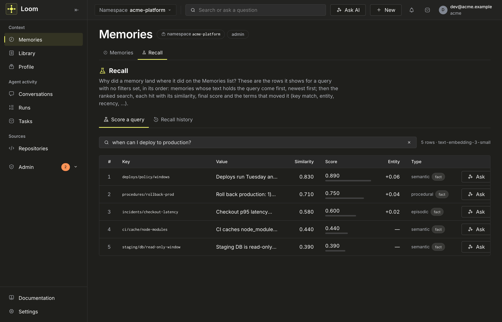
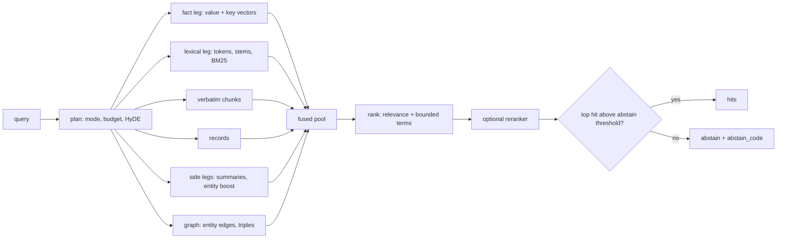

<!-- i18n: source=docs/concepts/retrieval-and-ranking.md blob=451339fc2ff5e4b649b678c1c5d0b58b1cf65e03 model=claude-sonnet-5-5 -->
> 이 페이지는 [영어 원문](https://github.com/ClickHouse/loom/blob/main/docs/concepts/retrieval-and-ranking.md)을 기계 번역한 것이며, 영어 원문이 기준입니다.
> Machine-translated from the [English page](https://github.com/ClickHouse/loom/blob/main/docs/concepts/retrieval-and-ranking.md), which is authoritative.

# 검색과 순위 지정

이 페이지는 `memory.search`가 행을 찾는 방식을 설명합니다. 네임스페이스에 대해 여러 검색 경로를 동시에 실행하고, 각 경로의 후보를 하나의 풀로 합친 뒤, 관련도와 제한된 보정 항목으로 풀의 순위를 매기고, 가장 좋은 결과가 답변의 근거로 삼을 만큼 충분한지 판단합니다. 결과가 약하면 가장 가까운 잡음을 반환하는 대신 **abstain**("Loom이 모름")으로 보고합니다. 요청 및 응답 필드는 [검색과 질문](https://github.com/ClickHouse/loom/blob/main/docs/features/memory/search-and-ask.md)에 있습니다.

## 검색 레그

각 레그는 다른 레그의 실패를 보완합니다. 더할 것이 없는 레그는 아무것도 반환하지 않으며, 오류가 난 레그는 fail open으로 처리되고 응답의 `degraded`에 그 레그가 명시됩니다.

| 레그                  | 읽는 대상                                               | 다른 레그가 놓치는 것을 찾는 방식                                                                            |
| --------------------- | ------------------------------------------------------- | ------------------------------------------------------------------------------------------------------------ |
| **팩트, 벡터**        | `loom.memory_embeddings`의 value 벡터 (벡터 인덱스 없음) | 바꿔 말한 표현: 질문과 저장된 주장이 단어가 아니라 의미를 공유합니다.                                        |
| **팩트, 키 축**       | 같은 테이블의 `memory_key` 벡터                         | 키가 인코딩하는 속성을 직접 언급하는 질문. `least(value distance, key distance)`로 점수를 매깁니다.          |
| **Lexical**           | 소문자화, 어간 추출, 표제어 추출을 거친 발췌문과 키     | 임베딩이 잘 되지 않는 정확한 식별자, 숫자, 드문 단어. 어간 추출은 ClickHouse(`stem`)에서 실행됩니다.         |
| **BM25**              | 토큰별 IDF와 코퍼스 길이 롤업                           | `bm25_hybrid`를 위한 희귀 용어 가중치. 라이브 테일이 있어 새 행이 즉시 반영됩니다.                           |
| **원문 청크**         | `loom.memory_chunks`                                    | 긴 `memory.set` 값의 일부 구절은 해당 값을 자른 행으로 합쳐지고, 트랜스크립트의 구절은 그대로 히트가 됩니다. |
| **세션 다이제스트**   | `loom.session_summaries`                                | "그 세션에서 무슨 일이 있었는가". 다이제스트 하강을 쓰면 상위 다이제스트가 해당 세션의 최고 팩트를 끌어옵니다. |
| **Entity**            | `loom.entity_vectors`, `loom.entity_summaries`          | 표현이 달라도 쿼리가 지명한 엔티티에 관한 행.                                                                |
| **Graph**             | `loom.entity_edges`, `loom.entity_triples`              | 쿼리의 엔티티에서 한 홉 떨어진 행, 그리고 일치하는 (subject, relation, object) 트리플을 가진 행.             |
| **Records**           | `loom.memory_records`                                   | 필드가 일치하는 타입 지정 레코드.                                                                            |
| **키 매치**           | 어간 추출된 키 부분                                     | 키가 요청된 속성을 정확히 지명하는 행. 동점 처리용입니다 (`LOOM_MEMORY_SEARCH_KEY_MATCH_MODE`).              |
| **계산된 증거**       | `loom.derived_facts`, 이벤트 날짜                       | 집계("몇 개"), 날짜 차이, 속성의 최신 값. ClickHouse에서 계산됩니다.                                         |

**레그가 이렇게 많은 이유.** 벡터 레그 하나로는 식별자와 숫자(임베딩이 잘 되지 않음), 긴 값의 깊은 곳에 있는 구절(앞부분만 임베딩됨), 다른 표현으로 엔티티를 지칭하는 행을 놓칩니다. 각 레그는 Loom이 이미 기록하는 테이블에 대한 쿼리이므로, 레그를 추가하는 비용은 별도 시스템이 아니라 쿼리문 하나입니다.

**벡터 레그는 벡터 인덱스 없이 스캔합니다.** 스캔은 정확하게 수행되며, [codes-first 읽기](../architecture/clickhouse.md#vector-storage)가 적용되는 경우에는 양자화된 코드를 훑어 후보 풀을 유지한 뒤 전체 정밀도로 다시 점수를 매깁니다.

**키 축**은 네임스페이스의 키가 재사용될 때 네임스페이스별로 켜집니다 (`LOOM_MEMORY_SEARCH_KEY_AXIS=auto`, 임계값 `LOOM_MEMORY_SEARCH_KEY_AXIS_AUTO_REUSE_SHARE`). 벡터 컬럼 두 개를 읽으면 바이트 비용이 대략 두 배가 되며, 키가 의미를 담고 있을 때만 도움이 됩니다.

**계획과 예산.** `retrieval_budget`(`fast`, `standard`, `deep`)이 비용이 큰 레그 중 어느 것을 실행할지 결정합니다. `standard`에서는 저렴한 리콜이 먼저 실행되고, LLM 레그(HyDE, 쿼리 분해, 반복 재시도)는 첫 패스가 약할 때만 사용되며 `LOOM_MEMORY_SEARCH_FALLBACK_MAX_ROUNDS`와 `LOOM_MEMORY_SEARCH_FALLBACK_MAX_WALL_MS`로 제한됩니다. `fast`(또는 `fast` 레시피)에서는 읽기가 LLM을 호출하지 않으며, 임베딩과 ClickHouse 읽기 비용만 듭니다. HyDE는 질문 대신 LLM이 작성한 가상의 답변을 임베딩하여 질문과 저장된 주장의 표현 방식 차이를 줄입니다. `hyde=false`는 원본 쿼리를 강제로 사용합니다.

## 퓨전

`search_mode`는 팩트 풀의 정렬 방식을 정합니다.

- `search_mode`와 `recipe`를 모두 지정하지 않은 요청에는 네임스페이스의 `retrieval_defaults` 모드가 적용되고, 이것도 없으면 `LOOM_MEMORY_SEARCH_DEFAULT_MODE`(`semantic`)가 적용됩니다. 와이어 스키마에는 `rrf`가 표시되지만, 실제 기본값은 서버가 채웁니다.
- 그 위에 플래너의 형태 규칙이 적용됩니다. 쿼리에 식별자가 있으면 어휘(lexical) 퓨전을 사용합니다.
- `recipe`는 이름이 붙은 프리셋(`fast`, `balanced`, `quality`, `verbatim`, `code`, `temporal`, `graph`)을 적용하며, 두 기본값보다 우선합니다.

| 모드          | 정렬                                                                                   |
| ------------- | -------------------------------------------------------------------------------------- |
| `semantic`    | 코사인 유사도에 아래의 순위 항을 더합니다.                                             |
| `rrf`         | 어휘 순서와 의미 순서의 Reciprocal Rank Fusion이며, `1/(k + rank)`에서 k = 60입니다.   |
| `hybrid`      | `alpha × lexical + (1 − alpha) × cosine`에 순위 항을 더합니다.                         |
| `bm25_hybrid` | IDF 가중 BM25를 코사인과 융합합니다.                                                   |
| `lexical`     | 콘텐츠와 키의 토큰 겹침을 사용하며, 벡터 순서는 없습니다.                              |
| `graph`       | 코사인에 엔티티 그래프 신호(1홉 겹침과 일치한 트리플)를 더합니다.                      |
| `temporal`    | 질문에서 확정된 날짜 기준 일정 구간 안의 행을 대상으로, 그 구간 안에서 코사인을 적용합니다. |
| `related`     | 요청의 `tags` / `entity_filter`와의 태그 및 엔티티 겹침을 사용합니다.                  |

**Reciprocal Rank Fusion이 모드로 존재하는 이유.** 어휘 겹침 점수는 0에서 1까지 넓게 퍼지는 반면, 실제 임베더의 코사인 값은 좁은 구간에 몰려 있습니다. 그래서 둘의 가중합은 코퍼스마다 alpha를 조정하지 않으면 한쪽의 비중이 낮아집니다. RRF는 점수가 아니라 순위를 결합하므로 조정이 필요 없습니다. 또한 Loom은 코드나 경로 형태의 쿼리에서는 어휘 가중치를 낮춥니다. 이런 쿼리에서 공유되는 경로 토큰은 거의 노이즈이기 때문입니다(`server/memory/app/retrieval/fusion.py`, `_rrf_lexical_weight`). 한 순서에서 동점이면 다른 순서로, 그다음에는 키와 행의 네임스페이스, 작성자, 세션 순으로 결정하므로, 동일한 검색 두 번은 같은 구간을 반환합니다.

## 랭크 표현식

코사인 순서 모드에서 팩트 행 하나의 점수는 관련도에, 근소한 차이의 순위를 바꿀 수 있지만 관련도를 넘어서지 못하도록 상한이 걸린 항들을 더한 값입니다
(`server/memory/app/retrieval/fact_rank.py`):

| 항                        | 더하는 값                                                                                                                                                                                            | 제어 수단                                                                                                 |
| ------------------------- | ---------------------------------------------------------------------------------------------------------------------------------------------------------------------------------------------------- | --------------------------------------------------------------------------------------------------------- |
| 유사도                    | 가장 가까운 벡터의 `1 − cosine distance`.                                                                                                                                                            | 임베더                                                                                                    |
| 엔티티 가산점             | 행이 가진 `entity_filter` 엔티티 비율의 최대 0.5배. 쿼리에서 일치한 엔티티 벡터도 포함합니다.                                                                                                         | `entity_filter`                                                                                           |
| 최신성, 시간순, 날짜      | 최신성 의도("latest", "current")나 순서를 묻는 질문일 때, 그리고 질문한 날짜 근처에 고정된 행에 주는 가산점.                                                                                         | 쿼리 자체의 단서. 풀 단위 변형인 `LOOM_MEMORY_SEARCH_RECENCY_POOL_WEIGHT`의 기본값은 0(꺼짐)입니다        |
| 사전 확률 그룹            | 저장된 `confidence` × `confidence_weight`, 소프트 태그 및 카테고리 가산점, 선호도 가산점. 합산하여 상한이 적용됩니다.                                                                                 | `confidence_weight`, `tags_soft`, `prior_cap` (`LOOM_MEMORY_PRIOR_CAP`)                                   |
| 강화                      | 회상과 긍정적 결과. 반감기에 따라 감쇠하며, `harm` 이벤트는 얻은 가산점을 회수합니다.                                                                                                                | `LOOM_MEMORY_SEARCH_REINFORCEMENT_WEIGHT` (0.15), `…_HALF_LIFE_DAYS` (90)                                 |
| 신뢰                      | 주장(asserted) 또는 관찰(observed)은 `+0.5`, 가져온(imported) 것은 `−0.25`, 외부(external)는 `−1`, 증명(attested)된 경우 `+1`. 여기에 가중치를 곱합니다.                                              | `LOOM_MEMORY_SEARCH_TRUST_WEIGHT` (기본값 0 = 꺼짐)                                                       |
| 강등                      | `demote_tags`는 행을 제외하지 않고 맨 아래로 내립니다. `sensitivity:medium` 또는 `:high` 레이블이 붙은 행은 점수가 낮아집니다. 단, 쿼리가 연락처 정보나 은행 계좌(IBAN)를 묻는 경우는 예외입니다.      | `demote_tags`, `LOOM_MEMORY_SEARCH_SENSITIVITY_DEMOTE` (0.1)                                              |

**고정(pin)은 랭크 항이 아닙니다.** 고정은 행이 덮어쓰이지 않도록 보호할 뿐
([쓰기가 판정되는 방식](https://github.com/ClickHouse/loom/blob/main/docs/concepts/memory.md#how-a-write-is-judged)), 순위를
높여 주지는 않습니다. 팩트는 질문에 답하기 때문에 반환됩니다.

`personalization="none"`은 사용자에서 비롯된 모든 항(선호도, 사전 확률 그룹, 강화)을 제거하고 관련도만 남기므로, 한 서버에서 두 랭킹을 비교할 수 있습니다.
`LOOM_MEMORY_SEARCH_SOURCE_CLASS_BOOST_ELIGIBLE`은 어떤 출처 클래스가 이러한 항을 얻을 수 있는지 제한합니다. `extracted`를 빼면 추론이 사전 확률 때문에 진술보다 높은 순위를 차지하는 일을 막을 수 있습니다.

**리랭커.** 요청의 `rerank` 또는 네임스페이스의 `rerank_endpoint`는 풀을 리랭커로 보냅니다
(`builtin:openai[:model]`, `builtin:cohere[:model]`, 또는 운영자가 `LOOM_RERANK_ENDPOINTS_JSON`에 구성한 엔드포인트 이름이며, URL은 거부됩니다). 리랭커는 첫 단계에서 나온 결과만 재정렬하므로 풀을 먼저 넓힙니다(`LOOM_MEMORY_SEARCH_POOL_MULTIPLIER_RERANK`).
실패하면 그대로 통과시키며(fail open) 후보를 버리지 않습니다.

검색마다 호출이 한 번 더 늘어나는 비용보다 풀의 순서가 더 중요할 때 `rerank`를 지정하세요. 자신의 쿼리로 효과를 측정하려면 각 쿼리를 `rerank`를 지정한 경우와 `rerank="none"`(네임스페이스의 `rerank_endpoint`도 끕니다)인 경우로 실행하되, 둘 다 `explain=true`로 하고 실제 서비스하는 예산에서 실행한 다음(`fast` 또는 LLM을 쓰지 않는 읽기는 `builtin:openai` 호출을 하지 않습니다), 두 윈도를 비교하면서 각 히트의 `score_components`를 [이 결과가 이 순위인 이유](#why-did-this-rank-here)에서 설명하는 대로 읽으세요. 리랭커를 쓴 경우와 쓰지 않은 경우의 동일한 검색을 비교한 커밋된 실행 결과는 없습니다([결과](https://github.com/ClickHouse/loom/blob/main/docs/benchmarks/results.md#longmemeval-s)).

랭킹이 끝나면 반환 윈도가 다듬어집니다. `duplicate`와 `superseded` 행은 요청하지 않는 한 숨겨지고, 키당 최대 `LOOM_MEMORY_SEARCH_PER_KEY_CAP`개의 행만 유지되며, `exclude_keys`는 호출자가 이미 가진 행을 제거합니다.

## 기권

모든 검색은 자신의 결과에 대한 판정으로 끝납니다. 응답에는 `abstain`, `abstain_code`(`no_match`, `below_threshold`, `entity_absent`, `low_calibrated_confidence`, `page_expired`), 서술형 `abstain_reason`, `retrieval_confidence`, 그리고 `low`, `medium`, `high`, `abstain` 중 하나인 `retrieval_risk`가 포함됩니다.
코드의 정의는 [검색과 질의](https://github.com/ClickHouse/loom/blob/main/docs/features/memory/search-and-ask.md)에 있습니다.

자체 유사도가 임계값보다 낮은 윈도우 내 행에는 `below_threshold: true`가 붙으므로, 행마다 "기권은 기권이다"를 적용하려는 호출자는 이 값으로 필터링할 수 있습니다.

**임계값의 출처.** 고정된 유사도 하한은 특정 임베딩 모델 하나에 맞춰 보정된 값입니다. 모델을 바꾸면 코사인 값의 분포가 달라져, 같은 숫자가 좋은 결과를 걸러내거나 노이즈를 걸러내지 못하게 됩니다. `LOOM_ADAPTIVE_THRESHOLDS`가 켜져 있으면(기본값), 부팅 시 프로브가 작은 코퍼스 세 개를 임베딩하고 임베더 자체의 분포에서 모든 게이트를 도출합니다(`server/memory/app/embedder_calibration.py`):

| 프로브 코퍼스          | 도출되는 게이트                                                                                   |
| --------------------- | ----------------------------------------------------------------------------------------------- |
| 방해 문장 쌍      | 노이즈 하한(90번째 백분위수 + 0.02)과 기권 임계값(하한 + 0.05).              |
| 질문 → 사실 쌍 | 트리거 게이트: 쿼리 재작성, HyDE 폴백, 리랭크 건너뛰기(10번째, 25번째, 75번째 백분위수). |
| 바꿔 쓴 문장 쌍      | 쓰기 시점의 충돌 및 중복 임계값(중앙값, 75번째 백분위수).                                                     |

네임스페이스별 보정값이 저장되어 있으면 클러스터 전체 보정값보다 우선하며, `recalibration` 워커가 프로브를 주기적으로 반복하므로(`LOOM_RECALIBRATION_INTERVAL_SECONDS`) 게이트가 조용히 개정된 임베더를 따라갑니다. 어느 티어가 적용 중인지는 `calibration.get`으로 확인할 수 있습니다. 스칼라 설정(`LOOM_MEMORY_SEARCH_MIN_SIMILARITY` 0.22, `LOOM_MEMORY_SEARCH_ABSTAIN_THRESHOLD` 0.30, `LOOM_MEMORY_SEARCH_HYDE_FALLBACK_THRESHOLD` 0.45, `LOOM_MEMORY_SEARCH_QUERY_REWRITE_THRESHOLD` 0.38)은 가짜 임베더를 쓰거나, 프로브가 실패했거나, 적응형 설정을 끈 경우에 적용됩니다. 이 경우 임베더를 바꾼 뒤 벤치마크를 다시 수행하는 일은 사용자 몫입니다.

**트레이드오프.** 하한은 재현율과 정밀도를 맞바꿉니다. 주제와 무관한 질문에 가장 가까운 행 다섯 개를 받은 에이전트는 그것을 그대로 사용합니다. 기권은 에이전트에게 되묻거나 모른다고 말하라고 알려 줍니다. 하한을 너무 높게 잡으면 질문과 다르게 표현된 답을 숨기게 됩니다. Loom의 입장은 에이전트가 실행에 옮길 수 있는 명시적 기권이 가득 찬 윈도우보다 가치 있다는 것이며, 읽기마다 선택은 호출자에게 맡깁니다:

- `min_similarity`는 이번 읽기의 하한을 설정합니다.
- `floor_mode`는 하한 미만인 행을 어떻게 처리할지 정합니다. `readmit`(기본값: 신뢰도 높은 행 뒤에 하한 미만으로 표시되어 덧붙여지므로 `top_k`가 채워집니다), `ids_only`(본문이 빈 채로 덧붙여집니다. 키는 약한 일치가 있음을 알려 주되 그 텍스트를 컨텍스트에 넣지 않습니다), `drop` 중에서 고릅니다.

지연된 추출이 진행 중인 스코프에서 빈 결과가 나오면 `pending_extraction`이 보고됩니다. 저장이 진행 중이므로 빈 답이 부재의 증거는 아닙니다.

## 왜 이 순위가 나왔는가

`memory.search`에 `explain=true`를 지정하면 반환되는 각 히트에 `score_components`가 붙습니다. 여기에는 랭킹 신호, 해당 모드가 실행된 경우의 RRF 점수와 가중치, 리랭커를 거친 뒤 각 행의 이동(`rerank_from`, `rerank_pos`, `rerank_delta`), 그리고 리랭커가 순서를 바꾼 경우 리랭커 자체의 융합 점수(`rank_score_pre_rerank`)가 들어 있습니다. 연결된 코드가 변경되어 순위가 내려간 메모리에는 몇 칸 내려갔는지(`code_changed_places`)가 함께 표시됩니다. 언제 순위가 내려가는지는 [코드에 연결된 메모리](https://github.com/ClickHouse/loom/blob/main/docs/concepts/memory.md#memories-linked-to-code)에서 설명합니다. `memory.search_trace`는 같은 요청을 받아 벡터 단계만 점수화합니다(융합, 조립, 리랭커 없음). 모든 후보에 대해 `similarity`, `entity_boost`, `rank_score`, `rank`, 그리고 후보가 나온 평면(`source`: `fact` 또는 `chunk`)을 반환합니다. `LOOM_SEARCH_TRACE_LOG_ENABLED=true`로 설정하면 모든 검색이 `loom.search_trace_log`에 행(반환된 키, 점수, abstain, risk, 지연 시간)으로도 추가되며, `memory.search_trace_log`로 읽을 수 있습니다. 쿼리 텍스트는 네임스페이스가 텍스트 캡처에 동의한 경우에만 저장됩니다. 대시보드의 Recall Lab(`<server>/recall`)은 쿼리에 대해 메모리 목록이 보여 주는 행, 즉 키워드 일치 결과와 `score_components`가 포함된 `memory.search` 히트를 차례로 보여 줍니다.

`memory.ask`는 같은 방식으로 검색한 다음 더 좁은 풀에서 답변을 작성합니다. 자세한 내용은 [검색과 질문](https://github.com/ClickHouse/loom/blob/main/docs/features/memory/search-and-ask.md)을 참고하세요. `loom_search` MCP 도구(`search.query` 연산)와 `context.pack`은 여러 평면을 한 번에 검색합니다. 자세한 내용은 [통합 검색](https://github.com/ClickHouse/loom/blob/main/docs/features/unified-search.md)을 참고하세요.

## 제한 사항

- 검색은 라이브 임베딩 모델의 벡터만 읽습니다. 다른 모델로 임베딩된 행은 `loom reembed`가 다시 생성하기 전까지 보이지 않습니다.
- 긴 값은 앞부분만 임베딩됩니다. 더 뒤에 있는 구절은 청크 레그가 찾아냅니다. 실질적으로 문서에 해당하는 값은 knowledge에 두어야 합니다.
- abstain 게이트는 rank-1 행을 읽습니다. `rrf`에서는 어휘 일치만 있는 행이 rank 1을 차지하고 더 나은 코사인 값은 rank 2에 있을 수 있습니다. `LOOM_MEMORY_SEARCH_ABSTAIN_TOP_SIM_SCOPE=window`를 설정하면 대신 윈도우 안에서 가장 좋은 코사인 값을 읽습니다.
- 보정(calibration)은 내장된 작은 프로브 코퍼스에서 게이트를 도출합니다. 이와 다른 코퍼스(코드, 좁은 단일 도메인)에는 네임스페이스별 보정이 필요할 수 있습니다.

## 관련 문서

- [검색 및 질의](https://github.com/ClickHouse/loom/blob/main/docs/features/memory/search-and-ask.md): 모든 요청 필드와
  응답 필드.
- [통합 검색](https://github.com/ClickHouse/loom/blob/main/docs/features/unified-search.md): `loom_search`와 `context.pack`에 대한
  자세한 설명.
- [엔티티 그래프](https://github.com/ClickHouse/loom/blob/main/docs/features/entity-graph.md): 엔티티 및 그래프 경로의 출처.
- [메모리](https://github.com/ClickHouse/loom/blob/main/docs/concepts/memory.md): 랭킹이 읽는 필드(`source_class`, `status`, 시간).
- [성능 튜닝](https://github.com/ClickHouse/loom/blob/main/docs/guides/performance-tuning.md).
- 오퍼레이션: [메모리](https://github.com/ClickHouse/loom/blob/main/docs/reference/operations.md#memory),
  [보정](https://github.com/ClickHouse/loom/blob/main/docs/reference/operations.md#calibration),
  [컨텍스트](https://github.com/ClickHouse/loom/blob/main/docs/reference/operations.md#context). 설정:
  [메모리 검색](https://github.com/ClickHouse/loom/blob/main/docs/reference/configuration.md#memorysearch),
  [메모리 질의](https://github.com/ClickHouse/loom/blob/main/docs/reference/configuration.md#memoryask),
  [Mcp](https://github.com/ClickHouse/loom/blob/main/docs/reference/configuration.md#mcp).
