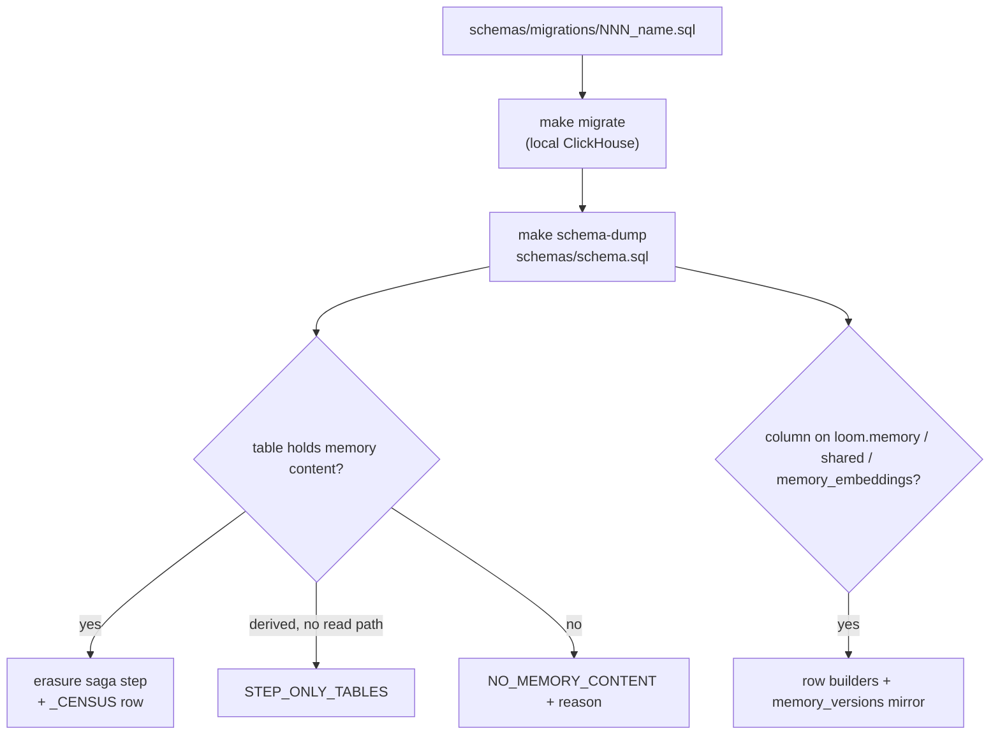

<!-- i18n: source=docs/development/adding-a-table.md blob=d8af79bee19277559de78fd0ef566e3df03ea7cb model=claude-sonnet-5-5 -->
> 이 페이지는 [영어 원문](https://github.com/ClickHouse/loom/blob/main/docs/development/adding-a-table.md)을 기계 번역한 것이며, 영어 원문이 기준입니다.
> Machine-translated from the [English page](https://github.com/ClickHouse/loom/blob/main/docs/development/adding-a-table.md), which is authoritative.

# ClickHouse 테이블 또는 컬럼 추가

Loom의 ClickHouse 상태는 `loom` 및 `loom_telemetry` 데이터베이스의 테이블로 구성됩니다. Postgres 메모리 authority를 사용하는 경우 라이브 메모리, 지식 상태, 그리고 이와 함께 있는 레코드는 Postgres에 있습니다. [스토리지 authority](https://github.com/ClickHouse/loom/blob/main/docs/architecture/storage-authority.md#the-tables) 페이지에 Postgres 테이블이 나와 있습니다. 배포 중에는 두 빌드가 동일한 스키마를 사용하므로, ClickHouse 스키마는 번호가 매겨진 추가형(additive) 마이그레이션으로만 변경됩니다. 아래의 각 규칙은 테스트로 검증됩니다. [ClickHouse](../architecture/clickhouse.md)에서 테이블 계열을 설명합니다.

## 1. 마이그레이션을 작성하고 스키마를 다시 생성하기

[마이그레이션](https://github.com/ClickHouse/loom/blob/main/docs/development/migrations.md) 문서가 번호 매기기, 추가적(additive) 변경의 기준, 러너 지시문, 정렬 키 재구성, 고정된 ClickHouse 버전을 대상으로 하는 `make schema-dump` / `make schema-check` 등의 규칙을 다룹니다. 요약하면 다음과 같습니다.

- 다음으로 비어 있는 번호를 붙여 `schemas/migrations/<NNN>_<what>.sql`을 추가합니다. 파일 머리말 주석에는 변경의 목적과 기존 행 및 이전 빌드에서 어떻게 보이는지를 적습니다.
- 테이블은 `loom.<table>` 형식으로 지정하고 `IF NOT EXISTS` / `IF EXISTS`를 사용합니다. Loom 자체 테이블에서 파생되는 텔레메트리는 대신 `loom_telemetry`에 둡니다([이유](../architecture/clickhouse.md)). preflight가 이 데이터베이스의 권한을 이미 확인하며, 삭제 대상 조사(erasure census)는 테이블 이름을 데이터베이스와 함께 표기합니다.
- 병합된 마이그레이션은 수정하거나 삭제하지 않습니다. 실수는 새 파일로 바로잡습니다.
- `make migrate`, `make schema-dump`를 실행한 다음 `python scripts/codegen/docs_reference.py`를 실행하여 [스키마 레퍼런스](https://github.com/ClickHouse/loom/blob/main/docs/reference/schema.md)에 해당 테이블이 나열되도록 합니다.

배포 환경에 마이그레이션이 적용되기 전까지, 클라이언트의 스키마 가드는 대기 중인 마이그레이션이 생성할 테이블을 지정하는 읽기 또는 쓰기를 `SCHEMA_PENDING`으로 거부합니다.

## 2. ReplacingMergeTree 쓰기 경로에서 모든 컬럼 미러링하기

`loom.memory`, `loom.shared`, `loom.memory_embeddings`는 `FINAL`로 읽는 `ReplacingMergeTree(version)` 테이블입니다. 새 버전 행을 쓰는 모든 핸들러(set, tombstone, restore, touch, `update_by_id`, `bulk_set`, promote, demote)는 저장되는 컬럼을 **모두** 다음 버전으로 그대로 가져가야 합니다. 이후 버전 행에서 빠진 컬럼은 `FINAL`로 읽을 때 0으로 읽힙니다.

이 테이블에 컬럼을 추가할 때는 다음을 따릅니다.

1. `server/memory/store/rows.py`의 표준 컬럼 목록(`MEMORY_PERSISTED_COLS` 또는 `EMBEDDING_PERSISTED_COLS`)에 추가합니다.
2. 같은 파일의 빌더(`build_memory_version_row`, `build_revision_row`, `build_first_version_row`, `build_embedding_row`)와, 이 빌더에 값을 공급하는 모든 프로젝션(기존 행을 불러오는 `SELECT`)에 컬럼을 반영합니다.
3. 핸들러에서 버전 행을 직접 만들지 말고 빌더를 호출합니다.

`tests/unit/test_memory_write_path_mirror.py`와 `tests/unit/test_embedding_mirror_carry.py`가 보조 쓰기 경로를 검사합니다.

**히스토리 미러.** `loom.memory_versions`는 `loom.memory`의 추가 전용(append-only) 쌍둥이 테이블이며 `memory_versions_mv` 구체화 뷰(materialized view)가 채웁니다. 병합 시 `ReplacingMergeTree`에서 대체된 행이 사라지기 때문에 `memory.history`, `memory.redact`, `namespace.rollback`은 이 테이블을 읽습니다. `loom.memory`에 새 컬럼을 추가하면 **같은 마이그레이션에서** `loom.memory_versions`와 뷰의 `SELECT`에도 추가하세요. `tests/unit/test_memory_versions_schema.py`는 `schema.sql`의 두 컬럼 목록을 `MEMORY_PERSISTED_COLS`와 비교합니다.

새 쓰기 경로는 요청 본문의 값이 아니라 서버가 기록하는 `actor`와 `source_class`(`server.memory.domain.provenance`)를 설정해야 합니다.

## 3. 삭제를 위해 테이블 분류하기

삭제는 사가(saga)로 동작합니다(`server/erasure/app/saga.py`). 마지막 단계는 읽기 경로가 접근하는 모든 테이블에 대한 잔여 데이터 조사(residue census)이며, 범위 안에 살아 있는 행이 하나라도 있으면 사가는 실패로 닫힙니다. `tests/unit/test_every_table_is_classified.py`는 `schema.sql`의 `CREATE TABLE` 중 `server/erasure/store/census.py`의 세 목록 가운데 정확히 한 곳에 들어 있지 않은 것이 있으면 실패합니다.

| 목록                | 이런 경우 테이블을 여기에 넣습니다                                                                                                    | 함께 추가할 것                                                                                                                        |
| ------------------- | ------------------------------------------------------------------------------------------------------------------------------------- | ------------------------------------------------------------------------------------------------------------------------------------- |
| `_CENSUS`           | 읽기 경로가 제공하는 메모리 콘텐츠를 담을 수 있는 경우.                                                                               | 범위 안의 행을 제거하는 사가 단계, 그리고 범위별로 해당 단계를 지정하는 `Substrate(table, live, user_pred, ns_step, user_step)`.      |
| `STEP_ONLY_TABLES`  | 사가 단계가 이 테이블을 변경하지만 census는 세지 않는 경우(파생 원장, 별칭 맵). 이유는 dict 위의 주석에 적습니다.                     | 이름을 키로 하는 단계.                                                                                                                |
| `NO_MEMORY_CONTENT` | 범위 안에 메모리 콘텐츠가 없는 경우(카운트, 커서, 공개 데이터의 캐시).                                                                | 한 줄짜리 이유.                                                                                                                       |

`_CENSUS` 테이블의 경우:

- `live`는 살아 있는 행이 만족하는 조건식입니다(`tombstoned_at IS NULL`, 또는 모든 행을 세는 경우 `"1"`). `user_pred`는 테이블에 사용자 축이 있으면 `user_id = {uid:String}`이고, 네임스페이스 전용 테이블이면 `None`입니다(이 경우 네임스페이스 범위 삭제에서만 집계됩니다).
- 단계는 `server/erasure/store/steps_*.py`에 있는 함수이며, 해당되는 각 사가 테이블(`server/erasure/app/saga_steps.py`의 `NAMESPACE_STEPS`, `USER_STEPS`)에 단계 이름과 함께 등록합니다. 일반 `MergeTree`에서는 `Substrate`에 `final=False`를 지정합니다(FINAL을 사용할 수 없습니다).
- 재개된 사가는 마지막 census에서 행이 발견된 테이블의 소유 단계를 다시 실행하므로(`steps_to_reopen`), 단계는 멱등이어야 합니다.
- `(org, namespace)`를 키로 하는 코드 플레인 테이블은 보통 `CODE_INDEX_STEP_ONLY_TABLES`에 속합니다(사가의 `code_index.purge` 단계가 제거합니다). 이 튜플이 스키마와 일치하는지는 단위 테스트가 확인합니다.

`tests/unit/test_erasure_repo.py`와 `tests/unit/test_erasure_late_steps.py`처럼 스텁 클라이언트로 단계의 구문 형태를 테스트하세요.

## 4. 모든 뮤테이션 분류하기

`ALTER TABLE loom.<t> UPDATE|DELETE`는 ClickHouse 뮤테이션입니다. 파트를 비동기적으로 다시 쓰며 트랜잭션을 지원하지 않습니다. `tests/unit/test_clickhouse_mutation_inventory.py`는 `server/` 아래에서 눈에 보이는 모든 뮤테이션을 세어 `_EXPECTED_MUTATIONS`와 비교합니다. 새 뮤테이션은 그곳에 이유를 설명하는 주석과 함께 추가하기 전까지 테스트에 실패합니다.

`ReplacingMergeTree`의 새 버전 행, 톰스톤 컬럼 또는 경량 `DELETE FROM`을 사용하는 편이 좋습니다. 요청이 대기하는 클레임이나 잠금으로 뮤테이션을 사용해서는 안 됩니다. 작업 인박스는 대신 `KeeperMap` 리스 테이블을 통해 클레임합니다.

## 체크리스트

- [ ] 새 `schemas/migrations/<NNN>_<what>.sql`을 추가합니다. 추가형(additive)이며 멱등이어야 하고, 이미 병합된 파일은 수정하지 않습니다.
- [ ] 새로 고정된 ClickHouse를 대상으로 `make schema-dump`를 실행하고, `make schema-check`가 깨끗하게 통과해야 합니다.
- [ ] 스키마 레퍼런스를 위해 `python scripts/codegen/docs_reference.py`를 실행합니다.
- [ ] RMT 컬럼: `rows.py` 컬럼 목록, 빌더, 프로젝션을 갱신하고, `memory_versions`와 `memory_versions_mv`도 같은 마이그레이션에 포함합니다.
- [ ] 삭제(erasure) 분류: `_CENSUS`와 saga 단계, `STEP_ONLY_TABLES`, 또는 사유를 적은 `NO_MEMORY_CONTENT` 중 하나로 분류합니다.
- [ ] 새로운 변경(mutation)은 모두 인벤토리 테스트에 등록합니다.
- [ ] [스토리지 레이아웃](https://github.com/ClickHouse/loom/blob/main/docs/architecture/storage-layout.md)에 행을 추가합니다. ClickHouse 테이블은 해당 패밀리의 표에, 이름이 `_`로 시작하는 테이블은 `_` 테이블 섹션에 넣고, 모든 컬럼을 채웁니다. `tests/unit/test_storage_layout_rows.py`는 해당 행이 존재하는지(ClickHouse 테이블의 경우 테이블이 삭제되면 행도 사라졌는지, 삭제된 Postgres 테이블의 행은 직접 제거합니다), 그리고 ClickHouse 행의 경우 Today 셀이 스키마와, Erasure 셀이 census와 일치하는지, 인용이 해당 테이블 이름을 포함하는지 검사합니다. 스키마 덤프가 보류 중이면 덤프가 반영될 때까지 실패합니다.
- [ ] `make test-unit`을 실행합니다(추가형, 번호 매기기, 미러, 분류, 인벤토리 테스트).

## 관련 문서

- [마이그레이션](https://github.com/ClickHouse/loom/blob/main/docs/development/migrations.md)
- [ClickHouse](../architecture/clickhouse.md)
- [보존 및 삭제](https://github.com/ClickHouse/loom/blob/main/docs/features/memory/retention-and-erasure.md)
- [업그레이드](https://github.com/ClickHouse/loom/blob/main/docs/operations/upgrades.md)
