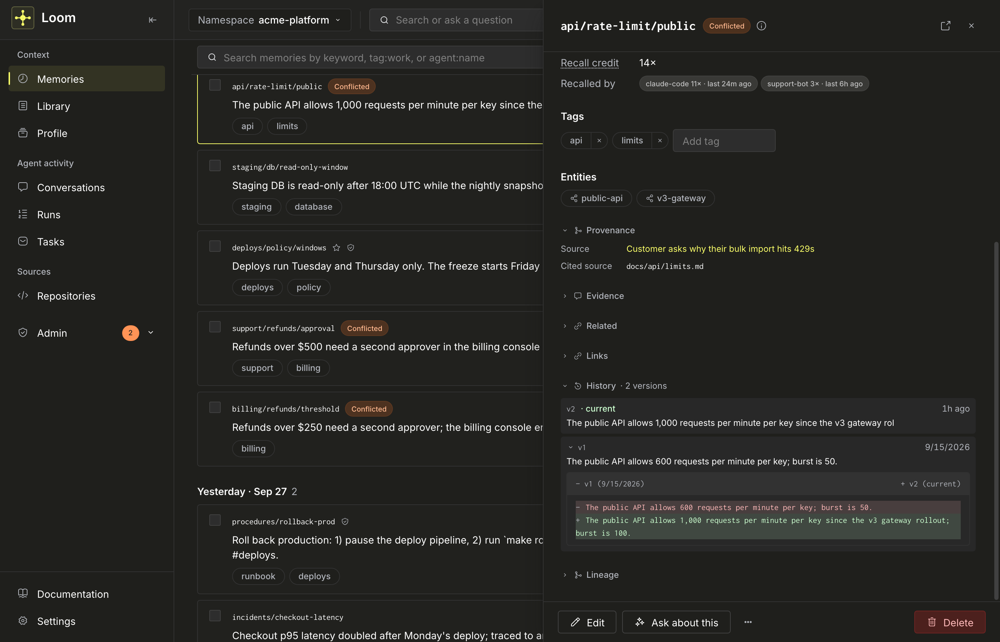

<!-- i18n: source=docs/features/memory/history-and-provenance.md blob=331db28f47c0d0f68295a93f97f4f36b6e5051ad model=claude-sonnet-5-5 -->
> 이 페이지는 [영어 원문](https://github.com/ClickHouse/loom/blob/main/docs/features/memory/history-and-provenance.md)을 기계 번역한 것이며, 영어 원문이 기준입니다.
> Machine-translated from the [English page](https://github.com/ClickHouse/loom/blob/main/docs/features/memory/history-and-provenance.md), which is authoritative.

<a id="history-and-provenance"></a>

# 기록과 출처

메모리에 대한 모든 쓰기는 새 버전을 만들며, 어떤 것도 제자리에서 수정되지 않습니다. 버전은
추가 전용(append-only) 미러에 보관되므로, 백그라운드 병합이 일어나도 사실의 이력은 그대로 남습니다. 각 행에는
누가 작성했는지와 어떤 경로로 메모리에 들어왔는지가 기록되고, 파생된 행에는 그 출처가 기록되며,
사람이 해당 행이 사실임을 증명할 수 있습니다. 버전 미러가 동작하는 방식은
[메모리 아키텍처](../../architecture/memory-architecture.md)에서 설명합니다.



<a id="operations"></a>

## 작업

| 작업                 | 역할   | 응답 내용                                                                                                 |
| -------------------- | ------ | --------------------------------------------------------------------------------------------------------- |
| `memory.history`     | viewer | 삭제 표시(tombstone)되거나 마스킹된 버전을 포함해, 키의 모든 버전을 최신순으로 반환합니다.                |
| `memory.provenance`  | viewer | 현재 행의 출처를 반환합니다: 소스 트레이스, 작성자, 소스 클래스, 추출된 대화.                             |
| `memory.evidence`    | viewer | 사실이 추출된 소스 턴과 이를 뒷받침하는 구간, 각 연결이 만들어진 방식을 반환합니다.                       |
| `memory.backlinks`   | viewer | 행을 가리키는 항목을 반환합니다: 버전, 다이제스트, 들어오고 나가는 타입 링크, 증거 수, 엔티티 이웃.       |
| `memory.lineage`     | viewer | 공유 메모리의 승격 경로를 반환합니다: 누가, 어떤 행에서, 어떤 검토를 거쳐 승격했는지.                      |
| `memory.verify`      | writer | 로그인한 사용자 또는 서비스 계정의 자격으로 행이 사실임을 증명하거나, 그 증명을 철회합니다.               |
| `memory.redact`      | admin  | 행과 감사 항목은 유지한 채, 과거 버전 하나의 값을 지웁니다.                                               |
| `namespace.rollback` | admin  | 네임스페이스의 모든 메모리 헤드를 특정 시점의 버전으로 되돌립니다.                                        |
| `namespace.snapshot` | admin  | 네임스페이스의 큐레이션된 상태를 JSON 페이로드로 내보냅니다.                                              |
| `namespace.restore`  | viewer | 스냅샷을 새 네임스페이스 또는 호출자가 관리하는 기존 네임스페이스로 가져옵니다. 컬렉션으로는 가져올 수 없습니다. |

`namespace.snapshot`과 `namespace.restore`는 MCP 도구가 아닙니다. 필드 목록은 작업 레퍼런스의 [메모리](https://github.com/ClickHouse/loom/blob/main/docs/reference/operations.md#memory)와
[네임스페이스](https://github.com/ClickHouse/loom/blob/main/docs/reference/operations.md#namespace)에 있습니다.

<a id="versions-memoryhistory"></a>

## 버전: `memory.history`

`loom.memory`는 현재 상태를 보관하며 `FINAL`로 읽으므로, 병합이 일어나면 각 행의 가장 최신 버전만 남습니다. `loom.memory_versions`는 모든 insert마다 materialized view가 채우는 추가 전용(append-only) 미러이며, `memory.history`, `memory.redact`, `namespace.rollback`이 읽는 기록(history)입니다.

history 행에는 `version`(쓰기 시점의 나노초 단위 epoch), `written_at`, `value`, `confidence`, `pinned`, `expires_at`, `tombstoned_at`, `redacted_at`, `redaction_reason`, `content_sha256`, `agent`, `actor`, `source_class`가 들어 있습니다. `created_at`은 해당 행을 처음 쓴 시점이며 모든 버전에서 같은 값이 반복됩니다. `agent="*"`는 해당 키를 쓴 모든 작성자를 대상으로 합니다.

```python
from loom import Agent

async with Agent(org="acme", namespace="support", agent="auditor") as agent:
    for v in await agent.memory.history("customer/4812/plan", agent_id="*"):
        print(v["written_at"], v["actor"], v["source_class"], v["value"])
```

툼스톤(tombstone)도 하나의 버전이므로 삭제 내역이 history에 나타나고, `memory.restore`로 14일 이내에는 해당 키를 되살릴 수 있습니다. 현재 상태를 특정 시점 기준으로 읽으려면 `memory.get`, `memory.search`, `memory.ask`에서 `as_of`를 사용하세요
([유효 시간](https://github.com/ClickHouse/loom/blob/main/docs/features/memory/writing.md#validity-time-valid_at-and-valid_to)).

<a id="who-wrote-it-actor-and-source-class"></a>

## 작성자: actor와 source class

서버는 토큰과 작업을 기반으로 모든 행에 `actor`(`human:<subject>` 또는 `process:<subject>`)와 `source_class`를 기록합니다. `source_class` 값은 [메모리 개념](https://github.com/ClickHouse/loom/blob/main/docs/concepts/memory.md)에서 확인할 수 있습니다. 요청은 클래스를 `external`, `imported`, `derived`로만 낮출 수 있습니다.

`memory.provenance`는 두 값과 함께 다음을 반환합니다.

- `source_trace`와 이를 바탕으로 도출한 `source_kind`(`conversation`, `extracted`, `observed`, `consolidated`, `app`, `manual`, `other`)
- 작성자가 인용한 `source_resource_id`
- 대화의 `thread_id`와 `thread_exists`(네임스페이스가 대화 내용을 기록하지 않거나 대화 내용이 삭제된 경우 false)
- 해당 행과 연결된, 직접 작성한 링크(`memory.link`)

검색 결과에는 `source_class`와 `verified`가 포함되며, 선택 사항인 신뢰 항(`LOOM_MEMORY_SEARCH_TRUST_WEIGHT`)이 이 값을 읽습니다.

<a id="evidence-which-turns-a-fact-came-from"></a>

## 근거: 사실이 어떤 턴에서 나왔는가

추출은 각 사실을 `loom.memory_belief_sources`에 있는 해당 턴과 연결합니다.
`memory.evidence(memory_key)`는 이러한 연결을 반환하며, 턴의 텍스트(최대 600자), 역할, 시간, 뒷받침하는 `span`, 그리고 연결이 만들어진 방식을 함께 제공합니다.

| `scope`   | `support_type`    | 의미                                                         |
| --------- | ----------------- | ------------------------------------------------------------ |
| `cited`   | `extracted_from`  | 추출기가 뒷받침하는 턴을 직접 지정했습니다.                  |
| `lexical` | `lexical_support` | 서버가 사실을 가장 잘 맞는 턴과 매칭했습니다.                |
| `window`  | `window`          | 일치하는 항목이 없어 추출 윈도우 전체가 연결됩니다.          |
| `derived` | `derived_from`    | 통합 계보: 해당 항목은 원본 메모리의 텍스트입니다.           |

응답은 연결을 scope별로 집계하므로, 검사 시 직접 인용된 사실과 느슨하게 연결된 사실을 구분할 수 있습니다. 대화의 정확한 표현이 필요하면 `memory.recall`이 저장된 턴을 검색합니다
([추출](https://github.com/ClickHouse/loom/blob/main/docs/features/memory/extraction.md)).

<a id="lineage"></a>

## 계보

- `memory.consolidate`와 기간별 다이제스트는 소스마다 `derived_from` 링크를 하나씩 `loom.memory_belief_sources`에 기록합니다. `memory.evidence`는 이 링크를 `derived` 항목으로 반환합니다.
- 세션 다이제스트는 압축한 키 목록을 담고 있습니다(`summary` 히트의 `derived_from`).
- `memory.lineage`(`scope="shared"`)는 공유 메모리의 승격 과정을 따라갑니다. 승격 이벤트, 승격한 주체, 근거가 된 행, 일치하는 항목이 있을 경우 해당 메모리가 유래한 learnings 후보(`match_confidence`는 `exact` 또는 `inferred`), 그리고 감사 이벤트를 보여 줍니다. `mechanism`은 `review`, `import`, `auto`, `unknown` 중 하나입니다.
- `memory.backlinks`는 그 반대 방향으로, 어떤 행을 가리키는 항목을 보여 줍니다.

`memory.delete`는 모든 소스가 사라진 통합 요약을 폐기하고, 소스가 남아 있는 통합 요약은 `conflicted`로 강등합니다.

<a id="attestation-memoryverify"></a>

## 증명: `memory.verify`

`pinned`와 `confidence`는 누가 사실을 확인했는지 알려 주지 않습니다. `memory.verify`는 이를 기록합니다. 호출자의 토큰에서 가져온 actor와 그가 증명한 콘텐츠 해시를 저장합니다. 행은 `memory_id`로 지정하거나, `namespace`와 `memory_key`를 writer 식별자와 함께 사용해 지정합니다. 해당 행의 네임스페이스에 대한 writer 권한이 필요합니다.

`memory.get`과 `memory.get_by_id`는 저장된 해시와 행의 현재 해시로부터 도출한 `verification`을 반환합니다.

| `verification` | 의미                                                              |
| -------------- | ----------------------------------------------------------------- |
| `human`        | 사람이 증명했고 이후 콘텐츠가 변경되지 않았습니다.                |
| `process`      | 서비스 계정이 증명했고 이후 콘텐츠가 변경되지 않았습니다.         |
| `stale`        | 누군가 증명했지만 이후 콘텐츠가 변경되었습니다.                   |
| `none`         | 증명된 적이 없거나 철회되었습니다.                                |

- 편집해도 증명은 지워지지 않습니다. 누군가 다시 verify할 때까지 `stale` 상태가 됩니다.
- `revoke=true`는 증명을 지웁니다. 변경되지 않은 행을 같은 actor가 다시 verify하는 것은 아무 동작도 하지 않습니다
  (`changed=false`).
- `human:` 접두사는 토큰에서 가져오므로, 에이전트는 자신이 쓴 내용을 human으로 표시할 수 없습니다.
  본문의 `actor`는 인증이 없는 개발 모드에서만 읽습니다.
- 스냅샷과 복원은 증명 컬럼을 그대로 유지하며, 복원이 `verified_by`를 제거하는 일은 없습니다.

<a id="scrubbing-history-memoryredact"></a>

## 기록 지우기: `memory.redact`

`memory.redact(memory_id, version)`는 과거 버전 하나의 텍스트를 복사된 모든 위치에서 지우고, 모델이 해당 메모리로부터 만든 모든 프로필 버전도 함께 지웁니다. `redacted_at`과 `redaction_reason`을 기록하며, 행과 감사 항목은 그대로 남깁니다. 이전 버전에 유출된 비밀 정보나 개인 정보를 지울 때 사용합니다.

| 위치                                              | 동작                                                                                                                                                            |
| ------------------------------------------------- | --------------------------------------------------------------------------------------------------------------------------------------------------------------- |
| `loom.memory`, `loom.memory_versions`             | `value`는 `"[REDACTED]"`가 되고, `value_json`, `evidence`, `entities`, `concepts`는 비워집니다.                                                                 |
| `loom.memory_embeddings`, `loom.memory_chunks`    | 발췌문 또는 청크 해시가 현재 헤드의 것이 아닌 행은 삭제되고, 현재 헤드의 행은 남습니다.                                                                         |
| 해당 메모리로부터 만들어진 사용자의 프로필 버전   | 트레이스에 해당 메모리가 나오는 모든 버전이 같은 방식으로 지워집니다. 현재 헤드도 포함하며, 해당 키에서 파생된 행도 함께 지워집니다.                            |
| `loom.shared`, 키에서 승격된 복사본               | `value`가 지워진 텍스트와 같은 모든 버전은 `"[REDACTED]"`가 되고, 해당 검색 행은 삭제됩니다. 현재 복사본은 관리자가 승격을 해제할 때까지 승격된 상태로 남습니다. |

범위에서 제외되는 항목: 태그, 파일, `content_sha256`, `loom.memory_evidence`(삭제 기능이 관리), 계보 테이블(ID와 해시만 있음), 엔티티 그래프. 현재 헤드도 지워진 텍스트를 가지고 있는 경우(편집을 바이트 단위로 되돌린 경우)에는 공유 복사본을 그대로 둡니다.

- 메모리의 현재 헤드는 거부합니다(`refused_head=true`). 먼저 키를 삭제하거나 다시 작성하세요. 지워진 현재 프로필은 워커가 다시 만들 때까지 렌더, 팩, 프로필 검색에서 제외됩니다.
- 두 잠금 모드 모두 이를 거부합니다. 메모리 자체의 키와, 이 작업이 영향을 미치는 모든 프로필 키에 적용됩니다.
- 해당 키 또는 공유 복사본의 키를 인용한 캐시된 `memory.ask`, `code.ask` 응답과 선례를 삭제합니다(`cache_rows_deleted`, `precedent_rows_deleted`). 영향을 미치는 프로필 키의 경우 삭제는 조직 전체에 적용됩니다. 모든 사용자의 프로필이 같은 키를 가지므로, 해당 키가 윈도에 들어 있던 조직 내 모든 캐시 응답과 선례가 모든 네임스페이스에서 삭제됩니다.
- 네임스페이스는 조회 후에 확인합니다. 거부되면 403이 아니라 `redacted=false`로 응답합니다.
- 존재하지 않는 버전에는 `redacted=false`로 응답하며 아무것도 지우지 않습니다. 프로필 버전도 지우지 않습니다.
- 두 메모리 테이블에 대해(복사본이 아직 해당 텍스트를 가지고 있다면 `loom.shared`에도) 동기식 `ALTER TABLE … UPDATE`를 실행하고, 파생 행에 대해서는 경량 `DELETE`를 실행합니다. 즉, 관리용 호출입니다.

공유 복사본의 redact와 경합하는 쓰기:

- 임베딩 워커가 정리 이후에, 그 이전에 읽은 스텁으로 기록한 검색 행은 해당 키를 다음에 redact할 때까지 남습니다.
- 키를 승격하면 다시 승격될 때까지 해당 검색 행이 사라집니다.
- 지우기 이전에 복사본을 읽은 승격 해제는 텍스트가 담긴 툼스톤을 기록하며, 이는 해당 버전을 다시 redact할 때까지 남습니다.

이후의 키 승격으로 대체되었고 그 뒤 `loom.shared`에서 병합되어 사라진 복사본은 더 이상 찾을 수 없습니다. `FINAL`이 더 이상 제공하지 않는 그 검색 행은 이후 해당 키를 정리할 때까지 남고, redact된 키가 아닌 다른 키로 저장된 캐시 응답은 만료될 때까지 남습니다.

값이 `"[REDACTED]"`인 복사본은 이전 redact가 지운 것으로 간주합니다. 따라서 그 텍스트 자체를 가지고 있으면서 승격된 메모리는, 해당 키를 다음에 redact할 때 검색 행을 잃습니다.

프로필 영향 범위와 그 한계는 [보안](https://github.com/ClickHouse/loom/blob/main/docs/architecture/security.md#sensitivity)에 있습니다.
특정 사람의 데이터를 모든 곳에서 제거하려면 [삭제](https://github.com/ClickHouse/loom/blob/main/docs/features/memory/retention-and-erasure.md#erasure)를 사용하세요.

<a id="rolling-a-namespace-back-namespacerollback"></a>

## 네임스페이스 되돌리기: `namespace.rollback`

`namespace.rollback(as_of)`는 각 키에 대해 `as_of` 시점 또는 그 이전의 가장 높은 버전을 새로운 최신 버전(head)으로 다시 삽입하고, 그 이후에 생성된 키는 tombstone 처리합니다. 롤백 자체도 새로운 버전으로 기록되므로 같은 방법으로 되돌릴 수 있습니다.

- 기본적으로 드라이 런으로 실행되며 `reinstate`, `remove`, `sample`을 보고합니다. `dry_run=false`를 지정하면 실제로 적용됩니다.
- `memory_keys`(최대 500개)로 대상을 제한할 수 있습니다. `max_keys`(기본값 5,000)는 한 번의 호출에서 처리할 수 있는 키 수의 상한이며, `truncated`가 표시되면 다시 호출하라는 뜻입니다.
- `embedding_worker`가 복원된 head를 다시 임베딩합니다.
- 네임스페이스의 기록보다 오래되었거나 미래인 `as_of`는 거부됩니다.

```bash
curl -sX POST http://localhost:7777/v1/namespace.rollback \
  -H "Authorization: Bearer $LOOM_API_KEY" -H 'Content-Type: application/json' \
  -d '{"org":"dev","namespace":"local","as_of":"<YYYY-MM-DD>T09:00:00Z"}' \
  | jq '{reinstate, remove, truncated, sample}'
```

<a id="snapshots-namespacesnapshot-and-namespacerestore"></a>

## 스냅샷: `namespace.snapshot` 및 `namespace.restore`

`namespace.snapshot`은 네임스페이스의 큐레이션된 상태를 JSON으로 내보냅니다. 내보내는 내용은 `version`, `content_sha256`, `actor`, `source_class`, 유효 기간 및 증명(attestation) 컬럼을 포함한 모든 메모리 행, 유형별 설정, 권한 부여(grant), 그리고 최대 `include_audit_tail_n`개의 최근 감사 행(기본값 1,000)입니다. `include_embeddings`는 기본적으로 false이므로, 대상 환경에서는 자체 모델로 다시 임베딩합니다.

`namespace.restore(target_namespace, payload)`는 페이로드를 버전 행으로 다시 기록합니다. `snapshot_id` 기준으로 멱등적입니다(다시 실행하면 `restored=false`로 응답합니다). 복원 대상은 새 네임스페이스이거나(호출자가 admin이 되며, 이미 데이터나 권한 부여가 있는 이름에 대해서는 호출자가 이미 해당 네임스페이스를 관리하는 경우가 아니면 거부됩니다) 호출자가 관리하는 네임스페이스입니다. `rebind_agent`는 모든 행의 작성자를 다시 지정합니다. 복원된 행은 `imported`로 표시됩니다.

스냅샷은 배포 백업이 아닙니다. [백업 및 복구](https://github.com/ClickHouse/loom/blob/main/docs/operations/backup-and-recovery.md)를 참고하십시오.

<a id="the-audit-log"></a>

## 감사 로그

메모리를 생성하거나 변경하는 모든 쓰기는 `loom.audit_log`에 해시만 담은 행을 하나씩 남깁니다
(키, id, 콘텐츠 해시, 행위자, 소스 클래스, 판정이 기록되며 값은 기록되지 않습니다). 매시간 생성되는
체크포인트가 로그를 체인으로 연결합니다. [감사](https://github.com/ClickHouse/loom/blob/main/docs/features/observability/audit.md)를 참조하세요.

<a id="limits"></a>

## 제한 사항

- **병합되어 사라진 버전의 편집(redaction)은 최선의 노력(best effort)으로 처리됩니다.** `loom.memory`에서는 그렇지만, 미러는 어느 경우에나 정리됩니다.
- **기록은 미러만큼만 완전합니다.** `loom.memory`에 추가한 컬럼은 같은 마이그레이션에서 `loom.memory_versions`와 해당 뷰에도 추가해야 합니다.
- **유효성은 유효 시간(valid-time)만 다룹니다.** `knowledge_time`은 `created_at`을 폐기(`invalid_at`) 및 삭제(`tombstoned_at`) 스탬프와 대조하여 재현하며, 별도의 트랜잭션 시간 테이블은 없습니다.
- **`thread_exists=false`는 오류가 아닙니다.**
- **롤백은 하드 삭제된 키를 복원하지 않습니다** (`skipped_no_head`).

<a id="related"></a>

## 관련 문서

- [메모리 쓰기](https://github.com/ClickHouse/loom/blob/main/docs/features/memory/writing.md)
- [충돌과 거부](https://github.com/ClickHouse/loom/blob/main/docs/features/memory/conflicts-and-refusal.md)
- [보존과 삭제](https://github.com/ClickHouse/loom/blob/main/docs/features/memory/retention-and-erasure.md)
- [감사](https://github.com/ClickHouse/loom/blob/main/docs/features/observability/audit.md)
