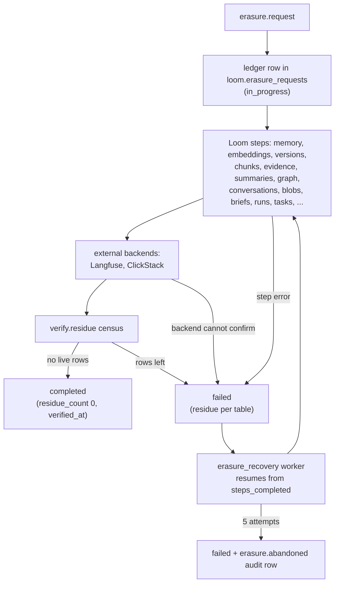

<!-- i18n: source=docs/features/memory/retention-and-erasure.md blob=193d8b98f7242dbe87366e0149f838322897ecdd model=claude-sonnet-5-5 -->
> 이 페이지는 [영어 원문](https://github.com/ClickHouse/loom/blob/main/docs/features/memory/retention-and-erasure.md)을 기계 번역한 것이며, 영어 원문이 기준입니다.
> Machine-translated from the [English page](https://github.com/ClickHouse/loom/blob/main/docs/features/memory/retention-and-erasure.md), which is authoritative.

<a id="retention-and-erasure"></a>

# 보존과 삭제

Loom은 작성자, 네임스페이스 소유자 또는 운영자가 요청하지 않는 한 어떤 메모리도 삭제하지 않습니다. 메모리에는 기본 수명이 없습니다. 데이터가 사라지는 경로는 세 가지입니다. 작성자가 지정한 만료 또는 삭제, 소유자나 운영자가 설정한 보존 정책, 그리고 Loom이 보관하는 모든 위치에서 특정 범위를 제거하는 삭제 요청입니다.

<a id="what-is-kept-and-for-how-long"></a>

## 무엇을 얼마나 오래 보관하는가

`schemas/schema.sql`의 메모리, 임베딩, 버전 이력, 대화, 엔티티, 요약, 작업 메모리, 지식 테이블에는 TTL이 없으며, 행을 기간에 따라 폐기하는 워커도 없습니다.
링크 테이블 `entity_triple_rows`와 `entity_edge_rows`는 `entity_triples`와 `entity_edges`를 따르므로 TTL이 없습니다. 삭제(erasure)는 해당 메모리의 링크도 함께 삭제하며, 이전 빌드의 삭제가 남긴 고아 링크는 `loom erasure-re-verify --completed-since … --resume`으로 처리합니다.
행이 제공 대상에서 빠지는 경우는 다음뿐입니다.

- **작성자가 제거한 경우**: `memory.delete`, 행을 대체하는 같은 키 재작성, `memory.apply`, `memory.clear`, `conflicts.resolve`, `blacklist.add(sweep=true)`.
- **작성자가 만료를 지정한 경우**: `memory.set`의 `ttl_seconds` 또는 `valid_to`, `memory.touch`, `run.complete(retain="expire")`, 리플렉션의 `expires_in_days`.
- **소유자나 운영자가 설정한 경우**: [설정된 보존](#configured-retention)을 참고하십시오.

운영 테이블(텔레메트리, 캐시, 큐)에는 고정 TTL이 있습니다. `loom.search_trace_log`와 `loom.memory_exposures`는 180일, `loom.erasure_requests`와 `loom.policy_decisions`는 90일, `loom.memory_drops`, `loom.memory_extraction_queue`, `loom.events`, `loom.embedding_cache`는 30일, `loom.llm_response_cache`는 7일입니다. 모든 테이블의 TTL은 [스키마 레퍼런스](https://github.com/ClickHouse/loom/blob/main/docs/reference/schema.md)에 나와 있습니다.

타이머로 데이터를 제거하는 워커는 하나입니다. `namespace_gc`는 `kind = 'bench'`인 네임스페이스(자동 등록 시 `LOOM_NAMESPACE_BENCH_PREFIXES`로 판별)가 `LOOM_NAMESPACE_GC_IDLE_HOURS` 동안 쓰기가 없으면 삭제(erasure) 사가를 통해 제거합니다. 다른 kind는 건드리지 않습니다. [네임스페이스와 공유](https://github.com/ClickHouse/loom/blob/main/docs/features/namespaces-and-sharing.md)를 참고하십시오.

<a id="delete-is-not-erase"></a>

### 삭제(delete)는 지우기(erase)가 아닙니다

툼스톤은 `tombstoned_at`이 설정된 새 버전입니다. 읽기에서는 즉시 제공되지 않지만, 해당 행과 `loom.memory_versions`의 이전 버전은 디스크에 남아 있습니다.

- `memory.restore`는 14일 이내에 툼스톤 처리된 키를 되살립니다(이후에는 `expired=true`로 응답합니다). 자동 대체(supersession)도 되돌립니다.
- `memory.clear`(관리자)는 네임스페이스 안에서 한 에이전트 또는 사용자의 모든 메모리를 툼스톤 처리합니다. `confirm_subject`에는 구체적인 `user_id` 또는 `agent`를 그대로 다시 입력해야 합니다(`'*'`와 `'-'`는 확인으로 인정되지 않습니다). `user_id`와 함께 `agent="*"`를 지정하면 모든 에이전트 아래의 해당 사용자 행을 지우고, `agent`와 함께 `user_id="*"`를 지정하면 모든 사용자에 대한 해당 에이전트의 행을 지웁니다. `'-'`만 지정한 범위는 네임스페이스 전체 삭제와 마찬가지로 거부됩니다. 잠긴 행은 남으며 `locked_skipped`에 집계됩니다. 삭제된 키도 같은 방식으로 되살릴 수 있습니다.

바이트 자체를 제거하려면 [삭제(erasure)](#erasure)를 사용하십시오. 행과 감사 추적은 유지하면서 값 하나만 지우려면 [`memory.redact`](https://github.com/ClickHouse/loom/blob/main/docs/features/memory/history-and-provenance.md#scrubbing-history-memoryredact)를 사용하십시오.

<a id="writer-set-expiry"></a>

### 작성자가 지정한 만료

행은 `expires_at`이 지나는 순간 읽기에서 숨겨집니다. 이후 `memory_expiry_sweep` 워커가 작성자가 지정한 `on_expire`를 새 버전으로 적용합니다.

| `on_expire`           | 효과                                                                                                                          |
| --------------------- | ---------------------------------------------------------------------------------------------------------------------------- |
| `tombstone` (기본값) | 툼스톤 처리되며 14일의 복원 기간이 있습니다.                                                                                  |
| `demote`              | 만료가 해제되고, 신뢰도가 `LOOM_MEMORY_EXPIRY_DEMOTE_FACTOR`(0.5)만큼 곱해지며 `LOOM_MEMORY_EXPIRY_DEMOTE_FLOOR`(0.05) 아래로는 내려가지 않습니다. |
| `anonymize`           | 값이 마커로 대체되고 임베딩이 제거됩니다. 행은 존재했다는 증거로 남습니다.                                                    |

`memory.touch`는 행의 만료만 변경하며, 키 하나 또는 최대 1,000개(`memory_keys`)에 적용할 수 있습니다. 새 `ttl_seconds`, `clear_expiry=true`, 새 `on_expire` 중 하나를 지정합니다. `memory.sweep_expired`(관리자)는 네임스페이스에 대해 스윕을 한 번 즉시 실행하며 `dry_run`을 지원합니다. 다른 필드를 수정해도 유효한 만료는 유지됩니다.

<a id="configured-retention"></a>

### 설정된 보존

모두 기본적으로 꺼져 있습니다(0 = 영구 보관).

| 위치                        | 설정 방법                                                                                                     | 효과                                                                                                                                                   |
| ---------------------------- | ---------------------------------------------------------------------------------------------------------- | -------------------------------------------------------------------------------------------------------------------------------------------------------- |
| 네임스페이스의 메모리 유형 | `namespace.register`의 `tag_registry` 항목에 있는 `retention_days`                                         | 유효한 만료, `ttl_seconds`, `clear_expiry` 없이 `memory.set`이 쓴 행은 `expires_at = now + N days`를 받습니다. 다시 기록된 `read_only` 행은 받지 않습니다.   |
| 민감한 행               | `LOOM_MEMORY_SENSITIVE_RETENTION_DAYS`, `LOOM_MEMORY_SENSITIVE_ON_EXPIRE` (기본값 `anonymize`)            | 민감도가 `medium` / `high`인 새 행에 만료가 설정됩니다. 호출자가 지정한 만료가 더 짧으면 그것이 우선합니다.                                                                      |
| 실행(run) 자체의 쓰기           | `LOOM_MEMORY_RUN_COMPLETE_RETAIN` (`keep`, `demote`, `expire`), `LOOM_MEMORY_RUN_COMPLETE_EXPIRE_DAYS` (7) | 호출에서 지정하지 않았을 때 `run.complete`가 해당 실행의 행에 적용하는 동작입니다. 고정(pinned), 검증(verified), 승격(promoted), 잠금(locked), 일화(episodic), 리플렉션 행은 항상 유지됩니다. |
| 네임스페이스 전체            | `namespace.register`의 `retention_days`, `warm_days`                                                      | 해당 네임스페이스 행에 대한 테이블 TTL(및 웜 티어 이동)입니다.                                                                                              |
| 배포 전체                 | `LOOM_RETENTION_<TABLE>_DAYS`, `LOOM_TIERING_<TABLE>_WARM_DAYS`                                            | `audit_log`, `agent_events`, `memory`, `memory_embeddings`, `conversations`, `chunks`, `documents`의 테이블 TTL(및 웜 티어 이동)입니다.                  |

Postgres를 기준 스토리지(source of truth)로 사용하는 구성에서는 마지막 두 행 모두 `memory`, `memory_embeddings`, `documents`에 보존 TTL을 적용하지 않습니다. Postgres가 아직 제공 중인 행의 ClickHouse 사본을 삭제하게 되기 때문에, 부팅 시 `LOOM_RETENTION_MEMORY_DAYS`, `LOOM_RETENTION_MEMORY_EMBEDDINGS_DAYS`, `LOOM_RETENTION_DOCUMENTS_DAYS`를 거부합니다
([기준 스토리지](https://github.com/ClickHouse/loom/blob/main/docs/architecture/storage-authority.md)). 네임스페이스의
`retention_days`는 `chunks`에도 적용되지 않으므로, 남아 있는 문서는 검색이 해당 문서를 찾는 데 쓰는 청크도 유지합니다. `LOOM_RETENTION_CHUNKS_DAYS`는 여전히 적용됩니다.

`retention_reconcile` 워커는 마지막 두 행을 테이블마다 멱등한 `ALTER TABLE … MODIFY TTL` 하나로 적용하며, 오버라이드가 있으면 `(org, namespace)`마다 적용합니다. 네임스페이스도 배포 단위 기간도 남지 않은 테이블에서는 TTL을 제거합니다. `loom.memory`에서는 TTL이 `coalesce(expires_at, created_at)`을 기준으로 하므로 작성자의 만료가 우선합니다.

- **테이블 TTL은 물리적으로 삭제합니다.** 파트가 다음에 병합될 때 삭제됩니다. 복원 기간이 없으며, 툼스톤은 자신이 숨기던 행과 함께 사라집니다.
- **되돌리기(Undo)는 해당 기록이 남아 있는 동안만 유효합니다.** 충돌 해결기는 사람이 한 폐기 되돌리기를 `audit_log`의 `memory.unsupersede` 행으로 인정합니다. `audit_log`의 TTL이 쌍의 수명보다 짧으면, 만료된 되돌리기는 더 이상 유효하지 않으며 해결기가 그 쌍을 다시 판단하여 폐기할 수 있습니다.
- **티어링에는 볼륨이 필요합니다.** `LOOM_TIERING_WARM_VOLUME_NAME`은 스토리지 정책에 있는 볼륨을 가리켜야 하며, 웜 기간은 보존 기간보다 짧아야 합니다.

<a id="erasure"></a>

## 삭제(Erasure)

`erasure.request`는 Loom이 보관하는 모든 위치에서 하나의 범위를 삭제하고, 범위 안에 남은 것이 없음을 보일 수 있게 되면 응답을 반환합니다. 한 사용자 id가 조직 전체에 가진 모든 데이터를 삭제하려면 조직 관리자가 `user_id` 범위를 요청합니다. 이 요청은 조직의 모든 네임스페이스에서 해당 사용자의 행을 삭제합니다(`purge=true`이면 툼스톤 처리하는 대신 행을 삭제하며, 남는 항목은 아래에 나열되어 있습니다). `memory.clear`는 한 네임스페이스 안에서 한 에이전트 또는 사용자의 메모리만 툼스톤 처리합니다([삭제는 소거가 아닙니다](#delete-is-not-erase)).

| `scope_type`     | `scope_value`                                                               | 요청할 수 있는 사람                          |
| ---------------- | --------------------------------------------------------------------------- | -------------------------------------------- |
| `user_id`        | 조직의 모든 네임스페이스에 걸친 사용자 id                                   | 조직 관리자                                  |
| `namespace`      | 하나의 네임스페이스                                                         | 해당 네임스페이스의 관리자(또는 조직 관리자) |
| `namespace_list` | 1–500개 네임스페이스의 JSON 배열, 또는 `{"namespaces": [...], "purge": bool}` | 조직 관리자                                  |

이 op는 writer 토큰으로 호출할 수 있지만, 핸들러는 대상에 대한 관리자 권한을 요구합니다(그렇지 않으면 403 `AUTH_INSUFFICIENT`).

카테고리 링크(`loom.memory_categories`)에는 사용자 정보가 없으므로, `user_id` 삭제는 이 링크와 이를 나열하는 `memory.import` 감사 행을 그대로 둡니다. 가져온 항목의 경우 링크의 키는 `import:`와 해당 텍스트의 다이제스트이며, 이는 추측한 텍스트가 맞는지 확인해 줄 수 있습니다. `namespace` 삭제는 링크를 제거합니다.

`user_id` 삭제는 해당 사용자로 기록된 원문 청크와, 사용자 정보 없이(`-`) 기록되었지만 사용자의 `(namespace, key)` 쌍에 속하는 청크를 누구의 메모리에 속하든 제거합니다. `-` 청크에 사용자의 텍스트가 들어 있을 수 있고, 쓰기 경로도 이런 청크를 작성자의 것으로 폐기하기 때문입니다. 다른 사용자로 기록된 청크는 남습니다.

`user_id` 삭제는 또한 사용자의 메모리로 만들어진 통합 요약을, 어떤 신원으로 기록되었든 폐기합니다([해당 요약](../../architecture/memory-architecture.md#background-passes)). 여기에는 그 요약에서 파생된 항목도 함께 포함됩니다. 즉 버전 이력, 원문 청크와 엔티티 벡터, 요약에서 추출된 그래프 행, 요약에서 승격된 네임스페이스 전체 사본입니다. 이를 인용한 캐시된 `memory.ask` 답변과 선례도 삭제합니다.

<a id="the-saga"></a>

### 사가(saga)



- **체크포인트가 있는 멱등 단계.** 완료된 각 단계는 `steps_completed`에 기록됩니다. `erasure_recovery` 워커는 `in_progress` 또는 `failed` 상태로 멈춘 사가를 체크포인트부터 재개합니다. 각 단계는 해당 뮤테이션을 위해 최대 `LOOM_ERASURE_MUTATION_WAIT_S`만큼 기다린 뒤, 그 뮤테이션을 지목하며 실패합니다.
- **문서 소스는 문서보다 먼저 멈춥니다.** 네임스페이스 삭제는 첫 단계인 `knowledge_sources.retire`에서 해당 네임스페이스의 [문서 소스](https://github.com/ClickHouse/loom/blob/main/docs/features/knowledge.md#document-sources)를 폐기하고 자격 증명을 지운 다음, 아직 실행 중인 각 소스의 동기화 턴이 끝나기를 기다립니다(전체 최대 30초이며, 아직 실행 중인 턴이 있으면 해당 단계가 `OVERLOADED`로 실패하고 `erasure_recovery`가 사가를 재시도합니다). 따라서 이후 단계가 문서를 삭제한 뒤에 동기화가 문서나 추출된 결정을 다시 쓰는 일은 없습니다.
- **코드 링크는 링크 워커를 기다립니다.** `code_links.delete`는 코드 링크 워커의 큐 리스를 가져가므로, 삭제 이전에 읽은 커서를 게시하는 패스는 없습니다. Keeper가 있으면 호스트 간에, 없으면 한 프로세스 안에서 보장됩니다. 패스가 끝나기를 최대 15분 기다리며, 그 이후에는 해당 단계가 `LeaseBusy`로 실패하고 `erasure_recovery`가 재시도합니다.
- **툼스톤 또는 purge.** 기본적으로 소프트 삭제 테이블(메모리, 임베딩, 청크, 요약, 링크)은 툼스톤 처리되며, 보존 기간 안에서는 `memory.restore`로 되살릴 수 있습니다. `erasure.list`는 이렇게 되살린 것을 `reversals_count`로 보고합니다. `purge=true`는 대신 행을 삭제합니다(와이드 테이블에서는 경량 `DELETE FROM`). 미러가 한 번이라도 있었던 네임스페이스를 포함하는 범위는 그 안의 모든 네임스페이스를 통째로 purge하므로 어느 곳에도 이런 보존 기간이 없습니다([문서 소스](https://github.com/ClickHouse/loom/blob/main/docs/architecture/document-sources.md#the-mirror)). 사용자 삭제는 사용자의 메모리가 키를 통해 만들어 낸 항목을 찾아내므로, purge에서는 해당 `loom.memory` 행과 그로부터 만들어진 통합 요약이 먼저 툼스톤 처리되고, 이 키들을 읽는 모든 단계가 끝난 뒤 `memory.retire`에서 삭제됩니다. 그때까지는 `memory.restore`로 되살릴 수 있으며(사용자 본인의 행은 되돌림으로 집계되고 요약은 집계되지 않습니다), `memory.retire`는 `memory.restore`가 되살린 항목을 삭제합니다.
- **업로드된 원본**(지식 문서): 해당 네임스페이스의 `loom.document_blobs` 행이 먼저 삭제되고 `blob_erased_at`이 기록됩니다. 사용자 삭제는 그 사용자가 업로드했고 다른 작성자의 라이브 문서가 공유하지 않는 원본을 삭제하는데, 이는 `loom.blob_uploads`(최종 사용자의 업로드당 한 행. 원본을 가리키던 문서 버전이 교체되어 병합되었을 수 있기 때문입니다)와 해당 사용자의 문서를 통해 찾습니다. 그다음 `loom.blob_uploads`의 해당 행이 삭제됩니다. 센서스는 두 테이블을 모두 집계합니다. S3 호환 버킷(`LOOM_DOCUMENT_OBJECT_STORE=s3`)에 보관된 원본은 해당 행보다 먼저 삭제됩니다. 네임스페이스 삭제는 해당 프리픽스 아래 범위의 모든 오브젝트를 삭제하고 센서스는 거기 남은 것을 집계합니다(`objects.document_originals`). 사용자 삭제는 행이 이름을 지정했든 아니든 사용자 본인 원본의 바이트를 담은 모든 오브젝트를 삭제하고, 그 프리픽스를 다시 나열해 스토어에 남은 것이 있으면 해당 단계를 실패시킵니다. 이어서 행을 삭제하고, 그다음 어떤 행도 가리키지 않지만 그 프리픽스에 아직 남은 것을 삭제합니다. 따라서 행이 삭제로 사라진 사용자 본인의 동일 바이트 업로드도 오브젝트를 잃습니다. 단계가 실행되는 시점에 아직 진행 중인 동일 바이트의 업로드(오브젝트는 저장되었고 행은 아직 들어오지 않은 상태)는 작성자가 누구든 오브젝트를 잃으며, 그 행은 나중에 들어오면 `410 BLOB_GONE`으로 응답합니다. 원본 배치마다 삭제 직전에 다시 읽으므로 그 사이 다른 작성자의 문서가 이름을 지정한 원본은 남습니다. 그 읽기 이후에 같은 네임스페이스에서 다른 작성자가 같은 바이트를 저장하면 그것을 잃을 수 있으며, 이는 ClickHouse 스토어에서도 마찬가지입니다. 버킷이 구성되지 않았는데 행이 오브젝트를 가리키거나, 구성된 버킷과 프리픽스 밖의 오브젝트를 가리키면 바이트를 남겨 두는 대신 해당 단계가 실패합니다. 어느 스토어에서든 사용자 삭제는 원본이 들어갈 수 있는 최소한의 뮤테이션 수로 행을 삭제합니다(각 뮤테이션은 ClickHouse 파라미터 하나가 담을 수 있는 만큼 바인딩합니다). 원본을 ClickHouse에서 버킷으로 옮기는 작업(`loom knowledge migrate-originals`)은 이 원장으로 보호됩니다. 완료되지 않은 삭제가 다루는 원본은 옮기지 않으며, 삭제가 앞질러 버린 이동은 그 삭제가 정한 대로 끝납니다([원본이 저장되는 위치](https://github.com/ClickHouse/loom/blob/main/docs/features/knowledge.md#where-originals-are-stored)).
- **수집 취소.** 사용자 삭제는 사용자의 수집(ingestion) 행을 삭제하며 취소 행도 그에 포함됩니다. 삭제 대상 사용자가 다른 작성자의 수집 작업에 대해 요청한 취소는, 그 수집 작업이 아직 대기 중이거나 처리 중인 경우(여기서 대기 중 또는 처리 중은 취소 기록이 아니라 다른 작성자의 수집 작업의 상태입니다), 먼저 신원이 없는 행(`agent`, `user_id`, `session_id`는 `'-'`, `actor`는 비어 있음)으로 보존되므로, 그 작업은 계속 취소된 상태로 남습니다.
- **조직 전체 캐시.** `loom.idempotency`(재생된 응답)와 `loom.embedding_cache`(쿼리 벡터이며 텍스트는 저장하지 않음)는 조직 정보만 있고 네임스페이스나 최종 사용자 정보가 없으므로, 어느 범위의 삭제든 두 테이블에서 조직의 모든 행을 삭제합니다. 비용은 캐시 미스입니다. 센서스는 `loom.idempotency`는 조직 전체에서 집계하지만 `loom.embedding_cache`는 집계하지 않는데, 조직의 어떤 검색이든 이 캐시를 다시 채우기 때문입니다. 각 레플리카의 벡터 프로세스 캐시는 `LOOM_EMBEDDING_CACHE_TTL_S` 안에 만료됩니다.
- **봇 규칙 학습 항목.** 학습 큐에 있는 사용자의 발언은 `loom.learnings_supporters`의 해당 행에만 존재하며, 사용자 삭제가 이를 삭제합니다. 지지자가 없어진 규칙 후보는 대기 중이면 삭제되고, 아니면 규칙을 비운 채 결정을 유지합니다([추출](https://github.com/ClickHouse/loom/blob/main/docs/features/memory/extraction.md#rules-the-assistant-states-about-itself)). 센서스는 삭제된 사용자의 후보만이 아니라 조직 전체에서 이처럼 지지자가 없는 후보를 집계하므로, 조직 내 다른 삭제가 단계 도중에 남겨 둔 후보 때문에 사가가 실패할 수 있습니다. 다시 열린 해당 단계가 이를 정리합니다.

<a id="the-federated-cascade"></a>

### 연합 연쇄 삭제

Loom이 다른 곳으로 보낸 데이터도 같은 사가에서 삭제됩니다. 외부 단계는 안전 실패(fail closed) 방식입니다. 삭제를 확인할 수 없는 백엔드(5xx, 타임아웃, 네트워크 끊김, 버전이 없는 Langfuse 상태 응답)는 해당 단계를 실패시키고 워커가 재시도합니다. "삭제할 것이 없음"(일치하는 행이 0개이거나 서비스에 없는 ClickStack 테이블)은 성공으로 간주합니다.

| 백엔드     | 구성 방법                                                  | 삭제 대상                                                                                         |
| ---------- | ---------------------------------------------------------- | ------------------------------------------------------------------------------------------------- |
| Langfuse   | `LOOM_LANGFUSE_URL` + `LOOM_LANGFUSE_ADMIN_TOKEN`          | 조직의 태그 안에서 `userId`로 찾은 트레이스, 또는 `org:` + `namespace:` 태그 쌍으로 찾은 트레이스. |
| ClickStack | `LOOM_CLICKSTACK_DATABASE`, `LOOM_CLICKSTACK_USER_ID_KEYS` | 같은 ClickHouse 서비스의 OTel 행 중 사용자 id 속성 키 또는 네임스페이스와 일치하는 것.            |

ClickStack 네임스페이스 삭제는 `loom.namespace` 행이 삭제를 요청한 조직의 `loom.org`를 가질 때만 일치시킵니다. 따라서 조직 정보가 없는 Loom 자체의 op 및 도메인 메트릭은 네임스페이스 레이블을 유지합니다([ClickStack 삭제](https://github.com/ClickHouse/loom/blob/main/docs/features/integrations/clickstack.md#erasure)).

구성되지 않은 백엔드는 의도만 로그로 남기고 아무것도 삭제하지 않습니다. `namespace_list` 삭제만 `external=false`를 전달할 수 있으며, `user_id`와 `namespace` 삭제는 항상 백엔드를 포함합니다. `LOOM_EXTERNAL_ERASURE_TIMEOUT_S`가 각 호출의 시간 제한입니다. 설정 방법: [Langfuse](https://github.com/ClickHouse/loom/blob/main/docs/features/integrations/langfuse.md) 및 [ClickStack](https://github.com/ClickHouse/loom/blob/main/docs/features/integrations/clickstack.md).

<a id="the-residue-census"></a>

### 잔여 데이터 센서스

마지막 단계인 `verify.residue`는 읽기 경로가 접근하는 모든 테이블에서 범위 안의 라이브 행을 집계합니다. 남은 행이 하나라도 있으면 사가가 실패하며, 최종 행에는 `residue_count`, `residue`(테이블별), `verified_at`, `census`(모든 집계값, 아래 참조)가 담깁니다. 재개된 사가는 마지막 센서스에서 행이 발견된 테이블을 담당하는 단계를, 체크포인트상 완료되었더라도 다시 실행하며, 항상 다시 집계합니다.

<a id="the-receipt"></a>

### 영수증

`erasure.status`(와 `erasure.request`의 응답)에는 가장 최근 실행의 센서스 영수증이 담깁니다. 가장 최근 원장 행에 모든 스토어를 집계한 센서스가 없으면 `census`는 null입니다. 진행 중인 실행, 실행되지 못했거나 집계하지 못한 스토어가 남은 센서스, 센서스를 보관하지 않는 빌드가 쓴 행이 여기에 해당합니다. 영수증의 필드는 다음과 같습니다.

- `census`: 센서스가 집계한 모든 저장소와 그 집계값이며 0도 포함합니다. 키는 테이블 이름이고, 스토리지 기준 저장소(source of truth)인 Postgres는 `pg:<table>`, 네임스페이스 범위의 문서 버킷은 `objects.document_originals`, 프로바이더 재구축의 복사본 전체 합계는 `provider_rebuild_copies`입니다(복사본이 없으면 0이며, 복사본에 org 컬럼이 없으면 배포 전체 기준으로 집계). 집계값은 센서스가 이 범위에서 잔여 데이터로 세는 행의 수로, 라이브 행이거나, 사가가 purge를 수행하거나 테이블에 툼스톤이 없는 경우에는 모든 행입니다([센서스 규칙](../../architecture/memory-architecture.md#erasure-saga)). `objects.document_originals`는 첫 목록 페이지를 집계하므로 "최소 이 정도"로 읽어야 합니다.
- `purge`: 범위의 삭제 또는 툼스톤 모드입니다(단일 네임스페이스는 요청과 관계없이 툼스톤). 미러가 있는 범위([문서 소스](https://github.com/ClickHouse/loom/blob/main/docs/architecture/document-sources.md#the-mirror))는 이 값과 관계없이 삭제됩니다. purge가 없으면 툼스톤 처리된 행은 테이블이 병합될 때까지 파트에 바이트를 유지하고, purge가 있으면 행은 삭제되지만 바이트는 병합이나 reclaim 워커가 제거할 때까지 디스크에 남습니다.
- 대상과 시각은 status의 `org`, `scope_type`, `scope_value`, `verified_at`입니다.

영수증은 Loom이 센 값입니다. 응답을 보관해 두십시오. `erasure.status`는 요청 후 89일 동안 원장 행을 제공하며, 센서스도 담고 있는 `erasure.completed` 감사 행은 completed 행 뒤에 최선 노력(best-effort)으로 기록되어 `LOOM_RETENTION_AUDIT_LOG_DAYS` 동안 보관됩니다. 요청자가 응답을 받지 못한 경우(복구 워커가 끝낸 사가, 분리되어 실행된 것, 타임아웃된 호출)에는 89일 안에 `erasure.status`를 읽으십시오.

<a id="checking-an-erasure-yourself"></a>

#### 삭제를 직접 확인하기

`--namespaces '*'` 또는 `--all`로 조직의 SQL 서피스 권한을 가진 운영자([SQL 서피스](https://github.com/ClickHouse/loom/blob/main/docs/reference/sql-surface.md#access))는 센서스 키 중 `loom.memory`, `loom.memory_versions`, `loom.conversations` 세 가지를 다시 집계하고 요청 원장(아래 네 번째 문장)을 확인할 수 있습니다. 삭제된 id와 센서스 시각은 파라미터로 바인딩하십시오. ClickHouse는 삭제 자체의 문장(아래)과 마찬가지로 바인딩된 값도 `system.query_log`에 기록하므로, 확인은 `clickhouse-client`로 실행하십시오. `pg_clickhouse`를 거치면 푸시다운된 텍스트가 Postgres 문장 로그에 사본으로 하나 더 남기 때문입니다.

```bash
read -r uid  # the erased id, typed at the prompt so it stays out of the shell history
clickhouse-client --param_org='<org>' --param_uid="$uid" --param_at='<verified_at>' \
  --multiquery --query "
SELECT count() FROM loom.sql_v1_memories WHERE org = {org:String}
  AND user_id = {uid:String} AND created_at <= {at:DateTime64(6, 'UTC')};
SELECT count() FROM loom.sql_v1_memory_history WHERE org = {org:String}
  AND user_id = {uid:String} AND created_at <= {at:DateTime64(6, 'UTC')};
SELECT count() FROM loom.sql_v1_conversations WHERE org = {org:String}
  AND user_id = {uid:String} AND ts <= {at:DateTime64(6, 'UTC')};
SELECT count() FROM loom.sql_v1_agent_events WHERE org = {org:String}
  AND user_id = {uid:String} AND ts <= {at:DateTime64(6, 'UTC')};"
```

`org` 필터는 둘 이상의 org를 포괄하는 권한(`--all`)을 삭제 요청의 org로 한정합니다.
각 문은 필터링하기 전에 권한의 전체 범위를 읽습니다([읽기 비용](https://github.com/ClickHouse/loom/blob/main/docs/reference/sql-surface.md#what-a-read-costs)). 따라서 큰 org나 `--all` 권한에서는 문이 SQL 사용자의 한도(`LOOM_CH_ANALYSIS_MAX_ROWS_TO_READ`, `_MAX_EXECUTION_S`)에서 멈추고 개수 대신 오류를 반환할 수 있습니다. 이 확인을 할 때는 한도를 올리십시오. 네임스페이스 범위에서는 `--param_ns='<namespace>'`를 전달하고, 처음 세 개의 문은 `user_id` 대신 `namespace = {ns:String}`로 필터링합니다. `namespace_list`에서는 `scope_value`의 `namespaces`에 있는 이름마다 한 번씩 실행합니다. `sql_v1_agent_events` 문은 사용자 범위 전용입니다. 네임스페이스 삭제는 해당 네임스페이스의 요청 원장 행을 유지하기 때문입니다. 삭제가 완료된 뒤에는 각 개수가 0이어야 하며, 센서스와는 다음과 같은 차이가 있습니다. 뷰는 제한된 네임스페이스를 제외하고, `sql_v1_memories`는 거부된 행과 삭제 표시된 행을 제외하며, `sql_v1_memory_history`는 거부된 버전을 제외합니다(삭제 표시된 버전은 유지). 또한 사용자의 메모리에서 통합된 요약은 다른 `user_id`를 가지므로, 센서스는 이를 세지만 이 쿼리들은 세지 않습니다. 요청 원장 개수는 영수증 밖의 별도 확인입니다. 삭제는 사용자의 요청 원장 행을 지우지 않고 `<erased>`로 덮어쓰며, 요청 원장의 뷰에는 해당 기간의 행만 있습니다([`sql_v1_agent_events`](https://github.com/ClickHouse/loom/blob/main/docs/reference/sql-surface.md#sql_v1_agent_events)). 그래서 이 확인은 그 기간 안의 행에 대해서만 덮어쓰기를 확인해 줍니다. 그 외의 모든 센서스 키는 Loom의 개수일 뿐입니다.

영수증이 다루지 않는 항목:

- 두 서비스의 백업, 특정 시점 복구, WAL 및 대기 서버
- Loom 밖에서 만든 사본. 예: [SQL 표면](https://github.com/ClickHouse/loom/blob/main/docs/reference/sql-surface.md)으로 org 자체 Postgres에 만든 테이블
- 워커가 센서스 이후에, 그 이전에 수행한 읽기를 바탕으로 쓰는 행([스토리지 기준 백엔드](https://github.com/ClickHouse/loom/blob/main/docs/architecture/storage-authority.md#erasure))
- 삭제 이전에 만든 스냅샷에서의 `namespace.restore`. 행이 다시 복원됩니다. 삭제를 다시 실행하면 그 센서스가 새 영수증이 됩니다.
- 사용자 범위의 경우 버킷에 있는 문서 원본. 센서스는 네임스페이스 범위에 대해서만 이를 셉니다.

삭제된 id는 삭제 증명에 필요한 곳에 남습니다. 원장 행(테이블의 TTL이 요청 후 90일에 삭제할 때까지), 감사, `loom.erasure_reversals`, 그리고 이를 지정한 문에 대한 배포 환경 자체의 로그(이를 기록한 문에 대한 ClickHouse 변경 로그, `system.query_log`, `system.text_log`, 그리고 `log_statement` 또는 `log_min_duration_statement`가 켜진 Postgres 문 로그)에 남습니다.

<a id="abandoned-sagas"></a>

### 포기된 saga

5번 시도한 뒤 워커는 요청을 영구적으로 `failed`로 표시하고 `failure_reason`과 `steps_completed`가 담긴 `erasure.abandoned` 감사 행을 기록합니다. 이후에는 사람이 에스컬레이션해야 합니다. `loom erasure-re-verify`는 종료 상태의 saga를 다시 확인하고, `--resume`은 실패한 saga를 체크포인트부터 다시 실행합니다(외부 단계가 계속 실패하는 `namespace_list` saga에는 `--skip-external`). `--completed-since <ISO timestamp>`는 실패한 saga 대신 그 이후에 검증된 완료된 saga를 다시 확인합니다. 이전 빌드가 업그레이드 중에 실행한 삭제를 위한 것이며, `--resume`과 함께 쓰면 고아 행 링크만 삭제합니다([유지보수](https://github.com/ClickHouse/loom/blob/main/docs/operations/maintenance.md#erasure)). [문제 해결](https://github.com/ClickHouse/loom/blob/main/docs/operations/troubleshooting.md)을 참고하십시오.

<a id="operations"></a>

### 작업

| Op                | 역할                         | 동작                                                                                                                                                                                                                                                                                                                                                        |
| ----------------- | ---------------------------- | ----------------------------------------------------------------------------------------------------------------------------------------------------------------------------------------------------------------------------------------------------------------------------------------------------------------------------------------------------------- |
| `erasure.request` | writer (대상의 admin) | 한 범위에 대해 saga를 실행합니다. `urgency`는 `normal` 또는 `urgent`, 그리고 `purge`, `external`.                                                                                                                                                                                                                                                                            |
| `erasure.status`  | viewer                       | 한 요청의 상태, 현재 단계, 실패 사유, 센서스. 사용자 삭제는 해당 org의 org admin 또는 platform admin만 조회할 수 있습니다. MCP 툴셋에는 나열되지 않습니다.                                                                                                                                                                                                                                                                                      |
| `erasure.list`    | viewer                       | 최근 요청(`status`로 필터링)과 `steps_completed_count`, `reversals_count`, `residue_count`.                                                                                                                                                                                                                                                     |
| `erasure.export`  | admin                        | 대상자의 데이터를 JSON으로 내보냅니다: `memory`, `knowledge`, `conversations`(대화 기록 턴과 저장된 메시지), `conversation_threads`, `agent_events`, `audit_log`. 각각 `section_limit`(기본값 10,000, 초과 시 `truncated`)으로 제한되며, `conversations`는 텍스트 `LOOM_ERASURE_EXPORT_CONVERSATION_MAX_BYTES`로도 제한됩니다. 기본적으로 삭제 표시된 행을 포함합니다. |

`erasure.status`와 `erasure.list`는 원장 행을 89일 동안 읽을 수 있으며, 테이블의 TTL은 90일에 이를 삭제합니다. 필드 목록은 [작업 레퍼런스](https://github.com/ClickHouse/loom/blob/main/docs/reference/operations.md#erasure)를 참고하십시오.

<a id="example"></a>

### 예시

```python
from loom import Agent

async with Agent(org="acme", namespace="support", agent="privacy-desk") as admin:
    out = await admin.erasure.request_user_id("u-42", requester="dpo@acme.example")
    print(out["status"], out["residue_count"], out["verified_at"])
    if out["status"] != "completed":
        print(out["failure_reason"], out["residue"])
```

SDK의 `request`는 `purge`나 `external`을 노출하지 않으므로 HTTP로 보내십시오.

```bash
curl -sX POST "$LOOM_BASE_URL/v1/erasure.request" \
  -H "Authorization: Bearer $LOOM_API_KEY" -H "Content-Type: application/json" \
  -d '{"org":"acme","scope_type":"namespace_list",
       "scope_value":"[\"bench-a\",\"bench-b\"]",
       "requester":"ops@acme.example","purge":true,"external":false}'
```

<a id="for-contributors"></a>

### 기여자를 위한 안내

메모리 콘텐츠를 담을 수 있는 새 테이블에는 saga 단계와 센서스 항목(`server/erasure/store/census.py`의 `_CENSUS`에 `Substrate(...)` 하나)이 필요합니다. 그렇지 않으면 사유와 함께 `STEP_ONLY_TABLES`에 한 줄을 추가해야 하며, 둘 다 없으면 단위 테스트가 실패합니다. saga는 `server/erasure/app/saga.py`(`run_saga`), 백엔드는 `server/erasure/app/backends.py`, 워커는 `server/erasure/workers/recovery.py`에 있습니다.

<a id="limits"></a>

## 제한 사항

- **규정 준수를 보장하지 않습니다.** saga, census, audit 해시는 엔지니어링 기본 구성 요소이며, 이것이 특정 의무를 충족하는지는 사용자가 판단해야 합니다.
- **삭제는 느립니다.** 각 단계가 mutation 완료를 기다리므로, 범위가 크면 수 분 정도의 시간을 예상해야 합니다. SDK는 첫 응답을 최대 120초까지 기다리며, 그 이후에는 `erasure.status`를 폴링하세요.
- **`org` 스코프는 없습니다.** 조직의 네임스페이스를 삭제하려면 `namespace_list`를 사용하세요.
- **테이블 TTL로 삭제된 데이터는 복원할 수 없습니다.** 수명 종료를 되돌릴 수 있어야 한다면 `on_expire`와 함께 작성자가 설정하는 만료를 사용하세요.
- **백업은 saga 범위 밖입니다.** 자세한 내용은 [백업 및 복구](https://github.com/ClickHouse/loom/blob/main/docs/operations/backup-and-recovery.md)를 참고하세요.
- **분석 내보내기 버킷은 saga 범위 밖입니다.** 이 버킷의 파일에는 해시된 org, 네임스페이스, 에이전트 이름과 사용 횟수만 들어 있으며 메모리 내용은 포함되지 않습니다. 자세한 내용은 [해시된 이름](https://github.com/ClickHouse/loom/blob/main/docs/operations/analytics-export.md#hashed-names)을 참고하세요.

<a id="related"></a>

## 관련 문서

- [기록 및 출처](https://github.com/ClickHouse/loom/blob/main/docs/features/memory/history-and-provenance.md): `memory.history`, `memory.redact`.
- [메모리 쓰기](https://github.com/ClickHouse/loom/blob/main/docs/features/memory/writing.md): 쓰기 시 사용하는 `ttl_seconds`, `valid_to`, `on_expire`.
- [실행](https://github.com/ClickHouse/loom/blob/main/docs/features/runs.md): `run.complete`의 `retain`.
