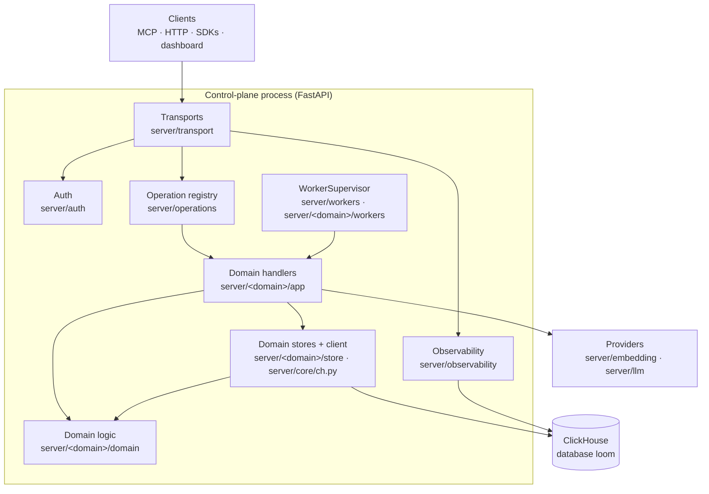
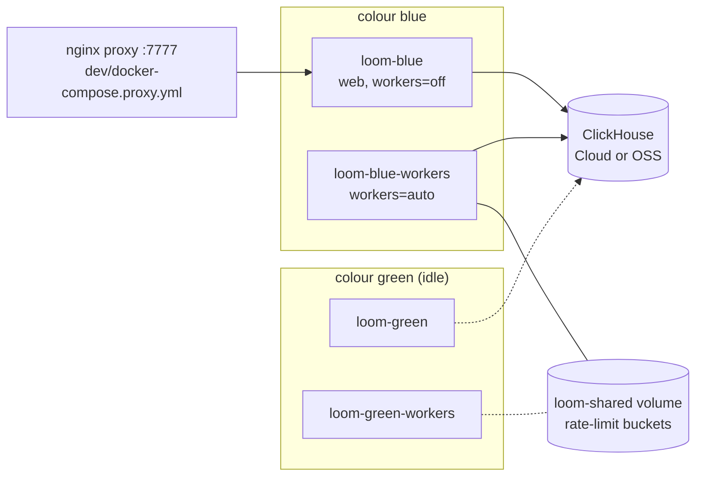

<!-- i18n: source=docs/architecture/system-overview.md blob=03fe3741579a4f9dee540c16ebdfbdab97cecb68 model=claude-sonnet-5-5 -->
> Esta página é uma tradução automática da [página em inglês](https://github.com/ClickHouse/loom/blob/main/docs/architecture/system-overview.md), que prevalece.
> Machine-translated from the [English page](https://github.com/ClickHouse/loom/blob/main/docs/architecture/system-overview.md), which is authoritative.

<a id="system-overview"></a>

# Visão geral do sistema

Loom é um servidor Python (uma aplicação FastAPI mais um supervisor de workers em segundo plano)
e ClickHouse, com Postgres como opção para o estado ativo de memória e conhecimento. Loom mantém
estado: tudo o que ele sabe (fatos e seus vetores, documentos, conversas, o
grafo de entidades, o índice de código, tarefas, auditoria, custo e progresso de exclusão) é armazenado no
ClickHouse, exceto que, com `LOOM_STORAGE_AUTHORITY=postgres`, o Postgres guarda a memória ativa,
o estado de conhecimento e os registros associados
([autoridade de armazenamento](storage-authority.md#the-tables)). Os processos do servidor não mantêm
estado durável próprio, então qualquer número deles pode atender ao mesmo deployment e uma
requisição pode chegar a qualquer um. As poucas peças de estado mantidas fora desses armazenamentos são
listadas em [Topologia de deployment](#deployment-topology).

O layout de armazenamento está em [ClickHouse](https://github.com/ClickHouse/loom/blob/main/docs/architecture/clickhouse.md).

<a id="goals-and-non-goals"></a>

## Objetivos e não objetivos

| Objetivos                                                                                                                         | Não objetivos                                                                                                              |
| --------------------------------------------------------------------------------------------------------------------------------- | -------------------------------------------------------------------------------------------------------------------------- |
| Um único mecanismo para todo tipo de estado (autoridade do ClickHouse): vetores, texto completo, arestas de grafo, séries temporais e ledgers. | Formatos de arquivo no servidor: `knowledge.add` recebe `content: str`; fazer o parsing é tarefa da CLI.                   |
| Uma única superfície de comunicação, declarada uma vez e servida da mesma forma via HTTP e MCP.                                   | Transações entre tabelas. As linhas derivadas se atualizam depois da gravação primária.                                    |
| Os processos do servidor não mantêm estado durável: para aumentar a capacidade web, basta executar mais deles.                    | Histórico bitemporal. A validade considera apenas o tempo de validade; o histórico de tempo de transação é o espelho de versões. |
| Toda linha é atribuível a um tenant (tupla de identidade), a um autor da escrita (`actor`) e a uma requisição (`log_comment`).    | Garantia de conformidade com a GDPR. O apagamento e o hash de auditoria são primitivas de engenharia.                      |
| Uma instalação sem chaves que inicia e responde, com os provedores falsos sendo informados.                                       |                                                                                                                            |

<a id="components"></a>

## Componentes



| Componente         | Código                                                | Função                                                                                                                                                                                                                                                                                                                                           |
| ------------------ | ----------------------------------------------------- | ------------------------------------------------------------------------------------------------------------------------------------------------------------------------------------------------------------------------------------------------------------------------------------------------------------------------------------------------ |
| Transportes        | `server/transport/http.py`, `server/transport/mcp.py` | Transformam uma requisição em uma chamada de operação. Ambos são gerados a partir do registro: toda op é `POST /v1/<name>` e a ferramenta MCP `loom_<name>` (os pontos viram sublinhados). A admissão compartilhada fica em `server/transport/gates.py`.                                                                                          |
| Registro de operações | `server/operations/`                               | Uma `Operation` por op (`base.py`): nome, modelos de entrada e saída, handler, `required_role`, `idempotent`, `audit`, `maturity` e flags de escopo; seu `budget_p99_ms` vem da tabela de orçamentos em `server/settings/catalog.py`. O `ALL_OPERATIONS` de `registry.py` reúne o `OPERATIONS` de cada grupo.                                    |
| Pacotes de domínio | `server/<domain>/`                                    | Um pacote por plano (`memory`, `code`, `tracker`, `knowledge`, `erasure`, `tasks`, `identity`, `insights`), cada um com `api/` (modelos de wire e declarações de `Operation`), `app/` (handlers e orquestração), `domain/` (lógica pura), `store/` (instruções ClickHouse e construtores de linhas) e `workers/`. Veja [organização do servidor](server-layout.md). |
| Cliente ClickHouse | `server/core/ch.py`                                   | O cliente único: pool de conexões, prazos, novas tentativas, atribuição de consultas. `server/memory/store/rows.py` contém os construtores de linhas de versão.                                                                                                                                                                                  |
| Workers            | `server/workers/`                                     | Loops em segundo plano declarados como linhas em `registry.py` (`_WORKERS`), cada um um módulo em `workers/` do seu domínio, executados por `supervisor.py`.                                                                                                                                                                                     |
| Auth               | `server/auth/`                                        | Verificação de JWT, revogação, autorização por papel e namespace, OIDC, o servidor OAuth e o autocadastro. Veja [segurança](https://github.com/ClickHouse/loom/blob/main/docs/architecture/security.md).                                                                                                                                         |
| Providers          | `server/embedding/`, `server/llm/`                    | Clientes plugáveis de embedder e de LLM, cada um com um fake determinístico. Veja [arquitetura de LLM](https://github.com/ClickHouse/loom/blob/main/docs/architecture/llm-architecture.md).                                                                                                                                                       |
| Observabilidade    | `server/observability/`                               | O registro por op (`loom.agent_events`), o fluxo de eventos em lote, linhas de auditoria, saúde dos providers, exportação para OpenTelemetry e Langfuse.                                                                                                                                                                                        |
| Painel             | `frontend/` (servido de `frontend/dist/` em `/`)      | Interface React sobre as mesmas ops HTTP. Um checkout sem build responde às suas páginas com 503.                                                                                                                                                                                                                                                |
| CLI                | `server/cli/`                                         | O comando `loom`: ações de operador (migrate, tokens, re-embed, doctor) e um cliente das ops. Veja a [referência da CLI](https://github.com/ClickHouse/loom/blob/main/docs/reference/cli.md).                                                                                                                                                     |

O registro é toda a superfície de wire. `GET /v1/operations` lista cada op com seu
orçamento e papel, e a [referência de operações](https://github.com/ClickHouse/loom/blob/main/docs/reference/operations.md) é gerada
a partir dele. Para adicionar uma op, defina os modelos, escreva o handler, declare a `Operation` e
acrescente-a à lista `OPERATIONS` do seu grupo
([adicionando uma operação](https://github.com/ClickHouse/loom/blob/main/docs/development/adding-an-operation.md)). Ambos os transportes a incorporam.

Algumas rotas HTTP não são ops do registro: `/v1/health`, `/v1/whoami`, `/v1/operations`,
`/v1/.well-known/jwks.json`, `/v1/.well-known/openid-configuration`, `/v1/knowledge.download`, `/v1/auth/login`, os auxiliares
`/v1/me/*` e `/v1/admin/*` do painel, e os endpoints OAuth e OIDC. A
[referência da API HTTP](https://github.com/ClickHouse/loom/blob/main/docs/reference/http-api.md) os lista.

<a id="dependency-direction"></a>

### Direção das dependências

```text
transports → operations → <domain>/api → <domain>/app → <domain>/store → server/core/ch.py
                                              ↘ <domain>/domain ↙
```

Os workers ficam ao lado dos transportes e chamam o `app` e o `store` do seu domínio. Os handlers
chamam os providers. Nada abaixo dos transportes importa um módulo de transporte. Qual pacote
pode importar qual, e as camadas dentro de um domínio, estão em [organização do servidor](server-layout.md);
`tests/unit/test_package_contracts.py` as faz valer.

`tests/unit/test_transport_layering.py` faz valer a regra dos transportes: ele falha quando
qualquer coisa fora de `server/transport/`, `server/cli/` e `server/main.py` importa
`server.transport`. Por isso as peças de que as camadas inferiores precisam ficam abaixo do transporte: os
conjuntos de ferramentas MCP (`server/operations/toolsets.py`), a verificação de bearer das rotas fora do registro
(`server/auth/bearer.py`), a variável de contexto de escopo de código (`server/code/domain/scope.py`),
o construtor de linhas do registro (`server/observability/ledger.py`), os orçamentos de latência
(`server/observability/budgets.py`) e os padrões do plano (`server/code/app/common.py`).

**Por quê:** só o transporte conhece os protocolos (códigos de status, frames JSON-RPC,
cabeçalhos). Assim, um handler pode ser chamado por HTTP, MCP, um worker ou um teste com o mesmo
modelo de entrada.

<a id="request-path"></a>

## Caminho da requisição

Os dois transportes executam as mesmas decisões de admissão, tomadas uma única vez em `server/transport/gates.py`.
Eles diferem na forma de ler credenciais e argumentos e de apresentar uma recusa:
o HTTP responde com um status e um corpo `detail`, o MCP com um resultado que carrega `isError`.

<a id="http"></a>

### HTTP

`build_router()` em `server/transport/http.py` adiciona uma rota `POST /v1/<op>` por op.
O `BodyLimitMiddleware` recusa primeiro um corpo acima de `LOOM_MAX_REQUEST_BYTES` (32 MiB) com 413;
0 desativa o limite. Cada requisição passa então por estas fases, em ordem (`_make_endpoint`). Uma
recusa encerra a requisição.

| Fase                 | Código                                 | Recusa                                                                                                                                                                                                                                                                                                                                                                                                 |
| -------------------- | -------------------------------------- | ------------------------------------------------------------------------------------------------------------------------------------------------------------------------------------------------------------------------------------------------------------------------------------------------------------------------------------------------------------------------------------------------------ |
| Início               | `_begin_request`                       | Nenhuma. Define `X-Request-Id` (o do chamador quando tem de 1 a 64 letras, dígitos, `.`, `_` ou `-`, senão um UUID novo), `X-Schema-Version` e a tag de consulta `"<op> <request_id>"`.                                                                                                                                                                                                                 |
| Verificar token      | `_extract_auth`                        | 401 `AUTH_INVALID` (ausente quando a autenticação está ativa, esquema desconhecido, token que falha); 503 `AUTH_UNAVAILABLE` até que a lista de revogação seja carregada.                                                                                                                                                                                                                              |
| Ler corpo            | `_read_body`                           | 400 `VALIDATION_FAILED` em JSON inválido; 422 `UNKNOWN_ARGUMENT` quando uma chave desconhecida de uma op de escrita é parecida com um de seus campos.                                                                                                                                                                                                                                                   |
| Preencher identidade | `gates.with_single_user_identity`      | Nenhuma. Em um servidor de usuário único, para uma chamada sem token: a org da instalação em toda op, exceto `code.*` e `tracker.*`, e seu namespace e o agente da op nas ops cotidianas de memória e busca ([quais ops](https://github.com/ClickHouse/loom/blob/main/docs/reference/http-api.md#request)); um namespace vazio ou `"-"` em qualquer outra op que exija um, exceto ops de code e tracker, é descartado, de modo que a validação o recusa como ausente. Somente HTTP. |
| Validar              | `_validate_payload`                    | 422 `VALIDATION_FAILED` indicando os campos.                                                                                                                                                                                                                                                                                                                                                           |
| Autorizar            | `_authorize` → `gates.authorize`       | 400 `IDENTITY_INCOMPLETE` (sem namespace ou org), 403 `AUTH_INSUFFICIENT`.                                                                                                                                                                                                                                                                                                                             |
| Vincular contexto, política | `_bind_context_and_policy`      | Define o contexto de autenticação e a execução no ledger (`X-Loom-Run-Id`); 403 `POLICY_FORBIDDEN` quando uma política de histórico nega no modo `enforce`.                                                                                                                                                                                                                                            |
| Limite de taxa       | `_rate_limit` → `gates.rate_limit`     | 429 `RATE_LIMITED` com `Retry-After`; cabeçalhos `X-RateLimit-*` em toda chamada limitada.                                                                                                                                                                                                                                                                                                             |
| Idempotência         | `_idempotency_gate`                    | Reenvia uma resposta armazenada (`X-Idempotent-Replay: true`), ou 409 `IDEMPOTENT_CONFLICT` quando a chave é reutilizada com um corpo diferente.                                                                                                                                                                                                                                                       |
| Handler              | `_run_handler`                         | A `HTTPException` do handler, o código e o status de um `LoomServerError`, ou 500 `INTERNAL_ERROR`.                                                                                                                                                                                                                                                                                                    |
| Após o sucesso       | `_finish_success`, `post_handler_rows` | Nenhuma. Linha do ledger, métricas, o corpo com `ignored_args`, depois as linhas de violação de orçamento, auditoria e idempotência.                                                                                                                                                                                                                                                                    |

Por que esta ordem:

- **Token antes do corpo.** Uma requisição anônima que a implantação recusa recebe o 401
  antes de seu corpo ser lido. Ela não deixa linha no ledger, não descobre erros de campo e não toca
  o bucket de limite de taxa de nenhum tenant.
- **Autorizar antes de limitar.** O limitador usa a org do token verificado
  (`gates._rate_limit_org`), nunca apenas um valor do corpo.
- **Idempotência após a admissão.** A chave de replay é restrita à org, ao subject e à op do chamador
  (`server/core/idempotency.py`, `scoped_key`). Um replay nunca chega a um chamador anônimo,
  a outro tenant ou a outra op.

**Gates que falham abertos.** A classificação de tráfego e o limitador de taxa são controles
de disponibilidade. Quando qualquer um deles lança uma exceção, a chamada é admitida e a falha é contada e registrada
no máximo uma vez por minuto (`gates._fail_open`). Autenticação e autorização falham fechadas.

**Argumentos desconhecidos.** Os modelos de entrada ignoram chaves desconhecidas, então `server/transport/arg_check.py`
as nomeia: a resposta traz `ignored_args` (e `did_you_mean` para um nome de campo
parecido), e o HTTP define `X-Loom-Ignored-Args`. Ambos listam primeiro qualquer campo que a op leu mas
decidiu não aplicar, depois as chaves não lidas. Uma op de escrita recusa uma correspondência próxima com 422
`UNKNOWN_ARGUMENT`. Chaves de identidade e chaves que o próprio transporte lê (`consumer`,
`traffic_class`, `explain`, a chave de idempotência) nunca são reportadas.

**Após o handler.** A linha do ledger traz a latência e o gasto de embedding e de LLM
da chamada. A linha de violação de orçamento (acima de `budget_p99_ms` × `LOOM_LATENCY_BUDGET_MULTIPLIER`),
a linha de auditoria (quando `op.audit`) e a linha de idempotência vão em uma única ida e volta
(`gather_best_effort`). Cada uma é de melhor esforço. Toda instrução ClickHouse da requisição
carrega `log_comment = "<op> <request_id>"` ([atribuição de consultas](https://github.com/ClickHouse/loom/blob/main/docs/architecture/clickhouse.md#query-attribution)).

<a id="mcp"></a>

### MCP

`POST /mcp` é JSON-RPC 2.0 (`server/transport/mcp.py`, `_handle_request`). Ele atende as
revisões de protocolo em `MCP_SUPPORTED_PROTOCOL_VERSIONS` (`mcp_config.py`); `initialize`
devolve a versão do cliente quando suportada e a mais recente caso contrário. Não há
eventos iniciados pelo servidor.

| Método                             | O que faz                                                                                                                                                                                           |
| ---------------------------------- | --------------------------------------------------------------------------------------------------------------------------------------------------------------------------------------------------- |
| `initialize`                       | Negocia a versão e retorna `instructions`: o primer, com as seções do perfil do chamador. O mesmo primer é o recurso `loom://primer`, o prompt `loom` e a ferramenta `loom_activate`.                |
| `tools/list`                       | O roster do toolset da conexão (depende da URL, nunca do chamador).                                                                                                                                 |
| `tools/call`                       | Uma chamada de op pelos mesmos gates do HTTP.                                                                                                                                                       |
| `prompts/*`, `resources/*`, `ping` | As superfícies do primer e a verificação de disponibilidade.                                                                                                                                        |

`LOOM_MCP_AUTH_MODE` decide quais métodos exigem um bearer: `required` (padrão, todo método
exceto notificações), `discovery_only` (apenas `tools/call`) ou `open`. Uma recusa carrega um
desafio `WWW-Authenticate` apontando para os metadados do recurso protegido, para que um
conector nativo encontre o servidor OAuth (`mcp_auth.py`).

`tools/list` mostra o roster escolhido por `LOOM_MCP_TOOLSET` (padrão `core`) ou `?toolset=`
(`server/operations/toolsets.py`). Um roster é apenas visibilidade: toda op continua chamável
pelo nome, exceto as ops em `_MCP_HIDDEN_OPS`, que o MCP não lista nem chama (o HTTP ainda
as atende). Os toolsets estão na [referência do MCP](https://github.com/ClickHouse/loom/blob/main/docs/reference/mcp.md). Três ferramentas
têm descritores escritos à mão: `loom_search` (a op `search.query`, apresentada como um resumo
em texto mais as seções enxutas), `loom_op` (chama qualquer op pelo nome pelo mesmo caminho;
`op: "help"` as lista, `server/transport/mcp_op.py`) e `loom_activate` (o primer,
a única ferramenta que não é uma op do registro).

`_call_tool` (`mcp_call.py`; a telemetria, a resposta e a resposta de falha em
`mcp_outcome.py`) executa estas fases em ordem:

1. **Resolver a ferramenta** (`_resolve_tool`). Uma ferramenta desconhecida ou oculta é um resultado
   `isError` dizendo o que usar no lugar.
2. **Vincular o chamador** (`_bind_caller_identity`). Gera o id da requisição, define a tag de consulta
   e preenche namespace e agente omitidos a partir do token e do padrão salvo do chamador.
   Argumentos explícitos prevalecem. As ops `code.*` usam por padrão o namespace de code da implantação. As
   leituras em `_MCP_CROSS_AGENT_READS` usam `*` como padrão para `agent`.
3. **Execução da sessão.** Uma execução implícita por (org, subject do token, `Mcp-Session-Id`), registrada no
   namespace padrão do chamador: uma escrita que não nomeia execução recebe o `run_id` da sessão,
   exceto `run.*`, que nomeia a própria execução, `code.*`, que age como a identidade de code da implantação,
   e `working_memory.*` e `conversation.update`, em que `run_id` delimita
   ou vincula a linha.
4. **Chave de idempotência.** Uma ferramenta idempotente aceita `_idempotency_key` (ou `idempotency_key`)
   em seus argumentos, removida antes da validação.
5. **Argumentos** (`_validated_input`). A recusa de argumento com erro de grafia, depois a validação. Uma
   falha é um resultado `isError` com os erros de campo, o campo provavelmente pretendido para
   cada chave desconhecida, os argumentos da op e um exemplo de chamada (`arg_feedback.py`).
6. **Autorizar** (`_authorize_call`), o gate compartilhado.
7. **Admissão** (`_admission_refusal`): classe de tráfego, política de histórico, limite de taxa. Em um 429
   com uma dica curta, o transporte espera uma vez e verifica de novo (no máximo
   `LOOM_MCP_RATELIMIT_RETRY_MAX_WAIT_S`).
8. **Replay de idempotência**, apenas para um chamador admitido.
9. **Handler.**
10. **Resposta.** `structuredContent` descarta detalhes de ranking e contabilidade
    (`lean_results.py`; `explain=true` os mantém) e carrega `ignored_args`.

**Recusas são resultados, falhas são erros.** Um 4xx diferente de 401 (`LOCKED`,
`PINNED_CONFLICT`, `BLACKLISTED`, `RESOURCE_NOT_FOUND`, um código de estado de tarefa, `RATE_LIMITED`)
volta como `isError: true` com o corpo estruturado (`mcp_refusals.py`), para que o cliente
veja a orientação. Um 401 e um 5xx (`OVERLOADED`, `BACKEND_TIMEOUT`, `SCHEMA_PENDING`) permanecem
erros JSON-RPC com o corpo e a dica de nova tentativa do HTTP.

Os passo a passo de uma escrita (`memory.set`) e de uma leitura (`memory.search`) estão na
[arquitetura de memória](memory-architecture.md).

<a id="roles-and-process-modes"></a>

## Papéis e modos de processo

<a id="roles"></a>

### Papéis

`Role` (`server/operations/base.py`) é ordenado como `VIEWER < WRITER < ADMIN < ORG_ADMIN <
PLATFORM_ADMIN`. Cada op declara seu `required_role`. Os papéis de um token flat se aplicam a todo
namespace que ele lê, e `loom.namespace_grants` pode elevar esse papel em um namespace, nunca
reduzi-lo. Os `ns_roles` de um token com escopo são autoritativos para os namespaces que eles nomeiam.
Grants e `ns_roles` carregam apenas `viewer`, `writer` ou `admin`; `ORG_ADMIN` e
`PLATFORM_ADMIN` existem apenas nos `roles` de um token flat. Veja
[segurança](https://github.com/ClickHouse/loom/blob/main/docs/architecture/security.md#authorization) e
[identidades e namespaces](https://github.com/ClickHouse/loom/blob/main/docs/concepts/identities-and-namespaces.md).

<a id="process-modes"></a>

### Modos de processo

Uma única imagem atende a todos os papéis. As configurações decidem o que um processo faz:

| Modo                | Configurações                                                                    | O que executa                                                                                         |
| ------------------- | -------------------------------------------------------------------------------- | ----------------------------------------------------------------------------------------------------- |
| All-in-one          | `LOOM_BACKGROUND_WORKERS=auto` (padrão)                                          | Camada web e os workers no processo que detém o lease do ClickHouse da implantação.                   |
| Réplica web         | `LOOM_BACKGROUND_WORKERS=off`                                                    | HTTP, MCP e o painel. Atualiza seu próprio snapshot de revogação e seu próprio keyring de assinatura. |
| Workers             | `LOOM_BACKGROUND_WORKERS=auto`, `LOOM_DEPLOYMENT=1`, `LOOM_SERVES_TRAFFIC=false` | O supervisor e seus workers; `/v1/health` continua respondendo.                                       |
| Servidor de branch / A-B | `LOOM_BOOT_MIGRATE=false`, `LOOM_INSTANCE_LABEL=<who>:<what>:<port>`        | Atende um ClickHouse compartilhado sem aplicar migrations; `auto` não executa workers nele.           |

`LOOM_WEB_WORKERS` define os processos uvicorn por contêiner (sem definir, a imagem inicia um por
CPU que o contêiner pode usar, no máximo um por GiB de memória e no máximo 8). Cada um executa o
lifespan completo; em `auto`, o lease da implantação escolhe o processo que executa os workers. `on`
não pega lease: cada processo executa sua própria cópia dos workers e, a menos que um processo `auto`
detenha o lease, os outros reportam `workers_lease_absent`. Um contêiner de workers executa `auto`.

**Eleição de líder.** `server/workers/leader.py` (`decide_supervisor`, `keep_lease`) elege
um supervisor por implantação por meio do ClickHouse: a chave `workers_supervisor` na tabela de
lock do Keeper `loom._migration_lock` (KeeperMap estrito, então, entre dois concorrentes, uma escrita
vence). A expiração é
julgada pelo relógio do servidor ClickHouse. O detentor renova a cada
`LOOM_SUPERVISOR_LEASE_TTL_S / 6` e para seus workers metade do TTL após sua última
renovação, ou quando uma renovação encontra outro detentor; quando o detentor morre, outro processo `auto`
assume o lease após `LOOM_SUPERVISOR_LEASE_TTL_S` (padrão 30 s). Os tempos
estão em [falha e recuperação](failure-and-recovery.md#background-workers). Uma parada graciosa o libera imediatamente, e é
assim que a nova cor de um par blue/green assume.

**Por que ClickHouse:** os processos que podem executar os workers abrangem contêineres e hosts,
e o ClickHouse é a única coisa que todos compartilham. Vários hosts podem executar `auto`; um executa os
workers ([capacidade](failure-and-recovery.md#background-workers)).

<a id="boot"></a>

## Inicialização

O `lifespan` em `server/main.py` roda em todo processo, nesta ordem (seus passos ficam em
`server/boot.py`):

1. **Regra de lançamento.** Um processo é o deployment (`LOOM_DEPLOYMENT=1`, definido pelos
   arquivos compose) ou carrega um `LOOM_INSTANCE_LABEL` não vazio; caso contrário, ele se recusa a iniciar. Um
   deployment que exige autenticação com o `LOOM_JWT_SECRET` de desenvolvimento versionado no repositório também se recusa
   (`require_real_signing_secret`); somente `LOOM_INSTANCE_LABEL=deploy:dev` é isento.
2. **Conectar** ao ClickHouse.
3. **Migrar** (`LOOM_BOOT_MIGRATE`, ativado por padrão). Todo processo obtém o lock de migração
   do deployment antes de aplicar: uma chave KeeperMap em `loom._migration_lock`
   (`server/core/schema/migrate_lease.py`). Um servidor sem Keeper, ou uma migração com falha,
   interrompe a inicialização. Com `LOOM_BOOT_MIGRATE=false`, o processo registra em log os arquivos pendentes e
   os informa em `/v1/health`. Sob a autoridade Postgres, lê o estado de células do deployment
   antes do primeiro heartbeat e da decisão de lease; uma falha na primeira leitura interrompe
   a inicialização (com migrações do Postgres pendentes, ele inicia bloqueado e não pronto até que uma leitura
   seja concluída) ([células](cells.md#the-tenancy-check-and-placement)).
4. **Iniciar o emissor de `agent_events`.**
5. **Namespace padrão.** Com a autenticação desativada, cria para o namespace configurado sua
   linha em `loom.namespaces`, a menos que o gate de célula recuse este processo.
6. **Eleger o líder dos workers.**
7. **Tarefas do líder.** Aplica as substituições de TTL de retenção onde diferem e registra os
   namespaces de tracker configurados.
8. **Estado de tokens e substituições.** Carrega o snapshot de tokens revogados
   (`server/auth/revocation.py`) e o chaveiro de assinatura (`server/auth/keyring.py`); todo
   processo atualiza ambos em seu próprio temporizador. Começa a adotar as substituições de runtime do admin
   (`loom.runtime_overrides`: limites de taxa, orçamentos de latência e configurações em tempo real) a cada
   `LOOM_RUNTIME_OVERRIDES_REFRESH_SECONDS`; o processo filho dos workers também as adota. A
   substituição de uma configuração em tempo real é aplicada sobre os `settings` do próprio processo, então o código a lê como
   `settings.<field>` ([configurações de runtime](https://github.com/ClickHouse/loom/blob/main/docs/operations/runtime-settings.md)).
9. **Iniciar os workers** no líder, e o loop de lease em `auto` (e em `on` sob
   a autoridade Postgres, onde o gate de célula os inicia e os para).
10. **Relatório de provedor.** Registra em log o provedor de LLM resolvido e sonda a dimensão do embedder.
11. **Recursos de vetor.** Sonda a configuração de leitura de códigos quantizados, os patch parts e se
    os inserts podem pular a construção do índice vetorial.
12. **Calibrar** os limiares de similaridade a partir do embedder (`LOOM_ADAPTIVE_THRESHOLDS`). Uma
    falha nunca derruba a inicialização; as configurações escalares são aplicadas.

O encerramento inverte essa ordem: para os loops, drena os workers (10 s), libera o lease, drena
a fila do Langfuse, o emissor de eventos e as escritas adiadas (linhas de exposição,
projeções pós-escrita, o stream de eventos). O cliente do ClickHouse desconecta por último.

`/v1/health` informa a acessibilidade do ClickHouse e uma lista `problems` (por exemplo, um provedor
falso). Ele responde 503 somente quando o ClickHouse está fora do ar;
`?include=workers,langfuse,otel,embedding_cache` adiciona verificações por subsistema.

<a id="background-processing"></a>

## Processamento em segundo plano

`WorkerSupervisor` executa uma task asyncio por worker habilitado, apenas no detentor do lease. Cada worker é uma linha `_Worker` em `server/workers/registry.py` com um flag de habilitação e um intervalo (`LOOM_<NAME>_ENABLED`, `LOOM_<NAME>_INTERVAL_SECONDS` na maioria dos casos). O supervisor escalona as primeiras execuções, cancela uma execução que passa do prazo, tenta novamente com backoff, marca cada consulta com `worker.<name>` na classe de tráfego `background` e registra o estado de cada execução em `loom.worker_status` (`GET /v1/admin/workers.status`). Consulte [falha e recuperação](failure-and-recovery.md#worker-supervision) e a [referência de workers](https://github.com/ClickHouse/loom/blob/main/docs/reference/workers.md) gerada.

<a id="deployment-topology"></a>

## Topologia de implantação



- **Os processos do servidor não mantêm estado durável.** O estado compartilhado entre réplicas (revogações, chaves de assinatura, substituições em tempo de execução, contagens de tentativas de login, marcas de escrita do grafo, o lease do supervisor, checkpoints de remoção, a versão da blacklist, o cache de idempotência sob a autoridade padrão, a autoridade registrada) e os originais dos documentos enviados ficam no ClickHouse; os bytes dos documentos gravados com `LOOM_DOCUMENT_OBJECT_STORE=s3` ficam, em vez disso, em um bucket compatível com S3. Sob a autoridade Postgres, o Postgres guarda as tabelas listadas em [autoridade de armazenamento](storage-authority.md#the-tables), entre elas o cache de idempotência, seu próprio registro de remoção e uma cópia da autoridade registrada. Um novo Loom com o mesmo ClickHouse (e Postgres, sob essa autoridade), a mesma configuração de env e o mesmo `LOOM_JWT_SECRET`, além do bucket enquanto houver linhas que apontem para objetos nele, recupera todos os recursos.
- **Estado fora do ClickHouse e do Postgres.** Os espelhos git do plano de código em `var/code_repos` (um cache: um host sem eles clona novamente) e os buckets de rate limit no volume `loom-shared`, nenhum dos quais é o sistema de registro; e, enquanto qualquer linha do catálogo apontar para um objeto nele, o `LOOM_DOCUMENT_S3_BUCKET`, que guarda os bytes desses originais.
- **Dois contêineres, uma imagem.** O `dev/docker-compose.cloud.yml` executa o `loom-server` (`LOOM_BACKGROUND_WORKERS=off`) e o `loom-workers` (`auto`: executa os workers enquanto detém o lease), de modo que uma passagem longa dos workers nunca divide o event loop com as requisições.
- **Par blue/green.** O `dev/docker-compose.colour.yml` executa duas cores atrás do proxy; o `./redeploy.sh` inicia a cor ociosa, espera pela verificação de saúde, troca o upstream e para a antiga. O rollback não exige nenhuma etapa de schema, porque toda migração é aditiva. Veja [implantação](https://github.com/ClickHouse/loom/blob/main/docs/operations/deployment.md) e [atualizações](https://github.com/ClickHouse/loom/blob/main/docs/operations/upgrades.md).
- **ClickHouse.** ClickHouse Cloud ou um servidor OSS autogerenciado. Um único nó OSS não tem alta disponibilidade.

<a id="foundational-shapes"></a>

## Formas fundamentais

Quatro formas sustentam a estrutura. Alterar uma delas é uma mudança de design, discutida no pull request
e nesta página.

<a id="one-engine-clickhouse"></a>

### Um único mecanismo: ClickHouse

Sob a autoridade padrão do ClickHouse, todo plano (fatos e vetores, índices BM25 e de token,
o grafo de entidades percorrido com uma consulta limitada por salto, o índice de código,
ledgers e custo) é um conjunto de tabelas do ClickHouse. Com
`LOOM_STORAGE_AUTHORITY=postgres`, o estado vivo de memória e conhecimento fica no Postgres,
o que troca um único backup e um único domínio de consistência por escritas transacionais de memória
([por que dois armazenamentos](storage-authority.md#why-two-stores)); o Porquê e o Custo abaixo valem para
o padrão.

**Por quê:** um backup, uma fronteira de acesso, uma linguagem de consulta para recuperação e análise,
e joins entre a memória e sua telemetria sem um job de sincronização. A recuperação híbrida roda como
SQL junto aos dados. Um armazenamento de vetores separado adicionaria um segundo domínio de consistência,
escritas duplas e fusão por saltos de rede.

**Custo:** não há atualização transacional de linhas. As tabelas mutáveis são `ReplacingMergeTree` lidas com
`FINAL`, de modo que todo caminho de escrita carrega todas as colunas adiante
([a regra de escrita do FINAL](https://github.com/ClickHouse/loom/blob/main/docs/architecture/clickhouse.md#the-final-write-rule)), e as escritas entre tabelas não
são atômicas ([falha e recuperação](failure-and-recovery.md)).

<a id="the-identity-tuple"></a>

### A tupla de identidade

Toda linha de memória carrega `(org, namespace, agent, user_id, session_id)`: os três primeiros
são obrigatórios, os demais têm `'-'` como padrão. Toda outra tabela de tenant carrega pelo menos
`(org, namespace)`. Nas escritas de memória, o servidor registra `actor` (`human:<subject>` /
`process:<subject>`, `server.memory.app.provenance.writer_actor`) e `source_class`
(`server.memory.domain.provenance.source_class_for`), que nunca vêm do corpo, exceto um rebaixamento declarado para `derived`,
`external` ou `imported`.

**Por quê:** tenancy, autoria e proveniência são colunas, então toda leitura filtra pela chave de ordenação
e toda linha diz de quem é e de onde veio, sem um join. **Custo:** um novo
caminho de escrita que esqueça `actor` ou `source_class` gera uma linha sem atribuição.

<a id="per-row-content-hash-audit"></a>

### Auditoria por hash de conteúdo em cada linha

Toda escrita auditada deixa uma linha em `loom.audit_log` cujo `row_hash` é o SHA-256 do seu
JSON canônico (`server/observability/audit.py`). Checkpoints a cada hora
(`loom.audit_checkpoints`) selam a contagem de linhas de cada janela fechada e um digest dos seus hashes,
cada um encadeado ao checkpoint anterior.

**Por que por linha:** uma cadeia de linha para linha se bifurca sob escritores concorrentes, e o Loom roda
vários processos de servidor. Hashes por linha detectam adulteração de conteúdo; a cadeia de checkpoints,
selada por um único worker, detecta linhas excluídas, modificadas e tardias em janelas seladas. **Custo:**
uma linha removida antes de a sua janela ser selada não deixa rastro. Veja
[segurança](https://github.com/ClickHouse/loom/blob/main/docs/architecture/security.md#audit-log).

<a id="five-belief-revision-operations"></a>

### Cinco operações de revisão de crenças

O ciclo de vida da memória tem cinco operações: Expandir (`memory.set`), Revisar
(`memory.update_by_id`), Contrair (`memory.delete`), Reforçar (`memory.pin`) e Recusar
(`blacklist.add`). É uma lente de design, não um enum de código: tudo no plano de memória que
não corresponda a uma delas é suspeito. Mesclar, mover e ocultar ou remover conteúdo sensível (redact) são expressos como
combinações dessas operações. Veja [memória](https://github.com/ClickHouse/loom/blob/main/docs/concepts/memory.md).

<a id="invariants"></a>

## Invariantes

- Uma op existe em HTTP e MCP se, e somente se, estiver em `ALL_OPERATIONS` (o MCP pode ocultá-la;
  o HTTP continua atendendo).
- Nada fora de `server/transport/`, `server/cli/` e `server/main.py` importa
  `server.transport`.
- Nenhum gate é executado depois de uma recusa. Uma requisição anônima nunca chega ao parser de corpo, ao
  ledger, ao limitador nem ao cache de replay quando a autenticação está ativada.
- O limitador de taxa usa como chave a org do token verificado. Um replay só é servido ao
  chamador, à org e à op que o produziram.
- A autenticação e a autorização falham de forma fechada; a classificação de tráfego e o limite de taxa
  falham de forma aberta, com contagem.
- Via MCP, uma recusa é um resultado com `isError: true`; apenas 401 e 5xx são erros
  JSON-RPC.
- Um processo é o próprio deployment ou carrega um `LOOM_INSTANCE_LABEL`. Uma migration de boot com falha
  o interrompe antes de qualquer worker iniciar.
- No máximo um processo do deployment detém o lease de supervisor sob `auto`.
- O ClickHouse é o sistema de registro de toda linha do plano de memória.
- O servidor, e não o chamador, define `actor` e `source_class` nas gravações de memória.

<a id="source-entry-points"></a>

## Pontos de entrada no código-fonte

| O quê                           | Onde                                                                                                                 |
| ------------------------------- | -------------------------------------------------------------------------------------------------------------------- |
| App, ciclo de vida, verificação de saúde | `server/main.py`; as etapas de boot e shutdown do ciclo de vida em `server/boot.py`; `GET /v1/health` em `server/health.py` |
| Declaração de operação          | `server/operations/base.py` (`Operation`, `Role`); registro em `server/operations/registry.py`                       |
| Rota HTTP e fases               | `server/transport/http.py` (`build_router`, `_make_endpoint`); `server/transport/post_rows.py` (`post_handler_rows`) |
| Admissão compartilhada          | `server/transport/gates.py`                                                                                          |
| Argumentos desconhecidos        | `server/transport/arg_check.py`, `server/transport/arg_feedback.py`                                                  |
| Cache de idempotência           | `server/core/idempotency.py`                                                                                         |
| Despacho e recusas do MCP       | `server/transport/mcp.py`, `mcp_call.py` (`_call_tool`), `mcp_op.py`, `mcp_refusals.py`                              |
| Cliente ClickHouse              | `server/core/ch.py` (`get_client`, `set_query_tag`)                                                                  |
| Workers e líder                 | `server/workers/registry.py`, `supervisor.py`, `leader.py`                                                           |
| Lease de migração               | `server/core/schema/migrate.py`, `server/core/schema/migrate_lease.py`                                               |
| Verificação de camadas          | `tests/unit/test_transport_layering.py`                                                                              |

<a id="related"></a>

## Relacionados

- [ClickHouse](https://github.com/ClickHouse/loom/blob/main/docs/architecture/clickhouse.md): tabelas, engines, índices e migrações.
- [Arquitetura de memória](memory-architecture.md): os caminhos de escrita e de leitura.
- [Falha e recuperação](failure-and-recovery.md): novas tentativas, reparo e capacidade.
- [Segurança](https://github.com/ClickHouse/loom/blob/main/docs/architecture/security.md): o que o token e as barreiras de autorização verificam.
- [Implantação](https://github.com/ClickHouse/loom/blob/main/docs/operations/deployment.md): os procedimentos por trás da topologia.
