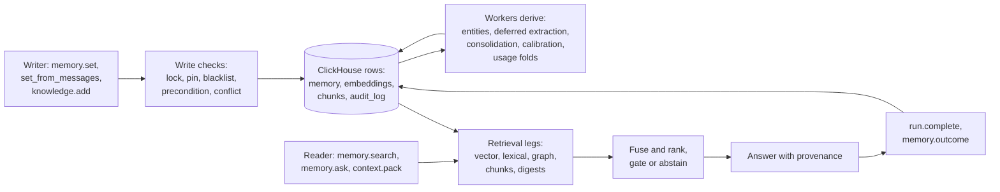
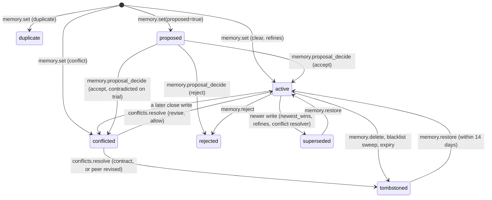

<!-- i18n: source=docs/concepts/memory.md blob=46b7e25492e9b562efacbe206c873ee4acd53694 model=claude-sonnet-5-5 -->
> Esta página é uma tradução automática da [página em inglês](https://github.com/ClickHouse/loom/blob/main/docs/concepts/memory.md), que prevalece.
> Machine-translated from the [English page](https://github.com/ClickHouse/loom/blob/main/docs/concepts/memory.md), which is authoritative.

<a id="memory"></a>

# Memória

Uma memória é uma afirmação que um agente deve conseguir encontrar de novo: "os deploys acontecem às terças-feiras", "a equipe de pagamentos é responsável pelo serviço de faturamento". O Loom armazena cada afirmação como uma linha em `loom.memory`, sob uma chave legível, com informações sobre quem a escreveu, quando ela era verdadeira, de onde veio e se alguém a validou. Esta página explica a linha, como uma escrita é avaliada em relação ao que já está armazenado e como as linhas mudam ao longo do tempo.
[Recuperação e ranqueamento](https://github.com/ClickHouse/loom/blob/main/docs/concepts/retrieval-and-ranking.md) explica como as linhas são encontradas.

<a id="rows-in-clickhouse"></a>

## Linhas no ClickHouse

Memórias, chunks de documentos, turnos de conversa, arestas de entidades, símbolos de código, execuções, entradas de auditoria e solicitações de apagamento são todos linhas no ClickHouse, criadas por migrações numeradas que o servidor aplica na inicialização. Sob a
[autoridade de memória no Postgres](../architecture/storage-authority.md#why-two-stores),
o Postgres guarda o estado ativo de memória e conhecimento, e o ClickHouse mantém os vetores, a busca e o histórico. Os originais dos documentos enviados também são linhas do ClickHouse
(`loom.document_blobs`), a menos que a implantação mantenha seus bytes em um bucket compatível com S3. Fora do ClickHouse, do Postgres e desse bucket, o Loom mantém os espelhos git do índice de código, um cache dos remotos que o ClickHouse registra, e os buckets de limite de taxa em um volume compartilhado.

- **A tupla de identidade lidera as chaves de ordenação.** `loom.memory` é ordenada por
  `(org, namespace, agent, user_id, session_id, memory_key)`, então restringir uma leitura a um namespace é um intervalo da chave primária; um usuário só a restringe totalmente sob um agente nomeado, e uma sessão só sob um agente e um usuário nomeados.
  [Identidades e namespaces](https://github.com/ClickHouse/loom/blob/main/docs/concepts/identities-and-namespaces.md) descreve a tupla.
- **Um único mecanismo.** Sob a autoridade padrão do ClickHouse, a busca vetorial, a busca lexical, a travessia do grafo, os filtros, a auditoria e o apagamento são SQL sobre as mesmas linhas, sem um segundo armazenamento para manter sincronizado. O custo é que toda leitura é uma consulta, e não um acesso chave-valor. Sob a autoridade do Postgres, leituras pontuais (por chave ou id, fora de um replay com `as_of`) são respondidas pelo Postgres.
- **Uma escrita é uma nova versão.** As tabelas de memória são `ReplacingMergeTree(version)` lidas com `FINAL`. Uma revisão, tombstone, fixação ou restauração insere uma nova linha de versão.

<a id="the-write-derive-read-loop"></a>

## O ciclo de escrita, derivação e leitura



1. **Escrita.** `memory.set` executa suas verificações ([abaixo](#how-a-write-is-judged)), gera o embedding do valor de forma inline e insere a linha da memória, a linha do embedding, chunks literais para valores longos e uma linha de auditoria apenas com hash. Se o embedding inline falhar, a chamada falha e nada é gravado.
   `memory.set_from_messages` faz o LLM escolher os fatos duráveis de uma transcrição e grava pelo mesmo caminho em lote.
2. **Derivação.** Os workers adicionam o que é lento demais para o caminho de escrita: tags de entidade (`entity_extractor`), extração adiada (`extraction_queue`), fatos consolidados, recalibração do gate e o uso incorporado aos sinais de ranqueamento (`usage_fold`). As linhas derivadas carregam `source_class=derived`.
3. **Leitura.** `memory.search` executa várias etapas (vetorial, lexical, grafo de entidades, chunks literais, resumos de sessão), as combina, ranqueia e retorna resultados ou se abstém. `memory.ask` escreve uma resposta fundamentada; `context.pack` monta um bloco de prompt com orçamento definido.
4. **Retroalimentação.** Uma execução que indica as memórias em que se baseou (`run.complete` `memories_used`, ou `memory.outcome`) credita essas memórias; um resultado ruim registra dano. Isso se torna um termo de ranqueamento limitado e com decaimento. Ele nunca exclui uma linha nem a coloca abaixo da sua relevância.

O ciclo tem consistência eventual. Uma leitura logo após uma escrita encontra o fato por meio do embedding inline; entidades e fatos extraídos chegam após a próxima passada do worker.

<a id="the-loommemory-row"></a>

## A linha `loom.memory`

Uma linha é uma versão de uma memória.

| Grupo       | Colunas                                                                         | Decide                                                              |
| ----------- | ------------------------------------------------------------------------------- | ------------------------------------------------------------------- |
| Identidade  | `org`, `namespace`, `agent`, `user_id`, `session_id`, `run_id`                  | Quem pode lê-la e quem a escreveu                                   |
| Endereço    | `memory_key`, `memory_id`                                                       | Como um chamador a nomeia (key) e como o Loom nomeia uma linha (id) |
| Conteúdo    | `value`, `memory_type`, `tags`, `entities`, `files`, `confidence`               | O que ela diz e como é classificada                                 |
| Ciclo de vida | `status`, `pinned`, `conflict_with`, `duplicate_of`, `superseded_by`, `version` | Se ela é servida e o que a substituiu                               |
| Tempo       | `created_at`, `updated_at`, `valid_at`, `valid_to`, `invalid_at`, `expires_at`  | Quando foi escrita, quando era verdadeira, quando saiu de serviço   |
| Proveniência | `actor`, `source_class`, `content_sha256`, `verified_by`, `verified_sha256`     | Quem a escreveu, como o Loom a aprendeu, se alguém a atestou        |
| Proteções   | `lock_mode`, `lock_until`, `sensitivity`, `on_expire`                           | Quais escritas ela recusa e como é lida                             |

A lista completa de colunas está na [referência do schema](https://github.com/ClickHouse/loom/blob/main/docs/reference/schema.md). Uma
memória pesquisável também tem uma linha em `loom.memory_embeddings`: vetores para o valor e para a chave,
cópias do trecho em minúsculas, com stemming e lematizadas para correspondência lexical, e as
flags `source_class` e `verified` que o ranker lê.

<a id="keys"></a>

## Chaves

Uma chave nomeia um atributo de um sujeito, como um caminho legível `<scope>/<kind>/<id>`:

```
sre/case/1234/evidence/dns-sidecar
project/loom/deploy-window
user/preferences/editor
```

- **Um fato por chave.** As verificações de conflito, a substituição e o histórico funcionam por chave. Uma chave que guarda uma lista de fatos não relacionados não pode ser revisada em parte.
- **Uma revisão reescreve a mesma chave.** O Loom mantém todas as versões, então uma cópia numerada (`…-v2`) ou uma chave criada a partir de um hash do valor apenas esconde a revisão. Chaves criadas por hash são o achado `hash_keys` de `namespace.audit`.
- **Facetas vão em `tags` e `entities`,** não na chave.

A identidade de armazenamento é `(org, namespace, agent, user_id, session_id, memory_key)`: a mesma chave gravada por dois agentes ou em duas sessões resulta em duas linhas. Sob a política de namespace `newest_wins`, a gravação mais recente de uma chave aposenta toda linha ativa mais antiga com essa chave no namespace, não importa quem a gravou. A extração gera as chaves a partir do sujeito e do atributo, nunca do valor, de modo que uma sessão posterior que declare o mesmo atributo cai na mesma chave. Sob `auto_reinforce` e `manual_review`, o resolvedor de conflitos julga as linhas de uma mesma chave que duas sessões do mesmo usuário gravaram (não o usuário anônimo `-` nem um user_id enviado vazio, cujas sessões são tarefas separadas), seja por gravação pontual ou em lote, como julga qualquer par próximo: ele aposenta a linha mais antiga de uma atualização da qual tem certeza (exceto sob `manual_review`), sinaliza uma contradição para revisão e deixa ativos dois fatos diferentes sob uma chave reutilizada. Sob `append_only`, nada é julgado.

<a id="memory-types"></a>

## Tipos de memória

`memory_type` é uma string livre, com padrão `semantic`. Alguns valores mudam a forma como a linha é
armazenada e encontrada (`server/memory/domain/memory_types.py`):

| Tipo                   | Embedding | Na busca sem filtro | Use para                                                          |
| ---------------------- | --------- | ------------------- | ----------------------------------------------------------------- |
| `semantic` (padrão)    | sim       | sim                 | Fatos duradouros.                                                 |
| `preference`           | sim       | sim                 | Preferências que devem ter destaque na recuperação.               |
| `procedural`           | sim       | sim                 | Procedimentos (`procedure.*`).                                    |
| `reflection`           | sim       | não                 | Lições aprendidas em execuções; leia com `memory_type="reflection"`. |
| `episodic`             | não       | não                 | Eventos de sessão reproduzidos por recência.                      |
| `profile`              | não       | não                 | Contexto sempre carregado, obtido por label (`profile.*`).        |
| qualquer outro (`decision`) | sim  | sim                 | Tipos de domínio podem ser pesquisados por padrão.                |

- **Reflexões ficam ocultas** da busca sem filtro e de `memory.ask`: uma lição sobre um
  processo não é uma afirmação sobre o mundo.
- **Uma escrita `procedural`** cujo valor não seja um corpo de procedimento (um `situation`
  não vazio e pelo menos dois `steps`) é armazenada como `semantic`, com a tag `retyped_from:procedural`,
  e a resposta informa isso em `retyped_from`.
- **Sensibilidade.** Uma linha com `sensitivity="high"` nunca recebe embedding, portanto nenhuma etapa de busca
  a encontra. Ela só pode ser lida pela chave, e essa leitura é auditada. Com `sensitivity`
  não definido, o servidor detecta formatos de credenciais, números de cartão, números de Social Security dos EUA
  e PINs informados (`high`), além de formatos de email, telefone e IBAN (`medium`)
  (`LOOM_MEMORY_SENSITIVITY_AUTODETECT`).

<a id="status"></a>

## Situação

| Situação     | Significado                                                                | Servido por padrão        |
| ------------ | -------------------------------------------------------------------------- | ------------------------- |
| `active`     | A crença vigente.                                                          | sim                       |
| `conflicted` | Próxima de uma linha par, mas dizendo algo diferente; ligada por `conflict_with`. | sim                |
| `duplicate`  | Quase idêntica a uma linha canônica (`duplicate_of`), que responde por ela. | não (`include_duplicates`) |
| `superseded` | Uma linha posterior a substituiu (`superseded_by`, encerrada em `invalid_at`). | não (`include_superseded`) |
| `proposed`   | Um fato em teste, decidido com `memory.proposal_decide`.                   | não (`include_proposed`)  |
| `rejected`   | Marcada como incorreta (`memory.reject`, ou uma proposta rejeitada).       | não                       |
| `tombstoned` | Excluída por quem a escreveu (`memory.delete`).                            | não                       |

O conjunto servido é definido em um único lugar, em `server/memory/domain/temporal_sql.py` (`SERVED_STATUSES`). Uma
linha em conflito continua sendo servida: ocultar um dos lados de uma contradição faria o armazenamento
responder com confiança usando um fato sobre o qual ele tem motivos para duvidar.

<a id="how-a-write-is-judged"></a>

## Como uma escrita é julgada

Cinco operações cobrem o ciclo de vida da memória:

| Lente      | Operação              | Efeito                                                                                   |
| ---------- | --------------------- | ---------------------------------------------------------------------------------------- |
| Expandir   | `memory.set`          | Aprende um fato sob uma chave.                                                           |
| Revisar    | `memory.update_by_id` | Corrige uma linha por id (`memory.update` faz o mesmo por chave).                        |
| Contrair   | `memory.delete`       | Marca uma chave com tombstone. `memory.restore` a revive até 14 dias após a exclusão.    |
| Reforçar   | `memory.pin`          | Armazena e fixa: nenhuma escrita posterior que não fixe a si mesma a substitui.          |
| Recusar    | `blacklist.add`       | Recusa toda escrita futura que corresponda a uma substring ou regex.                     |

Um `memory.set` pesquisável executa estas verificações, em ordem:

1. **Proteções de lock e pin** na linha sob a chave. `memory.lock` (`read_only` ou
   `no_delete`) responde 423 `LOCKED`. Um valor alterado sob uma chave fixada é 409
   `PINNED_CONFLICT`. Uma repetição idêntica byte a byte passa por todas as proteções.
2. **Blacklist.** Um valor que corresponda a um padrão registrado é 422 `BLACKLISTED`; em uma
   escrita em lote, a entrada é ignorada. As réplicas mantêm os padrões em cache e consultam
   uma tabela de versão de uma linha (`loom.blacklist_version`), então um novo padrão chega a
   todas as réplicas em segundos.
3. **Pré-condição.** `if_match_sha256` faz a escrita ser aplicada somente se o hash da linha
   ativa ainda corresponder; caso contrário, 409 `PRECONDITION_FAILED`. O hash atual vem em
   toda resposta de `memory.get`, `memory.get_by_id` e `memory.set` (`content_sha256`).
4. **Repetição.** Um valor idêntico byte a byte ao da linha ativa grava uma nova versão que
   carrega o `reinforcement_count + 1` da linha ativa. O caminho em lote (`memory.bulk_set`,
   usado por `set_from_messages`) trata qualquer linha ativa com o mesmo hash em
   `(org, namespace, agent, user_id)` como o fato (`LOOM_MEMORY_BULK_DEDUP_SCOPE=identity`).
5. **Busca de pares e veredito.** Linhas ativas do mesmo `memory_type` cujo embedding está
   próximo do novo valor são **pares**, comparados do mais próximo ao mais distante; uma
   escrita que informa seu `user_id` toma os pares somente das linhas desse usuário
   ([como uma escrita é julgada](https://github.com/ClickHouse/loom/blob/main/docs/features/memory/conflicts-and-refusal.md#how-a-write-is-judged)):
   - mesma forma canônica (minúsculas, pontuação removida, espaços colapsados) →
     `merge`: nada é gravado, o par é reforçado, `merged_into_key` o nomeia;
   - um par fixado próximo → `rejected`, 409 `PINNED_CONFLICT` (sob um token de todo o
     namespace, uma escrita que informa seu usuário e repete o valor fixado de outro usuário
     ou compartilhado é gravada);
   - sob `newest_wins`, um par que declara o mesmo sujeito e predicado com um objeto
     diferente → `refines`: o par é retirado, a menos que seu `valid_at` seja posterior ao da
     nova linha, o que responde `conflict`;
   - cosseno igual ou acima do limiar de duplicata, com as mesmas palavras de conteúdo e sem
     valor divergente (número, hora, quantia ou unidade; "27:10" / "26:30") →
     `duplicate`;
   - cosseno igual ou acima do limiar de conflito, mas diferente → `conflict`, ambas as
     linhas `conflicted`;
   - nenhum par próximo → `clear`.
6. **Inserção** em `loom.memory` e `loom.memory_embeddings`, substituição (supersession),
   projeção de entidades e uma linha apenas com hash em `loom.audit_log`.

Um tipo não pesquisável ou uma linha de sensibilidade `high` pula a busca de pares: não tem
embedding para comparar. `dry_run=true` executa todas as verificações e não grava nada, o que
responde "fato novo, repetição ou contradição?" antes de você se comprometer com uma chave. A
resposta traz `conflict_verdict`, até cinco `peers` e uma dica `next`.

- **Limiares.** Com `LOOM_ADAPTIVE_THRESHOLDS` ativado e um embedder real, os limiares de
  conflito e de duplicata vêm da distribuição de similaridade do próprio embedder na
  inicialização (`server/memory/app/embedder_calibration.py`). Os escalares
  `LOOM_CONFLICT_THRESHOLD` (0.85) e `LOOM_DUPLICATE_THRESHOLD` (0.97) são o fallback. Um
  namespace ou tipo de memória pode fixar o seu; `calibration.get` informa qual está em vigor.
- **O resolvedor de conflitos.** O cosseno diz que duas afirmações tratam da mesma coisa, não
  se elas concordam. Um worker exclusivo do líder julga, depois que a escrita é gravada, cada
  escrita que tem um par próximo, com uma chamada de LLM por linha: ele retira a linha mais
  antiga de uma atualização da qual tem certeza sob o padrão `auto_reinforce` e sob
  `newest_wins` (o valor antigo continua legível com `include_superseded` e `as_of`), sinaliza
  uma contradição e limpa um sinal falso
  ([conflitos](https://github.com/ClickHouse/loom/blob/main/docs/features/memory/conflicts-and-refusal.md#the-conflict-resolver)).
  Nenhum veredito sobre a própria escrita chama um LLM.
- **Escopo de execução.** Uma escrita sob um `run_id` cuja correspondência canônica pertence a
  outra execução é armazenada como `duplicate`, não mesclada, de modo que uma leitura com
  escopo de execução ainda a encontre.
- **Política do namespace.** `default_conflict_policy` decide o que uma contradição faz
  (`auto_reinforce`, `manual_review`, `newest_wins`, `append_only`).

`memory.update`, `memory.update_by_id` e `memory.bulk_set` executam a mesma verificação. Os
detalhes dos vereditos, as políticas, a fila de revisão e `conflicts.resolve` estão em
[conflitos e recusa](https://github.com/ClickHouse/loom/blob/main/docs/features/memory/conflicts-and-refusal.md).

**Pins protegem o que o usuário disse.** Uma linha fixada nunca é substituída por uma escrita
que não fixe a si mesma, seja por chave, seja por um valor próximo sob outra chave. Para
alterá-la, use `memory.update` (mantém o pin) ou `memory.pin` (fixa de novo).
`memory.for_file` lista as linhas fixadas primeiro; nenhuma outra leitura ordena pelo pin.

**A consolidação preserva a linhagem.** `memory.consolidate` (e o worker de consolidação,
quando um namespace opta por ele) mescla fragmentos sobre um mesmo assunto em linhas
canônicas com `source_class='derived'` e grava uma linha em `loom.memory_belief_sources` por
fonte (`support_type='derived_from'`). Excluir uma fonte retira uma linha consolidada quando
nenhuma de suas fontes sobrevive e a rebaixa para `conflicted` quando alguma sobrevive
(`dependents_tombstoned`, `dependents_downgraded` na resposta de `memory.delete`).

<a id="a-memorys-lifecycle"></a>

### O ciclo de vida de uma memória



Toda seta é uma nova versão; a antiga permanece em `loom.memory_versions`.

<a id="tags-entities-and-files"></a>

## Tags, entidades e arquivos

- `tags` são rótulos livres (`case:1234`, `kind:evidence`). Uma busca filtra por elas
  (`tags`), dá peso a elas (`tags_soft`) ou as rebaixa (`demote_tags`). O `tag_registry` de um namespace
  pode associar a uma tag uma política de retenção, de deduplicação e de conflito. As tags mantêm a
  caixa em que foram escritas: `memory.list` e `knowledge.list` as comparam sem diferenciar maiúsculas de minúsculas,
  e todos os outros filtros de tag, incluindo `memory.search` e `memory.apply`, as comparam
  exatamente.
- `entities` são as coisas nomeadas que o valor menciona, armazenadas na forma canônica em que a busca
  as lê (em minúsculas; artigos, possessivos e pontuação removidos; o substantivo principal
  no singular), de modo que `Billing Services` e `billing service` são uma só entidade. Quem escreve pode passá-las;
  caso contrário, o worker `entity_extractor` as preenche. Elas alimentam o peso por entidade
  e o [grafo de entidades](https://github.com/ClickHouse/loom/blob/main/docs/features/entity-graph.md).
- `files` são caminhos do repositório sobre os quais a memória trata; `memory.for_file` os serve antes
  de uma edição desses arquivos.

`memory.for_file` renderiza uma linha por memória. Uma decisão ou uma restrição é impressa inteira,
até o limite abaixo, e não conta contra o `token_budget` da requisição (300
tokens por padrão); as demais linhas ficam sujeitas a ele, cortadas em uma linha de 220 caracteres. Uma
linha que não cabe é deixada de fora por inteiro, enquanto as linhas seguintes ainda têm a sua vez,
e uma linha final `- … <n> more`, que também conta contra o orçamento, informa quantas
foram deixadas de fora e como listá-las. O cabeçalho e o rodapé de remoção são sempre
impressos, e a linha `… more` sempre que uma linha é deixada de fora; por isso um orçamento menor que esses itens pode ser excedido.

Decisões e restrições compartilham um único limite, `memory_for_file_whole_tokens` (1,500
tokens, cerca de 6,000 caracteres), de modo que um arquivo regido por dezenas delas não consiga inundar o
prompt. Elas são impressas na ordem do bloco; uma que ultrapassaria o limite é deixada de fora,
e as seguintes que ainda couberem são impressas. Uma linha final conta as que ficaram de fora e
nomeia as cinco primeiras chaves, cada uma lida com `memory.get` (no namespace que ela nomeia, para uma
linha de equipe) ou encontrada com `loom_search`. Uma linha deixada de fora junto com a linha mais nova que a substitui
é contada na linha `… more`, nunca nomeada como uma linha a ser lida. O padrão
mantém o bloco inteiro abaixo dos 10,000 caracteres que um host de agente de código passa de um hook
ao modelo como estão.

Cada linha:

- Uma memória de um namespace extra (o namespace de código do repositório) recebe o cabeçalho
  `Team rule (by <author>, <age>)`, ou `Decision (by <author>, <age>)` para uma decisão
  (`memory_type` `decision` ou a tag `decision`).
- Uma linha lista seus tipos `constraint`, `gotcha` e `decision` em um único colchete
  (`[constraint, decision]`; uma linha com o cabeçalho `Decision` omite `decision`).
- `(pinned)` marca uma linha fixada. A fixação é um sinalizador da própria linha: um membro de um namespace de código
  pode defini-lo em uma linha que escreva ali, de modo que `(pinned)` em uma linha de equipe diz que alguém a congelou,
  não que um mantenedor o fez.
- Uma decisão que ninguém fixou, como uma escrita por `loom decisions extract`, não traz
  marca de fixação: ela é servida como está.
- `(outcome: failed)` marca qualquer decisão cujo resultado registrado foi falha, fixada ou não.
- Uma decisão com a tag `source-changed` (seu documento de origem não a diz mais; veja
  [extração de decisões](https://github.com/ClickHouse/loom/blob/main/docs/features/tasks-and-decisions.md#extract-decisions-from-a-document))
  aparece como `(source changed)`, fixada ou não.
- Uma nota informa quando o código vinculado mudou ou foi removido.
- Um valor de string é impresso como texto, não como o JSON em que está armazenado, e uma linha que não seja
  decisão ou restrição termina em `…` quando a leitura ou a linha a cortou; um
  objeto ou lista cortado é impresso como está armazenado.
- Uma decisão com origem traz ` — source: <source_resource_id>` após o valor,
  inteiro, de modo que uma citação `knowledge:` mantém seu `#section` e é resolvida por
  `knowledge.get`.
- Uma linha mais nova que a verificação de conflito vinculou a uma mais antiga do seu tipo é colocada acima dela,
  e uma linha de equipe diz qual ela substitui (`supersedes decision` quando a mais antiga tem a tag
  `decision`). Duas decisões tipadas que a verificação vinculou mantêm cada uma seu lugar no bloco,
  sem essa nota, pois cada chave de decisão é uma decisão própria. Quando o orçamento ou o limite
  deixa de fora qualquer linha que substitui outras, em qualquer namespace, toda linha que ela
  substitui é deixada de fora junto, para que uma linha mais antiga nunca seja lida como atual.

<a id="memories-linked-to-code"></a>

## Memórias vinculadas ao código

O que isso oferece a um agente de código e por onde começar:
[memória vinculada ao código](../use-cases/memory-linked-to-code.md).

Uma memória sobre código é vinculada às definições e aos arquivos que ela nomeia, e os vínculos
acompanham o código. O worker `memory_code_links` vincula cada memória marcada com `repo:<id>`
(os plugins de código marcam suas sessões) ou escrita no namespace de código de um repositório
ao trunk desse repositório:

- cada nome entre crases, `A::b` e chamada `a.b()` que resolve para exatamente uma definição;
  os `files` da memória desempatam entre homônimos, e um nome definido mais de uma vez não é
  vinculado;
- uma palavra solta em camelCase ou snake_case da prosa, apenas a uma definição nos `files` da
  memória;
- cada arquivo que a memória nomeia e que não contém nenhuma dessas definições.

Um nome qualificado que o trunk ainda não define espera `memory_code_links_pending_days`
(14), de modo que uma memória sobre código não integrado é vinculada quando ele for integrado.

Um vínculo registra a impressão digital (fingerprint) da definição: todas as suas sobrecargas e as condições que
as selecionam, como tokens. Assim, espaços em branco, comentários (exceto uma diretiva `//go:` do Go ou um
comentário `# type:` do Python) e a maior parte do que os formatadores alteram (vírgulas finais e outros
separadores opcionais, um `;` em JavaScript, o estilo de aspas e os escapes que ele exige, a caixa de um
literal numérico, a indentação de uma docstring em Python, parênteses em Python, JavaScript e
TypeScript) não alteram a impressão digital. Juntar literais de string adjacentes, ou qualquer outra edição, altera.
O que um arquivo define é lido do arquivo no head indexado do repositório em seu
espelho git bare. A cada commit indexado, o worker acompanha as renomeações e edições do commit:

| Estado do vínculo | Quando                                                                                                                         |
| ----------------- | ------------------------------------------------------------------------------------------------------------------------------ |
| `fresh`           | A definição está onde estava, com o texto contra o qual a memória foi escrita.                                                 |
| `moved`           | Seu arquivo foi movido, ou ela foi renomeada sem nenhuma outra alteração, ou foi movida para outro arquivo.                    |
| `changed`         | Seu texto mudou depois que a memória foi escrita (`changed_since` nomeia o commit), renomeada ou não.                          |
| `unresolved`      | Seu nome sumiu e uma nova definição em seu lugar pode ser ela, mas nenhuma é com certeza. Servida, com um sinal de revisão.    |
| `missing`         | O código sumiu: nada novo tomou seu lugar. O vínculo mantém seu lugar, de modo que um revert o encontra de novo.               |


O detalhe de uma memória no painel lista esses vínculos com seu estado
([clipe](https://github.com/ClickHouse/loom/blob/main/docs/assets/screenshots/clip-memory-linked-code.webm)).

Um vínculo acompanha sua definição por movimentações de arquivo, renomeações (com uma edição, quando o novo
nome está relacionado ao antigo) e pela renomeação de sua classe dentro do arquivo. Um homônimo em
outra classe ou namespace nunca herda um vínculo, e um vínculo `missing` só volta
quando seu próprio nome volta. Um nome que sumiu de seu arquivo é procurado nos arquivos alterados
desde sua última verificação, como o espelho os mantém, ao lado do índice, de modo que uma definição movida por
um commit que o índice não absorveu por inteiro (acima de `code_ingest_max_files_per_commit`) é
acompanhada quando o vínculo é reverificado. Quando `memory_code_links_mirror_naming_files` ou mais
desses arquivos o nomeiam, ou mais de `memory_code_links_mirror_changed_files` arquivos mudaram
sob os prefixos da entrada, ou o diff não pode ser lido, ou os caminhos são mais do que o git
aceita em um comando ou pesquisa dentro do seu tempo, o espelho não acrescenta nada e o índice
decide. Quando o git não consegue executar a busca, ou uma definição que ele encontra não pode ser
convertida em impressão digital, um vínculo ativo que os homônimos do índice não resolvem fica `unresolved`. Arquivos que a
ingestão não indexaria (fora dos `path_prefixes` da entrada, recusados por sua denylist,
acima do limite de bytes, binários) não adicionam nenhuma definição; um arquivo gerado, que a ingestão declara
sem pesquisar seu texto, adiciona. Um arquivo em que o parser falha mantém seus vínculos como estavam
até que seja interpretado. Quando as regras de impressão digital mudam, todo vínculo é recalculado a partir dos
commits em que seus hashes foram obtidos. Quando seu texto antigo some do git, um vínculo que coincidia com
ele assume o texto que a próxima verificação encontrar, e um já alterado continua `changed`; um cujo texto antigo
não é mais interpretado mantém seu último estado, e o worker o reporta.

O Loom nunca escreve na memória. O `code_change_policy` do namespace
(`namespace.register`) decide o que as leituras fazem com uma mudança:

| Política                   | Código removido                                                                                                                                                                                                                                                  | Código alterado                                                                                                                                                                         |
| -------------------------- | ---------------------------------------------------------------------------------------------------------------------------------------------------------------------------------------------------------------------------------------------------------------- | --------------------------------------------------------------------------------------------------------------------------------------------------------------------------------------- |
| `retire_removed` (padrão)  | Quando todos os vínculos de uma memória são `missing` (um vínculo pendente ou `unresolved` conta como não), a busca (e `memory.ask`, `context.pack`) a deixa de fora antes de escolher seus resultados; `memory.get` ainda a mostra. Ela volta quando o código volta. | Sinalizado.                                                                                                                                                                             |
| `flag`                     | Sinalizado.                                                                                                                                                                                                                                                      | Sinalizado.                                                                                                                                                                             |
| `revise`                   | Como `retire_removed`.                                                                                                                                                                                                                                           | A afirmação é reverificada pelo LLM contra o código antigo e o novo: uma que se sustenta é reancorada, uma contradita recebe uma afirmação corrigida como `suggestion` do vínculo. |

Em qualquer política, uma memória que uma busca ainda serve fica em posição inferior quando seu pior vínculo
é `changed`, `unresolved` ou `missing`: ela desce abaixo das próximas
`memory_search_code_changed_places` (3) linhas ranqueadas por score (uma linha que também desce,
ou já desceu, não é contada), nunca saindo dos resultados nem ficando abaixo de uma linha servida apenas
como preenchimento (abaixo do piso de similaridade, ou sinalizada abaixo do limiar de abstenção), depois que as
verificações de confiança e de abstenção as leram em ordem de relevância;
`score_components.code_changed_places` diz quantas posições ela desce entre as linhas da própria busca
(`loom_search` posiciona suas decisões de repositório mescladas por similaridade entre as linhas que sua
busca não rebaixou). Nunca são rebaixadas:

- uma memória que uma pessoa mantém;
- uma memória cujos únicos vínculos desse tipo são para código que o chamador não pode ler, ou são vínculos
  que nada mantém atualizados (`memory_code_links_enabled` desligado);
- uma linha posicionada por uma correspondência de identificador ou por uma camada `anchor_first` ou `recent_first`,
  cuja movimentação também não conta como posição;
- toda linha que uma busca serve para uma consulta cuja resposta é uma ordem de datas
  (as decisões de repositório mescladas de `loom_search`, posicionadas por similaridade, ainda descem);
- as linhas de uma página posterior (`page=<handle>`), servidas em sua ordem estacionada;
- um hit de chunk, registro ou resumo, que não carrega `code_state`.

Um bloco de leitor (`render="reader"`, o bloco de `loom_search`) cuja pergunta traz uma palavra de tempo
(`when`, `after`, `since`, `latest`, …) lista suas linhas por data, então a
movimentação não aparece nele; `results` mantém a movimentação.

`memory.ask` reordena as linhas da busca por similaridade e recência enquanto
`memory_ask_recency_weight` for maior que 0 (0.2 por padrão), e suas consultas
por identificador posicionam suas próprias linhas; uma leitura de inicialização de `context.pack` sem consulta não
faz busca. Uma movimentação não aparece em nenhum desses casos.

`revise` julga um vínculo alterado uma vez por edição, dentro de um orçamento por passagem
(`memory_code_links_revise_per_pass`). Uma memória rotulada com sensibilidade `high` nunca é enviada
ao modelo. Uma memória que uma pessoa fixou, bloqueou (até o bloqueio expirar) ou verificou, e
uma que nomeia mais código do que o limite de vínculos, é apenas sinalizada. Vínculos feitos para um valor anterior
de uma memória (seu texto, arquivos, repositório ou usuário) são ignorados por toda leitura até que ela seja revinculada.

Os vínculos são mantidos contra o trunk. Em outro branch, uma lição compara a definição do próprio branch,
sob qualquer um dos últimos 16 nomes do vínculo, com o texto contra o qual a memória foi escrita:
um branch de release que ainda tem o texto antigo fica `fresh` depois que o trunk o alterou,
e um que tem código que o trunk removeu ainda recebe sua lição. Onde os arquivos do branch
não podem ser lidos (um host com `LOOM_GIT_HISTORY=none` não tem espelho git), uma lição carrega
o último estado do trunk.

Os vínculos são lidos onde o código está:

- `code.symbol` anexa as memórias vinculadas como `lessons`, cada uma com seu `code_state`.
  Elas vêm do namespace da equipe do repositório e dos `lesson_namespaces` que a chamada
  nomeia (via MCP, o memory home do chamador quando ela não nomeia nenhum), nunca de todos os
  namespaces que o chamador pode ler.
- `code.search`, `code.callers`, `code.callees`, `code.impact`, `code.outline` e o
  `code.context_pack` de uma tarefa anexam `lessons` para os principais arquivos da resposta
  (`code_result_lessons_paths`): dos mesmos namespaces, menos o namespace de código de qualquer outro repositório,
  as memórias vinculadas a código em cada arquivo ou que o nomeiam por seu caminho ou por um final dele
  (um nome de arquivo simples, `search/handler.py`; um caminho absoluto é considerado como nomeando um arquivo abaixo da
  raiz em que termina), cada uma com seu `code_state`, dentro de `code_result_lessons_tokens`. Cada
  linha carrega `path`, `memory_key`, `namespace`, `excerpt`, `code_state`, `changed_since` (o
  commit que colocou seu código em um estado changed, unresolved ou missing) quando conhecido, e
  `supersedes_key` quando substitui uma linha mais antiga; uma linha que outra linha lida para a resposta
  substitui não é servida. `lessons_left_out` conta as linhas que o limite, um corte ou essa regra
  deixou de fora. Uma decisão ou restrição é servida inteira ou deixada de fora. A leitura roda depois da resposta,
  nunca entra no memo da busca, e é ignorada com `include_lessons: false`, com
  `code_result_lessons` desligado, ou para um token restrito ao seu próprio usuário ou sessão.
- `memory.for_file` serve memórias vinculadas a código no arquivo, ao lado daquelas cujos
  `files` o nomeiam. Uma linha cujo código mudou, não foi encontrado de novo ou sumiu diz isso
  e nomeia o primeiro commit indexado em que isso apareceu; as linhas de decisão de `context.pack`
  carregam a mesma nota, e suas linhas de memória um rótulo `code_state=<state>@<commit>`.
- `memory.get` retorna os vínculos como `code` (com qualquer `suggestion`); os hits de `memory.search`
  lidos da própria linha de uma memória carregam seu pior vínculo como `code_state` (um hit de chunk, registro ou
  resumo não carrega nenhum e nunca é deixado de fora); `memory.ask` anota as memórias cujo
  código foi movido, alterado ou sumiu.
- `namespace.validate` lista memórias cujo código mudou, não foi encontrado de novo ou
  sumiu, nos repositórios que o chamador pode ler.

<a id="time"></a>

## Tempo

| Coluna            | Eixo   | Significado                                                                                                      |
| ----------------- | ------ | ---------------------------------------------------------------------------------------------------------------- |
| `valid_at`        | mundo  | Quando o fato passou a ser verdadeiro, conforme declarado por quem escreveu. `NULL` = desconhecido.              |
| `valid_to`        | mundo  | Quando o fato deixou de ser verdadeiro. Uma leitura descarta uma linha após o seu `valid_to`.                    |
| `temporal_anchor` | mundo  | A data sobre a qual o fato trata (a data de um evento), definida pela extração.                                  |
| `created_at`      | registro | Quando o Loom gravou a linha.                                                                                  |
| `invalid_at`      | registro | Quando o Loom aposentou a linha (substituição).                                                                |
| `tombstoned_at`   | registro | Quando quem escreveu a excluiu.                                                                                |
| `expires_at`      | registro | Quando a linha sai do conjunto servido, caso quem a escreveu ou o dono do namespace tenha definido uma expiração. |

Uma leitura `as_of` reproduz um eixo. `as_of_basis="valid_time"` (o padrão) pergunta o que
era verdadeiro em T: linhas cuja melhor data do mundo (`valid_at`, senão `temporal_anchor`,
senão `created_at`) é igual ou anterior a T. `as_of_basis="knowledge_time"` pergunta o que o
Loom havia aprendido até T: linhas gravadas até T e não aposentadas, excluídas ou
invalidadas até T.

Sob `newest_wins`, uma substituição por template aposenta o par somente se o `valid_at` do
par não for posterior ao da nova linha, de modo que um backfill de fatos antigos não
aposenta os atuais. Isto é tempo de validade mais um carimbo de aposentadoria, não um
modelo bitemporal: é a substituição, e não a exclusão por data, que decide qual de duas
linhas é a atual. Um modelo de intervalos completo exigiria que todo agente que escreve
informasse quando cada fato terminou, o que os agentes raramente sabem.

<a id="versions-and-history"></a>

## Versões e histórico

Toda alteração (edição de valor, tombstone, restauração, bloqueio, mudança de status) é uma nova linha com um `version` em nanossegundos mais alto e todas as outras colunas copiadas da versão anterior. Os merges descartam as versões antigas, então `loom.memory` representa o estado atual, não um histórico.

O histórico fica em `loom.memory_versions`, um espelho somente de acréscimo (append-only) preenchido por uma materialized view a cada inserção. `memory.history` lê todas as versões de uma chave; `namespace.rollback` devolve todos os heads de um namespace à sua versão em um determinado momento; `memory.redact` apaga um valor histórico e mantém o registro de auditoria correspondente. O `content_sha256` de cada versão é o que `if_match_sha256` compara e ao que uma attestation se vincula.

<a id="provenance"></a>

## Proveniência

O servidor registra duas colunas em cada escrita e nunca as aceita vindas do corpo da requisição:

- `actor`: `human:<subject>` ou `process:<subject>` (uma conta de serviço), obtido do token.
- `source_class`: como o Loom passou a ter o conteúdo, a partir da operação e do token.

| `source_class` | Significado                                                                                             |
| -------------- | ------------------------------------------------------------------------------------------------------- |
| `asserted`     | Um chamador declarou o conteúdo diretamente (`memory.set`).                                             |
| `extracted`    | O pipeline de extração inferiu o conteúdo a partir de uma transcrição.                                  |
| `observed`     | O Loom registrou o conteúdo a partir de uma atividade que ele viu.                                      |
| `derived`      | Calculado a partir de outras memórias (saída de consolidação, resumos de sessão).                       |
| `imported`     | Carregado de outro sistema por um importador.                                                           |
| `external`     | Declarado pelo escritor como conteúdo externo: o resultado de uma ferramenta, uma página, um documento. |

Uma requisição só pode declarar um rebaixamento (`derived`, `external` ou `imported`); qualquer
outro valor resulta em 422. O texto que um agente copia do ambiente é o que um atacante controla,
então `memory.ask` mantém as linhas `external` sem atestação fora da sua síntese
(`LOOM_MEMORY_ASK_EXCLUDE_UNVERIFIED_EXTERNAL`, ativado por padrão), e
`LOOM_MEMORY_SEARCH_TRUST_WEIGHT` pode elevar no ranking as linhas afirmadas e as atestadas.

- **Linhagem.** A consolidação grava linhas em `loom.memory_belief_sources`; um resumo de sessão
  lista as chaves que ele resumiu em `session_summaries.derived_from`. `memory.provenance`
  informa de onde veio uma linha, `memory.evidence` retorna os turnos da conversa dos quais um
  fato extraído foi obtido, e `memory.lineage` percorre como uma memória compartilhada foi
  promovida.
- **Atestação.** `memory.verify` registra quem avalizou o conteúdo, vinculado ao seu hash. As
  leituras informam `verification`: `human` ou `process` enquanto o conteúdo não muda,
  `stale` depois que ele muda, `none` se nunca foi atestado. Uma edição mantém a atestação e
  aparece como `stale`; ela nunca transfere confiança para o novo conteúdo.

<a id="what-goes-where"></a>

## O que vai onde

| É…                                                         | Plano                                               | Por que não é memória                                                                                         |
| ---------------------------------------------------------- | --------------------------------------------------- | ------------------------------------------------------------------------------------------------------------- |
| Um fato que continuará verdadeiro na semana que vem e que outra sessão precisa | **Memória durável**, `memory.set`                   | É memória.                                                                                                    |
| Uma transcrição que o usuário quer que seja lembrada       | `memory.set_from_messages` (extração)               | Uma linha grande só pode ser encontrada como um todo; a extração grava um fato curto por chave.               |
| O plano atual, um lease, um cursor, "onde eu estava"       | **Memória de trabalho**, `working_memory.*`         | O estado de coordenação muda a cada passo; ranqueá-lo polui a recuperação.                                    |
| Um resultado grande de ferramenta que você pode reler      | `context.offload` / `context.fetch`                 | É um blob a ser buscado por chave, não uma afirmação a ser ranqueada.                                         |
| O estado retomável de uma linha de trabalho                | **Resumos de sessão**, `session.brief_*`            | Um resumo é restaurado por escolha, nunca ranqueado na resposta de outra tarefa.                              |
| Um documento, especificação ou runbook; qualquer coisa com mais de alguns kilobytes | **Conhecimento**, `knowledge.add` / `knowledge.upsert` | Os documentos são divididos em chunks por título; uma memória é gerada por embedding a partir de um trecho de no máximo 1,200 caracteres. |
| Um log de turnos de chat                                   | **Conversas**, `conversation.*`                     | Turnos são evidência, não crenças; `memory.recall` lê os turnos usados por uma extração.                      |
| Dados com identidade e campos exatos (um PR, um ticket)    | **Registros**, `memory.record.*`                    | Os registros são combinados campo a campo e filtrados com exatidão.                                           |
| Persona ou preferências sempre carregadas                  | **Perfil**, `profile.*`                             | Buscado por rótulo todas as vezes; ranqueá-lo contra perguntas desperdiça o espaço.                           |

Para documentos: armazene o documento em conhecimento e escreva uma memória curta, com uma
chave legível que diga o que ela é e aponte para ele. `context.pack` carrega a memória de
trabalho antes das seções duráveis, de modo que um agente veja primeiro o seu próprio estado.

<a id="retention"></a>

## Retenção

O Loom exclui apenas o que seu autor pediu. Nenhuma tabela de memória tem TTL padrão e nenhuma varredura remove linhas por idade. Uma linha sai do conjunto servido quando seu autor a exclui ou a substitui, quando seu autor definiu uma expiração (`ttl_seconds`, `valid_to`), ou quando o proprietário do namespace ou o operador configurou uma janela de retenção. `memory.restore` reativa uma tombstone em até 14 dias.
[Retenção e eliminação](https://github.com/ClickHouse/loom/blob/main/docs/features/memory/retention-and-erasure.md) abrange as configurações e a saga de eliminação.

<a id="one-fact-over-time"></a>

## Um fato ao longo do tempo

Em março, um usuário diz "Moro em Délhi"; em junho, "Me mudei para Berlim."

- **Escrita de junho.** A extração gera a chave a partir do sujeito e do atributo, então as duas
  afirmações caem na mesma chave. A linha de junho não sobrescreve a de março: a versão de Délhi
  permanece em `loom.memory_versions`, e pode ser lida com `memory.history`.
- **Um fato arquivado no lugar errado.** Se Berlim cair sob outra chave, a busca por pares encontra
  a linha de Délhi próxima, porém diferente, e marca ambas como `conflicted`, ligadas por `conflict_with`.
  A política do namespace decide o que acontece depois (veja
  [como uma escrita é avaliada](#how-a-write-is-judged)).
- **"Onde a pessoa morava em abril?"** Uma leitura com `as_of` responde, tanto pelo momento em que o fato
  era verdadeiro quanto pelo que o Loom sabia naquela data ([tempo](#time)).
- **"Quem disse isso?"** `actor` e `source_class` registram quem escreveu e como o fato
  chegou; `memory.evidence` retorna os turnos dos quais um fato extraído veio.
- **Uma importação ruim.** `namespace.rollback` devolve todos os heads do namespace à sua
  versão em um ponto no tempo, e roda como simulação (dry run), a menos que se indique o contrário.

<a id="example"></a>

## Exemplo

Escreva um fato, teste uma alteração antes de gravá-la e depois atualize usando o hash que você leu:

```python
import asyncio
import os
from datetime import datetime, timezone

from loom import Datapack


async def main() -> None:
    dp = Datapack(
        org="acme",
        namespace="eng-tooling",
        base_url=os.environ["LOOM_BASE_URL"],
        api_key=os.environ["LOOM_API_KEY"],
    )
    agent = dp.agent("release-bot")
    key = "project/billing/deploy-window"

    out = await agent.memory.set(
        memory_key=key,
        value="Billing deploys only on Tuesdays and Thursdays, never on Fridays.",
        tags=["kind:constraint", "service:billing"],
        entities=["billing"],
        valid_at=datetime.now(timezone.utc),
    )
    print(out["conflict_verdict"], out["content_sha256"])

    probe = await agent.memory.set(
        memory_key="project/billing/deploy-days",
        value="Billing deploys only on Thursdays.",
        dry_run=True,
    )
    if probe["conflict_verdict"] == "conflict":
        peer = probe["peers"][0]  # closest peer, with its key
        current = await agent.memory.get(memory_key=peer["memory_key"])
        await agent.memory.update(
            memory_key=peer["memory_key"],
            value="Billing deploys only on Thursdays.",
            if_match_sha256=current["content_sha256"],
        )


asyncio.run(main())
```

Um 409 `PRECONDITION_FAILED` na atualização significa que outro escritor alterou a linha depois da leitura: leia novamente e decida de novo. Via HTTP, a escrita é `POST /v1/memory.set`; via MCP, é a ferramenta `loom_memory_set`.

<a id="related"></a>

## Relacionados

- [Identidades e namespaces](https://github.com/ClickHouse/loom/blob/main/docs/concepts/identities-and-namespaces.md), [recuperação e ranqueamento](https://github.com/ClickHouse/loom/blob/main/docs/concepts/retrieval-and-ranking.md)
- [Escrita de memórias](https://github.com/ClickHouse/loom/blob/main/docs/features/memory/writing.md),
  [conflitos e recusa](https://github.com/ClickHouse/loom/blob/main/docs/features/memory/conflicts-and-refusal.md),
  [histórico e proveniência](https://github.com/ClickHouse/loom/blob/main/docs/features/memory/history-and-provenance.md),
  [memória de trabalho e perfis](https://github.com/ClickHouse/loom/blob/main/docs/features/memory/working-memory-and-profiles.md),
  [conhecimento](https://github.com/ClickHouse/loom/blob/main/docs/features/knowledge.md)
- [Arquitetura de memória](../architecture/memory-architecture.md): o caminho de escrita no código
- [Operações](https://github.com/ClickHouse/loom/blob/main/docs/reference/operations.md#memory), [configurações](https://github.com/ClickHouse/loom/blob/main/docs/reference/configuration.md#memory)
