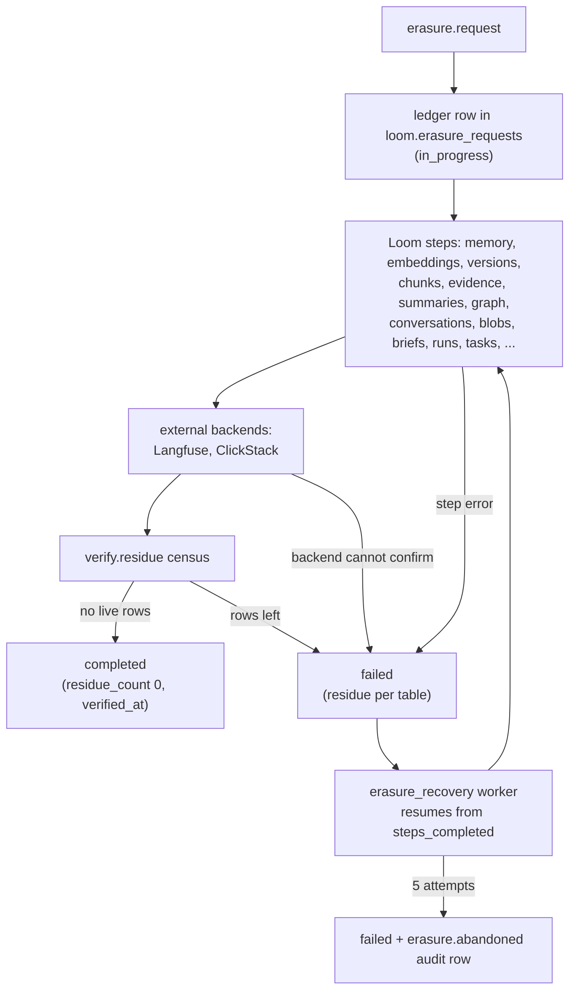

<!-- i18n: source=docs/features/memory/retention-and-erasure.md blob=193d8b98f7242dbe87366e0149f838322897ecdd model=claude-sonnet-5-5 -->
> Esta página é uma tradução automática da [página em inglês](https://github.com/ClickHouse/loom/blob/main/docs/features/memory/retention-and-erasure.md), que prevalece.
> Machine-translated from the [English page](https://github.com/ClickHouse/loom/blob/main/docs/features/memory/retention-and-erasure.md), which is authoritative.

<a id="retention-and-erasure"></a>

# Retenção e exclusão

O Loom não apaga nenhuma memória, a menos que seu autor, o proprietário do namespace ou o operador peça. A memória não tem tempo de vida padrão. Os dados saem de três maneiras: por expiração ou exclusão feita pelo autor, por uma retenção configurada por um proprietário ou operador, e por uma exclusão completa que remove um escopo de todos os lugares onde o Loom o mantém.

<a id="what-is-kept-and-for-how-long"></a>

## O que é mantido e por quanto tempo

Nenhuma tabela de memória, embedding, histórico de versões, conversa, entidade, resumo, memória de trabalho ou conhecimento tem TTL em `schemas/schema.sql`, e nenhum worker descarta linhas por idade.
As tabelas de links `entity_triple_rows` e `entity_edge_rows` seguem `entity_triples` e
`entity_edges`: sem TTL. Uma eliminação (erasure) apaga os links das memórias que elimina, e
`loom erasure-re-verify --completed-since … --resume` apaga os links órfãos que a eliminação de uma versão mais antiga deixou para trás.
Uma linha deixa o conjunto servido somente quando:

- **quem a escreveu a remove**: `memory.delete`, uma reescrita com a mesma chave que a substitui,
  `memory.apply`, `memory.clear`, `conflicts.resolve`, `blacklist.add(sweep=true)`;
- **quem a escreveu definiu uma expiração**: `ttl_seconds` ou `valid_to` em `memory.set`,
  `memory.touch`, `run.complete(retain="expire")`, o `expires_in_days` de uma reflexão;
- **o proprietário ou o operador configurou uma**: veja [retenção configurada](#configured-retention).

As tabelas operacionais (telemetria, caches, filas) têm TTLs fixos: `loom.search_trace_log`
e `loom.memory_exposures` 180 dias; `loom.erasure_requests` e
`loom.policy_decisions` 90 dias; `loom.memory_drops`, `loom.memory_extraction_queue`,
`loom.events` e `loom.embedding_cache` 30 dias; `loom.llm_response_cache` 7 dias. A
[referência do schema](https://github.com/ClickHouse/loom/blob/main/docs/reference/schema.md) lista o TTL de cada tabela.

Um worker remove dados por temporizador: `namespace_gc` elimina namespaces de
`kind = 'bench'` (identificados por `LOOM_NAMESPACE_BENCH_PREFIXES` no registro automático) sem
nenhuma escrita por `LOOM_NAMESPACE_GC_IDLE_HOURS`, por meio de uma saga de eliminação. Ele nunca toca
em outros kinds. Veja [namespaces e compartilhamento](https://github.com/ClickHouse/loom/blob/main/docs/features/namespaces-and-sharing.md).

<a id="delete-is-not-erase"></a>

### Excluir não é eliminar

Um tombstone é uma nova versão com `tombstoned_at` definido. As leituras deixam de servi-la imediatamente, mas
a linha e suas versões anteriores em `loom.memory_versions` permanecem no disco:

- `memory.restore` revive uma chave com tombstone em até 14 dias (depois disso responde
  `expired=true`). Também reverte uma substituição automática.
- `memory.clear` (admin) coloca tombstone em todas as memórias de um agente ou usuário em um namespace;
  `confirm_subject` deve repetir o `user_id` ou `agent` concreto (nem `'*'` nem `'-'`
  confirmam). `agent="*"` com um `user_id` limpa as linhas desse usuário em todos os agentes, e
  `user_id="*"` com um `agent` limpa as linhas desse agente para todos os usuários. Um escopo que não nomeia ninguém
  além de `'-'` é recusado, assim como uma limpeza de todo o namespace. Linhas bloqueadas permanecem e são contadas em
  `locked_skipped`. As chaves limpas são revividas da mesma forma.

Para remover os bytes, use uma [eliminação (erasure)](#erasure). Para apagar um único valor mantendo a linha e a
trilha de auditoria, use [`memory.redact`](https://github.com/ClickHouse/loom/blob/main/docs/features/memory/history-and-provenance.md#scrubbing-history-memoryredact).

<a id="writer-set-expiry"></a>

### Expiração definida por quem escreve

Uma linha fica oculta das leituras no momento em que seu `expires_at` passa. O worker
`memory_expiry_sweep` então aplica o `on_expire` de quem escreveu como uma nova versão:

| `on_expire`           | Efeito                                                                                                                       |
| --------------------- | ---------------------------------------------------------------------------------------------------------------------------- |
| `tombstone` (padrão)  | Recebe tombstone, com a janela de restauração de 14 dias.                                                                    |
| `demote`              | Expiração removida; confiança × `LOOM_MEMORY_EXPIRY_DEMOTE_FACTOR` (0.5), nunca abaixo de `LOOM_MEMORY_EXPIRY_DEMOTE_FLOOR` (0.05). |
| `anonymize`           | O valor é substituído por um marcador e os embeddings são descartados; a linha permanece como prova de que existiu.          |

`memory.touch` altera somente a expiração de uma linha, para uma chave ou até 1,000 (`memory_keys`): um
novo `ttl_seconds`, `clear_expiry=true` ou um novo `on_expire`. `memory.sweep_expired`
(admin) executa uma varredura para um namespace sob demanda, com `dry_run`. Uma edição em outros campos
mantém uma expiração ativa.

<a id="configured-retention"></a>

### Retenção configurada

Tudo desativado por padrão (0 = manter para sempre).

| Onde                         | Definido por                                                                                               | Efeito                                                                                                                                                   |
| ---------------------------- | ---------------------------------------------------------------------------------------------------------- | -------------------------------------------------------------------------------------------------------------------------------------------------------- |
| Um tipo de memória em um namespace | `retention_days` em uma entrada de `tag_registry` de `namespace.register`                            | Uma linha que `memory.set` grava sem expiração ativa, `ttl_seconds` ou `clear_expiry` recebe `expires_at = now + N days`; uma linha `read_only` reafirmada não recebe nenhuma. |
| Linhas sensíveis             | `LOOM_MEMORY_SENSITIVE_RETENTION_DAYS`, `LOOM_MEMORY_SENSITIVE_ON_EXPIRE` (padrão `anonymize`)             | Novas linhas de sensibilidade `medium` / `high` recebem uma expiração; uma expiração menor definida por quem chama prevalece.                            |
| As escritas de uma run       | `LOOM_MEMORY_RUN_COMPLETE_RETAIN` (`keep`, `demote`, `expire`), `LOOM_MEMORY_RUN_COMPLETE_EXPIRE_DAYS` (7) | O que `run.complete` faz com as linhas da run quando a chamada não especifica. Linhas fixadas, verificadas, promovidas, bloqueadas, episódicas e de reflexão são sempre mantidas. |
| Um namespace inteiro         | `retention_days`, `warm_days` em `namespace.register`                                                      | Um TTL de tabela (e movimentação para a camada warm) para as linhas desse namespace.                                                                     |
| O deployment                 | `LOOM_RETENTION_<TABLE>_DAYS`, `LOOM_TIERING_<TABLE>_WARM_DAYS`                                            | Um TTL de tabela (e movimentação para a camada warm) em `audit_log`, `agent_events`, `memory`, `memory_embeddings`, `conversations`, `chunks`, `documents`. |

Sob a autoridade Postgres, nenhuma das duas últimas linhas coloca um TTL de retenção em
`memory`, `memory_embeddings` ou `documents`: isso apagaria a cópia do ClickHouse de linhas que o
Postgres ainda serve, então o boot recusa `LOOM_RETENTION_MEMORY_DAYS`,
`LOOM_RETENTION_MEMORY_EMBEDDINGS_DAYS` e `LOOM_RETENTION_DOCUMENTS_DAYS`
([autoridade de armazenamento](../../architecture/storage-authority.md)). O
`retention_days` de um namespace também deixa `chunks` de fora, de modo que um documento que permanece mantém os chunks pelos quais a busca o
encontra; `LOOM_RETENTION_CHUNKS_DAYS` continua valendo.

O worker `retention_reconcile` aplica as duas últimas linhas como um `ALTER TABLE … MODIFY TTL` idempotente
por tabela, por `(org, namespace)` quando existem sobrescritas, e
remove o TTL de uma tabela quando não resta nenhum namespace nem janela de deployment nela. Em
`loom.memory` o TTL usa a chave `coalesce(expires_at, created_at)`, de modo que a expiração de quem escreveu
prevalece.

- **Um TTL de tabela exclui fisicamente** no próximo merge da parte. Não há janela de restauração, e os tombstones expiram junto com as linhas que ocultam.
- **Um Undo vale enquanto seu registro existir.** O resolvedor de conflitos respeita o Undo de uma pessoa
  sobre uma aposentadoria por meio da linha `memory.unsupersede` em `audit_log`. Com um TTL de `audit_log`
  menor que a vida de um par, um Undo expirado deixa de valer, e o resolvedor pode julgar
  e aposentar esse par novamente.
- **A camada warm precisa de um volume.** `LOOM_TIERING_WARM_VOLUME_NAME` deve nomear um volume na
  política de armazenamento, e a idade warm deve ser menor que a idade de retenção.

<a id="erasure"></a>

## Apagamento

`erasure.request` apaga um escopo em todos os lugares onde o Loom o mantém e só retorna quando consegue mostrar
que nada do escopo permanece. Para apagar tudo o que um mesmo user id mantém na organização, um
administrador da organização solicita o escopo `user_id`, que apaga as linhas do usuário em todos os namespaces da
organização (`purge=true` as exclui em vez de marcá-las com tombstone; o que sobra está listado
abaixo). `memory.clear` marca com tombstone as memórias de um agente ou de um usuário em um único namespace
([excluir não é apagar](#delete-is-not-erase)).

| `scope_type`     | `scope_value`                                                               | Quem pode solicitar                                  |
| ---------------- | --------------------------------------------------------------------------- | ---------------------------------------------------- |
| `user_id`        | O user id, em todos os namespaces da organização                            | Um administrador da organização                      |
| `namespace`      | Um namespace                                                                | Um administrador desse namespace (ou da organização) |
| `namespace_list` | Um array JSON de 1–500 namespaces, ou `{"namespaces": [...], "purge": bool}` | Um administrador da organização                      |

A op pode ser chamada com um token de escrita, mas o handler exige permissão de administrador sobre o alvo
(caso contrário, 403 `AUTH_INSUFFICIENT`).

Os links de categoria (`loom.memory_categories`) não carregam usuário, então um apagamento de `user_id` os mantém,
assim como as linhas de auditoria de `memory.import` que os listam. Para um item importado, a chave do link é
`import:` mais um digest do texto, o que permite confirmar um texto adivinhado; um apagamento de `namespace`
remove os links.

Um apagamento de `user_id` remove os chunks verbatim marcados com o usuário e os chunks
sem usuário (`-`) sob um dos pares `(namespace, key)` do usuário, seja de quem for a memória
a que pertencem: um chunk `-` pode conter o texto do usuário, e o caminho de escrita também
os retira como se fossem de quem escreveu. Chunks marcados com outro usuário permanecem.

Um apagamento de `user_id` também retira os resumos consolidados construídos a partir das memórias do usuário,
sob qualquer identidade que os tenha escrito
([quais são](../../architecture/memory-architecture.md#background-passes)), junto com o que foi
derivado deles: o histórico de versões, os chunks verbatim e os vetores de entidade,
as linhas de grafo extraídas deles e as cópias em todo o namespace promovidas a partir deles. Ele
exclui também as respostas de `memory.ask` em cache e os precedentes que os citavam.

<a id="the-saga"></a>

### A saga



- **Etapas com checkpoint e idempotentes.** Cada etapa concluída é registrada em
  `steps_completed`. O worker `erasure_recovery` retoma, a partir do checkpoint, uma saga parada
  em `in_progress` ou `failed`. Uma etapa espera até
  `LOOM_ERASURE_MUTATION_WAIT_S` pela sua mutation e, depois disso, falha citando-a.
- **As fontes de documentos param antes de os documentos irem embora.** Um apagamento de namespace retira as
  [fontes de documentos](https://github.com/ClickHouse/loom/blob/main/docs/features/knowledge.md#document-sources) do
  namespace em `knowledge_sources.retire`, sua primeira etapa, limpando as credenciais, e depois espera
  o turno de sincronização de cada fonte que ainda esteja em execução (até 30 segundos no total; um turno ainda em execução
  faz a etapa falhar com `OVERLOADED`, e o `erasure_recovery` tenta a saga de novo), de modo que nenhuma sincronização
  grave de volta um documento ou uma decisão minerada depois que as etapas seguintes os apagarem.
- **Os links de código esperam o worker de links.** `code_links.delete` obtém o lease da fila do worker de
  code-link, de modo que nenhuma passada publique um cursor que leu antes do apagamento: entre
  hosts com Keeper, dentro de um único processo sem ele. Ele espera até 15 minutos para que uma passada
  termine; depois disso a etapa falha com `LeaseBusy` e o `erasure_recovery` a tenta de novo.
- **Tombstone ou purge.** Por padrão, as tabelas de exclusão lógica (memória, embeddings, chunks,
  resumos, links) recebem tombstone, e `memory.restore` ainda pode reativá-las dentro
  da janela; `erasure.list` informa essas reativações como `reversals_count`. `purge=true`
  exclui as linhas em vez disso (um `DELETE FROM` leve nas tabelas largas). Um escopo
  que contém um namespace que já teve um mirror é purgado por inteiro, todos os namespaces
  nele, de modo que nenhum deles tem essa janela ([fontes de
  documentos](../../architecture/document-sources.md#the-mirror)). Um apagamento de usuário encontra
  o que as memórias do usuário alimentaram por meio de suas chaves; por isso, em um purge, suas linhas de `loom.memory`
  e os resumos consolidados construídos a partir delas recebem tombstone primeiro e são excluídos em
  `memory.retire`, depois de todas as etapas que leem essas chaves; até então `memory.restore`
  pode reativá-las (as linhas do próprio usuário contam como reversão, os resumos não),
  e `memory.retire` exclui o que `memory.restore` reativou.
- **Originais enviados** de documentos de conhecimento: as linhas do namespace em
  `loom.document_blobs` são excluídas primeiro, e `blob_erased_at` é preenchido. Um apagamento de usuário
  exclui os originais que esse usuário enviou e que nenhum documento ativo de outro escritor compartilha,
  encontrados por meio de `loom.blob_uploads` (uma linha por envio de cada usuário final, já que a versão
  do documento que nomeava um original pode ter sido substituída e mesclada) e por meio dos documentos
  dele; depois, as linhas dele em `loom.blob_uploads` são removidas. O census conta as duas tabelas.
  Os originais mantidos em um bucket compatível com S3 (`LOOM_DOCUMENT_OBJECT_STORE=s3`) vão antes
  de suas linhas: um apagamento de namespace exclui todos os objetos do escopo sob o seu prefixo e
  o census conta o que sobrou ali (`objects.document_originals`); um apagamento de usuário
  exclui todos os objetos que contêm bytes dos originais do próprio usuário, nomeados por uma linha ou não,
  lista os prefixos deles de novo e faz a etapa falhar se o store manteve algum, depois exclui
  as linhas e, em seguida, exclui o que esses prefixos ainda guardam e nenhuma linha nomeia, de modo que o envio do
  próprio usuário desses bytes, cuja linha a exclusão levou, também perde o seu objeto. Um envio
  desses bytes ainda em andamento quando a etapa roda, por qualquer escritor (com o objeto armazenado e a
  linha ainda não inserida), perde o seu objeto, e a sua linha, quando entrar, responde `410 BLOB_GONE`. Cada
  lote de originais é lido de novo logo antes de ser excluído, de modo que um original que o documento de
  outro escritor passou a nomear desde então permanece; outro escritor que armazene os mesmos bytes no mesmo
  namespace depois dessa leitura pode perdê-los, como no store do ClickHouse. Uma linha que nomeia
  um objeto sem que haja bucket configurado, ou um fora do bucket e do prefixo configurados, faz
  a etapa falhar em vez de deixar os bytes. Em qualquer um dos stores, um apagamento de usuário
  exclui as linhas no menor número de mutations em que seus originais couberem (cada uma vincula tantos quantos
  um parâmetro do ClickHouse comporta). A migração dos originais do ClickHouse para o bucket
  (`loom knowledge migrate-originals`) é protegida por este ledger: ela não move um
  original coberto por um apagamento não concluído, e uma migração que um apagamento ultrapassa termina como
  esse apagamento decidir
  ([onde os originais são armazenados](https://github.com/ClickHouse/loom/blob/main/docs/features/knowledge.md#where-originals-are-stored)).
- **Cancelamentos de ingestão.** Um apagamento de usuário exclui as linhas de ingestão do usuário, inclusive os cancelamentos.
  Um cancelamento que o usuário pediu sobre o job de outro escritor que ainda está pendente ou em processamento
  é mantido antes como uma linha sem identidade (`agent`, `user_id` e `session_id` `'-'`,
  `actor` vazio), de modo que esse job continue cancelado.
- **Caches de toda a organização.** `loom.idempotency` (respostas reproduzidas) e `loom.embedding_cache`
  (vetores de consulta, nunca o texto deles) carregam a organização, mas não o namespace nem o usuário final, então um
  apagamento em qualquer um dos escopos exclui todas as linhas da organização nas duas tabelas. O custo são
  cache misses. O census conta `loom.idempotency` em toda a organização, mas não `loom.embedding_cache`,
  que qualquer busca na organização repovoa; o cache de vetores em processo de cada réplica expira
  em `LOOM_EMBEDDING_CACHE_TTL_S`.
- **Aprendizados de regras do bot.** As palavras de um usuário na fila de aprendizados vivem apenas nas linhas dele
  em `loom.learnings_supporters`, que um apagamento de usuário exclui. Um candidato a regra que fica
  sem nenhum apoiador é então excluído quando está pendente, ou mantém a sua decisão com a regra
  em branco ([extração](https://github.com/ClickHouse/loom/blob/main/docs/features/memory/extraction.md#rules-the-assistant-states-about-itself)). O
  census conta esses candidatos sem apoio em toda a organização, não apenas os do usuário apagado,
  de modo que uma saga pode falhar por um candidato que outro apagamento da organização deixou no meio da etapa; a etapa
  reaberta o limpa.

<a id="the-federated-cascade"></a>

### A cascata federada

Os dados que o Loom enviou para outros lugares são apagados na mesma saga. As etapas externas falham de forma fechada: um
backend que não consegue confirmar a exclusão (5xx, timeout, queda de rede, uma resposta de health do Langfuse
sem versão) faz a etapa falhar, e o worker tenta de novo. "Nada a excluir" (nenhuma linha correspondente,
ou uma tabela do ClickStack que o serviço não tem) conta como sucesso.

| Backend    | Configurado por                                            | Apaga                                                                                                    |
| ---------- | ---------------------------------------------------------- | -------------------------------------------------------------------------------------------------------- |
| Langfuse   | `LOOM_LANGFUSE_URL` + `LOOM_LANGFUSE_ADMIN_TOKEN`          | Traces encontrados por `userId` dentro da tag da organização, ou pelo par de tags `org:` + `namespace:`. |
| ClickStack | `LOOM_CLICKSTACK_DATABASE`, `LOOM_CLICKSTACK_USER_ID_KEYS` | Linhas OTel no mesmo serviço ClickHouse, correspondidas pelas chaves de atributo de user id ou pelo namespace. |

Um apagamento de namespace no ClickStack só corresponde a uma linha `loom.namespace` quando ela carrega o
`loom.org` da organização que apaga, de modo que as métricas de op e de domínio do próprio Loom, que não carregam organização, mantêm
o rótulo do namespace ([apagamento no ClickStack](../integrations/clickstack.md#erasure)).

Um backend não configurado registra a intenção em log e não exclui nada. Somente um apagamento de `namespace_list`
pode passar `external=false`; os apagamentos de `user_id` e de `namespace` sempre incluem os
backends. `LOOM_EXTERNAL_ERASURE_TIMEOUT_S` limita cada chamada. Configuração:
[Langfuse](https://github.com/ClickHouse/loom/blob/main/docs/features/integrations/langfuse.md) e [ClickStack](../integrations/clickstack.md).

<a id="the-residue-census"></a>

### O census de resíduos

A última etapa, `verify.residue`, conta as linhas ativas no escopo em todas as tabelas que os caminhos de leitura
tocam. Qualquer linha que sobre faz a saga falhar; a linha terminal carrega `residue_count`, `residue`
(por tabela), `verified_at` e `census` (todas as contagens, abaixo). Uma saga retomada executa de novo a
etapa dona de qualquer tabela em que o último census encontrou linhas, mesmo que o checkpoint diga que
ela terminou, e sempre conta de novo.

<a id="the-receipt"></a>

### O recibo

`erasure.status` (e a resposta de `erasure.request`) traz o recibo do census da execução mais recente.
`census` é nulo quando a linha mais recente do ledger não contém um census que tenha contado todos os
stores: uma execução em andamento, um census que não pôde rodar ou deixou um store sem contar, ou uma linha
escrita por um build que não mantém census. Os campos do recibo:

- `census`: cada substrato que o census contou e a sua contagem, inclusive os zeros. As chaves são nomes
  de tabela, `pg:<table>` para a autoridade Postgres, `objects.document_originals` para o
  bucket de documentos em um escopo de namespace, e `provider_rebuild_copies`, somado sobre as cópias de uma
  reconstrução de provider, 0 quando não existe nenhuma (contado em toda a implantação quando uma cópia não tem coluna
  de organização). Uma contagem é o número de linhas que o census conta como resíduo neste escopo: linhas ativas, ou
  todas as linhas quando a saga faz purge ou a tabela não mantém tombstone ([as regras do
  census](../../architecture/memory-architecture.md#erasure-saga)).
  `objects.document_originals` conta uma primeira página de listagem, então deve ser lido como "pelo menos".
- `purge`: o modo de exclusão ou tombstone do escopo (o de um único namespace é tombstone,
  seja o que tiver sido pedido); um escopo que contém um mirror ([fontes de
  documentos](../../architecture/document-sources.md#the-mirror)) é excluído, seja o que isto
  diga. Sem purge, uma linha com tombstone mantém os seus bytes na parte até a tabela
  fazer merge; com purge as linhas são excluídas, e os bytes delas ficam em disco até um merge ou
  o worker de reclaim os remover.
- O sujeito e o horário são `org`, `scope_type`, `scope_value` e
  `verified_at` do status.

O recibo é a contagem do Loom. Guarde a resposta: `erasure.status` serve a linha do ledger por 89
dias após a solicitação, e a linha de auditoria `erasure.completed`, que também carrega o census,
é escrita depois da linha completed, em regime de melhor esforço, e mantida por
`LOOM_RETENTION_AUDIT_LOG_DAYS`. Quando o solicitante não recebeu resposta (uma saga que o worker
de recuperação terminou, uma executada de forma desanexada, uma chamada que deu timeout), leia `erasure.status` dentro de 89
dias.

<a id="checking-an-erasure-yourself"></a>

#### Verificando um apagamento por conta própria

Um operador que tenha o grant da superfície SQL da organização com `--namespaces '*'`, ou `--all` ([superfície
SQL](https://github.com/ClickHouse/loom/blob/main/docs/reference/sql-surface.md#access)), pode recontar três das chaves do census,
`loom.memory`, `loom.memory_versions` e `loom.conversations`, e verificar o ledger de solicitações
(a quarta instrução, abaixo). Vincule o id apagado e o horário do census como parâmetros.
O ClickHouse ainda grava os valores vinculados em `system.query_log`, como faz com as instruções do próprio
apagamento (abaixo); por isso, execute a verificação a partir do `clickhouse-client` em vez de
usar o `pg_clickhouse`, cujo texto repassado um log de instruções do Postgres guardaria como mais
uma cópia:

```bash
read -r uid  # the erased id, typed at the prompt so it stays out of the shell history
clickhouse-client --param_org='<org>' --param_uid="$uid" --param_at='<verified_at>' \
  --multiquery --query "
SELECT count() FROM loom.sql_v1_memories WHERE org = {org:String}
  AND user_id = {uid:String} AND created_at <= {at:DateTime64(6, 'UTC')};
SELECT count() FROM loom.sql_v1_memory_history WHERE org = {org:String}
  AND user_id = {uid:String} AND created_at <= {at:DateTime64(6, 'UTC')};
SELECT count() FROM loom.sql_v1_conversations WHERE org = {org:String}
  AND user_id = {uid:String} AND ts <= {at:DateTime64(6, 'UTC')};
SELECT count() FROM loom.sql_v1_agent_events WHERE org = {org:String}
  AND user_id = {uid:String} AND ts <= {at:DateTime64(6, 'UTC')};"
```

O filtro `org` mantém, no org da eliminação, um grant que cobre mais de um org (`--all`).
Cada instrução ainda lê todo o escopo do grant antes de filtrar ([o custo de uma leitura](https://github.com/ClickHouse/loom/blob/main/docs/reference/sql-surface.md#what-a-read-costs)), então, em um org grande ou em um grant `--all`, uma instrução pode parar nos limites do usuário SQL (`LOOM_CH_ANALYSIS_MAX_ROWS_TO_READ`, `_MAX_EXECUTION_S`) com um erro em vez de uma contagem; aumente esses limites para a verificação. Para um escopo de namespace, passe `--param_ns='<namespace>'` e filtre as três primeiras por `namespace = {ns:String}` em vez de `user_id`; para um `namespace_list`, execute isso uma vez para cada nome em `namespaces` do `scope_value`; a instrução `sql_v1_agent_events` serve apenas para um escopo de usuário, já que a eliminação de um namespace mantém as linhas do ledger de requisições do namespace. Cada contagem é 0 após uma eliminação concluída, com estas diferenças em relação ao censo: as views deixam de fora os namespaces restritos, `sql_v1_memories` deixa de fora as linhas rejeitadas e com tombstone e `sql_v1_memory_history` deixa de fora as versões rejeitadas (mas mantém as com tombstone), e um resumo consolidado a partir das memórias do usuário carrega outro `user_id`, que o censo conta e estas consultas não contam. A contagem do ledger de requisições é uma verificação separada, fora do recibo: uma eliminação limpa as linhas do ledger de requisições de um usuário para `<erased>` em vez de apagá-las, e a view do ledger de requisições guarda apenas a sua janela ([`sql_v1_agent_events`](https://github.com/ClickHouse/loom/blob/main/docs/reference/sql-surface.md#sql_v1_agent_events)), então ela confirma a limpeza apenas das linhas dentro dessa janela. Todas as outras chaves do censo são apenas a contagem do Loom.

O que o recibo não cobre:

- backups, recuperação point-in-time, WAL e standbys de qualquer um dos serviços;
- cópias feitas fora do Loom, como uma tabela criada no Postgres próprio de um org a partir da [superfície SQL](https://github.com/ClickHouse/loom/blob/main/docs/reference/sql-surface.md);
- linhas que um worker grava após o censo a partir de uma leitura feita antes dele ([autoridade de armazenamento](../../architecture/storage-authority.md#erasure));
- um `namespace.restore` de um snapshot tirado antes da eliminação, que traz as linhas de volta: execute a eliminação de novo, e o censo dela é o novo recibo;
- para um escopo de usuário, os originais de documentos no bucket, que o censo conta apenas para um escopo de namespace.

O id eliminado permanece onde a prova de eliminação precisa dele: na linha do ledger (até o TTL da tabela removê-la, 90 dias após a requisição), na auditoria, em `loom.erasure_reversals` e nos logs do próprio deployment das instruções que o citaram (o log de mutações do ClickHouse, `system.query_log` e `system.text_log` para uma instrução que o gravou, e os logs de instruções do Postgres com `log_statement` ou `log_min_duration_statement` ativados).

<a id="abandoned-sagas"></a>

### Sagas abandonadas

Após 5 tentativas, o worker marca a requisição como `failed` em definitivo e grava uma linha de auditoria `erasure.abandoned`, com `failure_reason` e `steps_completed`. Uma pessoa deve então escalar o caso. `loom erasure-re-verify` verifica novamente as sagas terminais; `--resume` executa de novo as que falharam a partir do checkpoint (`--skip-external` para uma saga `namespace_list` cuja etapa externa continua falhando). `--completed-since <ISO timestamp>` verifica novamente as sagas concluídas e verificadas desde então, em vez das que falharam, para as eliminações que uma build anterior executou durante uma atualização; com `--resume`, ele apaga apenas os vínculos de linhas órfãs delas ([manutenção](https://github.com/ClickHouse/loom/blob/main/docs/operations/maintenance.md#erasure)). Veja [solução de problemas](https://github.com/ClickHouse/loom/blob/main/docs/operations/troubleshooting.md).

<a id="operations"></a>

### Operações

| Op                | Papel                        | Faz                                                                                                                                                                                                                                                                                                                                                         |
| ----------------- | ---------------------------- | ----------------------------------------------------------------------------------------------------------------------------------------------------------------------------------------------------------------------------------------------------------------------------------------------------------------------------------------------------------- |
| `erasure.request` | writer (admin no alvo)       | Executa a saga para um escopo. `urgency` `normal` ou `urgent`; `purge`; `external`.                                                                                                                                                                                                                                                                         |
| `erasure.status`  | viewer                       | O estado de uma requisição, a etapa atual, o motivo da falha e o censo. A eliminação de um usuário só responde a um admin do org ou a um admin da plataforma do seu org. Não está listada nos toolsets do MCP.                                                                                                                                               |
| `erasure.list`    | viewer                       | Requisições recentes (filtre por `status`), com `steps_completed_count`, `reversals_count`, `residue_count`.                                                                                                                                                                                                                                                |
| `erasure.export`  | admin                        | Os dados de um titular como JSON: `memory`, `knowledge`, `conversations` (turnos de transcrição e mensagens salvas), `conversation_threads`, `agent_events`, `audit_log`, cada um limitado por `section_limit` (padrão 10,000; `truncated` quando excede), e `conversations` também por `LOOM_ERASURE_EXPORT_CONVERSATION_MAX_BYTES` de texto. Inclui por padrão as linhas com tombstone. |

`erasure.status` e `erasure.list` leem uma linha do ledger por 89 dias; o TTL da tabela a remove aos 90. Listas de campos: [referência de operações](https://github.com/ClickHouse/loom/blob/main/docs/reference/operations.md#erasure).

<a id="example"></a>

### Exemplo

```python
from loom import Agent

async with Agent(org="acme", namespace="support", agent="privacy-desk") as admin:
    out = await admin.erasure.request_user_id("u-42", requester="dpo@acme.example")
    print(out["status"], out["residue_count"], out["verified_at"])
    if out["status"] != "completed":
        print(out["failure_reason"], out["residue"])
```

O `request` do SDK não expõe `purge` nem `external`; envie-os por HTTP:

```bash
curl -sX POST "$LOOM_BASE_URL/v1/erasure.request" \
  -H "Authorization: Bearer $LOOM_API_KEY" -H "Content-Type: application/json" \
  -d '{"org":"acme","scope_type":"namespace_list",
       "scope_value":"[\"bench-a\",\"bench-b\"]",
       "requester":"ops@acme.example","purge":true,"external":false}'
```

<a id="for-contributors"></a>

### Para contribuidores

Uma nova tabela que possa guardar conteúdo de memória precisa de uma etapa da saga e de uma entrada no censo (um `Substrate(...)` em `_CENSUS`, em `server/erasure/store/census.py`), ou de uma linha em `STEP_ONLY_TABLES` com o motivo; caso contrário, um teste unitário falha. A saga está em `server/erasure/app/saga.py` (`run_saga`), os backends em `server/erasure/app/backends.py` e o worker em `server/erasure/workers/recovery.py`.

<a id="limits"></a>

## Limites

- **Não é uma garantia de conformidade.** Os hashes de saga, de censo e de auditoria são
  primitivas de engenharia; cabe a você decidir se eles atendem a uma obrigação.
- **Um apagamento é lento.** Cada etapa espera por uma mutation; reserve minutos em um escopo grande.
  O SDK espera até 120 segundos pela primeira resposta; depois disso, consulte `erasure.status` periodicamente.
- **Não existe escopo `org`.** Apague os namespaces de uma organização com `namespace_list`.
- **Não é possível restaurar a partir de TTLs de tabela.** Use a expiração definida pelo escritor com `on_expire` quando o
  fim da vida útil precisar ser reversível.
- **Os backups ficam fora da saga**; veja
  [backup e recuperação](https://github.com/ClickHouse/loom/blob/main/docs/operations/backup-and-recovery.md).
- **O bucket de exportação de análises fica fora da saga.** Seus arquivos contêm nomes de organização, namespace
  e agente em formato hash, além de contagens de uso, nunca o conteúdo da memória; veja
  [nomes com hash](https://github.com/ClickHouse/loom/blob/main/docs/operations/analytics-export.md#hashed-names).

<a id="related"></a>

## Relacionados

- [Histórico e proveniência](https://github.com/ClickHouse/loom/blob/main/docs/features/memory/history-and-provenance.md): `memory.history`, `memory.redact`.
- [Escrita de memória](https://github.com/ClickHouse/loom/blob/main/docs/features/memory/writing.md): `ttl_seconds`, `valid_to`, `on_expire` em uma escrita.
- [Execuções](https://github.com/ClickHouse/loom/blob/main/docs/features/runs.md): `retain` em `run.complete`.
