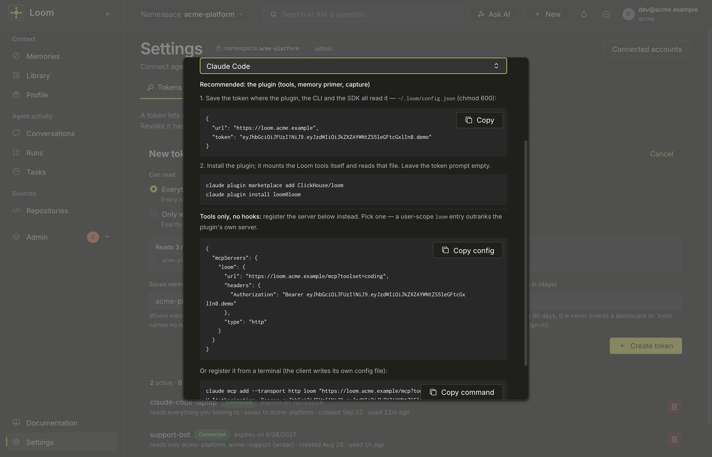

<!-- i18n: source=docs/getting-started/connect-a-coding-agent.md blob=4a72e3770686ed00295619940601d7f23baa7988 model=claude-sonnet-5-5 -->
> Esta página é uma tradução automática da [página em inglês](https://github.com/ClickHouse/loom/blob/main/docs/getting-started/connect-a-coding-agent.md), que prevalece.
> Machine-translated from the [English page](https://github.com/ClickHouse/loom/blob/main/docs/getting-started/connect-a-coding-agent.md), which is authoritative.

<a id="shared-memory-for-claude-code-codex-and-cursor"></a>

# Memória compartilhada para Claude Code, Codex e Cursor

O Loom oferece ao Claude Code, ao Codex e ao Cursor uma memória de longo prazo compartilhada, por meio de plugins ou de ferramentas MCP conectadas ao mesmo servidor self-hosted. Dê a cada colega de equipe um token com acesso ao namespace da equipe, para que os agentes deles encontrem os fatos que os outros salvaram. Instale o plugin ou a entrada MCP abaixo; a próxima sessão poderá recuperar o que um agente salvou. O que os plugins do Claude Code e do Codex enviam ao Loom está em [tratamento de dados](../features/integrations/claude-code.md#data-handling). A gravação de conversas vem desativada por padrão; o proprietário do namespace a ativa com a chave **Record conversations** na página Conversations do painel, ou com `conversation.set_logging`. Para executar um servidor por conta própria, comece pelo [guia de início rápido](quickstart.md); para que seu agente instale uma versão fixada e comprove que ela funciona, passe a ele o arquivo `https://github.com/ClickHouse/loom/releases/latest/download/agent-setup.txt` da versão mais recente ([Configure o Loom com seu agente de código](https://github.com/ClickHouse/loom/blob/main/docs/getting-started/agent-setup.md)).

<a id="what-you-need"></a>

## O que você precisa



- **A URL do servidor**, por exemplo `https://loom.example.com`, ou `http://localhost:7777`
  para uma stack iniciada com `loom up`.
- **Um token de escrita (writer) para o seu namespace**, exceto em um servidor de usuário único na mesma
  máquina: nesse caso, os plugins e os links de instalação para o
  [Cursor](https://github.com/ClickHouse/loom/blob/main/docs/features/integrations/cursor.md#mcp-tools) e o
  [VS Code](../features/integrations/vscode.md#local-single-user-server) se conectam sem token.
  Crie um no painel em
  `<server>/settings` → **Tokens**, ou peça a um operador que execute
  `loom mint-token --subject you --org <org> --namespaces <namespace> --roles writer`.
  Em um servidor com autocadastro aberto, o plugin do Claude Code pode cadastrar a máquina
  por conta própria na primeira sessão. Veja [o que acontece sem credencial](#no-token-yet).

<a id="claude-code"></a>

<a id="how-do-i-give-claude-code-shared-memory"></a>

## Como dou ao Claude Code uma memória compartilhada?

Instale o plugin do Loom com a URL do servidor e um token de escrita para o namespace que
você quer compartilhar. O plugin carrega as memórias relevantes no início da sessão e dá
ao agente ferramentas para salvar e buscar fatos.

```bash
claude plugin marketplace add ClickHouse/loom
claude plugin install loom@loom \
  --config server_url=https://loom.example.com \
  --config token=<writer JWT>
```

Os dois valores de `--config` são opcionais; sem eles, o Claude Code pergunta uma vez. Inicie uma nova
sessão. O primer de sessão do Loom aparece no topo e, a partir daí:

- os hooks enviam ao Loom o que [tratamento de dados](../features/integrations/claude-code.md#data-handling)
  lista;
- as skills `loom-memory`, `loom-code`, `loom-session` e outras dizem ao Claude quando salvar
  um fato, quando buscar e como usar o índice de código;
- `loom_search`, `loom_memory_set` e as ferramentas de código estão disponíveis como ferramentas MCP.

Tudo o que o plugin instala, e como configurá-lo, está na página
[Claude Code](../features/integrations/claude-code.md).

<a id="codex"></a>

<a id="how-do-i-give-codex-shared-memory"></a>

## Como dou memória compartilhada ao Codex?

Instale o plugin do Loom, conecte seus hooks e a entrada de MCP ao mesmo servidor e use um
token com acesso ao namespace compartilhado. O plugin carrega um primer de memória quando uma
sessão começa; seus hooks precisam da aprovação descrita abaixo.

```bash
codex plugin marketplace add ClickHouse/loom
codex plugin add loom@loom
```

Em seguida, execute `codex` de forma interativa uma vez e [aprove os hooks do plugin](../features/integrations/codex.md#approve-the-hooks);
até lá, as ferramentas funcionam, mas nada é capturado.

A entrada de MCP do plugin aponta para `http://localhost:7777`. Para outro servidor, grave a URL dele
e o seu token em `~/.loom/config.json` e sobrescreva a entrada de MCP em
`~/.codex/config.toml`, como mostrado em [Codex: o servidor](../features/integrations/codex.md#the-server).

O plugin do Codex traz os mesmos hooks e skills; as diferenças estão na página
[Codex](../features/integrations/codex.md). Não execute também `codex mcp add loom` com
o plugin instalado: uma entrada com o mesmo nome substitui a do plugin.

<a id="cursor-and-other-mcp-clients"></a>

<a id="how-do-i-give-cursor-or-another-mcp-client-shared-memory"></a>

## Como dou memória compartilhada ao Cursor ou a outro cliente MCP?

Conecte o cliente ao endpoint MCP do Loom com um token para o namespace compartilhado e
depois adicione as instruções para o agente indicadas abaixo. As ferramentas salvam e recuperam fatos; capturar
a transcrição da sessão também exige a integração de hooks do cliente.

Em um plano Cursor Teams ou Enterprise, um administrador da equipe pode importar o [plugin do
Cursor](https://github.com/ClickHouse/loom/blob/main/docs/features/integrations/cursor.md#plugin) (não testado no Cursor), que traz a
entrada MCP e as skills do Loom.

Para Cursor ou VS Code com um servidor de usuário único na mesma máquina, não é necessário token:
use o link de instalação do [Cursor](https://github.com/ClickHouse/loom/blob/main/docs/features/integrations/cursor.md#mcp-tools) ou do
[VS Code](../features/integrations/vscode.md#local-single-user-server). Caso contrário, no painel,
abra **Settings → Tokens**, preencha o formulário **New token** (pressione **New token** antes, se já existir um
token) e pressione **Create token**; depois escolha seu cliente (Cursor, VS Code, Cline,
Windsurf, Zed ou Claude Desktop) em **Connect**: a caixa de diálogo mostra a entrada para o arquivo
de configuração dele, já com o token. Para qualquer outro cliente MCP, copie a entrada de
[clientes MCP](https://github.com/ClickHouse/loom/blob/main/docs/features/integrations/mcp-clients.md). Com a CLI `loom` instalada
(`pip install -e .` a partir de um clone do repositório), um único comando grava a entrada:

```bash
loom install --client cursor --server-url https://loom.example.com --token "$LOOM_API_KEY"
```

Reinicie o cliente depois. `--client` também aceita `claude-desktop`, `vscode`, `cline`,
`windsurf` e `zed`; sem ele, `loom install` configura todos os clientes que encontrar. Esses clientes
recebem as ferramentas; a captura de transcrição precisa de um hook, que o [Cursor](https://github.com/ClickHouse/loom/blob/main/docs/features/integrations/cursor.md)
tem e os demais obtêm de um [template de transcrição](https://github.com/ClickHouse/loom/blob/main/docs/features/integrations/index.md#transcript-capture-hooks).
[Clientes MCP](https://github.com/ClickHouse/loom/blob/main/docs/features/integrations/mcp-clients.md) explica os conjuntos de ferramentas e a entrada que o
comando grava. Depois, adicione o bloco de [instruções para o agente](../features/integrations/agent-instructions.md)
ao arquivo de regras de um cliente de programação, para que o agente saiba quando chamar as ferramentas; para um
cliente que não seja o Cursor, adicione `?toolset=coding` à URL da entrada (`--toolset coding`
com `loom install`) para que as ferramentas citadas no bloco sejam listadas.

<a id="check-that-it-works"></a>

## Verifique se está funcionando

1. No Claude Code, execute `/loom:loom-status`. Ele informa o servidor que o plugin chama, se o token é aceito e pode gravar no namespace, e quaisquer lotes capturados que nunca chegaram ao servidor.
2. Diga ao agente algo duradouro, por exemplo "nossa janela de deploy é apenas terça e quinta". Em uma nova sessão, pergunte "quando podemos fazer deploy?". A resposta vem do Loom.
3. Abra o painel (`<server>/`). O fato salvo está lá, e a conversa da sessão também, enquanto a gravação de conversas estiver ativada; você pode corrigir ou excluir qualquer um dos dois.

`loom doctor --client` adiciona as verificações da configuração local quando você tem a CLI.

<a id="when-the-code-index-is-used"></a>

## Quando o índice de código é usado

O plugin anexa o índice de código somente quando a sessão começa dentro de um checkout git de
um repositório indexado:

- Ele lê os remotes do checkout (`origin`, depois `upstream`, depois os demais) e os procura
  entre os repositórios que o servidor indexa. Um fork sem índice próprio usa
  o índice do repositório pai.
- Você precisa de acesso de leitura ao namespace de código desse repositório. A página
  **Repositories** do painel mostra o que você pode ler e permite que você entre.
- Havendo correspondência, as perguntas de código da sessão ficam restritas a esse repositório, e as buscas com grep e
  as leituras de arquivos inteiros em caminhos indexados são respondidas pelo índice, no estado do seu último
  commit indexado.
- Sem correspondência (um diretório fora do git, um repositório que ninguém indexou ou um que você não pode
  ler), nada muda: o agente lê os arquivos locais, e a memória funciona normalmente.

Para usar o índice de um repositório mesmo assim, informe o nome dele: `LOOM_CODE_REPO=<owner>/<name>` (por exemplo
`ClickHouse/loom`, ou apenas `loom` quando um único repositório que você pode ler tem esse nome), a opção `code_repo` do
plugin do Claude Code, ou `"code_repo"` em `~/.loom/config.json` (a
configuração que uma sessão do Codex lê). É um fallback: fora de qualquer checkout git, ou em um
checkout cujo repositório não tem índice (um espelho com URL diferente), o primer informa o namespace
desse repositório e toda chamada `loom_code_*` o usa por padrão. Dentro de um checkout
indexado, o índice do próprio checkout continua tendo prioridade; para pesquisar outro repositório, passe o namespace dele
na chamada. `local_first` (`LOOM_CODE_LOCAL_FIRST=on`) mantém
o índice fora das buscas com grep e das leituras de arquivos, por exemplo enquanto você trabalha em alterações não commitadas.
Detalhes: [Claude Code](../features/integrations/claude-code.md#the-code-shunt).

<a id="no-token-yet"></a>

## Ainda sem token

Em um servidor iniciado com `LOOM_SELF_SIGNUP=open`, a primeira sessão do Claude Code que não encontrar nenhum token cadastra a máquina. Ela grava o token em `~/.loom/config.json` (modo 0600) e um código de reivindicação em `~/.loom/claim-<namespace>.txt`, e o primer explica como reivindicar o namespace: o código funciona uma única vez, na página `/oauth/agent-claim` do servidor, com uma senha de sua escolha. `LOOM_AUTO_SIGNUP=off` desativa esse comportamento. Um servidor sem autocadastro deixa a sessão sem token, e o primer explica como obter um.

<a id="next"></a>

## Próximos passos

- [Seu primeiro agente](https://github.com/ClickHouse/loom/blob/main/docs/getting-started/first-agent.md): a mesma memória a partir do seu próprio código com o SDK.
- [Integração com agentes](https://github.com/ClickHouse/loom/blob/main/docs/guides/agent-integration.md): o que salvar, quando buscar e
  erros a evitar.
- [Índice de código](../features/code-index/overview.md): pergunte ao Loom sobre um repositório que o servidor
  indexa.
- [Solução de problemas](https://github.com/ClickHouse/loom/blob/main/docs/operations/troubleshooting.md), começando por `/loom:loom-status`.
