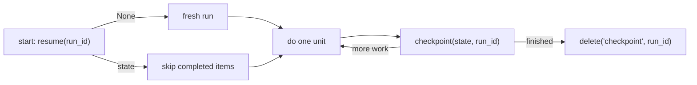

<!-- i18n: source=docs/guides/trace-and-resume.md blob=d597f5338750e0167731c70d5eb3f07fc5bc291d model=claude-sonnet-5-5 -->
> Esta página é uma tradução automática da [página em inglês](https://github.com/ClickHouse/loom/blob/main/docs/guides/trace-and-resume.md), que prevalece.
> Machine-translated from the [English page](https://github.com/ClickHouse/loom/blob/main/docs/guides/trace-and-resume.md), which is authoritative.

<a id="trace-and-resume-long-agent-runs"></a>

# Rastrear e retomar execuções longas de agentes

Uma execução longa (processar 300 arquivos, percorrer um repositório, executar um plano) pode parar no meio: uma
falha, uma janela de contexto cheia, um deploy, uma pausa. Um bloco de memória de trabalho identificado pelo
`run_id` da execução guarda o progresso no ClickHouse, de modo que um novo processo o lê de volta e continua a partir
da última unidade de trabalho concluída. Não é necessário um armazenamento de checkpoint separado.

<a id="the-pattern"></a>

## O padrão

1. Escolha um `run_id` estável para a tarefa: um id de job, um id de plano.
2. Após cada unidade de trabalho, chame `checkpoint(state, run_id=...)`. `state` é tudo o que um novo
   processo precisa para continuar: ids dos itens concluídos, um cursor, uma string JSON.
3. Na inicialização, chame `resume(run_id=...)`. `None` significa uma execução nova; caso contrário, pule o que o
   checkpoint diz que já foi feito.



<a id="with-the-python-sdk"></a>

## Com o SDK Python

```python
from loom import Agent

RUN = "reindex-catalog"


async def process(agent: Agent, items: list[str]) -> None:
    done = set((await agent.working_memory.resume(run_id=RUN) or "").split())
    for item in items:
        if item in done:
            continue
        await do_work(item)
        done.add(item)
        await agent.working_memory.checkpoint(" ".join(sorted(done)), run_id=RUN)
```

`checkpoint` e `resume` são `working_memory.set` e `working_memory.get` no bloco
`checkpoint` (altere com `block_key=`). Cada `checkpoint` sobrescreve o anterior.

> **Aviso:** o `char_limit` padrão é de 4,096 caracteres (`DEFAULT_CHAR_LIMIT` em
> `sdk/python/loom/working_memory.py`). Mantenha o estado pequeno ou armazene um ponteiro para ele: um
> blob grande pertence a `context.offload`, com seu `blob_key` no checkpoint.

Quando a tarefa terminar, limpe o checkpoint:

```python
await agent.working_memory.delete("checkpoint", run_id=RUN)
```

Para um log de progresso em vez de um único snapshot, `working_memory.append(..., run_id=RUN)` adiciona
a um bloco e `working_memory.render(run_id=RUN)` lê os blocos de volta.

<a id="over-mcp"></a>

## Via MCP

`working_memory.set` está listado (`loom_working_memory_set`) nos toolsets `coding`, `atomic` e
`all`, e é executado por meio de `loom_op` em todos os outros toolsets, exceto `readonly` e
`assistant`. `working_memory.get` não está listado em nenhum toolset, incluindo `all`; chame-o
por meio de `loom_op` com `{"op": "working_memory.get", "arguments": {...}}`. Um agente:

1. chama `working_memory.set` com `run_id` e `block_key="checkpoint"` após cada etapa;
2. chama `working_memory.get` com o mesmo `run_id` e `block_key` na inicialização.

Duas execuções com `run_id`s diferentes nunca veem os checkpoints uma da outra.

<a id="which-plane-holds-a-checkpoint"></a>

## Qual plano guarda um checkpoint

| Estado                                      | Plano                  | Por quê                                                                                           |
| ------------------------------------------- | ---------------------- | ------------------------------------------------------------------------------------------------- |
| Um pequeno cursor de retomada (ids concluídos, um offset) | Memória de trabalho    | Lido pela chave exata; sobrescrito a cada etapa; nunca gera embedding                             |
| Um resultado parcial grande ou a saída de uma etapa | Blob de `context.offload` | Guarda conteúdo além do limite do bloco, com um `summary` e `ttl_seconds`; leia com `context.fetch` |
| Uma afirmação que a execução estabeleceu    | `memory.set`           | Durável, com embedding e ranqueada para recuperação posterior                                     |

O [guia do agente de investigação](https://github.com/ClickHouse/loom/blob/main/docs/guides/investigation-agent-memory.md) associa cada tipo de estado
do agente ao seu plano.

<a id="trace-what-the-run-did"></a>

## Rastrear o que a execução fez

- `run.begin` / `run.complete` registram a própria execução: seu objetivo, status, as memórias nas quais ela
  se baseou (`memories_used`) e uma reflexão. `run.get` retorna a execução com as chaves que ela
  recuperou, as memórias que escreveu, seus turnos e custo ([execuções](https://github.com/ClickHouse/loom/blob/main/docs/features/runs.md)).
- As memórias que a execução escreveu carregam seu `run_id`; `memory.search(run_id=...)` restringe a elas.
- `conversation.create` e `conversation.append` aceitam um `run_id`, de modo que a transcrição da execução
  fica vinculada a ela ([conversas e sessões](../features/conversations-and-sessions.md)).
- Com `LOOM_SEARCH_TRACE_LOG_ENABLED=true` (desativado por padrão),
  `memory.search_trace_log(run_id=...)` lista cada busca que a execução fez e o que ela
  retornou ([depuração](https://github.com/ClickHouse/loom/blob/main/docs/guides/debugging.md)).

O Loom não faz snapshot de variáveis em processo. O checkpoint guarda o que você colocar nele.

<a id="why-it-holds"></a>

## Por que funciona

`loom.working_memory` é uma `ReplacingMergeTree(version)` ordenada por
`(org, namespace, agent, user_id, session_id, run_id, block_key)`. Cada `checkpoint` grava uma
nova versão da linha e as leituras colapsam para a mais recente. `run_id` está na chave de ordenação, então
duas execuções são duas linhas.

<a id="related"></a>

## Relacionados

- [Memória de trabalho e perfis](https://github.com/ClickHouse/loom/blob/main/docs/features/memory/working-memory-and-profiles.md)
- [Execuções](https://github.com/ClickHouse/loom/blob/main/docs/features/runs.md)
- [Bots headless](https://github.com/ClickHouse/loom/blob/main/docs/guides/headless-bots.md)
