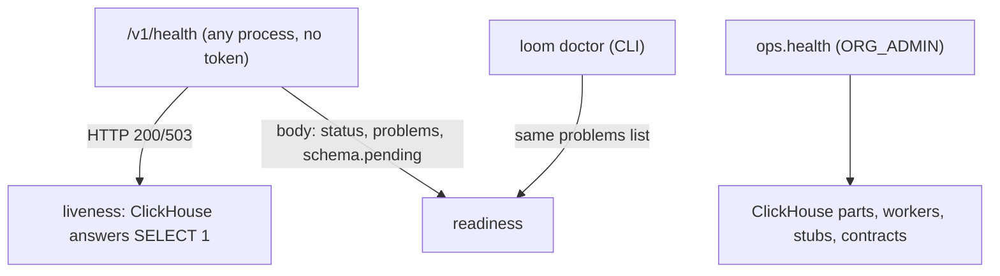

<!-- i18n: source=docs/operations/monitoring.md blob=b778428a5dabcc233847330b82b31b92a8373c9c model=claude-sonnet-5-5 -->
> Esta página é uma tradução automática da [página em inglês](https://github.com/ClickHouse/loom/blob/main/docs/operations/monitoring.md), que prevalece.
> Machine-translated from the [English page](https://github.com/ClickHouse/loom/blob/main/docs/operations/monitoring.md), which is authoritative.

<a id="monitoring"></a>

# Monitoramento

Esta página diz o que acompanhar. O Loom reporta sobre si mesmo por quatro superfícies:

| Superfície                      | Escopo                                     |
| ------------------------------- | ------------------------------------------ |
| `/v1/health`, `loom doctor`     | um processo                                |
| `ops.health`                    | verificações mais profundas no ClickHouse  |
| Métricas e spans do OpenTelemetry | gravados no mesmo ClickHouse, ou em OTLP |
| `loom.agent_events`             | o registro de requisições, uma linha por operação |

Os nomes e rótulos das métricas estão catalogados em
[telemetria](https://github.com/ClickHouse/loom/blob/main/docs/features/observability/telemetry.md).

<a id="running-operator-commands"></a>

## Executando comandos de operador

Os comandos de operador são subcomandos do `loom`. Execute-os dentro de um contêiner, que tem o ambiente do deployment:

```bash
docker exec loom-server loom doctor            # web container
docker exec loom-workers loom code stats       # workers container (split deployments)
```

A partir de um checkout, `pip install -e .` instala a mesma CLI; ela lê `LOOM_*` do ambiente e do `.env`. `loom <command> --help` documenta cada flag, e a [referência da CLI](https://github.com/ClickHouse/loom/blob/main/docs/reference/cli.md) lista todas elas.

As visões de toda a organização (custo entre namespaces, `ops.health`) exigem `ORG_ADMIN` ou `PLATFORM_ADMIN`, que somente `LOOM_PLATFORM_ADMINS` concede ([implantação](https://github.com/ClickHouse/loom/blob/main/docs/operations/deployment.md#required-environment)). As rotas `/v1/admin/*` de toda a implantação exigem `PLATFORM_ADMIN`; `token.mint`, `namespace.adopt` e `claim_release` exigem `ORG_ADMIN` na organização em que atuam. Um `admin` de namespace não alcança nenhuma delas.

<a id="health-checks"></a>

## Verificações de saúde



<a id="v1health"></a>

### Endpoint /v1/health

```bash
curl -s http://localhost:7777/v1/health | jq '{status, version, ch_ok, build_commit, schema, problems}'
curl -s 'http://localhost:7777/v1/health?include=workers' | jq '.workers_leader'
```

- **O status HTTP depende apenas do ClickHouse:** 200 quando `SELECT 1` responde, 503 quando
  não responde (`ch_error` indica o tipo do erro; o texto está no log do servidor). Use-o
  como probe de liveness. Assim, um probe
  que lê apenas o código de status (o healthcheck da imagem, um balanceador de carga) vê
  uma indisponibilidade, em vez de um 200 cujo corpo ele nunca analisa.
- **`status`** é `degraded` quando o ClickHouse está fora do ar ou qualquer entrada em `problems` tem
  severidade `error`, exceto `code_tier_failing`, que diz respeito ao índice de um repositório,
  não ao deployment; caso contrário, `ok`. Uma verificação de readiness também deve exigir que
  `schema.pending` esteja vazio (a troca do par de zero downtime faz exatamente isso).
- **`problems`** é uma lista de `{code, severity, message, fix, source}`, da pior para a menos grave. A
  mesma lista é impressa por `loom doctor` e exibida como o banner do painel. `loom doctor`
  nomeia cada entrada que lista em `code_tier_failing`, até cinco (`code.repos` nomeia
  as demais); o token de um administrador da plataforma nomeia cada entrada listada que não seja restrita
  ([quando uma camada falha](https://github.com/ClickHouse/loom/blob/main/docs/operations/code-index-operations.md#when-a-tier-fails)).

| Código do problema                        | Severidade                                                                                          | Significado                                                                                                                                                                                                                                                                                                                                                                                             |
| ----------------------------------------- | --------------------------------------------------------------------------------------------------- | ------------------------------------------------------------------------------------------------------------------------------------------------------------------------------------------------------------------------------------------------------------------------------------------------------------------------------------------------------------------------------------------------------- |
| `fake_embedder`, `fake_llm`               | warn (error com `LOOM_REQUIRE_REAL_PROVIDERS=true`)                                                 | um provedor falso está configurado                                                                                                                                                                                                                                                                                                                                                                      |
| `embedder_key_missing`, `llm_key_missing` | warn (igual)                                                                                        | um provedor real está configurado sem a sua chave; o processo roda com o cliente falso                                                                                                                                                                                                                                                                                                                  |
| `embedding_dim_mismatch`                  | error                                                                                               | o embedder retorna uma largura diferente de `LOOM_EMBEDDING_DIM`                                                                                                                                                                                                                                                                                                                                        |
| `coded_width_mismatch`                    | error                                                                                               | a largura de uma coluna de vetor codificada difere da que suas escritas carregam; essas escritas falham                                                                                                                                                                                                                                                                                                 |
| `provider_failing:<name>`                 | error                                                                                               | a última chamada a esse provedor falhou; some na próxima chamada bem-sucedida                                                                                                                                                                                                                                                                                                                           |
| `model_configuration_refused`             | error                                                                                               | a configuração de modelo salva no painel falha na verificação do gateway e não é aplicada; toda requisição do plano de dados responde 503 `GATEWAY_REQUIRED` e o servidor não fica pronto até que ela seja substituída                                                                                                                                                                                   |
| `jwt_secret_empty`                        | error                                                                                               | não é possível assinar tokens                                                                                                                                                                                                                                                                                                                                                                           |
| `dev_jwt_secret`                          | warn                                                                                                | o segredo de desenvolvimento versionado no repositório, com a autenticação ativada                                                                                                                                                                                                                                                                                                                      |
| `config_drift`                            | error                                                                                               | o segredo raiz ou as configurações MUST_MATCH deste processo diferem da configuração publicada do deployment: ele não fica pronto ([executando N réplicas](https://github.com/ClickHouse/loom/blob/main/docs/operations/replicas.md))                                                                                                                                                                      |
| `revocation_not_loaded`                   | error                                                                                               | autenticação ativada e este processo nunca leu `loom.revoked_tokens`: todo bearer recebe 503                                                                                                                                                                                                                                                                                                            |
| `revocation_stale`                        | warn                                                                                                | o snapshot de revogação é mais antigo que max(300 s, 10 × `LOOM_JWT_REVOCATION_CACHE_TTL_SECONDS`): um token revogado desde então ainda autentica aqui                                                                                                                                                                                                                                                  |
| `revocation_too_stale`                    | error                                                                                               | o snapshot é mais antigo que `LOOM_JWT_REVOCATION_MAX_STALE_SECONDS` (600 s): todo bearer recebe 503 até que uma atualização chegue                                                                                                                                                                                                                                                                     |
| `pending_migrations`                      | error                                                                                               | o schema não tem migrações que este build espera                                                                                                                                                                                                                                                                                                                                                        |
| `instance_label_missing`                  | warn                                                                                                | um processo fora dos arquivos compose não tem `LOOM_INSTANCE_LABEL`                                                                                                                                                                                                                                                                                                                                     |
| `workers_lease_absent`                    | warn, ou info                                                                                       | warn: nenhum processo detém um lease de workers ativo (um processo com `LOOM_BACKGROUND_WORKERS=on` não toma nenhum, então isso aparece ao lado de um; durante uma transição ou uma partida a frio pode aparecer por um instante); info: este processo não executa workers e não leu o lease recentemente                                                                                                |
| `workers_lease_unreachable`               | warn                                                                                                | este processo não conseguiu consultar o ClickHouse sobre o lease de workers; se todos os processos disserem isso, nada executa os workers                                                                                                                                                                                                                                                               |
| `workers_lease_given_up`                  | warn                                                                                                | este processo liberou o lease de workers e parou de disputá-lo (está sendo drenado, ou seu processo filho de workers continuou falhando ao iniciar); outro processo assume                                                                                                                                                                                                                              |
| `otel_erasure_index`                      | warn                                                                                                | as tabelas de métricas do ClickStack não têm o índice de que o apagamento precisa ([manutenção](https://github.com/ClickHouse/loom/blob/main/docs/operations/maintenance.md#clickstack-erasure-index))                                                                                                                                                                                                  |
| `code_tier_failing`                       | warn (error quando também está `LOOM_CODE_TIER_FAILING_ERROR_LAG_COMMITS` atrás; a camada de fetch continua warn) | uma camada do índice de código falhou em `LOOM_CODE_TIER_FAILING_WARN_PASSES` passagens seguidas ou por `LOOM_CODE_TIER_FAILING_WARN_HOURS`; o fix indica o que o tipo de erro exige ([quando uma camada falha](https://github.com/ClickHouse/loom/blob/main/docs/operations/code-index-operations.md#when-a-tier-fails)). Ele nunca degrada `status`; `loom.health.problems` o carrega como qualquer problema, então um alerta em `severity="error"` ali deve excluir `code="code_tier_failing"`. |

Outros campos do corpo: `providers` (estado das chamadas por provedor), `fake_embedding`, `fake_llm`,
`providers_degraded`, `embedding_dim_mismatch`, `adaptive_thresholds` (os limites de
similaridade derivados do embedder, com `calibration_hash` — igual em toda réplica que serve
os mesmos limites — e `source`: `shared` ou o `probe` da própria réplica), `ratelimit.backend` (`shared` ou
`per-process`) e `mode` (`ch`, mais `langfuse` e `clickstack` quando
configurados). `?include=` aceita `workers`, `langfuse`, `otel`, `embedding_cache` e
`llm_cache`; cada subsistema é reportado separadamente e apenas o ClickHouse decide o status
HTTP.

<a id="loom-doctor"></a>

### Comando loom doctor

`loom doctor` executa suas verificações (`python_version`, `settings_load`, `jwt_secret`,
`clickhouse_reachable`, `otel_erasure_index`, `llm_provider`) e depois imprime a
lista `problems` como linhas `problem:<code>`. Toda verificação é reportada antes de ele sair; o
código de saída é 1 quando alguma linha é `FAIL`. `--json` imprime `{ok, checks, problems}`. Com
`LOOM_CELL` definido e o ClickHouse acessível, ele também executa as verificações de [célula](../architecture/cells.md)
(`cell_state`, `cell_marker`, `cell_marker_everywhere`, `cell_triggers`), classificadas no máximo como `WARN`,
e `cell_deployment`, `FAIL` quando a verificação do deployment recusa (sem
`LOOM_PG_DSN`, outra autoridade ou deployment registrado, ou acesso negado ao ClickHouse). Com
a inteligência de código ativada e o ClickHouse acessível, ele também lê as camadas do índice de código
que estão falhando e as classifica com as substituições de runtime do deployment; `problem:code_tier_failing`
é no máximo `WARN`, pois nunca degrada `status`.

`--client` também verifica esta máquina como cliente de agente de código: a URL do servidor e o token
que os hooks usariam (`--server-url`, `--token` os substituem), se o token é
aceito e pode escrever no seu namespace, a integração com Claude Code ou Codex e os jobs de captura
que nunca chegaram ao servidor. `loom report` imprime a saída do doctor para o campo Environment de um
relatório de bug ([abrindo uma issue](https://github.com/ClickHouse/loom/blob/main/CONTRIBUTING.md#filing-an-issue)).

<a id="opshealth"></a>

### Operação ops.health

`POST /v1/ops.health` (`ORG_ADMIN`) executa verificações mais profundas no ClickHouse. Cada verificação
retorna `status` (`ok`, `warn` ou `fail`), `detail` e `repair`. O `detail` de um probe com falha
indica o tipo do erro (o código e a mensagem de um erro do Loom), e o `last_error_kind` de cada worker
indica a classe do erro; o texto do erro está no log do servidor e em
`/v1/admin/workers.status`. `/v1/health?include=workers` corta as linhas de workers da mesma
forma quando o supervisor em processo executa os workers: sem `last_error`, apenas números de resultado
e flags.

| Verificação              | O que examina                                                         |
| ------------------------ | --------------------------------------------------------------------- |
| `clickhouse_parts`       | partes ativas por tabela e merges que falharam nos últimos 15 minutos |
| `workers`                | falhas recentes nas passagens dos workers                             |
| `embedding_stubs`        | linhas de embedding de memória ainda aguardando um vetor                      |
| `schema_contracts`       | tabelas e colunas de alto risco comparadas com o dump do schema               |
| `memory_schema_contract` | as colunas persistidas de `loom.memory` comparadas com o dump do schema       |
| `op_mix`                 | a mistura recente de operações em `loom.agent_events`                         |
| `procedure_plane`        | `loom.procedure_runs` e as chaves de procedure registradas no ledger          |

<a id="smoke-test"></a>

### Teste de fumaça

Após um deploy, escreva e leia uma memória de ponta a ponta:

```bash
export LOOM_API_KEY=$(docker exec loom-server loom mint-token --subject smoke --org dev --namespaces smoke --roles writer --ttl-days 1)
curl -s -XPOST http://localhost:7777/v1/memory.set -H "Authorization: Bearer $LOOM_API_KEY" \
  -H 'Content-Type: application/json' \
  -d '{"org":"dev","namespace":"smoke","agent":"smoke","memory_key":"k","value":"deploy smoke test"}'
curl -s -XPOST http://localhost:7777/v1/memory.search -H "Authorization: Bearer $LOOM_API_KEY" \
  -H 'Content-Type: application/json' \
  -d '{"org":"dev","namespace":"smoke","agent":"smoke","query":"smoke test"}' | jq '.results[0].content_excerpt'
```

Se a busca se abstiver de responder, verifique `loom.embed.pending` e o bloco `providers` de
`/v1/health`: uma linha aguardando seu vetor está armazenada, mas ainda não pode ser pesquisada.

<a id="worker-status"></a>

## Status dos workers

O trabalho em segundo plano roda em loops supervisionados, declarados em `server/workers/registry.py`
(`_WORKERS`). O supervisor tenta novamente uma passagem que falhou, com backoff, cancela uma passagem que
excede seu prazo (por padrão min(4 × interval, 900 s), com piso de 60 s) e registra
`<worker>: DEGRADED` quando um worker falha em três passagens consecutivas. Cada worker é
ativado ou desativado por uma flag `LOOM_*_ENABLED`; a [referência de workers](https://github.com/ClickHouse/loom/blob/main/docs/reference/workers.md)
lista cada worker, sua flag, o valor padrão e a cadência.

```bash
curl -s -H "Authorization: Bearer $ADMIN_TOKEN" http://localhost:7777/v1/admin/workers.status | jq
```

Muitos relatos de "isso nunca aconteceu" se devem a um worker que não rodou: gerar o embedding de uma nova linha,
extrair um lote adiado, indexar um commit.

- `/v1/admin/workers.status` lista todos os workers registrados, inclusive os desativados, com
  seu intervalo e a última passagem. Ele combina o registro deste processo com `loom.worker_status`
  (mantido por 30 dias), de modo que um contêiner somente web mostra as passagens executadas pelo contêiner de workers.
  A visão admin **Health** do painel mostra o mesmo.
- `/v1/health?include=workers` → `workers_leader.reason` informa se este processo detém
  o lease de workers do deployment (`workers_supervisor` no ClickHouse).
- Métricas: `loom.worker.consecutive_failures{worker}` e
  `loom.worker.partial_failures{worker}`.
- `ops.projection_failures.list` (`ORG_ADMIN`) lista as projeções secundárias que falharam
  e aguardam o worker `projection_repair`; `ops.projection_failures.retry` tenta novamente
  uma delas.
- As instruções ClickHouse de um worker carregam `log_comment = 'worker.<name>'`
  ([atribuição de consultas](#logs-traces-and-query-attribution)).

<a id="what-to-alert-on"></a>

## O que monitorar com alertas

Os limites abaixo são pontos de partida; defina a linha de base de similaridade a partir da sua própria implantação, pois ela depende do embedder.

| Sinal                                                         | Alertar quando                                                    | Significa                                                                                                 | Primeiro passo                                                                                                                                                                                                                                                                    |
| ------------------------------------------------------------- | ----------------------------------------------------------------- | --------------------------------------------------------------------------------------------------------- | --------------------------------------------------------------------------------------------------------------------------------------------------------------------------------------------------------------------------------------------------------------------------------- |
| Status HTTP de `/v1/health`                                   | 503                                                               | ClickHouse inacessível a partir deste processo                                                            | [solução de problemas](https://github.com/ClickHouse/loom/blob/main/docs/operations/troubleshooting.md#every-operation-fails-and-v1health-returns-503)                                                                                                                                                                                            |
| `status` de `/v1/health`                                      | `degraded` por 5 minutos                                          | um problema `error` diferente de `code_tier_failing`                                                      | leia `problems[].fix`                                                                                                                                                                                                                                                             |
| média de `loom.search.top_similarity`                         | abaixo da sua linha de base por 30 minutos                        | a recuperação piorou sem falhar (troca de embedder, fallback fake)                                        | [solução de problemas](https://github.com/ClickHouse/loom/blob/main/docs/operations/troubleshooting.md#search-returns-arbitrary-results-or-extraction-writes-nothing)                                                                                                                                                                             |
| `loom.embed.pending`                                          | acima de 100 por 15 minutos                                       | memórias ainda não pesquisáveis; vazão ou cota do embedder                                                | estado do provedor em `/v1/health` → `providers`                                                                                                                                                                                                                                  |
| qualquer `loom.integrity.*`                                   | acima de 0                                                        | um defeito que já ocorreu e não será drenado ([abaixo](#integrity-invariants))                            | a coluna de reparo                                                                                                                                                                                                                                                                |
| `loom.worker.consecutive_failures`                            | ≥ 3                                                               | um worker falhando em loop                                                                                | [solução de problemas](https://github.com/ClickHouse/loom/blob/main/docs/operations/troubleshooting.md#a-worker-fails-every-pass)                                                                                                                                                                                                                 |
| `loom.process.open_fds / loom.process.fd_limit`               | acima de 0.5                                                      | um vazamento de descritores ou conexões demais                                                            | série por processo (`loom.pid`)                                                                                                                                                                                                                                                   |
| `loom.host.disk.free_bytes / loom.host.disk.total_bytes`      | abaixo de 0.10                                                    | o disco sob `var/` enchendo (repacks de repositório, logs, blobs); em zero toda escrita no host falha    | uma série por processo (`loom.disk.path`)                                                                                                                                                                                                                                         |
| `loom.langfuse.breaker`                                       | = 2                                                               | as postagens de scores no Langfuse falham; os scores são descartados                                      | acessibilidade do Langfuse para `POST /api/public/scores`                                                                                                                                                                                                                         |
| `loom.code.index_lag_commits`                                 | acima do orçamento de commits por passagem por 15 minutos         | o índice de código está ficando atrás da branch                                                           | [operações do índice de código](https://github.com/ClickHouse/loom/blob/main/docs/operations/code-index-operations.md#failure-model)                                                                                                                                                                                                                 |
| `loom.code.tier_lag_seconds`                                  | acima de 1800 por 10 minutos                                      | uma camada do compilador não alcançou os merges recentes                                                  | o alerta "code tier lag" em `deploy/dashboards/code_plane.json`; defina-o acima do ciclo normal da camada mais lenta                                                                                                                                                              |
| `loom.code.tier_failing`                                      | qualquer ponto por 15 minutos (`severity="error"` para um page)   | uma camada do índice de código que o problema `code_tier_failing` reporta, além dos limites `LOOM_CODE_TIER_FAILING_*` | o `fix` de `code_tier_failing` em `/v1/health` ([quando uma camada falha](https://github.com/ClickHouse/loom/blob/main/docs/operations/code-index-operations.md#when-a-tier-fails))                                                                                                                                                              |
| `clickhouse_parts` em `ops.health`, ou erro 252               | `fail`                                                            | merges falhando                                                                                           | [solução de problemas](https://github.com/ClickHouse/loom/blob/main/docs/operations/troubleshooting.md#writes-fail-with-too_many_parts-or-merges-are-failing)                                                                                                                                                                                     |
| `loom.audit.checkpoint_lag_windows`                           | crescendo                                                         | a cadeia de checkpoints de auditoria está atrasada                                                        | as passagens do worker `audit_verifier`                                                                                                                                                                                                                                           |
| `loom.auth.agents_provisioned{outcome=made}` por `loom.trust` | acima da taxa normal do plano de controle (comece em 50 em 10 minutos) | um trust nomeia novos agentes mais rápido do que sua frota cresce: uma chave de emissor vazada ou um plano de controle descontrolado | compare as linhas de auditoria `auth.agent_provisioned` do trust (`audit.list`) com os agentes que seu plano de controle iniciou; se diferirem, `loom bot disable --name <trust>` e rotacione a chave do emissor                                                                                   |
| `loom.auth.trust_agents_used_ratio`                           | acima de 0.8                                                      | o trust se aproxima de `--max-agents`, contado sobre seus agentes ativos (um agente liberado devolve a vaga) | se `outcome=made` também subiu mais rápido do que a frota cresce, siga a linha `outcome=made` (desabilite o trust, rotacione a chave); caso contrário, aumente o limite: `loom bot create --replace` com as flags do trust e um `--max-agents` maior (isso encerra os tokens dos agentes; cada um troca de novo) |
| `loom.auth.agents_provisioned{outcome=at_cap}`                | aumento acima de 0 em 10 minutos                                  | novos agentes do trust são recusados                                                                      | se `outcome=made` também subiu mais rápido do que a frota cresce, siga a linha `outcome=made` (desabilite o trust, rotacione a chave); caso contrário, aumente o limite: `loom bot create --replace` com as flags do trust e um `--max-agents` maior (isso encerra os tokens dos agentes; cada um troca de novo) |

Com o HyperDX, um resultado vazio é lido como 0; portanto, uma proteção de amostra mínima deve retornar um valor dentro da faixa saudável em vez de nenhuma linha.

Os sinais que indicam o que escalar (réplicas web, cota do provedor, container de workers ou ClickHouse) estão em [falha e recuperação](../architecture/failure-and-recovery.md).

<a id="pipeline-slos"></a>

### SLOs do pipeline

Sob a autoridade Postgres, uma escrita responde no seu commit e se torna pesquisável quando sua linha de memória e seu documento de busca estão no ClickHouse ([autoridade de armazenamento](../architecture/storage-authority.md#publication)). Uma busca que encontra escritas anteriores ainda ausentes espera por elas, até `LOOM_PG_PROJECTION_WAIT_MS` (padrão 2000 ms), e responde 503 `PROJECTION_BEHIND` após esse prazo.

| Objetivo                                    | Meta                                                                                                              | Sinal                                                                         |
| ------------------------------------------- | ----------------------------------------------------------------------------------------------------------------- | ----------------------------------------------------------------------------- |
| Uma leitura espera por escritas anteriores  | p99 abaixo de metade de `LOOM_PG_PROJECTION_WAIT_MS`, e nenhuma terminando em `deadline` fora de uma indisponibilidade (a op responde 503) | `loom.pg.search_wait_ms` por `outcome`                                        |
| Uma escrita está no ClickHouse              | p99 abaixo de metade de `LOOM_PG_PROJECTION_WAIT_MS`, para que a espera de uma leitura tenha a outra metade        | `loom.pg.projection_lag_ms{path="flush"}`                                     |
| Nada espera além do lease de um escritor parado | o pendente mais antigo abaixo de duas vezes `LOOM_PG_REQUEST_LEASE_SECONDS` mais `LOOM_PG_DELIVERY_IDLE_INTERVAL_SECONDS` | `loom.pg.oldest_pending_age_s{source="memory"}`                               |
| Nenhum erro de atraso fora de uma indisponibilidade | 0                                                                                                         | `loom.requests{loom.error_code="PROJECTION_BEHIND" or "PUBLICATION_PENDING"}` |
| Nada que o ClickHouse continue recusando    | 0 fora da retenção de um reconcile de restauração                                                                 | `loom.pg.backlog{state="parked"}`                                             |

O pior tempo de espera de uma busca sob um escritor que parou antes de publicar é o seu lease (`LOOM_PG_REQUEST_LEASE_SECONDS`): uma busca em espera publica ela mesma uma entrega expirada. Isso está acima da espera padrão, então aparece como `outcome="deadline"`, não como latência. A prontidão não depende de nenhum destes: toda réplica lê o mesmo Postgres, então uma verificação de prontidão baseada em atraso tiraria todas as réplicas de rotação de uma só vez.

Todo processo que executa os workers de entrega exporta o backlog de toda a implantação, e vários podem fazê-lo ao mesmo tempo; portanto, leia os gauges de backlog com `max`, não com `sum`.

Alertas:

| Sinal                                             | Alertar quando                  | Significa                                                                                                                                                                 | Primeiro passo                                                                                   |
| ------------------------------------------------- | ------------------------------- | ------------------------------------------------------------------------------------------------------------------------------------------------------------------------- | ------------------------------------------------------------------------------------------------ |
| taxa de `loom.pg.search_wait_ms{outcome="deadline"}` | acima de 0 por 5 minutos     | uma leitura esgotou o prazo: a op responde 503 `PROJECTION_BEHIND`, um relatório segue lendo                                                                              | acessibilidade do ClickHouse, depois `loom.pg.backlog` e as passagens do worker `pg_delivery`    |
| `loom.pg.oldest_pending_age_s{source="memory"}`   | acima da meta por 10 minutos    | o worker de entrega não está acompanhando, ou o ClickHouse recusa                                                                                                         | `GET /v1/health?include=postgres` → `postgres.backlog`, o status do worker `pg_delivery`         |
| `loom.pg.backlog{state="parked"}`                 | acima de 0                      | uma entrega que o ClickHouse continuou recusando, ou uma retida por um reconcile de restauração (seu `last_error` diz qual)                                               | o `last_error` da entrega ([autoridade de armazenamento](../architecture/storage-authority.md#delivery)) |
| nenhum ponto de `loom.pg.backlog` de nenhum processo | por 3 períodos de exportação | a leitura parou: a leitura do backlog falha, nenhuma passagem de entrega começa, ou o tempo entre o início de duas passagens (uma passagem e o intervalo após ela) excede dois períodos de exportação | o aviso `backlog not read` nos logs dos workers `pg_delivery` e `knowledge_pg_delivery`          |

<a id="integrity-invariants"></a>

### Invariantes de integridade

Cada um destes gauges deve marcar 0 para sempre. Eles são calculados a cada 15 minutos pelo processo que detém o lease dos workers e ficam em cache.

| Métrica                                                         | Um valor diferente de zero significa                                            | Reparo                                             |
| --------------------------------------------------------------- | ------------------------------------------------------------------------------- | -------------------------------------------------- |
| `loom.integrity.divergent_entities`                             | entidades diferem entre `loom.memory` e `loom.memory_embeddings` para uma memória | investigue o caminho de escrita                    |
| `loom.integrity.orphan_vectors`                                 | vetores incorporados cuja linha de memória não existe mais                      | worker `orphan_vector_reconcile`                   |
| `loom.integrity.orphan_entity_vectors`                          | vetores de entidade cuja linha de memória não existe mais                       | worker `orphan_vector_reconcile`                   |
| `loom.integrity.orphan_graph_namespaces`                        | namespaces com arestas de entidade, mas sem memória ou conhecimento ativos      | `loom erasure-re-verify --orphan-graph --erase`    |
| `loom.integrity.live_ns_unregistered`, `live_rows_unregistered` | memória ativa em namespaces sem linha em `loom.namespaces`                      | registre o namespace ou use `loom namespaces-adopt` |
| `loom.integrity.dim0_with_vector`                               | linhas com vetor, mas com `embedding_dim = 0`, invisíveis para a busca          | `loom integrity-repair --apply`                    |
| `loom.integrity.tombstone_status_drift`                         | linhas com `tombstoned_at` definido e outro status                              | listadas por `loom integrity-repair`               |
| `loom.integrity.active_past_valid_to`                           | linhas ativas além do próprio `valid_to`                                        | listadas por `loom integrity-repair`               |
| `loom.integrity.high_with_embedding`                            | linhas de alta sensibilidade que ainda têm uma linha de embedding ativa         | `loom sensitivity-sweep --apply`                   |

Os comandos de reparo são descritos em [manutenção](https://github.com/ClickHouse/loom/blob/main/docs/operations/maintenance.md#backfills-and-repairs).

<a id="metrics"></a>

## Métricas

O Loom exporta métricas do OpenTelemetry a cada `LOOM_OTEL_METRICS_EXPORT_INTERVAL_S` segundos
(padrão: 60). Com `LOOM_OTEL_EXPORTER=ch` (o padrão quando nenhum endpoint OTLP está definido),
elas são gravadas diretamente em `default.otel_metrics_sum`,
`default.otel_metrics_histogram` e `default.otel_metrics_gauge` no mesmo serviço ClickHouse
(em `LOOM_CLICKSTACK_DATABASE`, quando definido, aqui e a seguir), as tabelas
que o ClickStack/HyperDX lê; defina `LOOM_OTEL_EXPORTER_OTLP_ENDPOINT` para
enviar a um coletor. Contadores e histogramas são cumulativos, a menos que
`LOOM_OTEL_METRICS_DELTA_TEMPORALITY=true`. O log de inicialização confirma o exportador:

```text
OTel metrics initialized — emitting every 60s (cumulative temporality, gauge heartbeat …s) to default.otel_metrics_{sum,histogram,gauge}
```

Os rótulos vêm de um conjunto fechado (operação, namespace, enums limitados); chaves, IDs de usuário,
IDs de sessão e texto de consulta nunca são rótulos (`tests/unit/test_domain_metrics.py`
garante isso). O catálogo completo, agrupado por requisições e custo, qualidade de recuperação,
gravações de memória, backlogs, integridade e o índice de código, está em
[telemetria](https://github.com/ClickHouse/loom/blob/main/docs/features/observability/telemetry.md).

Consultas iniciais:

```sql
-- mean top similarity per namespace, last hour
SELECT Attributes['loom.namespace'] AS ns,
       round(anyLast(Sum) / greatest(anyLast(Count), 1), 3) AS mean_top_similarity
FROM default.otel_metrics_histogram
WHERE MetricName = 'loom.search.top_similarity' AND TimeUnix > now() - INTERVAL 1 HOUR
GROUP BY ns;

-- every gauge's latest value
SELECT MetricName, anyLast(Value) AS latest
FROM default.otel_metrics_gauge
WHERE TimeUnix > now() - INTERVAL 5 MINUTE
GROUP BY MetricName ORDER BY MetricName;
```

A primeira consulta lê histogramas cumulativos, portanto é uma média de todo o período por série; para uma
média em janela, calcule a diferença entre cada ponto e o ponto anterior da sua série (a
correção em `deploy/hyperdx_dashboards.md`, "The cumulative-counter correction").

<a id="dashboards"></a>

## Painéis

[`deploy/hyperdx_dashboards.md`](https://github.com/ClickHouse/loom/blob/main/deploy/hyperdx_dashboards.md) é o guia de configuração do ClickStack
e do HyperDX, com um livro de receitas de painéis em SQL; a integração com o ClickStack em si é
descrita em [ClickStack](../features/integrations/clickstack.md).

- **Sem collector.** O Loom grava linhas OTel diretamente em `default.otel_*` no próprio
  ClickHouse, de modo que um ClickStack hospedado só precisa ter suas sources apontadas para as tabelas
  existentes (`deploy/clickstack_sources.sh` automatiza isso). Onde nenhuma instalação do HyperDX as tenha criado,
  aplique `schemas/otel/clickstack_otel_tables.sql` uma vez, manualmente; todas as instruções são
  `IF NOT EXISTS`.
- **Duas armadilhas que os painéis evitam.** A instrumentação do FastAPI emite spans filhos ASGI com o mesmo nome
  do span pai (`POST /v1/memory.get http send`), o que infla um filtro por nome de span
  em cerca de três vezes; apenas o span pai carrega atributos `loom.*`, então filtre por
  `mapContains(SpanAttributes, 'loom.operation')`. Além disso, métricas cumulativas exigem um
  delta por série: `sum(Value)` em uma janela soma totais acumulados.
- **O painel do índice de código.** [`deploy/dashboards/code_plane.json`](https://github.com/ClickHouse/loom/blob/main/deploy/dashboards/code_plane.json)
  é a fonte da verdade do painel "Loom — Code Plane": cada tile com sua
  fonte e seu SQL, e os tiles que trazem um bloco `alert` com limite e motivo.
  Provisione a partir do JSON em vez de editar os tiles na interface, para que a próxima reconstrução
  seja idêntica.
- Se os painéis continuarem vazios, verifique `docker logs loom-server 2>&1 | grep -i otel`. Os spans são
  descarregados a cada poucos segundos; as métricas, uma vez por intervalo de exportação. Uma tabela ausente aparece como
  `default.otel_traces does not exist … Self-disabling span export`.

<a id="logs-traces-and-query-attribution"></a>

## Logs, traces e atribuição de consultas

- **Logs.** `docker logs loom-server` e `docker logs loom-workers`.
  `LOOM_LOG_FORMAT=json` para um pipeline de logs, `LOOM_LOG_LEVEL` para a verbosidade. O log de inicialização
  informa os providers resolvidos e cada migração aplicada; o supervisor registra cada
  passada com falha e a linha `DEGRADED`.
- **O ledger.** `loom.agent_events` tem uma linha por operação: `operation`, colunas de
  identidade, `request_id`, `trace_id`, `latency_ms`, `success`, `error_code`, tokens,
  `upstream_cost_usd`, `model`, `consumer`, `traffic_class`, `build_commit`, `instance`
  e `instance_label`. `loom.audit_log` registra quem alterou o quê, com um hash do conteúdo
  por linha ([auditoria](https://github.com/ClickHouse/loom/blob/main/docs/features/observability/audit.md)).
- **Traces.** Os spans vão para `default.otel_traces` (ou para o endpoint OTLP), com as tags
  `loom.org`, `loom.namespace`, `loom.agent`, `loom.operation`, `loom.request_id` e
  `enduser.id`. Com o Langfuse configurado, a árvore de spans também vai para o Langfuse
  ([Langfuse](https://github.com/ClickHouse/loom/blob/main/docs/features/integrations/langfuse.md)). Toda resposta HTTP traz
  `X-Request-Id` (o do cliente, quando ele envia um com 1 a 64 letras, dígitos, `.`, `_` ou `-`)
  e `X-Trace-Id`.
- **Toda consulta ao ClickHouse é atribuída** em sua configuração `log_comment`:

| `log_comment`                  | Emitido por                                                       |
| ------------------------------ | ----------------------------------------------------------------- |
| `<operation> <request_id>`     | uma requisição (HTTP ou MCP)                                      |
| `worker.<name>`                | uma passada de worker                                             |
| `cli.<command>[.<subcommand>]` | um comando `loom` (não `loom serve`)                              |
| `untagged:<module>.<function>` | qualquer outra origem; um loop em segundo plano deve chamar `set_query_tag(...)` |

Com `LOOM_CH_LOG_COMMENT_STATEMENT_DIGEST=true`, um digest da instrução vem depois da tag, então
faça a correspondência com um `%` no final.

```sql
-- which operations cost ClickHouse the most in the last hour
SELECT splitByChar(' ', log_comment)[1] AS source,
       count() AS queries, sum(read_bytes) AS bytes, sum(query_duration_ms) AS ms
FROM system.query_log
WHERE type = 'QueryFinish' AND event_time > now() - INTERVAL 1 HOUR AND log_comment != ''
GROUP BY source ORDER BY ms DESC LIMIT 20;

-- one request end to end
SELECT * FROM loom.agent_events WHERE request_id = '<id>';
```

`LOOM_INSTANCE_LABEL` (obrigatório fora dos arquivos compose) mantém as linhas de um laptop ou de um servidor
de teste separáveis das do próprio deployment em ambas as consultas. Depois de uma troca de cor (colour swap),
`loom deploy-delta` compara o ledger e os formatos das instruções em cada lado da troca.
Ele lê `--window-min` minutos de cada lado (padrão 60), então execute-o somente depois que essa janela
tiver passado e mantenha seu próprio tráfego de leitura de verificação fora dela: requisições logo após uma troca rodam
com caches frios e inflam a latência do lado posterior.

<a id="rate-limits-and-traffic-classes"></a>

## Limites de taxa e classes de tráfego

Toda requisição consome de dois buckets de tokens, um por namespace e um por organização (três
vezes o tamanho do namespace), indexados pela classe da operação. Ao exceder o limite, a resposta é 429
`RATE_LIMITED` com os headers `Retry-After` e `X-RateLimit-*`.

| Classe             | Operações                                                                                                     | Burst / taxa sustentada por namespace |
| ------------------ | ------------------------------------------------------------------------------------------------------------- | ------------------------------------- |
| `memory`           | `memory.*`, `conversation.*` (exceto as leituras por chave exata e `memory.import`)                           | 100 / 17 por segundo                  |
| `memory.read`      | leituras por chave exata: `memory.get`, `memory.bulk_get`, `memory.history`, `working_memory.get`, …          | 300 / 50 por segundo                  |
| `memory.import`    | `memory.import`                                                                                               | 10 / 2 por segundo                    |
| `knowledge.search` | `knowledge.search`                                                                                            | 20 / 3 por segundo                    |
| `knowledge.query`  | `knowledge.query`                                                                                             | 20 / 3 por segundo                    |
| `knowledge.read`   | as demais operações `knowledge.*` `read_only`, exceto `knowledge.inspect`: `knowledge.get`, `knowledge.list`, … | 50 / 10 por segundo                 |
| `knowledge.add`    | toda outra operação `knowledge.*`, incluindo `knowledge.inspect`, `knowledge.synthesize` e `knowledge.dedup_list` | 10 / 2 por segundo                |
| `code`             | `code.*` (exceto `code.outcome`, que consome de `memory`)                                                     | 60 / 10 por segundo                   |
| `insights.query`   | `insights.query`                                                                                              | 20 / 3 por segundo                    |
| `assistant.ask`    | `assistant.ask` e a rota de chat do assistente                                                                | 10 / 1 por segundo                    |
| `default`          | todo o resto                                                                                                  | 50 / 10 por segundo                   |

As requisições são classificadas como `production`, `interactive` ou `bench` (a claim do token em
`loom mint-token --traffic-class`; se ausente, o registro do namespace; se ausente, a dica da
requisição); o header de resposta `X-Loom-Traffic-Class` indica qual foi usada. O tráfego bench recebe
buckets próprios e menores (`LOOM_RATELIMIT_CLASS_FRACTIONS`) e menor prioridade no ClickHouse,
de modo que um benchmark não consiga gastar o orçamento de produção. Os limites são aplicados por réplica; veja
`LOOM_REPLICA_COUNT` em [falha e recuperação](../architecture/failure-and-recovery.md).
`POST /v1/admin/ratelimit.set` com `{namespace|org, op_class, capacity, rate}` (ou
`clear: true`) sobrescreve um bucket. A sobrescrita é armazenada em `loom.runtime_overrides`, e
todo processo a adota dentro de `LOOM_RUNTIME_OVERRIDES_REFRESH_SECONDS` (padrão 10); ela
sobrevive a uma reinicialização. `POST /v1/admin/budget.set` armazena sobrescritas do orçamento de latência
da mesma forma. O preenchimento dos buckets em si continua por host.

<a id="related"></a>

## Relacionados

- [Solução de problemas](https://github.com/ClickHouse/loom/blob/main/docs/operations/troubleshooting.md): guias de resolução que partem do sintoma, para o que esses
  sinais detectam
- [Telemetria](https://github.com/ClickHouse/loom/blob/main/docs/features/observability/telemetry.md): o catálogo de métricas e spans
- [Custo e uso](https://github.com/ClickHouse/loom/blob/main/docs/features/observability/cost-and-usage.md) e
  [auditoria](https://github.com/ClickHouse/loom/blob/main/docs/features/observability/audit.md)
