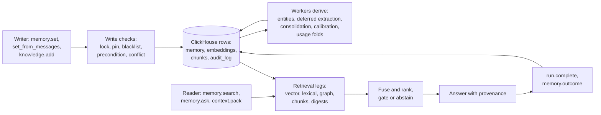
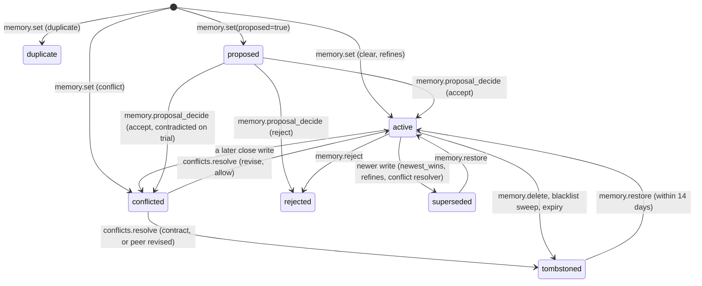

<!-- i18n: source=docs/concepts/memory.md blob=46b7e25492e9b562efacbe206c873ee4acd53694 model=claude-sonnet-5-5 -->
> 本页由机器从[英文原文](https://github.com/ClickHouse/loom/blob/main/docs/concepts/memory.md)翻译，内容以英文原文为准。
> Machine-translated from the [English page](https://github.com/ClickHouse/loom/blob/main/docs/concepts/memory.md), which is authoritative.

<a id="memory"></a>

# 记忆

一条记忆就是 agent 之后应当能再次找到的一个论断，例如“部署在周二进行”“支付团队负责账单服务”。Loom 把每个论断存为 `loom.memory` 中的一行，使用可读的键，并记录写入者、论断成立的时间、来源，以及是否有人为其背书。本页介绍这一行的结构、写入时如何与已存储的内容比对判定，以及行如何随时间变化。[检索与排序](https://github.com/ClickHouse/loom/blob/main/docs/concepts/retrieval-and-ranking.md)介绍如何找到这些行。

<a id="rows-in-clickhouse"></a>

## ClickHouse 中的行

记忆、文档分块、对话轮次、实体边、代码符号、运行记录、审计条目和擦除请求，都是 ClickHouse 中的行，由服务器在启动时应用的编号迁移创建。在 [Postgres 记忆权威](../architecture/storage-authority.md#why-two-stores)模式下，Postgres 保存实时的记忆和知识状态，ClickHouse 则保存向量、搜索和历史记录。上传的文档原件也是 ClickHouse 中的行（`loom.document_blobs`），除非部署把它们的字节保存在兼容 S3 的存储桶中。除了 ClickHouse、Postgres 和该存储桶之外，Loom 还在共享卷上保存代码索引的 git 镜像（即 ClickHouse 所记录远程仓库的缓存）以及限流桶。

- **身份元组位于排序键的最前面。** `loom.memory` 按 `(org, namespace, agent, user_id, session_id, memory_key)` 排序，因此把读取限定在某个命名空间内就是一次主键范围查询；只有在指定了 agent 的情况下，user 才能完全缩小范围；只有在指定了 agent 和 user 的情况下，session 才能完全缩小范围。[身份与命名空间](https://github.com/ClickHouse/loom/blob/main/docs/concepts/identities-and-namespaces.md)介绍了这个元组。
- **单一引擎。** 在默认的 ClickHouse 权威模式下，向量搜索、词法搜索、图遍历、过滤、审计和擦除都是针对同一批行的 SQL，无需再维护另一个需要保持同步的存储。代价是每次读取都是一次查询，而不是键值命中。在 Postgres 权威模式下，点读取（按键或 id 读取，且不在 `as_of` 回放中）由 Postgres 响应。
- **写入即新版本。** 记忆表使用 `ReplacingMergeTree(version)`，并通过 `FINAL` 读取。修订、墓碑标记、固定或恢复操作都会插入一条新的版本行。

<a id="the-write-derive-read-loop"></a>

## 写入、派生、读取循环



1. **写入。** `memory.set` 会先执行各项检查（见[下文](#how-a-write-is-judged)），然后内联生成嵌入向量，并插入记忆行、对应的嵌入行、长值的原文分块（verbatim chunks）以及一条仅含哈希的审计行。如果内联嵌入失败，调用即失败，不会写入任何内容。`memory.set_from_messages` 由 LLM 从对话记录中挑选出需要长期保留的事实，并通过同样的批量路径写入。
2. **派生。** Workers 负责处理对写入路径来说太慢的工作：实体标签（`entity_extractor`）、延迟提取（`extraction_queue`）、整合后的事实、门限重新校准，以及折算为排序信号的使用情况（`usage_fold`）。派生行带有 `source_class=derived`。
3. **读取。** `memory.search` 会运行多条检索路径（向量、词法、实体图、原文分块、会话摘要），将结果融合并排序，然后返回命中结果或放弃回答。`memory.ask` 生成有依据的回答；`context.pack` 构建受预算限制的提示词块。
4. **反馈。** 如果一次运行指明了它所依赖的记忆（`run.complete` 的 `memories_used`，或 `memory.outcome`），这些记忆会获得加分；结果不佳则记录损害。这会形成一个有界且随时间衰减的排序项。它不会删除任何行，也不会把某一行排到其相关性应有的位置之下。

该循环是最终一致的。写入后立即读取，可以通过内联嵌入找到该事实；实体和提取出的事实会在 worker 下一轮处理之后出现。

<a id="the-loommemory-row"></a>

## `loom.memory` 行

一行是一条记忆的一个版本。

| 分组 | 列 | 决定 |
| ---------- | ------------------------------------------------------------------------------- | ------------------------------------------------------------- |
| 身份 | `org`, `namespace`, `agent`, `user_id`, `session_id`, `run_id` | 谁可以读取它，以及谁写入了它 |
| 地址 | `memory_key`, `memory_id` | 调用方如何称呼它（key），以及 Loom 如何称呼一行（id） |
| 内容 | `value`, `memory_type`, `tags`, `entities`, `files`, `confidence` | 它说了什么，以及如何分类 |
| 生命周期 | `status`, `pinned`, `conflict_with`, `duplicate_of`, `superseded_by`, `version` | 它是否被提供，以及被什么取代 |
| 时间 | `created_at`, `updated_at`, `valid_at`, `valid_to`, `invalid_at`, `expires_at` | 它何时写入，何时有效，何时停止服务 |
| 来源 | `actor`, `source_class`, `content_sha256`, `verified_by`, `verified_sha256` | 谁写入了它，Loom 如何得知它，是否有人证实过它 |
| 防护 | `lock_mode`, `lock_until`, `sensitivity`, `on_expire` | 它拒绝哪些写入，以及如何读取它 |

完整的列列表见[schema 参考](https://github.com/ClickHouse/loom/blob/main/docs/reference/schema.md)。可搜索的记忆在 `loom.memory_embeddings` 中也有一行：包含 value 和 key 的向量，用于词法匹配的摘录的小写、词干提取和词形还原副本，以及排序器读取的 `source_class` 和 `verified` 标志。

<a id="keys"></a>

## 键

一个键以可读路径 `<scope>/<kind>/<id>` 命名某个主体的某一项属性：

```
sre/case/1234/evidence/dns-sidecar
project/loom/deploy-window
user/preferences/editor
```

- **一个键只存一条事实。** 冲突检查、取代和历史都按键进行。如果一个键里存放了多条互不相关的事实，就无法只修订其中一部分。
- **修订时重写同一个键。** Loom 会保留每个版本，因此带编号的副本（`…-v2`）或由值的哈希生成的键只会掩盖修订。由哈希生成的键会在 `namespace.audit` 中作为 `hash_keys` 发现项列出。
- **分面信息放在 `tags` 和 `entities` 中，** 不要放进键里。

存储标识为 `(org, namespace, agent, user_id, session_id, memory_key)`：同一个键由两个 agent 写入，或在两个会话中写入，就是两行记录。在命名空间策略 `newest_wins` 下，某个键的最新写入会使该命名空间中所有带该键的较旧有效行失效，无论是谁写入的。提取时，键由主体和属性生成，而不是由值生成，因此之后的会话如果陈述同一属性，就会落在同一个键上。在 `auto_reinforce` 和 `manual_review` 下，冲突解析器会判定同一用户的两个会话（不包括匿名用户 `-` 或发送为空的 user_id，它们的会话属于相互独立的任务）通过单点写入或批量写入而写下的同一个键的各行，判定方式与判定任何相近的记录对相同：对于它有把握判定为更新的情况，它会使较旧的行失效（`manual_review` 下除外），将矛盾标记为待审核，并让复用同一个键的两条不同事实保持有效。在 `append_only` 下不做任何判定。

<a id="memory-types"></a>

## 记忆类型

`memory_type` 是自由字符串，默认值为 `semantic`。少数取值会改变该行的存储和检索方式（`server/memory/domain/memory_types.py`）：

| 类型                   | 是否嵌入 | 是否出现在未过滤的搜索中 | 用途                                                     |
| ---------------------- | -------- | ------------------------ | -------------------------------------------------------- |
| `semantic`（默认）     | 是       | 是                       | 持久的事实。                                             |
| `preference`           | 是       | 是                       | 应在召回中排名靠前的偏好。                               |
| `procedural`           | 是       | 是                       | 流程（`procedure.*`）。                                  |
| `reflection`           | 是       | 否                       | 从运行中得到的经验教训；使用 `memory_type="reflection"` 读取。 |
| `episodic`             | 否       | 否                       | 按时间先后重放的会话事件。                               |
| `profile`              | 否       | 否                       | 按标签获取、始终加载的上下文（`profile.*`）。            |
| 其他任意值（`decision`） | 是       | 是                       | 领域类型默认可被搜索。                                   |

- **反思不会出现在**未过滤的搜索和 `memory.ask` 中：关于某个流程的经验教训，并不是对世界的陈述。
- **`procedural` 写入**的值如果不是流程主体（非空的 `situation` 和至少两个 `steps`），则会以 `semantic` 存储，并标记 `retyped_from:procedural`，响应会在 `retyped_from` 中说明这一点。
- **敏感度。** `sensitivity="high"` 的行不会被嵌入，因此任何搜索分支都找不到它。它只能通过 key 读取，且该读取会被审计。未设置 `sensitivity` 时，服务器会检测凭据格式、银行卡号、美国社会安全号码和明示的 PIN（`high`），以及电子邮件、电话和 IBAN 格式（`medium`）（`LOOM_MEMORY_SENSITIVITY_AUTODETECT`）。

<a id="status"></a>

## 状态

| 状态         | 含义                                                                       | 默认是否返回              |
| ------------ | -------------------------------------------------------------------------- | ------------------------- |
| `active`     | 当前有效的记忆。                                                           | 是                        |
| `conflicted` | 与另一条记忆相近但内容不同，通过 `conflict_with` 关联。                    | 是                        |
| `duplicate`  | 与某条规范记录（`duplicate_of`）几乎完全相同，由该规范记录代为应答。       | 否（`include_duplicates`） |
| `superseded` | 已被后来的记录取代（`superseded_by`，在 `invalid_at` 失效）。              | 否（`include_superseded`） |
| `proposed`   | 处于试用期的事实，通过 `memory.proposal_decide` 决定去留。                 | 否（`include_proposed`）  |
| `rejected`   | 被标记为错误（`memory.reject`，或被拒绝的提议）。                          | 否                        |
| `tombstoned` | 已被其写入者删除（`memory.delete`）。                                      | 否                        |

默认返回的状态集合只在 `server/memory/domain/temporal_sql.py`（`SERVED_STATUSES`）中定义一次。conflicted 记录仍会被返回：如果隐藏矛盾的某一方，存储就会用一条自己有理由怀疑的事实自信地作答。

<a id="how-a-write-is-judged"></a>

## 写入如何被判定

五个操作覆盖记忆的整个生命周期：

| 视角 | 操作 | 效果 |
| --------- | --------------------- | -------------------------------------------------------------------------- |
| 扩展 | `memory.set` | 在某个 key 下记录一条事实。 |
| 修订 | `memory.update_by_id` | 按 id 修正一行（`memory.update` 按 key 做同样的事）。 |
| 收缩 | `memory.delete` | 为某个 key 打上墓碑标记。`memory.restore` 可在删除后 14 天内恢复。 |
| 强化 | `memory.pin` | 存储并固定：之后任何本身不固定的写入都不能替换它。 |
| 拒绝 | `blacklist.add` | 拒绝此后所有匹配某个子串或正则表达式的写入。 |

可搜索的 `memory.set` 按顺序执行以下检查：

1. **锁与固定保护**，作用于该 key 下的现有行。`memory.lock`（`read_only` 或 `no_delete`）返回 423 `LOCKED`。对已固定的 key 写入不同的值，返回 409 `PINNED_CONFLICT`。逐字节相同的重复陈述可通过所有保护。
2. **黑名单。** 值匹配已登记的模式时返回 422 `BLACKLISTED`；在批量写入中，该条目会被跳过。各副本缓存这些模式，并轮询一张只有一行的版本表（`loom.blacklist_version`），因此新模式会在数秒内到达每个副本。
3. **前置条件。** `if_match_sha256` 使写入只在当前有效行的哈希仍然匹配时才生效；否则返回 409 `PRECONDITION_FAILED`。当前哈希（`content_sha256`）会包含在每个 `memory.get`、`memory.get_by_id` 和 `memory.set` 的响应中。
4. **重复陈述。** 与当前有效行逐字节相同的值，会写入一个新版本，并带上当前有效行的 `reinforcement_count + 1`。批量路径（`memory.bulk_set`，由 `set_from_messages` 使用）把 `(org, namespace, agent, user_id)` 内任何哈希相同的有效行视为同一条事实（`LOOM_MEMORY_BULK_DEDUP_SCOPE=identity`）。
5. **近邻搜索与判定。** 同一 `memory_type` 中、嵌入向量与新值接近的活跃行是**近邻**，按距离由近到远比较；指明了 `user_id` 的写入只从该用户的行中取近邻（[写入如何被判定](https://github.com/ClickHouse/loom/blob/main/docs/features/memory/conflicts-and-refusal.md#how-a-write-is-judged)）：
   - 规范形式相同（转为小写、去除标点、合并空白）→ `merge`：不写入任何内容，近邻被强化，`merged_into_key` 指明它；
   - 存在接近的已固定近邻 → `rejected`，409 `PINNED_CONFLICT`（在覆盖整个命名空间的令牌下，如果写入指明了用户，并重复陈述了其他用户的或共享的已固定值，则会被写入）；
   - 在 `newest_wins` 下，如果某个近邻陈述了相同的主语和谓语但宾语不同 → `refines`：该近邻被停用，除非它的 `valid_at` 晚于新行的，此时返回 `conflict`；
   - 余弦相似度达到或超过重复阈值，且实词相同、没有不同的取值（数字、时间、金额或单位；如 "27:10" / "26:30"）→ `duplicate`；
   - 余弦相似度达到或超过冲突阈值但内容不同 → `conflict`，两行均标为 `conflicted`；
   - 没有接近的近邻 → `clear`。
6. **插入**到 `loom.memory` 和 `loom.memory_embeddings`，并执行取代、实体投影，以及在 `loom.audit_log` 中写入一行仅含哈希的记录。

不可搜索的类型或 `high` 敏感度的行会跳过近邻搜索：它们没有可供比较的嵌入向量。`dry_run=true` 会运行所有检查但不写入任何内容，可在你确定 key 之前回答“这是新事实、重复陈述还是矛盾？”。响应包含 `conflict_verdict`、最多五个 `peers` 以及一个 `next` 提示。

- **阈值。** 开启 `LOOM_ADAPTIVE_THRESHOLDS` 并使用真实的嵌入器时，冲突阈值和重复阈值在启动时由该嵌入器自身的相似度分布得出（`server/memory/app/embedder_calibration.py`）。标量 `LOOM_CONFLICT_THRESHOLD`（0.85）和 `LOOM_DUPLICATE_THRESHOLD`（0.97）作为回退值。命名空间或记忆类型可以固定自己的阈值；`calibration.get` 会报告当前生效的是哪一个。
- **冲突解析器。** 余弦相似度只说明两条陈述讲的是同一件事，不说明它们是否一致。一个仅在 leader 上运行的 worker 会在写入落地后，对每条带有接近近邻的写入做判断，每行一次 LLM 调用：在默认的 `auto_reinforce` 和 `newest_wins` 下，对于它确信是更新的情况，会停用较旧的行（旧值仍可通过 `include_superseded` 和 `as_of` 读取），标记矛盾，并清除错误的标记（[冲突](https://github.com/ClickHouse/loom/blob/main/docs/features/memory/conflicts-and-refusal.md#the-conflict-resolver)）。对写入本身的判定不会调用 LLM。
- **运行范围。** 在某个 `run_id` 下的写入，如果其规范匹配项属于另一次运行，则按 `duplicate` 存储而不合并，因此限定运行范围的读取仍能找到它。
- **命名空间策略。** `default_conflict_policy` 决定矛盾如何处理（`auto_reinforce`、`manual_review`、`newest_wins`、`append_only`）。

`memory.update`、`memory.update_by_id` 和 `memory.bulk_set` 运行相同的检查。判定细节、各项策略、Review 队列和 `conflicts.resolve` 见[冲突与拒绝](https://github.com/ClickHouse/loom/blob/main/docs/features/memory/conflicts-and-refusal.md)。

**固定保护用户说过的内容。** 已固定的行不会被本身不固定的写入替换，无论是按 key 写入，还是在另一个 key 下写入接近的值。要修改它，请使用 `memory.update`（保留固定状态）或 `memory.pin`（重新固定）。`memory.for_file` 会把已固定的行排在最前；其他读取都不按固定状态排序。

**整合会保留谱系。** `memory.consolidate`（以及命名空间选择启用时的整合 worker）把关于同一主题的片段合并为 `source_class='derived'` 的规范行，并为每个来源写入一行 `loom.memory_belief_sources`（`support_type='derived_from'`）。删除某个来源时，如果整合行的所有来源都不再存在，则该行被停用；如果仍有部分来源存在，则降级为 `conflicted`（`memory.delete` 响应中的 `dependents_tombstoned`、`dependents_downgraded`）。

<a id="a-memorys-lifecycle"></a>

### 记忆的生命周期



每个箭头都是一个新版本；旧版本保留在 `loom.memory_versions` 中。

<a id="tags-entities-and-files"></a>

## 标签、实体与文件

- `tags` 是自由标签（`case:1234`、`kind:evidence`）。搜索可以按标签过滤（`tags`）、用标签加权（`tags_soft`），或让带有这些标签的结果下沉（`demote_tags`）。命名空间的 `tag_registry` 可以为标签附加保留、去重和冲突策略。标签保持写入时的大小写：`memory.list` 和 `knowledge.list` 匹配标签时不区分大小写，其他所有标签过滤（包括 `memory.search` 和 `memory.apply`）都按原样精确匹配。
- `entities` 是值中提到的命名事物，以搜索读取时使用的规范形式存储（小写；去掉冠词、所有格和标点；中心名词用单数），因此 `Billing Services` 和 `billing service` 是同一个实体。写入方可以传入实体；否则由 `entity_extractor` worker 填充。实体用于实体加权和[实体图](https://github.com/ClickHouse/loom/blob/main/docs/features/entity-graph.md)。
- `files` 是该记忆所涉及的仓库路径；`memory.for_file` 会在编辑这些文件之前提供相关记忆。

`memory.for_file` 每条记忆渲染一行。决策（decision）或约束（constraint）会完整输出，上限见下文，并且不计入请求的 `token_budget`（默认 300 个 token）；其他行受该预算限制，并被截断为 220 个字符的一行。放不下的行会被整行省略，而其后的行仍有机会输出；末尾的 `- … <n> more` 行同样计入预算，说明有多少行被省略以及如何列出它们。标题和移除页脚始终会输出，只要有行被省略，`… more` 行也会输出，因此小于这些内容的预算可能被超出。

决策和约束共用一个上限 `memory_for_file_whole_tokens`（1,500 个 token，约 6,000 个字符），因此受数十条决策和约束管辖的文件不会撑爆提示。它们按块中的顺序输出；会超过上限的一条被省略，其后仍能放下的则照常输出。末尾一行统计被省略的数量，并列出前五个键，每个键可用 `memory.get` 读取（团队行则在其所指的命名空间中读取），或用 `loom_search` 找到。若某行连同取代它的较新行一起被省略，则计入 `… more` 行，绝不会作为需要读取的行被点名。默认值使整个块保持在 coding-agent 宿主从钩子传给模型的 10,000 个字符以内，无需任何改动。

每一行：

- 来自额外命名空间（仓库的代码命名空间）的记忆，标题为 `Team rule (by <author>, <age>)`；若是决策（`memory_type` 为 `decision` 或带有标签 `decision`），则为 `Decision (by <author>, <age>)`。
- 一行把它的 `constraint`、`gotcha` 和 `decision` 类别列在同一对方括号中（`[constraint, decision]`；标题为 `Decision` 的行会省略 `decision`）。
- `(pinned)` 标记已固定的行。固定是该行自身的标志：代码命名空间的成员可以对自己在那里写入的行设置它，因此团队行上的 `(pinned)` 只表示有人冻结了它，并不表示是维护者所为。
- 没有人固定的决策，例如由 `loom decisions extract` 写入的决策，不带固定标记：按原样提供。
- `(outcome: failed)` 标记任何已记录结果为失败的决策，无论是否固定。
- 带有 `source-changed` 标签的决策（其来源文档不再这样表述；见[提取决策](https://github.com/ClickHouse/loom/blob/main/docs/features/tasks-and-decisions.md#extract-decisions-from-a-document)）显示为 `(source changed)`，无论是否固定。
- 备注会说明其关联的代码何时发生了变更或已被移除。
- 字符串值按文本输出，而不是按其存储的 JSON 形式输出；决策或约束之外的行，如果被读取或该行截断，则以 `…` 结尾；被截断的对象或列表按存储形式输出。
- 带来源的决策会在其值之后完整附上 ` — source: <source_resource_id>`，因此 `knowledge:` 引用会保留其 `#section`，并可通过 `knowledge.get` 解析。
- 冲突检查将较新的行与其同类型的较旧行关联后，较新行会置于较旧行之上，团队行会说明它取代了哪一行（较旧行带有标签 `decision` 时为 `supersedes decision`）。冲突检查关联的两条带类型的决策各自保持其在块中的位置，不加此类说明，因为每个决策键本身就是独立的决策。当预算或上限使任何命名空间中取代其他行的某一行被省略时，它所取代的每一行也会一并省略，因此较旧的行绝不会被当作当前有效的行。

<a id="memories-linked-to-code"></a>

## 与代码关联的记忆

这能为编码 agent 带来什么，以及从哪里开始：
[与代码关联的记忆](../use-cases/memory-linked-to-code.md)。

关于代码的记忆会与它所提到的定义和文件建立关联，并且这些关联会随代码一起变化。`memory_code_links` worker 会把每条带有 `repo:<id>` 标签的记忆（编码插件会给各自的会话打上该标签），或写在某个仓库代码命名空间中的记忆，与该仓库的 trunk 建立关联：

- 每个带反引号的名称、`A::b` 和 `a.b()` 调用，只要恰好解析到一个定义；记忆的 `files` 用于在同名定义之间做选择，而被定义多次的名称不会被关联；
- 正文中单独出现的 camelCase 或 snake_case 单词，只关联到记忆的 `files` 中的定义；
- 记忆提到的、且不包含上述任何定义的每个文件。

trunk 中尚未定义的限定名称会等待 `memory_code_links_pending_days`（14），因此关于未合并代码的记忆会在代码合并后建立关联。

关联会记录定义的指纹：它的所有重载以及选择这些重载的条件，均按 token 计算，因此空白、注释（Go 的 `//go:` 指令和 Python 的 `# type:` 注释除外）以及格式化工具所做的大部分改动（行尾逗号和其他可选分隔符、JavaScript 的 `;`、引号风格及其所需的转义、数字字面量的大小写、Python 文档字符串的缩进、Python、JavaScript 和 TypeScript 中的括号）都不会改变指纹。合并相邻的字符串字面量以及任何其他编辑则会改变指纹。
文件中定义了什么，是从仓库裸 git 镜像中已索引的 head 处读取该文件得到的。对每个已索引的提交，worker 都会跟踪该提交中的重命名和编辑：

| 关联状态 | 条件 |
| ------------ | ------------------------------------------------------------------------------------------------------------------ |
| `fresh`      | 定义仍在原处，文本与撰写记忆时一致。 |
| `moved`      | 它所在的文件被移动，或仅被重命名而无其他改动，或被移到了另一个文件。 |
| `changed`    | 它的文本在记忆撰写之后发生了变化（`changed_since` 给出对应的提交），无论是否重命名。 |
| `unresolved` | 它的名称已不存在，原处可能有一个新定义就是它，但无法确定。会照常提供，并附带复查信号。 |
| `missing`    | 代码已消失：没有新的内容取而代之。关联会保留其位置，因此回滚后可以再次找到它。 |


控制台中的记忆详情会列出这些关联及其状态
（[视频片段](https://github.com/ClickHouse/loom/blob/main/docs/assets/screenshots/clip-memory-linked-code.webm)）。

关联会跟随其定义经历文件移动、重命名（伴随编辑时，只要新名称与旧名称相关），以及其所在类在文件内的重命名。位于另一个类或命名空间中的同名定义绝不会继承关联，而 `missing` 关联只有在其自身的名称重新出现时才会恢复。若某个名称已从其文件中消失，会在自上次检查以来变化的文件中查找它，这些文件取自镜像中保存的状态，与索引并列；因此，如果某次提交没有被索引完整接收（超过 `code_ingest_max_files_per_commit`），被该提交移动的定义会在重新检查关联时被跟踪到。当提到它的这类文件达到 `memory_code_links_mirror_naming_files` 个或更多，或在条目前缀下变化的文件超过 `memory_code_links_mirror_changed_files` 个，或无法读取 diff，或路径数量超过 git 一条命令所能接受或在其时限内所能搜索的范围时，镜像不会补充任何内容，由索引来决定。当 git 无法运行搜索，或找到的定义无法计算指纹时，索引中的同名定义无法确定的有效关联会变为 `unresolved`。ingest 不会索引的文件（位于条目的 `path_prefixes` 之外、被其拒绝列表拒绝、超过字节上限、二进制文件）不会增加定义；而生成的文件（ingest 会将其声明为生成文件，但不会搜索其文本）则会增加。解析失败的文件会保持其关联不变，直到它能够被解析。当指纹规则变化时，每个关联都会基于其哈希当初所取自的提交重新计算哈希。当其旧文本已不在 git 中时，与旧文本匹配的关联会采用下次检查发现的文本，而已变化的关联仍为 `changed`；旧文本已无法解析的关联会保留其最后的状态，worker 会对此作出报告。

Loom 从不改写记忆。命名空间的 `code_change_policy`（`namespace.register`）决定读取时如何处理变更：

| 策略 | 被移除的代码 | 被修改的代码 |
| -------------------------- | -------------------------------------------------------------------------------------------------------------------------------------------------------------------------------------------------------------------------------------- | --------------------------------------------------------------------------------------------------------------------------------------------------------------------- |
| `retire_removed`（默认） | 当一条记忆的所有关联都是 `missing` 时（待定或 `unresolved` 的关联不计入），搜索（以及 `memory.ask`、`context.pack`）会在挑选结果之前将其排除；`memory.get` 仍会显示它。代码恢复后它也随之恢复。 | 标记。 |
| `flag` | 标记。 | 标记。 |
| `revise` | 与 `retire_removed` 相同。 | 由 LLM 对照新旧代码重新检查该论断：仍成立的会被重新锚定，被推翻的会得到一个修正后的论断，作为该关联的 `suggestion`。 |

在每种策略下，当一条仍被搜索提供的记忆，其最差的关联为 `changed`、`unresolved` 或 `missing` 时，它的排名会降低：它会移到按分数排名的后续 `memory_search_code_changed_places`（3）行之下（同样在下移或已经下移的行不计入），但绝不会被移出结果，也不会排到仅作为填充提供的行之后（低于相似度下限，或因低于弃答阈值而被标记），这发生在置信度与弃答检查按相关性顺序读取这些行之后；`score_components.code_changed_places` 说明它在其所属搜索的各行中下移了多远（`loom_search` 会按相似度，在其搜索未降级的行中安排其合并后的仓库决策）。以下情形绝不会被下移：

- 由人持有的记忆；
- 仅有的此类关联指向调用方无权读取的代码，或指向没有任何机制使其保持最新的关联（`memory_code_links_enabled` 关闭）的记忆；
- 由标识符匹配或 `anchor_first`、`recent_first` 层级安排位置的行，下移也不会把它们算作一个位置；
- 搜索针对答案为日期顺序的查询所提供的每一行（`loom_search` 按相似度安排的合并后仓库决策仍会下移）；
- 后续页（`page=<handle>`）的行，按其暂存的顺序提供；
- 分块、记录或摘要命中，它们不带 `code_state`。

当提问中带有时间词（`when`、`after`、`since`、`latest` 等）时，阅读器块（`render="reader"`，即 `loom_search` 的块）会按日期列出其行，因此下移在其中不会体现；`results` 则保留下移。

当 `memory_ask_recency_weight` 大于 0（默认 0.2）时，`memory.ask` 会按相似度和时效性对搜索的行重新排序，其标识符查找会安排各自的行；没有查询的 `context.pack` 启动读取不进行搜索。下移在以上这些情形中都不会体现。

`revise` 对每次编辑只判断一次已变化的关联，并受每轮预算（`memory_code_links_revise_per_pass`）的限制。敏感度标为 `high` 的记忆绝不会发送给模型。由人固定、锁定（直到锁到期）或验证过的记忆，以及提到的代码多于关联上限的记忆，只会被标记。为记忆的较早取值（其文本、文件、仓库或用户）所建立的关联，在重新关联之前会被所有读取忽略。

关联是针对 trunk 保存的。在其他分支上，lesson 会将该分支自身的定义（取关联最近 16 个名称中的任意一个）与撰写记忆时的文本进行比较：仍保留旧文本的发布分支，在 trunk 已修改之后仍读作 `fresh`，而拥有 trunk 已移除的代码的分支仍会得到它的 lesson。在无法读取分支文件的情况下（设置了 `LOOM_GIT_HISTORY=none` 的主机没有 git 镜像），lesson 沿用 trunk 的最后状态。

关联会在代码所在之处被读取：

- `code.symbol` 将关联的记忆作为 `lessons` 附上，每条都带有其 `code_state`。它们来自仓库的团队命名空间以及调用中指定的 `lesson_namespaces`（通过 MCP 调用且未指定时，取调用方的记忆主目录），绝不会来自调用方可读的所有命名空间。
- `code.search`、`code.callers`、`code.callees`、`code.impact`、`code.outline` 以及任务的 `code.context_pack` 会为答案中靠前的文件（`code_result_lessons_paths`）附上 `lessons`：来自相同的命名空间，去除任何其他仓库的代码命名空间，包含与每个文件中的代码关联的记忆，或以其路径或路径尾部（裸文件名，`search/handler.py`；绝对路径会被认为指向以它结尾的根目录之下的某个文件）提到该文件的记忆，每条都带有其 `code_state`，总量在 `code_result_lessons_tokens` 之内。每一行带有 `path`、`memory_key`、`namespace`、`excerpt`、`code_state`、`changed_since`（使其代码进入已变化、unresolved 或 missing 状态的提交，已知时提供），以及在其取代较旧行时的 `supersedes_key`；被答案所读取的另一行所取代的行不会提供。`lessons_left_out` 统计被上限、截断或该规则排除的行数。决策或约束要么完整提供，要么被排除。该读取在答案之后运行，从不进入搜索 memo，并且在 `include_lessons: false`、`code_result_lessons` 关闭，或令牌被限定在其自身用户或会话时跳过。
- `memory.for_file` 会提供与该文件中的代码关联的记忆，以及其 `files` 提到该文件的记忆。代码发生变化、再也找不到或已消失的行会如此说明，并给出它首次被读作该状态的已索引提交；`context.pack` 的决策行带有同样的备注，其记忆行则带有 `code_state=<state>@<commit>` 标签。
- `memory.get` 以 `code` 的形式返回关联（包含任何 `suggestion`）；`memory.search` 中读取自记忆自身行的命中，会以 `code_state` 带上其最差的关联（分块、记录或摘要命中不带此项，也绝不会被排除）；`memory.ask` 会注明其代码已移动、变化或消失的记忆。
- `namespace.validate` 会列出调用方有权读取的仓库中，代码已变化、再也找不到或已消失的记忆。

<a id="time"></a>

## 时间

| 列                | 时间轴 | 含义                                                                                    |
| ----------------- | ------ | --------------------------------------------------------------------------------------- |
| `valid_at`        | 现实   | 事实成立的时间，由写入方给出。`NULL` 表示未知。                                         |
| `valid_to`        | 现实   | 事实不再成立的时间。读取时会丢弃已超过其 `valid_to` 的行。                              |
| `temporal_anchor` | 现实   | 事实所涉及的日期（事件日期），由提取过程设置。                                          |
| `created_at`      | 记录   | Loom 写入该行的时间。                                                                   |
| `invalid_at`      | 记录   | Loom 淘汰该行的时间（被取代）。                                                         |
| `tombstoned_at`   | 记录   | 写入方删除该行的时间。                                                                  |
| `expires_at`      | 记录   | 该行退出服务集合的时间，前提是其写入方或命名空间所有者设置了过期时间。                  |

`as_of` 读取会回放其中一条时间轴。`as_of_basis="valid_time"`（默认值）查询的是在时间 T 什么为真：即最佳现实日期（`valid_at`，否则 `temporal_anchor`，再否则 `created_at`）不晚于 T 的行。`as_of_basis="knowledge_time"` 查询的是到时间 T 为止 Loom 已经获知了什么：即在 T 之前写入，且到 T 时尚未被淘汰、删除或失效的行。

在 `newest_wins` 下，模板化替换只有在对端行的 `valid_at` 不晚于新行的对应时间时才会淘汰对端行，因此回填旧事实不会淘汰当前事实。这是有效时间加淘汰标记，而不是双时态模型：决定两行中哪一行为当前行的是取代关系，而不是按日期排除。完整的区间模型需要每个写入方说明各个事实何时结束，而 agent 通常并不知道这一点。

<a id="versions-and-history"></a>

## 版本与历史

每一次变更（值编辑、墓碑标记、恢复、锁定、状态切换）都会写入一行新记录，其纳秒级 `version` 更高，其余各列沿用原值。合并会丢弃旧版本，因此 `loom.memory` 保存的是当前状态，而不是历史。

历史记录保存在 `loom.memory_versions` 中，这是一个只追加的镜像表，由物化视图在每次插入时填充。`memory.history` 读取某个键的所有版本；`namespace.rollback` 将命名空间中的每个最新版本恢复到某个时间点的版本；`memory.redact` 清除某个历史值，同时保留其审计条目。每个版本上的 `content_sha256` 就是 `if_match_sha256` 所比较的值，也是证明（attestation）所绑定的对象。

<a id="provenance"></a>

## 来源追溯

服务器会在每次写入时为两个列盖章，且从不从请求体中读取它们：

- `actor`：`human:<subject>` 或 `process:<subject>`（服务账号），取自令牌。
- `source_class`：Loom 如何获得这些内容，由操作和令牌决定。

| `source_class` | 含义                                                    |
| -------------- | ------------------------------------------------------- |
| `asserted`     | 调用方直接给出（`memory.set`）。                        |
| `extracted`    | 提取流水线从对话记录中推断得出。                        |
| `observed`     | Loom 根据所见的活动记录得到。                           |
| `derived`      | 由其他记忆计算得出（整合输出、会话摘要）。              |
| `imported`     | 由导入器从其他系统加载。                                |
| `external`     | 写入方声明其为外部内容：工具结果、网页、文档。          |

请求只能声明降级（`derived`、`external` 或 `imported`）；其他任何值都会返回 422。agent 从其环境中复制的文本正是攻击者可以控制的内容，因此 `memory.ask` 会将未经证明的 `external` 行排除在综合结果之外（`LOOM_MEMORY_ASK_EXCLUDE_UNVERIFIED_EXTERNAL`，默认开启），而 `LOOM_MEMORY_SEARCH_TRUST_WEIGHT` 可以在排序中提升 asserted 行和已证明行的权重。

- **谱系。** 整合会写入 `loom.memory_belief_sources` 行；会话摘要会在 `session_summaries.derived_from` 中列出它所概括的键。`memory.provenance` 说明一行数据的来源，`memory.evidence` 返回提取出的事实所取自的对话轮次，`memory.lineage` 则追溯共享记忆是如何被提升的。
- **证明。** `memory.verify` 记录是谁为内容担保，并与其哈希绑定。读取时会报告 `verification`：内容未变时为 `human` 或 `process`，内容变更后为 `stale`，从未证明过则为 `none`。编辑会保留证明并读作 `stale`，它绝不会把信任转移到新内容上。

<a id="what-goes-where"></a>

## 内容该放在哪里

| 内容                                         | 层面                                                | 为什么不放进记忆                                                                  |
| -------------------------------------------- | --------------------------------------------------- | --------------------------------------------------------------------------------- |
| 下周仍然成立、且其他会话需要的事实           | **持久记忆**，`memory.set`                          | 它本身就是记忆。                                                                  |
| 用户希望被记住的一段对话记录                 | `memory.set_from_messages`（提取）                  | 一整行大内容只能作为整体被检索到；提取会为每个键写入一条简短的事实。              |
| 当前计划、租约、游标、“我做到哪了”           | **工作记忆**，`working_memory.*`                    | 协调状态每一步都会变化；对其排序会污染召回结果。                                  |
| 可能需要重新读取的大型工具结果               | `context.offload` / `context.fetch`                 | 它是按键获取的数据块，而不是需要排序的论断。                                      |
| 某一条工作线的可恢复状态                     | **会话简报**，`session.brief_*`                     | 简报由用户选择恢复，绝不会被排入其他任务的答案中。                                |
| 文档、规范或运维手册；任何超过几 KB 的内容   | **知识库**，`knowledge.add` / `knowledge.upsert`    | 文档按标题分块；记忆则是根据最多 1,200 个字符的摘录生成嵌入。                     |
| 聊天轮次日志                                 | **对话**，`conversation.*`                          | 轮次是证据，而非信念；`memory.recall` 会读取某次提取所用到的轮次。                |
| 具有身份标识和精确字段的数据（PR、工单）     | **记录**，`memory.record.*`                         | 记录按字段逐一合并，并支持精确过滤。                                              |
| 始终加载的人设或偏好                         | **配置档案**，`profile.*`                           | 每次都按标签获取；将其与问题一起排序会白白浪费名额。                              |

对于文档：把文档存入知识库，再以一个可读的键写入一条简短的记忆，说明它是什么并指向该文档。`context.pack` 会把工作记忆加载在持久部分之前，因此 agent 会先看到自己的状态。

<a id="retention"></a>

## 保留策略

Loom 只删除写入方要求删除的内容。任何记忆表都没有默认 TTL，也没有按时间清理行的扫描任务。一行记忆会在以下情况下不再出现在服务集合中：写入方删除或取代它，写入方为它设置了过期时间（`ttl_seconds`、`valid_to`），或者命名空间所有者或运维人员配置了保留窗口。`memory.restore` 可以在 14 天内恢复一条墓碑记录。[保留与擦除](https://github.com/ClickHouse/loom/blob/main/docs/features/memory/retention-and-erasure.md)介绍了相关设置和擦除 saga。

<a id="one-fact-over-time"></a>

## 一个事实随时间的变化

3 月，用户说“我住在 Delhi”；6 月，又说“我搬到了 Berlin”。

- **6 月的写入。** 提取过程根据主体和属性生成键，因此两条陈述落在同一个键上。6 月的行不会覆盖 3 月的行：Delhi 版本仍保留在 `loom.memory_versions` 中，可通过 `memory.history` 读取。
- **归错键的事实。** 如果 Berlin 落在另一个键下，近邻搜索会发现 Delhi 这一行相近但内容不同，并把两者都标记为 `conflicted`，通过 `conflict_with` 相互关联。之后如何处理由命名空间策略决定（参见[一次写入如何被判定](#how-a-write-is-judged)）。
- **“4 月时他们住在哪里？”** 使用 `as_of` 读取即可回答，可以按事实成立的时间查询，也可以按 Loom 在该日期所知的内容查询（[时间](#time)）。
- **“这是谁说的？”** `actor` 和 `source_class` 记录写入者以及该事实的来源方式；`memory.evidence` 返回提取出该事实的对话轮次。
- **错误的导入。** `namespace.rollback` 会把命名空间中的每个头版本恢复到某个时间点的版本，除非另行指定，否则以试运行方式执行。

<a id="example"></a>

## 示例

写入一条事实，在写入变更之前先探测，然后针对你读取到的哈希值进行更新：

```python
import asyncio
import os
from datetime import datetime, timezone

from loom import Datapack


async def main() -> None:
    dp = Datapack(
        org="acme",
        namespace="eng-tooling",
        base_url=os.environ["LOOM_BASE_URL"],
        api_key=os.environ["LOOM_API_KEY"],
    )
    agent = dp.agent("release-bot")
    key = "project/billing/deploy-window"

    out = await agent.memory.set(
        memory_key=key,
        value="Billing deploys only on Tuesdays and Thursdays, never on Fridays.",
        tags=["kind:constraint", "service:billing"],
        entities=["billing"],
        valid_at=datetime.now(timezone.utc),
    )
    print(out["conflict_verdict"], out["content_sha256"])

    probe = await agent.memory.set(
        memory_key="project/billing/deploy-days",
        value="Billing deploys only on Thursdays.",
        dry_run=True,
    )
    if probe["conflict_verdict"] == "conflict":
        peer = probe["peers"][0]  # closest peer, with its key
        current = await agent.memory.get(memory_key=peer["memory_key"])
        await agent.memory.update(
            memory_key=peer["memory_key"],
            value="Billing deploys only on Thursdays.",
            if_match_sha256=current["content_sha256"],
        )


asyncio.run(main())
```

如果更新返回 409 `PRECONDITION_FAILED`，说明在你读取之后有另一个写入方修改了该行：请重新读取，并重新做出判断。通过 HTTP 写入使用 `POST /v1/memory.set`；通过 MCP 则使用 `loom_memory_set` 工具。

<a id="related"></a>

## 相关内容

- [身份与命名空间](https://github.com/ClickHouse/loom/blob/main/docs/concepts/identities-and-namespaces.md)，[检索与排序](https://github.com/ClickHouse/loom/blob/main/docs/concepts/retrieval-and-ranking.md)
- [写入记忆](https://github.com/ClickHouse/loom/blob/main/docs/features/memory/writing.md)，
  [冲突与拒绝](https://github.com/ClickHouse/loom/blob/main/docs/features/memory/conflicts-and-refusal.md)，
  [历史与来源](https://github.com/ClickHouse/loom/blob/main/docs/features/memory/history-and-provenance.md)，
  [工作记忆与配置档案](https://github.com/ClickHouse/loom/blob/main/docs/features/memory/working-memory-and-profiles.md)，
  [知识](https://github.com/ClickHouse/loom/blob/main/docs/features/knowledge.md)
- [记忆架构](https://github.com/ClickHouse/loom/blob/main/docs/architecture/memory-architecture.md)：代码中的写入路径
- [操作](https://github.com/ClickHouse/loom/blob/main/docs/reference/operations.md#memory)，[设置](https://github.com/ClickHouse/loom/blob/main/docs/reference/configuration.md#memory)
