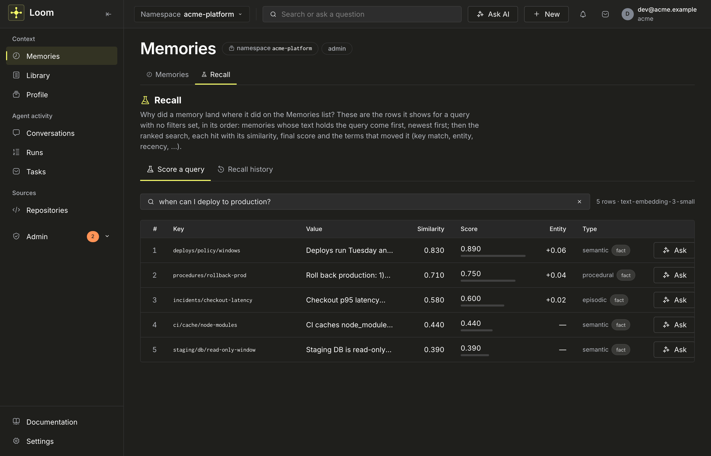
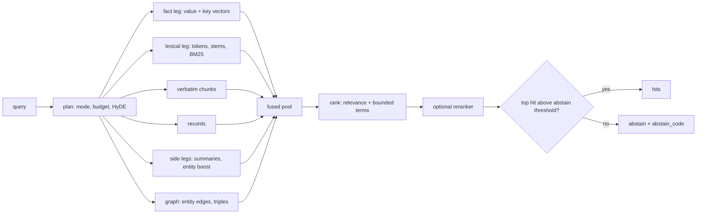

<!-- i18n: source=docs/concepts/retrieval-and-ranking.md blob=451339fc2ff5e4b649b678c1c5d0b58b1cf65e03 model=claude-sonnet-5-5 -->
> 本页由机器从[英文原文](https://github.com/ClickHouse/loom/blob/main/docs/concepts/retrieval-and-ranking.md)翻译，内容以英文原文为准。
> Machine-translated from the [English page](https://github.com/ClickHouse/loom/blob/main/docs/concepts/retrieval-and-ranking.md), which is authoritative.

# 检索与排序

本页说明 `memory.search` 如何查找行。它会同时在命名空间上运行多个检索分支，把各分支的候选结果融合为一个候选池，按相关性加上有界的修正项对候选池排序，然后判断最佳命中是否足够可靠，可以据此作答。结果较弱时，会报告为 **abstain**（"Loom 不知道"），而不是返回最接近的噪声。请求和响应字段见[搜索与提问](https://github.com/ClickHouse/loom/blob/main/docs/features/memory/search-and-ask.md)。

## 检索通道

每个通道都用来弥补其他通道的不足。没有可补充内容的通道不返回任何结果；出错的通道会以失败放行（fail open）的方式处理，响应会在 `degraded` 中列出它的名称。

| 通道                  | 读取内容                                                | 补足其他通道遗漏的内容                                                                                       |
| --------------------- | ------------------------------------------------------- | ------------------------------------------------------------------------------------------------------------ |
| **事实，向量**        | `loom.memory_embeddings` 的值向量（无向量索引）         | 同义改写：问题与已存储的陈述语义相同，用词不同。                                                             |
| **事实，键轴**        | 同一张表的 `memory_key` 向量                            | 问题中点名了某个键所编码的属性。得分为 `least(value distance, key distance)`。                               |
| **词法**              | 经小写化、词干提取和词形还原的摘录以及键                | 向量表示效果较差的精确标识符、数字和生僻词。词干提取在 ClickHouse 中运行（`stem`）。                         |
| **BM25**              | 按 token 汇总的 IDF 和语料长度                          | 为 `bm25_hybrid` 提供生僻词加权，并带有实时尾部，使新写入的行立即计入。                                      |
| **原文分块**          | `loom.memory_chunks`                                    | `memory.set` 长值中的某个段落会归并到其值截取该段落的那一行；对话记录中的段落则直接作为命中结果。            |
| **会话摘要**          | `loom.session_summaries`                                | “那次会话中发生了什么”；启用摘要下钻后，排名靠前的摘要会把其会话中最相关的事实一并带入。                     |
| **实体**              | `loom.entity_vectors`、`loom.entity_summaries`          | 与查询所提及实体有关的行，即使措辞不同。                                                                     |
| **图**                | `loom.entity_edges`、`loom.entity_triples`              | 与查询实体相距一跳的行，以及带有匹配的（主体，关系，客体）三元组的行。                                       |
| **记录**              | `loom.memory_records`                                   | 字段相匹配的类型化记录。                                                                                     |
| **键匹配**            | 经词干提取的键片段                                      | 键恰好指明所问属性的行，用作平局时的决胜依据（`LOOM_MEMORY_SEARCH_KEY_MATCH_MODE`）。                        |
| **计算证据**          | `loom.derived_facts`、事件日期                          | 聚合（“有多少”）、日期差以及某个属性的最新值，均在 ClickHouse 中计算。                                       |

**为什么需要这么多通道。** 单一的向量通道会漏掉标识符和数字（它们的向量表示效果较差）、长值深处的段落（只有开头部分被嵌入），以及用其他说法提及某个实体的行。每个通道都是对 Loom 已经写入的某张表的一次查询，因此新增一个通道只需多一条语句，而不必引入第二套系统。

**向量通道采用扫描方式，没有向量索引。** 扫描是精确的；在适用[codes-first 读取](../architecture/clickhouse.md#vector-storage)的情况下，则先对量化编码做一遍扫描以保留候选池，再以完整精度对其重新打分。

**键轴** 在命名空间的键被重复使用时按命名空间开启（`LOOM_MEMORY_SEARCH_KEY_AXIS=auto`，阈值为 `LOOM_MEMORY_SEARCH_KEY_AXIS_AUTO_REUSE_SHARE`）：读取两个向量列的字节数大约是原来的两倍，而且只有在键本身带有语义时才有帮助。

**规划与预算。** `retrieval_budget`（`fast`、`standard`、`deep`）决定运行哪些开销较大的通道。在 `standard` 下，先运行开销低的召回，只有在第一轮结果较弱时，才会启用 LLM 通道（HyDE、查询分解、迭代重试），并受 `LOOM_MEMORY_SEARCH_FALLBACK_MAX_ROUNDS` 和 `LOOM_MEMORY_SEARCH_FALLBACK_MAX_WALL_MS` 限制。在 `fast`（或 `fast` 配方）下，一次读取不会调用 LLM，只消耗嵌入和 ClickHouse 读取。HyDE 嵌入的是由 LLM 撰写的假设性答案，而不是问题本身，从而缩小问题与已存储陈述在表述方式上的差距；`hyde=false` 则强制使用原始查询。

## 融合

`search_mode` 决定事实池的排序方式。

- 仅当请求既未设置 `search_mode` 也未设置 `recipe` 时，才使用默认值：优先使用命名空间的 `retrieval_defaults` 模式；如果该命名空间未配置默认值，则使用 `LOOM_MEMORY_SEARCH_DEFAULT_MODE`（`semantic`）。wire schema 中显示的是 `rrf`，真正的默认值由服务器填充。
- 规划器的形态规则在此基础上生效：查询中包含标识符时，采用词法融合。
- `recipe` 应用一个命名预设（`fast`、`balanced`、`quality`、`verbatim`、`code`、`temporal`、`graph`），其优先级高于上述两种默认值。

| 模式          | 排序方式                                                                               |
| ------------- | -------------------------------------------------------------------------------------- |
| `semantic`    | 余弦相似度加下文的排名项。                                                             |
| `rrf`         | 对词法排序和语义排序做倒数排名融合（reciprocal rank fusion），`1/(k + rank)`，其中 k = 60。 |
| `hybrid`      | `alpha × lexical + (1 − alpha) × cosine`，再加上排名项。                               |
| `bm25_hybrid` | 经 IDF 加权的 BM25 与余弦相似度融合。                                                  |
| `lexical`     | 内容和 key 上的 token 重叠；没有向量排序。                                             |
| `graph`       | 余弦相似度加实体图信号：一跳重叠和匹配的三元组。                                       |
| `temporal`    | 日期落在问题所解析日期的某个窗口内的行，窗口内按余弦相似度排序。                       |
| `related`     | 与请求的 `tags` / `entity_filter` 的标签和实体重叠。                                   |

**为什么把倒数排名融合作为一种模式。** 词法重叠得分分布在 0 到 1 之间，而真实 embedder 给出的余弦值集中在一个很窄的区间；除非针对每个语料调整 alpha，否则两者的加权和会让其中一个权重偏低。RRF 合并的是排名而不是得分，因此无需调参。对于代码或路径形态的查询，其共有的路径 token 近乎噪声，Loom 还会降低这类查询的词法权重（`server/memory/app/retrieval/fusion.py`，`_rrf_lexical_weight`）。同一种排序中的并列项由另一种排序决定先后，再依次按 key 以及该行的命名空间、写入者和会话打破并列，因此两次相同的搜索会返回同一个窗口。

## 排序表达式

对于按余弦排序的模式，一条事实行的得分等于相关性，再加上若干项。这些项可以重排几乎同分的结果，但有上限，不会压过相关性（`server/memory/app/retrieval/fact_rank.py`）：

| 项                        | 增加的内容                                                                                                                                                                                           | 控制方式                                                                                                  |
| ------------------------- | ---------------------------------------------------------------------------------------------------------------------------------------------------------------------------------------------------- | --------------------------------------------------------------------------------------------------------- |
| 相似度                    | 最佳向量的 `1 − cosine distance`。                                                                                                                                                                   | embedder                                                                                                  |
| 实体加成                  | 最多为该行所含 `entity_filter` 实体占比的 0.5 倍；以及来自查询的实体向量匹配。                                                                                                                       | `entity_filter`                                                                                           |
| 时效、时间顺序、日期      | 对带有时效意图（"latest"、"current"）或要求排序的问题，以及锚定在所问日期附近的行，给予提升。                                                                                                        | 查询自身的线索；池级变体 `LOOM_MEMORY_SEARCH_RECENCY_POOL_WEIGHT` 默认为 0（关闭）                         |
| 先验组                    | 已存储的 `confidence` × `confidence_weight`，加上软性标签与类别加成、偏好加成；合计有上限。                                                                                                          | `confidence_weight`、`tags_soft`、`prior_cap`（`LOOM_MEMORY_PRIOR_CAP`）                                  |
| 强化                      | 召回次数与正面结果，随半衰期衰减；`harm` 事件会收回已获得的加成。                                                                                                                                    | `LOOM_MEMORY_SEARCH_REINFORCEMENT_WEIGHT`（0.15）、`…_HALF_LIFE_DAYS`（90）                               |
| 信任                      | 断言或观察到的为 `+0.5`，导入的为 `−0.25`，外部的为 `−1`，经证明的再 `+1`；再乘以权重。                                                                                                              | `LOOM_MEMORY_SEARCH_TRUST_WEIGHT`（默认 0 = 关闭）                                                        |
| 降权                      | `demote_tags` 把一行沉到最底部但不丢弃；标记为 `sensitivity:medium` 或 `:high` 的行会被降低，除非查询要的是联系方式或银行账户（IBAN）。                                                               | `demote_tags`、`LOOM_MEMORY_SEARCH_SENSITIVITY_DEMOTE`（0.1）                                             |

**置顶不是排序项。** 置顶可以保护一行不被覆盖（[写入如何被判定](https://github.com/ClickHouse/loom/blob/main/docs/concepts/memory.md#how-a-write-is-judged)），但不会让它排得更高。一条事实被返回，是因为它回答了问题。

`personalization="none"` 会去掉所有来自用户的项（偏好、先验组、强化），只保留相关性，因此可以在同一台服务器上比较两种排序。`LOOM_MEMORY_SEARCH_SOURCE_CLASS_BOOST_ELIGIBLE` 限定哪些来源类别可以获得这些项：不包含 `extracted`，就能避免推断凭先验压过陈述。

**Reranker。** 请求中的 `rerank`，或命名空间的 `rerank_endpoint`，会把候选池发送给 reranker（`builtin:openai[:model]`、`builtin:cohere[:model]`，或运维人员在 `LOOM_RERANK_ENDPOINTS_JSON` 中配置的端点名称；URL 会被拒绝）。候选池会先被放宽（`LOOM_MEMORY_SEARCH_POOL_MULTIPLIER_RERANK`），因为 reranker 只能重排第一阶段已经召回的内容。它失败时放行，且绝不丢弃任何候选。

当候选池的顺序比每次搜索多一次调用更重要时，请传入 `rerank`。要用你自己的查询来衡量，请对每条查询分别用 `rerank` 和 `rerank="none"` 运行（后者同时会关闭命名空间的 `rerank_endpoint`），两次都带 `explain=true`，并使用你实际服务的预算（`fast` 或不使用 LLM 的读取不会调用 `builtin:openai`），然后比较两个窗口，按 [为什么它排在这里](#why-did-this-rank-here) 的说明阅读每条命中的 `score_components`。目前没有已提交的运行结果，在相同搜索上比较使用与不使用 reranker 的情况（[结果](https://github.com/ClickHouse/loom/blob/main/docs/benchmarks/results.md#longmemeval-s)）。

排序之后，返回的窗口还会被整形：除非明确要求，`duplicate` 和 `superseded` 行会被隐藏；每个 key 最多保留 `LOOM_MEMORY_SEARCH_PER_KEY_CAP` 行；`exclude_keys` 会移除调用方已持有的行。

## 弃答

每次搜索都会对自身结果给出一个判定。响应中包含 `abstain`、`abstain_code`（`no_match`、`below_threshold`、`entity_absent`、`low_calibrated_confidence`、`page_expired`）、一段文字形式的 `abstain_reason`、`retrieval_confidence`，以及取值为 `low`、`medium`、`high` 或 `abstain` 的 `retrieval_risk`。这些代码的定义见[搜索与问答](https://github.com/ClickHouse/loom/blob/main/docs/features/memory/search-and-ask.md)。

窗口中自身相似度低于阈值的行带有 `below_threshold: true`，因此希望逐行贯彻“弃答就是弃答”的调用方可以据此过滤。

**阈值从何而来。** 固定的相似度下限只针对某一个 embedding 模型校准；更换模型后，余弦值的分布会发生变化，同一个数值会开始过滤掉好的命中，或者不再过滤噪声。启用 `LOOM_ADAPTIVE_THRESHOLDS`（默认开启）时，启动时的一次探测会对三个小型语料库做 embedding，并根据 embedder 自身的分布推导出每一道门限（`server/memory/app/embedder_calibration.py`）：

| 探测语料库 | 推导出的门限 |
| --------------------- | ----------------------------------------------------------------------------------------------- |
| 干扰项对 | 噪声下限（第 90 百分位 + 0.02）和弃答阈值（下限 + 0.05）。 |
| 问题 → 事实对 | 触发门限：查询改写、HyDE 回退和跳过 rerank（第 10、25、75 百分位）。 |
| 释义对 | 写入时的冲突阈值和重复阈值（中位数、第 75 百分位）。 |

如果存储了按命名空间的校准，它会覆盖集群范围的校准；`recalibration` worker 会重复执行探测（`LOOM_RECALIBRATION_INTERVAL_SECONDS`），使门限跟随被悄悄修订的 embedder。`calibration.get` 会显示当前生效的是哪一层。标量设置（`LOOM_MEMORY_SEARCH_MIN_SIMILARITY` 0.22、`LOOM_MEMORY_SEARCH_ABSTAIN_THRESHOLD` 0.30、`LOOM_MEMORY_SEARCH_HYDE_FALLBACK_THRESHOLD` 0.45、`LOOM_MEMORY_SEARCH_QUERY_REWRITE_THRESHOLD` 0.38）适用于 fake embedder、探测失败或关闭自适应的情况；此时更换 embedder 后需要由你自己重新做基准测试。

**权衡。** 下限是用召回换取精确。如果给 agent 一个离题问题的五个最近行，它会去使用这些行；而弃答会告诉它去追问，或者说明自己不知道。下限设得过高，会隐藏措辞与问题不同的答案。Loom 的立场是：agent 可以据以行动的明确弃答，比填满的窗口更有价值，同时把每次读取的选择权留给调用方：

- `min_similarity` 设置本次读取的下限；
- `floor_mode` 决定低于下限的行如何处理：`readmit`（默认：追加在高置信行之后，并标记为低于下限，因此 `top_k` 会被填满）、`ids_only`（追加时正文为空：键表明存在较弱的匹配，但不把其文本放入上下文）或 `drop`。

如果某个范围内有延迟提取正在进行，该范围返回的空结果会报告 `pending_extraction`：保存操作正在进行中，因此空答案并不能证明信息不存在。

## 为什么这条结果排在这里

在 `memory.search` 上设置 `explain=true`，会为每条返回的命中结果附加 `score_components`：其中包含排序信号、该模式运行时的 RRF 分数和权重；经过 reranker 之后，还包含每一行的位置变化（`rerank_from`、`rerank_pos`、`rerank_delta`），以及在 reranker 改变了顺序时它自己的融合分数（`rank_score_pre_rerank`）。如果一条记忆所关联的代码发生了变化并因此下移，则会带有下移的名次数（`code_changed_places`；何时下移见[关联到代码的记忆](https://github.com/ClickHouse/loom/blob/main/docs/concepts/memory.md#memories-linked-to-code)）。`memory.search_trace` 接受相同的请求，并且只对向量这一路打分（不做融合、组装或 reranker）：返回每个候选项的 `similarity`、`entity_boost`、`rank_score`、`rank`，以及它来自哪个平面（`source`：`fact` 或 `chunk`）。设置 `LOOM_SEARCH_TRACE_LOG_ENABLED=true` 后，每次搜索还会向 `loom.search_trace_log` 追加一行（返回的键、分数、abstain、风险、延迟），可通过 `memory.search_trace_log` 读取；只有当命名空间同意文本采集时，才会存储查询文本。控制台的 Recall Lab（`<server>/recall`）会显示某个查询在记忆列表中对应的行：先是关键词匹配，然后是带有 `score_components` 的 `memory.search` 命中结果。

`memory.ask` 以同样的方式检索，然后基于更窄的候选池撰写答案；参见[搜索与问答](https://github.com/ClickHouse/loom/blob/main/docs/features/memory/search-and-ask.md)。`loom_search` MCP 工具（即 `search.query` 操作）和 `context.pack` 会同时搜索多个平面；参见[统一搜索](https://github.com/ClickHouse/loom/blob/main/docs/features/unified-search.md)。

## 限制

- 搜索只读取当前生效的 embedding 模型生成的向量。由其他模型生成 embedding 的行不可见，直到 `loom reembed` 重新生成它们。
- 较长的值只会对开头部分生成 embedding；要找到更靠后的段落，依靠的是分块检索（chunk leg）。如果一个值实际上是一份文档，应当放入 knowledge。
- 弃答（abstain）阈值检查读取排名第 1 的行。在 `rrf` 下，仅有词法匹配的结果可能占据第 1 名，而余弦相似度更高的结果排在第 2 名；`LOOM_MEMORY_SEARCH_ABSTAIN_TOP_SIM_SCOPE=window` 则改为读取窗口内最佳的余弦相似度。
- 校准会根据内置的小型探测语料库得出阈值。与这些语料差异较大的语料库（例如代码，或单一的狭窄领域）可能需要按命名空间单独校准。

## 相关内容

- [搜索与提问](https://github.com/ClickHouse/loom/blob/main/docs/features/memory/search-and-ask.md)：所有请求字段和响应字段。
- [统一搜索](https://github.com/ClickHouse/loom/blob/main/docs/features/unified-search.md)：`loom_search` 和 `context.pack` 的详细说明。
- [实体图](https://github.com/ClickHouse/loom/blob/main/docs/features/entity-graph.md)：实体和图这两路结果的来源。
- [记忆](https://github.com/ClickHouse/loom/blob/main/docs/concepts/memory.md)：排序所读取的字段（`source_class`、`status`、时间）。
- [性能调优](https://github.com/ClickHouse/loom/blob/main/docs/guides/performance-tuning.md)。
- 操作：[记忆](https://github.com/ClickHouse/loom/blob/main/docs/reference/operations.md#memory)、
  [校准](https://github.com/ClickHouse/loom/blob/main/docs/reference/operations.md#calibration)、
  [上下文](https://github.com/ClickHouse/loom/blob/main/docs/reference/operations.md#context)。设置：
  [记忆搜索](https://github.com/ClickHouse/loom/blob/main/docs/reference/configuration.md#memorysearch)、
  [记忆提问](https://github.com/ClickHouse/loom/blob/main/docs/reference/configuration.md#memoryask)、
  [Mcp](https://github.com/ClickHouse/loom/blob/main/docs/reference/configuration.md#mcp)。
