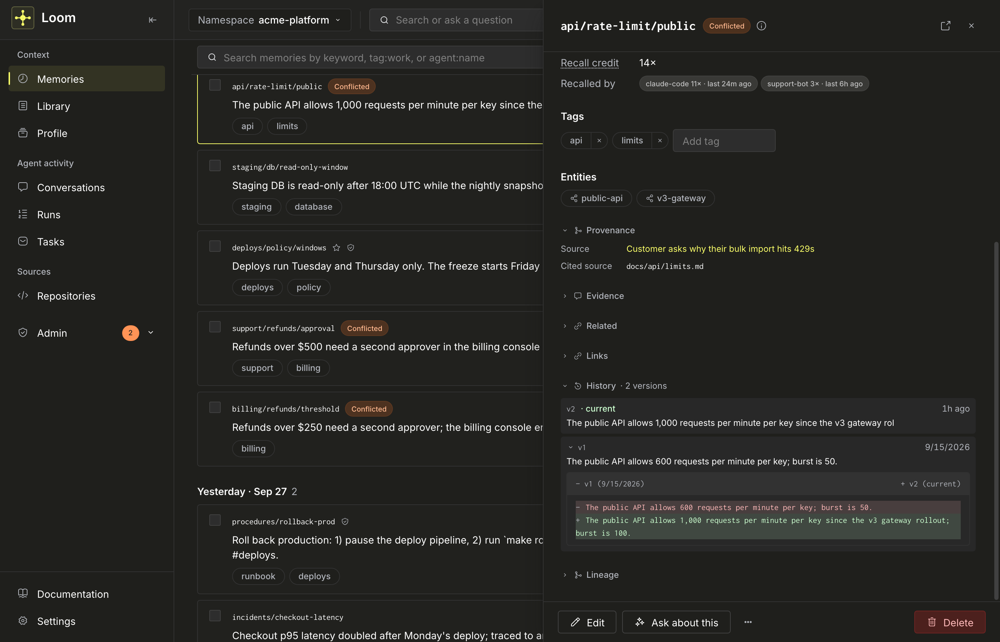

<!-- i18n: source=docs/features/memory/history-and-provenance.md blob=331db28f47c0d0f68295a93f97f4f36b6e5051ad model=claude-sonnet-5-5 -->
> 本页由机器从[英文原文](https://github.com/ClickHouse/loom/blob/main/docs/features/memory/history-and-provenance.md)翻译，内容以英文原文为准。
> Machine-translated from the [English page](https://github.com/ClickHouse/loom/blob/main/docs/features/memory/history-and-provenance.md), which is authoritative.

<a id="history-and-provenance"></a>

# 历史与来源

每次写入记忆都会生成一个新版本，不会原地修改任何内容。各个版本保存在只追加的镜像中，因此即使后台合并，事实的历史也不会丢失。每一行都会记录是谁写入的、以何种方式进入记忆；派生行会记录其来源；用户还可以证明某一行内容属实。版本镜像的工作方式见[记忆架构](https://github.com/ClickHouse/loom/blob/main/docs/architecture/memory-architecture.md)。



<a id="operations"></a>

## 操作

| 操作                 | 角色   | 用途                                                                                                      |
| -------------------- | ------ | --------------------------------------------------------------------------------------------------------- |
| `memory.history`     | viewer | 某个键的所有版本，按从新到旧排序，包括已标记删除和已脱敏的版本。                                          |
| `memory.provenance`  | viewer | 当前有效行的来源：源 trace、写入者、来源类别，以及提取它的对话。                                          |
| `memory.evidence`    | viewer | 某条事实提取自哪些源对话轮次，包括支撑片段以及每条关联的建立方式。                                        |
| `memory.backlinks`   | viewer | 哪些内容指向某一行：版本、摘要、出入方向的类型化链接、证据数量、相邻实体。                                |
| `memory.lineage`     | viewer | 共享记忆的提升轨迹：由谁提升、来自哪些行、经过哪次审核。                                                  |
| `memory.verify`      | writer | 以当前登录的用户或服务账号的身份证明某一行为真，或撤销该证明。                                            |
| `memory.redact`      | admin  | 清除某个历史版本的值，同时保留该行及其审计条目。                                                          |
| `namespace.rollback` | admin  | 将命名空间中所有记忆的头部版本恢复到某个时间点的版本。                                                    |
| `namespace.snapshot` | admin  | 将命名空间的整理后状态导出为 JSON 负载。                                                                  |
| `namespace.restore`  | viewer | 将快照导入新的命名空间，或调用者拥有管理权限的现有命名空间；不能导入到集合中。                            |

`namespace.snapshot` 和 `namespace.restore` 不是 MCP 工具。字段列表见操作参考中的 [记忆](https://github.com/ClickHouse/loom/blob/main/docs/reference/operations.md#memory) 和 [命名空间](https://github.com/ClickHouse/loom/blob/main/docs/reference/operations.md#namespace)。

<a id="versions-memoryhistory"></a>

## 版本：`memory.history`

`loom.memory` 保存当前状态，读取时使用 `FINAL`，因此合并后每一行只保留最新版本。`loom.memory_versions` 是仅追加的镜像表，由物化视图在每次插入时填充；它是 `memory.history`、`memory.redact` 和 `namespace.rollback` 所读取的历史记录。

一条历史记录包含 `version`（写入时的纳秒级 epoch）、`written_at`、`value`、`confidence`、`pinned`、`expires_at`、`tombstoned_at`、`redacted_at`、`redaction_reason`、`content_sha256`、`agent`、`actor` 和 `source_class`。`created_at` 是该行的首次写入时间，并在每个版本中重复出现。`agent="*"` 会覆盖该 key 的所有写入者。

```python
from loom import Agent

async with Agent(org="acme", namespace="support", agent="auditor") as agent:
    for v in await agent.memory.history("customer/4812/plan", agent_id="*"):
        print(v["written_at"], v["actor"], v["source_class"], v["value"])
```

墓碑标记（tombstone）同样是一个版本，因此删除操作会出现在历史中，并且 `memory.restore` 可以在 14 天内恢复该 key。若要按时间点读取当前状态，请在 `memory.get`、`memory.search` 和 `memory.ask` 上使用 `as_of`（[有效时间](https://github.com/ClickHouse/loom/blob/main/docs/features/memory/writing.md#validity-time-valid_at-and-valid_to)）。

<a id="who-wrote-it-actor-and-source-class"></a>

## 谁写入的：actor 和 source class

服务器会根据令牌和操作，在每一行上写入 `actor`（`human:<subject>` 或 `process:<subject>`）和 `source_class`。`source_class` 的取值见[记忆概念](../../concepts/memory.md)。请求只能将其来源类别降级为 `external`、`imported` 或 `derived`。

`memory.provenance` 会返回这两个字段，此外还有：

- `source_trace`，以及由它推导出的 `source_kind`（`conversation`、`extracted`、`observed`、`consolidated`、`app`、`manual`、`other`）；
- 写入方引用的 `source_resource_id`；
- 对话的 `thread_id` 和 `thread_exists`（当命名空间不记录对话记录，或对话记录已不存在时为 false）；
- 与该行相关的已编写链接（`memory.link`）。

搜索结果带有 `source_class` 和 `verified`，可选的信任项（`LOOM_MEMORY_SEARCH_TRUST_WEIGHT`）会读取它们。

<a id="evidence-which-turns-a-fact-came-from"></a>

## 证据：事实来自哪些对话轮次

提取过程会在 `loom.memory_belief_sources` 中将每条事实关联到对应的对话轮次。`memory.evidence(memory_key)` 返回这些关联，并附带该轮次的文本（最多 600 个字符）、角色、时间、起支撑作用的 `span`，以及关联的建立方式：

| `scope`   | `support_type`    | 含义                                       |
| --------- | ----------------- | ------------------------------------------ |
| `cited`   | `extracted_from`  | 提取器指明了起支撑作用的轮次。             |
| `lexical` | `lexical_support` | 服务器将事实与最匹配的轮次关联起来。       |
| `window`  | `window`          | 没有匹配项，因此关联整个提取窗口。         |
| `derived` | `derived_from`    | 整合谱系：该条目是来源记忆的文本。         |

响应会按 scope 统计关联数量，因此检查时可以区分有明确引用的事实和关联较松散的事实。如需查找对话的确切措辞，`memory.recall` 会搜索已存储的对话轮次（[提取](https://github.com/ClickHouse/loom/blob/main/docs/features/memory/extraction.md)）。

<a id="lineage"></a>

## 溯源

- `memory.consolidate` 和周期性摘要会为每个来源向 `loom.memory_belief_sources` 写入一条 `derived_from` 链接；`memory.evidence` 将它们作为 `derived` 条目返回。
- 会话摘要会列出它所压缩的 key（`summary` 命中项上的 `derived_from`）。
- `memory.lineage`（`scope="shared"`）会追溯共享记忆的晋升过程：事件、晋升者、支撑行、与之匹配时它所来源的 learnings 候选项（`match_confidence` 为 `exact` 或 `inferred`），以及审计事件。`mechanism` 取值为 `review`、`import`、`auto` 或 `unknown`。
- `memory.backlinks` 是其反向操作：查看哪些内容指向某一行。

`memory.delete` 会将来源已全部消失的合并摘要退役，并将仍有来源存留的合并摘要降级为 `conflicted`。

<a id="attestation-memoryverify"></a>

## 证明：`memory.verify`

`pinned` 和 `confidence` 并不说明是谁核实了某条事实。`memory.verify` 会记录这一点：来自调用方令牌的 actor，以及该 actor 所证明的内容哈希。可以通过 `memory_id` 定位记录，也可以通过 `namespace` 和 `memory_key` 加上写入者身份来定位。调用需要对该记录所在命名空间拥有 writer 权限。

`memory.get` 和 `memory.get_by_id` 会返回 `verification`，它由已存储的哈希与该记录当前的哈希比较得出：

| `verification` | 含义                                   |
| -------------- | -------------------------------------- |
| `human`        | 有人做过证明，且此后内容没有变化。     |
| `process`      | 有服务账号做过证明，且此后内容没有变化。 |
| `stale`        | 有人做过证明，但此后内容已发生变化。   |
| `none`         | 从未证明过，或已被撤销。               |

- 编辑不会清除证明，而是使其变为 `stale`，直到有人重新核实。
- `revoke=true` 会清除证明。同一个 actor 对未变化的记录重复核实不会产生任何效果（`changed=false`）。
- `human:` 前缀来自令牌，因此 agent 无法把自己写入的内容标记为 human。请求体中的 `actor` 仅在没有认证的开发模式下才会被读取。
- 快照和恢复会携带证明相关的列；恢复操作绝不会清除 `verified_by`。

<a id="scrubbing-history-memoryredact"></a>

## 清除历史：`memory.redact`

`memory.redact(memory_id, version)` 会清除某个历史版本的文本在所有副本中的内容，以及模型根据该记忆构建的每个画像版本。它会写入 `redacted_at` 和 `redaction_reason`，并保留这些行及其审计条目。当密钥或个人信息泄漏到较早的版本中时，可使用它。

| 位置                                              | 结果                                                                                                                                                            |
| ------------------------------------------------- | --------------------------------------------------------------------------------------------------------------------------------------------------------------- |
| `loom.memory`、`loom.memory_versions`             | `value` 变为 `"[REDACTED]"`；`value_json`、`evidence`、`entities` 和 `concepts` 被清空。                                                                        |
| `loom.memory_embeddings`、`loom.memory_chunks`    | 摘录或分块哈希与当前最新版本不一致的行会被删除；当前最新版本的行保留。                                                                                          |
| 根据该记忆构建的用户画像版本                      | 每个溯源信息中指向该记忆的版本都会以同样方式清除（包括当前最新版本），同时清除其键的派生行。                                                                    |
| `loom.shared`，从该键提升而来的副本               | 每个 `value` 为被清除文本的版本都会变为 `"[REDACTED]"`，其搜索行也会被删除。当前副本在管理员取消提升之前仍保持提升状态。                                        |

不在范围内：标签、文件、`content_sha256`、`loom.memory_evidence`（由删除功能负责）、谱系表（仅含 id 和哈希）以及实体图。如果当前最新版本也包含被清除的文本（某次编辑被逐字节还原），则共享副本保持原样。

- 它会拒绝处理该记忆的当前最新版本（`refused_head=true`）：请先删除或重写该键。被清除的当前画像在 worker 重建之前，不会出现在渲染、包和画像搜索中。
- 两种锁定模式都会拒绝它，无论是该记忆自身的键，还是它涉及的任何画像键。
- 它会删除引用了该键或共享副本键的 `memory.ask` 和 `code.ask` 缓存答案及先例（`cache_rows_deleted`、`precedent_rows_deleted`）。对于它涉及的画像键，删除范围是整个组织：每个用户的画像都使用相同的键，因此会清除组织内所有窗口中包含该键的缓存答案和先例，涵盖所有命名空间。
- 命名空间在获取之后才检查；被拒绝时返回 `redacted=false`，而不是 403。
- 不存在的版本返回 `redacted=false`，不会清除任何内容，包括任何画像版本。
- 它会对两张记忆表（以及副本仍包含该文本时的 `loom.shared`）同步执行 `ALTER TABLE … UPDATE`，并对派生行执行轻量级 `DELETE`：这是一个管理类调用。

与共享副本的清除并发的写入：

- embedding worker 在清理之后，根据它此前读取的存根写入的搜索行，会保留到该键的下一次 redact；
- 该键的一次提升会丢失其搜索行，直到再次提升；
- 在清除之前读取了副本的取消提升操作，会把带有文本的墓碑写入，该文本会保留到该版本再次被清除。

如果某个副本被该键之后的提升所取代，并且 `loom.shared` 已将其合并掉，则不会再被找到：它的搜索行（`FINAL` 已不再提供）会保留到该键之后的某次清理，而键与被清除的键不同的缓存答案会保留到过期。

值为 `"[REDACTED]"` 的副本会被视为较早的 redact 已清除过的副本，因此，本身包含该文本且已被提升的记忆，其搜索行会在该键的下一次 redact 时丢失。

画像涉及的范围及其限制见[安全](https://github.com/ClickHouse/loom/blob/main/docs/architecture/security.md#sensitivity)。
若要在所有位置删除某人的数据，请使用[删除](https://github.com/ClickHouse/loom/blob/main/docs/features/memory/retention-and-erasure.md#erasure)。

<a id="rolling-a-namespace-back-namespacerollback"></a>

## 回滚命名空间：`namespace.rollback`

`namespace.rollback(as_of)` 会针对每个 key，将不晚于 `as_of` 的最高版本重新插入为新的最新版本，并为在该时间点之后创建的 key 写入墓碑。回滚本身会产生新的版本，因此可以用同样的方式撤销。

- 默认是试运行，会报告 `reinstate`、`remove` 和 `sample`；设置 `dry_run=false` 才会真正执行。
- `memory_keys`（最多 500 个）用于限定回滚范围；`max_keys`（默认 5,000）限制单次调用处理的 key 数量，`truncated` 表示需要再次调用。
- `embedding_worker` 会对恢复的最新版本重新生成 embedding。
- 如果 `as_of` 早于该命名空间的历史记录，或者是未来的时间，请求会被拒绝。

```bash
curl -sX POST http://localhost:7777/v1/namespace.rollback \
  -H "Authorization: Bearer $LOOM_API_KEY" -H 'Content-Type: application/json' \
  -d '{"org":"dev","namespace":"local","as_of":"<YYYY-MM-DD>T09:00:00Z"}' \
  | jq '{reinstate, remove, truncated, sample}'
```

<a id="snapshots-namespacesnapshot-and-namespacerestore"></a>

## 快照：`namespace.snapshot` 和 `namespace.restore`

`namespace.snapshot` 以 JSON 形式导出命名空间的整理后状态：包含每一行记忆及其 `version`、`content_sha256`、`actor`、`source_class`、有效期和证明列，按类型的配置，授权，以及最多 `include_audit_tail_n` 条最近的审计行（默认 1,000）。`include_embeddings` 默认为 false，因此目标端会使用自己的模型重新生成嵌入。

`namespace.restore(target_namespace, payload)` 会将载荷作为版本行写回。它对 `snapshot_id` 是幂等的（重复运行会返回 `restored=false`）。它可以恢复到一个全新的命名空间（调用者成为管理员；如果该名称没有对应的行，但已存在数据或授权，则会被拒绝，除非调用者本来就管理该命名空间），也可以恢复到调用者已管理的命名空间；`rebind_agent` 会重新指定每一行的写入者。恢复的行为 `imported`。

快照不是部署备份；请参阅[备份与恢复](https://github.com/ClickHouse/loom/blob/main/docs/operations/backup-and-recovery.md)。

<a id="the-audit-log"></a>

## 审计日志

每次创建或修改记忆的写入操作，都会在 `loom.audit_log` 中留下一行仅包含哈希的记录（键、id、内容哈希、操作者、来源类别、判定结果，不含值本身）。每小时的检查点会将日志串联成链。参见[审计](https://github.com/ClickHouse/loom/blob/main/docs/features/observability/audit.md)。

<a id="limits"></a>

## 限制

- **对已合并版本的脱敏只能尽力而为**（见 `loom.memory`）；镜像表无论如何都会被清除相关内容。
- **历史记录的完整程度取决于镜像表。** 向 `loom.memory` 添加的列，必须在同一次迁移中同时添加到 `loom.memory_versions` 及其视图。
- **有效性仅指有效时间（valid-time）。** `knowledge_time` 会依据失效（`invalid_at`）和删除（`tombstoned_at`）时间戳回放 `created_at`；不存在单独的事务时间表。
- **`thread_exists=false` 不是错误。**
- **回滚不会恢复已被硬删除的键**（`skipped_no_head`）。

<a id="related"></a>

## 相关内容

- [写入记忆](https://github.com/ClickHouse/loom/blob/main/docs/features/memory/writing.md)
- [冲突与拒绝](https://github.com/ClickHouse/loom/blob/main/docs/features/memory/conflicts-and-refusal.md)
- [保留与删除](https://github.com/ClickHouse/loom/blob/main/docs/features/memory/retention-and-erasure.md)
- [审计](https://github.com/ClickHouse/loom/blob/main/docs/features/observability/audit.md)
