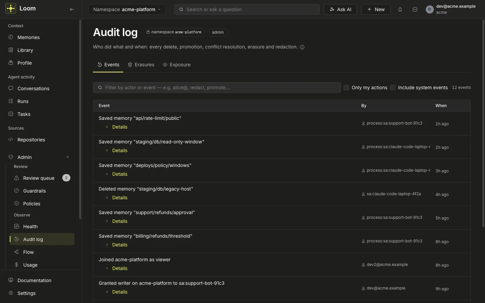

<!-- i18n: source=docs/features/observability/audit.md blob=8e4e9949ca4f7a4e54f9bad556832bda780a76c4 model=claude-sonnet-5-5 -->
> 本页由机器从[英文原文](https://github.com/ClickHouse/loom/blob/main/docs/features/observability/audit.md)翻译，内容以英文原文为准。
> Machine-translated from the [English page](https://github.com/ClickHouse/loom/blob/main/docs/features/observability/audit.md), which is authoritative.

<a id="audit-log"></a>

# 审计日志

审计行、`audit_verifier` worker 和检查点链默认开启。

Loom 会为每个以可能需要追责的方式改变状态的操作向 `loom.audit_log` 写入一行，此外还会记录服务器自身触发的一些事件。其目标是让篡改可被发现。每一行都带有其自身内容的 SHA-256，worker 会把已关闭的每小时窗口封存到哈希链中。ClickHouse 管理员仍然可以修改该表；下一次 verifier 运行时会显示出这些修改或删除。这是一种工程原语，而不是合规认证。



<a id="what-leaves-an-audit-row"></a>

## 哪些操作会留下审计行

| 来源                                                                  | `event_type`                                                                                                                                                                                                                                  | `subject` 的内容                                                                                                                                                                                                                                                                                                                                                                                              |
| --------------------------------------------------------------------- | --------------------------------------------------------------------------------------------------------------------------------------------------------------------------------------------------------------------------------------------- | ------------------------------------------------------------------------------------------------------------------------------------------------------------------------------------------------------------------------------------------------------------------------------------------------------------------------------------------------------------------------------------------------------------ |
| 任何声明为 `audit=True` 的操作                                        | 操作名（`memory.delete`、`grants.create`）                                                                                                                                                                                                    | 若操作声明了 `audit_subject`，则为该值（不含凭据，或对擦除必须覆盖的文本使用哈希）；否则为经过校验的输入，其中所有非命名类文本值都经过哈希，以 JSON 形式存储                                                                                                                                                                                                                                                  |
| `memory.set`（单点写入）                                              | `memory.set`                                                                                                                                                                                                                                  | key、记忆 id、`content_sha256`、`source_class`、verdict、`pinned`。从不包含值                                                                                                                                                                                                                                                                                                                                |
| `memory.update`、`memory.update_by_id`                                | 操作名                                                                                                                                                                                                                                        | key、记忆 id、`content_sha256`、`source_class`、version，以及写入后标记之前冲突检查的 verdict（作为重复版本写入时为 `duplicate`；修订后的行未做嵌入时为空：类型不嵌入，或值为 `high`）。从不包含值                                                                                                                                                                                                            |
| `memory.bulk_set`                                                     | `memory.bulk_set`                                                                                                                                                                                                                             | 每次写入对应一行仅含哈希的记录                                                                                                                                                                                                                                                                                                                                                                                |
| 在 Postgres 下提交的每个修订                                          | `memory.revision`                                                                                                                                                                                                                             | key、记忆 id、version、`content_sha256`、`source_class`、status、`pinned`、tombstoned；actor 为令牌的主体，否则为流水线阶段的主体，在请求中再否则为 `-`，Loom 自身的作业则为 `process:loom`。与修订一起存储，因此不是 fail-open：会重试直到写入成功或被搁置（[存储权威](../../architecture/storage-authority.md#audit)）                                                                                      |
| `memory.import`                                                       | 写入的事实为 `memory.bulk_set`；写入的类别链接为 `memory.import`                                                                                                                                                                              | 批量写入的仅哈希行；对于链接，为 `count` 和 `category_links`（key 和类别名）。从不包含文本                                                                                                                                                                                                                                                                                                                    |
| 读取 `high` 行，或读取以 `high` 保存的证据                            | `memory.sensitive_read`（来自 `memory.get`、`memory.get_by_id`、`memory.bulk_get`、`memory.history`、`memory.evidence`、`namespace.snapshot`、`erasure.export`，以及带 `include_high` 的 `memory.export_evidence`）                           | key 和记忆 id（`memory.history` 与 `erasure.export` 还会加上 version）；对于被释放的证据，为其 kind、session、chunk index 和关联的 key；对于 `erasure.export` 提供的对话轮次，为其 agent、thread id 和 message id；对于线程，为其 agent 和 thread id                                                                                                                                                         |
| 被受限命名空间接受的请求                                              | `namespace.restricted_access`（来自指明该命名空间的操作、指明它的 `audit.list`（transport 为 `op`）、文档下载和上传、inbox watch、`admin/claim_release`、`admin/namespace.adopt`、委托令牌的签发以及 MCP primer）                              | `op`、`transport`、调用方的 `token_id` 和 `roles`；对于签发，为 `granted_to`，即新令牌的主体                                                                                                                                                                                                                                                                                                                  |
| Loom 自行淘汰记忆                                                     | `memory.auto_supersede`                                                                                                                                                                                                                       | `reason`、`count` 和 `retired`：最多 200 个被淘汰的行（id、key、agent、user 和 session，各行及其 key 被哪一行取代，judge 的标签；冲突解决器淘汰时还有 `judge_verdict`、`judge_confidence`、`judge_model` 和 `judge_prompt_version`；以及重新读取无法确认淘汰时的 `unconfirmed`（`"true"`））。从不包含值。更多行会拆分到多个事件中                                                                                |
| 对已被取代的行执行 `memory.restore`                                   | `memory.unsupersede`                                                                                                                                                                                                                          | key、记忆 id、`superseded_by`、恢复后的 `content_sha256` 和 `version`                                                                                                                                                                                                                                                                                                                                         |
| 以另一种写法命中的 `grants.revoke` 行，或多行之一                     | `grants.revoke`                                                                                                                                                                                                                               | `namespace`、已存储的 `subject`、`named`（调用中指明的 subject），以及该行插入抛出异常时的 `landed`（`"unknown"`）。与记录输入的操作自身那一行并存                                                                                                                                                                                                                                                            |
| 服务器自身                                                            | `budget.violated`、`ratelimit.exceeded`、`worker.failed`、`audit.tamper_detected`，……                                                                                                                                                         | 事件所涉及的内容                                                                                                                                                                                                                                                                                                                                                                                              |

生成的[操作参考](https://github.com/ClickHouse/loom/blob/main/docs/reference/operations.md)中的 **Audit** 列列出了由传输层审计的操作（每个 `Operation` 上的 `audit` 标志）；上表中的记忆写入操作自行写入审计行，在该列中没有标记。没有任何读操作声明为 `audit=True`；读取 `high` 行会写入 `memory.sensitive_read`（见上）。`audit.list` 为 `audit=False`：读取审计轨迹只会为受限命名空间增加受限访问行。

传输层在处理器成功之后写入该行（HTTP 和 MCP 均使用 `server/transport/_common.py` 中的 `emit_op_audit`）。写入是 **fail-open** 的：插入失败时会记录日志并丢失该行，但操作本身仍然成功。

对于 `audit=True` 的操作，subject 在其声明了 `audit_subject` 时取该值，否则取按 `audit.input_subject` 的方式整理后的已校验输入。指明调用作用对象或调用者的字段（身份字段，主体 `subject`、`actor`、`grantee`、`owner_email`、`requester`、`approver` 和 `decision_maker`，`version`，以及以 id、key、URI、name、org、agent、namespace 或 `_by` 为后缀的名称），以及类型为数字、布尔值、日期或时间、Literal 或 Enum 的字段，按发送时的原样保留；名称表明其为凭据的字段（`server/observability/audit.py` 中的 `audit.is_credential`）无论后缀如何都会被哈希。包含单个嵌套模型的字段遵循同样的规则，模型列表则整体哈希。按原样保留的主体和 `_by` 字段属于个人数据，擦除不会将其从 `loom.audit_log` 中移除。其他所有值（记忆的值、决定的理由、原因、记录的字段、恢复的快照的各行）都以 `{"sha256", "chars"}` 的形式存储，即其 SHA-256 和长度（与记忆的 `content_sha256` 所携带的哈希相同，因此被移动的值能与之匹配），因为擦除不会触及 `loom.audit_log`。有三类由处理器自行写入的行，会在字段名下以该形式存储文本：`memory.cross_promote` 和 `memory.copy_to` 的 `rationale`，`memory.proposal_accept` 和 `memory.proposal_reject` 的 `reason`（由所有者策略作出的决定则改为记录该策略的模式和阈值），以及 `triple.follows_row_supersession` 的 `closed`，其 actor 为写入的主体或 `process:loom`。短值的哈希可以通过猜测还原；该规则的目的是让长文本不进入审计轨迹，而不是隐藏每一个词。输入中带有凭据的操作（tracker 源的密码、仓库的访问令牌）会声明一个将其排除在外的 `audit_subject`。授予 `loom.audit_log` 的权限时，应将其视同它所描述的数据。

<a id="the-row"></a>

## 行结构

`loom.audit_log` 是按月分区的 `MergeTree` 表，排序键为 `(org, namespace, event_type, ts)`，并在 `request_id` 上建有 bloom filter 索引。

| 列                                           | 含义                                                                                                                                                                                              |
| -------------------------------------------- | ------------------------------------------------------------------------------------------------------------------------------------------------------------------------------------------------- |
| `ts`                                         | UTC，毫秒精度                                                                                                                                                                                     |
| `event_type`                                 | op 名称或服务器事件                                                                                                                                                                               |
| `org`, `namespace`                           | 网关授权的租户                                                                                                                                                                                    |
| `actor`                                      | 令牌的 subject（关闭认证时为 `anonymous`）；记忆写入自身的行（`memory.set`、`memory.bulk_set`、`memory.update`、`memory.update_by_id`）写作 `kind:subject`，没有令牌时为 `-`                         |
| `subject`                                    | JSON 文本；是否解析由调用方决定                                                                                                                                                                   |
| `request_id`                                 | 可关联到 `loom.agent_events` 以及 `X-Request-Id` 响应头                                                                                                                                           |
| `row_hash`                                   | 对规范化行计算的 SHA-256                                                                                                                                                                          |
| `build_commit`, `instance`, `instance_label` | 写入该行的构建版本和进程                                                                                                                                                                          |
| `consumer`                                   | 请求所代表的客户端                                                                                                                                                                                |
| `token_id`                                   | 发出请求的凭据（其 `jti`，否则为令牌哈希前缀）                                                                                                                                                    |

哈希覆盖 `ts`、`event_type`、`org`、`namespace`、`actor`、`subject` 和 `request_id`，以键排序的 ASCII JSON 形式计算（见 `server/observability/audit.py` 中的 `_canonical`）。构建、实例、consumer 和令牌这几个标记不在哈希范围内，因此新增标记列不会使旧行失效。

`audit.list`、`erasure.export` 和 `namespace.snapshot` 返回 `erasure.failed` 或 `erasure.abandoned` 行的 subject 时，会把失败原因截短为步骤和错误类型，因此根据这些行重新计算的哈希可能与存储的哈希不同。`dev/verify_audit_chain.py` 检查的是存储的行。

<a id="per-row-hashes-and-checkpoints"></a>

## 每行哈希与检查点

多个服务器副本并发写入，因此行与行之间的哈希链会产生分叉。所以每一行都带有自己的哈希，写入无需协调。每行哈希可以发现被**修改**的行，但发现不了被删除的行；删除由检查点链负责覆盖（设计见[安全架构](https://github.com/ClickHouse/loom/blob/main/docs/architecture/security.md)）：

1. 当一个 `LOOM_AUDIT_CHECKPOINT_WINDOW_SECONDS`（1 h）的窗口关闭满 `LOOM_AUDIT_CHECKPOINT_GRACE_SECONDS`（10 min）后，`audit_verifier` worker 会将其封存到 `loom.audit_checkpoints`：包括行数、对已排序行哈希计算的 SHA-256，以及一个包含上一个检查点哈希的 `checkpoint_hash`。
2. 每一轮都会重新统计最近 `LOOM_AUDIT_CHECKPOINT_VERIFY_WINDOWS`（24）个已封存窗口的行数，并重新检查各检查点之间的链接。

只有一个 worker 负责封存，因此链只有单一写入者，请求路径不产生任何开销。删除只有在其所在窗口被封存之后才会显现，并且只有在该窗口被重新统计期间才能发现。

重新统计的结果由 `server/insights/domain/audit_checkpoints.py` 中的 `classify` 分类：

| 发现项 | 含义 | 是否篡改？ |
| -------------- | ----------------------------------------------------------------------------------- | ----------------------- |
| `deletion`     | 行数少于封存时的行数 | 是 |
| `modification` | 行数相同，摘要不同 | 是 |
| `chain`        | 某个检查点自身的哈希无法重新计算得出，或它没有指向其前一个检查点 | 是 |
| `late_insert`  | 行数多于封存时的行数：回填，或者非常晚到达的异步插入 | 本身不算，但会被报告 |

空窗口同样会被封存，其摘要为空字符串的摘要，因此之后插入该窗口的行会导致不匹配。

<a id="the-verifier-worker"></a>

## 验证 worker

`audit_verifier`（`server/insights/workers/audit_verifier.py`）在持有 workers 租约的进程上，每隔 `LOOM_AUDIT_VERIFIER_INTERVAL_SECONDS`（一小时）运行一次。每一轮执行以下步骤：

1. 重新计算过去一小时内每一行的哈希（每页 10,000 行，最多 500,000 行；超过上限时报告 `truncated`）。
2. 先验证已封存的窗口，再封存已关闭的窗口，每一轮最多封存 `LOOM_AUDIT_CHECKPOINT_MAX_SEAL_PER_PASS`（48）个。此处出错会记录为部分失败，不会阻塞逐行检查。
3. 对之前未报告过的断点写入**一条** `audit.tamper_detected` 记录（`subject.break_keys`），因此一个断点只会报告一次，而不是每小时报告一次。

每一轮的结果（`rows_checked`、`breaks`、`windows_sealed`、`windows_verified`、`checkpoint_breaks`、`new_breaks`、`truncated`）与其他 worker 一样记录在 `loom.worker_status` 中；参见 [后台任务](https://github.com/ClickHouse/loom/blob/main/docs/reference/workers.md)。

<a id="checkpoint-lag"></a>

### 检查点滞后

`loom.audit.checkpoint_lag_windows` 统计最新已封存的 `window_end` 与当前时间之间相隔的一小时窗口数。它直接从 `loom.audit_checkpoints` 读取，因此即使封存器已停止运行也能报告。

| 读数               | 含义                                                         |
| ------------------ | ------------------------------------------------------------ |
| 0 或 1             | 正常：链落后一个宽限期                                       |
| 持续上升           | 封存器已停滞：worker 被禁用、持续失败，或未持有租约          |
| 下降               | 停滞之后的回填；每一轮最多封存 48 个窗口                     |
| 0 且没有检查点     | 从未封存过任何内容（空表上该指标读数为 0）                   |

其余指标目录参见 [遥测](https://github.com/ClickHouse/loom/blob/main/docs/features/observability/telemetry.md#backlogs-and-process-state)。

<a id="reading-the-trail"></a>

## 查看审计记录

`audit.list` 按时间从新到旧分页返回调用方的行，使用不透明的 keyset 游标。一页不会在一次写入的中间结束：同一次请求在同一毫秒内写入的行会出现在同一页，因此一页可能包含超过 `limit` 的行数。

| 字段         | 含义                                                       |
| ------------ | ---------------------------------------------------------- |
| `org`        | 必填                                                       |
| `namespace`  | 调用方可读取的一个命名空间（否则返回空页）；省略则表示全部 |
| `event_type` | 精确匹配                                                   |
| `since`      | 返回 `ts >= since` 的行                                    |
| `limit`      | 1–500，默认 50                                             |
| `cursor`     | 上一页的 `next_cursor`；翻页时需再次传入相同的过滤条件     |
| `fields`     | 将输出行投影到这些字段                                     |

该 op 需要 `viewer` 角色，并自行检查范围。指定的命名空间与读取该命名空间时通过相同的检查；指定一个无法读取的命名空间会返回空页，而不是 403。未指定 `namespace` 时，令牌声明了 `*` 的组织管理员可以读取整个组织，但不包括其无法读取的受限命名空间和集合；平台管理员无论其声明如何，都可以读取整个组织，但不包括其无法读取的受限命名空间（控制台会话只会指定该用户自己的命名空间）。其他任何调用方，包括令牌中列出了具体命名空间的组织管理员，读取其令牌或授权所能覆盖的命名空间。

```bash
curl -s "$LOOM_BASE_URL/v1/audit.list" \
  -H "Authorization: Bearer $LOOM_API_KEY" -H 'Content-Type: application/json' \
  -d '{"org": "acme", "namespace": "support", "event_type": "memory.delete", "limit": 100}'
```

```python
from loom import Agent

async with Agent(org="acme", namespace="support", agent="auditor") as admin:
    page = await admin.audit.list(event_type="memory.delete", limit=100)
    while page.get("next_cursor"):
        page = await admin.audit.list(
            event_type="memory.delete", cursor=page["next_cursor"], limit=100
        )
```

管理抽屉中的 **Audit log** 视图读取的是同一个 op。它默认通过开关隐藏服务器事件（`budget.violated`、`ratelimit.exceeded`、`worker.failed`），并在列表旁显示擦除汇总。

要在账本和审计记录之间追踪同一个请求：

```sql
SELECT ts, event_type, actor, subject FROM loom.audit_log WHERE request_id = '<id>';
SELECT * FROM loom.agent_events WHERE request_id = '<id>';
```

<a id="verifying-offline"></a>

### 离线验证

`dev/verify_audit_chain.py` 使用 worker 的 `row_matches_hash` 重新计算时间窗口内每一行的哈希。退出码 0 表示全部通过，1 表示存在不匹配，2 表示无法验证。不匹配的行只以分区、`ts`、`request_id` 和已存储的哈希标识，绝不会给出 actor、subject 或命名空间。

```bash
python dev/verify_audit_chain.py --org acme --ts-since <YYYY-MM-DD> --json
```

<a id="erasure-and-the-audit-log"></a>

## 擦除与审计日志

擦除会保留审计轨迹，包括它自己的审计行；残留检查并不要求 `loom.audit_log` 为空。对于 `user_id` 范围，由于该表没有 `user_id` 列，导出时会按子串匹配 `subject`。参见[保留与擦除](https://github.com/ClickHouse/loom/blob/main/docs/features/memory/retention-and-erasure.md)。

<a id="settings"></a>

## 设置

| 设置                                      | 默认值  | 作用                                                                    |
| ----------------------------------------- | ------- | ----------------------------------------------------------------------- |
| `LOOM_AUDIT_VERIFIER_ENABLED`             | `true`  | 运行校验 worker                                                         |
| `LOOM_AUDIT_VERIFIER_INTERVAL_SECONDS`    | `3600`  | 每轮校验的间隔                                                          |
| `LOOM_AUDIT_CHECKPOINT_WINDOW_SECONDS`    | `3600`  | 窗口长度                                                                |
| `LOOM_AUDIT_CHECKPOINT_GRACE_SECONDS`     | `600`   | 窗口关闭后需等待多久才会被封存                                          |
| `LOOM_AUDIT_CHECKPOINT_VERIFY_WINDOWS`    | `24`    | 每轮重新统计的已封存窗口数                                              |
| `LOOM_AUDIT_CHECKPOINT_MAX_SEAL_PER_PASS` | `48`    | 每轮封存窗口数的上限                                                    |
| `LOOM_BUDGET_VIOLATION_AUDIT_INTERVAL_S`  | `60`    | 每个 op 在每个间隔内最多写入一行 `budget.violated`（突发额度用完之后）  |
| `LOOM_BUDGET_VIOLATION_AUDIT_BURST`       | `5`     | 每个窗口内仍会各自写入一行记录的违规次数                                |

所有设置都在[配置参考](https://github.com/ClickHouse/loom/blob/main/docs/reference/configuration.md)中。

<a id="limits-and-failure-modes"></a>

## 限制与故障模式

- **写入采用 fail-open 策略。** 审计插入失败会丢失该行，但不会使操作失败，例外是撤销停用的 `memory.restore` 和 `namespace.restore`，它们依赖自己的记录。审计行在对应工作运行时直接插入，不经过队列：某个 op 的审计行在其响应之前写入，分离式擦除的审计行则在每一步运行时写入。崩溃只会丢失仍在处理中的工作所对应的行（当 `LOOM_RESTRICTED_AUDIT_INLINE=false` 时，还包括在应答之后才写入的受限访问行）。在 Postgres authority 下，记忆写入的审计行会先持久化到 Postgres，写入才会应答（[审计](../../architecture/storage-authority.md#audit)）。
- **只能检测，不能预防。** 任何对 ClickHouse 表有写权限的人都可以修改它。验证器能显示这些改动，但无法撤销。
- **回溯范围有限。** 逐行检查读取最近一小时；检查点重新计数覆盖最近 24 个已封存的窗口。比这两者都早的修改，worker 不会再次检查。请对更早的分区运行 `dev/verify_audit_chain.py`。
- **延迟插入不属于篡改。** 向旧窗口回填的数据会被报告为 `late_insert`。
- **默认没有 TTL。** 审计行只有在设置了保留窗口时才会过期：`LOOM_RETENTION_AUDIT_LOG_DAYS` 大于 0 时作用于整张表，或者通过命名空间的 `retention_days` 作用于该命名空间的行（[已配置的保留策略](https://github.com/ClickHouse/loom/blob/main/docs/features/memory/retention-and-erasure.md#configured-retention)）。

<a id="related"></a>

## 相关内容

- [遥测](https://github.com/ClickHouse/loom/blob/main/docs/features/observability/telemetry.md)：账本、指标和查询归因。
- [成本与用量](https://github.com/ClickHouse/loom/blob/main/docs/features/observability/cost-and-usage.md)。
- [安全架构](https://github.com/ClickHouse/loom/blob/main/docs/architecture/security.md)。
- [历史与溯源](https://github.com/ClickHouse/loom/blob/main/docs/features/memory/history-and-provenance.md)：每条记忆的版本历史，这是另一种机制。
