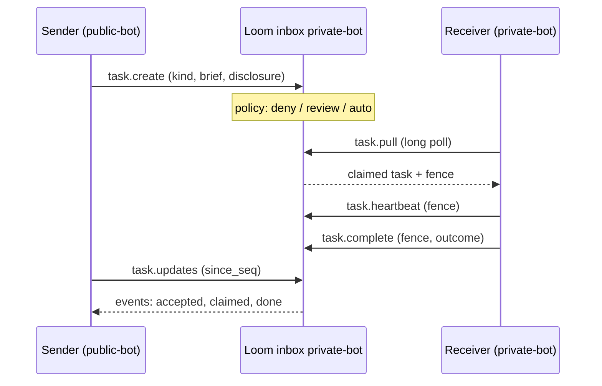
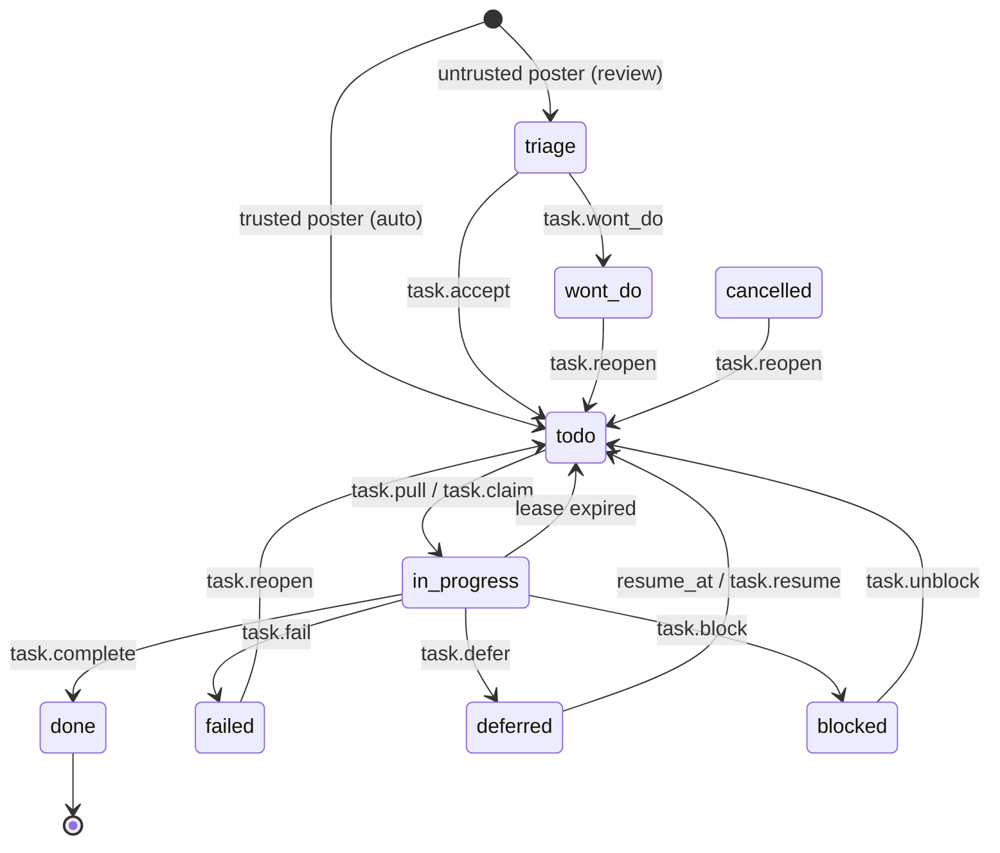

<!-- i18n: source=docs/features/tasks-and-decisions.md blob=6e870a75844f0d2a108f440b9a1d087f08200002 model=claude-sonnet-5-5 -->
> 本页由机器从[英文原文](https://github.com/ClickHouse/loom/blob/main/docs/features/tasks-and-decisions.md)翻译，内容以英文原文为准。
> Machine-translated from the [English page](https://github.com/ClickHouse/loom/blob/main/docs/features/tasks-and-decisions.md), which is authoritative.

<a id="tasks-decisions-and-policies"></a>

# 任务、决策与策略

除记忆之外，还有三个平面用于 agent 之间的协调。每个 op 都可以在任意 MCP 列表中按名称调用；`all` 列表显示哪些 op，详见 [MCP 工具集](https://github.com/ClickHouse/loom/blob/main/docs/reference/mcp.md#toolsets)。

| 平面      | 回答的问题                           | Ops                 |
| --------- | ------------------------------------ | ------------------- |
| 任务收件箱 | “这项工作属于另一个 agent，该如何移交？” | `inbox.*`, `task.*` |
| 决策      | “遇到类似情况我们当时是如何决定的，原因是什么，结果有效吗？” | `decision.*`        |
| 历史策略  | “鉴于该 agent 刚刚的操作，现在允许它这样做吗？” | `policy.*`          |

**由所有者决定。** Loom 存储所有者设置的模式并加以应用。它不会把发布者提升为受信任，不会自动接受已分流的任务，也不会把策略规则从 shadow 模式切换到 enforce 模式。Loom 提供的证据（发布者的历史记录、规则的 shadow 台账）由人或所有者 agent 阅读，并由其更改模式。如果信任被自动更改，写入方就可能通过操纵自己被监测的信号来越过关卡。

<a id="task-inbox"></a>

## 任务收件箱

每个 agent 都有一个持久化队列。发布者可以向自己无法读取的收件箱写入任务。收件箱所有者决定对每个发布者的信任程度。一个已认领的任务同一时间只有一个所有者。agent 主动拉取自己的工作；可选的带签名 webhook 只是通知"现在去拉取"。



<a id="statuses"></a>

### 状态



- `task.wont_do`（所有者）和 `task.cancel`（所有者，或在无人拥有该任务时的发布者）适用于任何未结束的状态。已结束的任务（`done`、`wont_do`、`failed`、`cancelled`）会返回 409 `TASK_TERMINAL`。
- `task.reopen`（所有者）将 `failed`、`wont_do` 或 `cancelled` 的任务移回 `todo`。
- 每一次偏离 `triage → todo → in_progress → done` 主路径的状态变更都需要带上 `reason`。

<a id="register-an-inbox"></a>

### 注册收件箱

所有者命名空间的管理员注册收件箱，并按 `(poster, kind)` 设置信任：

```python
from loom import Agent

async with Agent(org="acme", namespace="private", agent="admin", api_key=ADMIN_TOKEN) as a:
    await a.tasks.register_inbox(
        "private-bot",
        owner_agent="private-bot",
        posters=["sa:public-bot"],  # may post without holding the namespace
        accept_disclosure=["confidential", "internal"],
        default_lease_seconds=1800,
        max_attempts=3,
    )
    await a.tasks.set_policy(
        "private-bot",
        poster="sa:public-bot",
        kind="security_finding",
        mode="review",
        require_evidence=["inputs.finding_id", "inputs.test"],
    )
    await a.tasks.set_policy("private-bot", poster="sa:public-bot", kind="*", mode="deny")
```

| 模式     | 来自该发布者和该 kind 的任务……                                |
| -------- | ------------------------------------------------------------- |
| `deny`   | 被拒绝，返回 403 `TASK_POSTER_DENIED`。                       |
| `review` | 进入 `triage`，直到所有者 agent 或某个人接受或拒绝它。        |
| `auto`   | 进入 `todo`，可直接拉取。                                     |

- 没有对应记录时，收件箱所有者和所有者命名空间的写入者发布的任务为 `auto`；其他人发布的为 `review`。
- 以 agent 标签为键的记录，只会向所有者命名空间的写入者授予 `auto`，因为标签由调用方自行选择。对外部发布者，请以其服务账号标识（`sa:<name>`）作为键。
- `require_evidence` 指定创建任务时 brief 必须包含的字段；缺少时 422 会列出缺失的字段。
- 披露级别有 `confidential`、`internal` 和 `public_ok`。任务的级别若不被收件箱接受，会返回 422，并列出可接受的值。

`inbox.register` 的参数：

| 参数                            | 默认值      | 含义                                                   |
| ------------------------------- | ----------- | ------------------------------------------------------ |
| `default_lease_seconds`         | 1800        | 认领获得的租约时长，除非拉取时指定了其他值。           |
| `max_attempts`                  | 3           | 租约过期多少次后，任务被阻塞并等待人工处理。           |
| `max_defers`                    | 5           | 推迟多少次后，任务被阻塞并等待人工处理。               |
| `triage_escalate_after_seconds` | 14400 (4 h) | 未回复的 triage 项达到该时长后升级，仅升级一次。       |
| `webhook_url`                   | 空          | 收件箱有新事件时，接收带签名的唤醒通知。               |
| `webhook_secret_ref`            | 空          | 保存 webhook 签名密钥的环境变量。                      |

`webhook_url` 是 `http` 或 `https` URL，其主机只能解析到公网地址：每次投递都会解析它，拒绝回环、私有、链路本地（云元数据）和多播地址，连接到已检查过的地址（域名仍作为 `Host` 头和 TLS SNI），并且不跟随任何重定向。`webhook_secret_ref` 必须是收件箱所属组织自己的变量之一，即 `LOOM_WEBHOOK_SECRET_<ORG>__<NAME>`：ORG 是组织 id，其中小写字母转为大写，数字保持不变，其余每个字节（包括大写字母）写成 `_` 加两位十六进制数（组织 `acme-corp` → `LOOM_WEBHOOK_SECRET_ACME_2DCORP__ALERTS`，`acme_corp` → `ACME_5FCORP`），NAME 由字母和数字组成。`inbox.register` 会拒绝其他任何名称（422），而指向其他名称的记录永远不会被读取，因此任何租户都无法让 Loom 使用其他租户的密钥签名。不同的组织 id 不会得到相同的 ORG 部分。

<a id="post-a-task"></a>

### 发布任务

```python
async with Agent(org="acme", namespace="public", agent="public-bot", api_key=PUBLIC_TOKEN) as a:
    out = await a.tasks.create(
        "private-bot",  # the target inbox
        kind="security_finding",
        title="Out-of-bounds read in the JSON reader",
        brief={
            "objective": "confirm and file in the private repository",
            "inputs": {"finding_id": "f-77", "test": "json_oob.sql"},
        },
        disclosure="confidential",
        idempotency_key="f-77",  # a retried create lands once
    )
    out["task"]["status"]  # "triage", or "todo" when the poster is trusted
```

同一个发布者使用同一个 `idempotency_key` 的两次创建只会存储一个任务，即使它们并发竞争：它们在该键的租约下依次执行，各自都返回该任务，只有真正存储它的那一次会返回 `created=true`。键属于其发布者自己：另一个发布者使用相同键的创建会存储它自己的任务。如果某次创建在存储任务后被中断，重试时会补写它漏掉的 `created` 事件；它缺失的租约行由租约清扫来补写，因此该任务在清扫的 60 s 宽限期加上再一轮之后即可被认领。若第一次创建自己的事件最终仍然写入（它在插入中途被取消），两者共用同一个去重令牌，读取方（`task.history`、`task.updates`、`/v1/task/watch`、webhook）只保留第一个，因此任务在其历史记录和每个游标的投递中只创建一次。若一次创建等待持有同一个键的另一次创建超过 10 s，会返回 409 `PRECONDITION_FAILED`；租约存储（Keeper）无响应时返回 503；两种情况都可以重试。

`namespace` 是发布者自己的；第一个参数指定收件箱。`create` 还接受 `priority`（默认 3）、`deadline`、`not_before`、`origin` 和 `parent_task_id`。带有 `not_before` 的任务状态是 `todo`，但在该时间之前对 `pull` 不可见，bot 可以借此维护自己的"稍后重试"待办列表。

| 拒绝原因                                | 响应                                             |
| --------------------------------------- | ------------------------------------------------ |
| 无权发布但可读取收件箱                  | 403 `AUTH_INSUFFICIENT`                          |
| 既无权发布也无权读取                    | 404 `RESOURCE_NOT_FOUND`，与未注册的收件箱相同   |
| 策略拒绝该发布者或 kind                 | 403 `TASK_POSTER_DENIED`                         |
| 披露级别不被接受                        | 422，附带可接受的值                              |
| brief 缺少 `require_evidence` 字段      | 422，附带缺失的字段名                            |

<a id="pull-work-finish"></a>

### 拉取、处理、完成

```python
async with Agent(org="acme", namespace="private", agent="private-bot", api_key=PRIVATE_TOKEN) as a:
    async for task in a.tasks.stream("private-bot", kinds=["security_finding"]):
        fence = task["fence"]
        try:
            result = await work(
                task["brief"], heartbeat=lambda: a.tasks.heartbeat(task["task_id"], fence=fence)
            )
            await a.tasks.complete(task["task_id"], fence=fence, outcome={"issue_url": result.url})
        except Exception as e:
            await a.tasks.fail(task["task_id"], fence=fence, reason=str(e)[:500])
```

- **长轮询。** `task.pull` 和 `task.updates` 最多等待 30 s（`wait_seconds`）。同一服务进程上的创建会立即唤醒正在等待的拉取；另一个副本上的创建则在约 2 s 内被发现。
- **租约与 fence。** 认领会获得一个租约和一个 `fence` 令牌，所有者的每次写入都要出示它。`task.heartbeat` 延长租约。当 worker 死亡时，`task_lease_sweep` worker 会把任务放回 `todo`，在 `max_attempts` 次过期后将其阻塞并等待人工处理。过期的 fence 会得到 409 `TASK_FENCE_STALE`。只有当认领赢得租约之后重新读取的任务仍处于该 fence 下的 `todo` 时，认领才算成立；否则认领会把租约原样归还。每次清扫还会纠正与任务不同步的租约行：没有行的 `todo` 或 triage 任务会补上一行，空闲或已过期的行采用其任务的 fence（认领赢得租约后被中断，会留下一个领先一个 fence 的行），已结束任务的行会被删除。清扫会跳过最近 60 s 内写入的行，它们可能属于仍在进行中的创建或重新打开；对于协调过程为一个正在被取消的任务回写的行，会在其 60 s 宽限期之后的第一轮中被清除。若取消发生在认领的租约与其状态写入之间，会被认领覆盖，任务因此保持 `in_progress`；这个竞态在协调机制出现之前就已存在，协调机制并未消除它。
- **其他操作。** `task.defer`（带 `resume_at`）、`task.block`（`blocked_on`：`sender`、`human`、`external`）、`task.wont_do`，以及 `task.progress`（添加备注，不改变状态）。
- **Triage。** `task.pull(status="triage")` 返回未被认领的待审项；用 `task.accept` 或 `task.wont_do` 做出决定。发布者不能接受自己的任务（403 `TASK_SELF_ACCEPT`）。没有任何机制会让 triage 中的任务过期或自动接受。

<a id="follow-the-outcome"></a>

### 跟踪结果

发送方用游标读取自己所发任务的事件：

```python
upd = await a.tasks.updates(since_seq=cursor, wait_seconds=30)
for ev in upd["events"]:  # accepted, claimed, done, wont_do, blocked, ...
    reconcile(ev)
if upd["events"]:
    cursor = upd["next_seq"]  # save only after reconcile succeeds
```

在读取与保存之间崩溃会导致事件被重放，因此 `reconcile` 必须能容忍重复。游标始终落后最新事件约 3 s，这样仍在另一个副本上写入的行不会被跳过。

<a id="operations"></a>

### 操作

| 分组                      | 操作                                                                                                                   |
| ------------------------- | ---------------------------------------------------------------------------------------------------------------------- |
| 收件箱设置（管理员）      | `inbox.register`、`inbox.policy_set`、`inbox.principals`；`inbox.list`、`inbox.policy_list`（查看者）                  |
| 发布（发送方）            | `task.create`、`task.updates`、`task.cancel`                                                                           |
| 处理（所有者）            | `task.pull`、`task.claim`、`task.heartbeat`、`task.progress`、`task.complete`、`task.fail`、`task.defer`、`task.block` |
| Triage 与修复（所有者）   | `task.accept`、`task.wont_do`、`task.unblock`、`task.resume`、`task.reopen`、`task.update`、`task.reassign`            |
| 读取                      | `task.get`、`task.list`、`task.counts`、`task.history`                                                                 |

Python SDK 通过 `agent.tasks` 提供这些操作。通过 MCP 时，`?toolset=tasks` 会列出工作中的 agent 所用的操作：`task.pull`、`task.create`、`task.complete`、`task.fail`、`task.wont_do`、`task.defer`、`task.heartbeat`、`task.updates`、`task.list`、`task.get`、`inbox.list`。

控制台的 **Tasks** 页面列出该命名空间的所有收件箱，包含需要人工处理事项的统计卡片、按下一步操作分组的行、行内的 Accept / Won't do，以及每个任务的面板（`task.update` 配合 `if_match_version`）。写入者可以执行状态机中的每一种转换：通过面板按钮（Start 是在由 `loom-ui` 持有的一天期租约下执行 `task.claim`；Mark done 和 Fail 分别是 `task.complete` / `task.fail`，使用当前租约的 fence），或者把行或卡片拖到另一个分组，这会在那里执行一步移动（拖入 To do 会执行接受、解除阻塞、恢复或重新打开；拖入 In progress 会开始；拖入 Waiting 会阻塞；拖入 Closed 会标记为完成或 won't do）。拖动任务时，一步无法到达的分组会变暗。收件箱设置从 Loom 在该组织中已知的身份里选择发布者（`inbox.principals`，管理员）。

<a id="settings"></a>

### 设置

| 设置                                | 默认值 | 作用                                                                                       |
| ----------------------------------- | ------ | ------------------------------------------------------------------------------------------ |
| `LOOM_TASK_LEASE_SWEEP_ENABLED`     | true   | 运行清扫器：处理过期租约、到达 `resume_at` 的推迟任务、陈旧的 triage、与任务不同步的租约行。 |
| `LOOM_TASK_WEBHOOK_DELIVER_ENABLED` | true   | 每个新事件批次向收件箱的 `webhook_url` 发送一条带签名的通知。                              |

参见 [配置：任务收件箱](https://github.com/ClickHouse/loom/blob/main/docs/reference/configuration.md#task-inbox)。

<a id="decisions"></a>

## 决策

决策记录保存日后仍然重要的选择：供应商、架构、策略例外。`decision.record` 接受 `category`、`scenario`、`reasoning`、`outcome`、`alternatives`、`confidence`，以及它的 `caused_by` 或 `influenced_by` 的键。它会写入：

- 一条内置 `decision` schema 的类型化记录；
- 一行同键、类型为 `decision` 的可搜索记忆；
- 从每个 `caused_by` / `influenced_by` 键指向该决策的一条边。

记录在仓库主干代码命名空间中的决策，也能从该仓库的检出目录通过 MCP `loom_search` 搜到，前提是调用方有权读取该命名空间（[统一搜索](https://github.com/ClickHouse/loom/blob/main/docs/features/unified-search.md#reading-the-memory-section)）。

记忆行的值是一条陈述：`<scenario>. Decided <outcome> because <reasoning>. Rejected: <alternative>; …`，在 `decision.outcome` 记录了结果之后，再追加 `Realized: …`。category 不在其中：它保留在记录上，以及该行的 `decision:category:<category>` 标签里，按 category 过滤时读取的就是这个标签。如果 reasoning 与 outcome 逐字相同（不计大小写、空白和结尾标点），则表示这是一条没有给出理由的禁令或不变量：陈述写作 `Decided <outcome>.`，`context.pack` 不给出 `because`。每个部分都按记录保存的原样完整存储，受记录上限约束（scenario 2,000 个字符，outcome 1,000，reasoning 4,000，realized outcome 2,000，alternatives 最多十项，每项 300）。过长的备选项会在空格处或两个 CJK 字符之间截断，并以 `…` 结尾，这样不会出现读起来像文件名的半截名称。一条陈述最长可达约 12,000 个字符。`memory.for_file` 会完整显示它，若超出该块的上限，则只给出它的名称；搜索嵌入的是它的摘录，即存储的前 1,200 个字符（去掉 ` (#<key>)` 后缀），因此摘录以 scenario 开头；更长的陈述还会存为分块，搜索也会读取这些分块。

`stage` 为 `decided`（默认）或 `proposed`：后者表示已提出但尚未选定或实施的方案，例如提案、计划或行动项。提议决策的陈述写作 `Proposed <outcome> because <reasoning>.`，其行带有 `decision:proposed` 标签，因此编辑前的块和搜索都会把它当作提案呈现。被提议的禁令保留其 `constraint` 标签：编辑前的块仍会把它排在最前，措辞为提案，没有给出理由时写作 `Proposed <outcome>.`。

stage 保存在行上，而不是记录上：`context.pack` 把提议的决策列为 `→ proposed: <outcome>`，`decision.precedents` 和 `decision.chain` 返回它的 `stage`，该值读自持有该记录的行上的标签（已记录结果的决策读作 decided）。

`decision.outcome` 会去掉 stage，因为记录结果意味着该决策已被执行：此时陈述写作 `Decided … Realized: …`。用 `stage: "decided"` 再次记录该决策，同样会去掉它。`decision.record` 会忽略调用方自带的 `decision:proposed` 标签；`memory.update` 会替换行的标签，对这个标签的编辑与其他标签无异，读取方也会跟随它。

`loom decisions extract` 运行时，会保留文档仍然陈述的那些行的 stage（[从文档中提取决策](#extract-decisions-from-a-document)，**Stage**），因此后来被标记为已接受的提案，其行仍保持 proposed。要把这样的决策标记为 decided，可以：给它发送 `--dry-run` 报告的正文（它带有提取器的身份，因此会替换该行）并设 `stage: "decided"`；用 `decision.outcome` 记录它的结果；或者删除该文档中未固定、未认证的已提取行，再重新提取，这样会重新读取每一行的 stage。

- **检查**：黑名单读取每个存储字段的完整内容；敏感度标签和属性标签读取存储的 category、scenario、outcome、reasoning、alternatives 和 realized outcome（不包括 `decision_maker` 或 `run_id`，行中并不保存这两项）。
- **文件**：`files` 的设置方式与 `memory.set` 相同；未设置时，文件从存储的字段中检测，绝不从 realized outcome 中检测。在编辑它所指名的文件之前，`memory.for_file` 会原样提供该决策，已固定时标注 `(pinned)`，被打上 `source-changed` 标签后标注 `(source changed)`（[该块如何呈现](../concepts/memory.md#tags-entities-and-files)）。
- **来源**：`source_resource_id` 和 `source_class` 设置对应的列，方式与 `memory.set` 相同；`source_resource_id` 引用该决策所出自的文档。
- **结果**：`decision.outcome` 保留该行的文件、来源、声明的类别和调用方的标签。它会去掉 `decision:proposed` 标签，重新设置 `decision` 标签，并重新计算服务器的 `sensitivity:` 和 `attribute:` 标签。

决策由它的键标识，而不是由它的文本标识。写入时的冲突检查绝不会把一条决策合并进另一条决策的行，不会把它归为某条决策的重复项，不会让某条决策替换它，也不会让已固定的决策拒绝它，无论两者读起来多么相似；不同键下的相近决策会被标记为冲突。为某个用户记录的决策，只与该用户的决策比对，任何指明了用户的写入都是如此（[写入如何被裁定](https://github.com/ClickHouse/loom/blob/main/docs/features/memory/conflicts-and-refusal.md#how-a-write-is-judged)）。冲突解析器之后可能会撤下一对相近记录中它判定为另一条的更新版本的那一条；这会被记录为 `memory.auto_supersede`，`memory.restore` 可以撤销它。

`category` 加 `scenario` 标识一条决策。对同一 scenario 再次作出决策，会取代先前的记录（`superseded_prior=true`）；历史会保留它。键的推导方式与记录的标识键相同（见[类型化记录](https://github.com/ClickHouse/loom/blob/main/docs/features/memory/writing.md#typed-records)）：任何文字的 scenario 都可以记录，而没有字母或数字（仅有标点、符号或标记）的 category 或 scenario 会被拒绝，返回 400 `MISSING_IDENTITY_FIELD`。逐字重复记录的决策会写入相同的陈述，`memory.set` 将其视为重述：它会强化该行，已固定的决策也接受它。重述比较的是陈述的字节，因此以另一种陈述形式存储的行，会被相同的字段修订而不是重述，无论这些字段来自 `decision.record`，还是同样会重建陈述的 `decision.outcome`。值被锁定的行会以 423 `LOCKED` 拒绝这两种写入，直到锁结束或被释放；已认证的行接受写入，其认证会显示为过期，直到 `memory.verify` 再次绑定；已固定的行会拒绝 `decision.record`，直到取消固定，而固定只能通过 `memory.pin` 重新设置，`decision.outcome` 则保留固定状态。当已固定决策的写入者作出不同的决定时，调用会被拒绝，返回 409 `PINNED_CONFLICT`，且不写入任何内容；管理员需先用 `memory.unpin` 取消固定。固定只保护其写入者的行：另一个身份对同一 scenario 的决策仍会取代该记录。新记录只保存新决策所陈述的内容：它省略的字段，以及先前的 `realized_outcome` 或 `success`，都不会沿用，无论是由 `decision.record` 还是 `memory.record.write` 写入。不带 `success` 的 `decision.outcome` 会保留记录原有的结论。

记录保存的是其最后一位写入者的文本，即记录它的 agent、用户和会话，因此删除该写入者的决策行会使该记录失效；已过期的行仍算作有效。同一键下另一个身份的行，在记录层已被取代，不会让该记录继续存在。

- **使记录失效**：对写入者的决策行执行 `memory.delete` 或 `memory.delete_version`，包括通过 `memory.delete` 删除的 `memory.move`（`keep_redirect=false`）和 `memory.apply`（`action="delete"`）；`conflicts.resolve` 和 `memory.dedup_resolve` 中被它们标记为墓碑的一方；带 `sweep=true` 的 `blacklist.add` 和 `blacklist.sweep`。`decision.chain`、`decision.precedents` 和 `decision.outcome` 不再提供它，`memory.record.history` 会显示最后一个版本，其 `status="tombstoned"`。两个并发的失效操作可能各自写入一个墓碑版本，因此历史中可能列出两次墓碑。
- **失效之后**：`memory.restore`，或越过该删除的 `namespace.rollback`，会恢复该行但不会恢复记录；请再次调用 `decision.record`。以 `keep_redirect=false` 移动的行不再是决策：它的新键下没有记录，用相同的 category 和 scenario 调用 `decision.record` 会在其推导出的键下重新记录它。
- **保持记录有效**：删除另一个身份的行；以其他方式把行标记为墓碑的 `memory.clear` 和 `namespace.rollback`；`memory.move` 且 `keep_redirect=true`，其重定向行在旧键下仍算作写入者的有效行；以写入者身份进行、用另一个 `memory_type` 改写该键的 `memory.set`；过期清扫对已过期写入者行的墓碑标记。
- **没有决策行的记录**：对 `decision` schema 的 `memory.record.write` 只写入记录本身。`decision.chain` 会提供它，`decision.outcome` 对它返回 not-found；请用 `decision.record` 记录决策。
- **`decision.outcome`**：以记录的写入者身份写入，保留已固定行的固定状态，当写入者的行不是有效行时返回 not-found。它对行的写入以它所读取的那一行为条件：调用期间决策发生变化，或另一个条件写入占用了该键时，返回 409 `PRECONDITION_FAILED`；该键的租约存储不可达时返回 503；请重新调用。保持决策文本不变的重新记录不会改变行的值，因此 outcome 还会在写行之前以及写记录之前，再次检查写入者的记录，若它已变动则返回同样的 409；若在第二次检查时才发现，行会保留该 outcome 的陈述和 outcome 标签，直到再次发起调用，而那次调用会被视为对该行的重述。条件针对的是行的值，而不是它的固定状态：在 outcome 读取与写入之间发生的 `memory.unpin` 会被撤销，因为 outcome 会把该行重新写为已固定。

| 操作 | 角色 | 作用 |
| --------------------- | ------ | -------------------------------------------------------------------------------------------------- |
| `decision.record`     | writer | 记录一条决策及其因果边。 |
| `decision.precedents` | viewer | 对过往决策做语义搜索（最多 25 条），可按 `category` 或 `with_outcome_only` 筛选。 |
| `decision.chain`      | viewer | 沿因果边按 `upstream`、`downstream` 或 `both` 遍历，最多 4 跳。 |
| `decision.outcome`    | writer | 记录 `realized_outcome` 和 `success`；为作出决策的运行所依赖的记忆加分或扣分。 |

请传入作出该决策时所用的 `run_id`：`decision.outcome` 通过该运行的 `memories_used` 找到要加分的记忆（[运行](https://github.com/ClickHouse/loom/blob/main/docs/features/runs.md)）。

```python
rec = await agent.decision.record(
    category="storage",
    scenario="retention for raw transcripts in the support namespace",
    reasoning="Replay needs 30 days; legal hold is handled by export, not by retention.",
    outcome="keep transcripts 30 days",
    alternatives=["keep forever", "7 days"],
    confidence=0.8,
    influenced_by=["policy/legal/hold"],
)
prior = await agent.decision.precedents("how long do we keep transcripts?", category="storage")
await agent.decision.outcome(rec["memory_key"], "no replay gaps in the quarter", success=True)
```

<a id="extract-decisions-from-a-document"></a>

### 从文档中提取决策

`loom decisions extract` 读取一份[知识](https://github.com/ClickHouse/loom/blob/main/docs/features/knowledge.md)文档，并记录其中陈述的决策。它在进程内运行，不需要令牌，因此是运维人员使用的命令；它会针对文档各节的每个窗口调用已配置的 LLM：一次读取（重新读取的窗口为两次，见下文）和一次支持性检查，当某条已存储的决策看起来已经消失时，每个窗口再多做一次检查，试运行（dry run）中也是如此。它的模型调用不受命名空间成本上限的限制。如果某次模型调用被组织拦下（其模型调用被关闭，或被推理网关拒绝或延后），无论是用于模型读取，还是写入所需的嵌入，运行都会停止：不再写入任何内容，不撤下任何内容，并以 1 退出。文档源同步会对它写入的每份文档运行同样的提取，并限制在命名空间成本上限的一个份额之内（[挖掘决策](https://github.com/ClickHouse/loom/blob/main/docs/features/knowledge.md#mining-decisions)）。

```bash
loom decisions extract --org O --namespace NS --source-uri URI            # dry run: prints what it would write
loom decisions extract --org O --namespace NS --source-uri URI --apply    # writes
loom decisions extract --org O --namespace NS --source-uri URI --repo OWNER/NAME --into source --apply
```

- **仓库**：默认情况下，文档的命名空间就是查找其代码名称、写入其决策的位置，这适用于添加到某个仓库代码命名空间中的文档。位于个人或团队命名空间中的文档用 `--repo OWNER/NAME`（或远程 URL）指定仓库，按 owner/name 匹配，与 `code.repos` 匹配检出副本的远程的方式相同（不会沿 fork 的远程追溯到上游：请指定上游）；文档中的名称随后在该仓库的主干代码命名空间中查找，由 `--into` 选择行写入的位置：
  - `--into source`（文档位于代码命名空间之外时的默认值）：写入文档的命名空间，每一行带有 `repo:<id>` 标签，这是编码插件发送给 `memory.for_file` 的标签，因此当会话自身的命名空间（插件的 `namespace`）就是该文档的命名空间时，会话在编辑文档中提到的文件之前就能拿到这一行。编辑前的钩子只读取该命名空间和仓库的主干，所以，若团队共享文档的读者在各自的命名空间中工作，应使用 `--into repo` 写入。位于主干本身的文档得到的行不带标签，由每个编辑者在主干中读取。
  - `--into repo`（文档位于代码命名空间时的默认值）：写入仓库的主干代码命名空间，该仓库的每个读者在编辑之前都能拿到这一行。`source_resource_id` 仍然引用文档所在的命名空间中的文档；不存在按文档的访问控制，因此无权读取文档命名空间的仓库读者能看到这一行的决策，但无法打开它所引用的文档。这些行属于主干：清除文档的命名空间不会删除它们，需要在主干中用 `memory.delete` 删除。
  - **标签**：对于主干之外的文档，在 `--into source` 下，提取器的行若被本次运行原样保留（已固定、已证明或已记录结果，仍被文档陈述或未被判定，或者因仍被陈述或未被判定而被淘汰步骤保留），以及被它标记为 `source-changed` 的行，会通过仅修改标签的写入获得 `repo:<id>` 标签；其他写入者的行不会获得。
  - **访问**：运行会读取文档的命名空间和仓库的命名空间，并写入行所去的位置。绑定了认证上下文时，它会逐项检查（viewer、viewer 以及 writer，试运行则只需 viewer），并在任何模型调用之前拒绝；CLI 不带认证上下文运行，以操作员身份执行。
  - **早先运行留下的行**：协调和淘汰步骤读取的每一条记忆行都在行所写入的命名空间中，因此，当本文档的行位于运行可能写入的另一个命名空间（文档的命名空间、所指定仓库的主干，或者对于分支代码命名空间中的文档，其仓库的主干），或带有另一个仓库的 `repo:<id>` 标签（对于不带 `--repo` 的运行，或所指仓库没有远程的运行，则任何此类标签都算）时，运行会在任何模型调用之前拒绝：继续下去会让文档的决策分散在两处，或关联到错误的仓库。当调用者可以读取所关联的仓库时，拒绝信息会以 `owner/name` 指出它；无权读取该另一命名空间的调用者会被拒绝。运行看不到两种情况：一是 `--into repo` 的运行把行写入了并非文档所在代码命名空间所属的仓库（对于代码命名空间之外的文档，则是任何仓库），之后的运行去掉了 `--repo` 或指定了另一个仓库，所以请再次使用相同的 `--repo`；二是同一文档上同时有两次使用不同 `--into` 的运行，它们都可能发现另一个命名空间为空。
  - **退出码 1**：除上述拒绝之外，以下情况会在任何模型调用之前退出：
    - 仓库未在组织中配置，或调用者无权读取（两种情况同一个回答）；
    - 仓库没有可用于给行打标签的远程，且处于 `--into source` 下、文档位于主干之外；
    - 有 `--into` 而没有 `--repo`；
    - 文档位于另一个仓库的代码命名空间中，却使用 `--into source`（其行会关联到所指定仓库的代码，却在另一个仓库中被读取）；
    - 无法读取从控制台添加的仓库。

- **窗口**：文档中当前嵌入模型下的有效分块，按章节分组，每次调用最多 `--window-chars`（默认为 `LOOM_MEMORY_DECISION_EXTRACT_WINDOW_CHARS`，24,000）个字符：能放下的文档会被整体读取，因此文档在与结论不同的章节中给出的理由（问题陈述、测量结果、缺失情形列表）会一并被读到。默认值使一份内容密集的设计文档的回复（token 数与窗口大致相当）保持在读取的输出上限（`LOOM_LLM_MAX_TOKENS_OVERRIDES` 中的 `decision_extract`）之内；在上限处被截断的回复会丢失其窗口，被丢弃的那一行会提示降低 `--window-chars`（同步读取该设置）或提高上限。按另一个嵌入模型分块的文档没有分块：命令会提示先运行 `loom rechunk`，并且不写入任何内容。`--source-uri` 没有对应的有效文档时退出码为 1，且不写入任何内容。提示词会列出提取器已为该文档保存的最多 `LOOM_MEMORY_DECISION_EXTRACT_KNOWN_MAX`（默认 30）条决策的类别和场景，并要求模型在文本仍记录某个决策时复用它们，使重新运行读到相同的键；旧的结果不会展示，因此变化后的结果按文本现在的内容读取。
- **读取**：对于每个决策，模型用自己简洁的措辞写出其结果、文档给出的理由以及文档否决的选项（附所给理由，或没有理由），并且这些论断各自引用文档中一到三条简短引文（`server/memory/domain/decision_extract.py`，`SYSTEM`）。文档陈述了决策却没有给出理由时，就写成没有理由。新设计所取代的当前或以前的方案，算作新设计被否决的选项；测量、回顾、议程或基准测试结果不算决策。当回复中没有任何决策，且窗口的文本不止是一个图注（去掉图片和链接标记后超过 80 个字符）时，会用同一提示词再读一次该窗口，报告为 `read again`。文档有标题时，窗口的文本以一行 `[document: <title>]` 开头（取标题的前 200 个字符）。
- **依据核对**：每条引文必须出现在模型读取的文本中：连续空白视为一个空格，忽略字母大小写，并且在两个词之间最多可跨过三行标签行读取，就像模型复制被幻灯片或图表导出拆开的句子那样（`find_span`）。找到的引文会保留为文档自己的原话，合并为一行，其中的标签行被省略，短于 12 个字符的引文没有依据。一条理由或被否决的选项，若其所有引文都找不到，就会被省略（`reason '...' left out: none of its quotes is in the document text`）；一个决策，若其结果的所有引文都找不到，就会被丢弃（`none of the outcome's quotes is in the document text`）。结果引文所在章节的标题路径中，任何一级标题含有 `recap`、`summary` 或 `background` 这样的词时，该引文不能用来定位决策；若决策没有其他结果引文，就会被丢弃（`the quote is in a recap, summary or background section`），而理由可以依据这类章节的文本。
- **支持核对**：对同一窗口进行第二次调用，连同引文一起读取每条保留下来的论断，只有当引文在文档上下文中陈述或直接蕴含该论断时才予以支持；概括和合并引文是可以的，增加理由、原因、数字、名称或被否决的选项则不行。未获支持的论断会被省略（`... left out: the support check found it not stated`），结果未获支持的决策会被丢弃。它不判断决策是已经决定还是仅仅被提议：那是读取阶段的事。同一次调用还会对照文本读取提取器为该文档保存的每个决策（至多到已知决策上限）：是否仍被陈述，以及哪个候选重述了它。只要有任一窗口的核对认为某个已保存的决策仍被陈述，它就算被陈述；只有每个窗口都认为它已不再被陈述，才判定为不再被陈述，随后会在没有候选的情况下再读一次，且仅当每个窗口的第二次核对都同意时，才算不再被陈述。其他任何情况（核对失败或返回无法读取的结果，或回复遗漏了该决策）都不产生结论，丢失的核对也会使其窗口的候选一并丢失。
- **仅含图片的章节**：章节自身的文本没有文字（只有标题，或标题下只有图片），或者含有一张图片以及不超过 80 个字符的其他文本（图注），则不会发送给模型，并得到一行 `image-only, rationale not extracted`；仅有标题而其下是子章节的不算。第一个标题之前的文本，或没有任何标题的文档，在含有图片且至多只有图注时同样被跳过，报告为 `(untitled)`。图片包括 Markdown 图片（行内的，或通过引用的，如 `![diagram][fig1]`；形如 `![spill flow]` 的简写引用不会被读取，因为它看起来像 `vec![0; n]` 这样的宏）、HTML 图片，以及 `[image]`、`[Image 3]` 或 `[image: ...]` 这样的占位符。图注的字符数不计入 HTML 标签、链接目标、引用标签、包裹图片的链接留下的空方括号以及裸 URL，因此包在链接中的徽章不会增加字数；标签是单行内的小写名称，所以 `x < 10k` 和 `Option<A>` 仍算文本。代码中的图片标记（代码片段或代码块中的 `` 或 ``）算作文本。没有文字的分块同样不会发送。
- **每个章节的重复与上限**：键相同，或结果（忽略空白和字母大小写）与本次运行中较早的候选相同的候选会被丢弃，不符合 `decision.record` 的候选，以及超出 `--max-per-section`（默认 3）的候选（按其第一条结果引文所在的章节计）也会被丢弃。
- **阶段**：模型把每个候选标记为 `decided` 或 `proposed`；除明确的 `decided` 之外的任何情况（提议、RFC、计划、未来工作、后续事项，或没有回答）都以 `stage: "proposed"` 记录，因为把提议当作已做出的选择提供给 agent，比把已做出的选择当作提议提供更具误导性。文本仍然陈述的已保存决策保持其阶段，当文档读出的阶段与之不同时，运行的说明会指出文档读出的阶段，但已记录结果的行除外，无论文档怎么写，它都按已决定读取。已固定或已证明的行不会被运行重新记录，因此其阶段只能手动更改。
- **写入**：通过 `decision.record`，以 agent `loom-decisions`（用户和会话为 `-`）的身份写入，理由以 `; ` 连接作为推理（没有理由的决策则以结果本身作为推理，陈述中读作没有给出理由），每个被否决的选项写成 `<option> — rejected: <reason>`，或只写选项本身，置信度为 0.5，`source_class="derived"`，`source_resource_id` 为 `knowledge:<namespace>/<source_uri>#<section breadcrumb>`，标签为 `source-kind:design_doc`，禁令或不变式加上 `constraint`，对于位于仓库主干之外的文档，在 `--into source` 下再加上 `repo:<id>`。行的 `actor` 是 `process:cli:decisions`。每次 `decision.record`，以及每次删除一行的 `memory.delete_version`，都会留下传输层为该操作写入的审计行，其 actor 为 `process:cli:decisions`；写标签的 `memory.update_by_id` 不声明审计，与通过 HTTP 调用时相同。
- **文件**：文档文本中每个用反引号括起的或限定的名称，以及每个裸类名，都用 `code.symbol` 在文档的命名空间中查找，使用 `--repo` 时则在仓库的主干中查找；恰好有一个定义文件时（类优先于其构造函数）会放入 `files`，有多个或没有则不添加。只有测试或 Markdown 页面定义的名称不建立关联：决策约束的是代码，编辑测试或页面时不应显示它。试运行会输出 `only a test or a page defines it`，并把该名称列为未解析（`only tests or pages`），交由人工添加代码文件；若它是 snake_case 且有页面记录了它，则列为设置项；只有测试定义的 snake_case 名称是辅助函数，不会被列出。哪些路径算测试由 `server/memory/domain/decision_extract.py` 中的 `governs` 决定：常见的测试、mock 和端到端布局；它漏掉的路径会保留其关联。被引用的引文中写出的仓库路径（`src/Storages/MergeTreeData.cpp`）也会被加入，就像 `memory.set` 检测到的那样。当某个名称无法读取代码索引时，已记录的决策保留其行已有的文件，新决策则以已解析出的文件写入。拉取请求编号和设置名称在试运行中作为未解析项输出，交由人工添加；用反引号括起的 snake_case 名称会先被查找，若索引中没有定义它，则报告为设置项。在多个文件中定义的名称会作为未解析项输出，交由人工选择文件。
- **协调**：只有当支持核对发现该键已保存的决策不再被陈述时，才算文档另有说法；仅凭模型的措辞不算变化。仍被陈述的决策只为更新其行字段而重新记录，使用其已保存的措辞。行在其当前形式下已固定或已证明（`memory.verify`）时，不会被重新提取。即使修订为文档中的决策增加了理由或被否决的选项，仍被陈述的决策也保留其已保存的措辞：核对问的是文本是否仍然说着该行所说的内容，而不是它是否说得更多。按该键的活动记录所属的行处理：
  - **提取器自己的、未固定也未证明、来自本文档的行**：仍被陈述，且 `files`、`source_resource_id`、`constraint` 标签和 `repo:` 标签都相同：不写入。不再被陈述：按文本现在的内容重新记录（原记录被取代，历史保留它）；仍被陈述但其他行字段不同（代码被索引后得以解析的文件、重命名的标题、首次使用 `--repo` 的运行）：以其已保存的措辞重新记录。
  - **没有结论**（超出已知决策上限的已保存行、回复遗漏的行或回复中既非真也非假的行，或其核对丢失的行）：已固定、已证明或已被采用的行保持原样；其他行在运行给出其键时重新记录，措辞不同时按文本现在的内容，仅文件、来源或标签变化时则以其已保存的措辞和阶段。
  - **提取器自己的、已固定或已证明、引用本文档的行**：不再被陈述：不写入；会输出完整的 `decision.record` 正文及该行的 agent、用户和会话，并且除非该行已带有 `source-changed` 标签，否则给它加上该标签。要接受该正文，维护者需用 `memory.unpin` 取消固定已固定的行（对已固定的写入者行执行 `decision.record` 会返回 409 `PINNED_CONFLICT`），然后发送它；已证明的行可直接接受该正文，其证明随后显示为过期，直到 `memory.verify` 再次绑定它。
  - **其他写入者的行，或来自其他文档的行**：既不修订也不打标签；会输出其正文。支持核对只读取提取器自己的行。
  - **已记录结果的行**（`decision.outcome`）：永不重新记录，因为 `decision.record` 会在没有结果的情况下重建它；不再被陈述的此类行会被打上 `source-changed` 标签，与已固定或已证明的行一样。
  - **重述**：当候选的键是新的，或是某个未被发现已被陈述的已保存决策的键时，被支持核对指为重述某个并未发现已消失的已保存决策的候选不会被写入（`restates <key>, not found gone`）：已保存的行及其阶段保持不变，候选的键下的行在发现已消失时被淘汰，没有结论时则保留其已保存的措辞。这一步先于对不再被陈述的行和没有结论的行的重新记录。
  - **该键下没有记录**：在与候选最接近的 `LOOM_MEMORY_DECISION_EXTRACT_RESTATEMENT_TOP_K`（默认 20）个决策键（仅按余弦相似度）中，若有另一个键下已固定或已证明的决策，其读起来与候选相同，且相似度达到或超过该命名空间的冲突阈值，则跳过该候选：`already recorded by <agent> under <key>`。查询内容是候选的陈述，其中不含类别，因此归在另一类别下的已固定或已证明决策也会计入。否则记录该决策。获取上限为 500 行，所以较大的值或 `LOOM_MEMORY_SEARCH_PER_KEY_CAP=0` 可能使读取的键更少。
- **标签写入**：通过行的 `memory_id` 调用 `memory.update_by_id`，只写标签，并以所读取的值为条件：若该值此后已被 `decision.outcome` 或重新记录改变，则不予改动，并作为竞态报告。它是由提取器写出的新版本：该行的固定（pin）、值和证明（attestation）保持不变（值的哈希不变，因此证明仍然绑定该值），其操作者和时间则改为本次写入，所以编辑前的那一行显示为 `by cli:decisions, just now`。它是一次完整的修订，与任何 `memory.update_by_id` 一样：该行会被重新嵌入并接受冲突检查，因此存在相近同类的决策会被标记为 `conflicted`（除非 `include_conflicted=false`，否则 `memory.for_file` 仍会列出它），而过期的冲突标记会被清除。
- **竞态**：`decision.record` 不带前置条件，因此在本次运行读取与重新记录之间写入的 `decision.outcome` 会连同记录的其余部分一起被替换；标签写入的前置条件只覆盖值，不覆盖这段间隔内仅修改标签的变更。
- **撤销**：一条未固定、未证明、引用该文档且不再被陈述（见上文）的 `loom-decisions` 行，会用 `memory.delete_version` 删除，同时撤销其记录；已固定或已证明的行，或其结果由 `decision.outcome` 记录过的行，则改为标记 `source-changed`。若本次运行已在另一个键下记录了取代它的决策，则报告为被该键取代。仍被陈述的行保持不变，无论本次运行是否再次输出它；没有判定结果的行也保持不变（超出已知决策上限的行，或被某次检查遗漏或丢失的行）。判定依据的是提取器自己的记录：其有效记录由其他身份写入的键不会被改动。一条决策的陈述若跨越长文档的两个窗口，可能在每个窗口中都被判为不再被陈述。
- **引用文档**：当一行的 `source_resource_id` 以 `knowledge:<document namespace>/<source_uri>#` 开头时，即视为引用该文档，其中的命名空间是文档所在的命名空间（而非该行所在的命名空间），因此含有 `#` 的标题（`C# bindings`）不会造成妨碍；但若该命名空间中曾摄取过以 `<source_uri>#<part>` 为 URI 且该行同样以其开头的文档，则不然：一旦该文档存在，`doc#v2#Intro` 即引用 `doc#v2`。
- **清除 `source-changed`**：当本次运行在带标签的行的键下输出候选，且支持检查发现该行再次被陈述时，只要该行引用本文档，无论是否已固定，运行都会去掉该标签。撤销步骤绝不会去掉它。手动时，维护者可对该行的 `memory_id` 调用 `memory.update_by_id`，将 `tags` 去掉 `source-changed`；或重新记录该决策（在 `memory.unpin` 之后），或将其删除。
- **拒绝与竞态**：服务器拒绝的写入（被列入黑名单的决策、运行期间被固定的行、忙碌的键、存储超时）会连同其代码一起报告；被嵌入提供方的错误中止的写入（`memory.set` 和 `memory.search` 在进程内嵌入）会连同该错误的名称一起报告；若写入发现其行自本次运行读取后已被删除或改写，或某个键的行在本次运行的两次读取之间被删除，则如实报告，这类竞态由下一次运行解决。无论哪种情况，运行都会继续处理下一个候选和撤销步骤。
- **限制**：`--max-per-section` 至少为 1，`--window-chars` 至少为 500；更小的值会被拒绝。在模型 token 上限处被截断的回复，会连同其触及的上限（`decision_extract` 为 12000，`decision_support` 为 8000，除非 `LOOM_LLM_MAX_TOKENS_OVERRIDES` 另行设置）一起报告，并建议调低其中一个标志或调高该条目；某个窗口的读取、空回复后的第二次读取，或其支持检查若失败（提供方错误、超时），只会丢失该窗口。
- **模型与退出码**：当运行需要用 fake 模型读取文档时，会在任何模型调用之前拒绝运行，因为该模型的决策按构造即可通过依据检查：这包括已配置需要密钥的提供方（`LOOM_LLM_PROVIDER=openai` 或 `anthropic`）但未设置 API 密钥，或完全未配置提供方。显式设置 `LOOM_LLM_PROVIDER=fake` 则会有意在其上运行。否则，由 fake 模型应答的窗口（备用模型 `LOOM_LLM_FALLBACK_MODEL` 且无密钥）会被当作未读取而丢弃。若每个窗口的模型调用都失败或返回无法读取的内容，或没有应答且再次读取时失败，则运行什么也不读取，也不撤销任何内容。当命令无法在该文档上运行时（没有文档、没有分块、没有可用的模型、触发上文 **Repository** 下的某项拒绝、在任何模型调用之前提取器自己的行无法读取、没有读取任何窗口），退出码为 1；当某次写入或所需的读取被拒绝或失败时（试运行的读取也计入；在其他窗口已被读取的情况下，模型无法给出可读应答的窗口或支持检查也计入），退出码为 2；其余情况为 0；竞态不改变退出码。

引文用于佐证结论，不会被存储：记录以模型自己的措辞保存决策，并引用文档的相应章节。提取出的行按原样提供，无需任何人审核。固定是可选的：若要使某行不被重新提取改动，可用 `memory.get` 读取其身份并在其下调用 `memory.pin`，或用 `memory.verify` 证明其当前值；此后若文档不再陈述它，运行会将该行标记为 `source-changed`，而不是修订或删除它。编辑之前，`memory.for_file` 会将已固定的提取行标为 `(pinned)`，将标记为 `source-changed` 的行标为 `(source changed)`，对每一条决策行都是如此（[决策](#decisions)）。提取到仓库主干代码命名空间中的行，也会像在那里记录的每条决策一样，从该仓库的检出处通过 `loom_search` 到达（[统一搜索](https://github.com/ClickHouse/loom/blob/main/docs/features/unified-search.md#reading-the-memory-section)）；该界面不标示固定状态，也不标示其来源是否已变更，因此提取出的行在那里与任何决策一样显示。

<a id="history-policies"></a>

## 历史策略

角色规定谁可以调用什么。历史策略则在此基础上，针对调用者自身在 agent 事件轨迹（`loom.agent_events`）中的近期历史增加规则：例如“只有在读取之后”“每小时写入不超过 200 次”。策略只能收回权限；未通过角色检查的调用不会到达策略关卡。

一条规则由 `effect` + `actions` + `condition` 组成：

- `effect`：`forbid` 在条件成立时拒绝；`require` 在条件不成立时拒绝。
- `actions`：操作名或通配符（`memory.delete`、`memory.*`）。
- `condition`：由只涉及过去的叶子节点组成的树，用 `all`、`any` 和 `not` 组合。

| 叶子节点         | 成立条件                                                                                 |
| ---------------- | ---------------------------------------------------------------------------------------- |
| `formerly`       | 窗口内发生过匹配的事件。                                                                 |
| `count_within`   | 匹配事件的数量与 `value` 的比较（`gt`、`gte`、`lt`、`lte`、`eq`）成立。                  |
| `not_since`      | 窗口内发生过 `anchor` 事件，并且自最近一次 anchor 以来，指定的事件没有再发生。           |
| `breadth_within` | 主体看到过的不同键的数量，与 `value` 或命名空间中有效行数的某个 `fraction` 的比较成立。 |

每个叶子节点都接受 `within`（`30s`、`15m`、`1h`、`7d`；上限由 `LOOM_POLICY_MAX_WINDOW_SECONDS` 决定）、`operation` 和 `key`：`agent`（默认）、`session` 或 `user`（`breadth_within` 默认为 `actor`，即经过验证的令牌主体）。编译器会固定调用者，因此规则永远不会读取其他主体的事件。`args_equal` 将事件参数与字面量或当前调用的 `$args.<field>` 进行比较。

```python
await agent.policy.set(
    "read-before-delete",
    effect="require",
    actions=["memory.delete"],
    condition={
        "op": "formerly",
        "within": "1h",
        "operation": "memory.get",
        "args_equal": {"memory_key": "$args.memory_key"},
    },
    description="An agent deletes only what it has just looked at.",
)
verdict = await agent.policy.check(
    operation="memory.delete", agent="cleanup-bot", args={"memory_key": "notes/old"}
)
# verdict: {decision, would_enforce, mode, write_shaped, determining_rules, errors, rules, latency_ms}
```

<a id="modes"></a>

### 模式

`LOOM_POLICY_MODE` 设置部署的模式：

| 模式            | 效果                                                                              |
| --------------- | --------------------------------------------------------------------------------- |
| `off`（默认）   | 关卡不读取也不写入任何内容。                                                      |
| `shadow`        | 规则会运行，每个决策都追加到 `loom.policy_decisions`；不会阻止任何调用。          |
| `enforce`       | 命中拒绝规则时返回 403 `POLICY_FORBIDDEN`，并附上作出该决定的规则及各叶子节点的值。 |

规则自身的 `mode`（`inherit`、`shadow`、`enforce`）会覆盖部署的模式，但部署为 `off` 时除外。将规则切换到 enforce 是所有者的操作，应在查看 `policy.decisions` 之后进行。

在 `enforce` 模式下，无法求值的规则会拒绝写入类调用（writer 角色及以上），而放行读取调用，并报告错误。该关卡从不作用于 `policy.*` 或 `ops.*`，因此运维人员始终可以修复规则。扩大 agent 权限范围的变更还会写入一条 `policy.widened` 审计记录。

| 操作               | 角色   | 作用                                                         |
| ------------------ | ------ | ------------------------------------------------------------ |
| `policy.set`       | admin  | 创建或替换规则；返回 `leaf_count` 以及是否放宽了权限。       |
| `policy.delete`    | admin  | 删除规则。                                                   |
| `policy.list`      | viewer | 命名空间的规则以及部署的模式。                               |
| `policy.check`     | viewer | 针对已存储的规则或你传入的 `rules` 对一次调用进行试运行。    |
| `policy.decisions` | viewer | 读取决策账本，可按 `allow` / `deny` 过滤。                   |

控制台的 **Policies** 页面（管理员抽屉）用于管理规则、试运行调用和读取账本。相关设置：`LOOM_POLICY_MODE`、`LOOM_POLICY_MAX_WINDOW_SECONDS`（默认 86,400）和 `LOOM_POLICY_CACHE_TTL_SECONDS`（默认 30；其他副本会在该时间内看到规则变更），详见[配置：认证](https://github.com/ClickHouse/loom/blob/main/docs/reference/configuration.md#auth)。

<a id="limits"></a>

## 限制

- 认领是排他的，但与具体工作并不构成事务。完成任务和写入结果是两次调用，请确保结果写入是幂等的。
- `decision.chain` 最多追溯 4 跳；`decision.precedents` 最多返回 25 条。
- 策略评估只看过去：当前调用尚未进入跟踪记录，因此见证事件总是更早发生的事件。

<a id="related"></a>

## 相关内容

- [运行](https://github.com/ClickHouse/loom/blob/main/docs/features/runs.md)：决策计入的运行账本。
- [命名空间与共享](https://github.com/ClickHouse/loom/blob/main/docs/features/namespaces-and-sharing.md)：所有者命名空间与授权。
- [令牌与授权](https://github.com/ClickHouse/loom/blob/main/docs/guides/tokens-and-grants.md)：用于 `posters` 的服务账号主体。
- [无头机器人](https://github.com/ClickHouse/loom/blob/main/docs/guides/headless-bots.md)。
- [控制台](dashboard.md)：任务看板与策略页面。
- [安全架构](https://github.com/ClickHouse/loom/blob/main/docs/architecture/security.md)：策略关卡所在的位置。
