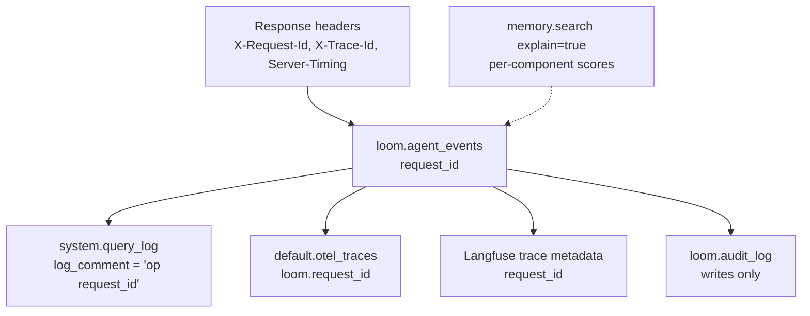

<!-- i18n: source=docs/guides/debugging.md blob=7e3e8e18681a11279a779257bf5385dbd9bce7c0 model=claude-sonnet-5-5 -->
> 本页由机器从[英文原文](https://github.com/ClickHouse/loom/blob/main/docs/guides/debugging.md)翻译，内容以英文原文为准。
> Machine-translated from the [English page](https://github.com/ClickHouse/loom/blob/main/docs/guides/debugging.md), which is authoritative.

<a id="debug-a-request"></a>

# 调试请求

Loom 会用同一个 id 标记一次请求所做的全部操作，因此追踪请求就是一次关联查询（join）。本页从响应头开始，跟踪一个请求，直到找到决定该结果的组件。如果是部署本身出现问题，请从[故障排查](https://github.com/ClickHouse/loom/blob/main/docs/operations/troubleshooting.md)开始；如果某个 worker 没有运行，请参阅 [worker 状态](https://github.com/ClickHouse/loom/blob/main/docs/operations/monitoring.md#worker-status)。



<a id="1-capture-the-requests-ids"></a>

## 1. 获取请求的 id

每个 HTTP 响应都带有以下头部：

| Header                            | 含义                                                                                                                                                                                  |
| --------------------------------- | ---------------------------------------------------------------------------------------------------------------------------------------------------------------------------------------------------- |
| `X-Request-Id`                    | 请求的 id。你可以自行发送（1 到 64 个字母、数字、`.`、`_` 或 `-`），Loom 会原样返回，这样你的日志和 Loom 的行就共用同一个键；任何其他值都会被替换为生成的 id。 |
| `X-Trace-Id`                      | 该请求 span 树的 OpenTelemetry trace id。                                                                                                                                   |
| `Server-Timing`                   | 成功时包含 `app`（处理程序耗时）和 `ch`（ClickHouse 耗时、语句数量、读取的字节数）。                                                                                                 |
| `X-Loom-Hint`, `X-Loom-Hint-Code` | 导师针对本次调用给出的提示（如果有）；SDK 会记录该提示。                                                                                                                       |

```bash
curl -si "$LOOM_BASE_URL/v1/memory.search" -H "Authorization: Bearer $LOOM_API_KEY" \
  -H 'Content-Type: application/json' -H 'X-Request-Id: dbg-0001' \
  -d '{"org":"acme","namespace":"support","agent":"bot","query":"refund window"}' \
  | grep -iE '^(x-request-id|x-trace-id|server-timing)'
```

`Server-Timing` 通常能回答“为什么这么慢”。`ch` 的耗时或字节数很大，说明问题出在查询上。`app` 很大而 `ch` 很小，则说明问题出在对提供方的调用上（embedding、rerank、LLM）。

<a id="2-join-the-request-across-systems"></a>

## 2. 跨系统关联请求

同一个 id 同时出现在 `loom.agent_events.request_id`、Langfuse trace 元数据，以及 `default.otel_traces` 中的 span 属性 `loom.request_id` 里。

```sql
-- the ledger row: operation, identity, latency, success, error_code, tokens, cost, model
SELECT * FROM loom.agent_events WHERE request_id = 'dbg-0001';

-- every ClickHouse statement the request issued
SELECT query_duration_ms, read_rows, read_bytes, substring(query, 1, 200) AS q
FROM system.query_log
WHERE type = 'QueryFinish' AND log_comment LIKE '% dbg-0001%'
ORDER BY event_time_microseconds;

-- its spans
SELECT SpanName, Duration, SpanAttributes['loom.operation'] AS op
FROM default.otel_traces
WHERE SpanAttributes['loom.request_id'] = 'dbg-0001'
ORDER BY Timestamp;
```

`log_comment` 标签列在[查询归因](https://github.com/ClickHouse/loom/blob/main/docs/operations/monitoring.md#logs-traces-and-query-attribution)中。当 `LOOM_OTEL_EXPORTER` 解析为 `ch` 时，span 会写入 `default.otel_traces`（若设置了 `LOOM_CLICKSTACK_DATABASE`，则写入该数据库），否则发送到 OTLP 端点。配置了 Langfuse 时，span 也会发送到 [Langfuse](../features/integrations/langfuse.md)。

> **注意：** 账本从不存储查询文本。`loom.agent_events` 会把每个自由文本参数替换为 `sha256:<16 hex>/<length>` 的形式。要查看具体问了什么，请使用下文的搜索追踪日志或你自己的客户端日志。

<a id="3-explain-a-search-answer"></a>

## 3. 解释搜索结果

**为什么它排在这个位置？** 带 `explain=true` 的 `memory.search` 会为每条返回的命中附加 `score_components`：其中包含各项排序信号；经过 reranker 后，还包含它带来的位置变动（`rerank_from`、`rerank_pos`、`rerank_delta`）；当 reranker 改变了顺序时，还包含它自己的融合得分（`rank_score_pre_rerank`）。如果某一行因其关联的代码发生变化而被下移，则会带有它下移的位置数（`code_changed_places`）。

```python
out = await agent.call("memory.search", {"query": "refund window", "explain": True})
for h in out["results"]:
    c = h["score_components"]
    print(
        h["memory_key"],
        h["similarity"],
        h["rank_score"],
        c.get("rerank_from"),
        c.get("rank_score_pre_rerank"),
    )
```

`memory.search_trace` 接受与 `memory.search` 相同的参数，只对向量这一路打分（不做融合、组装，也不经过 reranker），并为每条命中返回 `similarity`、`distance`、`entity_boost`、`rank_score`、`rank` 和 `source`。

**为什么它选择了放弃回答？** 直接查看 `memory.search` 的返回内容：

| 字段                                      | 说明                                                                                                           |
| ----------------------------------------- | -------------------------------------------------------------------------------------------------------------- |
| `abstain`、`abstain_code`                 | 触发了哪一道关卡：`no_match`、`below_threshold`、`entity_absent`、`low_calibrated_confidence`、`page_expired`。 |
| `retrieval_risk`、`retrieval_confidence`  | 最佳命中距离各关卡有多远。                                                                                     |
| `calibration_explanation`                 | 当前生效的是哪些相似度关卡（由 embedder 校准得到，或是标量回退值）。                                           |
| `degraded`                                | 本次读取中发生回退的 provider，以及响应转而采取的做法。                                                        |
| `pending_extraction`                      | 尚未提取的延迟 `set_from_messages` 批次；大于 0 时，空结果不能证明记忆不存在。                                 |
| `namespaces_searched`、`candidates_total` | 搜索是否覆盖了你预期的命名空间和行。                                                                           |

`calibration.get` 会显示某个命名空间当前生效的阈值，以及这些阈值来自哪一层（命名空间、集群、标量）。[检索与排序](../concepts/retrieval-and-ranking.md)对每个术语都有说明。

**某个 agent 在一段时间内搜索了什么？** 需要设置 `LOOM_SEARCH_TRACE_LOG_ENABLED=true`（默认关闭）。`memory.search_trace_log(since_hours=, agent=, run_id=)` 为每次搜索返回一行：`returned_keys`、`returned_scores`、`abstain`、`retrieval_risk`、`latency_ms`；当 `LOOM_LANGFUSE_CAPTURE_IO_LEVEL` 不是 `off` 时还包含 `query`（其默认值为 `off`，因此默认情况下这些行只有键和得分，不含问题本身）。

<a id="4-explain-a-write"></a>

## 4. 解释一次写入

- **写入自身的返回。** `memory.set` 会返回 `status`、`conflict_verdict`、`peers`、`duplicate_of`、`merged_into_key`、`noop` 和 `advisories`。看起来“消失”的写入，通常是被合并到了某个规范匹配项中，或被标记为重复。`advisories` 会指出被重复编码或体积过大的值。
- **它的历史。** `memory.history` 会列出某个键在 `loom.memory_versions` 中的各个版本。`memory.provenance` 会说明是谁写入的，以及来自哪个来源、会话和运行。
- **提取过程丢弃了什么。** `memory.extraction_status` 会列出被延后的 `set_from_messages` 批次（`pending`、`failed`）。`loom drops --namespace <ns>` 会按阶段和原因打印管道丢弃、截断或放弃处理的内容（[记忆摄取丢弃项](https://github.com/ClickHouse/loom/blob/main/docs/operations/maintenance.md#memory-ingest-drops)）。`set_from_messages` 的响应中带有 `pipeline_errors` 和每一步的 `stage_ms`（[提取管道](https://github.com/ClickHouse/loom/blob/main/docs/guides/extraction-pipeline.md)）。
- **审计记录。** `audit.list(event_type=, since=)` 会读取 `loom.audit_log`：谁修改了什么，并附带每一行的内容哈希。每一次创建或修改记忆的写入，都会留下一行仅含哈希的记录（[审计](https://github.com/ClickHouse/loom/blob/main/docs/features/observability/audit.md)）。
- **一次运行的视图。** `run.get(run_id)` 会返回一次运行召回了什么（`recalled_keys`）、写入了什么、它的轮次以及成本（[追踪与恢复](https://github.com/ClickHouse/loom/blob/main/docs/guides/trace-and-resume.md)）。

<a id="related"></a>

## 相关内容

- [故障排查](https://github.com/ClickHouse/loom/blob/main/docs/operations/troubleshooting.md)
- [监控](https://github.com/ClickHouse/loom/blob/main/docs/operations/monitoring.md)
- [遥测](https://github.com/ClickHouse/loom/blob/main/docs/features/observability/telemetry.md)
- [系统概览](../architecture/system-overview.md)
- [性能调优](https://github.com/ClickHouse/loom/blob/main/docs/guides/performance-tuning.md)
