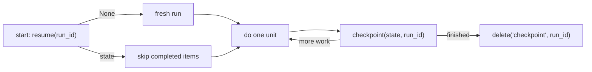

<!-- i18n: source=docs/guides/trace-and-resume.md blob=d597f5338750e0167731c70d5eb3f07fc5bc291d model=claude-sonnet-5-5 -->
> 本页由机器从[英文原文](https://github.com/ClickHouse/loom/blob/main/docs/guides/trace-and-resume.md)翻译，内容以英文原文为准。
> Machine-translated from the [English page](https://github.com/ClickHouse/loom/blob/main/docs/guides/trace-and-resume.md), which is authoritative.

<a id="trace-and-resume-long-agent-runs"></a>

# 追踪并恢复长时间运行的 agent

长时间运行的任务（处理 300 个文件、抓取一个仓库、按计划逐步执行）可能中途停止：崩溃、上下文窗口已满、部署或暂停。以运行的 `run_id` 为键的 working-memory 块会把进度保存在 ClickHouse 中，因此新进程可以将其读回，并从最后一个已完成的工作单元继续。不需要单独的检查点存储。

<a id="the-pattern"></a>

## 使用模式

1. 为任务选择一个稳定的 `run_id`：作业 id 或计划 id。
2. 每完成一个工作单元，调用 `checkpoint(state, run_id=...)`。`state` 是新进程继续运行所需的任何内容：已完成的条目 id、游标或 JSON 字符串。
3. 启动时调用 `resume(run_id=...)`。返回 `None` 表示这是一次全新的运行；否则跳过检查点中记录为已完成的部分。



<a id="with-the-python-sdk"></a>

## 使用 Python SDK

```python
from loom import Agent

RUN = "reindex-catalog"


async def process(agent: Agent, items: list[str]) -> None:
    done = set((await agent.working_memory.resume(run_id=RUN) or "").split())
    for item in items:
        if item in done:
            continue
        await do_work(item)
        done.add(item)
        await agent.working_memory.checkpoint(" ".join(sorted(done)), run_id=RUN)
```

`checkpoint` 和 `resume` 分别是对块 `checkpoint` 执行的 `working_memory.set` 和 `working_memory.get`（可通过 `block_key=` 修改）。每次 `checkpoint` 都会覆盖上一次的内容。

> **警告：** 默认的 `char_limit` 为 4,096 个字符（见 `sdk/python/loom/working_memory.py` 中的 `DEFAULT_CHAR_LIMIT`）。请保持状态较小，或者只存储指向它的指针：较大的数据应放在 `context.offload` 中，并在检查点里保存其 `blob_key`。

任务完成后，清除检查点：

```python
await agent.working_memory.delete("checkpoint", run_id=RUN)
```

如果需要的是进度日志而不是单个快照，可以用 `working_memory.append(..., run_id=RUN)` 向块中追加内容，并用 `working_memory.render(run_id=RUN)` 读回这些块。

<a id="over-mcp"></a>

## 通过 MCP

`working_memory.set` 在 `coding`、`atomic` 和 `all` 工具集中列出（`loom_working_memory_set`），在除 `readonly` 和 `assistant` 之外的其他所有工具集中通过 `loom_op` 运行。`working_memory.get` 没有在任何工具集中列出，包括 `all`；请通过 `loom_op` 调用它，参数为 `{"op": "working_memory.get", "arguments": {...}}`。agent 的做法是：

1. 每一步之后，使用 `run_id` 和 `block_key="checkpoint"` 调用 `working_memory.set`；
2. 启动时，使用相同的 `run_id` 和 `block_key` 调用 `working_memory.get`。

使用不同 `run_id` 的两次运行不会看到彼此的检查点。

<a id="which-plane-holds-a-checkpoint"></a>

## 检查点存放在哪个平面

| 状态                                       | 平面                  | 原因                                                                                               |
| ------------------------------------------- | ---------------------- | ------------------------------------------------------------------------------------------------- |
| 小型恢复游标（已完成的 id、偏移量） | 工作记忆         | 按精确键读回；每一步都会覆盖；从不做嵌入                                     |
| 较大的部分结果或步骤输出       | `context.offload` blob | 可保存超出块限制的内容，带有 `summary` 和 `ttl_seconds`；使用 `context.fetch` 读取 |
| 运行得出的结论                 | `memory.set`           | 持久保存，经过嵌入并排序，供以后召回                                                     |

[调查 agent 指南](https://github.com/ClickHouse/loom/blob/main/docs/guides/investigation-agent-memory.md)列出了每一类 agent 状态所对应的平面。

<a id="trace-what-the-run-did"></a>

## 追踪运行做了什么

- `run.begin` / `run.complete` 记录运行本身：它的目标、状态、所依赖的记忆（`memories_used`）以及一段反思。`run.get` 返回该运行，以及它召回的键、写入的记忆、轮次和成本（[运行](https://github.com/ClickHouse/loom/blob/main/docs/features/runs.md)）。
- 该运行写入的记忆带有它的 `run_id`；`memory.search(run_id=...)` 可以将搜索范围缩小到这些记忆。
- `conversation.create` 和 `conversation.append` 接受 `run_id`，因此运行的对话记录与它绑定（[对话与会话](../features/conversations-and-sessions.md)）。
- 设置 `LOOM_SEARCH_TRACE_LOG_ENABLED=true`（默认关闭）后，`memory.search_trace_log(run_id=...)` 会列出该运行执行的每一次搜索及其返回结果（[调试](https://github.com/ClickHouse/loom/blob/main/docs/guides/debugging.md)）。

Loom 不会对进程内的变量做快照。检查点只保存你放进去的内容。

<a id="why-it-holds"></a>

## 为什么可行

`loom.working_memory` 是一个 `ReplacingMergeTree(version)` 表，按 `(org, namespace, agent, user_id, session_id, run_id, block_key)` 排序。每次 `checkpoint` 都会写入该行的一个新版本，读取时会合并为最新版本。`run_id` 位于排序键中，因此两次运行对应两行。

<a id="related"></a>

## 相关内容

- [工作记忆与配置档案](https://github.com/ClickHouse/loom/blob/main/docs/features/memory/working-memory-and-profiles.md)
- [运行](https://github.com/ClickHouse/loom/blob/main/docs/features/runs.md)
- [无头机器人](https://github.com/ClickHouse/loom/blob/main/docs/guides/headless-bots.md)
