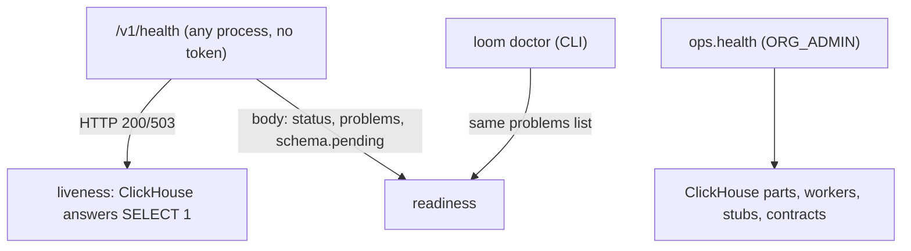

<!-- i18n: source=docs/operations/monitoring.md blob=b778428a5dabcc233847330b82b31b92a8373c9c model=claude-sonnet-5-5 -->
> 本页由机器从[英文原文](https://github.com/ClickHouse/loom/blob/main/docs/operations/monitoring.md)翻译，内容以英文原文为准。
> Machine-translated from the [English page](https://github.com/ClickHouse/loom/blob/main/docs/operations/monitoring.md), which is authoritative.

<a id="monitoring"></a>

# 监控

本页说明需要关注哪些内容。Loom 通过四个渠道报告自身状态：

| 渠道                            | 范围                                       |
| ------------------------------- | ------------------------------------------ |
| `/v1/health`、`loom doctor`     | 单个进程                                   |
| `ops.health`                    | 针对 ClickHouse 的更深入检查               |
| OpenTelemetry 指标和 span       | 写入同一个 ClickHouse，或发送到 OTLP       |
| `loom.agent_events`             | 请求账本，每次操作一行                     |

指标名称和标签的完整列表见[遥测](https://github.com/ClickHouse/loom/blob/main/docs/features/observability/telemetry.md)。

<a id="running-operator-commands"></a>

## 运行运维命令

运维命令是 `loom` 子命令。请在容器内运行它们，容器中带有该部署的环境变量：

```bash
docker exec loom-server loom doctor            # web container
docker exec loom-workers loom code stats       # workers container (split deployments)
```

在代码检出目录中，`pip install -e .` 会安装同一个 CLI；它从环境变量和 `.env` 中读取 `LOOM_*`。`loom <command> --help` 会列出每个标志的说明，[CLI 参考](https://github.com/ClickHouse/loom/blob/main/docs/reference/cli.md)列出了全部命令。

组织范围的视图（跨命名空间的成本、`ops.health`）需要 `ORG_ADMIN` 或 `PLATFORM_ADMIN`，而这只能通过 `LOOM_PLATFORM_ADMINS` 授予（[部署](https://github.com/ClickHouse/loom/blob/main/docs/operations/deployment.md#required-environment)）。整个部署范围的 `/v1/admin/*` 路由需要 `PLATFORM_ADMIN`；`token.mint`、`namespace.adopt` 和 `claim_release` 需要在其所作用的组织中拥有 `ORG_ADMIN`。命名空间的 `admin` 无法访问其中任何一项。

<a id="health-checks"></a>

## 健康检查



<a id="v1health"></a>

### /v1/health 端点

```bash
curl -s http://localhost:7777/v1/health | jq '{status, version, ch_ok, build_commit, schema, problems}'
curl -s 'http://localhost:7777/v1/health?include=workers' | jq '.workers_leader'
```

- **HTTP 状态码只取决于 ClickHouse：** `SELECT 1` 有响应时为 200，没有响应时为 503（`ch_error` 给出错误的类别，错误文本在服务器日志中）。可将其用作存活探针。这样，只读取状态码的探针（镜像的 healthcheck、负载均衡器）看到的是故障，而不是一个其响应体从未被解析的 200。
- **`status`** 在 ClickHouse 不可用，或 `problems` 中存在严重级别为 `error` 的条目（`code_tier_failing` 除外，它涉及的是某个仓库的索引，而不是部署本身）时为 `degraded`；否则为 `ok`。就绪检查还应要求 `schema.pending` 为空（零停机双实例切换正是这样做的）。
- **`problems`** 是 `{code, severity, message, fix, source}` 的列表，按严重程度由高到低排列。`loom doctor` 会打印同一份列表，控制台也会将其显示为横幅。`loom doctor` 会逐一列出 `code_tier_failing` 中的条目，最多五个（其余的由 `code.repos` 列出）；平台管理员的令牌会列出每个未受限制的条目（[层级失败时](https://github.com/ClickHouse/loom/blob/main/docs/operations/code-index-operations.md#when-a-tier-fails)）。

| 问题代码                                  | 严重级别                                                                                            | 含义                                                                                                                                                                                                                                                                                                                                                                                                    |
| ----------------------------------------- | --------------------------------------------------------------------------------------------------- | ------------------------------------------------------------------------------------------------------------------------------------------------------------------------------------------------------------------------------------------------------------------------------------------------------------------------------------------------------------------------------------------------------- |
| `fake_embedder`, `fake_llm`               | warn（设置 `LOOM_REQUIRE_REAL_PROVIDERS=true` 时为 error）                                          | 配置了模拟的 provider                                                                                                                                                                                                                                                                                                                                                                                   |
| `embedder_key_missing`, `llm_key_missing` | warn（同上）                                                                                        | 配置了真实的 provider 但缺少其密钥；进程使用模拟客户端运行                                                                                                                                                                                                                                                                                                                                              |
| `embedding_dim_mismatch`                  | error                                                                                               | embedder 返回的维度与 `LOOM_EMBEDDING_DIM` 不一致                                                                                                                                                                                                                                                                                                                                                       |
| `coded_width_mismatch`                    | error                                                                                               | 编码向量列的宽度与写入所带的宽度不一致；这些写入会失败                                                                                                                                                                                                                                                                                                                                                  |
| `provider_failing:<name>`                 | error                                                                                               | 对该 provider 的最近一次调用失败；下一次成功后清除                                                                                                                                                                                                                                                                                                                                                      |
| `model_configuration_refused`             | error                                                                                               | 控制台保存的模型配置未通过网关检查，未被应用；所有数据平面请求都返回 503 `GATEWAY_REQUIRED`，在该配置被替换之前服务器不会就绪                                                                                                                                                                                                                                                                           |
| `jwt_secret_empty`                        | error                                                                                               | 无法签发令牌                                                                                                                                                                                                                                                                                                                                                                                            |
| `dev_jwt_secret`                          | warn                                                                                                | 在启用认证的情况下使用了随代码提交的开发密钥                                                                                                                                                                                                                                                                                                                                                            |
| `config_drift`                            | error                                                                                               | 此进程的根密钥或 MUST_MATCH 设置与部署已发布的配置不一致：它不会就绪（[运行 N 个副本](https://github.com/ClickHouse/loom/blob/main/docs/operations/replicas.md)）                                                                                                                                                                                                                                         |
| `revocation_not_loaded`                   | error                                                                                               | 启用了认证，但此进程从未读取过 `loom.revoked_tokens`：每个 bearer 都得到 503                                                                                                                                                                                                                                                                                                                            |
| `revocation_stale`                        | warn                                                                                                | 吊销快照早于 max(300 s, 10 × `LOOM_JWT_REVOCATION_CACHE_TTL_SECONDS`)：此后被吊销的令牌在此处仍可通过认证                                                                                                                                                                                                                                                                                              |
| `revocation_too_stale`                    | error                                                                                               | 快照早于 `LOOM_JWT_REVOCATION_MAX_STALE_SECONDS`（600 s）：在刷新完成之前，每个 bearer 都得到 503                                                                                                                                                                                                                                                                                                       |
| `pending_migrations`                      | error                                                                                               | 数据库 schema 缺少此版本所需的迁移                                                                                                                                                                                                                                                                                                                                                                      |
| `instance_label_missing`                  | warn                                                                                                | compose 文件之外的进程没有设置 `LOOM_INSTANCE_LABEL`                                                                                                                                                                                                                                                                                                                                                    |
| `workers_lease_absent`                    | warn 或 info                                                                                        | warn：没有进程持有有效的 workers 租约（设置了 `LOOM_BACKGROUND_WORKERS=on` 的进程不获取租约，因此这种情况下会与其同时出现；在交接或冷启动期间，它可能短暂出现一次）；info：此进程不运行 workers，且最近没有读取过租约                                                                                                                                                                                    |
| `workers_lease_unreachable`               | warn                                                                                                | 此进程无法向 ClickHouse 查询 workers 租约；如果所有进程都这样报告，则没有任何进程在运行 workers                                                                                                                                                                                                                                                                                                         |
| `workers_lease_given_up`                  | warn                                                                                                | 此进程已释放 workers 租约并停止竞争（它正在排空，或其 workers 子进程持续启动失败）；由另一个进程接管                                                                                                                                                                                                                                                                                                     |
| `otel_erasure_index`                      | warn                                                                                                | ClickStack 指标表缺少擦除所需的索引（[维护](https://github.com/ClickHouse/loom/blob/main/docs/operations/maintenance.md#clickstack-erasure-index)）                                                                                                                                                                                                                                                     |
| `code_tier_failing`                       | warn（同时落后 `LOOM_CODE_TIER_FAILING_ERROR_LAG_COMMITS` 时为 error；fetch 层级保持 warn）         | 某个代码索引层级连续 `LOOM_CODE_TIER_FAILING_WARN_PASSES` 轮失败，或持续失败达 `LOOM_CODE_TIER_FAILING_WARN_HOURS`；其 fix 会说明该错误类别需要什么（[层级失败时](https://github.com/ClickHouse/loom/blob/main/docs/operations/code-index-operations.md#when-a-tier-fails)）。它从不使 `status` 降级；`loom.health.problems` 像对待其他问题一样包含它，因此针对其中 `severity="error"` 的告警必须排除 `code="code_tier_failing"`。 |

响应体中的其他字段：`providers`（各 provider 的调用状态）、`fake_embedding`、`fake_llm`、`providers_degraded`、`embedding_dim_mismatch`、`adaptive_thresholds`（由 embedder 推导出的相似度阈值，带有 `calibration_hash`，使用相同阈值的每个副本上该值相同；以及 `source`：`shared` 或此副本自身的 `probe`）、`ratelimit.backend`（`shared` 或 `per-process`），以及 `mode`（`ch`，配置后还包括 `langfuse` 和 `clickstack`）。`?include=` 接受 `workers`、`langfuse`、`otel`、`embedding_cache` 和 `llm_cache`；每个子系统各自单独报告，只有 ClickHouse 决定 HTTP 状态码。

<a id="loom-doctor"></a>

### loom doctor 命令

`loom doctor` 运行其检查项（`python_version`、`settings_load`、`jwt_secret`、`clickhouse_reachable`、`otel_erasure_index`、`llm_provider`），然后将 `problems` 列表打印为 `problem:<code>` 行。每项检查都会在退出前报告；只要有任何一行为 `FAIL`，退出码即为 1。`--json` 输出 `{ok, checks, problems}`。设置了 `LOOM_CELL` 且 ClickHouse 可达时，它还会运行[单元](https://github.com/ClickHouse/loom/blob/main/docs/architecture/cells.md)检查（`cell_state`、`cell_marker`、`cell_marker_everywhere`、`cell_triggers`），等级最高为 `WARN`；以及 `cell_deployment`，当部署检查被拒绝时为 `FAIL`（没有 `LOOM_PG_DSN`、存在另一个已记录的授权方或部署，或 ClickHouse 访问被拒绝）。启用代码智能且 ClickHouse 可达时，它还会读取失败的代码索引层级，并按该部署的运行时覆盖值评级；`problem:code_tier_failing` 最高为 `WARN`，因为它从不使 `status` 降级。

`--client` 还会把本机作为编码 agent 客户端进行检查：hooks 将使用的服务器 URL 和令牌（可用 `--server-url`、`--token` 覆盖）、令牌是否被接受并能写入其命名空间、Claude Code 或 Codex 的接入配置，以及从未到达服务器的捕获任务。`loom report` 会打印 doctor 的输出，用于填写错误报告的 Environment 字段（[提交 issue](https://github.com/ClickHouse/loom/blob/main/CONTRIBUTING.md#filing-an-issue)）。

<a id="opshealth"></a>

### ops.health 操作

`POST /v1/ops.health`（`ORG_ADMIN`）对 ClickHouse 运行更深入的检查。每项检查返回 `status`（`ok`、`warn` 或 `fail`）、`detail` 和 `repair`。探测失败时，`detail` 给出错误的类别（Loom 错误的 code 和 message），每个 worker 的 `last_error_kind` 给出错误的类；错误的文本在服务器日志和 `/v1/admin/workers.status` 中。当进程内的 supervisor 运行 workers 时，`/v1/health?include=workers` 以同样的方式裁剪其 worker 行：没有 `last_error`，只有结果数字和标志。

| 检查项                   | 检查对象                                                              |
| ------------------------ | --------------------------------------------------------------------- |
| `clickhouse_parts`       | 每个表的活动 part，以及最近 15 分钟内失败的合并                       |
| `workers`                | 最近 worker 执行失败的情况                                           |
| `embedding_stubs`        | 仍在等待向量的记忆 embedding 行                      |
| `schema_contracts`       | 高风险的表和列，与 schema dump 对照                  |
| `memory_schema_contract` | 已持久化的 `loom.memory` 列，与 schema dump 对照           |
| `op_mix`                 | `loom.agent_events` 中最近的操作构成                       |
| `procedure_plane`        | `loom.procedure_runs` 以及账本中记录的 procedure key   |

<a id="smoke-test"></a>

### 冒烟测试

部署之后，端到端地写入并读取一条记忆：

```bash
export LOOM_API_KEY=$(docker exec loom-server loom mint-token --subject smoke --org dev --namespaces smoke --roles writer --ttl-days 1)
curl -s -XPOST http://localhost:7777/v1/memory.set -H "Authorization: Bearer $LOOM_API_KEY" \
  -H 'Content-Type: application/json' \
  -d '{"org":"dev","namespace":"smoke","agent":"smoke","memory_key":"k","value":"deploy smoke test"}'
curl -s -XPOST http://localhost:7777/v1/memory.search -H "Authorization: Bearer $LOOM_API_KEY" \
  -H 'Content-Type: application/json' \
  -d '{"org":"dev","namespace":"smoke","agent":"smoke","query":"smoke test"}' | jq '.results[0].content_excerpt'
```

如果搜索放弃作答，请检查 `loom.embed.pending` 以及 `/v1/health` 的 `providers` 块：一行仍在等待向量，说明它已存储，但还不能被搜索到。

<a id="worker-status"></a>

## Worker 状态

后台任务运行在受监督的循环中，这些循环声明于 `server/workers/registry.py`（`_WORKERS`）。supervisor 会在失败后以退避方式重试；如果某一轮超过截止时间（默认为 min(4 × interval, 900 s)，下限为 60 s），则将其取消；某个 worker 连续三轮失败后，会记录 `<worker>: DEGRADED`。每个 worker 由一个 `LOOM_*_ENABLED` 标志开关控制；[worker 参考文档](https://github.com/ClickHouse/loom/blob/main/docs/reference/workers.md)列出了所有 worker、对应的标志、默认值和运行频率。

```bash
curl -s -H "Authorization: Bearer $ADMIN_TOKEN" http://localhost:7777/v1/admin/workers.status | jq
```

许多"事情没有发生"的报告，其原因都是某个 worker 没有运行：为新行生成嵌入、提取延迟批次、为提交建立索引。

- `/v1/admin/workers.status` 列出所有已注册的 worker（包括已禁用的），并给出其运行间隔和最近一轮的情况。它会合并当前进程的注册表与 `loom.worker_status`（保留 30 天），因此仅运行 web 的容器也能看到 workers 容器所执行的各轮结果。控制台的管理员 **Health** 视图显示相同内容。
- `/v1/health?include=workers` → `workers_leader.reason` 说明当前进程是否持有该部署的 workers 租约（ClickHouse 中的 `workers_supervisor`）。
- 指标：`loom.worker.consecutive_failures{worker}` 和 `loom.worker.partial_failures{worker}`。
- `ops.projection_failures.list`（`ORG_ADMIN`）列出失败并等待 `projection_repair` worker 处理的次级投影；`ops.projection_failures.retry` 重试其中一项。
- worker 的 ClickHouse 语句带有 `log_comment = 'worker.<name>'`（[查询归因](#logs-traces-and-query-attribution)）。

<a id="what-to-alert-on"></a>

## 告警项

下面的阈值只是起点；相似度基线请根据你自己的部署来设定，因为它取决于 embedder。

| 信号                                                          | 告警条件                                                          | 含义                                                                                                      | 第一步                                                                                                                                                                                                                                                                            |
| ------------------------------------------------------------- | ----------------------------------------------------------------- | --------------------------------------------------------------------------------------------------------- | --------------------------------------------------------------------------------------------------------------------------------------------------------------------------------------------------------------------------------------------------------------------------------- |
| `/v1/health` HTTP 状态                                        | 503                                                               | 此进程无法连接 ClickHouse                                                                                 | [故障排查](https://github.com/ClickHouse/loom/blob/main/docs/operations/troubleshooting.md#every-operation-fails-and-v1health-returns-503)                                                                                                                                                                                            |
| `/v1/health` `status`                                         | `degraded` 持续 5 分钟                                            | 出现 `code_tier_failing` 之外的 `error` 问题                                                              | 阅读 `problems[].fix`                                                                                                                                                                                                                                                             |
| `loom.search.top_similarity` 均值                             | 低于你的基线持续 30 分钟                                          | 检索质量下降但没有报错（embedder 变更、回退到 fake）                                                      | [故障排查](https://github.com/ClickHouse/loom/blob/main/docs/operations/troubleshooting.md#search-returns-arbitrary-results-or-extraction-writes-nothing)                                                                                                                                                                             |
| `loom.embed.pending`                                          | 高于 100 持续 15 分钟                                             | 记忆尚不可搜索；embedder 吞吐量或配额不足                                                                 | `/v1/health` → `providers` 中的提供方状态                                                                                                                                                                                                                                         |
| 任意 `loom.integrity.*`                                       | 大于 0                                                            | 缺陷已经发生且不会自行消除（[见下文](#integrity-invariants)）                                             | 修复列                                                                                                                                                                                                                                                                            |
| `loom.worker.consecutive_failures`                            | ≥ 3                                                               | 某个 worker 在循环中反复失败                                                                              | [故障排查](https://github.com/ClickHouse/loom/blob/main/docs/operations/troubleshooting.md#a-worker-fails-every-pass)                                                                                                                                                                                                                 |
| `loom.process.open_fds / loom.process.fd_limit`               | 高于 0.5                                                          | 描述符泄漏或连接过多                                                                                      | 按进程区分的序列（`loom.pid`）                                                                                                                                                                                                                                                    |
| `loom.host.disk.free_bytes / loom.host.disk.total_bytes`      | 低于 0.10                                                         | `var/` 所在磁盘将满（仓库 repack、日志、blob）；降为零时主机上的所有写入都会失败                          | 每个进程一个序列（`loom.disk.path`）                                                                                                                                                                                                                                              |
| `loom.langfuse.breaker`                                       | = 2                                                               | 向 Langfuse 提交评分失败；评分被丢弃                                                                      | 检查 `POST /api/public/scores` 的 Langfuse 可达性                                                                                                                                                                                                                                 |
| `loom.code.index_lag_commits`                                 | 高于每轮提交预算持续 15 分钟                                      | 代码索引落后于分支                                                                                        | [代码索引运维](https://github.com/ClickHouse/loom/blob/main/docs/operations/code-index-operations.md#failure-model)                                                                                                                                                                                                                 |
| `loom.code.tier_lag_seconds`                                  | 高于 1800 持续 10 分钟                                            | 某个编译器层级尚未处理最近的合并                                                                          | `deploy/dashboards/code_plane.json` 中的 "code tier lag" 告警；阈值应设得高于最慢层级的正常周期                                                                                                                                                                                   |
| `loom.code.tier_failing`                                      | 任意数据点持续 15 分钟（`severity="error"` 时发出页面告警）       | `code_tier_failing` 问题所报告的代码索引层级，已超过其 `LOOM_CODE_TIER_FAILING_*` 阈值                    | `/v1/health` 中 `code_tier_failing` 的 `fix`（[层级失败时](https://github.com/ClickHouse/loom/blob/main/docs/operations/code-index-operations.md#when-a-tier-fails)）                                                                                                                                                                         |
| `ops.health` 中的 `clickhouse_parts`，或错误 252              | `fail`                                                            | 合并失败                                                                                                  | [故障排查](https://github.com/ClickHouse/loom/blob/main/docs/operations/troubleshooting.md#writes-fail-with-too_many_parts-or-merges-are-failing)                                                                                                                                                                                     |
| `loom.audit.checkpoint_lag_windows`                           | 持续增长                                                          | 审计检查点链落后                                                                                          | `audit_verifier` worker 的各轮执行                                                                                                                                                                                                                                                |
| 每个 `loom.trust` 的 `loom.auth.agents_provisioned{outcome=made}` | 高于控制平面的正常速率（起点为 10 分钟内 50 个）                  | 某个 trust 创建新 agent 的速度快于其集群增长：签发者密钥泄漏或控制平面失控                                | 将该 trust 的 `auth.agent_provisioned` 审计行（`audit.list`）与其控制平面启动的 agent 对比；若不一致，执行 `loom bot disable --name <trust>` 并轮换签发者密钥                                                                                                                      |
| `loom.auth.trust_agents_used_ratio`                           | 高于 0.8                                                          | 该 trust 接近 `--max-agents`，按其存活的 agent 计数（已释放的 agent 会归还名额）                          | 若 `outcome=made` 的增长也快于集群增长，请按 `outcome=made` 行处理（禁用该 trust，轮换密钥）；否则调高上限：使用该 trust 的参数和更大的 `--max-agents` 执行 `loom bot create --replace`（这会使这些 agent 的令牌失效；每个 agent 需重新交换） |
| `loom.auth.agents_provisioned{outcome=at_cap}`                | 10 分钟内增量大于 0                                               | 该 trust 的新 agent 被拒绝                                                                                | 若 `outcome=made` 的增长也快于集群增长，请按 `outcome=made` 行处理（禁用该 trust，轮换密钥）；否则调高上限：使用该 trust 的参数和更大的 `--max-agents` 执行 `loom bot create --replace`（这会使这些 agent 的令牌失效；每个 agent 需重新交换） |

在 HyperDX 中，空结果会被当作 0，因此最小样本保护必须返回健康范围内的值，而不是返回无行。

关于该扩容什么（web 副本、提供方配额、workers 容器或 ClickHouse）的信号，见[故障与恢复](../architecture/failure-and-recovery.md)。

<a id="pipeline-slos"></a>

### 管道 SLO

在 Postgres 权威模式下，写入在提交时即返回，待其记忆行和搜索文档进入 ClickHouse 后才可被搜索（[存储权威](../architecture/storage-authority.md#publication)）。如果搜索发现较早的写入尚未到达，它会等待这些写入，最长等待 `LOOM_PG_PROJECTION_WAIT_MS`（默认 2000 ms），超时则返回 503 `PROJECTION_BEHIND`。

| 目标                                   | 指标                                                                                                              | 信号                                                                          |
| -------------------------------------- | ----------------------------------------------------------------------------------------------------------------- | ----------------------------------------------------------------------------- |
| 读取等待较早的写入                     | p99 低于 `LOOM_PG_PROJECTION_WAIT_MS` 的一半，且在非故障期间没有以 `deadline` 结束的情况（该 op 返回 503）        | 按 `outcome` 区分的 `loom.pg.search_wait_ms`                                  |
| 写入已进入 ClickHouse                  | p99 低于 `LOOM_PG_PROJECTION_WAIT_MS` 的一半，使读取的等待有另一半时间                                            | `loom.pg.projection_lag_ms{path="flush"}`                                     |
| 没有任何内容等待超过已停止写入方的租约 | 最早的待处理项低于 `LOOM_PG_REQUEST_LEASE_SECONDS` 的两倍加上 `LOOM_PG_DELIVERY_IDLE_INTERVAL_SECONDS`            | `loom.pg.oldest_pending_age_s{source="memory"}`                               |
| 非故障期间没有滞后错误                 | 0                                                                                                                 | `loom.requests{loom.error_code="PROJECTION_BEHIND" or "PUBLICATION_PENDING"}` |
| 没有 ClickHouse 持续拒绝的内容         | 除恢复 reconcile 持有期间外为 0                                                                                   | `loom.pg.backlog{state="parked"}`                                             |

如果写入方在发布前停止，搜索的最坏等待时间就是其租约（`LOOM_PG_REQUEST_LEASE_SECONDS`）：等待中的搜索会自行发布已过期的投递。这个时间超过默认等待时间，因此表现为 `outcome="deadline"`，而不是延迟。就绪状态不依赖上述任何一项：每个副本读取的是同一个 Postgres，因此由滞后驱动的就绪检查会让所有副本同时退出轮转。

每个运行投递 workers 的进程都会导出整个部署的积压量，并且可能有多个进程同时导出，因此读取积压量 gauge 时应使用 `max`，而不是 `sum`。

告警：

| 信号                                              | 告警条件                        | 含义                                                                                                                                                                      | 第一步                                                                                           |
| ------------------------------------------------- | ------------------------------- | ------------------------------------------------------------------------------------------------------------------------------------------------------------------------- | ------------------------------------------------------------------------------------------------ |
| `loom.pg.search_wait_ms{outcome="deadline"}` 速率 | 高于 0 持续 5 分钟              | 读取等待到超时：该 op 返回 503 `PROJECTION_BEHIND`，报告则继续读取                                                                                                        | 先检查 ClickHouse 可达性，再检查 `loom.pg.backlog` 和 `pg_delivery` worker 的各轮执行            |
| `loom.pg.oldest_pending_age_s{source="memory"}`   | 高于目标值持续 10 分钟          | 投递 worker 跟不上，或 ClickHouse 拒绝写入                                                                                                                                | `GET /v1/health?include=postgres` → `postgres.backlog`，以及 `pg_delivery` worker 的状态         |
| `loom.pg.backlog{state="parked"}`                 | 大于 0                          | ClickHouse 持续拒绝的投递，或恢复 reconcile 持有的投递（其 `last_error` 会说明是哪种）                                                                                    | 该投递的 `last_error`（[存储权威](../architecture/storage-authority.md#delivery)）               |
| 任何进程都没有 `loom.pg.backlog` 数据点           | 持续 3 个导出周期               | 读取已停止：积压读取失败、没有投递轮次启动，或两轮起点之间的时间（一轮加其后的间隔）超过两个导出周期                                                                      | `pg_delivery` 和 `knowledge_pg_delivery` worker 日志中的 `backlog not read` 警告                 |

<a id="integrity-invariants"></a>

### 完整性不变量

下列每个 gauge 应始终为 0。它们由持有 workers 租约的进程每 15 分钟计算一次并缓存。

| 指标                                                            | 非零值的含义                                                                    | 修复                                               |
| --------------------------------------------------------------- | ------------------------------------------------------------------------------- | -------------------------------------------------- |
| `loom.integrity.divergent_entities`                             | 某条记忆在 `loom.memory` 与 `loom.memory_embeddings` 之间的 entities 不一致     | 排查写入路径                                       |
| `loom.integrity.orphan_vectors`                                 | 记忆行已不存在的已嵌入向量                                                      | `orphan_vector_reconcile` worker                   |
| `loom.integrity.orphan_entity_vectors`                          | 记忆行已不存在的实体向量                                                        | `orphan_vector_reconcile` worker                   |
| `loom.integrity.orphan_graph_namespaces`                        | 存在实体边，但没有有效记忆或知识的命名空间                                      | `loom erasure-re-verify --orphan-graph --erase`    |
| `loom.integrity.live_ns_unregistered`, `live_rows_unregistered` | 位于没有 `loom.namespaces` 行的命名空间中的有效记忆                             | 注册该命名空间，或运行 `loom namespaces-adopt`     |
| `loom.integrity.dim0_with_vector`                               | 有向量但 `embedding_dim = 0` 的行，搜索不可见                                   | `loom integrity-repair --apply`                    |
| `loom.integrity.tombstone_status_drift`                         | 设置了 `tombstoned_at` 但状态为其他值的行                                       | 由 `loom integrity-repair` 列出                    |
| `loom.integrity.active_past_valid_to`                           | 已超过自身 `valid_to` 的活动行                                                  | 由 `loom integrity-repair` 列出                    |
| `loom.integrity.high_with_embedding`                            | 仍有有效嵌入行的高敏感度行                                                      | `loom sensitivity-sweep --apply`                   |

修复命令的说明见[维护](https://github.com/ClickHouse/loom/blob/main/docs/operations/maintenance.md#backfills-and-repairs)。

<a id="metrics"></a>

## 指标

Loom 每隔 `LOOM_OTEL_METRICS_EXPORT_INTERVAL_S` 秒（默认 60）导出一次 OpenTelemetry 指标。当 `LOOM_OTEL_EXPORTER=ch`（未设置 OTLP 端点时的默认值）时，指标会直接写入同一 ClickHouse 服务上的 `default.otel_metrics_sum`、`default.otel_metrics_histogram` 和 `default.otel_metrics_gauge`（如果设置了 `LOOM_CLICKSTACK_DATABASE`，则写入该数据库，此处及下文同理），这些表也是 ClickStack/HyperDX 读取的表；若要改为发送到 collector，请设置 `LOOM_OTEL_EXPORTER_OTLP_ENDPOINT`。除非设置 `LOOM_OTEL_METRICS_DELTA_TEMPORALITY=true`，否则计数器和直方图均为累积值。启动日志会确认导出器：

```text
OTel metrics initialized — emitting every 60s (cumulative temporality, gauge heartbeat …s) to default.otel_metrics_{sum,histogram,gauge}
```

标签来自一个封闭的集合（操作、命名空间、有界枚举）；键、用户 id、会话 id 和查询文本绝不会作为标签（`tests/unit/test_domain_metrics.py` 会强制检查这一点）。完整的指标目录按请求与成本、检索质量、记忆写入、积压、完整性和代码索引分组，见 [遥测](https://github.com/ClickHouse/loom/blob/main/docs/features/observability/telemetry.md)。

起步查询：

```sql
-- mean top similarity per namespace, last hour
SELECT Attributes['loom.namespace'] AS ns,
       round(anyLast(Sum) / greatest(anyLast(Count), 1), 3) AS mean_top_similarity
FROM default.otel_metrics_histogram
WHERE MetricName = 'loom.search.top_similarity' AND TimeUnix > now() - INTERVAL 1 HOUR
GROUP BY ns;

-- every gauge's latest value
SELECT MetricName, anyLast(Value) AS latest
FROM default.otel_metrics_gauge
WHERE TimeUnix > now() - INTERVAL 5 MINUTE
GROUP BY MetricName ORDER BY MetricName;
```

第一个查询读取的是累积直方图，因此得到的是每个序列的整个生命周期均值；若要得到窗口均值，需要将每个点与其所在序列的前一个点做差（见 `deploy/hyperdx_dashboards.md` 中的“The cumulative-counter correction”）。

<a id="dashboards"></a>

## 控制台

[`deploy/hyperdx_dashboards.md`](https://github.com/ClickHouse/loom/blob/main/deploy/hyperdx_dashboards.md) 是 ClickStack 和 HyperDX 的设置指南及 SQL 面板手册；ClickStack 集成本身的说明见 [ClickStack](../features/integrations/clickstack.md)。

- **无需 collector。** Loom 直接把 OTel 行写入自己 ClickHouse 上的 `default.otel_*`，因此托管的 ClickStack 只需把数据源指向现有的表即可（`deploy/clickstack_sources.sh` 可以脚本化完成这一步）。如果没有 HyperDX 安装创建这些表，请手动执行一次 `schemas/otel/clickstack_otel_tables.sql`；其中每条语句都带有 `IF NOT EXISTS`。
- **面板避开的两个陷阱。** FastAPI 的插桩会生成与父 span 同名的 ASGI 子 span（`POST /v1/memory.get http send`），这会使按 span 名称的过滤结果膨胀约三倍；只有父 span 带有 `loom.*` 属性，因此应使用 `mapContains(SpanAttributes, 'loom.operation')` 过滤。另外，累计型指标需要按序列计算增量：对一个时间窗口内的 `sum(Value)` 求和，得到的是累计值的总和。
- **代码索引看板。** [`deploy/dashboards/code_plane.json`](https://github.com/ClickHouse/loom/blob/main/deploy/dashboards/code_plane.json) 是“Loom — Code Plane”控制台的唯一权威来源：包含每个图块及其数据源和 SQL，以及带有 `alert` 块（含阈值和原因）的图块。请根据该 JSON 进行配置，而不要在 UI 中编辑图块，这样下次重建时才能保持一致。
- 如果面板一直为空，请检查 `docker logs loom-server 2>&1 | grep -i otel`。span 每隔几秒刷新一次；指标则在每个导出间隔刷新一次。缺少表时会显示为 `default.otel_traces does not exist … Self-disabling span export`。

<a id="logs-traces-and-query-attribution"></a>

## 日志、追踪与查询归因

- **日志。** 使用 `docker logs loom-server` 和 `docker logs loom-workers`。接入日志管道时设置 `LOOM_LOG_FORMAT=json`，用 `LOOM_LOG_LEVEL` 控制详细程度。启动日志会列出解析出的 provider 以及每个已应用的迁移；supervisor 会记录每一次失败的执行和 `DEGRADED` 行。
- **账本。** `loom.agent_events` 每个操作对应一行，包含 `operation`、身份列、`request_id`、`trace_id`、`latency_ms`、`success`、`error_code`、token、`upstream_cost_usd`、`model`、`consumer`、`traffic_class`、`build_commit`、`instance` 和 `instance_label`。`loom.audit_log` 记录谁修改了什么，并为每一行附带内容哈希（[审计](https://github.com/ClickHouse/loom/blob/main/docs/features/observability/audit.md)）。
- **追踪。** span 会写入 `default.otel_traces`（或 OTLP 端点），并带有 `loom.org`、`loom.namespace`、`loom.agent`、`loom.operation`、`loom.request_id` 和 `enduser.id` 标签。配置 Langfuse 后，span 树也会发送到 Langfuse（[Langfuse](../features/integrations/langfuse.md)）。每个 HTTP 响应都带有 `X-Request-Id`（如果客户端发送了由 1 到 64 个字母、数字、`.`、`_` 或 `-` 组成的值，则沿用客户端的值）和 `X-Trace-Id`。
- **每个 ClickHouse 查询都会归因**，记录在其 `log_comment` 设置中：

| `log_comment`                  | 发起方                                                            |
| ------------------------------ | ----------------------------------------------------------------- |
| `<operation> <request_id>`     | 一次请求（HTTP 或 MCP）                                           |
| `worker.<name>`                | 一次 worker 执行                                                  |
| `cli.<command>[.<subcommand>]` | 一条 `loom` 命令（不含 `loom serve`）                             |
| `untagged:<module>.<function>` | 其他情况；后台循环应调用 `set_query_tag(...)`                     |

设置 `LOOM_CH_LOG_COMMENT_STATEMENT_DIGEST=true` 后，标签后面会附加语句摘要，因此匹配时请在末尾加上 `%`。

```sql
-- which operations cost ClickHouse the most in the last hour
SELECT splitByChar(' ', log_comment)[1] AS source,
       count() AS queries, sum(read_bytes) AS bytes, sum(query_duration_ms) AS ms
FROM system.query_log
WHERE type = 'QueryFinish' AND event_time > now() - INTERVAL 1 HOUR AND log_comment != ''
GROUP BY source ORDER BY ms DESC LIMIT 20;

-- one request end to end
SELECT * FROM loom.agent_events WHERE request_id = '<id>';
```

`LOOM_INSTANCE_LABEL`（在 compose 文件之外必须设置）可使笔记本电脑或测试服务器的行与部署本身的行在上述两个查询中保持可区分。蓝绿切换后，`loom deploy-delta` 会比较切换前后两侧的账本和语句形态。它在两侧各读取 `--window-min` 分钟（默认 60），因此请在该窗口过去之后再运行，并避免自己的回读流量混入其中：切换后立即发出的请求运行在冷缓存上，会拉高切换后一侧的延迟。

<a id="rate-limits-and-traffic-classes"></a>

## 速率限制与流量类别

每个请求都会从两个令牌桶中扣减，一个按命名空间，一个按组织（容量为命名空间的三倍），并按操作类别划分。超出限制时，响应为 429 `RATE_LIMITED`，并带有 `Retry-After` 和 `X-RateLimit-*` 头。

| 类别               | 操作                                                                                                          | 每个命名空间的突发 / 持续速率 |
| ------------------ | ------------------------------------------------------------------------------------------------------------- | ----------------------------- |
| `memory`           | `memory.*`、`conversation.*`（精确键读取和 `memory.import` 除外）                                             | 每秒 100 / 17                 |
| `memory.read`      | 精确键读取：`memory.get`、`memory.bulk_get`、`memory.history`、`working_memory.get` 等                        | 每秒 300 / 50                 |
| `memory.import`    | `memory.import`                                                                                               | 每秒 10 / 2                   |
| `knowledge.search` | `knowledge.search`                                                                                            | 每秒 20 / 3                   |
| `knowledge.query`  | `knowledge.query`                                                                                             | 每秒 20 / 3                   |
| `knowledge.read`   | 其余 `read_only` 的 `knowledge.*` 操作（`knowledge.inspect` 除外）：`knowledge.get`、`knowledge.list` 等      | 每秒 50 / 10                  |
| `knowledge.add`    | 其他所有 `knowledge.*` 操作，包括 `knowledge.inspect`、`knowledge.synthesize` 和 `knowledge.dedup_list`       | 每秒 10 / 2                   |
| `code`             | `code.*`（`code.outcome` 除外，它从 `memory` 扣减）                                                           | 每秒 60 / 10                  |
| `insights.query`   | `insights.query`                                                                                              | 每秒 20 / 3                   |
| `assistant.ask`    | `assistant.ask` 及 assistant 的聊天路由                                                                       | 每秒 10 / 1                   |
| `default`          | 其他所有操作                                                                                                  | 每秒 50 / 10                  |

请求被归为 `production`、`interactive` 或 `bench`（优先取 `loom mint-token --traffic-class` 设置的令牌声明，其次是命名空间的注册信息，最后是请求的提示）；响应头 `X-Loom-Traffic-Class` 会说明实际使用的类别。Bench 流量使用独立的、更小的桶（`LOOM_RATELIMIT_CLASS_FRACTIONS`），并使用更低的 ClickHouse 优先级，因此基准测试不会耗用生产环境的额度。限制按副本分别执行，参见[故障与恢复](../architecture/failure-and-recovery.md)中的 `LOOM_REPLICA_COUNT`。`POST /v1/admin/ratelimit.set` 携带 `{namespace|org, op_class, capacity, rate}`（或 `clear: true`）可覆盖某个桶。覆盖值存储在 `loom.runtime_overrides` 中，每个进程会在 `LOOM_RUNTIME_OVERRIDES_REFRESH_SECONDS`（默认 10）内采用它，且重启后依然有效。`POST /v1/admin/budget.set` 以同样方式存储延迟预算的覆盖值。桶的填充本身仍然按主机进行。

<a id="related"></a>

## 相关内容

- [故障排查](https://github.com/ClickHouse/loom/blob/main/docs/operations/troubleshooting.md)：按症状组织的运行手册，针对这些信号所能捕获的问题
- [遥测](https://github.com/ClickHouse/loom/blob/main/docs/features/observability/telemetry.md)：指标和 span 目录
- [成本与用量](https://github.com/ClickHouse/loom/blob/main/docs/features/observability/cost-and-usage.md)和[审计](https://github.com/ClickHouse/loom/blob/main/docs/features/observability/audit.md)
