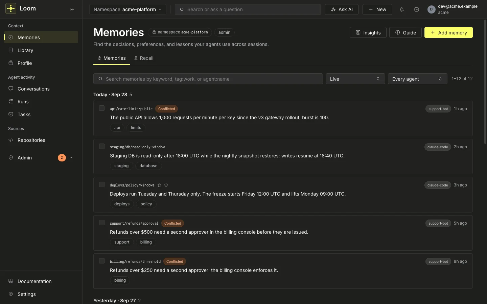

<!-- i18n: source=README.md blob=29675cf2a8d5e7d37f9dc00aeedb1a413885bb38 model=claude-sonnet-5-5 -->
> Esta página es una traducción automática de la [página en inglés](https://github.com/ClickHouse/loom/blob/main/README.md), que prevalece.
> Machine-translated from the [English page](https://github.com/ClickHouse/loom/blob/main/README.md), which is authoritative.

<h1 align="center">ClickHouse Loom</h1>

<p align="center">
  <b>Memoria compartida, búsqueda de documentos e inteligencia de código para agentes de IA.</b><br>
  Para Claude Code, Codex, Cursor y tus propios agentes.
</p>

<p align="center">
  <a href="https://pypi.org/project/clickhouse-loom/"></a>
  <a href="https://www.npmjs.com/package/@clickhouse/loom"></a>
  <a href="https://github.com/ClickHouse/loom/blob/main/LICENSE"></a>
  <a href="https://glama.ai/mcp/servers/ClickHouse/loom"></a>
  <a href="https://github.com/ClickHouse/loom/actions/workflows/ci.yml?query=branch%3Amain+event%3Apush"></a>
  <a href="https://scorecard.dev/viewer/?uri=github.com/ClickHouse/loom"></a>
</p>

<p align="center">
  <!-- languages -->
  <a href="../../README.md">English</a> · <a href="../zh-CN/README.md">简体中文</a> · <a href="../ja/README.md">日本語</a> · <a href="../ko/README.md">한국어</a> · <a href="../pt-BR/README.md">Português (Brasil)</a> · Español
  <br>
  <a href="https://loom.clickhouse.com/docs/es/use-cases/">Documentación</a>
  <!-- /languages -->
</p>

<p align="center">
  <a href="#what-loom-is-for">Para qué sirve Loom</a> ·
  <a href="#measured-results">Pruebas de rendimiento</a> ·
  <a href="#get-started">Primeros pasos</a> ·
  <a href="#why-loom">Capacidades</a> ·
  <a href="#integrations">Integraciones</a> ·
  <a href="https://loom.clickhouse.com/docs/">Documentación</a>
</p>

<p>
  
  
  
</p>

Loom es un servidor MCP de código abierto y autoalojado que da a tus agentes una memoria
compartida y a largo plazo: lo que un agente aprende en una sesión, el siguiente agente o
herramienta puede encontrarlo.

Los agentes se conectan mediante MCP, HTTP, Python o TypeScript. Puedes autoalojarlo con Docker o
[en Kubernetes con el Helm chart](https://github.com/ClickHouse/loom/blob/main/docs/operations/kubernetes.md); el contexto de los agentes y
los datos del índice se almacenan en [ClickHouse](docs/use-cases/self-hosted-clickhouse.md), y un
despliegue puede elegir [Postgres en el primer arranque](https://github.com/ClickHouse/loom/blob/main/docs/operations/postgres.md) para el estado
activo de la memoria y del conocimiento. El panel reúne memorias, repositorios, tareas y ejecuciones
en un solo lugar.

<a id="what-loom-is-for"></a>

## Para qué sirve Loom

- **Memoria a largo plazo compartida entre tus agentes de programación**, con plugins que cargan contexto
  al inicio de la sesión y capturan la sesión mientras se ejecuta.
  [Memoria del agente](docs/use-cases/agent-memory.md) ·
  [Conectar un agente de programación](https://github.com/ClickHouse/loom/blob/main/docs/getting-started/connect-a-coding-agent.md)
- **Memoria para una aplicación de agentes**, por usuario, desde el SDK de Python o
  TypeScript. [Tu primer agente](https://github.com/ClickHouse/loom/blob/main/docs/getting-started/first-agent.md)
- **Un servidor de memoria MCP multiusuario** con espacios de nombres, roles y tokens.
  [Modo multiusuario](docs/getting-started/quickstart.md#start-in-multi-user-mode) ·
  [Espacios de nombres y uso compartido](https://github.com/ClickHouse/loom/blob/main/docs/features/namespaces-and-sharing.md)
- **Un índice de código de tus repositorios** que los agentes de programación consultan para obtener definiciones,
  llamadores e impacto de los cambios. [Índice de código](docs/use-cases/code-intelligence.md) ·
  [Compatibilidad de lenguajes y límites](https://github.com/ClickHouse/loom/blob/main/docs/features/code-index/overview.md#language-support)
- **Memorias vinculadas al código del que tratan**, que lo siguen a través de refactorizaciones, se
  marcan cuando cambia y aparecen cuando un agente lo lee o lo edita.
  [Memoria vinculada al código](docs/use-cases/memory-linked-to-code.md)
- **Menor costo de modelo para los agentes de programación**, según lo [medido](#measured-results) a continuación.
  [Costo de los agentes de programación](docs/use-cases/coding-agent-cost.md)
- **Búsqueda de documentos con citas (RAG)**, incluidos archivos PDF, `.docx` y `.pptx` que el
  servicio extractor convierte. [Búsqueda de documentos](docs/use-cases/document-search.md)
- **Contexto compartido para flujos de trabajo con varios agentes**: memoria compartida, bandejas de tareas y
  decisiones. [Varios agentes](docs/use-cases/multi-agent.md)
- **Memoria, recuperación, auditoría y borrado para agentes autónomos.**
  [Agentes autónomos](docs/use-cases/autonomous-agents.md)
- **Un registro del trabajo de los agentes**, con conversaciones con búsqueda (cuando la grabación está activada),
  resúmenes de sesión desde los que retomar el trabajo, ejecuciones con sus objetivos, resultados y costos de modelo cuando
  se proporcionan, e historial de PR y de gestores de incidencias.
  [Ejecuciones e historial de PR](docs/use-cases/runs-and-pr-history.md)

Todos los casos de uso, y cuándo conviene más otra herramienta: [casos de uso](docs/use-cases/index.md).

Loom no es una biblioteca en proceso para la memoria de corta duración de un solo agente, ni un framework
de agentes. [Cuándo Loom no es la mejor opción](https://github.com/ClickHouse/loom/blob/main/docs/getting-started/overview.md#when-it-does-not-fit)

<a id="measured-results"></a>

## Resultados medidos

| Evaluación                                 | Con Loom  | Sin Loom | Mejora de eficiencia                     | Alcance                                  |
| ------------------------------------------ | --------- | -------- | ---------------------------------------- | ---------------------------------------- |
| Calidad de respuesta del agente de código  | **0.84**  | 0.78     | **20 % menos** de costo del modelo       | 24 preguntas × 3 ejecuciones pareadas    |
| Localización de archivos del agente de código | **96.4%** | 91.4%    | **21 % menos** de costo del modelo       | 36 preguntas × 10 ejecuciones pareadas   |
| Memoria frente a respuestas con el historial completo | **94%**   | 90%      | **91 % menos** de tokens en el prompt del lector | 100 preguntas pareadas de LongMemEval-S  |

Ambas configuraciones de código usan Claude Code (`claude-sonnet-5`) sobre el código base de ClickHouse;
el costo es la factura completa del modelo de la sesión, sin incluir las llamadas al modelo del lado del servidor de Loom, el alojamiento
ni la indexación. La calidad de respuesta
mide la cobertura de los puntos clave de una respuesta verificada, con una penalización por contradicciones.
La localización de archivos cuenta si el archivo correcto está entre los hasta tres archivos que se le
pide al agente nombrar al final de su respuesta.

La fila de memoria compara las memorias recuperadas con el historial completo de la conversación usando
el mismo lector `gpt-5`. El ahorro de tokens excluye la construcción de la memoria; la diferencia de precisión
de 94% frente a 90% es descriptiva, no está establecida estadísticamente.

**Por separado, la configuración `memory.ask` de Loom obtuvo una precisión de respuesta del 96.6% en las
500 preguntas de LongMemEval-S.** Es una evaluación de producto con sus propios modelos de respuesta configurados, no la comparación con lector fijo anterior.

Los resultados son específicos de las cargas de trabajo probadas.

[Protocolos y artefactos reproducibles](https://github.com/ClickHouse/loom/blob/main/docs/benchmarks/results.md) ·
[resultados detallados](#benchmark-details) ·
[evalúa con tu carga de trabajo](https://github.com/ClickHouse/loom/blob/main/docs/getting-started/evaluate.md)

<a id="get-started"></a>

## Primeros pasos

<a id="1-choose-your-docker-setup"></a>

### 1. Elige tu configuración de Docker

- **Uso personal (el valor predeterminado):** sin inicio de sesión, acceso solo desde localhost y un
  espacio de nombres `dev/local`. Una persona puede conectar varios agentes.
- **Uso en equipo:** cuentas autenticadas y controles de acceso a los espacios de nombres.
  [Inicia en modo multiusuario desde el primer arranque](docs/getting-started/quickstart.md#start-in-multi-user-mode).

Ambos modos admiten las mismas funciones de Loom, incluidos los LLM y los embeddings configurados.
El modo de un solo usuario no es una edición con funciones reducidas. También puedes
[cambiar una instalación existente sin borrar sus datos](docs/getting-started/quickstart.md#2-open-the-dashboard);
concede a las cuentas nuevas acceso a los espacios de nombres existentes.

Para probarlo sin instalar nada, ábrelo en un codespace:

[](https://codespaces.new/ClickHouse/loom?quickstart=1)
([qué ejecuta y quién puede acceder](docs/getting-started/quickstart.md#try-it-in-github-codespaces))

Para la instalación personal predeterminada, con Docker instalado (en Windows, en una terminal
WSL 2 donde `docker` funcione: Docker Desktop con su integración con WSL activada, o Docker Engine
instalado en la distribución):

```bash
curl -fsSL https://github.com/ClickHouse/loom/releases/latest/download/install.sh -o loom-install.sh && sh loom-install.sh && rm loom-install.sh
```

Ejecútalo desde tu directorio personal, o desde otro
[directorio en el que solo tú puedas escribir](docs/getting-started/quickstart.md#fast-path-released-image-no-clone).
El instalador inicia Loom y ClickHouse, aplica las migraciones e imprime la URL del panel:
**http://localhost:7777/**; en una instalación nueva, después comprueba que una memoria se guarda y se lee
de vuelta. En una terminal, también ofrece conectar los agentes de programación que encuentre (Claude Code, Codex,
VS Code) y, en una instalación nueva, abre el panel. La imagen incluye el servidor,
los workers, el panel y los indexadores de código para Python, TypeScript y Go, además del de C++ en
`amd64`; las dependencias de TypeScript se preparan automáticamente. [Inicio rápido y versiones fijadas](docs/getting-started/quickstart.md)

La instalación reside en `~/.loom` (`LOOM_INSTALL_DIR` permite elegir otro directorio): el
archivo de Compose y los ajustes de arranque en `~/.loom/.env`. Si vuelves a ejecutar el comando de instalación,
se actualiza en el mismo lugar y se conservan los ajustes de tu `.env`.

Mantén el modo de un solo usuario accesible solo desde localhost. Para el acceso compartido, sigue la
[guía de despliegue para equipos](https://github.com/ClickHouse/loom/blob/main/docs/operations/deployment.md#identity-modes), incluido TLS.

<a id="2-configure-models-and-api-keys"></a>

### 2. Configura los modelos y las claves de API

**La instalación estándar arranca sin claves ni red.** El almacenamiento, el panel, la indexación
estructural de código y la búsqueda semántica funcionan, con un pequeño modelo de embeddings local que
incluye la imagen; el LLM falso no genera respuestas con IA.

| Componente | Configuración para uso real                        | Sin configuración                                                           |
| ---------- | -------------------------------------------------- | --------------------------------------------------------------------------- |
| Embeddings | Proveedor, modelo de embeddings, dimensiones y clave de API. | `local` (bge-small en CPU): recuperación semántica, más débil que un modelo alojado. |
| LLM        | Proveedor, modelo y clave de API.                  | `fake-echo-1`: sin extracción, resúmenes ni respuestas significativas.      |

Abre **Settings → Models & keys**, elige ambos proveedores y modelos, introduce sus
claves y haz clic en **Test & apply**. No hace falta reiniciar Docker; si cambias el espacio de
embeddings, se reconstruye el índice existente. Las opciones de embeddings del panel son
proveedores alojados: para mantener `local` y añadir un LLM, configura en su lugar las líneas del LLM en `~/.loom/.env`
([Modelos y claves](https://github.com/ClickHouse/loom/blob/main/docs/getting-started/models-and-keys.md#claude-for-the-llm)).

**Una sola clave de API de OpenAI puede servir para ambos roles.** Claude necesita un proveedor de embeddings distinto.
Se admiten OpenAI, Gemini y endpoints de embeddings compatibles con OpenAI. El inicio de sesión o la suscripción
de la CLI de tu agente no proporciona las claves de proveedor de Loom.

¿Prefieres configurar mediante variables de entorno? Edita `~/.loom/.env` y luego recrea el servidor:

```bash
docker compose --project-directory "$HOME/.loom" up -d --force-recreate loom
```

Una clave por sí sola no cambia los modelos fijados (el embedder local y el LLM falso); configura
también el proveedor y el modelo.
Los ajustes guardados en el panel tienen prioridad sobre `.env`. Consulta
[modelos y claves de API](https://github.com/ClickHouse/loom/blob/main/docs/getting-started/models-and-keys.md) para ver recetas de proveedores
y comprobaciones de estado.

**Todo lo demás está en un solo archivo.** [`loom.example.yaml`](https://github.com/ClickHouse/loom/blob/main/loom.example.yaml) enumera
cada ajuste con su valor predeterminado y lo que hace, por área: la conexión con ClickHouse,
tiempos de espera y presupuestos, límites de tasa, workers y los interruptores `*_enabled` que activan y desactivan
funciones. Define cualquiera de ellos como `LOOM_<NAME>` en `~/.loom/.env` y recrea el
servidor; un despliegue que monte un archivo de configuración puede definirlos en una copia de este archivo
([cómo se leen los ajustes](https://github.com/ClickHouse/loom/blob/main/docs/operations/deployment.md#how-settings-are-read)). Los marcados
como `live` también cambian mientras Loom se ejecuta: `loom settings set <name> <value>`, o Admin → Deployment
settings. `loom settings list --changed` muestra qué difiere de los valores predeterminados y
de dónde proviene cada valor ([ajustes en tiempo de ejecución](https://github.com/ClickHouse/loom/blob/main/docs/operations/runtime-settings.md)).

<a id="3-connect-your-agents"></a>

### 3. Conecta tus agentes

Si el instalador conectó tu agente, omite los comandos siguientes. En la máquina que ejecuta una
instalación personal, los plugins no necesitan token:

```bash
# Claude Code
claude plugin marketplace add ClickHouse/loom
claude plugin install loom@loom

# Codex
codex plugin marketplace add ClickHouse/loom
codex plugin add loom@loom
```

Inicia una sesión nueva; la primera se conecta a `http://localhost:7777`. En Codex, ejecuta
`codex` de forma interactiva una vez y aprueba los hooks del plugin; hasta entonces solo funcionan
las herramientas. Cuéntale al agente algo que valga la pena conservar y pregúntale por ello en la siguiente sesión.

Para Cursor, en un plan Teams o Enterprise, un administrador del equipo puede importar este repositorio como
marketplace del equipo; su [plugin de Cursor](https://github.com/ClickHouse/loom/blob/main/docs/features/integrations/cursor.md#plugin),
sin probar en Cursor, instala la entrada MCP y las skills de Loom. En la máquina que ejecuta una
instalación personal, el botón siguiente añade la [entrada MCP
local](https://github.com/ClickHouse/loom/blob/main/docs/features/integrations/cursor.md#mcp-tools), que no necesita token:

[](https://cursor.com/en/install-mcp?name=loom&config=eyJ1cmwiOiJodHRwOi8vbG9jYWxob3N0Ojc3NzcvbWNwP3Rvb2xzZXQ9Y29kaW5nIn0%3D)

Para el modo agente de VS Code en la máquina que ejecuta una instalación personal, los botones siguientes
añaden la [entrada MCP local](https://github.com/ClickHouse/loom/blob/main/docs/features/integrations/vscode.md#local-single-user-server),
que no necesita token:

[](https://vscode.dev/redirect?url=vscode%3Amcp%2Finstall%3F%257B%2522name%2522%253A%2522loom%2522%252C%2522type%2522%253A%2522http%2522%252C%2522url%2522%253A%2522http%253A%252F%252Flocalhost%253A7777%252Fmcp%2522%257D)
[](https://insiders.vscode.dev/redirect?url=vscode-insiders%3Amcp%2Finstall%3F%257B%2522name%2522%253A%2522loom%2522%252C%2522type%2522%253A%2522http%2522%252C%2522url%2522%253A%2522http%253A%252F%252Flocalhost%253A7777%252Fmcp%2522%257D)

Para un servidor de equipo, pasa `--config server_url=… --config token=…` a Claude Code, o
apunta Codex hacia él como se describe en
[conectar un agente de programación](https://github.com/ClickHouse/loom/blob/main/docs/getting-started/connect-a-coding-agent.md). Crea
los tokens en **Settings → Tokens**. Cursor y otros clientes MCP, y
[el SDK](https://github.com/ClickHouse/loom/blob/main/docs/getting-started/first-agent.md), también se tratan allí.

<a id="why-loom"></a>

## Por qué Loom

- **Memoria que se mantiene en el tiempo.** Comparte decisiones y hallazgos entre agentes y
  sesiones. Cada dato registra quién lo escribió, el historial de versiones y la revisión de conflictos hacen
  trazables las correcciones, y un espacio de nombres puede revertirse a cualquier punto en el tiempo.
  [Memoria](https://github.com/ClickHouse/loom/blob/main/docs/concepts/memory.md)
- **Inteligencia de código con evidencia.** Encuentra definiciones, llamadores, impacto de cambios y
  pruebas relevantes; conecta el código con commits, pull requests e issues. Usa ubicaciones del código fuente, señales de completitud y la actualización por nivel para verificar un resultado.
  [Índice de código](https://github.com/ClickHouse/loom/blob/main/docs/features/code-index/overview.md)
- **Recuperación fundamentada.** Busca en memorias, documentos, conversaciones y registros de seguimiento a los que se tiene permiso de acceso. Las respuestas citan sus fuentes; la recuperación con baja confianza puede abstenerse.
  [Recuperación](https://github.com/ClickHouse/loom/blob/main/docs/concepts/retrieval-and-ranking.md)
- **Traspasos entre varios agentes.** Asigna trabajo mediante bandejas de tareas duraderas con arrendamientos (leases), reintentos, reglas de revisión y resultados. Tus agentes ejecutan el flujo de trabajo; Loom
  conserva los traspasos. [Colas de tareas](https://github.com/ClickHouse/loom/blob/main/docs/features/tasks-and-decisions.md)
- **Control sobre los datos de los agentes.** Gestiona el acceso a los espacios de nombres, la procedencia, la retención, los registros de auditoría y el borrado verificado. El contexto sigue siendo consultable en ClickHouse.
  [Seguridad](https://github.com/ClickHouse/loom/blob/main/docs/architecture/security.md)

<a id="integrations"></a>

## Integraciones

| Integración                                                                                                                                                                                                                                                                                   | Qué conecta                                                                   |
| --------------------------------------------------------------------------------------------------------------------------------------------------------------------------------------------------------------------------------------------------------------------------------------------- | ----------------------------------------------------------------------------- |
| [Claude Code](https://github.com/ClickHouse/loom/blob/main/docs/features/integrations/claude-code.md), [Codex](https://github.com/ClickHouse/loom/blob/main/docs/features/integrations/codex.md), [Cursor](https://github.com/ClickHouse/loom/blob/main/docs/features/integrations/cursor.md) y [otros clientes MCP](https://github.com/ClickHouse/loom/blob/main/docs/features/integrations/mcp-clients.md) ([todas las integraciones](https://github.com/ClickHouse/loom/blob/main/docs/features/integrations/index.md)) | Memoria e inteligencia de código en tu flujo de trabajo de agentes existente. |
| [Python](https://github.com/ClickHouse/loom/blob/main/docs/reference/python-sdk.md), [TypeScript](https://github.com/ClickHouse/loom/blob/main/docs/reference/typescript-sdk.md) y [HTTP](https://github.com/ClickHouse/loom/blob/main/docs/reference/operations.md)                                                                                                                                                         | Tus propios agentes y aplicaciones.                                           |
| [Langfuse](https://github.com/ClickHouse/loom/blob/main/docs/features/integrations/langfuse.md)                                                                                                                                                                                                                                          | Trazas de solicitudes, costos de modelos, puntuaciones de recuperación y atribución de versiones de prompts. |
| [ClickStack / HyperDX](https://github.com/ClickHouse/loom/blob/main/docs/features/integrations/clickstack.md)                                                                                                                                                                                                                            | Trazas, registros y métricas de OpenTelemetry en ClickHouse.                  |

Langfuse y ClickStack son integraciones opcionales, no servicios incluidos en el stack de Docker.

<a id="benchmark-details"></a>

## Detalles de los benchmarks

<a id="detailed-retrieval-reader-and-code-search-results"></a>

### Resultados detallados de recuperación, lector y búsqueda de código

| Evaluación                                            | Resultado                                                                                                    |
| ----------------------------------------------------- | ------------------------------------------------------------------------------------------------------------ |
| Recuperación de evidencia en LongMemEval-S (500 preguntas)      | **98.6%** de las preguntas con al menos una sesión de apoyo entre las primeras 30 memorias.                  |
| LongMemEval-S con lector `gpt-5` fijo (500 preguntas)    | **92.0%** de precisión en las respuestas a partir de las 200 memorias principales.                           |
| LoCoMo (las 10 conversaciones)                         | **89.6%** de precisión en las respuestas; **90.8%** de abstenciones correctas en preguntas adversariales.    |
| Muestra de preguntas de hechos de MemoryAgentBench (500 preguntas) | **99.0%** SubEM; **95.7%** de F1 por solapamiento de tokens en las respuestas generadas.                     |
| Búsqueda conceptual de código (36 preguntas)                 | Recall del archivo de referencia **91.2%** en 5 / **97.2%** en 10; MRR **0.91**.                             |
| Localización de archivos en SWE-bench Verified (200 incidencias)     | Incidencias con un archivo modificado entre los primeros 10: **82%** frente a **57%** de BM25; **76.5%** entre los primeros 5. |
| Detección de duplicados en el tracker (104 pares)               | El duplicado anterior registrado quedó en primer lugar el **87.5%** de las veces.                            |

Estas evaluaciones miden tareas distintas, no una puntuación agregada única. SWE-bench mide
la localización de archivos, no la resolución de incidencias. El [registro de resultados](https://github.com/ClickHouse/loom/blob/main/docs/benchmarks/results.md)
incluye las definiciones de puntuación, las evaluaciones con muestras pequeñas, los hallazgos más débiles y negativos,
y los protocolos completos, los modelos y los artefactos.

[Metodología](https://github.com/ClickHouse/loom/blob/main/docs/benchmarks/methodology.md) ·
[cobertura y limitaciones conocidas](https://github.com/ClickHouse/loom/blob/main/docs/benchmarks/coverage.md) ·
[ejecutar los benchmarks](https://github.com/ClickHouse/loom/blob/main/docs/benchmarks/running.md)

<a id="documentation-and-contributing"></a>

## Documentación y contribución

Para contexto compartido entre agentes, inteligencia de código y recuperación con permisos, empieza por la
[documentación](https://loom.clickhouse.com/docs/). Para conocer los requisitos de despliegue, consulta los
[requisitos previos](https://github.com/ClickHouse/loom/blob/main/docs/getting-started/overview.md#prerequisites).

[Despliegue](https://github.com/ClickHouse/loom/blob/main/docs/operations/deployment.md) · [Preguntas frecuentes](https://github.com/ClickHouse/loom/blob/main/docs/faq.md) ·
[Cómo contribuir](https://github.com/ClickHouse/loom/blob/main/CONTRIBUTING.md) · [Reporte de seguridad](https://github.com/ClickHouse/loom/blob/main/SECURITY.md) ·
[`llms.txt`](https://loom.clickhouse.com/docs/llms.txt) ·
[`llms-full.txt`](https://loom.clickhouse.com/docs/llms-full.txt)

Apache-2.0 · [Licencia](https://github.com/ClickHouse/loom/blob/main/LICENSE) · [Aviso](https://github.com/ClickHouse/loom/blob/main/NOTICE)
