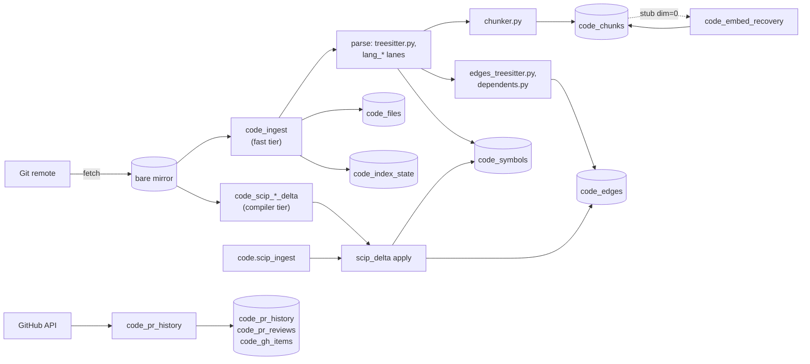

<!-- i18n: source=docs/architecture/code-index-architecture.md blob=9c0d2829f06e5917747d7848ef3ce0748e0c02d4 model=claude-sonnet-5-5 -->
> Esta página es una traducción automática de la [página en inglés](https://github.com/ClickHouse/loom/blob/main/docs/architecture/code-index-architecture.md), que prevalece.
> Machine-translated from the [English page](https://github.com/ClickHouse/loom/blob/main/docs/architecture/code-index-architecture.md), which is authoritative.

# Arquitectura del índice de código

Esta página es la vista interna del índice de código: cómo los archivos se convierten en fragmentos, símbolos y aristas, y cómo se mantienen actualizados los dos niveles. Lo que responde cada op, los lenguajes y su profundidad, y cómo leer `as_of` están en la
[descripción general del índice de código](https://github.com/ClickHouse/loom/blob/main/docs/features/code-index/overview.md) y en
[actualidad de los datos](https://github.com/ClickHouse/loom/blob/main/docs/features/code-index/freshness.md). La puesta en marcha (clones, backfills, los niveles del compilador)
está en [operaciones del índice de código](https://github.com/ClickHouse/loom/blob/main/docs/operations/code-index-operations.md).

## Objetivos y no objetivos

| Objetivos                                                                                                | No objetivos                                                                                         |
| -------------------------------------------------------------------------------------------------------- | ---------------------------------------------------------------------------------------------------- |
| Actualización por cada merge del nivel rápido a partir de un sondeo de un mirror bare local; sin webhook entrante. | Indexar un árbol de trabajo. Los cambios sin commit y sin push nunca están en el índice.             |
| Aristas exactas de llamada, sobrescritura y herencia donde existe un indexador de compilador; heurísticas graduadas en el resto. | Ejecutar un compilador en el proceso del servidor. Los productores SCIP se ejecutan en subprocesos del proceso workers. |
| Ingesta idempotente: los mismos bytes producen las mismas filas y no cuestan ningún embedding.           | Un host de código de propósito general. El índice son datos de referencia de solo lectura organizados por espacio de nombres. |
| Cada respuesta indica el commit y el nivel que leyó, y explica por qué una respuesta vacía está vacía.   | Ocultar la obsolescencia. Se informa de un nivel retrasado.                                          |
| Un lenguaje nuevo se incorpora sin reindexar los demás.                                                  | La misma profundidad para todos los lenguajes ([lenguajes](https://github.com/ClickHouse/loom/blob/main/docs/features/code-index/overview.md)). |

## Un espacio de nombres, una rama

Un espacio de nombres de código es una rama de un repositorio en un commit concreto. Tiene `kind='code'` en
`loom.namespaces` (`code/app/index/registry.py`, `ensure_registered`), no contiene
memorias y organiza cada fila `code_*` por `(org, namespace)`. Loom mantiene un mirror git bare
por repositorio, una caché del remoto registrada en ClickHouse: `code_ingest` clona
uno que falte (o lo hace `loom code init`, con antelación) y lo actualiza con fetch en cada pasada.
`server/code/app/index/gitrepo.py` invoca `git` mediante shell; no tiene árbol de trabajo y no escribe
nada excepto `fetch`. Las ramas de un mismo repositorio comparten el mirror.

Una lectura de historial (`blame_range`, bisect, `first_build`, la comprobación de código de una lección) en un host
sin el mirror lo clona una vez en segundo plano
(`server/code/app/index/mirrors.py`, `history_dir`). Una lectura que nombra su op espera hasta
10 s por el clon que inició, o lo que quede del presupuesto de latencia de la op, lo que sea
menor; las demás responden `no_git_mirror` hasta que el clon termine. Tras el clon, se obtienen por sha y se fijan los commits de merge del ledger
que le faltan al clon: un merge hecho en una rama de staging
que el upstream ha eliminado desde entonces está en el mirror del worker (nunca se poda), pero no en un clon nuevo. Un mirror presente responde tal como está; uno al que le falta el head indexado
hace fetch de la rama en segundo plano. Un head que no es el de la rama (el head de un PR) no se obtiene.

Esto coloca una copia completa de cada mirror en cada host de servicio al que se consulte, lo cual es
la ventaja (cualquier host responde lecturas de historial tras un traslado o un scale-out) y el coste
(disco por host: el tamaño de un repositorio por cada uno). `LOOM_CODE_HISTORY_CLONE_ON_READ=false`
lo desactiva: solo clona el host del worker, y una lectura de historial en cualquier otro lugar responde
`no_git_mirror`.

Las entradas de repositorio provienen de dos fuentes, combinadas:

| Fuente            | Leída por                         | Notas                                                                                                      |
| ----------------- | --------------------------------- | ---------------------------------------------------------------------------------------------------------- |
| Entorno           | `code/domain/index/repos.py`      | `LOOM_CODE_REPOS_JSON`, o los ajustes escalares `LOOM_CODE_*`.                                             |
| `loom.code_repos` | `code/app/index/repo_registry.py` | Filas de autoservicio, según `row_kind` (abajo). El token de un remoto privado se almacena cifrado y nunca se devuelve. |

El `row_kind` de una fila de `loom.code_repos` indica de qué se trata:

- `page`: una rama añadida desde la página. Conserva fuera de su espacio de nombres una entrada del operador, eliminada o no.
- `access`: la clasificación y la política de unión de una entrada del operador.
- `''`: una fila escrita antes de existir la columna, que se lee como la fila de acceso del espacio de nombres de una entrada del operador y como una rama añadida desde la página en cualquier otro caso.

`configured_repos()` lee una instantánea en proceso que se actualiza al arrancar, en cada pasada de ingesta y tras una adición. Hasta la primera lectura de la instantánea lanza `RegistryUnread`
(con autoservicio activado), ya que aún no se conocen las entradas que omite un espacio de nombres de página; los módulos que deciden el acceso leen `config_entries()`, que lista las entradas anteriores a esa
lectura sin ninguna legible por la organización (`tests/unit/test_repo_snapshot_contract.py`). Una op
que necesita la lista completa responde 503 en esa ventana; las lecturas de memoria, la búsqueda y
`memory.for_file` responden sin enlaces de código. Una llamada de código que no nombra espacio de nombres usa por defecto
`LOOM_CODE_NAMESPACE` solo cuando ningún miembro añadió ese espacio de nombres desde la página.
Retirar una entrada (`code/app/index/retire.py`) desactiva sus filas, ejecuta una saga de borrado sobre
cada tabla `code_*` del espacio de nombres y elimina el mirror cuando ninguna otra entrada lo usa
en el host que atendió la llamada; la limpieza de cada uno de los demás hosts elimina su propia copia.

## Mirrors de git en cada réplica

Todo proceso que sirve puede responder una lectura de historial (blame, bisect, citas, superposiciones de PR, cobertura de commits), por lo que cada host mantiene sus propios mirrors bare (`code/app/index/mirrors.py`). Un mirror es una caché de su remoto: ClickHouse nombra el remoto y cualquier host puede reconstruir el mirror a partir de él.

- **Warm-up.** Al arrancar, cada proceso clona los mirrors de las entradas indexadas que le faltan, `LOOM_CODE_MIRROR_WARMUP_CONCURRENCY` a la vez, cada uno tras una espera aleatoria de hasta 30 s, para que N réplicas que arrancan juntas no clonen todas desde GitHub al mismo tiempo. Los clones se ejecutan en segundo plano: la disponibilidad (readiness) no los espera.
- **El costo de un disco nuevo.** Un host con un `LOOM_CODE_REPOS_ROOT` vacío hace un clon bare completo de cada repositorio indexado (varios GB en uno grande) antes de que sus lecturas de historial respondan. El warm-up queda activado por defecto porque una réplica nueva debe construir sus cachés sin un operador; coloca `LOOM_CODE_REPOS_ROOT` en un volumen que sobreviva a un rollout para pagarlo una vez por volumen y no una vez por pod. Los clones son completos, no `--filter=blob:none`: un clon parcial obtiene cada blob que falta desde el remoto mientras se ejecuta `git blame`, lo que convierte una lectura de historial en una lectura de red y alcanzaría el remoto fuera del sandbox de trabajos de repositorio.
- **La compuerta.** Toda lectura de historial pasa por `mirrors.history_dir`, que devuelve el mirror o la razón por la que no hay ninguno. Hasta que el mirror existe, la lectura responde `no_git_mirror: cloning <entry>` (o la razón por la que no se clonará aquí) en lugar de un error de git, e inicia el clon si no hay ninguno en curso. `LOOM_GIT_HISTORY=none` desactiva el historial en un host: esas lecturas responden `no_git_history`.
- **El bucle del host.** Solo el líder pregunta al remoto qué cambió (`ls-remote` de las ramas extra y de las cabezas de PR). Lo que obtuvo su pasada está en ClickHouse: la punta de rama de cada entrada (`clone_head`), las cabezas de los PR abiertos (`code_gh_items.head_sha`) y los merges del ledger. Cada `LOOM_CODE_MIRROR_FETCH_INTERVAL_S`, cada host lee esos datos y hace fetch, por nombre, solo de las ramas y cabezas de PR que su mirror tiene en otro sha, más una página de merges del ledger que le faltan; un host que está al día no hace ninguna llamada de red. Las ramas extra no se siguen en los demás hosts: un clon nuevo trae todas las ramas que tenía el remoto, y los merges en ellas llegan por el ledger. Un proceso por host ejecuta la ronda de cada mirror, y todo fetch hacia un mirror (el de la pasada, el del bucle del host, el de una lectura) toma el `.fetch-lock` del mirror; el fetch de la pasada también cuenta como la ronda del host para el intervalo. El mismo bucle ejecuta `git gc --no-prune` cuando corresponde y barre `LOOM_CODE_REPOS_ROOT`: mirrors, árboles `checkout-*` y archivos de bloqueo de mirror que ninguna entrada activa nombra (incluidas las entradas restringidas) y clones a medias. No barre nada cuando no se puede leer el registro.
- **Sandbox.** Un host sin el sandbox de trabajos de repositorio nunca clona ni hace fetch de una entrada añadida por un viewer con un remoto de red, tanto en la ruta de lectura como en el worker (`compiler_tier.unsandboxed_skip`).
- **Merges que el remoto perdió.** Un merge del ledger que el remoto ya no sirve ("not our ref" en dos llamadas, para que una sola negativa transitoria no cuente) se registra en el mirror (`loom-unpinned-merges`), no se vuelve a pedir y se cuenta en `/v1/health?include=mirrors` (`mirrors.unpinned_merges`) y en `loom doctor`.
- **El líder** también clona en segundo plano un mirror que falta, para que un clon largo no retenga las demás entradas de su pasada; una entrada indexada conserva su etapa en la tarjeta de Repositories mientras su mirror se vuelve a clonar en un host nuevo.
- **Borrado.** Los mirrors y los checkouts contienen contenido de repositorios, no contenido de memoria: el censo de borrado no los cuenta. Las copias de un repositorio eliminado desaparecen con el barrido en cada host.

`/v1/health?include=mirrors` incluye `mirrors`: cuántos de los mirrors de este host están `ready` y `cloning`, y los `failed` y `absent` contados por razón. Responde sin token, por lo que no nombra ninguna entrada. El uso de disco es el tamaño de todos los mirrors en todos los hosts: N réplicas guardan N copias.

## Componentes

## Nivel rápido: `code_ingest`

`server/code/workers/ingest.py` consulta cada `LOOM_CODE_INGEST_INTERVAL_SECONDS`;
`code.refresh` dispara una pasada desde CI. Por cada entrada, cada pasada:

1. **Obtiene** el mirror y recorre los commits de primer padre desde la marca de agua `git_head`
   en `code_index_state` hasta la punta, del más antiguo al más reciente, como máximo
   `LOOM_CODE_INGEST_MAX_COMMITS_PER_PASS`.
2. **Reindexa exactamente los archivos modificados** de cada commit (`ingest_file` en
   `code/app/index/ingest.py`): parseo, fragmentos, símbolos, aristas, guardas de llamadas, la fila
   del archivo, y un paquete de contexto y un resumen de revisión para el PR fusionado que el commit nombra. Luego
   avanza `git_head`. Un fallo reejecuta desde el último commit completo.
3. **Recorre** con la parte `LOOM_CODE_INGEST_WALK_BUDGET_SHARE` que queda: reparaciones de reconciliación
   y re-fragmentaciones del extractor (más abajo).

| Límite                                  | Efecto                                                                                                        |
| --------------------------------------- | ------------------------------------------------------------------------------------------------------------- |
| `LOOM_CODE_INGEST_MAX_PASS_SECONDS`     | Duración de la pasada.                                                                                        |
| `LOOM_CODE_INGEST_PASS_BUDGET_FRACTION` | Tras esta parte la pasada no inicia unidades nuevas, guarda los cursores y devuelve `partial: true`.          |
| `LOOM_CODE_INGEST_SECONDS_PER_FILE`     | Predice el costo de un commit; un commit que se prevé que se exceda solo empieza como el primero de la pasada. |
| `LOOM_CODE_INGEST_SLICE_SHARE`          | Lo máximo de la fase de commits que puede ocupar un commit demasiado grande antes de dividirse entre pasadas. |
| `LOOM_CODE_INGEST_LANES`                | Entradas ingeridas en paralelo (por defecto 1, hasta 8). Los commits de una misma entrada siguen en secuencia. |
| `LOOM_CODE_INGEST_ROUND_FILES`          | Archivos por ronda dentro de un commit; las lecturas se precargan en dos sentencias y las escrituras se agrupan en lotes. |

Los carriles ayudan porque un carril espera viajes de ida y vuelta a ClickHouse, no CPU.

**Admisión.** Un archivo se rechaza antes del parseo cuando coincide con la lista de denegación
(`code/app/index/denylist.py`, `LOOM_CODE_INGEST_EXCLUDE`,
`LOOM_CODE_INGEST_IGNORE_FILE`), es binario o supera `LOOM_CODE_INGEST_MAX_FILE_BYTES`.
Por eso `coverage_floor: true` en un grep significa todos los fragmentos admitidos, no todos los bytes.

### Elección de un parser

`ingest_parse.parse_for_ingest` prueba estos en orden. El orden mantiene los tipos de archivo nuevos fuera del
sello del extractor:

1. `treesitter.lang_for_path`: el núcleo sellado (C/C++ con `.h` mediante la gramática de C++,
   Python, shell, SQL, doc, config). Después `ingest_parse._lane_language` reasigna los archivos
   CMake y las configuraciones TLC.
2. Manifiestos de Helm y Kubernetes entre los archivos de configuración (`lang_gotemplate`, `lang_k8s`).
3. `lang_detect.detect_by_extension` (`LANG_BY_EXTENSION`).
4. Un shebang, luego la detección de shell por nombres de Linguist y directivas de ShellCheck
   (`lang_detect.detect_shell`).
5. Archivos host (Dockerfile, Makefile, Jenkinsfile, YAML de CI) con `LOOM_CODE_HOST_ISLANDS`
   (`lang_hosts`).
6. Fixtures de salida esperada, un fragmento sin embeddings por archivo (`lang_reference`).
7. Cualquier otro texto, dividido en fragmentos sin símbolos (`lang_text`).

El parser proviene de `ingest_parse._PARSERS`. Un fallo de ese parseo, incluida una gramática ausente
o un parseo de tree-sitter que supere `code_parse_timeout_s` o `code_parse_memory_mb`
(`bounded_parse`, un parseo a la vez), degrada a un archivo solo con fragmentos con
`code_files.index_error` establecido; `code.index_errors` lo informa; en cambio, una especificación TLA+ recurre
a su lector basado en regex. Un parseo que supere sus límites en cualquier otro lugar usa el respaldo de quien lo llama y no registra ningún error.
Los módulos de tree-sitter se importan de forma diferida, de modo que un servidor con los workers de código desactivados arranca sin los
extras de `code`.

### Fragmentos

`server/code/domain/extract/chunker.py` corta unidades semánticas, nunca ventanas fijas:

| Fragmento        | Contenido                                                                                                                   |
| ---------------- | --------------------------------------------------------------------------------------------------------------------------- |
| `function`       | El cuerpo de una función. Uno demasiado grande se divide en sentencias de nivel superior, cada parte con la firma como prefijo. |
| `class_skeleton` | Una clase con los cuerpos de los métodos omitidos.                                                                          |
| `file_header`    | Comentarios iniciales e includes.                                                                                           |
| `other`          | El resto, agrupado.                                                                                                         |

Los archivos sin árbol recurren a ventanas de líneas completas; los carriles sin gramática cortan según
sus rangos de símbolos (`lane_units.span_chunks`). El id de un fragmento es
`uuid5("loom://code/{namespace}/{path}#{scope}@{sha16}")`. Está direccionado por contenido, así que
un fragmento sin cambios conserva su id y su hash, y el paso de embedding lo omite sin consulta.
Los fragmentos idénticos dentro de un archivo reciben un sufijo ordinal.

### Símbolos y aristas

El id de un símbolo es `treesitter.symbol_id(qualified_name, signature)`: los primeros 128 bits de
SHA-256 sobre el nombre y una firma normalizada (espacios en blanco colapsados, valores por defecto
eliminados, de modo que las sobrecargas difieran). El nivel rápido, el conversor de SCIP y la ruta de lectura
lo llaman todos, así que ambos niveles asignan un símbolo compartido bajo un mismo id. Python y shell califican los nombres
por ruta de módulo, de modo que las muchas funciones `main()` de un árbol de pruebas siguen siendo distintas.

Las aristas del nivel rápido (`edges_treesitter.py`, `tier='treesitter'`) se resuelven por nombre y
se califican:

| Confianza  | Regla                                                                          |
| ---------- | ------------------------------------------------------------------------------ |
| 1.0        | Definición única en el mismo archivo                                           |
| 0.8        | Método de la clase envolvente                                                  |
| 0.6        | Coincidencia única en la tabla de nombres de símbolos de todo el repositorio   |
| ninguna    | Ambigua o desconocida: sin arista; se registra en `code_call_sites_unresolved` |

Una arista errónea es peor que una ausente, por lo que `code.callers` informa cuántos sitios
deja fuera su conteo. Las llamadas a constructores (`T x(...)`, `new T`, `make_unique<T>`) son llamadas
a `T::T`. Los módulos de tipo de receptor (`cpp_receivers.py`, `py_receivers.py`, `ts_receivers.py`,
`go_receivers.py`) enlazan las llamadas a miembros. Los tipos de arista son `calls`, `includes`, `inherits`,
`overrides`, `uses_type`, `fixture_use`, `reads` y `writes`.

**Dependientes.** Las aristas se resuelven contra una tabla de nombres de todo el repositorio, así que un commit que
agrega, elimina o cambia la firma de un símbolo modifica las aristas de archivos no tocados que lo nombran.
`code/app/index/dependents.py` vuelve a extraer solo las aristas de esos archivos en el mismo
commit, hasta `LOOM_CODE_INGEST_DEPENDENTS_MAX_FILES`. El excedente espera en
`code_index_state` (`dependents_pending`) y se drena mediante la reconciliación.

### Embeddings y tablas de vectores

`code_ingest` genera embeddings de los fragmentos nuevos en línea, memoizados por hash de contenido (`embed_reuse.py`),
con texto acotado (`embed_text.py`). Con `LOOM_CODE_CONTEXT_DESCRIPTION_ENABLED` (activado por
defecto) un fragmento recibe una descripción de una línea generada por un LLM, antepuesta a su texto del embedding,
con el mejor esfuerzo y sujeta al presupuesto. Un fallo del proveedor deja un stub con `embedding_dim = 0` que
`code_embed_recovery` completa, con respaldo por texto y marcado como envenenado tras
`LOOM_CODE_EMBED_MAX_ATTEMPTS`. Hasta que `LOOM_CODE_READY_EMBED_COVERAGE` de los fragmentos de un espacio de nombres
tenga vectores, `code.search` responde con sus ramas léxicas y lo indica.

| Tabla                                     | La llena                                           | Uso                                                                                                           |
| ----------------------------------------- | -------------------------------------------------- | ------------------------------------------------------------------------------------------------------------- |
| `code_summaries`                          | `code_summary` (semanal, desactivado por defecto)  | Fichas de archivo y módulo para `code.map`, controladas por un hash de entradas, con PageRank de `code_graph_stats`. |
| tablas del segundo modelo, `code_chunks_prefix` | `LOOM_CODE_VECTOR_TABLES`; `loom code vector-twin` | La rama vectorial preselecciona en el gemelo más pequeño y revalúa con los vectores servidos (`prefix_twin.py`). |
| `code_answers`                            | `code.ask`                                         | Caché de respuestas indexada por el embedding de la pregunta; se sirve solo si el hash de cada archivo citado está vigente. |

Las pasadas masivas dejan copias adicionales por clave hasta una fusión. `code/app/index/compaction.py`
ejecuta `OPTIMIZE … FINAL` en las tablas gemelas tras una pasada masiva. `code_chunks` se compacta
solo con `loom code compact --table code_chunks --apply`.

## Nivel del compilador: SCIP

El nivel del compilador contiene símbolos y aristas con `tier='scip'`. El servidor nunca analiza
protobuf: un productor convierte la salida de SCIP a un delta JSON versionado
(`scripts/scip_harness/scip_to_delta.py`) y `code/app/index/scip_delta.py`
lo aplica. Por cada archivo afectado, la aplicación hace upsert de lo que emite el delta y marca como eliminadas (tombstone) las filas `scip`
del archivo que ya no emite; un archivo borrado se marca como eliminado por completo. Volver a aplicar un
delta produce el mismo conjunto activo.

| Productor         | Lenguaje                | Marca de agua    | Workers                                                | Cómo se ejecuta                                                                                                                                         |
| ----------------- | ----------------------- | ---------------- | ------------------------------------------------------ | ------------------------------------------------------------------------------------------------------------------------------------------------------- |
| `scip-clang`      | C++                     | `scip_commit`    | `code_scip_full`, `code_scip_delta`, `code_scip_apply` | TU modificadas (y TU que incluyen cabeceras modificadas, con un límite) mediante `run_delta.sh`; `code_scip_full` inicializa el nivel y lo reindexa cada semana. |
| `scip-typescript` | TypeScript / JavaScript | `scip_commit_ts` | `code_scip_ts_delta`                                   | Índice de todo el workspace en cada pasada, limitado por el conversor a los archivos de la ventana.                                                     |
| `scip-go`         | Go                      | `scip_commit_go` | `code_scip_go_delta`                                   | Una compilación por módulo (`run_go_monorepo_delta.sh`).                                                                                                |
| `scip-python`     | Python                  | `scip_commit_py` | `code_scip_py_delta`, `code_scip_apply`                | Delta por cada merge (`run_python_delta.sh`); la primera ejecución indexa el árbol.                                                                     |

`code/domain/index/compiler_tiers.py` (`TIERS`) es la tabla única de marca de agua, etiqueta
y workers por productor; los manejadores de estado y el panel la leen. Un worker de delta
compara su marca de agua con `git_head`, mueve el checkout (haciendo fetch desde el mirror local,
no desde la red), ejecuta el productor en un subproceso y aplica el delta
por la misma ruta que usa `code.scip_ingest`. Una pasada cubre todos los merges desde la
marca de agua.

Un productor externo, como un trabajo de CI, puede subir un delta por partes con
`code.scip_ingest`; las partes se almacenan temporalmente en `code_scip_batches` / `code_scip_parts` y
las aplica `code_scip_apply`. Cada pasada del nivel del compilador toma un archivo de bloqueo por entrada en
`LOOM_CODE_SCIP_LOCK_DIR` y un lease de ClickHouse, de modo que una reindexación completa y un delta nunca
se ejecutan a la vez sobre una misma entrada. `loom code scip-full` reconstruye
el nivel de C++; `loom code scip-delta` ejecuta una pasada de delta.

Cuando ambos niveles tienen la misma fila, las lecturas prefieren la fila del compilador, y cada respuesta
indica el nivel que leyó (`scip` o `treesitter`).

## El sello del extractor

Los chunks direccionados por contenido y los ids de símbolo con hash dependen de la entrada, no del código que
produjo las filas, así que una corrección en el chunker nunca llegaría a una fila existente.
`server/code/domain/extract/extractor_stamp.py` cierra esa brecha. Calcula el hash de los tokens de código de
cada módulo del extractor (`logic_tokens`: sin comentarios, líneas en blanco ni docstrings, y con cada
import reducido a los nombres que enlaza, de modo que mover un módulo entre paquetes no mueve ningún
sello) más las versiones instaladas de las gramáticas selladas (`STAMPED_GRAMMARS`: la biblioteca base, C++,
Python, bash).

El sello se divide de dos maneras para que un cambio vuelva a derivar lo mínimo posible:

- **Por etapa** (`STAGES`: `chunk`, `symbol`, `edge`, `guard`; `STAGE_MODULES`). El sello de una
  etapa cubre sus módulos y los de las etapas que lee (`STAGE_INPUTS`).

  | Módulo modificado                 | Etapas afectadas                           |
  | --------------------------------- | ------------------------------------------ |
  | `chunker.py`                      | `chunk`                                    |
  | `edges_treesitter.py`             | `edge`, `chunk`, `guard`                   |
  | `treesitter.py`, `lang_python.py` | todas (`symbol` alimenta al resto)         |
  | `call_guards.py`                  | `guard`                                    |

- **Por familia de lenguaje** (`LANGUAGE_FAMILIES`: `python`, `shell`, `typescript`, `cpp`,
  `other`; `MODULE_LANGUAGES`). Un cambio solo de Python sana los archivos `.py` y deja C++
  intacto. Los módulos de aristas de TypeScript (`ts_receivers.py`, `ts_reexports.py`,
  `ts_config.py`, `ts_workspace.py`) mueven solo `typescript`. Un módulo sellado que falta
  en `MODULE_LANGUAGES` mueve todas las familias.

Cada pasada compara los sellos en ejecución con los de `code_index_state`. Una etapa afectada se
vuelve a derivar para cada archivo de esa familia en cada espacio de nombres indexado, en lotes
dosificados (`LOOM_CODE_EXTRACTOR_RECHUNK_PER_PASS`, interruptor `LOOM_CODE_EXTRACTOR_RECHUNK_ENABLED`).
Un sello registrado vacío se registra, nunca se actúa sobre él. Por tanto:

- un cambio de código en un módulo de `EXTRACTOR_MODULES` reindexa todos los repositorios de las
  familias afectadas, lo que tarda horas en un despliegue grande; los comentarios y los docstrings
  se pueden editar libremente;
- esos archivos están excluidos de los formateadores (`pyproject.toml`), y
  `tests/unit/test_code_extractor_stamp.py` mantiene sincronizados la lista de exclusión y el
  inventario de módulos: un módulo de `server/code/domain/extract/` que no esté en ninguna etapa debe
  figurar en `NON_EXTRACTOR_MODULES` de la prueba con su motivo;
- modifícalos solo cuando cambie la extracción, y espera la nueva derivación tras el despliegue.

**Los módulos de carril quedan fuera del sello.** Los parsers de carril (`lang_typescript.py`,
`lang_rust.py`, `lang_go.py`, `lane_units.py`, …), sus gramáticas y los módulos de selección de archivos
(`lang_detect.py`, `denylist.py`) no lo mueven; los módulos de aristas de TypeScript
mencionados arriba son la excepción. Una corrección de carril se aplica con `loom code backfill --paths-file`
sobre los archivos de ese lenguaje.

## Reconciliación

Las watermarks indican qué commits se recorrieron, no si cada fila está actualizada.
`code/app/index/reconcile.py` mide la deriva. Una fila de `code_files` incluye `blob_sha`
e `indexed_commit`. Un solo `git ls-tree -r <head>` marca una ruta como obsoleta cuando su blob
difiere, y como eliminada cuando no existe. Las filas sin blob recurren a un
`git diff --name-only` por cada commit distinto, hasta `LOOM_CODE_RECONCILE_MAX_COMMITS`.

La comprobación cada hora en `code_ingest` (`LOOM_CODE_RECONCILE_ENABLED`,
`LOOM_CODE_RECONCILE_INTERVAL_SECONDS`) vuelve a ingerir hasta `LOOM_CODE_RECONCILE_HEAL_PER_PASS` rutas
obsoletas mediante `ingest_file`; solo se generan embeddings del contenido nuevo. De forma manual: `loom code reconcile --heal`. El gauge `loom.code.stale_files`
informa el recuento.

## Marcas de agua y cobertura

`code_index_state` (`ReplacingMergeTree(version)`, con clave `(org, namespace, state_key)`)
contiene `git_head`, las marcas de agua de SCIP por productor, los sellos del extractor, los cursores y
`dependents_pending`. El bloque `as_of` de cada respuesta y
`loom.code.tier_lag_seconds{tier}` se calculan a partir de estas filas y del mirror, no a partir del log de
un productor. La cobertura por commit (`code/app/index/commit_coverage.py`) es un
`git merge-base --is-ancestor` por nivel sobre el mirror, nunca una comparación de marcas de agua.
Lo que ven los llamadores está en [frescura](https://github.com/ClickHouse/loom/blob/main/docs/features/code-index/freshness.md).

## Historial de PR, backports y enlaces a trackers

| Tabla                                                  | Escritor                                                    | Contiene                                                                                                                       |
| ------------------------------------------------------ | ----------------------------------------------------------- | ------------------------------------------------------------------------------------------------------------------------------ |
| `code_pr_history`, `code_pr_reviews`, `code_gh_items`  | `code_pr_history` (GitHub REST, cursor sobre `updated_at`)  | PR fusionados con archivos, comentarios de revisión e issues. Un límite de tasa o un 5xx deja el cursor sin avanzar.           |
| `code_context_packs`, `code_review_briefs`             | `code_ingest` en el commit de fusión, o bajo demanda        | Paquete de contexto y resumen para el revisor de cada PR.                                                                      |
| `code_backport_gaps`                                   | `code_backport_gaps` (nocturno; requiere `code_pr_history`) | Por cada PR de la rama principal con etiqueta de backport, una fila por espacio de nombres de rama de release: cubierto, pendiente, no afectado. |
| `code_test_map`, `code_symbol_stats`, `code_unit_risk` | `code_graph_stats` (semanal), `loom code crossref`          | Mapa de pruebas↔código fuente, fan-in de símbolos, riesgo por unidad.                                                          |
| `code_coverage_files`                                  | `code_coverage_import` (diario), `loom code coverage-import` | Por archivo fuente, los rangos de líneas que ejecutó una ejecución de cobertura por prueba.                                    |
| `qa_link_candidates`                                   | `tracker_links` (diario)                                    | Los PR fusionados principales por cada issue reciente, ordenados por BM25F, trazas de pila en el diff y menciones de cierre.   |
| `qa_item_embeddings`                                   | `tracker_embed`                                             | Vectores de issues y PR del tracker en la ventana de embeddings; claves y datos de filtro, sin texto.                          |

`code.repo.set_source` vincula un repositorio con sus trackers, en orden; el primero es el
principal, cuyos números son los números de issue y de PR del repositorio. Los enlaces son
la fila `qa_binding` de `code_index_state` y se leen por `(org, namespace)`: el nombre de
un espacio de nombres de código se deriva del repositorio y la rama, por lo que dos orgs
pueden tener el mismo. `LOOM_TRACKER_CODE_NAMESPACE_BINDINGS_JSON`, del operador, se aplica
solo a los repositorios del propio operador (`LOOM_CODE_REPOS_JSON` o `LOOM_CODE_REPO`),
nunca a uno de autoservicio cuyo nombre coincida con un glob. Los workers del tracker leen
cada espacio de nombres a través de su propia fuente, de modo que las filas de un espacio
de nombres restringido nunca terminan bajo uno estándar. El contrato de registros está en
[contrato de registros del tracker](https://github.com/ClickHouse/loom/blob/main/docs/features/tracker/record-contract.md).

`code.repo.add_branch` escribe la fila `qa_branch_of` de la nueva rama con el nombre del
repositorio raíz (la fuente, o la raíz de la propia fuente cuando esta es una rama) cuando
esa raíz es un repositorio del operador, de modo que la rama de una raíz de autoservicio
nunca empiece a leer el mapa si el operador configura más tarde el nombre de esa raíz. Una
rama registrada cuya raíz es un repositorio del operador sigue los enlaces de ese
repositorio en el momento de la lectura, incluido el glob; una fila `qa_branch_of` sin una
entrada de autoservicio junto a ella no se sigue. Una fuente que no es un repositorio del
operador tiene su propia fila `qa_binding` copiada a la rama, incluso si estaba vacía. Una
fuente del operador es su propia raíz. Ambas filas se escriben leyendo primero las filas de
la fuente y dejando `qa_branch_of` al final, por lo que un fallo deja a la rama sin seguir
nada.

`code.repo.remove` vacía la fila, de las dos, que contenga un valor antes de la purga
desacoplada del espacio de nombres. Registrar un espacio de nombres vacía cualquier fila
que dejó uno eliminado con el mismo nombre y quita el nombre de la instantánea de su propio
proceso, de modo que el nuevo espacio de nombres no sigue a ninguno. Un `qa_binding` vaciado
se lee como borrado hasta que un administrador del tracker lo vincula. Un espacio de nombres
que no tenía fila `qa_binding` no recibe ninguna, así que el mapa del operador sigue
alcanzando una entrada del operador configurada con el mismo nombre. Una entrada del
operador configurada bajo un nombre eliminado no recibe esa limpieza: hasta que se ejecuta
la purga, lee la fila `qa_binding` del espacio de nombres eliminado cuando existe, es decir,
los enlaces antiguos tras una eliminación en la compilación N-1 y ninguno tras una en N. Los
demás procesos conservan las filas que leyeron hasta `LOOM_CODE_REPOS_REFRESH_SECONDS`.

## Almacenamiento

| Tabla                                                          | Motor y clave                                                                                          | Notas                                                                                                      |
| -------------------------------------------------------------- | ------------------------------------------------------------------------------------------------------ | ---------------------------------------------------------------------------------------------------------- |
| `code_files`                                                   | RMT(`version`), `(org, namespace, path)`                                                               | Último análisis por ruta: lenguaje, `blob_sha`, `indexed_commit`, `index_error`.                           |
| `code_chunks`                                                  | RMT(`version`), `(org, namespace, embedding_model, path, chunk_id)`, particionada por `(org, namespace)` | Contenido, `lexemes`, vector. Índices de texto: 3-grama sobre `lower(content)`, tokens sobre `lexemes`.    |
| `code_symbols`                                                 | RMT(`version`), `(org, namespace, tier, qualified_name, symbol_id)`                                    | Definiciones con firma, rango, comentario de documentación, `scip_symbol`; índices de salto ngram sobre el nombre. |
| `code_symbol_names`, `code_symbol_ids`                         | RMT, rellenada por `code_symbol_names_mv` / `code_symbol_ids_mv`                                       | Los símbolos reorganizados con otra clave: por nombre corto y por id.                                      |
| `code_edges`                                                   | RMT(`version`), `(org, namespace, tier, to_symbol_id, edge_kind, from_symbol_id, path, line)`          | Los llamadores son un rango de claves; proyecciones `by_from` (llamados) y `by_path`.                      |
| `code_call_sites_unresolved`, `code_caller_guards`             | RMT(`version`)                                                                                         | Sitios de llamada rechazados, por nombre del llamado; guardas alrededor de los sitios de llamada de cada llamador. |
| `code_term_freq`, `code_doc_stats`                             | AMT, RMT; rellenadas por `code_term_freq_mv`, `code_doc_stats_mv`                                      | Estadísticas BM25 para la rama léxica.                                                                     |
| `code_unit_signal`                                             | `SummingMergeTree((positive, negative))`                                                               | Contadores de resultados por unidad a partir de `code.outcome`.                                            |
| `code_search_trace`, `code_search_outcome`, `code_search_memo` | MT con TTL de 180 días; RMT con TTL de 60 minutos                                                      | Trazas y resultados por consulta; una memoria temporal de las respuestas de `code.search` ya servidas.     |

Todas las columnas están en la [referencia del esquema](https://github.com/ClickHouse/loom/blob/main/docs/reference/schema.md) generada.

## Patrones de consulta

| Op                               | Ruta                          | Cómo                                                                                                                                                                                                                                                                                                                                                                                                                       |
| -------------------------------- | ----------------------------- | -------------------------------------------------------------------------------------------------------------------------------------------------------------------------------------------------------------------------------------------------------------------------------------------------------------------------------------------------------------------------------------------------------------------------- |
| `code.search`                    | `code/app/search/pipeline.py` | Primero enruta (patrón, ruta, pregunta de historial) y luego ejecuta las ramas bajo el plazo límite (`gather.py`): léxica (conteo de tokens ponderado por idf), vectorial (un escaneo sin índice vectorial, o una lista corta de gemelos), historial de PR y voto difuso de símbolos. `fusion.py` fusiona por rango recíproco (k = 60); `serve.py` pagina dentro del presupuesto de tokens o se abstiene. Una repetición dentro de la ventana de memo es una sola lectura de `code_search_memo`. |
| `code.grep`                      | `code/store/index/grep.py`    | El índice de 3-gramas reduce los gránulos; `position()` o `match()` decide; cada coincidencia se une a su unidad contenedora. `mode=presence` abarca hasta ocho espacios de nombres de rama.                                                                                                                                                                                                                                 |
| `code.symbol`                    | `code/app/symbol/`            | Un nombre calificado es una lectura por prefijo de clave de `code_symbols`; un nombre corto pasa por `code_symbol_names`; varias definiciones se ordenan por `near_paths` o por el PR en revisión.                                                                                                                                                                                                                          |
| `code.callers`, `code.impact`    | `code/store/index/edges.py`   | Los llamadores son el rango `to_symbol_id` de `code_edges`, con preferencia por las filas del compilador, junto con el conteo de no resueltos. `code.impact` asigna los fragmentos del diff a símbolos semilla y recorre hacia afuera; un recorrido vacío responde `no_indexed_paths`, `no_seeds_in_hunks` o `no_static_callers`.                                                                                            |
| `code.outline`, `code.enclosing` | —                             | Lecturas por ruta de los tramos de `code_symbols` y `code_chunks`.                                                                                                                                                                                                                                                                                                                                                         |

## Invariantes

- Un espacio de nombres de código es una rama; cada fila `code_*` está identificada por `(org, namespace)`.
- `git_head` avanza solo después de que se hayan escrito todos los archivos del commit.
- `treesitter.symbol_id` es la única función de symbol-id, usada por ambos niveles y por la ruta de lectura.
- Los ids de chunk se direccionan por contenido; un chunk sin cambios no se vuelve a generar como embedding.
- Un cambio de código en un módulo marcado (stamped) vuelve a derivar sus etapas para su familia de lenguaje en cada espacio de nombres; los comentarios y docstrings nunca lo hacen.
- Aplicar un delta es idempotente y marca como eliminado (tombstone) lo que el productor dejó de emitir.
- El servidor nunca analiza protobuf de SCIP.
- La cobertura por commit es una comprobación de ascendencia en el mirror, nunca una marca de agua.
- La recuperación filtra `embedding_dim > 0`; un chunk stub solo se puede buscar de forma léxica.

## Puntos de entrada del código fuente

| Ruta                                                                                                                               | Qué                                                                                                  |
| ---------------------------------------------------------------------------------------------------------------------------------- | ---------------------------------------------------------------------------------------------------- |
| `server/code/app/index/ingest_pass.py`                                                                                             | La pasada del nivel rápido.                                                                          |
| `server/code/app/index/ingest.py`                                                                                                  | `ingest_file`, las etapas por archivo.                                                               |
| `server/code/app/index/ingest_parse.py`, `ingest_chunks.py`, `ingest_edges.py`, `ingest_resolve.py`, `ingest_reconcile.py`         | `parse_for_ingest` y `_PARSERS`, fragmentos, aristas, lecturas de resolución de aristas, escrituras de diferencias por clave. |
| `server/code/domain/extract/treesitter.py`, `lang_detect.py`, `lang_*.py`, `lane_units.py`                                         | Lenguajes.                                                                                           |
| `server/code/domain/extract/chunker.py`, `edges_treesitter.py`, `call_guards.py`; `server/code/app/index/dependents.py`            | Fragmentos y aristas.                                                                                |
| `server/code/domain/extract/extractor_stamp.py`                                                                                    | El sello.                                                                                            |
| `server/code/app/index/reconcile.py`, `commit_coverage.py`, `scip_delta.py`; `server/code/domain/index/compiler_tiers.py`          | Desfase, cobertura, niveles.                                                                         |
| `server/code/workers/scip_*.py`, `scripts/scip_harness/`                                                                           | Nivel del compilador.                                                                                |
| `server/code/workers/embed_recovery.py`, `summary.py`, `graph_stats.py`, `pr_history.py`, `backport_gaps.py`, `coverage_notify.py` | Workers en segundo plano.                                                                            |
| `server/code/domain/index/repos.py`; `server/code/app/index/repo_registry.py`, `registry.py`, `retire.py`, `gitrepo.py`            | Entradas, réplicas, espacios de nombres.                                                             |
| `server/code/app/search/`, `server/code/store/index/`                                                                              | Lecturas y escrituras.                                                                               |

## Relacionado

- [Descripción general del índice de código](https://github.com/ClickHouse/loom/blob/main/docs/features/code-index/overview.md) (lenguajes y niveles),
  [actualización](https://github.com/ClickHouse/loom/blob/main/docs/features/code-index/freshness.md),
  [historial y PRs](https://github.com/ClickHouse/loom/blob/main/docs/features/code-index/history-and-prs.md).
- [Operaciones del índice de código](https://github.com/ClickHouse/loom/blob/main/docs/operations/code-index-operations.md).
- [Agregar compatibilidad con un lenguaje](https://github.com/ClickHouse/loom/blob/main/docs/development/adding-language-support.md).
- [ClickHouse](https://github.com/ClickHouse/loom/blob/main/docs/architecture/clickhouse.md), [referencia de operaciones](https://github.com/ClickHouse/loom/blob/main/docs/reference/operations.md#code).
