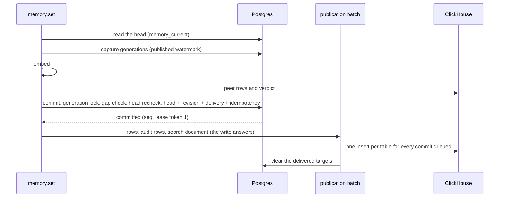

<!-- i18n: source=docs/architecture/storage-authority.md blob=ddfbb1e79149f5d1a03c9c3f7d95d4881dd6a2e6 model=claude-sonnet-5-5 -->
> Esta página es una traducción automática de la [página en inglés](https://github.com/ClickHouse/loom/blob/main/docs/architecture/storage-authority.md), que prevalece.
> Machine-translated from the [English page](https://github.com/ClickHouse/loom/blob/main/docs/architecture/storage-authority.md), which is authoritative.

# Autoridad de almacenamiento: Postgres para la memoria activa, ClickHouse para la búsqueda

Loom funciona con una de dos autoridades de memoria, que se elige por despliegue mediante
`LOOM_STORAGE_AUTHORITY`. Con `clickhouse` (el valor por defecto) ClickHouse guarda
todo, como se describe en [arquitectura de la memoria](https://github.com/ClickHouse/loom/blob/main/docs/architecture/memory-architecture.md). Con
`postgres`, Postgres guarda el contenido actual de cada clave de memoria, cada revisión
confirmada y lo que cada revisión todavía debe a ClickHouse, además de la cabecera de cada documento
de conocimiento ([documentos de conocimiento](#knowledge-documents)); ClickHouse conserva cada vector,
cada etapa de búsqueda, el historial y las analíticas. Esta página describe la autoridad
Postgres: sus tablas, las rutas de escritura y lectura, la admisión bajo concurrencia,
la idempotencia, el borrado, los fallos y los dos perfiles de despliegue de Postgres.

## Por qué dos almacenes

Una escritura de memoria necesita versiones ordenadas, compare-and-set, locks y comprobaciones de pin. Un
insert en ClickHouse es una parte (part), y cada parte cuesta un merge: si se confirman una a una, las
tablas de memoria pagan ese costo en cada escritura, y dos escritores concurrentes no pueden ver la fila
del otro antes de decidir sus veredictos. Postgres ofrece una transacción corta con locks de fila;
ClickHouse sigue haciendo lo que mejor sabe hacer: escanear vectores y texto.

| Estado                                                                       | Almacén                                                                               |
| ---------------------------------------------------------------------------- | ------------------------------------------------------------------------------------- |
| Contenido actual de la memoria, versiones, locks, pins, compare-and-set      | Postgres `loom.memory_current`                                                        |
| Journal de revisiones y sus trabajos de entrega                              | Postgres `loom.memory_revisions`, `loom.memory_deliveries`                            |
| Claves de idempotencia y respuestas de repetición                            | Postgres `loom.idempotency`                                                           |
| Generaciones de alcance (admisión)                                           | Postgres `loom.scope_generations`                                                     |
| Cabeceras de documentos de conocimiento, sus trabajos de entrega, evidencia de borrado | Postgres `loom.knowledge_heads`, `loom.knowledge_deliveries`, `loom.erased_documents` |
| Trabajos de ingesta de conocimiento                                          | Postgres `loom.knowledge_jobs`                                                        |
| Catálogo de datasets de conocimiento: snapshots de servicio, aprobaciones de esquema | Postgres `loom.knowledge_datasets`                                                    |
| Vectores, búsqueda léxica y vectorial, las filas de memoria buscables        | ClickHouse `loom.memory_embeddings`, `loom.memory`                                    |
| Historial de revisiones, el rastro de auditoría, uso                         | ClickHouse `loom.memory_versions`, `loom.audit_log`, tablas de uso                    |

Postgres no almacena ningún vector. `loom.memory` y `loom.memory_embeddings` de ClickHouse son
proyecciones publicadas a partir de revisiones confirmadas.

Un escritor de copias (un lock, un touch, una marca de estado, la tombstone de un borrado, una expiración) toma su
versión después de su lectura y por encima de la de esa cabecera (`rows.version_over`), de modo que una cabecera escrita en
una réplica cuyo reloj va adelantado no lo supere. El relabel del barrido de sensibilidad va
por encima de la cabecera que escaneó y solo sobre esa cabecera, leída en modo strong por su clave: una escrita
después contiene texto que su detector no leyó, o la etiqueta de su propio escritor, y se deja para
su siguiente pasada o, cuando su entrega está aparcada, hasta que la entrega se reintenta
([barrido de sensibilidad](https://github.com/ClickHouse/loom/blob/main/docs/architecture/security.md#sensitivity)). Una cabecera que se mueve después de esa lectura rechaza
la confirmación en Postgres, y el fence de un relabel `high` sigue a su confirmación, así que uno rechazado
no deja ningún fence sobre esa cabecera; en ClickHouse, una cabecera insertada por debajo de la versión del relabel
queda superada, como con cualquier escritor de copias. El paso de entidades y un restore toman su
versión antes de la lectura y la elevan por encima de la cabecera leída, de modo que una escritura que tome una versión
por encima de la suya los supera. Un valor escrito sobre una cabecera (`memory.set`, `memory.bulk_set`,
`memory.update_by_id`) también va por encima de esa cabecera, ya que en Postgres la confirmación
conserva la más reciente de las dos. Los resúmenes consolidados
de una fuente eliminada se encuentran y se juzgan sobre la autoridad (sus cabeceras y sus fuentes vivas),
y cada tombstone o degradación va sobre una cabecera que todavía cita las fuentes
juzgadas, incluida una copia posterior, mientras que un resumen reconstruido a partir de otras fuentes se deja. Sus
vectores se escriben con la versión de cada fila, en Postgres dentro del lease de la confirmación: una
tombstone los retira sin texto, y una degradación copia solo los del propio hash de su cabecera
(ninguno para una cabecera escrita antes de los hashes), de modo que ninguna lleva texto que la redacción de
otra versión pueda estar purgando. En Postgres, una degradación debe su documento de búsqueda hasta que
ClickHouse lo contiene; si no, el worker de entrega lo construye; en ClickHouse, una fila de vector que la
copia dejó conserva su estado antiguo hasta que `loom reconcile-status` lo refleja. Una
supersesión toma su versión antes de su lectura y no se eleva: cualquier cabecera por encima de esa versión
conserva la clave, ya sea una escritura posterior o una de una réplica con el reloj adelantado. Una
supersesión juzgada va una versión por encima de la que leyó; sus filas de vector toman una versión que el
espejo de estado calcula (`mirror_status_to_embeddings(judged=True)`). Bajo la autoridad de ClickHouse,
una copia es un insert simple: una escritura con una versión menor cuya fila cae entre
la lectura y el insert (un valor, un borrado, un relabel a `high`) queda superada por ella, y
nada lo notifica. En Postgres la copia se confirma solo
sobre la cabecera que leyó (`heads_unchanged(exact=True)`), y una cabecera escrita después la rechaza.

## Las tablas

El esquema está en `schemas/pg_migrations/` ([migraciones](#migrations)). Toda clave primaria de tenant empieza por `org`, y lo mismo vale para todo índice de tenant salvo los índices de mantenimiento de los barridos y de los escaneos de reclamación ([disposición del almacenamiento](https://github.com/ClickHouse/loom/blob/main/docs/architecture/storage-layout.md#postgres)).
La [disposición del almacenamiento](https://github.com/ClickHouse/loom/blob/main/docs/architecture/storage-layout.md) ubica cada tabla, de cualquiera de los dos almacenes, y la ola que la mueve.

| Tabla                       | Clave                                                      | Contiene                                                                                                                                                                                                                                                                                                                                                                                |
| --------------------------- | ---------------------------------------------------------- | --------------------------------------------------------------------------------------------------------------------------------------------------------------------------------------------------------------------------------------------------------------------------------------------------------------------------------------------------------------------------------------- |
| `loom.authority`            | singleton                                                  | la autoridad registrada, su época y el id del despliegue                                                                                                                                                                                                                                                                                                                                |
| `loom.scope_generations`    | `(org, scope)`                                             | el último número de revisión de un espacio de nombres, o una generación de política (`scope = '*'`, org `''` para la global)                                                                                                                                                                                                                                                            |
| `loom.memory_current`       | `(org, namespace, agent, user_id, session_id, memory_key)` | la cabeza de cada clave: la fila completa de `loom.memory` como JSON, con `memory_id`, `version`, `seq`, `content_sha256` a su lado                                                                                                                                                                                                                                                     |
| `loom.memory_revisions`     | `(org, namespace, seq)`                                    | cada fila confirmada, solo de adición (una redacción depura una en el sitio, y con `LOOM_PG_PAYLOAD_CLEAR_ENABLED` la pasada de limpieza borra el contenido de una ya entregada pasado el horizonte: [limpieza de contenido](#payload-clearing)), con su fila de auditoría solo de hash y sus metadatos en columnas tipadas ([metadatos de revisión](#revision-metadata))              |
| `loom.memory_deliveries`    | `(org, namespace, seq)`                                    | los destinos que una revisión aún debe a ClickHouse (bits: 1 fila de memoria, 2 documento de búsqueda, 4 fila de auditoría, 8 el registro de una decisión eliminada, 16 los vectores antiguos), su lease y su token de fencing; se elimina cuando llega el último destino                                                                                                                 |
| `loom.idempotency`          | `(org, key_hash)`                                          | el digest de la solicitud de una op, su estado (`running`, `committed`, `done`), las revisiones que confirmó, su respuesta, un lease y su token                                                                                                                                                                                                                                         |
| `loom.erased_memories`      | `(org, namespace, memory_id)`                              | evidencia de borrado: el espacio de nombres y el id de cada memoria que una eliminación quitó, cuándo, y cuándo están en silencio sus publicadores; sin contenido, se conserva `LOOM_PG_ERASURE_EVIDENCE_HOURS`                                                                                                                                                                          |
| `loom.idempotency_fences`   | `org`                                                      | cuándo quitó por última vez una eliminación las respuestas de repetición de la org: el límite de su censo de residuos                                                                                                                                                                                                                                                                   |
| `loom.audit_outbox`         | `(org, namespace, row_hash)`                               | las filas de auditoría que una eliminación quitó antes de que ClickHouse las tuviera, y las que una reclamación difirió porque el titular al que reemplazó aún puede insertarlas, hasta que la pasada de entrega las publica; claves e ids, sin valores                                                                                                                                  |
| `loom.knowledge_heads`      | `(org, namespace, source_uri)`                             | la cabeza de cada fuente de conocimiento: la fila completa de `loom.documents` ([documentos de conocimiento](#knowledge-documents)), y la revisión y versión de los fragmentos que sirve ([búsqueda de conocimiento](#knowledge-search))                                                                                                                                                |
| `loom.knowledge_deliveries` | `(org, namespace, source_uri, version)`                    | lo que una confirmación de documento aún debe a ClickHouse (bits: 1 la fila del documento, siempre activo, 2 la retirada de los fragmentos más antiguos; se publica completo), su fila, lease y token                                                                                                                                                                                   |
| `loom.erased_documents`     | `(org, namespace, doc_id)`                                 | evidencia de borrado: el `doc_id` de cada versión de cada documento que una eliminación quitó, incluidas las de ClickHouse, rechazado en una confirmación; sin contenido, se conserva `LOOM_PG_ERASURE_EVIDENCE_HOURS`                                                                                                                                                                   |
| `loom.knowledge_jobs`       | `(org, namespace, ingestion_id)`                           | cada trabajo de ingesta: su fila completa de `loom.knowledge_ingestions`, las columnas de la cola, el token que protege las lecturas y los guardados de su ejecución, y cuándo se pidió una cancelación ([trabajos de ingesta](#ingestion-jobs))                                                                                                                                         |
| `loom.erasure_ledger`       | `(org, id)`                                                | las eliminaciones solicitadas al despliegue: el alcance de cada una, el indicador de purga, la urgencia, la hora de solicitud, la hora de finalización o abandono, y los pasos de Postgres que se confirmaron (`pg_steps`, cada uno en la transacción de su paso), escrito antes de su primer checkpoint de ClickHouse, de modo que una restauración de cualquiera de los almacenes vuelve a ejecutar lo que perdió (`loom reconcile`); sin contenido, se conserva `LOOM_ERASURE_LEDGER_DAYS` |
| `loom.knowledge_datasets`   | `(org, namespace, source_uri, doc_version, dataset_id)`    | la fila de catálogo de cada conjunto de datos en una versión de documento: el snapshot que lo sirve, su esquema y su aprobación ([conjuntos de datos](#datasets))                                                                                                                                                                                                                       |

Una cabeza es la fila que serviría `loom.memory FINAL`: una confirmación la reemplaza solo cuando su versión no es más antigua, como decide `ReplacingMergeTree(version)`. Guardar la fila completa mantiene sin cambios cada una de las rutas de escritura que construyen filas de `loom.memory` (`server/memory/store/rows.py`): todas llegan a la confirmación por el mismo embudo de inserción, `insert_memory_versions`. La fila conserva la precisión de ClickHouse (datetimes UTC ingenuos de segundos enteros, confianza Float32), de modo que una lectura desde Postgres devuelve lo que devolvería una lectura desde ClickHouse.

Una fila almacenada (una cabeza, o el contenido de una revisión) puede omitir un campo con su valor por defecto de `loom.memory`, los que una primera versión puede dejar sin establecer (`rows.FIRST_VERSION_DEFAULTS`, `pg_memory.SPARSE_DEFAULTS`): todo lector toma un campo ausente como ese valor por defecto, `decode_row` en Python y `coalesce` (o una prueba que se cumpla para NULL) en SQL. Todos los demás campos se almacenan siempre, incluso los que tienen el valor por defecto. Esta compilación almacena todos los campos.

Un id de memoria no es único dentro de una org: un espacio de nombres restaurado desde el snapshot de otro conserva los ids de memoria con versiones más nuevas. Por tanto, toda lectura de cabeza por id nombra su espacio de nombres (`reads.get_by_id`), y una op dirigida solo por el id (`memory.get_by_id`, `memory.update_by_id`, `memory.verify`) primero encuentra el único espacio de nombres que tiene una cabeza viva de él al que el llamante puede acceder (`id_namespace.namespace_for_id`). Responde que no se encontró cuando el llamante accede a más de uno, contados por acceso al espacio de nombres, así que también cuando su alcance de lectura de solo su propio usuario oculta una de las copias, y cuando no se pudo leer la concesión de algún titular (entonces la solicitud es un fallo del servidor). Un espacio de nombres restaurado sobre sí mismo bajo otro agente tiene el id bajo una segunda clave; una op por id actúa entonces sobre la cabeza más nueva que lo contiene, de modo que esa copia se direcciona por su clave. `memory.redact` nombra una versión, que solo una fila tiene, y actúa sobre la clave de esa fila.

El progreso mutable de la entrega vive en `loom.memory_deliveries`, aparte del contenido de las revisiones, de modo que limpiar un destino nunca reescribe el contenido de una revisión.

### Metadatos de revisión

Una revisión conserva su clave (`agent`, `session_id`, `memory_key`), `status`, y la hora y el motivo de su redacción en columnas tipadas junto a su contenido (`row`). Un trigger las establece a partir de `row` cada vez que un escritor de cualquier compilación lo establece, recurriendo cada una al valor por defecto de la columna de `loom.memory` para un campo que `row` omite, y las conserva cuando `row` se limpia, rellenando las que sigan en NULL desde el contenido que se limpia. Una revisión escrita antes de que existieran las columnas las tiene en NULL y su contenido en su sitio, así que un lector toma cada una de la columna o, cuando es NULL, de `row` (`pg_memory._meta`); la migración no reescribe ninguna revisión. Todo lector del journal salvo el alcance de perfiles (abajo) compara con esos metadatos y lee `row` solo para el contenido de una revisión, que puede ser NULL:

- una versión antigua (las filas reinstauradas de `namespace.rollback`, `revisions_at`) es entonces la fila de `memory_versions` de ClickHouse de la misma clave, servida depurada cuando las columnas dicen que está redactada, de modo que nunca se sirve una redacción que la depuración de ClickHouse aún no ha alcanzado; no se sirve una revisión que el journal ya no tiene (eliminada);
- el hueco de una admisión con tal revisión no se borra del journal: la escritura llega de nuevo a su veredicto sobre pares leídos de nuevo;
- una redacción marca las columnas de tal revisión, y la depuración de ClickHouse alcanza su texto.

Una revisión de perfil conserva su contenido para siempre: el alcance de una redacción sobre los perfiles plegados desde la memoria compara con `row`, lo cual sirve el índice parcial `memory_revisions_profile`.

Toda confirmación establece el contenido de una revisión; solo la pasada de limpieza de contenido lo borra.

Once índices de mantenimiento no empiezan por `org`: `memory_deliveries (lease_until)` y `knowledge_deliveries (lease_until)` `WHERE NOT settled` (las colas de los workers de entrega entre tenants), los mismos dos `WHERE settled`, `audit_outbox (due_at)`, `idempotency (expires_at)`, `erased_memories (erased_at)`, `erased_documents (erased_at)`, `knowledge_jobs (updated_at)` y `erasure_ledger (requested_at)` (los barridos), y `memory_revisions_payload` (la pasada de limpieza de contenido entre tenants). Los once son locales a una base de datos Postgres, y las filas de un tenant se siguen encontrando por sus claves primarias.

### Limpieza de contenido

Con `LOOM_PG_PAYLOAD_CLEAR_ENABLED` (desactivado por defecto), el worker `pg_payload_clear` borra el contenido de una revisión que tiene todo backup de ClickHouse que una restauración pueda usar, conservando sus metadatos. El journal queda entonces del tamaño de sus metadatos, más los contenidos del último horizonte, de las revisiones de perfil, de las revisiones que aún deben una entrega y de las versiones que le faltan a ClickHouse, mientras `memory_versions` de ClickHouse sirve el contenido de las versiones antiguas.

- **Cuándo se entregó una revisión.** Una finalización que vacía una entrega más de 15 minutos después de la confirmación de su revisión establece el `delivered_at` de la revisión, en la misma sentencia que elimina o liquida la entrega; una dentro de 15 minutos deja el journal intacto. Por tanto, la hora de entrega de una revisión es como máximo `coalesce(delivered_at, committed_at)` más 15 minutos; una compilación sin la marca rompe ese límite para lo que entrega tarde, lo cual la [regla 43 de actualización gradual](https://github.com/ClickHouse/loom/blob/main/docs/architecture/rolling-upgrades.md#the-rules) espera a que pase.
- **Qué se borra.** Una pasada borra una revisión cuando se cumple todo esto:
  - su hora de entrega está más allá del horizonte;
  - no tiene fila de entrega: una entrega aparcada o reparada, y una liquidada hasta que la pasada de entrega la barre pasado el límite de inserción, conservan el contenido de la revisión;
  - no es una revisión de perfil;
  - `loom.memory_versions` tiene su clave y versión con el mismo `memory_id` y hash de contenido, leído con consistencia secuencial. Una redacción conserva el hash, así que una revisión redactada también se borra.

  Una versión que le falta a ClickHouse se cuenta (`missing_in_clickhouse` en el resultado del worker) y se conserva. La pasada lee el índice parcial `memory_revisions_payload` en orden de entrega desde donde se detuvo la última pasada (su cursor en `loom.worker_status`, de modo que un proceso o color nuevo la continúa), en lotes de `LOOM_PG_DELIVERY_BATCH_ROWS` a la vez, hasta que uno vuelve corto o ha transcurrido la mitad de su plazo. Borra con `FOR NO KEY UPDATE SKIP LOCKED`, de modo que una revisión que retiene una redacción o una eliminación se deja para una pasada posterior.

- **El horizonte** es `LOOM_PG_PAYLOAD_RESTORE_HORIZON_MINUTES`, nunca menor que `LOOM_CH_BACKUP_INTERVAL_MINUTES` más 60 ni que el límite de inserción más 60. En 0 (el valor por defecto) es el doble del intervalo de backup más 60. Ambos ajustes son LIVE y se leen en cada pasada. Un proceso no borra nada hasta que ha adoptado las sobrescrituras del despliegue. Por qué el horizonte cubre una restauración, y el runbook de restauración que detiene primero la pasada, están en [backup y recuperación](https://github.com/ClickHouse/loom/blob/main/docs/operations/backup-and-recovery.md#the-postgres-journal-and-a-clickhouse-restore).
- **Tras una restauración.** Una entrega de una revisión borrada que sigue siendo la cabeza de su clave envía la fila de la cabeza desde `memory_current`, la misma versión, de modo que `loom reconcile` vuelve a enviar toda cabeza que le falta a ClickHouse o que tiene más antigua. Una revisión borrada y luego reemplazada no tiene nada que enviar: `loom reconcile` la deja fuera de sus retenciones, y una entrega que aún llega a una (retenida cuando una pasada la borró) se aparca en su reclamación ([entrega](#delivery)).
- **Los documentos de conocimiento** no se borran aquí: las versiones reemplazadas de un documento viven solo en ClickHouse una vez barrida su entrega.

### Disposiciones descartadas

- **Una tabla tipada con todas las columnas de `loom.memory`.** Cada columna nueva se escribiría dos veces y los dos esquemas divergirían; la fila JSON es la fila que el embudo ya comprueba (`check_memory_rows`).
- **Cabezas en Postgres con el contenido en ClickHouse.** Cada lectura puntual necesitaría una segunda consulta, y ClickHouse seguiría en la ruta de escritura.
- **Un bloqueo por espacio de nombres mantenido durante la comprobación de conflictos.** Retendría una conexión de base de datos, o una transacción, durante la inferencia y una consulta a ClickHouse.

### Una base de datos por tenant

Los tenants comparten un esquema en una base de datos por unidad de Postgres, con toda clave e índice de tenant encabezados por `org`; un tenant que necesita aislamiento obtiene su propia [celda](https://github.com/ClickHouse/loom/blob/main/docs/architecture/cells.md), no su propia base de datos. Se sopesó una base de datos por tenant según aquello con lo que crece cada uno de sus costos:

| Costo                      | Una base de datos por tenant                                                                                                                                                                                                                       | Esquema compartido                                          |
| -------------------------- | -------------------------------------------------------------------------------------------------------------------------------------------------------------------------------------------------------------------------------------------------- | ----------------------------------------------------------- |
| Conexiones                 | una conexión llega a una base de datos ([Postgres](https://www.postgresql.org/docs/16/manage-ag-overview.html)); un pool por tenant por proceso: tenants × procesos × 20 conexiones al servidor con el tamaño de pool habitual de un pooler        | un pool por unidad                                          |
| Captura de cambios         | un slot lógico decodifica una base de datos ([Postgres](https://www.postgresql.org/docs/16/logicaldecoding-explanation.html)): un slot y un walsender por tenant, cada uno leyendo todo el WAL                                                     | uno por unidad                                              |
| Vacuum y wraparound        | 3 workers de autovacuum por defecto para todo el clúster, un lanzamiento por base de datos por naptime, un horizonte `datfrozenxid` por base de datos ([Postgres](https://www.postgresql.org/docs/16/routine-vacuuming.html))                        | un conjunto de tablas                                       |
| Migraciones                | se aplican una vez por base de datos; el bloqueo advisory de un arranque cubre una base de datos, una ejecución parcial deja a los tenants en esquemas distintos                                                                                   | una transacción por archivo                                 |
| Aislamiento                | ninguno: el WAL, los buffers, el IO, los checkpoints y los workers de vacuum son del clúster ([Postgres](https://www.postgresql.org/docs/16/manage-ag-overview.html))                                                                              | igual; una unidad aparte aísla                              |
| Mover un tenant            | un `pg_dump` de su base de datos                                                                                                                                                                                                                   | fuera de alcance ([celdas](https://github.com/ClickHouse/loom/blob/main/docs/architecture/cells.md#operations)) |
| Eliminación                | `DROP DATABASE`, rápido, pero no en una transacción y rechazado mientras un slot usa la base de datos ([Postgres](https://www.postgresql.org/docs/16/sql-dropdatabase.html)); los backups y el WAL archivado conservan los datos de cualquier modo | borrar por `org` bajo los bloqueos de generación del alcance |

Su única ventaja, mover un tenant con un solo volcado, no compensa el resto, y no aísla nada que una base de datos compartida no aísle. Un esquema por tenant tiene los mismos costos de migración y de catálogo, y un pooler de transacciones rechaza el `search_path` que necesita por conexión. Una base de datos dedicada en un clúster compartido para un tenant regulado comparte el WAL, el IO y los backups de ese clúster; una celda propia no.

### Ramificación de Postgres

Se sopesaron las ramas copy-on-write (un snapshot del volumen, un Postgres nuevo sobre él en segundos) para cada lugar donde se hace una copia de la autoridad:

| Uso                                                           | Veredicto                                                                                                                                                                                                                                         |
| ------------------------------------------------------------- | ------------------------------------------------------------------------------------------------------------------------------------------------------------------------------------------------------------------------------------------------- |
| La autoridad misma                                            | no es una dependencia: Loom corre en cualquier Postgres 16+, y una rama nueva tiene un primario y ningún standby                                                                                                                                  |
| Pruebas de integración                                        | contenedores `postgres:16` y `postgres:18` con un standby síncrono, iniciados por ejecución, no necesitan cuenta ni red y prueban el standby que a una rama le falta                                                                               |
| Restauración en cuarentena                                    | una copia en un punto de recuperación a la que se aplican las eliminaciones antes de que sirva: un fork de Managed Postgres o un clúster de recuperación bajo el gestor de HA lo hace; una rama es una forma más rápida de hacer la copia          |
| Ensayar un cambio de autoridad o una migración con datos de producción | el mejor uso: una copia de tamaño completo en segundos; contiene datos de producción a los que no llegan las eliminaciones posteriores, así que vive solo durante el ensayo; un fork a un punto en el tiempo es lo mismo en cualquier Postgres |
| Una vista previa por pull request                             | no con datos de producción: una copia por cambio multiplica lo que una eliminación debe alcanzar                                                                                                                                                  |

Así que una rama es una forma opcional de hacer las copias que necesitan estos procedimientos, nunca una condición de ellos.

## La ruta de escritura

1. **Lectura.** El handler lee el head de la clave desde Postgres
   (`memory_repo.get_by_key`, `get_by_id` y `memory_rows_by_identity_keys` leen
   Postgres bajo esta autoridad; un replay con `as_of` lee el historial de ClickHouse).
   Las protecciones (lock, pin, blacklist, límite de caracteres) se ejecutan igual que
   con la autoridad ClickHouse.
2. **Captura.** La admisión captura las generaciones de política y la marca de agua
   publicada del espacio de nombres: el último número de revisión por debajo del cual la
   fila de memoria y el documento de búsqueda de todas las revisiones están en
   ClickHouse; se excluye la revisión aparcada y se cuenta como incluido el documento de
   un stub (`pg_memory.capture`). Aquí no se espera nada.
3. **Veredicto.** El embedding y la comprobación de conflictos se ejecutan fuera de
   cualquier transacción. Bajo esta autoridad `memory.set` obtiene por sí mismo sus
   filas pares (`conflicts.peer_rows`: los pares del escritor en `_writer_scope`, las
   filas de su usuario cuando lo indica, y todas las fijadas)
   y las pasa a `check_on_commit`, de modo que una ronda posterior puede añadirles más.
4. **Commit.** Una transacción (`pg_memory.commit_versions`), con los locks tomados en
   un solo orden (los advisory locks de los ámbitos de política, compartidos y
   ordenados; luego las filas de generación por `(org, scope)`; luego los heads por
   clave; luego las entregas por seq), esperando cada lock como máximo
   `LOOM_PG_COMMIT_LOCK_TIMEOUT_MS`:
   - los ámbitos de política se mantienen compartidos hasta el commit (un cambio de
     blacklist o de acceso los toma de forma exclusiva, después de los commits que los
     mantienen y antes de los encolados tras él); luego se leen sus generaciones, en una
     sentencia propia, y se comparan: un cambio desde la captura devuelve la escritura a
     su comprobación;
   - la generación del espacio de nombres avanza según el número de filas, lo que la
     bloquea; si había avanzado más allá de la capturada, las filas confirmadas en el
     intervalo se leen en esta transacción y sobre ellas se ejecuta la comprobación de
     intervalo de la admisión
     ([admisión](#admission-under-concurrency));
   - el head de cada clave escrita se bloquea y se vuelve a comprobar contra la fila que
     leyó la escritura: nunca un delete, un pin, un lock, un status o una redacción que
     la escritura no haya visto; con `if_match_sha256` también esa misma versión
     (compare-and-set); en otro caso puede llevar un valor más nuevo (dos escrituras
     incondicionales de una clave: gana la versión más nueva, como en ClickHouse); si
     no, la escritura empieza de nuevo;
   - se hace upsert de los heads, se insertan las revisiones y sus entregas, y la clave
     de idempotencia, si existe, se marca como `committed` con las revisiones, bajo su
     token de lease.
5. **Publicación.** El escritor entrega las filas confirmadas, sus filas de auditoría y
   el documento de búsqueda que construyó al lote de publicación de su proceso
   ([publicación](#publication)), que las inserta en `loom.memory` (cuya vista
   materializada mantiene `loom.memory_versions`), `loom.audit_log` y
   `loom.memory_embeddings` junto con todos los demás commits encolados, y limpia esos
   destinos bajo el token de lease de cada commit.
   Un `memory.set` de una clave sin head vivo (una clave nueva, o una eliminada desde
   entonces) que no declara relaciones y no es `high` responde en cuanto vuelve el
   commit ([publicación](#publication)); todos los demás escritores, `memory.bulk_set`
   incluido, esperan a su flush, de modo que lo que le sigue lee sus filas en
   ClickHouse, y responden 503 `PUBLICATION_PENDING` con `committed: true` cuando el
   flush falla o su lease (`LOOM_PG_REQUEST_LEASE_SECONDS`, menos
   `LOOM_PG_LEASE_MARGIN_SECONDS`) se agota antes.

La transacción no hace inferencia ni consultas a ClickHouse. Una escritura que falló
antes de su commit no escribió nada; una interrumpida después es durable y otro termina
su entrega ([entrega](#delivery)).

`memory.bulk_set` sigue los mismos pasos para un lote: captura antes de su búsqueda de
existentes, confirma todas las filas en una transacción con el head de cada clave
recomprobado, y da el destino de documento de búsqueda solo a las filas que tienen
vector.

### Publicación

Un insert de ClickHouse de una fila de versión es un `INSERT … SELECT FROM input()`
con fence, que ClickHouse no puede almacenar en buffer
([inserts por lotes](https://github.com/ClickHouse/loom/blob/main/docs/architecture/clickhouse.md#batched-inserts)), así que un insert por escritura es una parte por escritura. Por
eso cada proceso agrupa en lotes la publicación de sus commits
(`server/memory/store/pg_batch.py`). Un flush envía todos los commits encolados desde el
anterior, sea cual sea su espacio de nombres y su org: un insert en cada una de
`loom.memory` y `loom.memory_embeddings`, dividido en bloques de como máximo 100 meses
de `created_at` (la clave de partición de las tablas; ClickHouse Cloud fija
`max_partitions_per_insert_block` en 100), y un insert por lotes de las filas de
auditoría en `loom.audit_log`, y luego una transacción de Postgres que limpia lo que
llegó. Los flushes empiezan como máximo 1000 / `LOOM_PG_PUBLISH_INTERVAL_MS` (250, es
decir 4; limitado a la mitad de `LOOM_PG_PROJECTION_WAIT_MS`) por segundo de media, con
hasta un segundo de margen acumulado (al menos uno) de una vez: un proceso que escribe de
vez en cuando envía cada escritura al instante, y uno ocupado envía como máximo esa
cantidad de inserts por segundo a cada tabla. Un insert crea una parte por cada
partición que abarcan sus filas, así que las tablas de memoria reciben de las escrituras
4 partes por segundo por cada proceso que sirve (cada web worker de cada réplica, y el
proceso de los workers) y por mes de `created_at` escrito, con el valor por defecto,
sea cual sea la tasa de escritura; la retirada de vectores antiguos por un flush
(`OLD_VECTORS`) y un flush rechazado que se reenvía commit a commit añaden las suyas.

El documento de búsqueda lo construye, y su vector lo calcula, el escritor antes de su
commit, como en la autoridad ClickHouse; hasta su flush se mantiene en el proceso del
escritor, y Postgres no almacena ningún vector. Un proceso que se detiene antes de su
flush pierde el documento, no la escritura: el delivery worker toma la entrega cuando
vence su lease y vuelve a calcular el embedding del texto de la revisión
([entrega](#delivery)). El drenaje de apagado envía primero lo que está encolado. Un
flush envía un documento solo mientras el head de su clave todavía lo sirve: la
revisión de la que se construyó, o una copia más nueva de ella con el mismo contenido
(un pin, un touch, una marca de conflicto) cuya propia entrega no debe documento, sobre
la que el flush lleva los vectores del escritor con las columnas y la versión de la
copia, de modo que el texto no se vuelve a vectorizar. Una clave eliminada, reescrita o
redactada desde entonces tiene su propia retirada o documento, sobre los que este
aterrizaría como vivo. El flush termina de inmediato el lease de su escritor sobre una
entrega así (`pg_memory.hand_over`), y sobre toda entrega de un commit que ClickHouse
rechazó, de modo que el delivery worker, o una búsqueda que espera en su barrera,
construye el documento a partir del head o lo da por resuelto sin esperar a que venza el
lease. Un flush que no obtuvo respuesta no termina ningún lease: un insert suyo puede
seguir ejecutándose.

Solo una escritura de una clave sin head vivo responde antes de su flush, porque sus
seguimientos no necesitan nada de ClickHouse: no hay head propio que revisar, ni
relaciones que acotar con fence, y su proyección de entidades se ejecuta junto a la
respuesta. Una escritura posterior de la clave en otra sesión la encuentra igualmente:
las lecturas de la misma clave (la supersesión `newest_wins`, la marca pendiente del
resolver para una clave mantenida en otro lugar, la protección que rechaza una propuesta
sobre un hecho aceptado, y la comprobación de `memory.delete_version` de los chunks que
sirven los valores de la clave, incluido el head más nuevo del propio eliminador) toman
los heads de la autoridad (`pg_memory.live_key_heads`). La deduplicación de identidad de
una escritura en bloque encuentra un keeper de los mismos bytes bajo otra clave entre los
que tiene ClickHouse y los que aún se le deben (`pg_memory.unpublished_keepers`), cada
uno comprobado contra su head en la autoridad. Una revisión acota con fence sus aristas
sobre su nueva fila, una escritura con relaciones sus hechos, y el fence de una fila
`high` (`fence_high`) vuelve a comprobar el head en ClickHouse: cada uno de ellos espera
a su propio flush.

Cada commit de un flush se envía bajo su propio lease y token, como lo enviaría su
escritor por separado, de modo que las garantías de más abajo se mantienen sin cambios:
el flush se ejecuta bajo el lease más temprano entre sus commits y no envía nada de un
commit cuyo lease venció en la cola; un borrado espera a que esos leases terminen; el
fence de una redacción los termina; un destino se limpia solo bajo el token del commit.
Un flush que ClickHouse rechaza se reenvía commit a commit, de modo que una fila que
sigue rechazando solo retiene su propio commit; uno al que ClickHouse no responde se deja
entero al delivery worker. Durante una actualización gradual, un build N-1 que publica
cada escritura por separado sirve junto a N: ambos envían las mismas filas bajo los
mismos leases. Las lecturas de ClickHouse de N-1 que en N esperan en la barrera (abajo)
no esperan, así que hasta que termine el despliegue el primer `memory.set` de una clave
respondido por N puede faltar en ellas en una réplica N-1 durante hasta un flush.

Read-your-writes: `memory.get` y las demás lecturas puntuales responden desde Postgres,
al día en el commit. Una búsqueda espera en la barrera ([búsqueda](#search)) al flush,
como máximo la espera de un flush y un insert tras la escritura, y lo mismo hacen
`memory.list`, `memory.history`, un replay `as_of` de `memory.get` o `memory.get_by_id`
y el plan de `namespace.rollback`. Los fences del grafo proyectan las aristas y los
hechos de una escritura solo mientras `loom.memory` muestre que mantiene su valor
(`graph_holders`): la proyección de entidades de una primera escritura, que se ejecuta
junto a la respuesta, espera primero al flush de esa escritura, hasta su lease
(`pg_batch.own_write_published`); cuando el flush no llega, no encuentra fila que
mantenga el valor, como en una escritura cuya publicación está pendiente, y el extractor
de entidades proyecta la fila una vez que está. Un fence lee la fila de cualquier otra
escritura tal como la tiene ClickHouse. Una escritura cuyo veredicto escribe copias de
otros heads (las marcas de un conflicto, una supersesión, un refinamiento) espera al
flush de cada copia, que espera a que termine el de la escritura y, en un proceso
ocupado, al ritmo. Una lectura solo de ClickHouse (`memory.keys` y las demás que nombra
[borrado](#erasure)) muestra la escritura una vez que llega su flush.

Todo otro escritor de `loom.memory` confirma mediante `insert_memory_versions`: un nuevo
head cuando su versión no es más antigua, una revisión, una entrega, la fila de
auditoría. Una copia de un head que leyó confirma mediante
`lifecycle.insert_versions_over_heads`, solo sobre la versión que leyó; los escritores
que no recomprueban ningún head se enumeran en [Redacción](#redaction). Una copia que
escribe el documento de búsqueda de una fila viva (un rollback, un restore, un Undo) lo
escribe bajo el lease de su commit y lo debe hasta entonces, de modo que el delivery
worker construye uno que el lease o un fallo hayan cortado. La fila de un resumen de
periodo, que no recomprueba ningún head, escribe su documento del mismo modo
(`lifecycle.insert_documented_versions`), y enlaza su linaje solo cuando la fila y su
documento llegaron a ClickHouse en su commit, donde un borrado de usuario alcanza el
linaje a través de ella; una fila que queda pendiente, o cuyo documento fue rechazado,
se queda sin su linaje hasta una reescritura.
`memory.reject` y `memory.clear` escriben sus cambios como revisiones, y sus vectores se
vuelven a emitir en la versión de la revisión (un documento de búsqueda que un escritor
aún debe, en una versión más antigua, aterriza debajo de ellos). El TTL de tabla que una
configuración de retención pone en `loom.memory` y `loom.memory_embeddings`
(`LOOM_RETENTION_MEMORY_DAYS`, `LOOM_RETENTION_MEMORY_EMBEDDINGS_DAYS`, el
`retention_days` de un espacio de nombres) borraría solo las copias de ClickHouse, así
que no se aplica a ninguna de las dos tablas bajo esta autoridad, y el arranque rechaza
las dos configuraciones.

### Auditoría

La fila de auditoría solo con hash de cada fila confirmada (`memory.revision`: clave,
id, versión, hash de contenido, clase de fuente, status, pin, tombstone, id de petición,
y como actor el principal del token, si no el actor de la etapa del pipeline, si no `-`
dentro de una petición y `process:loom` para los jobs propios de Loom, nunca el escritor
anterior que lleva una copia) se construye una vez, se almacena junto a la revisión en
la misma transacción y se entrega a `loom.audit_log`. Es durable antes de que la
escritura responda. Una entrega que se reintenta omite las filas de auditoría ya
almacenadas, por su hash. Una op de escritura que deja su propia fila (`memory.set`,
`memory.update`, `memory.update_by_id`, `memory.bulk_set`) la sigue dejando, con su
veredicto, junto a esta.

## Admisión bajo concurrencia

Un veredicto alcanzado en ClickHouse puede ser incorrecto en el momento en que la escritura se confirma: un par creado mientras se ejecutaba la comprobación no está entre las filas que leyó. Comprobar solo las versiones de los candidatos devueltos pasa por alto ese par, y un nivel de aislamiento de Postgres no rastrea un predicado evaluado en ClickHouse. Loom lo rastrea con generaciones:

- cada commit en un espacio de nombres hace avanzar la generación del espacio de nombres, en la misma transacción, y numera sus revisiones con ella;
- un cambio en la lista de bloqueo hace avanzar la generación de política de su ámbito; una admisión compara ambas en el commit.

Cuando la generación del espacio de nombres avanzó, el intervalo (las revisiones confirmadas después de la capturada) se examina dentro del commit, que mantiene el bloqueo de generación, de modo que ningún commit puede unirse a él mientras tanto. Un seq que falta en el intervalo fue borrado, o fue el propio avance de generación de un borrado, y ya no tiene nada que pueda ser un par; un veredicto que vincula la fila escrita con una memoria que un borrado eliminó (su canónica, un conflicto) se rechaza en el commit y se vuelve a alcanzar con pares leídos de nuevo, sea cual sea el intervalo:

- una fila que no puede ser un par se descarta: otro tipo de memoria, la clave del propio escritor (se vuelve a comprobar bajo su bloqueo de head), un vector más lejano de lo que alcanza la comprobación y, para `memory.set`, también una fila no viva o no activa, o fuera del ámbito del escritor (`_writer_scope`) y no fijada (`memory.bulk_set` juzga una fila así también por su vector);
- los vectores se miden sobre la copia que este proceso tiene de los vectores que confirmó, y solo se descarta de ese modo una fila claramente fuera de alcance (con un margen sobre la menor precisión almacenada de ClickHouse);
- `memory.set` también se niega a dar por libre un intervalo que cambió alguno de los pares de su veredicto.

Un intervalo despejado se confirma con la nueva generación. Un intervalo que no se despeja con los vectores locales devuelve la escritura a su veredicto fuera de la transacción: `memory.set` espera a que se publiquen las filas del intervalo, las mide sobre la copia de ClickHouse, añade las que están al alcance a sus filas de pares (`pg_admission.absorb`) y alcanza de nuevo su veredicto sobre ellas, sin volver a leer sus pares; `memory.bulk_set` mide el intervalo del mismo modo y empieza de nuevo si una fila está al alcance de una entrada, o si una fila del tipo de una entrada y de otra clave no tiene ningún vector vivo del modelo del embedder que medir (borrado, o aún no embebido con él).

Por tanto, las escrituras que son pares entre sí se confirman de una en una, y cada una ve las anteriores. Un espacio de nombres cuyas admisiones no pueden seguir el ritmo responde 503 `ADMISSION_CONTENDED` una vez que una escritura ha vuelto a comprobar durante `LOOM_PG_ADMISSION_DEADLINE_MS`: el trabajo excedente se rechaza, nunca se encola sin límite. Un head que siguió cambiando responde lo mismo tras `LOOM_PG_ADMISSION_ROUNDS` reinicios. Por tanto, un espacio de nombres no confirma más rápido de lo que escribe el despliegue: cuando los escritores concurrentes en él hacen cola más tiempo que el plazo, el excedente recibe un 503 con `retry_after_s`, donde la autoridad de ClickHouse lo habría respondido más tarde. Un plazo más largo cambia esos rechazos por latencia; más espacios de nombres, o más réplicas, aumentan la tasa.

El estado basado en el tiempo no se rastrea con una generación: el vencimiento de un bloqueo o de una expiración se juzga en el commit, sobre el head tal como esté entonces.

## Búsqueda

ClickHouse recupera y ordena; Postgres dice qué es vigente
(`server/memory/app/search/pg_validation.py`).

- **Barrera.** Una búsqueda captura, para cada espacio de nombres que lee, la generación actual del espacio de nombres, y recupera solo cuando todas las revisiones hasta ella están publicadas. Lo habitual es que no haya ninguna pendiente, ya que un flush sigue a cada escritura de inmediato, o al ritmo de la publicación en un proceso ocupado ([publicación](#publication)), y la barrera es una sola consulta. De lo contrario, la búsqueda publica lo que dejó un escritor detenido, dentro de `LOOM_PG_PROJECTION_WAIT_MS` para todos sus espacios de nombres en conjunto, y después responde 503 `PROJECTION_BEHIND`; una búsqueda que esperó lee ClickHouse con consistencia secuencial. Las escrituras confirmadas después de la captura no mueven la barrera: promete cobertura hasta ella, no una instantánea entre los dos almacenes.
- **Validación.** Un resultado de memoria se sirve solo cuando la cabeza de su propia clave (org, namespace, agent, user_id, session_id, memory_key) está vigente, es del tipo del resultado, no está rechazada, ni es `high`, ni está redactada, y la revisión a partir de la cual se construyó su documento, la más reciente igual o anterior a la versión del documento, tiene el hash de contenido de la cabeza. Un cambio de etiquetas, confianza o caducidad conserva el documento; un resultado sobre otro contenido, sobre una memoria eliminada o caducada, o cuya identidad la rama no leyó, se descarta. Un resultado que muestra el pasaje de un fragmento (un fragmento convertido en el resultado de su fila, juzgado por esa fila bajo cualquier tipo, o una fila que eleva el extracto de un fragmento) se sirve solo cuando una cabeza vigente del escritor del fragmento y de la clave padre, bajo cualquier sesión, aún corta su valor en ese fragmento, tal como lo corta esta compilación (un cambio del fragmentador o de `LOOM_MEMORY_SET_CHUNK_MAX_CHUNKS` descarta un pasaje hasta que se vuelva a escribir su clave); uno cuya fila la rama no nombró se juzga solo por su pasaje. Las filas de los niveles recientes primero y ancla primero se comprueban del mismo modo, incluso en una reproducción con `as_of` (son lecturas actuales), y no se rellenan; un nivel no vuelve a contar una versión que la comprobación de la página descartó, y cuenta las filas que leyó, antes de su ventana. Las filas promovidas (`loom.shared`), los resultados de fragmentos independientes (`source=chunk`), los resúmenes, los registros, los resúmenes de entidades, la rama de observaciones del estado actual y `memory.timeline` no se comprueban, ni tampoco el resto de una reproducción con `as_of`, que lee el historial de ClickHouse. `memory.search_trace` espera en la misma barrera y, fuera de una reproducción con `as_of`, omite los candidatos que la autoridad ya no sirve y los cuenta en su `stale_dropped`, sin rellenar. `memory.ask` juzga su conjunto ya terminado con la misma regla, fuera de una reproducción con `as_of`, y descarta lo que no la cumple sin rellenar y sin contar: sus propias ramas (inyección de identificadores, completado de puentes y de facetas) leen ClickHouse después de que se comprobó la página de la búsqueda, y una fila que añaden lleva la identidad y la versión con que se leyó. Su vía rápida de precedentes, que respondería antes de la recuperación a partir de las marcas de escritura de ClickHouse, está desactivada; un precedente se reutiliza solo frente al conjunto comprobado.
- **Relleno.** Los resultados descartados se reemplazan con el resto ordenado, en una sola ronda de como máximo una página, sin los límites del ensamblador por clave, por sesión y por token; el `stale_dropped` de la respuesta los cuenta, de modo que una página corta explica por qué. Una página aparcada se comprueba del mismo modo y sigue leyendo más allá de sus filas obsoletas, hasta cuatro por cada resultado que aún falta; el resto queda para la página siguiente. Su total sigue siendo el de la lista aparcada.

## Entrega

Una fila de entrega se crea con el commit y se cede en lease al escritor durante
`LOOM_PG_REQUEST_LEASE_SECONDS` bajo el token 1. Una entrega cuyo lease ha expirado se retoma
bajo el siguiente token mediante:

- el worker `pg_delivery`, en cada pasada (`LOOM_PG_DELIVERY_*`), empezando por el lease más antiguo, con
  `FOR UPDATE SKIP LOCKED`;
- una admisión que necesita que se publique el backlog del espacio de nombres
  (`pg_admission.wait_searchable`), para su propio espacio de nombres.

Cualquiera de los dos publica desde la revisión confirmada: la fila de memoria, la fila de auditoría y, para una
escritura con búsqueda, el documento de búsqueda, cuyo embedding se calcula allí a partir del texto de la revisión, salvo que
ClickHouse ya contenga el documento que su escritor construyó en esa versión. Un documento construido
aquí se calcula a partir del texto propio de la revisión: una entrada de `memory.bulk_set` cuyo escritor
calculó el embedding con un prefijo contextual recibe en su lugar el vector del texto sin prefijo, el mismo que
le habría dado `memory.set`. Los claims se publican de un espacio de nombres a la vez, y uno por uno cuando falla el lote de un espacio de nombres, de modo que una revisión que ClickHouse rechaza de forma continua retiene
solo a sí misma. Tras `LOOM_PG_DELIVERY_MAX_ATTEMPTS` publicaciones fallidas (una fila rechazada, una
sentencia de Postgres rechazada, un lease que expiró durante la publicación), una entrega que debe su
documento de búsqueda y no su fila de memoria publica un stub que el worker de embeddings completa;
cualquier otra se aparca: deja de reclamarse, queda fuera de la marca de agua de publicación y se contabiliza en
`GET /v1/health?include=postgres` (`postgres.parked_deliveries`). Una entrega cuya
carga de la revisión fue borrada ([borrado de carga](#payload-clearing)) envía la fila head de su clave
cuando la revisión sigue siendo el head; en otro caso no tiene nada que enviar y se aparca al reclamarla,
con `last_error` "payload cleared, nothing to send" (qué hacer:
[operaciones de Postgres](https://github.com/ClickHouse/loom/blob/main/docs/operations/postgres.md#what-the-boot-checks)). También cuenta una publicación que
termina el proceso del worker: un claim se marca como iniciado justo antes de su propia
publicación y la marca se borra con su resultado, de modo que la siguiente pasada cuenta como
intento uno que siga marcado, lo publica solo y lo aparca al llegar al límite (una entrega que debe solo su
documento de búsqueda recibe en su lugar su stub, y se aparca si ese stub también detiene el proceso).
El worker detiene una pasada entre espacios de nombres, y entre los claims que publica uno por uno o convierte en stub tras agotar sus intentos, una vez transcurrido un lease, de modo que su plazo corta solo
una publicación lenta por sí misma. Una pasada que termina sin un resultado para un claim borra su marca
y no cuenta nada: uno cancelado (el plazo del worker, un apagado) antes de que empezara la publicación de ese
claim, o cortado por una caída de Postgres. Una publicación que el worker estaba ejecutando
cuando se canceló su pasada conserva su marca y cuenta (cada claim de un lote cuenta entonces
un intento y va solo), igual que una cuyo lease expiró; una admisión que ayuda con el
backlog de un espacio de nombres libera todo lo que reclamó. ClickHouse no rechazó nada cuando
responde con un estado que se resuelve por sí solo (un backlog de merges, una tabla de solo lectura, Keeper
perdido, demasiadas consultas, un insert de estado desconocido, el servidor sin memoria en
conjunto), cuando todas las conexiones del pool están ocupadas, o cuando una publicación falla en la
conexión y ClickHouse luego no responde a una sonda: la pasada se detiene. Un fallo de conexión mientras
ClickHouse responde, un timeout y un bloque de insert que abarca demasiadas particiones son
propios de las filas y cuentan, de modo que un lote que siempre falla así se prueba fila por fila y una fila
que sigue fallando se aparca. Una segunda copia de una fila es inofensiva: ambas tablas de ClickHouse
son `ReplacingMergeTree(version)` y cada fila conserva la versión de su revisión, de modo que una copia
se fusiona con la primera y una tardía nunca supera a una escritura más reciente. Solo el titular del
token actual borra un destino, de modo que un publicador superado no puede marcar como hecho el trabajo de un claim más reciente.

### Solo se publican revisiones durables

Un commit cuya espera de standby síncrono fue cancelada (un timeout del cliente, una cancelación) está
confirmado solo en el primario y es visible para todas las sesiones allí; un failover lo pierde
y el nuevo primario numera otra revisión con su `seq`. Por eso una fila llega a
ClickHouse solo cuando los standbys síncronos la tienen. Una fila se hace visible solo tras
terminar la espera de standby de su propio commit, de modo que un commit posterior que escribe WAL y vuelve de
su propia espera cubre todas las filas que leyó su transacción.

- Un claim del worker de entrega, del outbox de auditoría o del worker de entrega de conocimiento es
  un UPDATE de las filas que reclama, por lo que su commit espera a los standbys (el timeout de sentencia
  no cubre la espera de standby de un commit); el timeout de comando del cliente cancela
  una espera que lo supera y lanza un error, y no se envía nada de lo reclamado.
- El flush de un escritor envía sus propios commits, que volvieron de su espera, y un
  documento construido sobre una copia más reciente de su fila, que antes vuelve a leer de forma durable; una
  copia que la lectura durable ya no encuentra va a su lista `stale`, para que
  el worker de entrega decida.
- Un head de clave que no es la revisión que reclamó una entrega (más nuevo, redactado o desaparecido),
  y los escritores de decisiones activos que conserva una retirada de registro, son commits de otras sesiones.
  Se vuelven a leer en `pg.durable_transaction()`; su COMMIT lleva un mensaje lógico
  transaccional (prefijo `loom.durable`), por lo que espera a los standbys en la
  conexión que hizo la lectura. El documento se construye o se resuelve a partir de esa lectura: sobre una
  copia (un pin, un touch) se construye un documento; un delete, otro contenido, una
  redacción o un borrado resuelve el documento reclamado sin enviarlo.
  La lectura se hace durable en su propia conexión porque el commit que resuelve, en
  otra, no podría cubrirla: tras un failover marcaría el documento como hecho en un
  primario donde la revisión reclamada vuelve a ser el head.
- `decision.record` comprueba así a sus escritores después de que su registro se asiente, y un delete de una
  decisión retira su registro así en su flush, de modo que cada uno espera un viaje de ida y vuelta más al standby.
- Una versión de un job de conocimiento que falta en ClickHouse solo se proyecta de nuevo en la ejecución de ingesta cuando
  `pg_jobs.get(..., durable=True)` devuelve la misma versión: una que solo tiene el primario
  volvería por `pg_jobs.adopt` tras perderla un failover.

La regla para cualquier ruta: un envío a ClickHouse alimentado por una lectura de Postgres envía solo lo que el
llamador confirmó o reclamó, o lee antes de forma durable. Una decisión que solo cambia
el estado de Postgres queda cubierta por su commit cuando la transacción que la confirma también hizo
la lectura.
`tests/unit/test_pg_durable_reads.py` fija a cada llamador de una lectura del journal con la razón
por la que la mantiene.

La garantía se cumple cuando un failover promueve un standby del conjunto síncrono que tiene
la posición de flush más alta, como hace un gestor de HA estricto
([operaciones de Postgres](https://github.com/ClickHouse/loom/blob/main/docs/operations/postgres.md#self-hosted-postgres)). Un gestor que
no es estricto vacía `synchronous_standby_names` cuando su standby se cae; los commits son entonces
solo del primario, como con `LOOM_PG_DURABILITY=local` sin standby nombrado: un
failover puede perder escrituras confirmadas, ClickHouse puede conservar sus filas
y la reconciliación posterior a una restauración las elimina.

Con el standby desconectado, un claim espera hasta `LOOM_PG_STATEMENT_TIMEOUT_MS` más un
segundo y la pasada termina como ante una caída de Postgres; un claim cuya espera se cortó conserva sus
filas en lease hasta que termina `LOOM_PG_DELIVERY_LEASE_SECONDS` tras volver el standby, y
las búsquedas en esos espacios de nombres lo esperan en la barrera. Una redacción o un borrado que bloquea
una entrega reclamada espera detrás de ese commit hasta `LOOM_PG_COMMIT_LOCK_TIMEOUT_MS`, y luego
responde con su 503 reintentable, como lo haría su propio commit mientras el standby está caído.

## Idempotencia

Bajo esta autoridad, una `Idempotency-Key` es una fila de `loom.idempotency`, con clave
`(org, sha256(v3, org, subject, op, key))` como en la autoridad ClickHouse, y falla en
modo cerrado (si Postgres no está disponible, responde 503).

| La fila de la clave                                  | Una solicitud con la clave recibe                                                                                                                                                                                                                                                      |
| ---------------------------------------------------- | -------------------------------------------------------------------------------------------------------------------------------------------------------------------------------------------------------------------------------------------------------------------------------------- |
| ninguna, o expirada                                  | se ejecuta y retiene la fila (`running`, un lease de 60 s, un token)                                                                                                                                                                                                                   |
| otro digest de solicitud                             | 409 `IDEMPOTENT_CONFLICT`                                                                                                                                                                                                                                                              |
| `done`                                               | la respuesta almacenada                                                                                                                                                                                                                                                                |
| `running` o `committed` con un lease vigente         | 503 `IDEMPOTENT_IN_PROGRESS`, se puede reintentar                                                                                                                                                                                                                                      |
| `committed`, lease vencido                           | 200 con la identidad de las revisiones confirmadas (`memory_id`, `version`, `content_sha256`, `memory_key`) y `idempotent_replay: committed`; en `memory.bulk_set`, `written` nombra las filas que el lote confirmó, en su orden de confirmación, no un resultado por cada entrada      |
| `committed`, una eliminación borró una revisión      | 404 `RESOURCE_NOT_FOUND`, para toda la solicitud                                                                                                                                                                                                                                       |
| `running`, lease vencido                             | se ejecuta, con el siguiente token                                                                                                                                                                                                                                                     |

La confirmación marca la clave como `committed` en la misma transacción que las
revisiones, y solo bajo el token que su solicitud retiene: una solicitud cuyo trabajo
fue asumido por un reintento ya no puede confirmar bajo la clave y responde 503
`IDEMPOTENT_TAKEN_OVER`. Una solicitud que responde sin confirmar elimina su reclamo,
de modo que un reintento se ejecuta de inmediato. Las claves se conservan durante 24
horas; un reintento posterior es una solicitud nueva.

## Borrado

El primer paso que borra es `pg_memory.delete` (`server/erasure/store/steps_pg.py`);
el borrado de un espacio de nombres solo detiene antes las fuentes de documentos del espacio de nombres. En una
transacción, `pg_memory.delete` avanza la generación de cada espacio de nombres afectado (lo que lo
bloquea, de modo que los commits del ámbito esperan, y un veredicto en curso que enlaza una memoria que
eliminó vuelve a evaluarse), mueve las filas de auditoría que ClickHouse aún no tiene a
`loom.audit_outbox`, borra las revisiones del ámbito (y con ellas
sus entregas) y las cabeceras, y lee la última concesión (lease) entre las entregas que eliminó.
Después espera hasta que se hayan detenido todos los publicadores que tenían una: un publicador no envía nada
más allá de su lease, cada inserción que envió comienza en el servidor dentro de un margen de tránsito
del fin del lease (una posterior se rechaza, con o sin tabla transportada), y se ejecuta como máximo durante
el límite de escritura (el timeout de escritura de ClickHouse, o 60 s cuando es 0). Lo que cubre la espera
es lo que publica la autoridad: las filas de memoria, los documentos de búsqueda, las filas de auditoría,
los registros de decisión y las retiradas de vectores antiguos que adeudan sus entregas. Las copias propias de ClickHouse
de las filas de búsqueda de una escritura posteriores a su publicación (la retirada de vectores de un borrado o una expiración,
un fence, un lift, un reflejo de estado o de expiración) y
lo que se deriva de ella (la proyección del grafo, la evaluación de conflictos, los
workers en segundo plano) son escrituras como cualquier otra: una que compite con un borrado de su ámbito es la carrera que
existe bajo la autoridad ClickHouse, y los pasos de ClickHouse del borrado y el censo de residuos
cubren lo que llega antes del censo. Una entrega que otro titular asumió y terminó
se mantiene como resuelta hasta que ha pasado ese límite tras su lease y su `fenced_until`,
ya que el publicador al que reemplazó aún podría estar enviando, así que el borrado también la espera;
una entrega aparcada se espera hasta su `fenced_until`, el último momento en que un titular que ya
no la posee puede enviar (el lease de su último titular cuando una reclamación la aparca, o la
hora de una publicación fallida). Los pasos de ClickHouse se ejecutan tras esa espera, que forma parte de
la respuesta de `erasure.request` cuando ejecuta la saga: unos 80 s después del último lease de ese tipo
con la configuración por defecto. La evidencia de cada id eliminado en `loom.erased_memories` conserva
`quiet_at`, el momento en que ningún publicador de lo que eliminó esa ejecución puede aún escribir una fila: una ejecución
que encuentra las filas ya borradas (una anterior las borró y se detuvo antes de
su espera) espera hasta ese momento: para un ámbito de espacio de nombres, la evidencia de ese espacio de nombres; para el de un usuario,
la de la organización, que no nombra a ningún usuario, de modo que también se espera la espera de otro borrado en la organización.
El paso de idempotencia aísla (fence) las reclamaciones en curso de la organización (un token nuevo: ninguna
almacena una respuesta) y registra cuándo en `loom.idempotency_fences`, manteniendo el bloqueo de reclamaciones
de la organización solo durante esas dos sentencias; una solicitud que encuentra el bloqueo responde
`IDEMPOTENT_IN_PROGRESS` y reintenta. Después borra las respuestas reclamadas antes de ese
momento, que el censo también cuenta; un reintento que asume una reclamación aislada reinicia su
`created_at`, de modo que su respuesta no es residuo.

La traza de auditoría sobrevive a la memoria, y el borrado no espera a que ClickHouse la
reciba: la pasada de entrega publica el outbox cuando ningún publicador de esas filas puede
aún escribirlas, un espacio de nombres a la vez, omitiendo una fila que ya está en `loom.audit_log`,
y borra lo que publicó. Una fila rechazada se cuenta y se reintenta, y se aparca tras `LOOM_PG_DELIVERY_MAX_ATTEMPTS` (`postgres.parked_audits` en
`/v1/health?include=postgres`); un ClickHouse no disponible, o una reclamación que expiró,
no cuenta nada. El outbox contiene claves e ids, nunca valores, igual que `loom.audit_log`. Una
entrega reclamada dentro del límite de inserción del lease (o fence) que reemplazó envía
su fila de auditoría de la misma forma, debida cuando ese titular ya no puede escribirla, de modo que la lectura
de `loom.audit_log` de la reclamación no puede pasar por alto una copia en vuelo y escribir la fila dos veces.

La misma transacción guarda el espacio de nombres y el id de cada memoria que eliminó en
`loom.erased_memories`; por espacio de nombres, porque un espacio de nombres restaurado desde el snapshot de otro
conserva los ids de memoria. Una escritura construida a partir de una cabecera leída antes del borrado (un touch, un pin,
un worker) se rechaza en su commit con 404, tras el bloqueo de generación que mantuvo el borrado,
de modo que no puede devolver la memoria. La evidencia dura `LOOM_PG_ERASURE_EVIDENCE_HOURS`,
juzgada por su antigüedad en el punto donde se lee; el worker de entrega barre las filas expiradas para recuperarlas,
y un rechazo nunca espera a ese barrido. Un borrado de un id cuya evidencia ha
expirado la inicia de nuevo. Un `namespace.restore` en el espacio de nombres omite las
memorias del snapshot cuya evidencia se conserva (sus filas no se distinguen de las de un
escritor obsoleto), restaura el resto y cuenta las omitidas en `counts.erased_skipped`. Una
repetición de ese `snapshot_id` no escribe nada, así que no las devuelve (dos
restauraciones del mismo snapshot a la vez escriben ambas, y la evidencia deja fuera las memorias de
cada una); un snapshot restaurado por primera vez después de que expire su evidencia las escribe, como lo hace toda
restauración bajo la autoridad ClickHouse, que no conserva evidencia. La evidencia de borrado
protege solo los espacios de nombres de los que el borrado eliminó la memoria, y solo mientras se conserva: un snapshot tomado antes de un borrado devuelve sus memorias a cualquier otro
espacio de nombres, en cualquiera de las dos autoridades; vuelve a ejecutar el borrado tras tal restauración. Una restauración
confirma por lotes de `LOOM_PG_RESTORE_BATCH_ROWS`, cada uno dentro del lease de una solicitud; cuando
la publicación de un lote está pendiente, el resto solo se confirma, reclamable por el
worker de entrega de inmediato, y la restauración termina con `publication_pending`: hasta que el
worker las haya publicado, una búsqueda o una escritura semántica en el espacio de nombres responde
`PROJECTION_BEHIND` pasada su espera. Un borrado que llega entre la comprobación de la restauración y un
lote rechaza ese lote con 409 `PRECONDITION_FAILED`: los lotes anteriores permanecen,
y el reintento escribe todas las memorias de nuevo, sin esas. Una memoria que el borrado no
eliminó (una borrada antes de que se ejecutara) y que una restauración escribe mientras el borrado sigue
en ejecución es residuo de las filas propias del ámbito que hace fallar la saga, que se vuelve a ejecutar.

El censo de residuos cuenta `pg:loom.memory_current`, `pg:loom.memory_revisions` y
`pg:loom.idempotency` junto a las tablas de ClickHouse, sobre las filas propias del ámbito: un id borrado
no puede volver mientras se conserve su evidencia, ya que su commit se rechaza. Los dependientes
consolidados de un usuario (los resúmenes que una etiqueta `src:` empareja con una clave que el usuario escribió en
el espacio de nombres de la fila) se cuentan en ClickHouse, con su historial, chunks, vectores de entidades
y enlaces del grafo ([saga de borrado](https://github.com/ClickHouse/loom/blob/main/docs/architecture/memory-architecture.md#erasure-saga)), y no en
Postgres. Una tabla de Postgres que no contiene contenido de memoria se lista con su motivo
(`PG_NO_MEMORY_CONTENT`). Bajo la autoridad ClickHouse la saga no tiene paso de Postgres
y el censo no tiene filas de Postgres.

Bajo la autoridad Postgres, `namespace.snapshot` lee las cabeceras que tiene la autoridad, de modo que
un borrado que ClickHouse no ha publicado, o que nunca publicará (una entrega aparcada), no se incluye en el
snapshot. Los recuentos de memorias de `namespace.inventory` leen ClickHouse una vez que contiene todas las
revisiones confirmadas hasta el momento, en la misma barrera que una búsqueda (503 `PROJECTION_BEHIND` pasada
su espera), y luego lo leen secuencialmente; una entrega aparcada no se espera. Los
informes de diagnóstico (`namespace.audit`, `namespace.validate`, `namespace.tune`,
`memory.inspect`, y los recuentos de decisiones y hallazgos de memoria de `knowledge.inspect`) comienzan
en la misma barrera, pero una espera que expira, o un Postgres que no responde, no
los hace fallar: leen lo que contiene ClickHouse y nombran `projection` en `skipped`, y
audit y validate también en `coverage`, que entonces no es `complete`. Como ocurre con una búsqueda,
la espera puede publicar entregas caducadas de otro escritor. Un hallazgo cita una fila muestreada
solo mientras sea la cabecera viva de su clave en la versión que leyó ClickHouse, en el mismo
estado de redacción, con el hash del valor que `memory.get` sirve allí; una fila reescrita,
borrada o redactada desde entonces no se cita. Un `memory.set` de una clave sin cabecera viva, una
copia de una cabecera que su escritor leyó (`lifecycle.insert_versions_over_heads`: una lápida, un
estado, un pin, un touch, las sustituciones y cascadas de cualquier escritura), `memory.reject`,
`memory.clear` y la fila de un resumen de período están completos una vez confirmados, incluso cuando su
publicación está pendiente: el worker de entrega los publica, una búsqueda sirve un resultado solo
mientras la cabecera de la autoridad muestre su contenido, y una lectura puntual responde desde la
autoridad. La escritura continúa como en la autoridad ClickHouse, donde una fila una vez insertada
se mantiene: lo que derivó se retira, se envía su webhook, y un seguimiento de ClickHouse que
falla responde con su propio error. Una escritura por id se confirma con su commit, que conserva la
versión más reciente: una fila más antigua que la cabecera desde la que se leyó queda superada. Toda otra
escritura responde 503 `PUBLICATION_PENDING`. `memory.bulk_get` (y la exportación OKF, que
lee valores a través de él) responde desde las cabeceras de la autoridad, como lo hace `memory.get`, y
también la sección de memoria de `erasure.export`. `memory.list`, en cualquier orden, comienza cuando
ClickHouse contiene todas las filas de memoria que confirmó el espacio de nombres, en la barrera de una búsqueda (503
`PROJECTION_BEHIND` pasada su espera; también una reproducción con `as_of`, ya que el historial que lee
contiene una escritura solo una vez volcada), de modo que una escritura aparece en la lista una vez que respondió. Sirve
una fila de ClickHouse solo mientras sea la cabecera viva de la autoridad en esa versión, redactada o
no (`lifecycle.served_rows`), así que un borrado, una reescritura o una redacción que ClickHouse
no ha publicado no se lee de vuelta.

Las lecturas en segundo plano cuyas filas van a un modelo, o a una fila derivada simple, siguen
la misma regla; dos de ellas también conservan la fila de ClickHouse mientras la cabecera de la autoridad es solo
una copia de ella. Una fila de período toma las entidades de una fuente, tal como las leyó ClickHouse, solo cuando
la cabecera de la autoridad es la fila leída o una copia de ella con el mismo id y texto, activa
y no `high`; una fila de período escrita mientras se deja fuera una fuente queda sin las entidades de esa
fuente hasta que se reescribe el período, ya que una pasada posterior omite un período
ya escrito salvo que se pida reescribirlo. Bajo Postgres un período cuenta como escrito
una vez que la autoridad tiene su cabecera, antes de que ClickHouse tenga la fila. Una pasada que no puede leer
las fuentes de un período no escribe ningún período, y una pasada posterior lo escribe. El contexto de sesión del
extractor de observaciones conserva la fila de ClickHouse, con sus fechas, mientras la cabecera sea
aún una observación que su sentencia selecciona (por tanto no `high`) con el mismo id y texto,
como una que una pasada anterior marcó como DONE; el lote que destila se lee de las
cabeceras de la autoridad, como el de un escritor de copias ([Redacción](#redaction)). El resolutor de
conflictos aparta una fila con un par marcado cuya entrega ClickHouse no ha publicado, sin
llamada al modelo y sin contar ningún intento, durante `LOOM_PG_DELIVERY_LEASE_SECONDS` cada vez. Un
perfil estructurado construido sin los hechos que contó se lee como `stale` y se construye
de nuevo tras el enfriamiento, con una llamada al modelo cada vez mientras un hecho siga atrasado. Una construcción
estructurada a la que no se sirvió ninguno de los hechos que contó no hace llamada al modelo: reemplaza un
perfil servido por el de todo `null`, escrito de nuevo tras cada enfriamiento, y no escribe
nada para un usuario sin perfil servido.

Hasta que una entrega aparcada llegue (`postgres.parked_deliveries` en
`/v1/health?include=postgres` las cuenta), las filas que estas reglas dejan fuera permanecen fuera de
las lecturas en segundo plano, y también una fila del resolutor cuyo par marcado está en esa entrega.
Un usuario sin perfil servido cuyos hechos están todos atrasados se ordena con los demás usuarios que
no tienen perfil según el esquema, por delante del resto, y una pasada lee los hechos de ese usuario
una vez por cada escaneo del espacio de nombres, sin llamada al modelo. Mientras las entregas de esos hechos estén
aparcadas, tales usuarios pueden llenar la cuota de ese espacio de nombres de
`LOOM_STRUCTURED_PROFILE_MAX_USERS_PER_PASS`, y lo que le queda a la pasada, en cada pasada
hasta que la lista de escaneo los deje atrás; mientras llenen un escaneo entero, los demás
usuarios del espacio de nombres esperan a las entregas.

Un listado de recuperación (`include_tombstoned`) comprueba también las filas borradas, y lista una fila que la
autoridad ha borrado desde entonces (sin que cambiara nada de lo que filtra: las columnas que lee, un
filtro de traza o de estado; nunca bajo `as_of`) como esa cabecera borrada, con la vista previa del texto de ClickHouse
(`lifecycle.recovered_rows`); una fila restaurada, o cambiada de otro modo,
desde la copia de ClickHouse se une a cualquiera de los listados una vez que ClickHouse la tiene. Abiertas frente a
la compuerta de aislamiento: las lecturas solo de ClickHouse, entre ellas `memory.keys`, `memory.statuses`,
`memory.related`, las semillas recientes del recorrido del grafo y
`memory.aggregate`, muestran una escritura que tiene la autoridad una vez publicada. El escritor de un registro de decisión
cuenta como vivo solo si la autoridad tiene su
cabecera de decisión; si una decisión viva sigue propuesta se lee solo de ClickHouse.

El barrido de la lista negra espera hasta que ClickHouse tenga las filas de memoria confirmadas en el
ámbito del patrón (503 `PROJECTION_BEHIND` pasada su espera), compara allí con una lectura secuencial,
y luego recorre las cabeceras vivas cuya fila de memoria ClickHouse sigue rechazando (una
entrega aparcada) en el orden de claves de las entregas, de modo que un barrido tarda más con el
backlog aparcado que informa `GET /v1/health?include=postgres`. Juzga cada cabecera que
tiene la autoridad con la misma coincidencia RE2 antes de marcarla con lápida, y deja una cabecera cuya versión es
superior a la de la lápida. Su `matched` cuenta lo que ClickHouse encontró y las cabeceras aparcadas
que marcó con lápida. Una consulta de coincidencia fallida se responde en `error`. Un fallo al
marcar con lápida es el error de la llamada hasta que una fila puede haberse escrito, y después el barrido responde lo
que se escribió, con `error` establecido; `blacklist.add` informa de cualquiera de los dos en `sweep_error` con el patrón
conservado. Un commit cuya respuesta se perdió puede haberse completado: sus lápidas están en la
autoridad, cada una con su fila de auditoría, y la respuesta no las cuenta; sus
eventos `memory.tombstoned` y el recuento de `memory_drops` no se envían.

El registro de una decisión borrada se retira una vez confirmada su lápida, como destino de
una entrega propia (`DECISION_RECORD`, aparte de la fila de memoria que espera una búsqueda):
la publicación de la solicitud o el worker de entrega lo retira
(`pg_publish.retire_decision_records`), de modo que un commit cuya respuesta se perdió pierde también su registro.
La retirada conserva un registro cuyo escritor la autoridad tiene vivo y solo copia
los registros por debajo de una versión que toma justo antes de leer los escritores vivos (dentro del desfase de reloj
de los hosts, como toda versión), de modo que una decisión registrada de nuevo desde entonces conserva su registro. Su
copia en ClickHouse comienza antes de un plazo que el servidor comprueba con su propio reloj, dentro del
margen de tránsito del fin del lease como toda inserción bajo un lease, de modo que nunca
llega después de que un borrado haya esperado a su publicador. Una que falla sigue pendiente, se
cuenta y se aparca por sí sola en `LOOM_PG_DELIVERY_MAX_ATTEMPTS`. Bajo la autoridad ClickHouse
un borrado retira el registro por sí mismo, y la actualización in situ de `memory.clear` no
retira ninguno.

Un commit cuya fila no se embebe (marcada 'high', o de un tipo que no es buscable)
sobre una cabecera que sí lo estaba adeuda del mismo modo la retirada de los vectores de esa cabecera
(`OLD_VECTORS`), en toda ruta de escritura: el commit lo decide a partir de la cabecera que bloquea,
sea cual sea la versión que leyó la escritura. La publicación los retira una vez que las filas están dentro y
borra el destino; cuando eso falla la respuesta es `PublicationPending`, y el worker de entrega
los retira bajo su lease. En ambos casos una redacción de la clave puede estar purgando
esas filas mientras la retirada está en curso, de modo que sus lápidas conservan solo la clave de ordenación y la partición de cada fila, sin texto ni vector, y ejecutarla dos veces no cambia nada. Un
`memory.restore` de la fila borrada de tal clave refleja una fila sin texto ni vector, y una
reproducción `as_of` desde antes de la retirada no encuentra el vector de la clave.
En la autoridad ClickHouse una retirada copia las filas retiradas como lápidas, de modo que una
restauración y una reproducción conservan sus vectores.

El worker de entrega construye un documento de búsqueda mientras la cabecera de la clave sea la revisión, o una
copia más nueva, viva, embebida y sin redactar del mismo contenido (un pin, un touch, un estado),
que no adeuda un documento propio: el documento se construye entonces a partir de la fila de esa cabecera, con su estado
y etiquetas. Bajo cualquier otra cabecera más nueva no construye ninguno, ya que quedaría vivo por encima de la retirada de esa cabecera.

`memory.import` decide qué omitir a partir de las cabeceras de la autoridad.

## Redacción

`memory.redact` depura el texto de la versión en las cabeceras y en el diario de revisiones dentro de una sola transacción (`pg_memory.redact`). La misma transacción bloquea las entregas de las revisiones depuradas, lee cuánto les queda de arrendamiento (lease) y las aísla: un token nuevo y un arrendamiento terminado, de modo que un publicador que aún tenga uno no pueda renovarlo ni completarlo, y la siguiente reclamación publique la revisión depurada. El arrendamiento terminado se conserva (`fenced_until`): su titular aún puede estar enviando el texto antiguo hasta entonces. Un reintento, que también lee las entregas de las copias que depuró la primera llamada, espera a que pase ese plazo, igual que lo hace un borrado del ámbito. El barrido conserva una entrega resuelta hasta que hayan pasado su `fenced_until` y el límite de inserción. Una entrega aparcada sigue aparcada; su `fenced_until`, el último momento en que su último titular puede enviar, es lo que cubre la espera, y la depuración de ClickHouse cubre lo que ClickHouse ya tiene. Esa depuración se ejecuta una vez que se ha esperado a todos los titulares, como espera un borrado (`pg.wait_out`): `memory.redact` responde después de esa espera, que con la configuración por defecto llega a unos 80 s más allá del arrendamiento de un publicador que tuviera una entrega de la clave, incluidos los 30 s del arrendamiento de entrega cuando la tenía el worker de entregas.

Una redacción toma primero el bloqueo de generación del espacio de nombres, como hace un commit, de modo que ningún commit se cuela entre sus sentencias, y actúa sobre la clave de la versión que nombra (un espacio de nombres restaurado desde otro, o sobre sí mismo bajo otro agente, conserva el id de la memoria bajo otras claves y con versiones nuevas). Vuelve a comprobar la cabecera viva de la clave dentro de su transacción, bajo el bloqueo de fila de la cabecera, con los bloqueos que comprueba: una cabecera escrita o restaurada desde entonces responde 503. Una escritura que vuelve a comprobar la cabecera que leyó trata una redacción posterior como una cabecera movida: `memory.set`, `memory.bulk_set` y `memory.clear` empiezan de nuevo desde la cabecera depurada, y `memory.update_by_id` responde 503 `ADMISSION_CONTENDED`, con su reintento leyendo la cabecera depurada. Una cabecera depurada conserva su hash de contenido, y la búsqueda no la sirve hasta que se escribe de nuevo; un valor nuevo escrito encima no queda redactado.

Un borrado, una restauración y todo escritor de copias copian la cabecera que leyeron, así que las versiones de la clave inmediatamente posteriores a la redactada llevan su texto hasta que la clave contiene otro texto (una reformulación del mismo valor también es una copia) o se llega a su cabecera viva: se depuran con ella (`redaction_lineage`), y una restauración de una clave así borrada responde `redacted: true` y no escribe nada. El texto escrito de nuevo más tarde se alcanza redactando esa versión posterior. La versión nombrada toma la hora y el motivo de la última redacción; una copia conserva los primeros. Un reintento vuelve a nombrar todas las copias, así que alcanza un almacén que una llamada fallida dejó sin depurar, y `memory.redacted` se anuncia de nuevo por cada una. Los escritores de copias (un bloqueo, un touch, un unpin, un verify, un move, una expiración, la lápida de un borrado, una marca de estado, una sustitución, una lápida en cascada, una etiqueta o un demote por `memory.apply`, la decisión de una propuesta, una etiqueta de entidad o de crystallize, una restauración) se construyen a partir de la cabecera que tiene la autoridad (`lifecycle.current_heads` cuando la lectura fue de ClickHouse, dejando fuera una fila cuya cabecera ha avanzado desde entonces salvo que la cabecera más nueva siga cumpliendo las condiciones) y solo se confirman sobre esa misma versión: un valor, un borrado, un pin, un bloqueo, un estado o una redacción posteriores responden 503 `ADMISSION_CONTENDED`, para toda la llamada, y el reintento lee la cabecera más nueva. `namespace.rollback` confirma un lote cada vez sobre las cabeceras leídas justo antes, de modo que una cabecera que se movió responde 503 con los lotes anteriores ya escritos, algo que cuenta su fila de auditoría. Un reintento planifica de nuevo desde las cabeceras tal como están: una clave que un lote anterior ya devolvió a su contenido antiguo se escribe otra vez, como una versión nueva del mismo contenido. Bajo Postgres planifica a partir del historial de ClickHouse una vez que ClickHouse contiene todas las filas de memoria que confirmó el espacio de nombres (503 `PROJECTION_BEHIND` pasada la espera), de modo que una clave escrita justo antes también se planifica, y lee cada versión que reinstaura de las revisiones de la autoridad, que una redacción depura antes que las copias de ClickHouse, y su commit rechaza (503) una que una redacción depuró desde que la leyó. Una versión mantenida como redactada vuelve redactada, sin documento de búsqueda. Una versión reinstaurada es una versión nueva de la clave: una redacción posterior de la antigua no la alcanza, así que hay que borrar la clave y luego redactar esa versión.

Un `memory.restore` que deshace una retirada parte del estado de la versión anterior más reciente de la clave que no sea `superseded` (`memory_repo.status_before`), emparejada por la clave además del id de la memoria. Devuelve `conflicted` solo mientras un par siga en conflicto y lista la fila, y `duplicate` solo mientras el original que repite siga sirviéndose. Bajo Postgres ese estado se lee de las revisiones de la autoridad: el historial de ClickHouse puede carecer aún de una cuya publicación está pendiente.

Una fila `high` (`memory.set`, `memory.bulk_set`, `memory.update`, `memory.update_by_id`, `memory.restore`, `namespace.rollback`, el resumen de una consolidación, el nuevo etiquetado del barrido de sensibilidad) se aísla siempre que su commit pueda haberse completado: con su respuesta recibida, perdida, o con la escritura cancelada a partir de su COMMIT. Una cuya respuesta se perdió se juzga por la cabecera de su clave leída con `FOR SHARE` (`pg_memory.settled_head_versions`): un COMMIT que aún espera al standby síncrono retiene la fila de la cabecera y todavía no es visible para una lectura simple, así que la lectura lo espera, el bloqueo de cada cabecera dentro de `LOOM_PG_COMMIT_LOCK_TIMEOUT_MS`, en el orden de claves del commit, y se revierte, de modo que nunca espera al propio standby. La fila se aísla cuando es la cabecera, o cuando la clave no tiene cabecera (una primera escritura aún en curso, que ninguna lectura puede esperar); una cabecera por debajo de ella no tomó la escritura, y una por encima pertenece a una escritura posterior. Cuando no se pueden leer las cabeceras, todas las filas se aíslan y se registran como un descarte `fenced_outcome_unknown`: una que no llegó a completarse deja la cabecera anterior de su clave fuera de la búsqueda hasta que la clave se escriba de nuevo. Una restauración cuya respuesta se perdió lee su cabecera de vuelta de la misma manera: una cabecera por debajo de ella establece que no se completó (las cabeceras solo suben), y se responde con un 503 reintentable; una cabecera por encima o ninguna deja el resultado desconocido, y se responde como tal con `outcome_unknown`. Un nuevo etiquetado del barrido cuyo commit pueda haberse completado sin respuesta, con la respuesta perdida o su pasada cancelada a partir de su COMMIT, se aísla de la misma manera. El aislamiento se ejecuta hasta el final cuando se cancela la petición. Un aislamiento que falla entonces responde como lo hace el commit: sus vectores antiguos aún se retiran con su publicación, o mediante el worker de entregas cuando esta falla (`OLD_VECTORS`), y una copia aún en curso queda sin aislar hasta que una escritura posterior de la clave la aísle; el registro de descartes anota `fence_failed` con la clave, o `fence_failed_outcome_unknown` cuando se perdió la respuesta del propio commit. Con ClickHouse como autoridad, un aislamiento fallido es el error de la escritura, salvo el resumen de una consolidación, cuyo aislamiento fallido se registra de la misma manera.

El grafo se juzga a partir de las filas de ClickHouse, y ningún barrido posterior lee una fila etiquetada, de modo que el barrido de sensibilidad adeuda los hechos de un nuevo etiquetado 'high' (los tripletes y las aristas que su texto dio al grafo) justo antes de confirmarlo, como `sensitivity_facts_owed` para la reparación de la proyección. Una vez que el nuevo etiquetado está dentro y ClickHouse lo contiene, el barrido los cierra y salda la deuda; en caso contrario (su publicación pendiente, su respuesta perdida, su pasada cancelada, su cierre fallido) la reparación los cierra cuando la cabecera de la clave en ClickHouse alcanza la versión del nuevo etiquetado, incluido un borrado posterior, y no adeuda nada cuando la cabecera de la autoridad se estabilizó por debajo de ella o la clave no tiene fila. La reparación deja en paz una deuda de menos de diez minutos, igual que hace con una intención de seguimiento; aquella cuyo cierre por el barrido falló espera esos minutos, y aquella cuyo cierre por la reparación falló se reintenta en su siguiente pasada. El barrido y la reparación leen la cabecera de la autoridad con `FOR SHARE` (`pg_memory.settled_head_versions`), de modo que un COMMIT que aún espera al standby síncrono se espera en lugar de leerse como ausente; una espera superior a `LOOM_PG_COMMIT_LOCK_TIMEOUT_MS` deja la deuda para la siguiente pasada. La eliminación de aristas y el cierre de tripletes se ejecutan cada uno sea cual sea el resultado del otro, y una reformulación de reserva cuya reparación de intervalos falla se adeuda por su cuenta (`triples_reconcile`, con los cierres que hizo), como la adeuda una reconciliación. Un nuevo etiquetado que está dentro y luego falla o se cancela se anuncia igualmente; uno cuya respuesta se perdió no. Un nuevo etiquetado `medium` cancelado tras su commit deja sus vectores sin etiquetar.

Un escritor que no vuelve a comprobar ninguna cabecera confirma lo que leyó, como con ClickHouse como autoridad: el digest del período (`loom period-digest`), `observe.record`, `namespace.restore`, la importación de lecciones, la reescritura de `memory.delete_version` sobre su lápida y el levantamiento del aislamiento de escritura. Uno que compita con una redacción puede volver a escribir el texto como una versión nueva; hay que borrar la clave y luego redactar esa versión. Una copia bajo otra memoria (`memory.copy`, `memory.cross_promote`, una promoción a `loom.shared`) o bajo otra clave (un espacio de nombres restaurado desde este, o sobre sí mismo bajo otro agente) no la alcanza una redacción de su origen: redáctela también. Un `namespace.restore` o una importación de lecciones escribe el texto que lleva su carga, así que una carga tomada antes de una redacción trae de vuelta el texto antiguo. `memory.consolidate` fusiona solo las filas que sirve la autoridad, y confirma su resumen sobre la cabecera de la clave del resumen, con las filas fusionadas como sus fuentes, cada una todavía la cabecera viva de su clave en la versión leída: una fila fusionada borrada, escrita de nuevo, fijada, bloqueada, redactada o eliminada desde la lectura rechaza el clúster. Las filas fusionadas que siguen moviéndose a lo largo de `LOOM_PG_ADMISSION_ROUNDS` lecturas mientras se retiran permanecen vivas junto al resumen (`retire_contended` en el registro de descartes), igual que una retenida desde la lectura (`merged_row_left_live`). El vector del resumen se escribe bajo el arrendamiento del commit, y se deja adeudado al worker de entregas cuando falla. Una redacción de una fuente fusionada posterior a la fusión no alcanza el resumen: redáctelo también.

Las filas de búsqueda de la clave que no contienen el texto de la cabecera viva se depuran después de las versiones, a partir de una lectura de la cabecera; una cabecera redactada cuenta como ninguna cabecera viva. Una fila de embedding con un hash de contenido real (64 hexadecimales en minúscula) se juzga por él frente al de la cabecera viva, leído de la autoridad, de modo que bajo Postgres desaparece una fila más antigua que ClickHouse aún sirve como la viva de la clave; una sin hash o con el marcador `'0'` no puede emparejarse con una escritura y se juzga por su extracto, cuando sea que se escribiera. Una fila de embedding con hash y sellada después de que comenzara la redacción (un sello de versión tomado antes de que leyera la cabecera, con el reloj de esa réplica) es de una escritura más nueva y permanece, salvo que lleve el hash de contenido de la versión redactada, como el espejo de un extracto antiguo en una restauración; una escritura del texto redactado que compite con la redacción pierde por tanto su fila de búsqueda hasta que se escriba de nuevo. Una cabecera de perfil que la redacción descartó no delimita nada: se juzga toda fila de perfil de la clave, y un pliegue que compite con la redacción pierde su fila de búsqueda hasta el siguiente pliegue. Las filas de chunks no llevan versión. Bajo Postgres, los chunks del valor largo de un `memory.set` se juzgan por los chunks que escriben las cabeceras vivas de la clave, en cualquier sesión, leídos de la autoridad: los chunks de un valor más antiguo desaparecen aunque ClickHouse todavía los tenga como vivos, y una escritura que aterrice entretanto pierde sus chunks hasta que se escriba de nuevo. Cualquier otro chunk de la clave (un chunk de conversación que una extracción vinculó a ella), y todo chunk con ClickHouse como autoridad, se juzga por los chunks que ClickHouse tiene como vivos. Con ClickHouse como autoridad, un chunk de `memory.set` del valor redactado que una escritura posterior no logró retirar sigue leyéndose como vivo y permanece; borrar la clave antes de la redacción lo elimina. Un escritor de embeddings que no tiene arrendamiento de entrega (el worker de embeddings, un re-embed, los chunks de un valor largo que aún se están incrustando) y leyó el texto antes de la redacción puede dejar su fila después de la depuración, igual que una copia de las filas de vectores vivos de una clave que leyó la fila de una versión más antigua antes de la purga (un espejo de estado, un touch, un verify, una etiqueta, la nueva comprobación tras el aislamiento de una escritura 'high'). Una escritura posterior oculta esa fila de la búsqueda, pero solo un reintento de la redacción elimina su texto: la lápida de un chunk conserva el contenido que retira.
Bajo Postgres, los chunks que se conservan los planifica el chunker de la compilación que redacta, y una clave escrita con un límite de chunks más alto conserva todos sus chunks. Una fila de aislamiento (sin extracto, términos ni vector) no contiene texto y permanece. Una restauración que compite con una redacción termina según la autoridad: bajo Postgres la redacción responde 503 y su reintento deja viva la cabecera restaurada, para borrarla y redactarla de nuevo; con ClickHouse como autoridad, que no tiene bloqueo sobre la clave, una restauración que aterriza antes de que la redacción lea las copias se depura con ellas, y una que aterriza después conserva el texto.

Bajo Postgres, un reject copia solo las filas de vectores del hash de contenido propio de la cabecera, ninguna de una cabecera redactada, sin hash, 'high' o no buscable, y retira sin texto toda otra fila por debajo de su versión. Lee cada clave una vez (secuencialmente consistente en ClickHouse Cloud), bajo el arrendamiento de su commit y antes de su publicación, de modo que una redacción espera a las copias; las copias quedan en la versión del reject, por debajo del aislamiento de cualquier escritura 'high' posterior, y los vectores de entidad de la clave se quedan como están. Hasta que la publicación llega, `memory_embeddings` lee la clave como rechazada mientras que `loom.memory` no. `loom reconcile-status` retiene una fila cuya cabecera de clave en Postgres es más nueva que la fila de `loom.memory`, o ya no existe (un borrado aún no reflejado en ClickHouse), y la cuenta. Las filas retenidas cuentan contra su `--limit`, de modo que un espacio de nombres cuyas entregas están aparcadas puede llenarlo. Un reject que se confirma después de que una pasada lea las cabeceras, y cuyas copias aterrizan antes de que el espejo de la pasada vuelva a leer los vectores, aún puede ser revertido por esa pasada; un `loom reconcile-status` posterior, ejecutado tras la publicación, lo refleja de nuevo. Un reject cuya copia falla deja vivas las filas antiguas, que la búsqueda fuera de una reproducción con `as_of` descarta como obsoletas hasta que una escritura posterior las retire.

Fuera de la depuración, el texto redactado permanece donde Postgres guarda imágenes antiguas de las filas: las tuplas muertas que deja el `UPDATE` de una depuración hasta el vacuum, el WAL, su archivo y las copias de seguridad base. Una respuesta de idempotencia almacenada (`loom.idempotency`, conservada 24 horas) puede citar un extracto hasta que caduque.

## Documentos de conocimiento

`loom.knowledge_heads` contiene el head de cada fuente de conocimiento, con clave
`(org, namespace, source_uri)`: la fila completa de `loom.documents` que sirve una lectura, con
su versión, su revisión y si está eliminada, y la revisión y la versión de los
chunks que sirve ([búsqueda de conocimiento](#knowledge-search)). `loom.knowledge_deliveries`,
con clave `(org, namespace, source_uri, version)`, contiene lo que un commit todavía debe a
ClickHouse (bits: 1 la fila de `loom.documents`, 2 la retirada de las versiones de chunks
más antiguas de la fuente), su propia copia de la fila, un lease y su token
(`schemas/pg_migrations/002_knowledge_documents.sql`, `004_knowledge_chunk_heads.sql`).

Toda escritura de un documento llega a Postgres por un único embudo,
`documents.insert_one` / `insert_many` (`server/knowledge/store/documents.py`), que
toma la versión que leyó su escritor (`over`, 0 si no leyó ninguna):

1. El escritor rechaza una fila cuyo source URI o id de escritor contiene texto que Postgres no puede
   almacenar (422 `VALIDATION_FAILED`; cualquier otro texto se conserva tal cual, en base64 dentro de la
   fila almacenada), y después inserta los chunks de la nueva versión en ClickHouse. ClickHouse los lee
   como vigentes desde el momento en que llegan; la búsqueda los sirve cuando el commit los convierte
   en los del head ([búsqueda de conocimiento](#knowledge-search)). Una escritura cuyo documento no
   llega a registrarse los retira (los elimina si una eliminación por derecho de supresión borró aquello a partir de lo que se construyó).
2. El commit bloquea los heads de las fuentes en orden de clave y reemplaza cada uno solo cuando
   no es más reciente que la versión que leyó el escritor (uno por detrás se adopta) y la nueva fila
   está por encima de ambos. Todo escritor marca su versión por encima de la que leyó, de modo que un host
   cuyo reloj va atrasado igualmente escribe por encima del head. Un head que se movió rechaza todo el
   commit (`HeadMoved`, 409 `PRECONDITION_FAILED`): el escritor retira su propia versión de chunks
   y quien llama empieza de nuevo desde una lectura reciente. Por tanto, dos escrituras de una misma fuente
   nunca se publican ambas, y cada número de revisión se toma una sola vez; una adición masiva
   que nombra una fuente dos veces se rechaza (422) antes de escribir nada.
3. Bajo su lease, el escritor inserta la fila de `loom.documents` y retira las versiones de chunks
   más antiguas de la fuente (todo escritor que inserta chunks, y una eliminación; la búsqueda sirve
   solo los del head, y bajo la autoridad de ClickHouse una adición y una adición masiva los conservan,
   ambos servidos), y después elimina la delivery con su token. Un escritor detenido tras el commit
   responde 503 `PUBLICATION_PENDING`; el worker `knowledge_pg_delivery` toma la delivery
   cuando su lease expiró y la publica a partir de la fila almacenada, aparcándola
   tras `LOOM_PG_DELIVERY_MAX_ATTEMPTS` rechazos
   (`postgres.parked_knowledge_deliveries` en `GET /v1/health?include=postgres`);
   que ClickHouse no esté disponible no cuenta como intento.
   Una segunda copia se colapsa en la primera (`ReplacingMergeTree(version)`), y una
   retirada repetida no retira nada más.

Una eliminación es un head cuya fila lleva `superseded_at`; su delivery retira todas las versiones
de chunks más antiguas, de modo que una eliminación que pierde el head frente a otra escritura deja intactos
los chunks de esa escritura. La retirada de una lápida se ejecuta antes de publicar su fila, así que
cuando una eliminación es visible sus chunks ya están retirados, y `knowledge.restore`, que lee
la eliminación bajo el claim de la fuente, responde un 503 reintentable mientras una publicación de la
fuente aún pueda registrarse (una pendiente, o una que el worker tomó y resolvió dentro del
límite de inserción de su lease): de lo contrario, la retirada de la eliminación podría registrarse después de que la
restauración devolviera los chunks.

`knowledge.get` y las lecturas de los escritores (`get_one`, `get_many_by_uris`) leen el head de cada
fuente y su última fila de `loom.documents`, y sirven la versión más reciente: el head
sirve un commit que ClickHouse aún no tiene, y ClickHouse una fila escrita por una build que no registra
heads (una escrita antes de que el namespace tuviera heads, o por una réplica más antigua durante una
[actualización progresiva](https://github.com/ClickHouse/loom/blob/main/docs/architecture/rolling-upgrades.md)). En una misma versión responde la copia de ClickHouse:
solo se diferencia del head por una marca hecha in situ, como la lápida de eliminación por derecho de supresión de una
build más antigua o un original borrado. El siguiente commit de la fuente inserta o
reemplaza el head sobre esa fila: un commit solo es rechazado por un head más nuevo que lo que
leyó su escritor, y de dos primeros commits concurrentes se rechaza el segundo. Un head que no debe
nada a ClickHouse mientras ClickHouse no tiene ninguna fila en su versión (una purga puede dejar filas de
escritores anteriores), confirmado por una lectura secuencialmente consistente (exacta en ClickHouse Cloud
y en un único servidor; un clúster replicado envía todos los procesos de Loom a una réplica,
[ClickHouse](https://github.com/ClickHouse/loom/blob/main/docs/architecture/clickhouse.md)), fue purgado por una build así; la lectura lo elimina en lugar de
servirlo. El TTL de retención de `loom.documents` (`LOOM_RETENTION_DOCUMENTS_DAYS`, el
`retention_days` de un namespace) eliminaría solo la copia de ClickHouse y dejaría el texto en
el head, por lo que no se aplica bajo esta autoridad, y el arranque rechaza esa configuración.
El `retention_days` de un namespace deja también los chunks del documento en `loom.chunks`, de modo que
la búsqueda sigue encontrando un documento que permanece.
Un documento cuyo source URI o id de escritor contiene texto que una columna de clave de Postgres no puede almacenar
no tiene head: se lee desde ClickHouse, y cualquier escritura sobre él (una eliminación, una edición de metadatos,
una restauración) se rechaza (422), de modo que solo una eliminación por derecho de supresión lo borra.

Las secciones de documentos de `knowledge.inspect` (los totales por formato y esquema, los chunks,
los documentos listados) leen ClickHouse, así que pueden no ver un commit que este aún no tiene.
El informe lee una vez las deliveries sin resolver del namespace (cuenta una delivery cuya fila se registró
pero cuyas versiones de chunks más antiguas aún no están retiradas). Toda delivery pendiente o aparcada
se cuenta en `skipped` (`documents.projection: …`). Cuando la lectura de deliveries, la comparación de
jobs o la comprobación del listado no obtiene respuesta, la primera en fallar añade
`documents.projection: POSTGRES_UNAVAILABLE: …` (que cubre también las secciones de memoria,
que entonces no esperan), y no se vuelve a consultar a Postgres en la llamada; las secciones de jobs
lo indican con su propio nombre cuando sus jobs no se compararon. Una delivery pendiente o aparcada
o la caída hacen que `listed_complete` sea false; las líneas de jobs no. Una caída
que encuentra primero la propia espera de las secciones de memoria se nombra `projection: …`. Una fila listada
se conserva solo mientras `get_many_by_uris` la sirva en la versión que ClickHouse listó, vigente; un
documento reescrito o eliminado en Postgres desde entonces sale del listado y se cuenta en
`skipped` (`listed.heads: …`).

El paso `pg_knowledge.delete` de una eliminación por derecho de supresión, tras `pg_memory.delete`, se ejecuta en una conexión
propia dentro de una transacción:

1. Toma el lock de documentos de cada namespace (`pg.KNOWLEDGE_LOCK_KEY`) en solitario, que todo
   commit mantiene compartido, de modo que ningún commit se registra en un namespace bloqueado entre su lectura y
   su eliminación. El alcance de un usuario bloquea todo namespace que contenga heads, deliveries
   o filas del catálogo de datasets del usuario (una aprobación que añade una primera fila de Postgres en otro lugar la encuentra
   el censo de residuos), leyendo de nuevo hasta que ningún namespace más contenga una. Los namespaces del usuario
   que solo tienen filas de ClickHouse se leen como evidencia sin lock: un commit allí durante el paso crea
   un head con el id del usuario, que el censo de residuos encuentra, de modo que la saga falla y se ejecuta de nuevo.
   Hasta que termina la transacción, una escritura de conocimiento en los namespaces bloqueados, de cualquier usuario, espera
   `LOOM_PG_COMMIT_LOCK_TIMEOUT_MS` y responde 503, así que un alcance con un historial largo en ClickHouse
   los mantiene durante toda su lectura de evidencia.
2. Bloquea los heads del alcance en el orden de clave de un commit, elimina las deliveries, los
   heads, los jobs de ingesta ([jobs de ingesta](#ingestion-jobs)) y, por último, las filas del catálogo de
   datasets ([conjuntos de datos](#datasets)), y conserva el `doc_id` de cada versión de los
   documentos del alcance, incluidas las que tiene ClickHouse, en `loom.erased_documents` durante
   `LOOM_PG_ERASURE_EVIDENCE_HOURS`. Una fila construida a partir de la lectura de un documento conserva su
   `doc_id` (la lápida de una eliminación, una edición de metadatos), y una escritura que lleva el original o el autor de un
   documento vigente lo nombra (`built_from`), de modo que un commit construido a partir de uno
   eliminado se rechaza (`DocumentErased`, 404), leído tras los locks de los heads que mantiene la
   eliminación. Una escritura construida a partir de una versión que una escritura posterior reemplazó antes de la eliminación
   conserva el id de esa versión y también se rechaza; una que lee después de la eliminación no lleva
   ninguno (una nueva versión toma un id nuevo, y un documento eliminado no aporta ninguno) y se registra.
   Una versión que un merge absorbió antes de la eliminación no deja ningún id.
3. Espera a que expiren los leases de las deliveries que eliminó, y los de una ejecución anterior
   (`quiet_at`). Una delivery aparcada no tiene lease propio: la espera cubre el envío
   que la aparcó, desde su `fenced_until`. Una delivery que el worker tomó
   y terminó se mantiene resuelta, con su lease terminando entonces, hasta que haya pasado el límite de
   inserción (la solicitud que reemplazó aún puede tener una inserción en curso), de modo que la espera
   la cubre también, por su propio `user_id` en el alcance de un usuario, como en memoria.

Los pasos de ClickHouse eliminan después los documentos y los chunks. Una fuente escrita antes de que su
namespace tuviera heads no tiene head que bloquear: una escritura suya que compita con la eliminación es la carrera que
es bajo la autoridad de ClickHouse. La pasada de deliveries limpia la evidencia expirada.

### Búsqueda de conocimiento

ClickHouse lee un chunk como vigente hasta que algo lo retira, así que también lee como vigentes
los chunks de la versión anterior mientras su retirada está pendiente, los de un documento eliminado mientras
lo está su lápida, y los chunks que una escritura insertó antes de su commit: uno aún por registrar, uno
rechazado, o uno cuya limpieza falló. El head indica cuáles se sirven. Un commit
cuya escritura insertó chunks (una adición, un upsert, una adición masiva, la publicación de una ingesta) registra
su revisión y su versión en el head (`chunks_revision`, `chunks_version`,
`schemas/pg_migrations/004_knowledge_chunk_heads.sql`); una eliminación, una edición de metadatos o una
restauración no insertan ninguno y los conservan. Un chunk se sirve cuando su fuente no tiene head (un
documento escrito antes de que su namespace tuviera heads), o cuando el head no está eliminado,
el chunk es de la revisión del head y, mientras `chunks_revision` sea esa revisión, de
`chunks_version` (`server/knowledge/domain/serving.py`). La versión distingue dos
escrituras que numeraron una misma revisión, de las cuales la segunda se rechazó; un chunk que no registró
revisión se juzga solo por la versión mientras `chunks_revision` sea la revisión del head, y
se sirve en caso contrario.

`knowledge.search` comprueba cada página de candidatos en una lectura de Postgres
(`server/knowledge/app/pg_serving.py`) antes de reordenarla, colapsarla o recortarla. Una página completa
que dejó fuera a algún candidato (uno obsoleto, o una segunda versión servida de un mismo chunk) se
obtiene una vez más, al doble de profundidad, con una segunda lectura, y `stale_dropped` cuenta los
obsoletos. Los chunks obsoletos son un estado pasajero bajo esta autoridad: toda escritura
que inserta chunks de una fuente sobre una versión anterior retira los de esa versión. La fusión identifica un
chunk también por su versión, así que un chunk obsoleto y el servido en el mismo índice son dos
candidatos, y la página conserva un resultado por chunk. `knowledge.outline`, los chunks que
lee `knowledge.synthesize` y la sección de conocimiento de `memory.stack` aplican la misma comprobación,
y `context.pack` y `memory.ask` leen a través de `knowledge.search`; `knowledge.get`
sirve el propio head. Una lectura de búsqueda, outline o síntesis que no puede llegar a los heads
falla de forma cerrada, 503 `POSTGRES_UNAVAILABLE`, en lugar de servir lo que no puede comprobar;
`memory.stack` entonces omite su sección de conocimiento. Lo que cuenta chunks sin servirlos
lee todo chunk que ClickHouse lee como vigente: `knowledge.inspect`, el `chunk_count` de `knowledge.list`,
`knowledge.dedup_list` y el `duplicate_chunk_count` de un upsert.

## Trabajos de ingesta

`loom.knowledge_jobs` guarda cada trabajo `knowledge.ingest` bajo esta autoridad, con clave
`(org, namespace, ingestion_id)`: su fila completa de `loom.knowledge_ingestions`, revisada
en el lugar, y junto a ella las columnas que lee la cola
(`schemas/pg_migrations/005_knowledge_jobs.sql`, `server/knowledge/store/pg_jobs.py`).
`knowledge.ingest` confirma el trabajo, `knowledge.ingest_status` y
`knowledge.ingest_cancel` lo leen, y la cola del worker de ingesta lee la tabla con
las reglas que describe `ingestions.due`.

- **Proyección.** Una vez que se confirma una versión, también se inserta en
  `loom.knowledge_ingestions`, que leen los informes y `knowledge.inspect`. La inserción es
  de mejor esfuerzo: cada versión lleva la fila completa, de modo que el siguiente guardado repara una versión
  que no llegó a registrarse, y una ejecución que encuentra ClickHouse por detrás de la última versión de un trabajo (un
  trabajo terminado no tiene un siguiente guardado) la proyecta de nuevo, a partir de una lectura durable
  ([solo se publican revisiones durables](#only-durable-revisions-are-published)): una
  versión que solo tiene el primario volvería de otro modo a través de ClickHouse después de que un
  failover la perdiera. `knowledge.inspect` compara las versiones de hasta 1,000 de los
  trabajos abiertos del espacio de nombres y de sus 1,000 trabajos no pendientes guardados más recientemente con
  las de ClickHouse, cada lectura en el orden de su índice parcial, y cuenta en `skipped` los
  trabajos que ClickHouse tiene en una versión más antigua o no tiene en absoluto
  (`ingestions.projection: <n> ingestion job(s) …`): las secciones de ingesta y los
  trabajos listados pueden omitirlos o mostrarlos en un estado más antiguo. Cuando alguna de las dos lecturas encuentra
  más de su página, `ingestions.projection: at most … were compared …` indica que la
  comparación se detuvo antes de tiempo; de lo contrario, se comparó cada trabajo vivo. ClickHouse se lee
  con la consistencia por defecto, igual que lo hacen las secciones de trabajos: en un solo servidor o en un clúster
  replicado (una réplica por proceso de Loom) un retraso solo puede producir un recuento excesivo, mientras que
  donde las lecturas pueden llegar a otra réplica una sección puede mostrar un trabajo más antiguo de lo que
  encontró la comparación. Cuando la comparación falló, `ingestions.projection: <reason>: …`
  indica que no se comparó nada (`POSTGRES_UNAVAILABLE` cuando Postgres no respondió). El
  barrido de originales y la comprobación de originales compartidos de un borrado de usuario también leen los
  originales de los trabajos abiertos desde Postgres (`owed_originals`), de modo que un trabajo cuya proyección no ha llegado
  conserva su original.
- **Cercado.** Una ejecución toma su trabajo bajo el lease de todo el despliegue sobre su id, como con
  ClickHouse, y la toma incrementa el `lease_token` del trabajo. Cada lectura del trabajo sobre el que actúa la ejecución,
  y cada guardado, nombra ese token: la que encuentra otro token detiene la ejecución
  (`LeaseLost`), y la que no encuentra ninguna fila la detiene como borrada (`JobGone`). Una ejecución cuyo
  lease expiró mientras corría, por tanto, ya no guarda nada más y no retira ninguna versión de chunk de
  un tomador posterior de este build; entre esas lecturas, sus inserciones de chunks y documentos están protegidas por el lease
  (`lease.held`), como con ClickHouse. Un build anterior a la tabla toma el trabajo solo con el lease.
- **Cancelación.** Una cancelación establece `cancel_requested_at` en el trabajo, y también se escribe en
  `loom.knowledge_ingest_cancels` junto con quién la pidió; una ejecución lee ambos.
- **Borrado.** `pg_knowledge.delete` borra los trabajos del alcance junto con sus cabeceras y
  entregas; la siguiente lectura o guardado de una ejecución no encuentra ninguna fila y se detiene. Hasta que
  `documents.tombstone` borra las filas de ingesta, una ejecución encuentra el trabajo solo en ClickHouse
  y lo ejecuta allí, como bajo la autoridad de ClickHouse; Postgres nunca vuelve a guardar un trabajo
  una vez borrado. Una proyección que llega después de `documents.tombstone` (una
  inserción que agotó el tiempo y llegó tarde) es encontrada por el censo de residuos, y la saga
  se ejecuta de nuevo.
- **Expiración.** El pase de entrega de knowledge borra un trabajo que ninguna ejecución ha guardado en 30 días,
  igual que el TTL de `loom.knowledge_ingestions` lo elimina, se ejecute o no el worker de ingesta.
  Hasta que el pase lo alcanza, ninguna lectura de ninguno de los dos almacenes ofrece ni espera un trabajo así
  (el TTL de ClickHouse elimina sus filas solo en una fusión posterior), y una toma lo deja
  en paz en lugar de proyectarlo de vuelta.

Un build anterior a la tabla mantiene sus trabajos solo en ClickHouse, de modo que una lectura toma la
versión más reciente de los dos almacenes, una ejecución de un trabajo que Postgres tiene toma primero la versión de ClickHouse cuando es la más reciente,
y un trabajo que solo tiene ClickHouse se ejecuta allí
([actualizaciones progresivas](https://github.com/ClickHouse/loom/blob/main/docs/architecture/rolling-upgrades.md#the-rules), regla 40).

## Conjuntos de datos

`loom.knowledge_datasets` contiene el catálogo de conjuntos de datos bajo esta autoridad, con clave `(org, namespace, source_uri, doc_version, dataset_id)`: cada fila del catálogo, la fila completa de `loom.datasets`, indica qué snapshot de `loom.dataset_rows` sirve a un conjunto de datos de una fuente en una versión de documento, así como su esquema y su aprobación
(`schemas/pg_migrations/007_knowledge_datasets.sql`,
`server/knowledge/store/pg_datasets.py`).

- **Escrituras.** Toda escritura del catálogo (la publicación de una ingesta, una aprobación, el traspaso de una edición de metadatos) se confirma allí, solo sobre una versión anterior de la fila, según decide `ReplacingMergeTree(version)`, y después se inserta en `loom.datasets`, en la medida de lo posible, para una compilación anterior a la tabla y para volver a una de ellas. Las filas de un conjunto de datos se escriben antes que la fila del catálogo que las nombra, como en ClickHouse.
- **Aprobación.** `knowledge.dataset_approve` se confirma en una sola transacción, bajo el bloqueo del espacio de nombres que comparte la confirmación de un documento y que una eliminación (erasure) mantiene en exclusiva, y que retiene la cabecera de la fuente (`FOR SHARE`). El cambio se aplica a menos que la cabecera haya avanzado más allá de la versión del documento revisada (una versión posterior, o esa versión eliminada), que una eliminación haya borrado ese documento (`loom.erased_documents`), o que se haya escrito la fila del catálogo después de la que leyó quien aprueba; en caso contrario responde 409 `PRECONDITION_FAILED` sin escribir nada. Una fuente sin cabecera (escrita antes de que su espacio de nombres tuviera cabeceras) se aprueba del mismo modo. La reclamación (claim) de la fuente sigue manteniendo separada una aprobación de la publicación de una ingesta, que comprueba que no se haya completado ninguna aprobación mientras se ejecutaba.
- **Lecturas.** Toda lectura del catálogo (`datasets_repo.at_version`) toma las filas de Postgres y las filas que solo tiene ClickHouse ([actualizaciones progresivas](https://github.com/ClickHouse/loom/blob/main/docs/architecture/rolling-upgrades.md#the-rules), regla 42, enumera sus llamadores).
- **Eliminaciones.** Una publicación posterior, una eliminación y una ejecución fallida quitan primero allí sus filas del catálogo, después las filas de ClickHouse y las filas de los snapshots, usando los conjuntos de datos que nombra cualquiera de los dos almacenes, de modo que un conjunto de datos cuya proyección nunca llegó a escribirse también pierde sus filas.
- **Claves que Postgres no puede almacenar.** Una fuente escrita antes de que su espacio de nombres tuviera cabeceras puede tener un URI de fuente o un uploader que Postgres no puede almacenar: su catálogo permanece solo en ClickHouse, y se lee y se aprueba como sin esta autoridad.
- **Eliminación (erasure).** `pg_knowledge.delete` elimina las filas del catálogo del ámbito junto con sus cabeceras, entregas y trabajos, y las filas del catálogo en último lugar. La escritura del catálogo de una publicación lee la fila de su trabajo en la misma transacción (`pg_datasets.upsert`), por lo que no escribe nada una vez que la eliminación borró el trabajo, y una eliminación posterior espera a que termine y borra lo que escribió. El traspaso de una edición de metadatos, la publicación de un trabajo que solo tiene ClickHouse y la aprobación de un conjunto de datos que solo tenía ClickHouse no tienen fila de Postgres que leer: si uno se completa entre el paso de Postgres de la eliminación y su final, lo encuentra el censo de residuos y la saga se ejecuta de nuevo.

Una compilación anterior a la tabla mantiene sus filas del catálogo solo en ClickHouse, por lo que una lectura también las toma, y gana la versión más reciente de un conjunto de datos, y la aprobación de un conjunto de datos que solo tiene ClickHouse lo confirma en Postgres mediante la confirmación de su aprobación ([actualizaciones progresivas](https://github.com/ClickHouse/loom/blob/main/docs/architecture/rolling-upgrades.md#the-rules), regla 42).

## Fallos

| Fallo                                                | Efecto                                                                                                                                                                                                                                                                                                                                                                                                                                                         |
| ---------------------------------------------------- | -------------------------------------------------------------------------------------------------------------------------------------------------------------------------------------------------------------------------------------------------------------------------------------------------------------------------------------------------------------------------------------------------------------------------------------------------------------- |
| Postgres inaccesible                                 | las escrituras, las lecturas puntuales, las repeticiones idempotentes, las lecturas de ClickHouse que esperan en la barrera (`memory.list`, `memory.history`, las repeticiones `as_of`, el plan de `namespace.rollback`), las lecturas de conocimiento que comprueban las cabeceras (`knowledge.search`, `knowledge.outline`, `knowledge.synthesize`) y las operaciones de datasets (`knowledge.dataset_get`, `knowledge.dataset_approve`, `knowledge.query`) responden 503 `POSTGRES_UNAVAILABLE`; nada recurre a la copia de ClickHouse |
| Se pierde la respuesta de una confirmación           | 503 `POSTGRES_UNAVAILABLE` con `outcome_unknown: true`; un reintento con la misma clave de idempotencia reproduce lo que se confirmó                                                                                                                                                                                                                                                                                                                           |
| ClickHouse inaccesible después de una confirmación   | la escritura es durable; su entrega se publica cuando ClickHouse responde; mientras tanto, las admisiones semánticas, las búsquedas y las lecturas que esperan en la barrera del espacio de nombres responden 503 `PROJECTION_BEHIND`                                                                                                                                                                                                                           |
| Un escritor muere después de su confirmación         | su lease expira dentro de `LOOM_PG_REQUEST_LEASE_SECONDS`; la siguiente admisión en el espacio de nombres, o el worker, publica la revisión                                                                                                                                                                                                                                                                                                                    |
| Dos publicadores de una misma entrega                | ambas copias se unifican; solo el token vigente libera el destino                                                                                                                                                                                                                                                                                                                                                                                              |
| Una fila que ClickHouse rechaza continuamente        | se aparca tras `LOOM_PG_DELIVERY_MAX_ATTEMPTS` publicaciones fallidas; las demás revisiones del espacio de nombres se publican                                                                                                                                                                                                                                                                                                                                 |
| Una escritura construida a partir de una memoria borrada | 404 `RESOURCE_NOT_FOUND`, no se confirma nada: la evidencia de eliminación del borrado la rechaza en la confirmación                                                                                                                                                                                                                                                                                                                                           |
| Una cadena que contiene un carácter NUL o un surrogate aislado | 422 `VALIDATION_FAILED` antes de la confirmación: el text y el jsonb de Postgres no pueden almacenarla (un documento de conocimiento guarda ese texto en base64, y solo la rechaza en un URI de origen o en el id de un escritor)                                                                                                                                                                                                                              |
| La barrera de idempotencia de un borrado             | una solicitud con un `Idempotency-Key` en esa organización responde 503 `IDEMPOTENT_IN_PROGRESS` mientras se ejecutan las dos sentencias de la barrera, y se reintenta                                                                                                                                                                                                                                                                                         |

## Autoridad registrada

En el primer arranque, un despliegue registra su autoridad, bajo el lease de todo el despliegue `storage_authority`: en ClickHouse (`loom.storage_authority`, leída por todas las réplicas de cualquiera de los dos perfiles) y, en el caso de Postgres, en `loom.authority` con el mismo id de despliegue y la misma época. Una réplica se niega a arrancar cuando:

- está configurada para ClickHouse y el registro indica Postgres, o al revés;
- está configurada para Postgres y este ClickHouse ya contiene memoria bajo la autoridad de ClickHouse;
- su Postgres registra otro despliegue, o ninguno mientras ClickHouse registra Postgres;
- falla su primera lectura de las filas de estado de las celdas, sin ninguna migración de Postgres pendiente
  ([celdas](https://github.com/ClickHouse/loom/blob/main/docs/architecture/cells.md#the-tenancy-check-and-placement),
  [solución de problemas](https://github.com/ClickHouse/loom/blob/main/docs/operations/troubleshooting.md#a-process-with-loom_cell-unset-is-gated)).

Un proceso con `LOOM_BOOT_MIGRATE=0` no aplica ninguna migración de ninguno de los dos almacenes y no escribe ningún registro: comprueba el registro que existe. Uno de ClickHouse sirve sin la tabla cuando aún no está migrada; uno de Postgres se niega a arrancar hasta que un arranque con las migraciones activadas haya registrado la autoridad. Los archivos de Postgres que omite se registran en el log y se listan en `pending_migrations` de `/v1/health` con el prefijo `pg:` (un ledger que no puede leer aparece como `pg:<ledger unreadable>`), y mantienen `/v1/health/ready` en estado no listo: un archivo omitido hasta que el proceso se reinicia después de aplicarlo, igual que ocurre con un archivo omitido de ClickHouse, y un ledger ilegible hasta que una sonda de disponibilidad lo lee; un ledger que no coincide con la compilación rechaza el arranque.

Un comando de la CLI compara su autoridad configurada con el registro de ClickHouse antes de ejecutarse y se niega si no coinciden (código de salida 2), o cuando está configurado para Postgres y ClickHouse no registra ninguna; con Postgres, su primera conexión, sea del pool o la dedicada que abre un paso de borrado, comprueba además que la base de datos que nombra `LOOM_PG_DSN` registra este despliegue, antes de cualquier sentencia. Un borrado o una importación ejecutados desde un shell configurado para otro almacén dejarían o escribirían las filas de ese almacén. Un comando que nunca toca la memoria, como una revocación de token, no abre ninguna conexión, por lo que se ejecuta aunque Postgres esté caído.

Una interrupción nunca traslada las escrituras de una autoridad a otra, y tampoco lo hace un ajuste de configuración: un despliegue de ClickHouse que contiene memoria mantiene la autoridad de ClickHouse.

## Migraciones

`schemas/pg_migrations/NNN_*.sql` sigue las [reglas del journal de ClickHouse](https://github.com/ClickHouse/loom/blob/main/docs/development/migrations.md):
numeradas, aditivas y nunca se editan una vez fusionadas. El arranque aplica los archivos pendientes bajo
un bloqueo asesor (advisory lock) de sesión de Postgres, cada uno en una sola transacción junto con su fila en
`loom.pg_migrations` (el SHA-256 del archivo). Si un archivo ya aplicado cambió, o si hay una fila del registro para un archivo que esta compilación no tiene por debajo de su último número, el arranque se rechaza; los archivos de una
compilación más reciente se aceptan con una advertencia, de modo que las compilaciones N-1 y N funcionan con el esquema de N.

Las migraciones se ejecutan en una conexión propia sin tiempo límite de sentencia (statement timeout), por lo que un
DDL largo se ejecuta hasta el final, y con `lock_timeout = 5s`: un archivo que no puede obtener su bloqueo se
reintenta en lugar de retener detrás de él todas las lecturas y escrituras de la tabla. Un arranque que
detecta que otro está migrando espera el bloqueo asesor el tiempo que haga falta.

## Perfiles de despliegue

La conexión a Postgres es un único DSN (`LOOM_PG_DSN`; un despliegue de varias
[celdas](https://github.com/ClickHouse/loom/blob/main/docs/architecture/cells.md) tiene uno por celda) y los tamaños del pool (`LOOM_PG_POOL_MIN_SIZE`,
`LOOM_PG_POOL_MAX_SIZE`). Se requiere Postgres 16 o posterior, solo con las funciones del núcleo; no hace falta
ninguna extensión. Cada conexión establece `synchronous_commit = on`. Al arrancar, Loom lee
`synchronous_standby_names` y `pg_stat_replication`:

| `LOOM_PG_DURABILITY`    | Sin standby síncrono configurado | Standby configurado, ninguno conectado |
| ----------------------- | -------------------------------- | -------------------------------------- |
| `synchronous` (default) | se niega a arrancar              | avisa (los commits esperan a uno)      |
| `local`                 | avisa                            | avisa                                  |

El valor predeterminado de `synchronous_commit` del propio servidor no importa: las sesiones de Loom lo establecen.

|                               | ClickHouse Managed Postgres                               | Postgres autoalojado                                                                                                                            |
| ----------------------------- | --------------------------------------------------------- | ----------------------------------------------------------------------------------------------------------------------------------------------- |
| Durabilidad de escrituras confirmadas | dos standbys de HA (uno de ellos es asíncrono)            | un standby síncrono en otro dominio de fallo: `synchronous_standby_names`, configurado por el gestor de HA en su modo síncrono estricto         |
| Promoción                     | la conmutación por error del servicio                     | el gestor de HA, aislando al primario anterior                                                                                                  |
| Qué comprueba Loom            | la misma comprobación al arrancar                         | la misma comprobación al arrancar                                                                                                               |

Ambas son configuración del operador, no código ([operaciones de Postgres](https://github.com/ClickHouse/loom/blob/main/docs/operations/postgres.md)).

## Celdas

Un despliegue puede repartir sus organizaciones entre varias celdas, cada una un despliegue completo con su propia unidad de Postgres, su propio servicio de ClickHouse y su propio bucket; todas las garantías de esta página se cumplen dentro de una misma celda. La forma en que se asigna y se enruta una organización se describe en [celdas](https://github.com/ClickHouse/loom/blob/main/docs/architecture/cells.md).

## Puertas de lanzamiento

El umbral de cada puerta se fija aquí antes de medirse; el perfil de despliegue para la
calificación local es un host, ClickHouse latest en Docker, `postgres:16` con un
standby síncrono, el embedder falso, concurrencia 5, 30 s por op
(`scripts/ops/benchmark.py`). Control: la autoridad de ClickHouse en la misma build.

| Puerta                         | Umbral                                                                                                                                                                                                                          |
| ------------------------------ | ------------------------------------------------------------------------------------------------------------------------------------------------------------------------------------------------------------------------------- |
| Aislamiento y corrección       | sin divulgación, escritura confirmada perdida, protección omitida, efecto lógico duplicado ni contenido borrado resucitado en las suites                                                                                         |
| Admisión semántica             | escrituras concurrentes de un mismo hecho bajo claves distintas: exactamente un hecho nuevo                                                                                                                                     |
| Latencia de `memory.get`       | p99 como máximo el del control, p50 como máximo 15 ms                                                                                                                                                                           |
| Latencia de `memory.set`       | p99 por debajo del del control                                                                                                                                                                                                  |
| Latencia de `memory.bulk_set`  | p99 como máximo 1.10 × el del control                                                                                                                                                                                           |
| Partes                         | partes nuevas de `loom.memory` y `loom.memory_embeddings` mientras se ejecuta `memory.set`: como máximo 1000 / `LOOM_PG_PUBLISH_INTERVAL_MS` por segundo cada una, por proceso de servicio y mes de `created_at` escrito         |
| Latencia de `memory.search`    | p99 como máximo 1.15 × el del control                                                                                                                                                                                           |
| Errores                        | ningún 5xx salvo respuestas explícitas de sobrecarga                                                                                                                                                                            |
