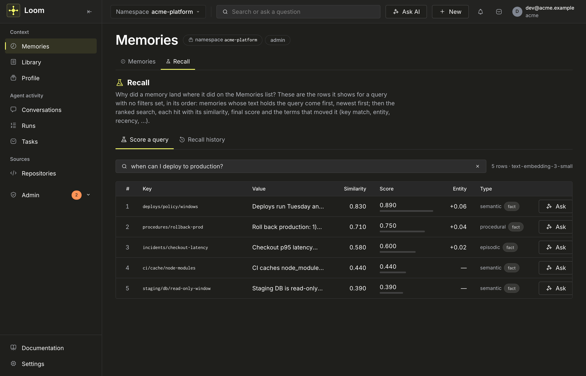
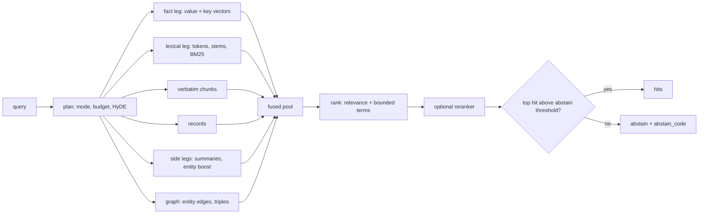

<!-- i18n: source=docs/concepts/retrieval-and-ranking.md blob=451339fc2ff5e4b649b678c1c5d0b58b1cf65e03 model=claude-sonnet-5-5 -->
> Esta página es una traducción automática de la [página en inglés](https://github.com/ClickHouse/loom/blob/main/docs/concepts/retrieval-and-ranking.md), que prevalece.
> Machine-translated from the [English page](https://github.com/ClickHouse/loom/blob/main/docs/concepts/retrieval-and-ranking.md), which is authoritative.

# Recuperación y ranking

Esta página explica cómo `memory.search` encuentra filas. Ejecuta varias rutas de recuperación sobre el espacio de nombres a la vez, fusiona sus candidatos en un único conjunto, ordena ese conjunto por relevancia más términos de corrección acotados y, a continuación, decide si el mejor resultado es lo bastante bueno para responder a partir de él. Un resultado débil se reporta como **abstain** ("Loom no lo sabe"), no como el ruido más cercano. Los campos de la solicitud y la respuesta están en [búsqueda y ask](https://github.com/ClickHouse/loom/blob/main/docs/features/memory/search-and-ask.md).

## Las etapas de recuperación

Cada etapa responde a un fallo de las demás. Una etapa que no tiene nada que aportar
no devuelve nada; una etapa que falla con error continúa sin bloquear la consulta y la respuesta la nombra en `degraded`.

| Etapa                 | Lee                                                     | Encuentra lo que las demás pasan por alto                                                                    |
| --------------------- | ------------------------------------------------------- | ------------------------------------------------------------------------------------------------------------ |
| **Hecho, vector**     | Vector de valor de `loom.memory_embeddings` (sin índice vectorial) | Paráfrasis: la pregunta y la afirmación almacenada comparten significado, no palabras.                       |
| **Hecho, eje de clave** | El vector `memory_key` de la misma tabla              | Una pregunta que nombra el atributo que codifica una clave. Puntúa `least(value distance, key distance)`.    |
| **Léxica**            | Extractos y clave en minúsculas, con stemming y lematización | Identificadores exactos, números y palabras raras que se incrustan mal. El stemming se ejecuta en ClickHouse (`stem`). |
| **BM25**              | IDF por token y agregados de longitud del corpus        | Ponderación de términos raros para `bm25_hybrid`, con una cola en vivo para que las filas nuevas cuenten de inmediato. |
| **Fragmentos literales** | `loom.memory_chunks`                                 | Un pasaje de un valor largo de `memory.set` se pliega sobre la fila cuyo valor lo contiene; el de una transcripción es un resultado directo. |
| **Resúmenes de sesión** | `loom.session_summaries`                              | «Qué ocurrió en esa sesión»; con el descenso por resúmenes, los mejores resúmenes traen los mejores hechos de sus sesiones. |
| **Entidad**           | `loom.entity_vectors`, `loom.entity_summaries`          | Filas sobre una entidad que nombra la consulta, incluso cuando la redacción difiere.                         |
| **Grafo**             | `loom.entity_edges`, `loom.entity_triples`              | Filas a un salto de las entidades de la consulta, y filas con una tripleta (sujeto, relación, objeto) coincidente. |
| **Registros**         | `loom.memory_records`                                   | Registros tipados cuyos campos coinciden.                                                                    |
| **Coincidencia de clave** | Partes de clave con stemming                        | Una fila cuya clave nombra exactamente el atributo solicitado, como criterio de desempate (`LOOM_MEMORY_SEARCH_KEY_MATCH_MODE`). |
| **Evidencia calculada** | `loom.derived_facts`, fechas de eventos               | Agregados («cuántos»), diferencias de fechas y el último valor de un atributo, calculados en ClickHouse.     |

**Por qué tantas etapas.** Una sola etapa vectorial pasa por alto identificadores y números (se
incrustan mal), pasajes situados en lo profundo de un valor largo (solo se incrusta la primera parte) y filas que
nombran una entidad con otras palabras. Cada etapa es una consulta sobre una tabla que Loom ya escribe, así que
añadir una cuesta una sentencia, no un segundo sistema.

**Las etapas vectoriales recorren los datos, sin índice vectorial.** El recorrido es exacto o, donde se aplican
las [lecturas con códigos primero](https://github.com/ClickHouse/loom/blob/main/docs/architecture/clickhouse.md#vector-storage), una pasada sobre
códigos cuantizados mantiene un conjunto de candidatos y lo vuelve a puntuar con precisión completa.

**El eje de clave** se activa por espacio de nombres cuando se reutilizan sus claves (`LOOM_MEMORY_SEARCH_KEY_AXIS=auto`,
umbral `LOOM_MEMORY_SEARCH_KEY_AXIS_AUTO_REUSE_SHARE`): leer dos columnas vectoriales
cuesta aproximadamente el doble de bytes, y solo ayuda donde las claves tienen significado.

**Planificación y presupuestos.** `retrieval_budget` (`fast`, `standard`, `deep`) decide qué
etapas costosas se ejecutan. Con `standard`, primero se ejecuta la recuperación barata y las etapas con LLM
(HyDE, descomposición de la consulta, el reintento iterativo) solo gastan cuando la primera pasada es
débil, acotadas por `LOOM_MEMORY_SEARCH_FALLBACK_MAX_ROUNDS` y
`LOOM_MEMORY_SEARCH_FALLBACK_MAX_WALL_MS`. Con `fast` (o la receta `fast`) una lectura
no hace ninguna llamada a un LLM; cuesta embeddings y lecturas de ClickHouse. HyDE incrusta una respuesta
hipotética escrita por un LLM en lugar de la pregunta, lo que cierra la brecha entre cómo se formulan las preguntas
y las afirmaciones almacenadas; `hyde=false` fuerza la consulta original.

## Fusión

`search_mode` elige cómo se ordena el conjunto de hechos.

- Una solicitud que no define ni `search_mode` ni `recipe` recibe el modo `retrieval_defaults` del espacio de nombres; si no existe, `LOOM_MEMORY_SEARCH_DEFAULT_MODE` (`semantic`). El esquema de la API muestra `rrf`; el servidor completa el valor predeterminado real.
- Las reglas de forma del planificador se aplican por encima: un identificador en la consulta aplica la fusión léxica.
- `recipe` aplica un preset con nombre (`fast`, `balanced`, `quality`, `verbatim`, `code`, `temporal`, `graph`) y prevalece sobre ambos valores predeterminados.

| Modo          | Ordenación                                                                                            |
| ------------- | ----------------------------------------------------------------------------------------------------- |
| `semantic`    | Similitud del coseno más los términos de rango que se describen abajo.                                |
| `rrf`         | Fusión por rango recíproco de los órdenes léxico y semántico, `1/(k + rank)` con k = 60.              |
| `hybrid`      | `alpha × lexical + (1 − alpha) × cosine`, más los términos de rango.                                  |
| `bm25_hybrid` | BM25 ponderado por IDF fusionado con el coseno.                                                       |
| `lexical`     | Coincidencia de tokens en el contenido y la clave; sin orden vectorial.                               |
| `graph`       | Coseno más la señal del grafo de entidades: coincidencia a un salto y tripletas coincidentes.         |
| `temporal`    | Filas fechadas dentro de una ventana alrededor de la fecha resuelta de la pregunta, coseno dentro de la ventana. |
| `related`     | Coincidencia de etiquetas y entidades con `tags` / `entity_filter` de la solicitud.                   |

**Por qué existe la fusión por rango recíproco como modo.** Las puntuaciones de coincidencia léxica se distribuyen entre 0 y 1, mientras que los cosenos de un embedder real están en una banda estrecha; una suma ponderada de ambos da menos peso a uno de ellos a menos que alpha se ajuste para cada corpus. RRF combina rangos, no puntuaciones, por lo que no requiere ajuste. Loom también reduce el peso léxico en las consultas con forma de código o de ruta, cuyos tokens de ruta compartidos son casi ruido (`server/memory/app/retrieval/fusion.py`, `_rrf_lexical_weight`). Los empates en un orden se resuelven con el otro, luego por clave y por el espacio de nombres, el escritor y la sesión de la fila, de modo que dos búsquedas idénticas devuelven la misma ventana.

## La expresión de ranking

Para los modos ordenados por coseno, la puntuación de una fila de hechos es la relevancia más términos que pueden reordenar empates cercanos, pero que están acotados para que no superen a la relevancia
(`server/memory/app/retrieval/fact_rank.py`):

| Término                   | Qué aporta                                                                                                                                                                                           | Controlado por                                                                                            |
| ------------------------- | ---------------------------------------------------------------------------------------------------------------------------------------------------------------------------------------------------- | --------------------------------------------------------------------------------------------------------- |
| Similitud                 | `1 − cosine distance` del mejor vector.                                                                                                                                                              | el embedder                                                                                               |
| Refuerzo por entidad      | Hasta 0.5 × la proporción de entidades de `entity_filter` que contiene la fila; coincidencias de vectores de entidad con la consulta.                                                                | `entity_filter`                                                                                           |
| Recencia, cronología, fecha | Un impulso en una consulta con intención de recencia ("latest", "current") o de ordenación, y para las filas ancladas cerca de la fecha solicitada.                                                | las propias señales de la consulta; la variante a nivel de pool `LOOM_MEMORY_SEARCH_RECENCY_POOL_WEIGHT` tiene por defecto 0 (desactivada) |
| Grupo de priors           | `confidence` almacenado × `confidence_weight`, refuerzos suaves por etiqueta y categoría, el refuerzo por preferencia; limitados en conjunto.                                                         | `confidence_weight`, `tags_soft`, `prior_cap` (`LOOM_MEMORY_PRIOR_CAP`)                                   |
| Refuerzo por uso          | Recuperaciones y resultados positivos, que decaen con una vida media; un evento `harm` retira el refuerzo ganado.                                                                                    | `LOOM_MEMORY_SEARCH_REINFORCEMENT_WEIGHT` (0.15), `…_HALF_LIFE_DAYS` (90)                                 |
| Confianza                 | `+0.5` afirmado u observado, `−0.25` importado, `−1` externo, `+1` cuando está atestiguado; multiplicado por el peso.                                                                                | `LOOM_MEMORY_SEARCH_TRUST_WEIGHT` (por defecto 0 = desactivado)                                           |
| Penalizaciones            | `demote_tags` hunde una fila al final sin descartarla; las filas etiquetadas `sensitivity:medium` o `:high` se rebajan, excepto cuando la consulta pide un dato de contacto o una cuenta bancaria (un IBAN). | `demote_tags`, `LOOM_MEMORY_SEARCH_SENSITIVITY_DEMOTE` (0.1)                                              |

**Fijar no es un término de ranking.** Un pin protege una fila de ser sobrescrita
([cómo se juzga una escritura](https://github.com/ClickHouse/loom/blob/main/docs/concepts/memory.md#how-a-write-is-judged)); no hace que puntúe
más alto. Un hecho se devuelve porque responde a la pregunta.

`personalization="none"` elimina todos los términos derivados del usuario (preferencia, el grupo de priors,
refuerzo por uso) y conserva la relevancia, de modo que los dos rankings se puedan comparar en un mismo servidor.
`LOOM_MEMORY_SEARCH_SOURCE_CLASS_BOOST_ELIGIBLE` limita qué clases de procedencia pueden
ganar esos términos: excluir `extracted` evita que una inferencia supere a una
afirmación por sus priors.

**Reranker.** `rerank` en la solicitud, o el `rerank_endpoint` del espacio de nombres, envía el
pool a un reranker (`builtin:openai[:model]`, `builtin:cohere[:model]`, o el nombre de un
endpoint que el operador configuró en `LOOM_RERANK_ENDPOINTS_JSON`; una URL se rechaza). Primero se amplía el pool (`LOOM_MEMORY_SEARCH_POOL_MULTIPLIER_RERANK`),
porque un reranker solo reordena lo que la primera etapa ha sacado a la superficie. Falla en abierto y nunca
descarta un candidato.

Pasa `rerank` cuando el orden del pool importa más que una llamada adicional por búsqueda. Para
medirlo con tus propias consultas, ejecuta cada consulta con `rerank` y con `rerank="none"`
(que también desactiva el `rerank_endpoint` de un espacio de nombres), ambas con `explain=true` y con
el presupuesto que usas en producción (una lectura `fast` o sin LLM no hace ninguna llamada a `builtin:openai`), y
compara las dos ventanas, leyendo el `score_components` de cada resultado como explica [Por qué se clasificó
aquí](#why-did-this-rank-here). Ninguna ejecución registrada compara las mismas búsquedas con
y sin reranker ([resultados](https://github.com/ClickHouse/loom/blob/main/docs/benchmarks/results.md#longmemeval-s)).

Tras el ranking, se da forma a la ventana servida: las filas `duplicate` y `superseded` se ocultan
salvo que se pidan, se conservan como máximo `LOOM_MEMORY_SEARCH_PER_KEY_CAP` filas por clave,
y `exclude_keys` elimina las filas que el llamante ya tiene.

## Abstención

Toda búsqueda termina con un veredicto sobre su propio resultado. La respuesta incluye `abstain`,
`abstain_code` (`no_match`, `below_threshold`, `entity_absent`,
`low_calibrated_confidence`, `page_expired`), un `abstain_reason` en prosa, un
`retrieval_confidence` y un `retrieval_risk` con valor `low`, `medium`, `high` o `abstain`.
Los códigos se definen en [búsqueda y ask](https://github.com/ClickHouse/loom/blob/main/docs/features/memory/search-and-ask.md).

Las filas de la ventana cuya propia similitud queda por debajo del umbral llevan
`below_threshold: true`, de modo que un llamador que quiera que "abstenerse signifique abstenerse" fila por fila
puede filtrar por ese campo.

**De dónde salen los umbrales.** Un piso de similitud fijo se calibra para un solo
modelo de embeddings; si se cambia el modelo, la distribución de los cosenos cambia, y el mismo
número empieza a filtrar buenos resultados o deja de filtrar ruido. Con
`LOOM_ADAPTIVE_THRESHOLDS` activado (el valor por defecto), una sonda al arrancar genera embeddings de tres corpus pequeños
y deriva cada puerta a partir de la distribución del propio embedder
(`server/memory/app/embedder_calibration.py`):

| Corpus de la sonda          | Puertas derivadas                                                                                   |
| --------------------- | ----------------------------------------------------------------------------------------------- |
| Pares de distractores | El piso de ruido (percentil 90 + 0.02) y el umbral de abstención (piso + 0.05).              |
| Pares pregunta → hecho | Las puertas de activación: reescritura de la consulta, respaldo HyDE y omisión del rerank (percentiles 10, 25 y 75). |
| Pares de paráfrasis   | Los umbrales de conflicto y duplicado al escribir (mediana, percentil 75).                     |

Una calibración por espacio de nombres, cuando existe una almacenada, tiene prioridad sobre la del clúster, y
el worker `recalibration` repite la sonda (`LOOM_RECALIBRATION_INTERVAL_SECONDS`) para que
las puertas sigan a un embedder revisado de forma silenciosa. `calibration.get` muestra qué nivel
está en vigor. Los ajustes escalares (`LOOM_MEMORY_SEARCH_MIN_SIMILARITY` 0.22,
`LOOM_MEMORY_SEARCH_ABSTAIN_THRESHOLD` 0.30, `LOOM_MEMORY_SEARCH_HYDE_FALLBACK_THRESHOLD`
0.45, `LOOM_MEMORY_SEARCH_QUERY_REWRITE_THRESHOLD` 0.38) se aplican a embedders falsos, a
una sonda fallida o a cuando la adaptación está desactivada; en ese caso te corresponde volver a hacer el benchmark
tras un cambio de embedder.

**El equilibrio.** Un piso intercambia recall por precisión. Un agente al que se le dan las cinco filas más cercanas
a una pregunta fuera de tema las usará; una abstención le indica que pregunte o diga que no
lo sabe. Un piso demasiado alto oculta respuestas formuladas de forma distinta a la pregunta. La
postura de Loom es que una abstención explícita sobre la que un agente puede actuar vale más que una
ventana llena, y deja la elección al llamador en cada lectura:

- `min_similarity` fija el piso de esta lectura;
- `floor_mode` decide qué ocurre con las filas por debajo de él: `readmit` (por defecto: se añaden después
  de las filas confiables, marcadas como por debajo del piso, de modo que se llena `top_k`), `ids_only` (se añaden
  con el cuerpo vacío: la clave indica que existe una coincidencia débil sin poner su texto en
  el contexto) o `drop`.

Un resultado vacío de un ámbito con extracción diferida en curso informa
`pending_extraction`: hay un guardado en camino, por lo que la respuesta vacía no es prueba
de ausencia.

## Por qué se clasificó aquí

`explain=true` en `memory.search` adjunta `score_components` a cada resultado servido: las señales de ranking, la puntuación RRF y su peso cuando ese modo se ejecutó, y, tras un reranker, el movimiento de cada fila (`rerank_from`, `rerank_pos`, `rerank_delta`) y, cuando el reranker cambió el orden, su propia puntuación fusionada (`rank_score_pre_rerank`). Una memoria cuyo código vinculado cambió y que bajó de posición indica cuántos lugares bajó (`code_changed_places`; cuándo se mueve se explica en [memorias vinculadas a código](https://github.com/ClickHouse/loom/blob/main/docs/concepts/memory.md#memories-linked-to-code)). `memory.search_trace` acepta la misma solicitud y puntúa solo la rama vectorial (sin fusión, ensamblado ni reranker): cada candidato con su `similarity`, `entity_boost`, `rank_score`, `rank` y el plano del que procede (`source`: `fact` o `chunk`). Con `LOOM_SEARCH_TRACE_LOG_ENABLED=true`, cada búsqueda también añade una fila a `loom.search_trace_log` (claves devueltas, puntuaciones, abstain, riesgo, latencia), que se puede leer con `memory.search_trace_log`; el texto de la consulta se almacena solo cuando el espacio de nombres consiente la captura de texto. El Recall Lab del dashboard (`<server>/recall`) muestra las filas que la lista de Memorias muestra para una consulta: coincidencias de palabras clave y, después, los resultados de `memory.search` con sus `score_components`.

`memory.ask` recupera de la misma manera y luego escribe una respuesta a partir de un conjunto más reducido; consulta [búsqueda y ask](https://github.com/ClickHouse/loom/blob/main/docs/features/memory/search-and-ask.md). La herramienta MCP `loom_search` (la operación `search.query`) y `context.pack` buscan en varios planos a la vez; consulta [búsqueda unificada](https://github.com/ClickHouse/loom/blob/main/docs/features/unified-search.md).

## Límites

- La búsqueda solo lee vectores del modelo de embeddings activo. Las filas generadas con otro modelo
  permanecen invisibles hasta que `loom reembed` las regenera.
- Solo se genera el embedding de la primera parte de un valor largo; la rama de chunks es la que encuentra un
  pasaje situado más adelante. Un valor que en realidad es un documento pertenece a knowledge.
- El umbral de abstención lee la fila de rango 1. Con `rrf`, una coincidencia solo léxica puede ocupar el rango 1
  mientras un coseno mejor queda en el rango 2; `LOOM_MEMORY_SEARCH_ABSTAIN_TOP_SIM_SCOPE=window`
  lee en su lugar el mejor coseno de la ventana.
- La calibración deriva los umbrales a partir de pequeños corpus de prueba integrados. Un corpus distinto a ellos
  (código, un único dominio acotado) puede requerir una calibración por espacio de nombres.

## Relacionado

- [Buscar y preguntar](https://github.com/ClickHouse/loom/blob/main/docs/features/memory/search-and-ask.md): todos los campos de la solicitud y de la
  respuesta.
- [Búsqueda unificada](https://github.com/ClickHouse/loom/blob/main/docs/features/unified-search.md): `loom_search` y `context.pack` en
  detalle.
- [Grafo de entidades](https://github.com/ClickHouse/loom/blob/main/docs/features/entity-graph.md): de dónde provienen las ramas de entidades y de grafo.
- [Memoria](https://github.com/ClickHouse/loom/blob/main/docs/concepts/memory.md): los campos que lee el ranking (`source_class`, `status`, tiempo).
- [Ajuste del rendimiento](https://github.com/ClickHouse/loom/blob/main/docs/guides/performance-tuning.md).
- Operaciones: [memoria](https://github.com/ClickHouse/loom/blob/main/docs/reference/operations.md#memory),
  [calibración](https://github.com/ClickHouse/loom/blob/main/docs/reference/operations.md#calibration),
  [contexto](https://github.com/ClickHouse/loom/blob/main/docs/reference/operations.md#context). Configuraciones:
  [Búsqueda de memoria](https://github.com/ClickHouse/loom/blob/main/docs/reference/configuration.md#memorysearch),
  [Consulta de memoria](https://github.com/ClickHouse/loom/blob/main/docs/reference/configuration.md#memoryask),
  [Mcp](https://github.com/ClickHouse/loom/blob/main/docs/reference/configuration.md#mcp).
