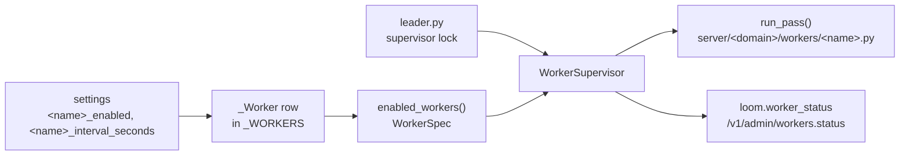

<!-- i18n: source=docs/development/adding-a-worker.md blob=caf48d881a70356a242d6cb16a1569b75e93391e model=claude-sonnet-5-5 -->
> Esta página es una traducción automática de la [página en inglés](https://github.com/ClickHouse/loom/blob/main/docs/development/adding-a-worker.md), que prevalece.
> Machine-translated from the [English page](https://github.com/ClickHouse/loom/blob/main/docs/development/adding-a-worker.md), which is authoritative.

<a id="add-a-background-worker"></a>

# Añadir un worker en segundo plano

Un worker es una fila en `server/workers/registry.py` (`_WORKERS`) más un módulo con una función de pasada. `enabled_workers()` convierte las filas habilitadas en `WorkerSpec`s, y `WorkerSupervisor` (`server/workers/supervisor.py`) ejecuta, mide el tiempo, aplica retroceso y drena cada uno. La [referencia de workers](https://github.com/ClickHouse/loom/blob/main/docs/reference/workers.md) generada enumera cada fila.



<a id="1-write-the-pass"></a>

## 1. Escribir el pass

Crea `server/<domain>/workers/<name>.py` con un `async def run_pass()`. El supervisor lo llama una vez por intervalo y descarta el valor de retorno. Un ejemplo pequeño es `server/tasks/workers/lease_sweep.py`:

```python
from server.workers import pass_context
from server.workers.status import record_pass


async def run_pass() -> SweepResult:
    from server.tasks.app.sweep import sweep_once

    with record_pass("task_lease_sweep") as rec:
        counts = await sweep_once()
        rec.outcome = dict(counts)
    result = SweepResult(**counts)
    if result.total == 0:
        pass_context.mark_idle()
    else:
        log.info("task_lease_sweep: expired=%d ...", result.expired)
    return result
```

El contrato del pass:

- **Idempotente y acotado.** Un pass puede cancelarse al llegar a su plazo, volver a ejecutarse tras una caída o ejecutarse en el otro color después de un despliegue. Haz una cantidad acotada de trabajo y deja el resto para el siguiente pass.
- **Plazo.** El valor por defecto es `min(4 × interval, 900 s)`, con un mínimo de 60 s (`default_max_pass_seconds`). Un pass que lo supera se cancela y cuenta como un fallo. Define `max_pass_seconds` o `max_pass_setting` en la fila para un pass más largo.
- **Fallos.** Una excepción hace fallar el pass. El supervisor reintenta con backoff exponencial (de 1 s, duplicándose hasta 60 s) y marca el worker como `degraded` tras 3 fallos consecutivos. Un pass cortado en su plazo, o un worker cuyo intervalo supera su plazo (los pass diarios y semanales), espera el intervalo completo (`failure_hold_seconds`), de modo que un reintento no gaste otra vez el mismo tiempo de base de datos.
- **Fallos parciales.** Una parte que falla sin hacer fallar el pass llama a `pass_context.note_failure(exc, what)`. Cuenta para la racha y aparece en `loom.worker.partial_failures{worker}`.
- **Inactivo.** Un pass que no encontró nada llama a `pass_context.mark_idle()`. Entonces el supervisor espera `idle_interval_seconds`.
- **Cursor.** Un worker que pagina lee `pass_context.resume_cursor()` y llama a `pass_context.set_cursor(value)` donde se detuvo. El cursor se guarda en la fila `loom.worker_status` del pass, así que un proceso reiniciado continúa desde ahí.
- **Un `except` amplio explica por qué:** `# noqa: BLE001 — <what must not fail>`.

<a id="2-attribute-its-queries"></a>

## 2. Atribuir sus consultas

El supervisor etiqueta cada pasada:

- Las consultas a ClickHouse llevan `log_comment` `worker.<name>` (`set_worker_identity` en `server/workers/status.py`);
- los spans del proveedor llevan `loom.operation=worker.<name>`;
- la pasada se ejecuta en la clase de tráfico en segundo plano (`bind_background`);
- el gasto de LLM y del embedder queda en una sola fila del libro de registro, `worker.<name>.pass`.

Un bucle **fuera** del supervisor (una tarea, un hilo, un bucle de CLI) se etiqueta a sí mismo; de lo contrario, sus consultas se registran como `untagged:<module>.<function>`:

```python
from server.core.ch import set_query_tag

set_query_tag("worker.my_loop")
```

<a id="3-add-its-settings"></a>

## 3. Agregar sus ajustes

Agrega el interruptor y la cadencia a la sección del área en `server/settings/catalog.py` (`Memory`, `Code`, `Tracker`, …). Cada comentario se convierte en el texto de la fila en la [referencia de configuración](https://github.com/ClickHouse/loom/blob/main/docs/reference/configuration.md) generada.

```python
    # Lease sweeper: return expired leases to todo, resume deferred tasks at
    # resume_at, escalate stale triage. One read per pass.
    task_lease_sweep_enabled: bool = True
    # Seconds between passes while there is work.
    task_lease_sweep_interval_seconds: int = 60
    # Seconds between passes that found nothing.
    task_lease_sweep_idle_interval_seconds: int = 300
```

Deja un worker **desactivado** por defecto cuando necesita credenciales, genera costos en un proveedor o atiende un plano que un operador activa por decisión propia. Los workers activados por defecto se ejecutan en todas las instalaciones, incluido un portátil.

<a id="4-add-the-registry-row"></a>

## 4. Añadir la fila del registro

```python
(
    _Worker(
        "task_lease_sweep",
        "server.tasks.workers.lease_sweep",
        "task_lease_sweep_enabled",
        "task_lease_sweep_interval_seconds",
        idle_interval="task_lease_sweep_idle_interval_seconds",
    ),
)
```

| Campo de `_Worker`                     | Significado                                                                                                                                                  |
| -------------------------------------- | ------------------------------------------------------------------------------------------------------------------------------------------------------------ |
| `name`                                 | El nombre del worker: la etiqueta del log, la operación del ledger, la fila de estado.                                                                       |
| `module`                               | La ruta completa del módulo. Solo se importa cuando el worker está habilitado, de modo que el arranque sigue siendo rápido y las dependencias opcionales siguen siendo opcionales. |
| `enabled`                              | El flag de configuración que lo activa; `None` = siempre activo.                                                                                             |
| `interval`                             | El campo de configuración que contiene la cadencia en segundos.                                                                                              |
| `pass_attr`                            | El nombre de la función de pasada (por defecto `run_pass`).                                                                                                  |
| `also_requires`                        | Un segundo flag de configuración que el worker necesita (el ledger que lee, el plano al que sirve); si está desactivado, el worker queda desactivado.        |
| `idle_interval`                        | Campo de configuración para la espera tras una pasada inactiva.                                                                                              |
| `max_pass_seconds`, `max_pass_setting` | El plazo límite de la pasada, fijo o leído de un ajuste.                                                                                                     |
| `first_pass_due`                       | Un atributo del módulo: una comprobación asíncrona que se consulta una vez al inicio; `True` ejecuta la primera pasada de inmediato en lugar de esperar al escalonado de arranque. |
| `owned_tables`                         | `True`: el módulo exporta `OWNED_TABLES` y `due_scope`; la primera pasada corresponde cuando una tabla propia no tiene fila para un espacio de nombres dentro del alcance. |

**Escalonado de arranque.** Sin un hook de primera pasada, la primera pasada espera `crc32(name) % interval`. Un worker diario en procesos que viven unas pocas horas podría no ejecutarse nunca, así que declara qué rellena:

```python
from server.workers.first_pass import OwnedTable

OWNED_TABLES = (OwnedTable("loom.qa_item_embeddings", namespace_column="namespace"),)


def due_scope() -> list[tuple[str, str]]: ...  # the (org, namespace) pairs this worker fills
```

Esa es la declaración de `server/tracker/workers/embed.py`. La comprobación es una sentencia por tabla, acotada por `FIRST_PASS_DUE_TIMEOUT_SECONDS`. Una tabla ilegible se considera pendiente.

<a id="5-understand-where-it-runs"></a>

## 5. Entender dónde se ejecuta

**Un supervisor por despliegue.** `server/workers/leader.py` elige un único proceso entre todos los contenedores y hosts a través de ClickHouse: la clave `workers_supervisor` en la tabla de bloqueo de Keeper `loom._migration_lock`. El titular renueva cada `LOOM_SUPERVISOR_LEASE_TTL_S / 6`; un titular que pierde el lease detiene sus workers; cuando el titular muere, otro proceso toma el relevo tras `LOOM_SUPERVISOR_LEASE_TTL_S` (por defecto 30 s).

| `LOOM_BACKGROUND_WORKERS` | Efecto                                                                                                                  |
| ------------------------- | ----------------------------------------------------------------------------------------------------------------------- |
| `auto` (por defecto)      | Compite por el lease; ejecuta el supervisor mientras lo mantiene. Fuera del despliegue (sin `LOOM_DEPLOYMENT`), `off`.  |
| `on`                      | Ejecuta siempre el supervisor.                                                                                          |
| `off`                     | Solo web.                                                                                                               |

Ejecuta cada réplica en `auto`: cualquiera de ellas puede convertirse en líder. Un servidor de `make server` o un servidor iso no ejecuta workers a menos que se configure `on`.

**Dos copias pueden solaparse brevemente.** Un titular detiene sus workers en T/2 sin una renovación, antes de que otro proceso pueda tomar el relevo en T, pero una sentencia que ya envió igualmente se aplica, y un proceso `on` no toma ningún lease. Haz que una segunda copia sea inofensiva: escrituras idempotentes, reclamaciones con lease, cursores en el almacén. Un worker que gasta en un LLM duplica su gasto mientras hay dos copias en ejecución.

**Detenerse entre lotes.** Un bucle largo llama a `pass_context.check_stop()` antes de cada lote que escribe. Lanza `PassStopped` cuando la pasada se detuvo o el lease quedó obsoleto, lo que también alcanza al trabajo que se ejecuta en `asyncio.to_thread`. `PassBudget.exhausted()` lo llama por ti.

**Actualizaciones progresivas.** Una compilación más antigua cede el lease a una compilación más nueva que esté activa (consulta [Fallos y recuperación](../architecture/failure-and-recovery.md#background-workers)). El líder antiguo libera el lease cuando se detiene, y un proceso más nuevo lo toma en su siguiente ronda, en cuestión de segundos.

<a id="6-pin-it-in-tests"></a>

## 6. Fíjalo en las pruebas

- **Snapshot del registro.** `tests/unit/test_worker_registry_snapshot.py` construye la lista de workers con tres perfiles de configuración (`defaults`, `all_on`, `production`) y compara cada campo de `WorkerSpec` con `tests/unit/snapshots/worker_registry.json`. Regenéralo solo cuando el cambio sea intencional:

  ```bash
  LOOM_UPDATE_WORKER_SNAPSHOT=1 python -m pytest tests/unit/test_worker_registry_snapshot.py
  ```

  Si production debe ejecutar el worker, añade su flag a `_PRODUCTION_FLAGS` en esa prueba.

- **Paridad.** `tests/unit/test_worker_registry_parity.py` comprueba que `worker_meta()` (lo que muestra `/v1/admin/workers.status`) y `enabled_workers()` listan el mismo conjunto con todos los flags activados.
- **El pase en sí.** Una prueba unitaria llama a `run_pass()` contra un repositorio stub o un ClickHouse local. Fuera de un pase supervisado, las llamadas a `pass_context` solo registran logs.
- **Documentación generada.** `python scripts/codegen/docs_reference.py` regenera la
  [referencia de workers](https://github.com/ClickHouse/loom/blob/main/docs/reference/workers.md); `make lint` falla mientras esté desactualizada.

<a id="7-check-it-runs"></a>

## 7. Comprueba que funciona

- `/v1/admin/workers.status` combina el registro de este proceso con la última fila de `loom.worker_status` por cada worker, de modo que el nivel web muestra los workers que se ejecutan en el contenedor de workers.
- `/v1/health?include=workers` informa del estado de cada worker y de `workers_leader`: si el proceso que responde tiene el bloqueo, y por qué.
- Configura alertas sobre `loom.worker.consecutive_failures{worker}` y `loom.worker.partial_failures{worker}` ([monitorización](https://github.com/ClickHouse/loom/blob/main/docs/operations/monitoring.md)).

<a id="related"></a>

## Relacionado

- [Ampliar Loom](https://github.com/ClickHouse/loom/blob/main/docs/development/extending-loom.md)
- [Referencia de workers](https://github.com/ClickHouse/loom/blob/main/docs/reference/workers.md)
- [Fallos y recuperación](../architecture/failure-and-recovery.md)
- [Estado de los workers](https://github.com/ClickHouse/loom/blob/main/docs/operations/monitoring.md#worker-status)
