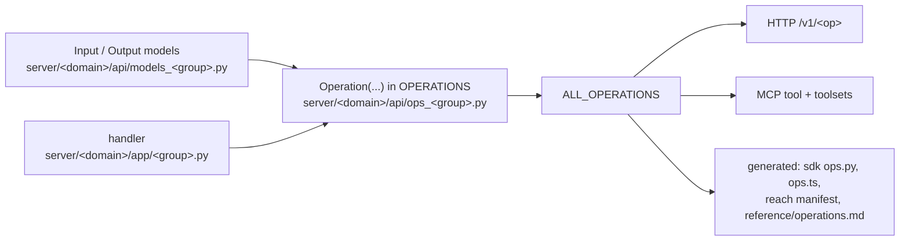

<!-- i18n: source=docs/development/adding-an-operation.md blob=32e9eb1349c29c12bc71e2adc8c55441a459025d model=claude-sonnet-5-5 -->
> Esta página es una traducción automática de la [página en inglés](https://github.com/ClickHouse/loom/blob/main/docs/development/adding-an-operation.md), que prevalece.
> Machine-translated from the [English page](https://github.com/ClickHouse/loom/blob/main/docs/development/adding-an-operation.md), which is authoritative.

<a id="add-an-operation"></a>

# Añadir una operación

Una operación se declara una sola vez, en el registro. La ruta HTTP (`POST /v1/<op>`), el esquema OpenAPI, la herramienta MCP (`loom_<op with dots as underscores>`), el catálogo (`/v1/operations`, `ops.capabilities`), las tablas de operaciones del SDK y la [referencia de operaciones](https://github.com/ClickHouse/loom/blob/main/docs/reference/operations.md) se derivan de ella. Usted escribe los modelos, el handler, la declaración y las pruebas, y regenera el resto.



El ejemplo es `calibration.get`, una de las operaciones más pequeñas: `server/memory/api/models_calibration.py`, `server/memory/api/ops_calibration.py` y `server/memory/app/calibration.py`.

<a id="1-define-the-input-and-output-models"></a>

## 1. Definir los modelos de entrada y salida

Colócalos en el módulo de modelos del grupo, `server/<domain>/api/models_<group>.py`. Un módulo de modelos contiene solo modelos Pydantic de la interfaz de red: no importa ningún handler.

```python
from pydantic import BaseModel, Field


class CalibrationGetInput(BaseModel):
    org: str
    namespace: str


class CalibrationGetOutput(BaseModel):
    source: str  # "namespace" / "cluster" / "scalar"
    embedder_model: str = ""
    noise_floor: float
    ...
    similar_pairs_n: int = Field(default=0)
```

Reglas para los modelos:

- **Identidad.** Una op direccionada por espacio de nombres recibe `org` y `namespace`. Las ops que escriben filas reciben el resto de la tupla de identidad: `agent`, `user_id`, `session_id`, `run_id` (los tres últimos tienen `'-'` como valor por defecto). Por MCP, el servidor completa los campos de identidad omitidos con los valores por defecto de la conexión y luego autoriza el `(org, namespace)` que nombra el cuerpo.
- **Las columnas que estampa el servidor nunca vienen del cuerpo.** Una ruta de escritura establece `actor` (`server.memory.app.provenance.writer_actor`) y `source_class` (`server.memory.domain.provenance.source_class_for`). Una solicitud solo puede declarar una degradación a `derived`, `external` o `imported`.
- **Oculta de MCP los campos irrelevantes para el agente.** Marca un parámetro de ranking o un interruptor del pipeline con `json_schema_extra=MCP_HIDDEN` (`server/operations/base.py`). El esquema MCP lo omite; la op sigue aceptándolo.
- **Sin validadores de modelo del tipo "uno de A o B"** en las entradas de lectura. El transporte valida el cuerpo antes de la autorización, de modo que un `@model_validator` que lance una excepción describe la op a un principal al que la compuerta del espacio de nombres rechazaría. Pon la regla en el handler y lanza `server.core.errors.ValidationError`. `tests/unit/test_op_inputs_after_gate.py` comprueba todas las ops registradas.
- **Para retirar un campo**, elimínalo. Un cliente que aún lo envíe recibe respuesta, con el campo indicado en `ignored_args` ([campos desconocidos y eliminados](https://github.com/ClickHouse/loom/blob/main/docs/reference/http-api.md#unknown-and-removed-fields)).

<a id="2-write-the-handler"></a>

## 2. Escribir el handler

Un módulo de handler por grupo, bajo `server/<domain>/app/`. Un handler es `async`, recibe el modelo de entrada y devuelve el modelo de salida. Importa los modelos de la interfaz al inicio del módulo; los modelos nunca importan un handler, de modo que la importación es acíclica:

```python
from server.memory.api.models_calibration import CalibrationGetInput, CalibrationGetOutput


async def handle_calibration_get(input: CalibrationGetInput) -> CalibrationGetOutput:
    from server.memory.app.embedder_calibration import get_calibration, get_namespace_calibration

    ns_cal = await get_namespace_calibration(input.org, input.namespace)
    ...
```

- La lógica pura va en el `domain/` del dominio, el SQL en su `store/`. El handler los compone.
- **Los rechazos** lanzan una subclase de `server.core.errors.LoomServerError` (o una `HTTPException` con un detalle `{"code", "message"}`). Los transportes la convierten en el sobre de error y, sobre MCP, en un resultado `isError`. Un código de error nuevo aparece en la [referencia de errores](https://github.com/ClickHouse/loom/blob/main/docs/reference/errors.md) generada.
- **Un `except` amplio explica por qué:** `except Exception as e:  # noqa: BLE001 — <what must not fail>`.
- El transporte etiqueta las consultas a ClickHouse con `log_comment`; un handler no hace nada.
- Lee la configuración como `settings.<field>`, nunca con `getattr(settings, ...)`.
- Si la op escribe en `loom.memory` o `loom.shared`, construye las filas con los constructores de
  `server/memory/store/rows.py` ([añadir una tabla](https://github.com/ClickHouse/loom/blob/main/docs/development/adding-a-table.md#2-mirror-every-column-on-replacingmergetree-write-paths)).

<a id="ops-addressed-by-an-org-wide-id"></a>

### Ops direccionadas por un id a nivel de organización

Una op que recibe solo `(org, memory_id)`, como `memory.get_by_id` o `memory.update_by_id`, no obtiene un espacio de nombres del transporte. Decláralo con `row_scoped=True`, resuelve el espacio de nombres al que llega el llamador antes de la lectura y **oculta** una fila ajena:

```python
import server.memory.store as memory_repo
from server.memory.app.id_namespace import namespace_for_id

namespace = await namespace_for_id(input.org, input.memory_id, strong=False)
if namespace is None:
    return MemoryGetByIdOutput(found=False)
row = await memory_repo.get_by_id(input.memory_id, org=input.org, namespace=namespace, ...)
if row is None:
    return MemoryGetByIdOutput(found=False)
```

Responde como ante una fila inexistente, nunca con 403: un 403 confirma que el id existe en otro tenant. Pasa `Role.WRITER` y `strong=True` a `namespace_for_id` en una escritura, para que los titulares se lean actualizados. Una op que debe leer primero la fila, como `memory.redact`, la comprueba con `authz.row_in_scope` después de obtenerla ([operaciones con alcance de fila](https://github.com/ClickHouse/loom/blob/main/docs/architecture/security.md#row-scoped-operations)).

<a id="3-declare-the-operation"></a>

## 3. Declarar la operación

```python
from server.operations.base import Operation, Role

calibration_get = Operation(
    name="calibration.get",
    maturity="experimental",
    input_model=CalibrationGetInput,
    output_model=CalibrationGetOutput,
    handler=handle_calibration_get,
    idempotent=True,
    required_role=Role.VIEWER,
    audit=False,
)

OPERATIONS: list[Operation] = [calibration_get]
```

Su presupuesto de latencia es una entrada de `OP_BUDGETS_P99_MS` en `server/settings/catalog.py`, donde se define el presupuesto de cada op, `"calibration.get": 60,` (el p99 objetivo de diseño de la op en ms; una llamada exitosa que lo supere emite un evento `budget.violated`). Las formas de solicitud que el handler registra en tiempo de ejecución (`server.observability.budget_shape`) tienen sus propios presupuestos en `OP_SHAPE_BUDGETS_P99_MS`, y el catálogo los enumera. `tests/unit/test_op_budgets.py` falla si una op no tiene entrada. Un despliegue ajusta una op con `LOOM_LATENCY_BUDGET_OVERRIDES` y todas con `LOOM_LATENCY_BUDGET_MULTIPLIER`.

La declaración vive en el módulo de ops del grupo, `server/<domain>/api/ops_<group>.py`, que importa los modelos y el handler. Añádela a la lista `OPERATIONS` del módulo. Un **módulo de grupo nuevo** se importa y se añade a `_OPERATION_MODULES` en `server/operations/registry.py`.

| Campo                         | Obligatorio | Significado                                                                                                                                                                                                                                                                                                                  |
| ----------------------------- | ----------- | ---------------------------------------------------------------------------------------------------------------------------------------------------------------------------------------------------------------------------------------------------------------------------------------------------------------------------- |
| `name`                        | sí          | `<group>.<verb>` separado por punto. Ruta HTTP `/v1/<name>`; herramienta MCP `loom_<name with . → _>`.                                                                                                                                                                                                                      |
| `input_model`, `output_model` | sí          | Modelos de Pydantic.                                                                                                                                                                                                                                                                                                         |
| `handler`                     | sí          | Callable asíncrono: modelo de entrada → modelo de salida.                                                                                                                                                                                                                                                                    |
| `idempotent`                  | sí          | Es seguro reintentarla ante un fallo transitorio. Los SDK y los clientes dependen de ello.                                                                                                                                                                                                                                  |
| `required_role`               | sí          | `Role.VIEWER`, `WRITER`, `ADMIN`, `ORG_ADMIN` o `PLATFORM_ADMIN`.                                                                                                                                                                                                                                                           |
| `audit`                       | no          | `True`: un éxito escribe una fila en `loom.audit_log`. Actívalo para todo lo que cambie la memoria, los permisos, las políticas o la configuración.                                                                                                                                                                         |
| `writes`                      | no          | La op cambia el estado almacenado aunque un viewer pueda llamarla y reintentarla sea seguro (una fila de feedback, una marca de visto). Un rol writer o `audit=True` ya implica "escribe".                                                                                                                                  |
| `maturity`                    | no          | `stable` (por defecto) o `experimental`. Consulta el [paso 5](#5-check-reach-and-maturity).                                                                                                                                                                                                                                  |
| `skip_namespace_authz`        | no          | Omite la comprobación de espacio de nombres del transporte en las ops que actúan **sobre** un espacio de nombres (join, leave, register) o cuyo destino solo el handler puede resolver (`memory.verify` por id, `erasure.request` por alcance, `erasure.list` por rol del llamante); el handler aplica sus propias reglas. La comprobación de rol sigue ejecutándose. |
| `deployment_scoped`           | no          | La op lee datos del despliegue (su build, su registro), no los datos de ningún espacio de nombres; un token con alcance limitado pasa con su mejor rol por espacio de nombres.                                                                                                                                              |
| `row_scoped`                  | no          | Se direcciona con un id válido en toda la organización; el handler autoriza el alcance de la fila (`namespace_for_id` antes de la lectura, o `row_in_scope` después) y oculta una fila ajena como no encontrada.                                                                                                           |

La op es de **solo lectura** (`readOnlyHint` de MCP, el toolset `readonly`) exactamente cuando es `idempotent`, `required_role == Role.VIEWER`, no tiene `audit` y no tiene `writes` (`Operation.read_only`). Los clientes que aprueban automáticamente las herramientas de solo lectura confían en estos indicadores.

<a id="4-decide-mcp-visibility"></a>

## 4. Decidir la visibilidad en MCP

`server/operations/toolsets.py` decide dónde se lista la op:

- **Una lista curada** (`_MCP_CORE_OPS`, `_MCP_CODING_OPS`, `_MCP_ATOMIC_OPS`, `_MCP_TASK_OPS`, `_MCP_TRACKER_OPS`, `_MCP_CODE_CORE_OPS`) la lista en ese `?toolset=`. Cada propiedad listada cuesta tokens en cada turno, así que añade solo lo que ese arquetipo llama. `tests/unit/test_mcp_listing_budget.py` mantiene el listado por debajo de un tope de tokens.
- **Sin listar** (la mayoría de las ops): se pueden llamar por nombre mediante `loom_op` en cualquier listado (solo lecturas en `readonly`, [toolsets de MCP](https://github.com/ClickHouse/loom/blob/main/docs/reference/mcp.md#toolsets)). `?toolset=all` lista una op `stable`, y una op `experimental` solo cuando la lista core o atomic la incluye (`listed_under_all` en `server/operations/toolsets.py`).
- **`_MCP_HIDDEN_OPS`**: no son accesibles por MCP. `tests/unit/test_hidden_op_says_why.py` exige un rechazo que indique a qué op llamar en su lugar.

Una op listada necesita su descripción en `server/transport/mcp_descriptions.py`
(`TOOL_DESCRIPTIONS`). Escríbela pensando en el modelo: cuándo llamar a la herramienta, qué devuelve y para qué no usarla. Una descripción sobre un hecho que ha cambiado interpola `revision_policy()` del mismo módulo en lugar de declarar la suya. Nombra otra op por su nombre con puntos; cada listado renombra una op listada a su herramienta y marca una no listada ([referencia de MCP](https://github.com/ClickHouse/loom/blob/main/docs/reference/mcp.md#tool-list)). Nunca escribas una op como una llamada (`op(args)`), dentro de un fragmento de código más largo, ni con un "(via loom_op)" escrito a mano. Un nombre de op dado como valor de ejemplo de un campo va entre comillas simples (`'memory.ask'`), que el listado deja tal como están escritas.

<a id="5-check-reach-and-maturity"></a>

## 5. Comprobar el alcance y la madurez

El **alcance** (reach) de una op se deriva (`Operation.reach`, `server/operations/reach.py`): su pertenencia a la lista de MCP más un análisis confirmado de los SDK, `examples/`, `dev/` y `scripts/`, los hooks de los plugins y los puntos de llamada `"/v1/<op>"` del dashboard. `{"http_only"}` significa que solo un POST directo a `/v1/*` la alcanza.

Toda op está en todas las superficies o explica en el código por qué no. HTTP sirve todas las ops del registro, y ambos SDK se generan a partir de él. MCP la alcanza, salvo que `_MCP_HIDDEN_OPS` la reserve para personas y operadores. El dashboard la llama cuando una persona la necesita: para administrar, revisar, inspeccionar, configurar o eliminar con una confirmación; una op nueva de ese tipo se entrega con su control. Una op que solo llama un agente o un programa cliente, o que el dashboard sirve a través de otra op, se nombra en `NOT_IN_DASHBOARD` (`server/operations/dashboard.py`) con el motivo. El `--check` del censo (`tests/unit/test_op_reach_census.py`) falla ante una op que no tenga ni un punto de llamada en el dashboard ni una entrada en `server/operations/dashboard.py`.

- Una op oculta de MCP que no tiene otra vía de alcance (`server/operations/reach.py` enumera los tipos) declara `maturity="experimental"`.
- Una op `stable` está [incluida en el toolset `all` de MCP](https://github.com/ClickHouse/loom/blob/main/docs/reference/operations.md#mcp-all-listing) o, si está oculta de MCP, tiene otra vía de alcance, y se espera que tenga llamadores en producción; `python scripts/codegen/op_reach_census.py --call-counts --days 30` muestra si los tiene. Declara una op nueva como `experimental`, salvo que reemplace a una stable.
- Actualiza el manifiesto: `python scripts/codegen/op_reach_census.py --write-manifest` (escribe `server/operations/reach_manifest.py`).

<a id="6-write-the-tests"></a>

## 6. Escribir las pruebas

| Prueba                                                   | Qué le exige a tu op                                                                                                                                                                                                                                                                                                                                                  |
| -------------------------------------------------------- | --------------------------------------------------------------------------------------------------------------------------------------------------------------------------------------------------------------------------------------------------------------------------------------------------------------------------------------------------------------------- |
| Una prueba unitaria en `tests/unit/`                     | Cubre las denegaciones del handler y su camino exitoso.                                                                                                                                                                                                                                                                                                               |
| `tests/integration/test_cross_principal_leakage.py`      | Cada op de tipo lectura se ejecuta como otro tenant (un escritor y un lector en otro espacio de nombres, y otra organización) con nonces canario; ninguna respuesta puede contener uno, y toda llamada termina en 200 (vacía), 403 o 404, nunca en 500. Los payloads se sintetizan a partir de tu modelo de entrada, así que una op de lectura nueva se prueba el día en que se registra. |
| `tests/integration/test_restricted_namespace_leakage.py` | Lo mismo para los espacios de nombres restringidos.                                                                                                                                                                                                                                                                                                                   |
| `tests/unit/test_op_inputs_after_gate.py`                | Tu modelo de entrada se construye sin un error de validación a nivel de modelo.                                                                                                                                                                                                                                                                                       |
| `tests/unit/test_op_reach_census.py`                     | El alcance y la madurez coinciden, y el manifiesto está actualizado.                                                                                                                                                                                                                                                                                                  |
| `tests/unit/test_mcp_listing_budget.py`                  | Una op listada mantiene el listado dentro del presupuesto y su descripción no apunta a ninguna herramienta que el cliente no pueda llamar.                                                                                                                                                                                                                            |

Si la suite de fugas no puede sintetizar un cuerpo para tu op, lo reporta; agrega una pista en lugar de omitirla. Una op que modifica el espacio de nombres propio del llamante va en `_SKIP_OPS` de la suite, con la restricción de escritor cubierta en otro lugar. Las pruebas de integración necesitan un servidor en ejecución (`LOOM_BASE_URL`) y se omiten si no hay uno. Genera los tokens con los helpers de la suite, no con autoregistro, que CI no habilita.

<a id="7-regenerate-and-run-the-gates"></a>

## 7. Regenerar y ejecutar los gates

```bash
python scripts/codegen/sdk_py_gen.py                       # sdk/python/loom/ops.py
python scripts/codegen/sdk_py_client_gen.py                # sdk/python/loom/client.py
python scripts/codegen/sdk_ts_gen.py                       # sdk/typescript/src/generated/ops.ts
python scripts/codegen/op_reach_census.py --write-manifest # server/operations/reach_manifest.py
python scripts/codegen/docs_reference.py                   # generated regions of docs/reference/*.md
make format
make lint          # ruff, gates, every generator with --check, the reach census --check, Biome's dashboard accessibility rules
make typecheck
make test-unit     # reach census, MCP listing budget
```

CI falla cuando un archivo generado está desactualizado. Los archivos SDK generados dan a todos los clientes la op de una sola vez: `agent.call("calibration.get", {...})` en Python y TypeScript está tipado contra los nuevos TypedDicts e interfaces. Un método escrito a mano en un cliente SDK (`sdk/python/loom/<group>.py`) es opcional; añade uno para un verbo de uso común. Cuenta como una ruta de alcance.

`python scripts/codegen/wire_changelog.py <rev_a> <rev_b>` imprime qué cambió para los clientes entre dos revisiones. Las notas de la versión se construyen a partir de esa salida.

<a id="before-you-open-the-pr"></a>

## Antes de abrir el PR

- [ ] Modelos, handler, declaración, entrada en `OPERATIONS` (y `_OPERATION_MODULES` para un grupo nuevo).
- [ ] `required_role`, `idempotent`, `audit`, `writes`, `maturity` elegidos de forma deliberada.
- [ ] Las operaciones `row_scoped` responden a una fila ajena como si no existiera.
- [ ] Ubicación en el toolset y, si figura en la lista, una descripción.
- [ ] Las pruebas mencionadas arriba pasan; los archivos generados están regenerados.
- [ ] La página de la funcionalidad que contiene la operación enlaza su ancla en la
      [referencia de operaciones](https://github.com/ClickHouse/loom/blob/main/docs/reference/operations.md).

<a id="related"></a>

## Relacionado

- [Extender Loom](https://github.com/ClickHouse/loom/blob/main/docs/development/extending-loom.md)
- [Visión general del sistema](https://github.com/ClickHouse/loom/blob/main/docs/architecture/system-overview.md): el orden de las puertas que atraviesa cada op
- [API HTTP](https://github.com/ClickHouse/loom/blob/main/docs/reference/http-api.md)
- [Generación de código](https://github.com/ClickHouse/loom/blob/main/docs/development/code-generation.md)
