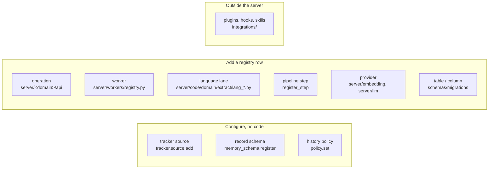

<!-- i18n: source=docs/development/extending-loom.md blob=73da8dff0ce992ad0dcb19d796cbf828d8785b33 model=claude-sonnet-5-5 -->
> Esta página es una traducción automática de la [página en inglés](https://github.com/ClickHouse/loom/blob/main/docs/development/extending-loom.md), que prevalece.
> Machine-translated from the [English page](https://github.com/ClickHouse/loom/blob/main/docs/development/extending-loom.md), which is authoritative.

# Extender Loom

Loom tiene un registro por cada tipo de elemento: operaciones, workers, ajustes, proveedores, carriles de lenguaje, pasos de extracción y fuentes del tracker. Para extender Loom, agrega una fila al registro correspondiente; HTTP, MCP, los SDKs y la referencia generada se actualizan en consecuencia.

Primero comprueba si basta con los datos. Una fuente del tracker, un esquema de registros, un procedimiento o una política de historial se configuran, no se programan.

## Elegir el punto de extensión

| Quieres…                                                     | Punto de extensión            | Dónde                                                                                            | Guía                                                                   |
| ------------------------------------------------------------ | ----------------------------- | ------------------------------------------------------------------------------------------------ | ---------------------------------------------------------------------- |
| Exponer una nueva capacidad a los llamadores                 | Una operación                 | `server/<domain>/api/ops_<group>.py`, `server/<domain>/app/<group>.py`                           | [Añadir una operación](https://github.com/ClickHouse/loom/blob/main/docs/development/adding-an-operation.md)                             |
| Ejecutar trabajo en segundo plano según una programación     | Un worker                     | `server/<domain>/workers/<name>.py`, una fila en `server/workers/registry.py`                    | [Añadir un worker](https://github.com/ClickHouse/loom/blob/main/docs/development/adding-a-worker.md)                                     |
| Almacenar algo nuevo                                         | Una tabla o columna           | `schemas/migrations/<NNN>_*.sql`, `server/<domain>/store/`                                       | [Añadir una tabla](https://github.com/ClickHouse/loom/blob/main/docs/development/adding-a-table.md)                                       |
| Indexar un nuevo lenguaje de programación                    | Una vía de lenguaje del índice de código | `server/code/domain/extract/lang_<lang>.py`, `lang_detect.py`, `server/code/app/index/ingest.py` | [Añadir soporte de lenguaje](https://github.com/ClickHouse/loom/blob/main/docs/development/adding-language-support.md)                     |
| Cambiar lo que conserva la extracción para algunos llamadores | Un paso del pipeline          | `register_step` en `server/memory/app/pipeline.py`                                               | [Pipeline de extracción](https://github.com/ClickHouse/loom/blob/main/docs/guides/extraction-pipeline.md)                |
| Leer un nuevo gestor de incidencias o historial de CI        | Una fuente de tracker (solo datos) | `tracker.source.add` + `tracker.source.set_mapping`                                         | [Contrato de registros del tracker](https://github.com/ClickHouse/loom/blob/main/docs/features/tracker/record-contract.md)      |
| Guardar hechos con una identidad y campos tipados            | Un esquema de registros (solo datos) | `memory_schema.register`, `memory.record.write`                                           | [Escribir en la memoria](https://github.com/ClickHouse/loom/blob/main/docs/features/memory/writing.md)                        |
| Restringir lo que los agentes pueden hacer según su historial | Una política de historial (solo datos) | `policy.set`                                                                              | [Tokens y permisos](https://github.com/ClickHouse/loom/blob/main/docs/guides/tokens-and-grants.md#add-history-policy) |
| Usar otro proveedor de embeddings o de LLM                   | Un cliente de proveedor       | `server/embedding/`, `server/llm/`                                                               | [más abajo](#add-a-provider)                                           |
| Añadir un ajuste                                             | Un campo de ajustes           | La sección del área en `server/settings/catalog.py`                                              | [más abajo](#add-a-setting)                                            |
| Capturar sesiones de otro cliente, o distribuir guías para agentes | Una integración, hook o skill | `integrations/`, `skills/`                                                                 | [más abajo](#add-an-integration)                                       |

## Lo que comparten todas las extensiones

- **El código es el registro.** Los transportes iteran `ALL_OPERATIONS`, el supervisor itera `_WORKERS` y la referencia de configuración se genera a partir de `server/settings/`. Cada registro tiene una prueba de snapshot o de censo que falla hasta que lo regeneras.
- **Archivos generados.** `make lint` ejecuta cada generador con `--check`: las tablas de operaciones del SDK (`scripts/codegen/sdk_py_gen.py`, `sdk_ts_gen.py`), el manifiesto de alcance (`op_reach_census.py`), las páginas de referencia (`docs_reference.py`, `settings_reference.py`) y las copias del plugin de Codex (`agent_plugin_sync.py`). Consulta [generación de código](https://github.com/ClickHouse/loom/blob/main/docs/development/code-generation.md).
- **Madurez.** Una nueva operación declara `maturity="experimental"` a menos que reemplace a una estable ([añadir una operación](https://github.com/ClickHouse/loom/blob/main/docs/development/adding-an-operation.md#5-check-reach-and-maturity)).
- **Medición.** Un cambio en el ranking, la extracción o un valor predeterminado de un proveedor ejecuta el benchmark correspondiente antes y después ([ajuste del rendimiento](https://github.com/ClickHouse/loom/blob/main/docs/guides/performance-tuning.md#measure-first)).
- **Las estructuras fundamentales no son puntos de extensión.** El motor (ClickHouse), la tupla de identidad, la auditoría por fila mediante hash de contenido y las cinco operaciones de revisión de creencias solo cambian con una justificación de diseño en el PR y en la documentación de arquitectura ([visión general del sistema](https://github.com/ClickHouse/loom/blob/main/docs/architecture/system-overview.md)).

## Añadir un proveedor

Los embedders y los LLM son clientes elegidos mediante la configuración.

**Un embedder** va en `server/embedding/`, junto a `openai.py`, `gemini.py`, `local.py` y `fake.py`. Comparte la infraestructura HTTP de `server/embedding/_provider.py`:

- reintenta solo ante estados que admiten reintento, tres intentos;
- `EmbedderInputTooLarge` en lugar de un truncamiento silencioso por parte del proveedor;
- `MalformedEmbedding` para un vector vacío, de ancho incorrecto o no finito.

Conéctalo en `server/embedding/embedder.py`: la inferencia del proveedor a partir de `LOOM_EMBEDDING_MODEL` (`_inferred_provider`), los valores de `LOOM_EMBEDDING_PROVIDER` y las variables de clave en `KEY_ENVS`. Si falta una clave, se recurre al embedder fake y se registra un error.

**Un LLM** va en `server/llm/`, junto a `openai.py`, `anthropic.py` y `fake.py`, e implementa `LLMClient` (`server/llm/client.py`). Conéctalo en `_build_llm_client` y en `DEFAULT_MODEL_BY_PROVIDER`, `KEY_ENV_BY_PROVIDER` y `resolve_llm_provider` (`server/core/llm_provider.py`).

> **Advertencia:** un proveedor cambia la calidad. Los umbrales de similitud están calibrados para `text-embedding-3-small`. Ejecuta `make bench-quick` con un proveedor nuevo antes de convertirlo en el predeterminado. Un embedder nuevo requiere `loom reembed` en cada espacio de nombres existente.

## Añadir una configuración

Un campo nuevo va en la sección de su área en `server/settings/catalog.py` (`MemorySearch`, `Code`, `Tracker`, …), el único archivo en el que se declara cada configuración. El comentario que lo precede explica qué controla y qué significan sus valores; ese comentario se convierte en su fila en la [referencia de configuración](https://github.com/ClickHouse/loom/blob/main/docs/reference/configuration.md) generada. El nombre de la variable de entorno es `LOOM_<FIELD>`.

Léelo como `settings.<field>`, nunca como `getattr(settings, "<field>", default)`. `tests/unit/test_settings_attribute_access.py` falla con esta última forma: un valor por defecto copiado se desvía y oculta el punto de lectura a quien elimine el campo. Regenera con `python scripts/codegen/settings_reference.py` y `python scripts/codegen/settings_schema.py`.

Para retirar un flag, elimina la configuración, su rama y cualquier campo por solicitud que la llevara. Un cliente que aún envíe el campo recibe respuesta, y el campo se nombra en `ignored_args`.

## Agregar una integración

| Integración                               | Dónde                                                               | Notas                                                                                                                                                                                                                                                                                                    |
| ----------------------------------------- | ------------------------------------------------------------------- | -------------------------------------------------------------------------------------------------------------------------------------------------------------------------------------------------------------------------------------------------------------------------------------------------------- |
| Un hook o skill de plugin de agente de programación | `integrations/claude-code-plugin/` (`hooks/`, `lib/`, `skills/`)    | La fuente de verdad; `python scripts/codegen/agent_plugin_sync.py` copia los scripts, las skills y el icono del listado (`assets/`) en `integrations/codex-plugin/`. Conecta a mano un hook nuevo en el `hooks.json` de Codex. Los clientes instalados recogen un cambio cuando cambia la versión del plugin en su manifiesto. |
| Un hook de captura de sesiones para otro cliente | `integrations/<client>/` (`cursor/`, `generic/`)                    | Llama a `loom ingest-transcript` o `conversation.append`, y a `memory.set_from_messages` para la extracción.                                                                                                                                                                                             |
| Una skill de agente portable              | `skills/<name>/SKILL.md`                                            | Se instala por nombre en cualquier cliente de Agent-Skills; solo ofrece orientación, sin hooks.                                                                                                                                                                                                          |
| Un adaptador de framework                 | `sdk/python/loom/integrations/`, `sdk/typescript/src/integrations/` | Envuelve el SDK en la interfaz de almacén o de memoria del framework (`LoomStore` de LangGraph y `LoomMemoryStore` de Strands en Python, un adaptador de Strands en TypeScript).                                                                                                                         |
| Un backend de observabilidad              | `server/observability/`                                             | Los spans ya incluyen `loom.request_id` y se exportan mediante OTLP; es preferible usar un colector OTLP antes que crear un nuevo exportador.                                                                                                                                                            |

[Integraciones](https://github.com/ClickHouse/loom/blob/main/docs/features/integrations/index.md) describe las que se incluyen. [Integración de agentes](https://github.com/ClickHouse/loom/blob/main/docs/guides/agent-integration.md) cubre lo que debe escribir y leer cualquier cliente nuevo.

## Relacionado

- [Guía del repositorio](https://github.com/ClickHouse/loom/blob/main/docs/development/repository-guide.md)
- [Pruebas](https://github.com/ClickHouse/loom/blob/main/docs/development/testing.md)
- [Cómo contribuir](https://github.com/ClickHouse/loom/blob/main/CONTRIBUTING.md)
