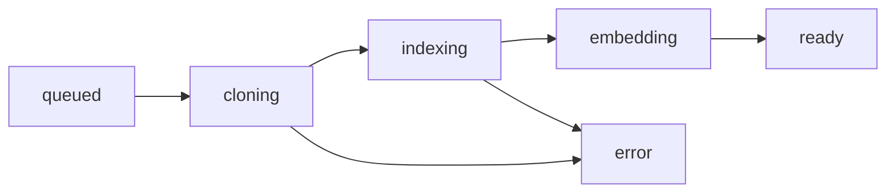

<!-- i18n: source=docs/features/code-index/repositories.md blob=dfd41b79236a859839f989a995deb2de9cd4ad2b model=claude-sonnet-5-5 -->
> Esta página es una traducción automática de la [página en inglés](https://github.com/ClickHouse/loom/blob/main/docs/features/code-index/repositories.md), que prevalece.
> Machine-translated from the [English page](https://github.com/ClickHouse/loom/blob/main/docs/features/code-index/repositories.md), which is authoritative.

<a id="adding-repositories"></a>

# Agregar repositorios

Una instalación nueva no indexa ningún repositorio. Las entradas provienen de dos fuentes, combinadas: los repositorios que las personas agregan por su cuenta y la configuración del operador. Una entrada del operador para un espacio de nombres agregado aquí se omite (consulta las reglas a continuación). Un espacio de nombres de código es una rama ([descripción general](https://github.com/ClickHouse/loom/blob/main/docs/features/code-index/overview.md#one-namespace-is-one-branch)).

| Ruta                    | Cómo                                                                                                         | Construido por                         | Niveles                                                          |
| ----------------------- | ------------------------------------------------------------------------------------------------------------ | -------------------------------------- | ---------------------------------------------------------------- |
| Autoservicio            | **Repositories → Add repository** en el dashboard, o **Add branch** en una tarjeta que mantienes             | el worker `code_ingest`, por porciones | nivel rápido; niveles del compilador opcionales                  |
| Configurado por operador | una entrada en `LOOM_CODE_REPOS_JSON` (o los ajustes escalares `LOOM_CODE_*`), luego `loom code backfill`    | el operador, con la CLI `loom code`    | nivel rápido, más el nivel del compilador donde esté configurado |

El autoservicio no requiere acceso de operador ni de shell para el nivel rápido. Los niveles del compilador son mejoras opcionales de precisión y necesitan su toolchain del lenguaje en la imagen del worker.

<a id="self-service-repositories"></a>

## Repositorios de autoservicio

Requiere `LOOM_CODE_SELF_SERVICE_ENABLED` y el worker `code_ingest`. Ambos están habilitados por
el despliegue de desarrollo de Compose predeterminado; los despliegues personalizados pueden deshabilitar cualquiera de los dos.

También requiere el [sandbox de trabajos de repositorio](https://github.com/ClickHouse/loom/blob/main/docs/operations/code-index-operations.md#repository-job-sandbox):
un repositorio añadido aquí obtiene niveles del compilador que ejecutan su propio código de compilación, y su
clonación se comunica con un host elegido por la persona, por lo que sin el sandbox la adición se rechaza
(`SANDBOX_UNAVAILABLE`) y las entradas ya añadidas dejan de obtenerse e indexarse.
De las pilas de Compose incluidas, solo la blue/green (`dev/docker-compose.colour.yml`)
lo ejecuta, en un host con el perfil de AppArmor cargado. En las demás, incluida la pila publicada,
indexe un repositorio mediante `LOOM_CODE_REPOS_JSON`
([inicio rápido](../../getting-started/quickstart.md#optional-index-a-repository-on-the-released-stack)).

Cada organización tiene como máximo `LOOM_CODE_SELF_SERVICE_MAX_REPOS` (20) entradas.

Cualquier miembro de una organización con sesión iniciada puede añadir un repositorio y se convierte en su primer mantenedor.
El remoto puede ser `owner/name` (abreviatura de GitHub), una URL HTTPS o una URL Git
de estilo SSH/scp. GitHub, GitLab y Bitbucket se etiquetan explícitamente; otros servidores usan el
adaptador genérico. Las rutas locales y las URL `file://` se rechazan. El remoto debe responder a
`git ls-remote`, usando el token de acceso opcional para HTTPS o la configuración SSH del worker.
Cuando la rama está en blanco, Loom sigue el `HEAD` simbólico del remoto; no se
asume `master`. El espacio de nombres es `code-<name>` para la rama predeterminada y
`code-<name>-<branch-slug>` en caso contrario.

El worker clona un mirror bare en `LOOM_CODE_REPOS_ROOT` (por defecto
`var/code_repos/self`, uno por repositorio Git, compartido por sus ramas). Construye el
primer índice de `LOOM_CODE_BOOTSTRAP_FILES_PER_PASS` (400) archivos por pasada con un cursor, de modo que un
reinicio lo reanuda. `code.repos` informa del progreso en `stage` y `stage_detail`:



La entrada permanece en `embedding` hasta que `LOOM_CODE_READY_EMBED_COVERAGE` (0.95) de sus
fragmentos tenga un vector; hasta entonces `code.search` responde de forma léxica
([frescura](https://github.com/ClickHouse/loom/blob/main/docs/features/code-index/freshness.md)).

| Op                          | Rol    | Hace                                                                                                                                                      |
| --------------------------- | ------ | --------------------------------------------------------------------------------------------------------------------------------------------------------- |
| `code.repo.remote_branches` | viewer | lo que muestra el remoto Git antes de escribir nada: proveedor, ramas y heads, rama predeterminada, ramas con forma de release, cuota y advertencias de disponibilidad |
| `code.repo.add`             | viewer | añade `repo@branch` (en blanco descubre la predeterminada del remoto), opcionalmente más `branches`; acceso, filtros, `scip_producer`, `access_token`      |
| `code.repo.add_branch`      | admin  | indexa otra rama de un repositorio que mantiene; hereda remoto, token, prefijos y acceso                                                                  |
| `code.repo.set_access`      | admin  | establece `classification` (`standard` / `restricted`) y `join_policy` (`open` / `approval` / `closed`)                                                   |
| `code.repo.set_source`      | admin  | vincula los espacios de nombres del tracker que lee este repositorio, el principal primero ([resumen del tracker](https://github.com/ClickHouse/loom/blob/main/docs/features/tracker/overview.md#linking-a-tracker-to-a-repository)) |
| `code.repo.remove`          | admin  | retira un índice de autoservicio; `confirm` debe ser igual al espacio de nombres                                                                          |

Los argumentos están en la [referencia de operaciones](https://github.com/ClickHouse/loom/blob/main/docs/reference/operations.md#code).

Reglas:

- Una organización tiene como máximo `LOOM_CODE_SELF_SERVICE_MAX_REPOS` (20) entradas de
  autoservicio activas, ramas incluidas (`REPO_QUOTA`). Una rama ya indexada, bajo cualquier
  espacio de nombres, o cuyo espacio de nombres contenga datos o permisos que usted no administra, se rechaza
  con `REPO_EXISTS`; únase a un índice en su lugar. Una rama de una entrada configurada por el operador
  sin primer índice todavía se rechaza con `REPO_NOT_INDEXED` hasta que se haya
  ejecutado `loom code backfill` para ella.
- Los permisos de admin fluyen entre las ramas de un repositorio en una sola dirección. Las
  entradas del operador pasan sus admins a todas las ramas del repositorio, y una rama añadida aquí
  pasa sus admins solo a otras ramas standard añadidas aquí. Una rama restricted
  añadida aquí toma solo los admins del operador. Cada sincronización revoca las demás copias que
  tenga, o convierte la de un admin del operador en una copia del permiso del operador; una copia cuyo
  `granted_by` nombra una entrada que la réplica no configura también se revoca (una entrada
  retirada, o una nueva a la que un despliegue progresivo aún no ha llegado: vuelva a conceder admin sobre esa entrada).
  Una rama cuyos admins eran todos copias de ese tipo se queda sin ninguno, y solo un
  permiso de admin sobre una de las entradas del operador del repositorio llega a ella. Un miembro que tuviera
  una copia así puede haber concedido o aprobado a otros allí, incluido él mismo:
  revise sus permisos. Ampliar de nuevo la rama no devuelve una copia que una restricción
  revocó; vuelva a conceder ese admin en una rama hermana. Solo un admin con un permiso concedido allí,
  o una copia de uno de una entrada del operador, puede ampliarla; una copia de una rama añadida aquí
  no cuenta.
- Una revocación sigue el mismo camino. Una hecha sobre una entrada del operador elimina de una rama
  añadida aquí solo un permiso copiado, y ninguno de una standard mientras el sujeto tenga
  un permiso de admin concedido en una rama añadida aquí. Una copia que es el único admin de una rama
  permanece, salvo en una rama restricted añadida aquí, donde una revocación se lleva una copia cuyo
  origen no es una entrada del operador (una cuyo titular conserva un permiso de admin concedido sobre una
  entrada del operador distinta de la revocada es reescrita por la siguiente sincronización); una
  copia del operador mantenida allí desaparece en la siguiente sincronización una vez que su permiso del operador ya no existe.
- Una entrada del operador que nombra un espacio de nombres añadido aquí (`code.repo.add` o
  `code.repo.add_branch`), incluso uno eliminado desde entonces, se omite, con una advertencia en el
  log del servidor, ya que los permisos de quien lo añadió pasarían a ser los de una entrada del operador.
  Eliminar la rama no libera el nombre: liste la entrada bajo otro espacio de nombres.
  Una fila del registro que no registra ningún tipo se lee como la fila de acceso de la entrada, un espacio de nombres
  creado por un miembro con `namespace.register` no tiene fila de registro, y mientras
  el autoservicio está desactivado el registro no se lee: revise los permisos de un espacio de nombres antes de
  listarlo en cada caso.
- La fila de acceso que `code.repo.set_access` escribe para una entrada del operador no se lista
  mientras la entrada esté fuera de la configuración, por lo que el espacio de nombres no se indexa; se
  aplica de nuevo si la entrada vuelve, y no cuenta para la cuota de repositorios de la organización.
  Una fila del registro que no registra ningún tipo se lista como una rama añadida aquí
  una vez que su entrada ha desaparecido.
- Una copia en un espacio de nombres del operador cuyo `granted_by` es `repo-maintainers:<namespace>`
  y nombra una rama añadida aquí, o un espacio de nombres que ya no está configurado, permanece hasta que se revoque:
  liste esos permisos y revoque los que no deban mantenerse.
- Mientras el autoservicio está desactivado, una revocación sobre una entrada del operador no ve ninguna rama añadida aquí,
  por lo que una copia allí del permiso revocado permanece cuando el autoservicio se vuelve a activar:
  revóquela en esa rama.
- Un repositorio restricted nunca es `open`: `code.repo.add` establece `approval`. Ampliar un índice
  restricted a standard requiere que `confirm` sea igual al espacio de nombres.
- El token de un repositorio privado se almacena cifrado con una clave derivada de
  `LOOM_JWT_SECRET` y nunca se devuelve. Rotar ese secreto inutiliza los tokens almacenados
  hasta que un mantenedor los introduzca de nuevo.
- `code.repo.remove` retira las filas del registro y purga todas las filas `code_*` del
  espacio de nombres mediante una saga de borrado reanudable. El mirror se elimina cuando ninguna otra rama
  lo usa. Una entrada configurada por el operador se rechaza con `REPO_FROM_CONFIG`.
- `LOOM_CODE_SELF_SERVICE_ENABLED=false` elimina la funcionalidad (`SELF_SERVICE_OFF`).
- `LOOM_CODE_INTEL_ENABLED=false` rechaza todas las ops `code.repo.*` salvo `code.repo.remove`,
  con `PRECONDITION_FAILED`, igual que hace con cualquier otra op `code.*`. Una retirada con el
  interruptor desactivado purga el índice y el mirror de esta réplica; las otras réplicas barren su copia
  del mirror solo cuando la inteligencia de código vuelve a estar activada.

Añada un repositorio público y una rama de release en una sola llamada:

```bash
curl -fsS -X POST "$LOOM_BASE_URL/v1/code.repo.add" \
  -H "Authorization: Bearer $LOOM_API_KEY" -H 'Content-Type: application/json' \
  -d '{"org":"acme","repo":"acme/widgets","branch":"main","branches":["release/2.4"]}'
```

La respuesta nombra el espacio de nombres de cada rama. Las ramas que no se pudieron añadir vuelven en
`skipped` con el motivo.

<a id="repository-profiles-and-compiler-preflight"></a>

## Perfiles de repositorio y verificación previa del compilador

Cada entrada informa un `profile` y un `provider` en `code.index_status`. `generic` se encarga de la búsqueda, los símbolos, las llamadas, el impacto y los paquetes de contexto independientes del repositorio. El perfil `clickhouse` identifica las convenciones exclusivas de ClickHouse para el registro de SQL, los códigos de error y las pruebas stateless; esas suposiciones no se infieren solo porque un proyecto contenga C++ o SQL.

`compiler_candidates` se infiere a partir de los manifiestos de compilación. Un candidato sin marca de agua aparece en `quality_warnings` junto con los workers que se deben habilitar:

| Candidato             | Verificación previa en el entorno del worker                                                                                                                                                       | Worker                                       |
| --------------------- | -------------------------------------------------------------------------------------------------------------------------------------------------------------------------------------------------- | -------------------------------------------- |
| C/C++                 | `scip-clang --version` (en la imagen amd64); el CMake del repositorio se configura con clang 21                                                                                                    | `code_scip_full`, luego `code_scip_delta`    |
| TypeScript/JavaScript | El indexador y los gestores de paquetes vienen incluidos en Docker; los servidores nativos ejecutan `sh scripts/install-code-toolchains.sh`. Las dependencias del repositorio se preparan automáticamente. | `code_scip_ts_delta`                         |
| Go                    | `scip-go --version`; `go env` se ejecuta correctamente en cada módulo                                                                                                                              | `code_scip_go_delta`                         |
| Python                | `scip-python --version`; las importaciones del proyecto se resuelven en su entorno                                                                                                                 | `code_scip_py_delta`, luego `code_scip_apply` |

El nivel rápido sigue siendo utilizable cuando falla la verificación previa del compilador. `code.index_status` y la pestaña Health muestran los errores de los workers, la cobertura por lenguaje, las aristas sin resolver, la cobertura de embeddings y la actualización. El historial de PR/revisión usa actualmente la API de GitHub; otros proveedores siguen recibiendo el historial de Git y la inteligencia de código, con una advertencia explícita durante la incorporación.

<a id="operator-configured-repositories"></a>

## Repositorios configurados por el operador

`LOOM_CODE_REPOS_JSON` contiene un objeto por cada rama indexada. Los campos de cada entrada,
los requisitos previos (imagen, embedder, mirrors con permiso de escritura, token de GitHub), el primer índice
(`loom code init`, `backfill`, `backfill-prs`, `scripts/ops/code_intel_bootstrap.sh`),
el nivel del compilador y otras ramas se encuentran en el
[runbook de operaciones del índice de código](https://github.com/ClickHouse/loom/blob/main/docs/operations/code-index-operations.md). El worker
nunca inicia una entrada configurada por el operador; una que no tenga una marca de agua `git_head` se omite
hasta que se ejecute `loom code backfill`. Todos los ajustes están en la
[referencia de configuración](https://github.com/ClickHouse/loom/blob/main/docs/reference/configuration.md#code).

<a id="who-can-read"></a>

## Quién puede leer

Los espacios de nombres de código siguen las reglas de concesión habituales
([identidades y espacios de nombres](https://github.com/ClickHouse/loom/blob/main/docs/concepts/identities-and-namespaces.md),
[tokens y concesiones](https://github.com/ClickHouse/loom/blob/main/docs/guides/tokens-and-grants.md)): un token debe nombrar el espacio de nombres de código
(o `*`), o la llamada falla con `AUTH_INSUFFICIENT`. Tres interruptores cambian
eso:

| Interruptor                                                       | Efecto                                                                                                                                       |
| ----------------------------------------------------------------- | -------------------------------------------------------------------------------------------------------------------------------------------- |
| `LOOM_CODE_ORG_READABLE=true`, o el `org_readable` de la entrada  | todo principal autenticado de la organización lee sin una concesión (desactivado por defecto); las escrituras siguen dependiendo de las concesiones |
| `LOOM_CODE_REPO_PUBLIC=true`, o el `public` de la entrada         | el espacio de nombres se registra con `join_policy=open` y como descubrible, de modo que cualquier miembro de la organización se une como lector de inmediato; de lo contrario, la política es `approval` |
| `classification: "restricted"` (entrada, o `code.repo.set_access`) | nunca es legible por la organización ni público; un maintainer aprueba a cada lector, y toda lectura necesita un token que nombre el espacio de nombres más una concesión directa vigente |

Una fila de `code.repo.set_access` prevalece sobre la clasificación y la política de unión configuradas
y se conserva tras los reinicios. `code.refresh` (writer) y las operaciones de administración siempre necesitan una concesión.

<a id="failure-modes"></a>

## Modos de fallo

| Síntoma                                           | Causa y solución                                                                                                                                                                                                                                                       |
| ------------------------------------------------- | ---------------------------------------------------------------------------------------------------------------------------------------------------------------------------------------------------------------------------------------------------------------------- |
| Una entrada configurada nunca se indexa           | no hay marca de agua `git_head`: ejecuta `loom code init` y `loom code backfill`; o el espacio de nombres se agregó desde la página (se haya eliminado después o no), y el log indica que la entrada se omite: lístala bajo otro espacio de nombres                  |
| Al agregar un repositorio se responde `SANDBOX_UNAVAILABLE` | este despliegue no puede ejecutar el sandbox: lista el repositorio en `LOOM_CODE_REPOS_JSON` en su lugar (salvo que `LOOM_CODE_SANDBOX_REQUIRED` esté definido, lo que también los omite), o consulta los [requisitos del sandbox](https://github.com/ClickHouse/loom/blob/main/docs/operations/code-index-operations.md#repository-job-sandbox) |
| Una tarjeta de autoservicio se queda en `error`   | lee `stage_detail` en `code.repos`; un clon fallido se reintenta en la siguiente pasada (tiempo de espera `LOOM_CODE_BOOTSTRAP_CLONE_TIMEOUT_S`)                                                                                                                      |
| Un repositorio privado de autoservicio deja de hacer fetch | se rotó `LOOM_JWT_SECRET`; vuelve a introducir el token                                                                                                                                                                                                |
| Falta una entrada en `code.repos`                 | revisa `loom.code.repos_config_errors`; además, `code.repos` solo lista lo que el solicitante puede leer                                                                                                                                                               |
| Al revocar o reducir un administrador se responde busy | una revocación en un espacio de nombres de código primero vuelve a leer `loom.code_repos`, de modo que ve las ramas agregadas aquí desde otro proceso, y responde busy mientras esa lectura falla; reintenta cuando la lectura tenga éxito                         |
| Una rama restringida agregada aquí no tiene administrador | todos sus administradores eran copias de ramas agregadas aquí, que la sincronización revoca; concede admin en una de las entradas del operador del repositorio (si no hay ninguna, el operador debe listar primero una rama del repositorio en `LOOM_CODE_REPOS_JSON`) |
| Un nuevo mantenedor no tiene las otras ramas      | la concesión de admin se hizo antes de que este proceso leyera `loom.code_repos` (ese proceso registra `not synced` la primera vez); la siguiente concesión de admin o aprobación en una rama del repositorio, o una rama agregada, la copia; o concédela de nuevo      |
| Las respuestas son solo léxicas                   | la entrada no ha alcanzado `LOOM_CODE_READY_EMBED_COVERAGE` ([frescura](https://github.com/ClickHouse/loom/blob/main/docs/features/code-index/freshness.md))                                                                                                           |

<a id="related"></a>

## Relacionado

- [Descripción general](https://github.com/ClickHouse/loom/blob/main/docs/features/code-index/overview.md) y [operaciones por pregunta](https://github.com/ClickHouse/loom/blob/main/docs/features/code-index/operations.md)
- [Actualidad de los datos](https://github.com/ClickHouse/loom/blob/main/docs/features/code-index/freshness.md) e [historial y PRs](https://github.com/ClickHouse/loom/blob/main/docs/features/code-index/history-and-prs.md)
- [Runbook de operaciones del índice de código](https://github.com/ClickHouse/loom/blob/main/docs/operations/code-index-operations.md)
