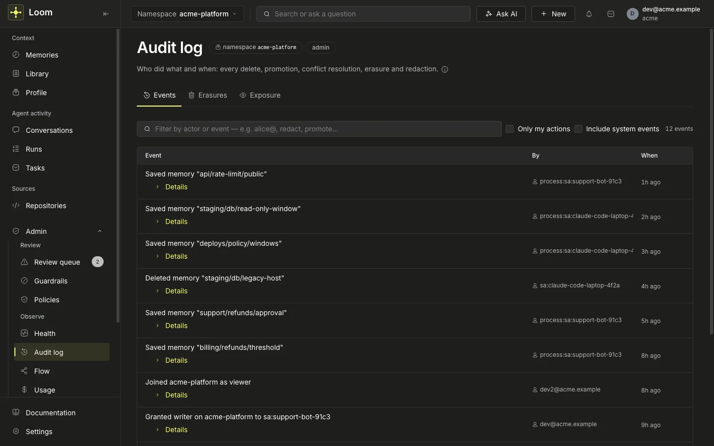

<!-- i18n: source=docs/features/observability/audit.md blob=8e4e9949ca4f7a4e54f9bad556832bda780a76c4 model=claude-sonnet-5-5 -->
> Esta página es una traducción automática de la [página en inglés](https://github.com/ClickHouse/loom/blob/main/docs/features/observability/audit.md), que prevalece.
> Machine-translated from the [English page](https://github.com/ClickHouse/loom/blob/main/docs/features/observability/audit.md), which is authoritative.

<a id="audit-log"></a>

# Registro de auditoría

Las filas de auditoría, el worker `audit_verifier` y la cadena de checkpoints están activados por defecto.

Loom escribe una fila en `loom.audit_log` por cada operación que cambia el estado de una forma de la que alguien pueda tener que rendir cuentas, además de algunos eventos que genera el propio servidor. El objetivo es que la manipulación sea detectable. Cada fila incluye un SHA-256 de su propio contenido, y un worker sella las ventanas horarias cerradas en una cadena de hashes. Un administrador de ClickHouse todavía puede editar la tabla; la siguiente pasada del verificador mostrará la edición o el borrado. Esto es una primitiva de ingeniería, no una certificación de cumplimiento normativo.



<a id="what-leaves-an-audit-row"></a>

## Qué deja una fila de auditoría

| Origen                                                                | `event_type`                                                                                                                                                                                                                                  | `subject` contiene                                                                                                                                                                                                                                                                                                                                                                                           |
| --------------------------------------------------------------------- | --------------------------------------------------------------------------------------------------------------------------------------------------------------------------------------------------------------------------------------------- | ------------------------------------------------------------------------------------------------------------------------------------------------------------------------------------------------------------------------------------------------------------------------------------------------------------------------------------------------------------------------------------------------------------- |
| Cualquier operación declarada `audit=True`                            | el nombre de la operación (`memory.delete`, `grants.create`)                                                                                                                                                                                  | el `audit_subject` de la operación cuando lo declara (sin credencial, o con un hash para el texto que una eliminación debe alcanzar); si no, su entrada validada con cada valor de texto que no nombra nada convertido en hash, como JSON                                                                                                                                                                      |
| `memory.set` (escrituras puntuales)                                   | `memory.set`                                                                                                                                                                                                                                  | clave, id de la memoria, `content_sha256`, `source_class`, veredicto, `pinned`. Nunca el valor                                                                                                                                                                                                                                                                                                               |
| `memory.update`, `memory.update_by_id`                                | el nombre de la operación                                                                                                                                                                                                                     | clave, id de la memoria, `content_sha256`, `source_class`, versión y el veredicto de la comprobación de conflictos antes del marcado posterior a la escritura (`duplicate` para una versión escrita como tal, vacío cuando la fila revisada no tiene embedding: un tipo que no lo tiene, o un valor `high`). Nunca el valor                                                                                    |
| `memory.bulk_set`                                                     | `memory.bulk_set`                                                                                                                                                                                                                             | una fila solo con hashes por cada escritura                                                                                                                                                                                                                                                                                                                                                                  |
| Cada revisión confirmada en Postgres                                  | `memory.revision`                                                                                                                                                                                                                             | clave, id de la memoria, versión, `content_sha256`, `source_class`, estado, `pinned`, tombstoned y, como actor, el principal del token; si no, el de la etapa del pipeline; si no, `-` en una solicitud y `process:loom` para los trabajos propios de Loom. Se almacena junto con la revisión, por lo que no es fail-open: se reintenta hasta que se guarda o se aparca ([autoridad de almacenamiento](../../architecture/storage-authority.md#audit)) |
| `memory.import`                                                       | `memory.bulk_set` para los hechos que escribe; `memory.import` para los vínculos de categoría que escribe                                                                                                                                     | la fila solo con hashes de la escritura masiva; para los vínculos, `count` y `category_links` (clave y nombre de categoría). Nunca el texto                                                                                                                                                                                                                                                                  |
| Una lectura de una fila `high`, o de evidencia retenida como `high`   | `memory.sensitive_read` (desde `memory.get`, `memory.get_by_id`, `memory.bulk_get`, `memory.history`, `memory.evidence`, `namespace.snapshot`, `erasure.export` y `memory.export_evidence` con `include_high`)                                | clave e id de la memoria (`memory.history` y `erasure.export` añaden la versión); para la evidencia liberada, su tipo, sesión, índice de fragmento y claves vinculadas; para un turno de conversación que sirve `erasure.export`, su agente, id de hilo e id de mensaje; para un hilo, su agente e id de hilo                                                                                                  |
| Una solicitud admitida a un espacio de nombres restringido            | `namespace.restricted_access` (desde una operación que lo nombra, `audit.list` que lo nombra (transporte `op`), la descarga y la subida de documentos, un inbox watch, `admin/claim_release`, `admin/namespace.adopt`, las emisiones de tokens delegados y el primer de MCP) | `op`, `transport`, el `token_id` y los `roles` de quien llama; para una emisión, `granted_to`, el sujeto del nuevo token                                                                                                                                                                                                                                                                                      |
| Loom retira memorias por su cuenta                                    | `memory.auto_supersede`                                                                                                                                                                                                                       | `reason`, `count` y `retired`: hasta 200 filas retiradas (id, clave, agente, usuario y sesión, la fila y la clave detrás de las que se retiró cada una, la etiqueta del juez, `judge_verdict`, `judge_confidence`, `judge_model` y `judge_prompt_version` para una retirada del conflict-resolver, y `unconfirmed` (`"true"`) cuando la relectura no pudo confirmar la retirada). Nunca el valor. Si hay más filas, se dividen en varios eventos |
| `memory.restore` de una fila reemplazada                              | `memory.unsupersede`                                                                                                                                                                                                                          | clave, id de la memoria, `superseded_by`, el `content_sha256` y la `version` restaurados                                                                                                                                                                                                                                                                                                                     |
| Una fila de `grants.revoke` tomada con otra grafía, o una de varias  | `grants.revoke`                                                                                                                                                                                                                               | `namespace`, el `subject` almacenado, `named` (el sujeto que nombró la llamada) y `landed` (`"unknown"`) cuando el insert de la fila falló. Junto a la fila propia de la operación, que contiene la entrada                                                                                                                                                                                                  |
| El propio servidor                                                    | `budget.violated`, `ratelimit.exceeded`, `worker.failed`, `audit.tamper_detected`, …                                                                                                                                                          | aquello sobre lo que trata el evento                                                                                                                                                                                                                                                                                                                                                                         |

La columna **Audit** de la [referencia de operaciones](https://github.com/ClickHouse/loom/blob/main/docs/reference/operations.md) generada
lista las operaciones que audita el transporte (la marca `audit` de cada `Operation`); las escrituras de memoria de
la tabla anterior escriben su propia fila y no llevan marca allí. Ninguna operación de lectura se declara
`audit=True`; una lectura de una fila `high` escribe `memory.sensitive_read` (arriba). `audit.list` es
`audit=False`: leer el registro solo añade la fila de acceso restringido para un espacio de nombres restringido.

El transporte escribe la fila después de que el handler tenga éxito (`emit_op_audit` en
`server/transport/_common.py`, para HTTP y MCP). La escritura es **fail-open**: un
insert fallido se registra en el log y se pierde la fila; la operación se completa igualmente.

Para una operación `audit=True`, el sujeto es su `audit_subject` cuando lo declara; si no, la
entrada validada tal como la da forma `audit.input_subject`. Los campos que nombran sobre qué
actuó la llamada o quién actuó (los campos de identidad, los principales `subject`, `actor`, `grantee`,
`owner_email`, `requester`, `approver` y `decision_maker`, `version`, y los nombres que terminan
en el sufijo id, key, URI, name, org, agent, namespace o `_by`) y los campos tipados como
número, booleano, fecha u hora, Literal o Enum se quedan tal como se enviaron; un campo cuyo nombre
indica una credencial (`audit.is_credential` en `server/observability/audit.py`) se convierte en hash
sea cual sea su sufijo. Un campo que contiene un modelo anidado sigue la misma regla, y una lista de
modelos se convierte en hash completa. Los principales y los campos `_by` que se conservan tal como se enviaron son datos personales
que una eliminación no borra de `loom.audit_log`. Cualquier otro valor (un valor de memoria,
el razonamiento de una decisión, un motivo, los campos de un registro, las filas de un snapshot restaurado) se
almacena como `{"sha256", "chars"}`, su SHA-256 y su longitud (el hash que llevaría el
`content_sha256` de una memoria, de modo que coincida con el de un valor movido), ya que la eliminación no alcanza a
`loom.audit_log`. Tres filas que escribe un handler por sí mismo almacenan texto con esa forma bajo el nombre
del campo: el `rationale` de `memory.cross_promote` y de `memory.copy_to`,
el `reason` de `memory.proposal_accept` y de `memory.proposal_reject` (una decisión que toma la
política del propietario registra en su lugar el modo y los umbrales de la política), y
el `closed` de `triple.follows_row_supersession`, cuyo actor es el principal que escribe o
`process:loom`. El hash de un valor corto se puede recuperar por prueba y error; la regla mantiene el texto
largo fuera del registro, no cada palabra. Una operación cuya entrada lleva una credencial (la contraseña de una
fuente de tracker, el token de acceso de un repositorio) declara un `audit_subject` que la
omite. Concede permisos sobre `loom.audit_log` como sobre los datos que describe.

<a id="the-row"></a>

## La fila

`loom.audit_log` es una `MergeTree` particionada por mes y ordenada por
`(org, namespace, event_type, ts)`, con un índice bloom-filter sobre `request_id`.

| Columna                                      | Significado                                                                                                                                                                                       |
| -------------------------------------------- | ------------------------------------------------------------------------------------------------------------------------------------------------------------------------------------------------- |
| `ts`                                         | UTC, precisión de milisegundos                                                                                                                                                                    |
| `event_type`                                 | nombre de la op o evento del servidor                                                                                                                                                             |
| `org`, `namespace`                           | el tenant que autorizó la puerta                                                                                                                                                                  |
| `actor`                                      | el sujeto del token (`anonymous` cuando la autenticación está desactivada); la fila propia de una escritura de memoria (`memory.set`, `memory.bulk_set`, `memory.update`, `memory.update_by_id`) lo nombra `kind:subject`, `-` sin token |
| `subject`                                    | texto JSON; el llamante decide si lo analiza                                                                                                                                                      |
| `request_id`                                 | se une con `loom.agent_events` y con el encabezado de respuesta `X-Request-Id`                                                                                                                    |
| `row_hash`                                   | SHA-256 sobre la fila canónica                                                                                                                                                                    |
| `build_commit`, `instance`, `instance_label` | qué build y qué proceso escribió la fila                                                                                                                                                          |
| `consumer`                                   | el cliente en nombre del cual se hizo la solicitud                                                                                                                                                |
| `token_id`                                   | la credencial que hizo la solicitud (su `jti`, o si no, un prefijo del hash del token)                                                                                                            |

El hash cubre `ts`, `event_type`, `org`, `namespace`, `actor`, `subject` y
`request_id` como JSON ASCII con claves ordenadas (`_canonical` en `server/observability/audit.py`).
Los sellos de build, instancia, consumer y token quedan fuera del hash, de modo que añadir una columna
de sello no invalida las filas antiguas.

`audit.list`, `erasure.export` y `namespace.snapshot` devuelven el subject de una fila
`erasure.failed` o `erasure.abandoned` con el motivo del fallo recortado al paso y al tipo
de error, por lo que un hash recalculado a partir de esas filas puede diferir del almacenado.
`dev/verify_audit_chain.py` comprueba las filas almacenadas.

<a id="per-row-hashes-and-checkpoints"></a>

## Hashes por fila y checkpoints

Varias réplicas del servidor escriben de forma concurrente, por lo que una cadena de hashes de fila a fila se bifurcaría. En su lugar, cada fila lleva su propio hash y las escrituras no necesitan coordinación. Un hash por fila detecta una fila **modificada**, pero no una eliminada; la cadena de checkpoints cubre las eliminaciones (el diseño está en [arquitectura de seguridad](https://github.com/ClickHouse/loom/blob/main/docs/architecture/security.md)):

1. Cuando una ventana de `LOOM_AUDIT_CHECKPOINT_WINDOW_SECONDS` (1 h) lleva cerrada `LOOM_AUDIT_CHECKPOINT_GRACE_SECONDS` (10 min), el worker `audit_verifier` la sella en `loom.audit_checkpoints`: el número de filas, un SHA-256 sobre los hashes de fila ordenados y un `checkpoint_hash` que incluye el hash del checkpoint anterior.
2. Cada pasada vuelve a contar las últimas `LOOM_AUDIT_CHECKPOINT_VERIFY_WINDOWS` (24) ventanas selladas y vuelve a comprobar los enlaces.

Un solo worker sella, de modo que la cadena tiene un único escritor y la ruta de la solicitud no paga ningún coste. Una eliminación solo se manifiesta después de que su ventana se selle, y solo mientras la ventana se vuelve a contar.

`classify` en `server/insights/domain/audit_checkpoints.py` clasifica un recuento:

| Hallazgo       | Significado                                                                         | ¿Manipulación?          |
| -------------- | ----------------------------------------------------------------------------------- | ----------------------- |
| `deletion`     | menos filas de las selladas                                                         | sí                      |
| `modification` | mismo número de filas, digest distinto                                              | sí                      |
| `chain`        | el hash propio de un checkpoint no se recalcula, o no apunta a su predecesor        | sí                      |
| `late_insert`  | más filas de las selladas: un backfill o un insert asíncrono muy tardío             | no por sí solo; se reporta |

Una ventana vacía también se sella, con el digest de la cadena vacía, de modo que una fila insertada en ella más tarde provoca una discrepancia.

<a id="the-verifier-worker"></a>

## El worker verificador

`audit_verifier` (`server/insights/workers/audit_verifier.py`) se ejecuta cada
`LOOM_AUDIT_VERIFIER_INTERVAL_SECONDS` (una hora) en el proceso que tiene el lease de
los workers. Cada pasada:

1. Vuelve a calcular el hash de cada fila de la última hora (10,000 filas por página, como máximo 500,000; si se supera
   el límite, informa `truncated`).
2. Verifica las ventanas selladas y después sella las ventanas cerradas, como máximo
   `LOOM_AUDIT_CHECKPOINT_MAX_SEAL_PER_PASS` (48) por pasada. Un error en este paso se registra como un fallo parcial y nunca bloquea la comprobación por fila.
3. Escribe **una** fila `audit.tamper_detected` por las roturas no informadas antes
   (`subject.break_keys`), de modo que una rotura se informa una sola vez, no cada hora.

El resultado de la pasada (`rows_checked`, `breaks`, `windows_sealed`, `windows_verified`,
`checkpoint_breaks`, `new_breaks`, `truncated`) se registra en `loom.worker_status` como el de todos los workers; consulta [los workers](https://github.com/ClickHouse/loom/blob/main/docs/reference/workers.md).

<a id="checkpoint-lag"></a>

### Retraso de los checkpoints

`loom.audit.checkpoint_lag_windows` cuenta las ventanas de una hora entre el `window_end` sellado más reciente
y el momento actual. Se lee directamente de `loom.audit_checkpoints`, por lo que informa incluso
cuando el sellador está caído.

| Lectura               | Significado                                                                      |
| --------------------- | -------------------------------------------------------------------------------- |
| 0 o 1                 | saludable: la cadena va por detrás el periodo de gracia                          |
| en aumento constante  | el sellador está detenido: el worker está deshabilitado, falla o no tiene el lease |
| en descenso           | un backfill tras una detención; cada pasada sella como máximo 48 ventanas        |
| 0 sin checkpoints     | nunca se ha sellado nada (el indicador marca 0 en una tabla vacía)               |

Consulta [telemetría](https://github.com/ClickHouse/loom/blob/main/docs/features/observability/telemetry.md#backlogs-and-process-state) para el resto del catálogo.

<a id="reading-the-trail"></a>

## Lectura del registro

`audit.list` pagina las filas del solicitante de la más reciente a la más antigua con un cursor keyset opaco. Una página nunca termina en medio de una escritura: las filas que una solicitud escribió en el mismo milisegundo llegan en una sola página, por lo que una página puede contener más de `limit` filas.

| Campo        | Significado                                                                         |
| ------------ | ----------------------------------------------------------------------------------- |
| `org`        | obligatorio                                                                         |
| `namespace`  | un espacio de nombres que el solicitante puede leer (si no, una página vacía); omítelo para todos |
| `event_type` | coincidencia exacta                                                                 |
| `since`      | filas con `ts >= since`                                                             |
| `limit`      | 1–500, por defecto 50                                                               |
| `cursor`     | `next_cursor` de la página anterior; vuelve a pasar los filtros junto con él        |
| `fields`     | proyecta las filas de salida a estos campos                                         |

La op requiere `viewer` y aplica sus propios alcances. Un espacio de nombres indicado pasa la misma validación que una lectura del mismo; indicar uno que no puedes leer devuelve una página vacía, no un 403. Sin `namespace`, un administrador de la organización cuyo token declara `*` lee la organización, salvo los espacios de nombres y colecciones restringidos que no puede leer, y un administrador de la plataforma lee la organización, salvo los espacios de nombres restringidos que no puede leer, sea cual sea su declaración (una sesión del panel nombra solo los espacios de nombres propios de la persona). Cualquier otro solicitante, incluido un administrador de la organización cuyo token enumera espacios de nombres, lee los espacios de nombres a los que llegan su token o sus permisos.

```bash
curl -s "$LOOM_BASE_URL/v1/audit.list" \
  -H "Authorization: Bearer $LOOM_API_KEY" -H 'Content-Type: application/json' \
  -d '{"org": "acme", "namespace": "support", "event_type": "memory.delete", "limit": 100}'
```

```python
from loom import Agent

async with Agent(org="acme", namespace="support", agent="auditor") as admin:
    page = await admin.audit.list(event_type="memory.delete", limit=100)
    while page.get("next_cursor"):
        page = await admin.audit.list(
            event_type="memory.delete", cursor=page["next_cursor"], limit=100
        )
```

La vista **Audit log** del panel de administración lee la misma op. Oculta los eventos del servidor (`budget.violated`, `ratelimit.exceeded`, `worker.failed`) tras un interruptor y muestra el resumen de borrados junto a la lista.

Para seguir una solicitud a través del ledger y del registro de auditoría:

```sql
SELECT ts, event_type, actor, subject FROM loom.audit_log WHERE request_id = '<id>';
SELECT * FROM loom.agent_events WHERE request_id = '<id>';
```

<a id="verifying-offline"></a>

### Verificación sin conexión

`dev/verify_audit_chain.py` recalcula el hash de cada fila de una ventana con `row_matches_hash` del worker. Código de salida 0 = todo correcto, 1 = discrepancia, 2 = no se pudo verificar. Una discrepancia se identifica por partición, `ts`, `request_id` y hash almacenado, nunca por actor, subject ni namespace.

```bash
python dev/verify_audit_chain.py --org acme --ts-since <YYYY-MM-DD> --json
```

<a id="erasure-and-the-audit-log"></a>

## Borrado y el registro de auditoría

Un borrado conserva el rastro de auditoría, incluida su propia fila de auditoría; el censo de residuos no exige que `loom.audit_log` esté vacío. Para un alcance `user_id`, la exportación compara `subject` por subcadena, ya que la tabla no tiene una columna `user_id`. Consulta [retención y borrado](https://github.com/ClickHouse/loom/blob/main/docs/features/memory/retention-and-erasure.md).

<a id="settings"></a>

## Configuración

| Ajuste                                    | Valor por defecto | Efecto                                                                  |
| ----------------------------------------- | ----------------- | ----------------------------------------------------------------------- |
| `LOOM_AUDIT_VERIFIER_ENABLED`             | `true`            | ejecuta el worker del verificador                                       |
| `LOOM_AUDIT_VERIFIER_INTERVAL_SECONDS`    | `3600`            | cadencia de cada pasada                                                 |
| `LOOM_AUDIT_CHECKPOINT_WINDOW_SECONDS`    | `3600`            | duración de la ventana                                                  |
| `LOOM_AUDIT_CHECKPOINT_GRACE_SECONDS`     | `600`             | cuánto tiempo debe estar cerrada una ventana antes de sellarse          |
| `LOOM_AUDIT_CHECKPOINT_VERIFY_WINDOWS`    | `24`              | ventanas selladas que se recuentan en cada pasada                       |
| `LOOM_AUDIT_CHECKPOINT_MAX_SEAL_PER_PASS` | `48`              | límite de ventanas selladas por pasada                                  |
| `LOOM_BUDGET_VIOLATION_AUDIT_INTERVAL_S`  | `60`              | como máximo una fila `budget.violated` por op en cada intervalo (después de la ráfaga) |
| `LOOM_BUDGET_VIOLATION_AUDIT_BURST`       | `5`               | infracciones por ventana que aún escriben su propia fila                |

Todos los ajustes están en la [referencia de configuración](https://github.com/ClickHouse/loom/blob/main/docs/reference/configuration.md).

<a id="limits-and-failure-modes"></a>

## Límites y modos de fallo

- **Escrituras fail-open.** Si falla la inserción de auditoría, se pierde la fila y la operación nunca falla,
  salvo en un `memory.restore` que deshace una retirada y en un `namespace.restore`, que
  dependen de su registro. Una fila se inserta directamente mientras se ejecuta su trabajo, no se pone en cola: la fila de una
  operación, antes de su respuesta; la de un borrado desacoplado, a medida que se ejecuta cada paso. Una caída pierde
  solo las filas del trabajo en curso (con `LOOM_RESTRICTED_AUDIT_INLINE=false`, también la fila de un
  acceso restringido escrita después de su respuesta). Bajo la autoridad de Postgres, la fila de auditoría de una escritura de memoria
  es duradera en Postgres antes de que la escritura responda ([auditoría](../../architecture/storage-authority.md#audit)).
- **Detección, no prevención.** Cualquiera con acceso de escritura a la tabla de ClickHouse puede
  alterarla. El verificador muestra el cambio; no puede deshacerlo.
- **Retrospección acotada.** La comprobación por fila lee la última hora; el nuevo recuento de checkpoints
  cubre las últimas 24 ventanas selladas. Una edición más antigua que ambas no es reexaminada por el
  worker. Ejecuta `dev/verify_audit_chain.py` sobre las particiones más antiguas.
- **Una inserción tardía no es manipulación.** Un backfill en una ventana antigua se informa como
  `late_insert`.
- **Sin TTL por defecto.** Las filas de auditoría caducan solo con una ventana de retención:
  `LOOM_RETENTION_AUDIT_LOG_DAYS` mayor que 0 para toda la tabla, o el
  `retention_days` de un espacio de nombres para las filas de ese espacio de nombres
  ([retención configurada](https://github.com/ClickHouse/loom/blob/main/docs/features/memory/retention-and-erasure.md#configured-retention)).

<a id="related"></a>

## Relacionado

- [Telemetría](https://github.com/ClickHouse/loom/blob/main/docs/features/observability/telemetry.md): el libro de registro, las métricas y la atribución de consultas.
- [Costo y uso](https://github.com/ClickHouse/loom/blob/main/docs/features/observability/cost-and-usage.md).
- [Arquitectura de seguridad](https://github.com/ClickHouse/loom/blob/main/docs/architecture/security.md).
- [Historial y procedencia](https://github.com/ClickHouse/loom/blob/main/docs/features/memory/history-and-provenance.md): el historial de versiones de cada memoria, que es un mecanismo distinto.
