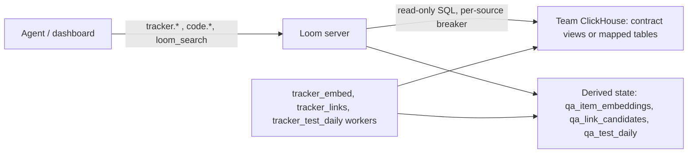

<!-- i18n: source=docs/features/tracker/overview.md blob=c43c9c14bbb3aece5e21c57716e38e3f7ca0c5e8 model=claude-sonnet-5-5 -->
> Esta página es una traducción automática de la [página en inglés](https://github.com/ClickHouse/loom/blob/main/docs/features/tracker/overview.md), que prevalece.
> Machine-translated from the [English page](https://github.com/ClickHouse/loom/blob/main/docs/features/tracker/overview.md), which is authoritative.

<a id="issue-duplicate-checks-and-regression-candidates-for-agents"></a>

# Verificación de duplicados de issues y candidatos de regresión para agentes

Con `LOOM_TRACKER_ORG` definido y una fuente registrada, Loom permite a los agentes comprobar si un error ya fue reportado y ordenar los cambios que pueden
haber introducido una regresión, usando los registros del tracker y el historial de PR indexado.
Para un repositorio
con historial de PR indexado y sin tracker, usa
[historial de código y candidatos de bisect](../code-index/history-and-prs.md).

Un tracker es el registro que lleva un equipo de issues, pull requests, incidentes y ejecuciones de CI, almacenado en el
ClickHouse propio del equipo. Loom lo lee en vivo con una credencial de solo lectura y nunca lo copia.
Cada sentencia está escrita según el [contrato de registros](https://github.com/ClickHouse/loom/blob/main/docs/features/tracker/record-contract.md), por lo que un nuevo
tracker no requiere cambios de código: el equipo expone vistas con los nombres del contrato o guarda un mapeo desde sus propias tablas.

Las lecturas en vivo mantienen una sola copia del registro bajo el control de acceso del equipo, y el
despliegue no conserva nada que luego tenga que borrar. Cada lectura tiene un presupuesto de tiempo y un
circuit breaker; cuando la fuente no responde, el resultado indica `tracker_unavailable`.

Loom conserva solo estado derivado: embeddings de similitud (`loom.qa_item_embeddings`),
vínculos issue→PR recuperados (`loom.qa_link_candidates`), un resumen diario de CI por prueba
(`loom.qa_test_daily`), el ajuste de calibración de la verificación de duplicados y las fuentes registradas
(`loom.qa_sources`, con credenciales cifradas).



<a id="portability-and-record-types"></a>

## Portabilidad y tipos de registro

El plano de trackers es neutral respecto al repositorio. Jira, GitHub, GitLab, Linear, un help desk o un tracker interno pueden servir el mismo contrato mediante vistas de ClickHouse o un mapeo guardado; no se selecciona en el código ningún nombre de repositorio ni proveedor. Los registros lógicos requeridos son issues y pull requests/cambios. Los nombres de tabla del contrato son `github_issues` y `github_prs`, pero el modo de mapeo los presenta en el panel como **items** y **changes**, de modo que las tablas y columnas propias de la fuente no necesitan esos nombres.

Los registros estructurados opcionales habilitan más operaciones: incidentes, casos de soporte, hilos de chat, instantáneas de riesgo de componentes, releases y salud de releases, historial de versiones, checks de CI, instancias en la nube y sus relaciones. Son registros de tabla tipados, no archivos adjuntos. Los PDF, los archivos de Office y los documentos arbitrarios pertenecen al plano Library; enlaza sus URL desde las filas del tracker cuando un issue necesite citarlos.

Un repositorio puede vincular varios espacios de nombres de trackers en orden. Las búsquedas por número usan el primer tracker porque `#42` es ambiguo entre sistemas. La búsqueda semántica, la comprobación de duplicados, el enrutamiento de respuestas y los escaneos de candidatos de bisect leen todos los trackers vinculados a los que el llamador pueda acceder, y cada elemento devuelto indica el espacio de nombres de su tracker.

<a id="tracker-namespaces"></a>

## Espacios de nombres de tracker

Un tracker se lee a través de **espacios de nombres de tracker** (filas de directorio con `kind = tracker`).
Cada uno indica su fuente y los `repos` (prefijos `Org/repo` de `source_id`) que puede leer; un
repositorio que no figure en la lista nunca se lee.

| Tipo       | Lee                                                                                                           | Política de unión                  |
| ---------- | ------------------------------------------------------------------------------------------------------------- | ---------------------------------- |
| standard   | agrega `is_private = 0` a cada sentencia; rechaza de plano `core_incidents`, `support_cases`, `slack_threads` | `open` (por defecto) o `approval`  |
| restricted | también filas privadas; cada lectura necesita un token que nombre el espacio de nombres más una concesión directa vigente | `approval`                         |

Los lectores se unen con `namespace.join` (`role: "viewer"`): un espacio de nombres abierto admite al instante, incluidas las cuentas de servicio; uno restringido espera a su administrador. Los diseños y su aplicación están en [público y privado](https://github.com/ClickHouse/loom/blob/main/docs/features/tracker/record-contract.md#public-and-private); el modelo de acceso está en
[identidades y espacios de nombres](https://github.com/ClickHouse/loom/blob/main/docs/concepts/identities-and-namespaces.md).

<a id="the-operations"></a>

## Las operaciones

Todas las operaciones del tracker aceptan `org` (por defecto `LOOM_TRACKER_ORG`) y un `namespace` obligatorio: un espacio de nombres del tracker, o un espacio de nombres de código vinculado a uno. Por MCP, cada operación es una herramienta `loom_<op>` (`loom_tracker_duplicate_check`). El toolset `tracker` lista las operaciones de consulta; `tracker.contract` y `tracker.source.*` se pueden invocar por nombre.

| Op                        | Responde                                                                                                                                               |
| ------------------------- | ------------------------------------------------------------------------------------------------------------------------------------------------------ |
| `tracker.duplicate_check` | ¿Ya existe este borrador? Un veredicto calibrado `duplicate_of` / `related` / `none`                                                                   |
| `tracker.similar`         | Los reportes que ya lo dicen: issues y PR duplicados y relacionados para un `text` pegado, un `issue_number` o `frames` de pila                        |
| `tracker.item`            | El registro de hasta diez números de issue o PR: componente, severidad, veredicto de bisección, ramas afectadas, tests, CI, backports, el grafo fixes / caused-by |
| `tracker.links`           | Qué PR probablemente corrigió este issue (o qué issue corrigió este PR) cuando nadie escribió el vínculo                                               |
| `tracker.flaky`           | ¿Es este test un flaky conocido? Los issues de tests flaky que lo nombran, opcionalmente con su historial de CI (`include_signal`)                     |
| `tracker.test_signal`     | ¿Flaky, regresión o infraestructura? El historial de CI propio de un test                                                                              |
| `tracker.release`         | Preparación de release para una versión: bloqueadores con su estado y la última instantánea de salud                                                   |
| `tracker.component`       | La instantánea de riesgo de un componente y sus issues abiertos, los más graves primero                                                                |
| `tracker.answer`          | Una pregunta en prosa, o los anclajes de un artefacto, respondidos mediante plantillas con nombre; indica qué buscó (`explain_only` devuelve el plan)  |
| `tracker.binding`         | Qué puede consultar un espacio de nombres en el plano del tracker: sus espacios de nombres del tracker, el principal primero, y las plantillas que el llamante puede ejecutar |
| `tracker.contract`        | El contrato de registros y las plantillas de vista en blanco, antes de cualquier conexión                                                              |
| `tracker.source.*`        | Registrar, inspeccionar, comprobar, remapear, rotar, listar y eliminar fuentes ([contrato de registros](https://github.com/ClickHouse/loom/blob/main/docs/features/tracker/record-contract.md#adding-a-tracker-source)) |

El plano de código también lee un tracker vinculado (`code.bisect_candidates`, `code.backport_gap`, `code.first_build`, `code.history`, `code.context_pack`; consulta [historial y PR](../code-index/history-and-prs.md#pr-and-tracker-planes)), y [`loom_search`](https://github.com/ClickHouse/loom/blob/main/docs/features/unified-search.md) ejecuta la comprobación de duplicados como una rama para una consulta con forma de defecto dentro de un ámbito de código.

<a id="duplicate-check"></a>

### Comprobación de duplicados

`tracker.duplicate_check` recibe un borrador tal como lo presentaría quien reporta: `title`, `body`, `frames`, `component`, `version` (`X.Y`), los números de issue que `mentions`, y `paths` y `symbols` de código.

```python
from loom import Agent

async with Agent(org="acme", namespace="code-widgets", agent="triage-bot") as bot:
    res = await bot.tracker.duplicate_check(
        namespace="code-widgets",
        title="Upload hangs after token refresh",
        body="Steps: … Observed: the request never returns.",
        component="upload",
        paths=["src/upload/client.py"],
    )
    print(res["verdict"], res["epistemic"], res["answer"])
```

Ejecuta una vez las ramas de `tracker.similar` y puntúa cada candidato fusionado con el ajuste logístico almacenado del espacio de nombres:

1. **Ramas.** BM25F sobre título y cuerpo con refuerzos por componente, versión y código de error; IDF de frames con decaimiento por posición; los elementos que el texto nombra por número; una rama vectorial sobre los embeddings propios de Loom (`LOOM_TRACKER_SIMILAR_VECTOR_LEG`, solo recall: añade candidatos, nunca reordena); y una rama de corrección en curso: los paths del borrador → los PR que los tocan → los issues que corrigen.
2. **Veredicto.** `duplicate_of` cuando la probabilidad calibrada del mejor candidato alcanza el umbral de duplicado, `related` en el umbral de relacionado; de lo contrario `none` sin elementos. El ajuste se reentrena semanalmente mediante la pasada `tracker_links` con los duplicados etiquetados del propio registro; se sirve el umbral sugerido de cada reajuste, limitado por `LOOM_TRACKER_DUPCHECK_DUPLICATE_THRESHOLD_MIN` / `_MAX`.
3. **Juez y reordenación.** En una respuesta `related`, una llamada al LLM puede promover un candidato del mismo defecto a `duplicate` (nunca degradar); una llamada de reordenación ordena las pistas de `nearest` pero nunca cambia el veredicto. Ambas requieren un proveedor de LLM real y fallan en abierto.
4. **Vínculos.** Las filas de issues incluyen sus PR vinculados, el release en el que se publica una corrección y sus backports; en `none` o `related`, `related_prs` lista los PR que ya podrían abordar el borrador ([`code.pr_check`](../code-index/history-and-prs.md#pre-pr-duplicate-check-codepr_check)).

`epistemic` indica cuánto confiar en la respuesta:

| Valor          | Significa                                                    |
| -------------- | ------------------------------------------------------------ |
| `calibrated`   | hay un ajuste almacenado                                     |
| `uncalibrated` | sin ajuste: como máximo `related`, confianza nula            |
| `degraded`     | una rama o un tracker no respondió; un `none` no es una garantía |
| `unavailable`  | el tracker no respondió                                      |

`none` significa «sin evidencia calibrada de duplicado», no «no reportado»; lee la lista `related` de todos modos. Dirigida a un espacio de nombres de código, la comprobación lee todos los trackers que el llamante puede leer, el vinculado primero, hasta `LOOM_TRACKER_DUPCHECK_FANOUT_NAMESPACES` (por defecto 4), e indica el espacio de nombres de cada elemento.

<a id="bisect"></a>

### Bisección

`code.bisect_candidates` se dirige al espacio de nombres de código y lee el tracker vinculado a él: las observaciones registradas previamente en las columnas de triaje de un `issue_number` (`triage_reproduces_on`, `triage_clean_on`) dan la ventana de releases, y los diffs de PR del tracker (`github_prs.diff`, `affected_file_paths`, la característica `bisect` del contrato) se escanean en busca de los frames. Sin frames, el escaneo se acota con los patrones más raros del issue (`LOOM_TRACKER_BISECT_SCOPE_PATTERNS`) y los directorios de su componente (`LOOM_TRACKER_BISECT_COMPONENT_DIRS`). Sin tracker, la bisección lee el historial de PR del propio repositorio. No reproduce el issue ni verifica las observaciones de triaje; ordena PR para que un ingeniero o un agente de pruebas los investigue. El flujo completo está en [historial y PR](../code-index/history-and-prs.md#bisect-candidates-codebisect_candidates).

<a id="from-a-bug-draft-to-candidate-prs"></a>

### De un borrador de bug a PR candidatos

Usa esta secuencia para comprobar reportes previos y ordenar cambios ya integrados sin compilar el repositorio. Las peticiones siguientes ilustran un borrador; no son resultados registrados.

1. Comprueba la configuración. Las comprobaciones de duplicados necesitan una [fuente de tracker registrada](https://github.com/ClickHouse/loom/blob/main/docs/features/tracker/record-contract.md#adding-a-tracker-source) y un espacio de nombres que el llamante pueda leer. Para usar el mismo espacio de nombres de código en ambas operaciones, [vincula el tracker](#linking-a-tracker-to-a-repository) e inspecciona allí `tracker.binding`. `kind: "none"` puede significar sin vincular o rechazado; no establece que no exista un tracker. Un repositorio con solo [historial de PR indexado](../code-index/history-and-prs.md#the-pr-plane) puede ordenar cambios, pero ese historial no sustituye la comprobación de duplicados del tracker.
2. Envía el borrador a `POST /v1/tracker.duplicate_check`, usando el espacio de nombres de código vinculado al tracker. Reemplaza el ámbito y las pistas de código de ejemplo por los de tu repositorio:

   ```json
   {
     "org": "acme",
     "namespace": "code-widgets",
     "title": "Upload hangs after token refresh",
     "body": "The upload request never returns after refreshing its token.",
     "paths": ["src/upload/client.py"],
     "symbols": ["UploadClient.send"]
   }
   ```

   Lee juntos `verdict`, `epistemic`, `items`, `closest`, `related_prs` y `leg_status`. Inspecciona los reportes y correcciones vinculados antes de tratarlos como el mismo defecto. `none` no autoriza a concluir que el bug no ha sido reportado; una lectura degradada o no disponible deja sin resolver la pregunta de duplicados.

3. Si aún hay que investigar el cambio que introdujo el defecto, envía las pistas de código del reporte a `POST /v1/code.bisect_candidates` en ese mismo espacio de nombres de código:

   ```json
   {
     "org": "acme",
     "namespace": "code-widgets",
     "paths": ["src/upload/client.py"],
     "symbols": ["UploadClient.send"],
     "text": "Upload hangs after refreshing its token.",
     "before": "now",
     "limit": 5
   }
   ```

   Proporciona `issue_number` solo para un reporte real en el tracker vinculado principal. Si se observaron releases buenos y malos, proporciona esas observaciones como se describe en el [ejemplo de ventana de versiones](../code-index/history-and-prs.md#bisect-candidates-codebisect_candidates). Aquí, `before: "now"` fija el límite superior en el momento de la petición; no es una hora de fallo observada. Prefiere límites de release observados, un límite superior de tiempo observado en `before` (y `after` cuando se conozca), o un commit malo conocido en `bad_sha`. Para un borrador sin registrar como este, omitir todo límite de release y de tiempo da `unknown` con `no_failing_version`; no se ejecuta ningún escaneo de candidatos. En cambio, un registro del tracker que ya nombra un commit o PR que introdujo el defecto puede responder sin escaneo. La operación no descubre la última versión buena.

4. Conserva la evidencia junto con la investigación. Lee `candidates_from`, `epistemic`, `causes`, `tracker_unavailable` y cualquier `partial` / `partial_reason` junto a la lista de candidatos. `candidates_from: "code_history"` identifica el respaldo del historial del repositorio, no una lectura exitosa del tracker. Los `matched_paths`, `matched_symbols` y `score` de cada candidato explican su posición; `epistemic: "lower_bound"` significa que una lista vacía no excluye nada. Inspecciona el diff y compara el comportamiento reportado antes y después del candidato en una reproducción o test aparte. El ranking por sí solo no prueba ni el defecto ni su causa.

<a id="ci-test-history"></a>

### Historial de tests de CI

`tracker.test_signal` lee las ejecuciones de CI de un test desde la tabla `checks` y responde `flaky`, `regression_candidate`, `infra_candidate`, `no_signal` (silencio, no salud) o `unknown_test` (con nombres de tests similares). Pondera la tasa de fallos y su cota inferior de Wilson, los cambios de resultado entre ejecuciones consecutivas, los cambios al reejecutar el mismo commit, las tormentas de fallos en muchos tests no relacionados (infraestructura) y la rotación de los archivos propios del test. `pr_number` añade la racha de resultados de la cabeza de ese PR; el código fuente del test se escanea en busca de indicios de test flaky.

El worker `tracker_test_daily` consolida diariamente los checks en `loom.qa_test_daily`, de modo que una lectura solo trae del remoto las horas sin consolidar. La tabla de checks proviene de `checks.from` en la entrada de la fuente ([opciones de la entrada de fuente](https://github.com/ClickHouse/loom/blob/main/docs/features/tracker/record-contract.md#source-entry-options)), si no de la tabla `checks` propia de la fuente, si no de `LOOM_TRACKER_CHECKS_FROM`; sin ninguna, la operación no tiene nada que leer. `tracker.flaky` responde la pregunta más barata: si los issues de tests flaky nombran el test (`flaky_by_issue` o `no_flaky_signal`).

<a id="links-to-fixing-prs"></a>

### Vínculos a PR que corrigen

Los issues a menudo se cierran sin una arista `fixes`. La pasada diaria `tracker_links` toma cada issue abierto en los últimos `LOOM_TRACKER_LINKS_ISSUE_DAYS` (90) días, ordena los PR integrados en el tronco posteriores a él (BM25F sobre título y cuerpo, palabras clave de cierre, frames de pila en el diff, componente) y escribe los mejores `LOOM_TRACKER_LINKS_PER_ISSUE` (20) en `loom.qa_link_candidates`. `tracker.links` los sirve en ambas direcciones. Un consumidor que necesita una sola corrección (`code.backport_gap`, bisect) toma el mejor candidato solo por encima de `LOOM_TRACKER_LINKS_MIN_SCORE` (1.0) y cuando una palabra clave de cierre nombra el issue.

<a id="linking-a-tracker-to-a-repository"></a>

## Vincular un tracker a un repositorio

Un espacio de nombres de código lee sus trackers vinculados en orden. El primero es el **primario**: sus
números son los números de issues y PR del repositorio, por lo que las búsquedas por número (`tracker.item`,
datos de PR, blame, backports, primera compilación) leen solo ese. Las búsquedas (`tracker.duplicate_check`,
`tracker.similar`, `tracker.answer`, el tramo de registros de `loom_search`, el escaneo de candidatos de bisect)
leen todos los trackers vinculados e indican la fuente de cada resultado.

| Quién      | Cómo                                                                                                                                                                                                                                                                                                                                                                                                              |
| ---------- | ----------------------------------------------------------------------------------------------------------------------------------------------------------------------------------------------------------------------------------------------------------------------------------------------------------------------------------------------------------------------------------------------------------------- |
| maintainer | `code.repo.set_source` con `tracker_namespaces` (administrador del repositorio y administrador de cada tracker que los vínculos propios del repositorio no incluyan ya), o la sección Trackers de la tarjeta del repositorio. Reemplaza el mapa del operador para ese repositorio dentro de `LOOM_CODE_REPOS_REFRESH_SECONDS`. Un tracker cuyos `repos` no cubren el repositorio se acepta con `not_covering`. |
| operator   | `LOOM_TRACKER_CODE_NAMESPACE_BINDINGS_JSON`: claves glob sobre nombres de espacios de nombres de código, cada una hacia un espacio de nombres de tracker o una lista ordenada. Vincula solo los repositorios del operador (`LOOM_CODE_REPOS_JSON` o `LOOM_CODE_REPO`); un repositorio de autoservicio (`code.repo.add`) lo vincula su maintainer.                                                                  |

Un tracker estándar vinculado lo leen todos los lectores del repositorio, así que vincular uno es una
delegación duradera; un nuevo vínculo requiere al administrador del tracker, sea restringido o no. Un lector de
el tracker que no es su administrador recibe 403; cualquier otra persona recibe `NOT_A_TRACKER_NAMESPACE`.
Una vez que un administrador del tracker vincula un tracker estándar, los administradores del repositorio deciden quién
lo lee, incluso mediante un cambio posterior de la política de ingreso con `code.repo.set_access`. Un vínculo en un
repositorio del operador, establecido antes o después de añadir una rama, también lo leen los lectores
de cada rama añadida desde él con `code.repo.add_branch`, y los administradores de cada rama
deciden quién se une a esa rama.

```bash
LOOM_TRACKER_CODE_NAMESPACE_BINDINGS_JSON='{"code-widgets*": ["tracker-widgets", "tracker-helpdesk"]}'
```

Una rama añadida con `code.repo.add_branch` desde un repositorio del operador lo registra como su
raíz (`qa_branch_of`) y, si no tiene vínculos propios, lee los vínculos de ese repositorio,
de modo que un glob que el operador cambie, o un vínculo establecido en el repositorio, también le llega. El vínculo de un
maintainer en un repositorio de autoservicio se copia a una rama nueva; un vínculo establecido después en
ese repositorio lo establece en sus ramas un administrador del tracker con
`code.repo.set_source`. Una rama de un repositorio del operador que se vuelve a añadir con el nombre de un
espacio de nombres eliminado que tenía vínculos de un maintainer, antes de que se ejecute la purga de ese espacio de nombres,
no lee ningún tracker hasta que un administrador del tracker lo vincule con `code.repo.set_source`.

Los vínculos nunca se deducen a partir de los nombres, y un vínculo pertenece a una organización: dos organizaciones pueden tener el
mismo nombre de espacio de nombres de código, y un vínculo establecido en una nunca se aplica en la otra. La puerta se evalúa
de nuevo para quien llama sobre el espacio de nombres vinculado, de modo que un tracker restringido vinculado a un repositorio público
sigue cerrado para cualquiera a quien la puerta rechace. `tracker.binding` informa a qué se resuelve un
espacio de nombres; sin vincular, rechazado y "sin tracker" dan la misma respuesta
(`kind: "none"`), así que un rechazo no revela nada.

<a id="adding-a-tracker-from-the-dashboard"></a>

## Añadir un tracker desde el panel

Cualquier miembro de la organización con sesión iniciada puede añadir un tracker desde la lista Trackers de la página Repositories, mientras `LOOM_TRACKER_SELF_SERVICE_ENABLED` esté activado (valor predeterminado) y la organización tenga menos de `LOOM_TRACKER_SELF_SERVICE_MAX_SOURCES` (10). El flujo muestra primero el contrato, luego la conexión (o un mapeo propuesto a partir de `tracker.source.inspect`), y después una comprobación con `dry_run: true` que devuelve un borrador de `CREATE OR REPLACE VIEW` por cada tabla que falla.
_Add_ permanece deshabilitado hasta que el formulario comprobado sea el mismo que se envía. Quien registra el tracker se convierte en el primer administrador. Los pasos como ops, el SQL del usuario de solo lectura y el formulario del operador están en
[añadir una fuente de tracker](https://github.com/ClickHouse/loom/blob/main/docs/features/tracker/record-contract.md#adding-a-tracker-source).

<a id="settings-that-change-it"></a>

## Ajustes que lo modifican

| Ajuste                                                       | Valor por defecto | Efecto                                                                                      |
| ------------------------------------------------------------ | ----------------- | ------------------------------------------------------------------------------------------- |
| `LOOM_TRACKER_ORG`                                           | `""`              | la organización a la que pertenecen los espacios de nombres del tracker; vacío = ningún espacio de nombres del tracker responde |
| `LOOM_TRACKER_LIVE_SERVE`                                    | activado          | interruptor de emergencia: desactivado = toda lectura del tracker responde `tracker_unavailable` |
| `LOOM_TRACKER_LIVE_BUDGET_MS`, `LOOM_TRACKER_LIVE_TIMEOUT_S` | 300, 1.5          | presupuesto del lado del llamante por lectura y el `max_execution_time` remoto              |
| `LOOM_TRACKER_CIRCUIT_FAILURE_THRESHOLD`, `_COOLDOWN_S`      | 3, 120            | fallos consecutivos que abren el interruptor de una fuente y cuánto tiempo permanece abierto |
| `LOOM_TRACKER_EMBED_ENABLED`                                 | activado          | el paso `tracker_embed` que rellena la rama vectorial                                       |
| `LOOM_TRACKER_LINKS_ENABLED`                                 | activado          | el paso diario de recuperación de enlaces, que también reajusta la calibración de la detección de duplicados |
| `LOOM_TRACKER_TEST_DAILY_ENABLED`                            | activado          | el resumen diario de CI por prueba                                                          |

Los umbrales, las ramas, el juez, el rerank, el alcance de bisect y los ajustes de la señal de pruebas están en la
[referencia de configuración](https://github.com/ClickHouse/loom/blob/main/docs/reference/configuration.md#tracker).

<a id="limits-and-failure-modes"></a>

## Límites y modos de fallo

- **Una fuente lenta** responde `tracker_unavailable` (o degrada una rama, indicada en
  `leg_status`) dentro de su presupuesto. Cada fuente tiene su propia conexión, su propio breaker y su propio presupuesto,
  por lo que la caída de un equipo nunca afecta a la de otro.
- **Una fuente que no cumple el contrato no se sirve** hasta que se corrijan sus vistas o su mapeo; un veredicto fallido se vuelve a comprobar después de 60 s
  ([comprobar una fuente](https://github.com/ClickHouse/loom/blob/main/docs/features/tracker/record-contract.md#checking-a-source)).
- **Sin calibrar hasta que exista un ajuste.** La comprobación de duplicados de un nuevo tracker responde
  `uncalibrated` hasta que el reajuste se haya ejecutado sobre sus duplicados etiquetados; un espacio de nombres restringido usa el ajuste estándar de la organización.
- **La rama vectorial se retrasa como máximo una pasada**, y una puesta al día en el momento de la consulta genera embeddings de los elementos
  modificados desde la pasada dentro de `LOOM_TRACKER_SIMILAR_CATCH_UP_BUDGET_MS`.
- **Las tablas ausentes responden `not_provided`.** Los incidentes, las versiones, las comprobaciones de CI y las demás
  tablas opcionales solo se leen cuando la fuente las proporciona.

<a id="related"></a>

## Relacionado

- [Feed de GitHub](github-feed.md): mantén un registro propiedad del equipo con un trabajo programado de la CLI
- [Contrato del registro](https://github.com/ClickHouse/loom/blob/main/docs/features/tracker/record-contract.md): tablas, columnas, alias, modo de mapeo, fuentes
- [Historial y PRs](../code-index/history-and-prs.md): las operaciones del plano de código que leen un tracker
- [Añadir repositorios](../code-index/repositories.md)
- [El panel](https://github.com/ClickHouse/loom/blob/main/docs/features/dashboard.md)
- [Referencia de configuración](https://github.com/ClickHouse/loom/blob/main/docs/reference/configuration.md#tracker)
- [Referencia de operaciones](https://github.com/ClickHouse/loom/blob/main/docs/reference/operations.md#tracker)
