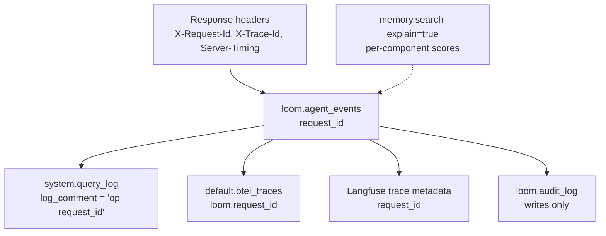

<!-- i18n: source=docs/guides/debugging.md blob=7e3e8e18681a11279a779257bf5385dbd9bce7c0 model=claude-sonnet-5-5 -->
> Esta página es una traducción automática de la [página en inglés](https://github.com/ClickHouse/loom/blob/main/docs/guides/debugging.md), que prevalece.
> Machine-translated from the [English page](https://github.com/ClickHouse/loom/blob/main/docs/guides/debugging.md), which is authoritative.

<a id="debug-a-request"></a>

# Depurar una solicitud

Loom etiqueta todo lo que hace una solicitud con el mismo id, por lo que rastrear una solicitud es un join.
Esta página sigue una solicitud desde los encabezados de su respuesta hasta el componente que decidió
la respuesta. Cuando el despliegue en sí no está sano, empieza por
[solución de problemas](https://github.com/ClickHouse/loom/blob/main/docs/operations/troubleshooting.md); cuando un worker no se ha ejecutado, consulta
[estado de los workers](https://github.com/ClickHouse/loom/blob/main/docs/operations/monitoring.md#worker-status).



<a id="1-capture-the-requests-ids"></a>

## 1. Captura los ids de la solicitud

Cada respuesta HTTP incluye:

| Header                            | Significado                                                                                                                                                                                                                              |
| --------------------------------- | ---------------------------------------------------------------------------------------------------------------------------------------------------------------------------------------------------------------------------------------- |
| `X-Request-Id`                    | El id de la solicitud. Envía el tuyo (de 1 a 64 letras, dígitos, `.`, `_` o `-`) y Loom lo devuelve igual, de modo que tu log y las filas de Loom comparten una misma clave; cualquier otro valor se sustituye por un id generado. |
| `X-Trace-Id`                      | El id de traza de OpenTelemetry del árbol de spans de la solicitud.                                                                                                                                                                      |
| `Server-Timing`                   | `app` (tiempo del handler) y `ch` (tiempo de ClickHouse, número de sentencias, bytes leídos) cuando la solicitud tiene éxito.                                                                                                            |
| `X-Loom-Hint`, `X-Loom-Hint-Code` | La sugerencia del mentor para esta llamada, cuando la hay; los SDKs la registran en el log.                                                                                                                                              |

```bash
curl -si "$LOOM_BASE_URL/v1/memory.search" -H "Authorization: Bearer $LOOM_API_KEY" \
  -H 'Content-Type: application/json' -H 'X-Request-Id: dbg-0001' \
  -d '{"org":"acme","namespace":"support","agent":"bot","query":"refund window"}' \
  | grep -iE '^(x-request-id|x-trace-id|server-timing)'
```

`Server-Timing` suele responder a la pregunta "por qué fue lenta". Una duración o un número de bytes de `ch` elevados apuntan a la consulta. Un `app` alto con un `ch` bajo apunta a una llamada a un proveedor (embedding, rerank, LLM).

<a id="2-join-the-request-across-systems"></a>

## 2. Unir la solicitud entre sistemas

El mismo id está en `loom.agent_events.request_id`, en los metadatos del trace de Langfuse y en el
atributo de span `loom.request_id` de `default.otel_traces`.

```sql
-- the ledger row: operation, identity, latency, success, error_code, tokens, cost, model
SELECT * FROM loom.agent_events WHERE request_id = 'dbg-0001';

-- every ClickHouse statement the request issued
SELECT query_duration_ms, read_rows, read_bytes, substring(query, 1, 200) AS q
FROM system.query_log
WHERE type = 'QueryFinish' AND log_comment LIKE '% dbg-0001%'
ORDER BY event_time_microseconds;

-- its spans
SELECT SpanName, Duration, SpanAttributes['loom.operation'] AS op
FROM default.otel_traces
WHERE SpanAttributes['loom.request_id'] = 'dbg-0001'
ORDER BY Timestamp;
```

Las etiquetas de `log_comment` se enumeran en
[atribución de consultas](https://github.com/ClickHouse/loom/blob/main/docs/operations/monitoring.md#logs-traces-and-query-attribution).
Los spans van a `default.otel_traces` (en `LOOM_CLICKSTACK_DATABASE` cuando está definida) cuando
`LOOM_OTEL_EXPORTER` se resuelve como `ch`, o al endpoint OTLP. Si Langfuse está configurado, también van a
[Langfuse](https://github.com/ClickHouse/loom/blob/main/docs/features/integrations/langfuse.md).

> **Nota:** el ledger nunca almacena el texto de las consultas. `loom.agent_events` reemplaza cada
> argumento de texto libre con una forma `sha256:<16 hex>/<length>`. Para ver qué se preguntó, usa
> el registro de trazas de búsqueda que aparece más abajo o el registro de tu propio cliente.

<a id="3-explain-a-search-answer"></a>

## 3. Explicar una respuesta de búsqueda

**¿Por qué quedó en esta posición?** `memory.search` con `explain=true` adjunta `score_components`
a cada resultado devuelto: las señales de ranking y, tras un reranker, su desplazamiento (`rerank_from`,
`rerank_pos`, `rerank_delta`) y, cuando el reranker cambió el orden, su propia puntuación fusionada
(`rank_score_pre_rerank`). Una fila que bajó de posición porque cambió el código enlazado lleva
los lugares que descendió (`code_changed_places`).

```python
out = await agent.call("memory.search", {"query": "refund window", "explain": True})
for h in out["results"]:
    c = h["score_components"]
    print(
        h["memory_key"],
        h["similarity"],
        h["rank_score"],
        c.get("rerank_from"),
        c.get("rank_score_pre_rerank"),
    )
```

`memory.search_trace` recibe los argumentos de `memory.search` y puntúa únicamente la rama vectorial
(sin fusión, ensamblado ni reranker), y devuelve, por cada resultado, `similarity`, `distance`,
`entity_boost`, `rank_score`, `rank` y `source`.

**¿Por qué se abstuvo?** Lee la propia respuesta de `memory.search`:

| Campo                                     | Qué te indica                                                                                                  |
| ----------------------------------------- | -------------------------------------------------------------------------------------------------------------- |
| `abstain`, `abstain_code`                 | Qué umbral se activó: `no_match`, `below_threshold`, `entity_absent`, `low_calibrated_confidence`, `page_expired`. |
| `retrieval_risk`, `retrieval_confidence`  | Qué tan lejos está el mejor resultado de los umbrales.                                                         |
| `calibration_explanation`                 | Qué umbrales de similitud estaban en vigor (calibrados a partir del embedder, o los valores escalares de respaldo). |
| `degraded`                                | Proveedores que recurrieron a un respaldo en esta lectura, y qué hizo la respuesta en su lugar.                |
| `pending_extraction`                      | Lotes diferidos de `set_from_messages` que aún no se han extraído; si es mayor que 0, una respuesta vacía no prueba la ausencia. |
| `namespaces_searched`, `candidates_total` | Si la búsqueda llegó a los espacios de nombres y las filas que esperabas.                                      |

`calibration.get` muestra los umbrales vigentes para un espacio de nombres y qué nivel
(espacio de nombres, clúster, escalar) los produjo.
[Recuperación y ranking](https://github.com/ClickHouse/loom/blob/main/docs/concepts/retrieval-and-ranking.md) explica cada término.

**¿Qué buscó un agente a lo largo del tiempo?** Requiere `LOOM_SEARCH_TRACE_LOG_ENABLED=true`
(desactivado por defecto). `memory.search_trace_log(since_hours=, agent=, run_id=)` devuelve una fila
por búsqueda: `returned_keys`, `returned_scores`, `abstain`, `retrieval_risk`,
`latency_ms`, y el `query` cuando `LOOM_LANGFUSE_CAPTURE_IO_LEVEL` no es `off` (su
valor por defecto es `off`, así que por defecto las filas incluyen claves y puntuaciones, pero no la pregunta).

<a id="4-explain-a-write"></a>

## 4. Explicar una escritura

- **La respuesta propia de la escritura.** `memory.set` devuelve `status`, `conflict_verdict`, `peers`,
  `duplicate_of`, `merged_into_key`, `noop` y `advisories`. Una escritura que "desapareció"
  normalmente se fusionó con una coincidencia canónica o se marcó como duplicada. `advisories` señala
  un valor con doble codificación o de tamaño excesivo.
- **Su historial.** `memory.history` lista las versiones de una clave desde `loom.memory_versions`.
  `memory.provenance` indica quién la escribió, desde qué fuente, sesión y ejecución.
- **Lo que descartó la extracción.** `memory.extraction_status` lista los lotes diferidos de
  `set_from_messages` (`pending`, `failed`). `loom drops --namespace <ns>` imprime
  lo que el pipeline descartó, truncó o abandonó, por etapa y motivo
  ([descartes de ingesta de memoria](https://github.com/ClickHouse/loom/blob/main/docs/operations/maintenance.md#memory-ingest-drops)). Una
  respuesta de `set_from_messages` incluye `pipeline_errors` y `stage_ms` por paso
  ([pipeline de extracción](https://github.com/ClickHouse/loom/blob/main/docs/guides/extraction-pipeline.md)).
- **El registro de auditoría.** `audit.list(event_type=, since=)` lee `loom.audit_log`: quién
  cambió qué, con un hash del contenido por fila. Toda escritura que crea o modifica memoria
  deja una fila con solo el hash ([auditoría](https://github.com/ClickHouse/loom/blob/main/docs/features/observability/audit.md)).
- **La vista de una ejecución.** `run.get(run_id)` devuelve lo que una ejecución recuperó (`recalled_keys`), lo que
  escribió, sus turnos y su costo ([traza y reanudación](https://github.com/ClickHouse/loom/blob/main/docs/guides/trace-and-resume.md)).

<a id="related"></a>

## Relacionado

- [Solución de problemas](https://github.com/ClickHouse/loom/blob/main/docs/operations/troubleshooting.md)
- [Monitorización](https://github.com/ClickHouse/loom/blob/main/docs/operations/monitoring.md)
- [Telemetría](https://github.com/ClickHouse/loom/blob/main/docs/features/observability/telemetry.md)
- [Visión general del sistema](https://github.com/ClickHouse/loom/blob/main/docs/architecture/system-overview.md)
- [Ajuste del rendimiento](https://github.com/ClickHouse/loom/blob/main/docs/guides/performance-tuning.md)
