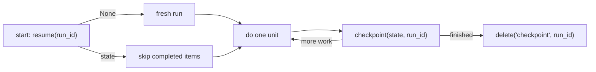

<!-- i18n: source=docs/guides/trace-and-resume.md blob=d597f5338750e0167731c70d5eb3f07fc5bc291d model=claude-sonnet-5-5 -->
> Esta página es una traducción automática de la [página en inglés](https://github.com/ClickHouse/loom/blob/main/docs/guides/trace-and-resume.md), que prevalece.
> Machine-translated from the [English page](https://github.com/ClickHouse/loom/blob/main/docs/guides/trace-and-resume.md), which is authoritative.

<a id="trace-and-resume-long-agent-runs"></a>

# Rastrear y reanudar ejecuciones largas de agentes

Una ejecución larga (procesar 300 archivos, rastrear un repositorio, completar un plan) puede detenerse a mitad de camino: un fallo, una ventana de contexto llena, un despliegue, una pausa. Un bloque de memoria de trabajo identificado por el `run_id` de la ejecución guarda su progreso en ClickHouse, de modo que un proceso nuevo lo lee y continúa desde la última unidad de trabajo completada. No se necesita un almacén de checkpoints aparte.

<a id="the-pattern"></a>

## El patrón

1. Elige un `run_id` estable para la tarea: un id de trabajo, un id de plan.
2. Después de cada unidad de trabajo, llama a `checkpoint(state, run_id=...)`. `state` es lo que un proceso nuevo necesita para continuar: ids de elementos completados, un cursor, una cadena JSON.
3. Al arrancar, llama a `resume(run_id=...)`. `None` significa una ejecución nueva; en caso contrario, omite lo que el checkpoint indica como hecho.



<a id="with-the-python-sdk"></a>

## Con el SDK de Python

```python
from loom import Agent

RUN = "reindex-catalog"


async def process(agent: Agent, items: list[str]) -> None:
    done = set((await agent.working_memory.resume(run_id=RUN) or "").split())
    for item in items:
        if item in done:
            continue
        await do_work(item)
        done.add(item)
        await agent.working_memory.checkpoint(" ".join(sorted(done)), run_id=RUN)
```

`checkpoint` y `resume` son `working_memory.set` y `working_memory.get` sobre el bloque `checkpoint` (cámbialo con `block_key=`). Cada `checkpoint` sobrescribe el anterior.

> **Advertencia:** el `char_limit` por defecto es de 4,096 caracteres (`DEFAULT_CHAR_LIMIT` en `sdk/python/loom/working_memory.py`). Mantén el estado pequeño, o guarda un puntero a él: un blob grande pertenece a `context.offload`, con su `blob_key` en el checkpoint.

Cuando la tarea termina, borra el checkpoint:

```python
await agent.working_memory.delete("checkpoint", run_id=RUN)
```

Para un registro de progreso en lugar de una sola instantánea, `working_memory.append(..., run_id=RUN)` añade a un bloque y `working_memory.render(run_id=RUN)` vuelve a leer los bloques.

<a id="over-mcp"></a>

## Mediante MCP

`working_memory.set` aparece listado (`loom_working_memory_set`) en los toolsets `coding`, `atomic` y `all`, y se ejecuta mediante `loom_op` en todos los demás toolsets excepto `readonly` y `assistant`. `working_memory.get` no aparece listado en ningún toolset, incluido `all`; llámalo mediante `loom_op` con `{"op": "working_memory.get", "arguments": {...}}`. Un agente:

1. llama a `working_memory.set` con `run_id` y `block_key="checkpoint"` después de cada paso;
2. llama a `working_memory.get` con el mismo `run_id` y `block_key` al arrancar.

Dos ejecuciones con `run_id` distintos nunca ven los checkpoints de la otra.

<a id="which-plane-holds-a-checkpoint"></a>

## Qué plano guarda un checkpoint

| Estado                                      | Plano                  | Por qué                                                                                           |
| ------------------------------------------- | ---------------------- | ------------------------------------------------------------------------------------------------- |
| Un cursor de reanudación pequeño (ids hechos, un desplazamiento) | Memoria de trabajo | Se lee por clave exacta; se sobrescribe en cada paso; nunca se genera su embedding |
| Un resultado parcial grande o la salida de un paso | Blob de `context.offload` | Guarda contenido que supera el límite del bloque, con un `summary` y `ttl_seconds`; se lee con `context.fetch` |
| Una afirmación que la ejecución estableció  | `memory.set`           | Duradera, con embedding y clasificada para recuperarla después                                    |

La [guía del agente de investigación](https://github.com/ClickHouse/loom/blob/main/docs/guides/investigation-agent-memory.md) asigna cada tipo de estado del agente a su plano.

<a id="trace-what-the-run-did"></a>

## Rastrear lo que hizo la ejecución

- `run.begin` / `run.complete` registran la propia ejecución: su objetivo, su estado, las memorias en las que se apoyó (`memories_used`) y una reflexión. `run.get` devuelve la ejecución con las claves que recuperó, las memorias que escribió, sus turnos y su coste ([ejecuciones](https://github.com/ClickHouse/loom/blob/main/docs/features/runs.md)).
- Las memorias que escribió la ejecución llevan su `run_id`; `memory.search(run_id=...)` filtra por ellas.
- `conversation.create` y `conversation.append` aceptan un `run_id`, de modo que la transcripción de la ejecución queda vinculada a ella ([conversaciones y sesiones](https://github.com/ClickHouse/loom/blob/main/docs/features/conversations-and-sessions.md)).
- Con `LOOM_SEARCH_TRACE_LOG_ENABLED=true` (desactivado por defecto), `memory.search_trace_log(run_id=...)` lista cada búsqueda que hizo la ejecución y lo que devolvió ([depuración](https://github.com/ClickHouse/loom/blob/main/docs/guides/debugging.md)).

Loom no guarda instantáneas de las variables del proceso. El checkpoint contiene lo que tú pongas en él.

<a id="why-it-holds"></a>

## Por qué funciona

`loom.working_memory` es una `ReplacingMergeTree(version)` ordenada por `(org, namespace, agent, user_id, session_id, run_id, block_key)`. Cada `checkpoint` escribe una nueva versión de la fila y las lecturas colapsan a la más reciente. `run_id` forma parte de la clave de ordenación, así que dos ejecuciones son dos filas.

<a id="related"></a>

## Relacionado

- [Memoria de trabajo y perfiles](https://github.com/ClickHouse/loom/blob/main/docs/features/memory/working-memory-and-profiles.md)
- [Ejecuciones](https://github.com/ClickHouse/loom/blob/main/docs/features/runs.md)
- [Bots sin interfaz](https://github.com/ClickHouse/loom/blob/main/docs/guides/headless-bots.md)
