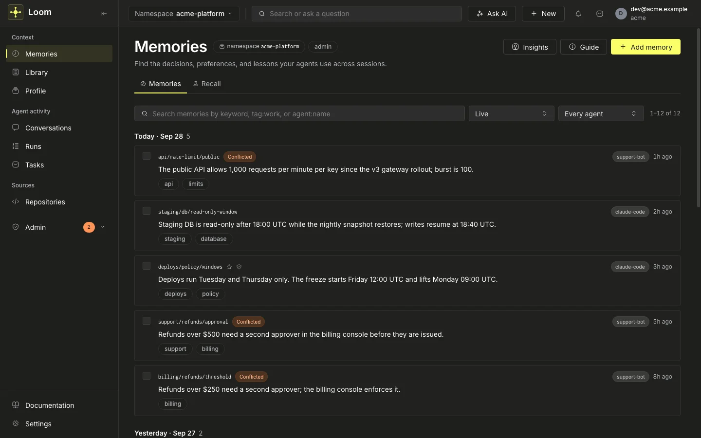

<!-- i18n: source=README.md blob=29675cf2a8d5e7d37f9dc00aeedb1a413885bb38 model=claude-sonnet-5-5 -->
> このページは[英語の原文](https://github.com/ClickHouse/loom/blob/main/README.md)の機械翻訳です。内容は英語の原文が優先されます。
> Machine-translated from the [English page](https://github.com/ClickHouse/loom/blob/main/README.md), which is authoritative.

<h1 align="center">ClickHouse Loom</h1>

<p align="center">
  <b>AI エージェントのための、共有メモリ、ドキュメント検索、コードインテリジェンス。</b><br>
  Claude Code、Codex、Cursor、独自のエージェントに対応。
</p>

<p align="center">
  <a href="https://pypi.org/project/clickhouse-loom/"></a>
  <a href="https://www.npmjs.com/package/@clickhouse/loom"></a>
  <a href="https://github.com/ClickHouse/loom/blob/main/LICENSE"></a>
  <a href="https://glama.ai/mcp/servers/ClickHouse/loom"></a>
  <a href="https://github.com/ClickHouse/loom/actions/workflows/ci.yml?query=branch%3Amain+event%3Apush"></a>
  <a href="https://scorecard.dev/viewer/?uri=github.com/ClickHouse/loom"></a>
</p>

<p align="center">
  <!-- languages -->
  <a href="../../README.md">English</a> · <a href="../zh-CN/README.md">简体中文</a> · 日本語 · <a href="../ko/README.md">한국어</a> · <a href="../pt-BR/README.md">Português (Brasil)</a> · <a href="../es/README.md">Español</a>
  <br>
  <a href="https://loom.clickhouse.com/docs/ja/">ドキュメント</a>
  <!-- /languages -->
</p>

<p align="center">
  <a href="#what-loom-is-for">Loom の用途</a> ·
  <a href="#measured-results">ベンチマーク</a> ·
  <a href="#get-started">はじめに</a> ·
  <a href="#why-loom">機能</a> ·
  <a href="#integrations">連携</a> ·
  <a href="https://loom.clickhouse.com/docs/">ドキュメント</a>
</p>

<p>
  
  
  
</p>

Loom は、エージェントに長期的な共有メモリを提供する、オープンソースのセルフホスト型 MCP サーバーです。あるエージェントがセッションで学んだことを、次のエージェントやツールが見つけられます。

エージェントは MCP、HTTP、Python、TypeScript で接続します。セルフホストには Docker、または [Helm チャートを使った Kubernetes](https://github.com/ClickHouse/loom/blob/main/docs/operations/kubernetes.md) を利用できます。エージェントのコンテキストとインデックスデータは [ClickHouse](docs/use-cases/self-hosted-clickhouse.md) に保存されます。また、デプロイ時に、ライブのメモリとナレッジの状態に [初回起動時に Postgres](https://github.com/ClickHouse/loom/blob/main/docs/operations/postgres.md) を選択することもできます。ダッシュボードでは、メモリ、リポジトリ、タスク、実行を一か所にまとめて確認できます。

<a id="what-loom-is-for"></a>

## Loom の用途

- **コーディングエージェント間で共有される長期メモリ**。プラグインがセッション開始時にコンテキストを読み込み、セッションの実行中にその内容を記録します。
  [エージェントメモリ](docs/use-cases/agent-memory.md) ·
  [コーディングエージェントを接続する](https://github.com/ClickHouse/loom/blob/main/docs/getting-started/connect-a-coding-agent.md)
- **エージェントアプリケーション向けのメモリ**。ユーザーごとに、Python または TypeScript の SDK から利用できます。[最初のエージェント](https://github.com/ClickHouse/loom/blob/main/docs/getting-started/first-agent.md)
- **マルチユーザー対応の MCP メモリサーバー**。名前空間、ロール、トークンを備えています。
  [マルチユーザーモード](docs/getting-started/quickstart.md#start-in-multi-user-mode) ·
  [名前空間と共有](https://github.com/ClickHouse/loom/blob/main/docs/features/namespaces-and-sharing.md)
- **リポジトリのコードインデックス**。コーディングエージェントが定義、呼び出し元、変更の影響範囲を問い合わせます。[コードインデックス](docs/use-cases/code-intelligence.md) ·
  [対応言語と制限](https://github.com/ClickHouse/loom/blob/main/docs/features/code-index/overview.md#language-support)
- **対象のコードに紐づくメモリ**。リファクタリングをまたいでコードに追従し、コードが変更されると通知され、エージェントがそのコードを読んだり編集したりすると表示されます。
  [コードに紐づくメモリ](docs/use-cases/memory-linked-to-code.md)
- **コーディングエージェントのモデルコスト削減**。以下の[計測結果](#measured-results)を参照してください。
  [コーディングエージェントのコスト](docs/use-cases/coding-agent-cost.md)
- **引用付きのドキュメント検索（RAG）**。抽出サービスが変換する PDF、`.docx`、`.pptx` ファイルも対象です。[ドキュメント検索](docs/use-cases/document-search.md)
- **マルチエージェントワークフロー向けの共有コンテキスト**：共有メモリ、タスクインボックス、決定事項。[マルチエージェント](docs/use-cases/multi-agent.md)
- **自律型エージェント向けのメモリ、想起、監査、消去。**
  [自律型エージェント](docs/use-cases/autonomous-agents.md)
- **エージェントの作業記録**。検索可能な会話（記録を有効にしている場合）、再開に使えるセッション概要、目標・結果・モデルコスト（提供された場合）を含む実行履歴、PR とトラッカーの履歴を残します。
  [実行履歴と PR 履歴](docs/use-cases/runs-and-pr-history.md)

すべてのユースケースと、ほかのツールのほうが適している場合については、[ユースケース](docs/use-cases/index.md)を参照してください。

Loom は、1 つのエージェントの短期的なメモリのためのインプロセスライブラリではなく、エージェントフレームワークでもありません。[Loom が適さない場合](https://github.com/ClickHouse/loom/blob/main/docs/getting-started/overview.md#when-it-does-not-fit)

<a id="measured-results"></a>

## 測定結果

| 評価                           | Loom あり | Loom なし | 効率の向上                         | 範囲                               |
| ------------------------------ | --------- | --------- | ---------------------------------- | ---------------------------------- |
| コーディングエージェントの回答品質 | **0.84**  | 0.78      | モデルコストが **20% 低下**        | 24 問 × 3 回のペア実行             |
| コーディングエージェントのファイル特定 | **96.4%** | 91.4%     | モデルコストが **21% 低下**        | 36 問 × 10 回のペア実行            |
| メモリと全履歴での回答の比較   | **94%**   | 90%       | リーダーのプロンプトトークンが **91% 減少** | LongMemEval-S の 100 問のペア      |

どちらのコーディング設定も、ClickHouse のコードベースで Claude Code（`claude-sonnet-5`）を使用しています。コストは、セッション全体のモデル利用料金であり、Loom のサーバー側のモデル呼び出し、ホスティング、インデックス作成は含みません。回答品質は、検証済みの回答の要点をどれだけ網羅しているかを測り、矛盾があれば減点します。ファイル特定は、エージェントが回答の最後に挙げるよう求められる最大 3 つのファイルの中に、正しいファイルが含まれているかを数えます。

メモリの行では、取得したメモリと会話の全履歴を、同じ `gpt-5` のリーダーで比較しています。トークンの削減量にはメモリの構築は含まれません。94% と 90% の精度の差は記述的なものであり、統計的に確立されたものではありません。

**これとは別に、Loom の `memory.ask` 構成は、LongMemEval-S の全 500 問で 96.6% の回答精度を記録しました。** これは独自に設定した回答モデルを用いた製品評価であり、上記の固定リーダーによる比較とは異なります。

結果は、テストしたワークロードに固有のものです。

[プロトコルと再現可能な成果物](https://github.com/ClickHouse/loom/blob/main/docs/benchmarks/results.md) ·
[詳細な結果](#benchmark-details) ·
[自分のワークロードで評価する](https://github.com/ClickHouse/loom/blob/main/docs/getting-started/evaluate.md)

<a id="get-started"></a>

## はじめに

<a id="1-choose-your-docker-setup"></a>

### 1. Docker のセットアップを選ぶ

- **個人利用（デフォルト）：** ログイン不要、localhost のみでアクセスでき、`dev/local` 名前空間を使います。1 人で複数のエージェントを接続できます。
- **チーム利用：** 認証付きアカウントと名前空間のアクセス制御を使います。[初回起動からマルチユーザーモードで開始する](docs/getting-started/quickstart.md#start-in-multi-user-mode)。

どちらのモードでも、設定済みの LLM や埋め込みを含め、Loom の同じ機能が使えます。シングルユーザーモードは機能を絞った版ではありません。[データを削除せずに既存のインストールを切り替える](docs/getting-started/quickstart.md#2-open-the-dashboard)こともでき、新しいアカウントに既存の名前空間へのアクセスを付与できます。

何もインストールせずに試すには、codespace で開きます。

[](https://codespaces.new/ClickHouse/loom?quickstart=1)
（[実行内容とアクセスできるユーザー](docs/getting-started/quickstart.md#try-it-in-github-codespaces)）

デフォルトの個人向けインストールでは、Docker をインストールしておきます（Windows では、`docker` が動作する WSL 2 ターミナルで行います。WSL 統合を有効にした Docker Desktop、またはディストリビューション内にインストールした Docker Engine が使えます）。

```bash
curl -fsSL https://github.com/ClickHouse/loom/releases/latest/download/install.sh -o loom-install.sh && sh loom-install.sh && rm loom-install.sh
```

ホームディレクトリ、または[自分だけが書き込めるディレクトリ](docs/getting-started/quickstart.md#fast-path-released-image-no-clone)から実行してください。インストーラーは Loom と ClickHouse を起動し、マイグレーションを適用して、ダッシュボードの URL **http://localhost:7777/** を表示します。新規インストールの場合は、続けてメモリの保存と読み取りが正しく動作するか確認します。ターミナルでは、検出したコーディングエージェント（Claude Code、Codex、VS Code）の接続も提案し、新規インストールではダッシュボードを開きます。イメージには、サーバー、ワーカー、ダッシュボード、Python・TypeScript・Go のコンパイラインデクサーが含まれ、`amd64` では C++ のインデクサーも含まれます。TypeScript の依存関係は自動的に準備されます。[クイックスタートとバージョン固定のリリース](docs/getting-started/quickstart.md)

インストール先は `~/.loom` です（`LOOM_INSTALL_DIR` で別のディレクトリを指定できます）。Compose ファイルと、起動時の設定を記した `~/.loom/.env` が置かれます。インストールコマンドを再度実行すると、その場でアップグレードされ、`.env` の設定は保持されます。

シングルユーザーモードは localhost のみで使ってください。共有アクセスが必要な場合は、TLS を含め、[チームデプロイガイド](https://github.com/ClickHouse/loom/blob/main/docs/operations/deployment.md#identity-modes)に従ってください。

<a id="2-configure-models-and-api-keys"></a>

### 2. モデルと API キーを設定する

**標準のインストールは、キーやネットワークがなくても起動します。** ストレージ、ダッシュボード、構造的なコードインデックス、セマンティック検索は動作します。セマンティック検索には、イメージに含まれる小さなローカル埋め込みモデルが使われます。ただし fake LLM は AI による回答を生成しません。

| コンポーネント | 実運用での設定                                         | 未設定の場合                                                                      |
| -------------- | ------------------------------------------------------ | --------------------------------------------------------------------------------- |
| 埋め込み       | プロバイダー、埋め込みモデル、次元数、API キー。       | `local`（CPU 上の bge-small）：セマンティック検索は動作しますが、ホスト型モデルより精度は劣ります。 |
| LLM            | プロバイダー、モデル、API キー。                       | `fake-echo-1`：意味のある抽出、要約、回答は得られません。                         |

**Settings → Models & keys** を開き、両方のプロバイダーとモデルを選んでキーを入力し、**Test & apply** をクリックします。Docker の再起動は不要です。埋め込み空間を変更すると、既存のインデックスが再構築されます。ダッシュボードで選べる埋め込みはホスト型プロバイダーのみです。`local` を維持して LLM だけを追加するには、代わりに `~/.loom/.env` の LLM の行を設定します（[モデルとキー](https://github.com/ClickHouse/loom/blob/main/docs/getting-started/models-and-keys.md#claude-for-the-llm)）。

**1 つの OpenAI API キーで両方の役割を賄えます。** Claude を使う場合は、別途埋め込みプロバイダーが必要です。OpenAI、Gemini、OpenAI 互換の埋め込みエンドポイントに対応しています。エージェントの CLI ログインやサブスクリプションは、Loom のプロバイダーキーの代わりにはなりません。

環境変数で設定したい場合は、`~/.loom/.env` を編集してからサーバーを再作成します。

```bash
docker compose --project-directory "$HOME/.loom" up -d --force-recreate loom
```

キーだけでは、固定されているモデル（ローカル埋め込みと fake LLM）は変わりません。プロバイダーとモデルも設定してください。ダッシュボードで保存した設定は `.env` より優先されます。プロバイダー別の手順とヘルスチェックについては、[モデルと API キー](https://github.com/ClickHouse/loom/blob/main/docs/getting-started/models-and-keys.md)を参照してください。

**その他の設定はすべて 1 つのファイルにあります。** [`loom.example.yaml`](https://github.com/ClickHouse/loom/blob/main/loom.example.yaml) には、すべての設定がデフォルト値と説明付きで、分野別に並んでいます。ClickHouse への接続、タイムアウトと予算、レート制限、ワーカー、機能のオン・オフを切り替える `*_enabled` スイッチなどです。いずれも `~/.loom/.env` に `LOOM_<NAME>` として設定し、サーバーを再作成すれば反映されます。設定ファイルをマウントするデプロイでは、このファイルのコピーに設定できます（[設定の読み込み方法](https://github.com/ClickHouse/loom/blob/main/docs/operations/deployment.md#how-settings-are-read)）。`live` と記された設定は、Loom の実行中にも変更できます。`loom settings set <name> <value>` を使うか、Admin → Deployment settings で変更します。`loom settings list --changed` を実行すると、デフォルトと異なる設定と、各値の取得元が表示されます（[ランタイム設定](https://github.com/ClickHouse/loom/blob/main/docs/operations/runtime-settings.md)）。

<a id="3-connect-your-agents"></a>

### 3. エージェントを接続する

インストーラーがエージェントを接続済みなら、以下のコマンドは不要です。個人向けインストールを実行しているマシンでは、プラグインにトークンは不要です。

```bash
# Claude Code
claude plugin marketplace add ClickHouse/loom
claude plugin install loom@loom

# Codex
codex plugin marketplace add ClickHouse/loom
codex plugin add loom@loom
```

新しいセッションを開始すると、最初のセッションが `http://localhost:7777` に接続します。Codex では、一度 `codex` を対話モードで実行し、プラグインのフックを承認してください。承認するまではツールのみが動作します。残しておきたい内容をエージェントに伝え、次のセッションでそれについて尋ねてみましょう。

Cursor では、Teams または Enterprise プランの場合、チーム管理者がこのリポジトリをチームマーケットプレイスとしてインポートできます。その [Cursor プラグイン](https://github.com/ClickHouse/loom/blob/main/docs/features/integrations/cursor.md#plugin)（Cursor では未検証）は、MCP エントリと Loom のスキルをインストールします。個人向けインストールを実行しているマシンでは、下のボタンでトークン不要の[ローカル MCP エントリ](https://github.com/ClickHouse/loom/blob/main/docs/features/integrations/cursor.md#mcp-tools)を追加できます。

[](https://cursor.com/en/install-mcp?name=loom&config=eyJ1cmwiOiJodHRwOi8vbG9jYWxob3N0Ojc3NzcvbWNwP3Rvb2xzZXQ9Y29kaW5nIn0%3D)

個人向けインストールを実行しているマシンの VS Code エージェントモードでは、下のボタンでトークン不要の[ローカル MCP エントリ](https://github.com/ClickHouse/loom/blob/main/docs/features/integrations/vscode.md#local-single-user-server)を追加できます。

[](https://vscode.dev/redirect?url=vscode%3Amcp%2Finstall%3F%257B%2522name%2522%253A%2522loom%2522%252C%2522type%2522%253A%2522http%2522%252C%2522url%2522%253A%2522http%253A%252F%252Flocalhost%253A7777%252Fmcp%2522%257D)
[](https://insiders.vscode.dev/redirect?url=vscode-insiders%3Amcp%2Finstall%3F%257B%2522name%2522%253A%2522loom%2522%252C%2522type%2522%253A%2522http%2522%252C%2522url%2522%253A%2522http%253A%252F%252Flocalhost%253A7777%252Fmcp%2522%257D)

チームサーバーの場合は、Claude Code に `--config server_url=… --config token=…` を渡すか、[コーディングエージェントを接続する](https://github.com/ClickHouse/loom/blob/main/docs/getting-started/connect-a-coding-agent.md)の説明に従って Codex の接続先を設定します。トークンは **Settings → Tokens** で作成します。Cursor などの MCP クライアントや[SDK](https://github.com/ClickHouse/loom/blob/main/docs/getting-started/first-agent.md)についても、そちらで説明しています。

<a id="why-loom"></a>

## Loom を選ぶ理由

- **引き継がれるメモリ。** 決定事項や調査結果を、エージェントやセッションをまたいで共有できます。各ファクトには書き込んだ主体が記録され、バージョン履歴と競合レビューによって修正を追跡でき、名前空間は任意の時点までロールバックできます。
  [メモリ](https://github.com/ClickHouse/loom/blob/main/docs/concepts/memory.md)
- **根拠を伴うコードインテリジェンス。** 定義、呼び出し元、変更の影響範囲、関連するテストを見つけられます。コードをコミット、プルリクエスト、イシューに関連付けることもできます。ソースの位置、網羅性のシグナル、ティアごとの鮮度を使って、結果を確認できます。
  [コードインデックス](https://github.com/ClickHouse/loom/blob/main/docs/features/code-index/overview.md)
- **根拠に基づく検索。** 参照が許可されたメモリ、ドキュメント、会話、トラッカーのレコードを検索します。回答には出典が示され、信頼度の低い検索結果の場合は回答を控えることもできます。
  [検索](https://github.com/ClickHouse/loom/blob/main/docs/concepts/retrieval-and-ranking.md)
- **マルチエージェントの引き継ぎ。** リース、リトライ、レビュールール、結果を備えた永続的なタスクインボックスを通じて、作業を割り当てます。ワークフローはエージェントが実行し、Loom は引き継ぎを保持します。[タスクキュー](https://github.com/ClickHouse/loom/blob/main/docs/features/tasks-and-decisions.md)
- **エージェントデータの管理。** 名前空間のアクセス、来歴、保持、監査記録、検証済みの消去を管理できます。コンテキストは ClickHouse でクエリ可能なまま残ります。
  [セキュリティ](https://github.com/ClickHouse/loom/blob/main/docs/architecture/security.md)

<a id="integrations"></a>

## インテグレーション

| インテグレーション | 接続対象 |
| --------------------------------------------------------------------------------------------------------------------------------------------------------------------------------------------------------------------------------------------------------------------------------------------- | ----------------------------------------------------------------------------- |
| [Claude Code](https://github.com/ClickHouse/loom/blob/main/docs/features/integrations/claude-code.md)、[Codex](https://github.com/ClickHouse/loom/blob/main/docs/features/integrations/codex.md)、[Cursor](https://github.com/ClickHouse/loom/blob/main/docs/features/integrations/cursor.md)、[その他の MCP クライアント](https://github.com/ClickHouse/loom/blob/main/docs/features/integrations/mcp-clients.md)（[すべてのインテグレーション](https://github.com/ClickHouse/loom/blob/main/docs/features/integrations/index.md)） | 既存のエージェントのワークフローにメモリとコードインテリジェンスを組み込みます。 |
| [Python](https://github.com/ClickHouse/loom/blob/main/docs/reference/python-sdk.md)、[TypeScript](https://github.com/ClickHouse/loom/blob/main/docs/reference/typescript-sdk.md)、[HTTP](https://github.com/ClickHouse/loom/blob/main/docs/reference/operations.md) | 独自のエージェントやアプリケーション。 |
| [Langfuse](https://github.com/ClickHouse/loom/blob/main/docs/features/integrations/langfuse.md) | リクエストトレース、モデルコスト、検索スコア、プロンプトバージョンの帰属。 |
| [ClickStack / HyperDX](https://github.com/ClickHouse/loom/blob/main/docs/features/integrations/clickstack.md) | ClickHouse 上の OpenTelemetry のトレース、ログ、メトリクス。 |

Langfuse と ClickStack はオプションのインテグレーションであり、Docker スタックには同梱されていません。

<a id="benchmark-details"></a>

## ベンチマークの詳細

<a id="detailed-retrieval-reader-and-code-search-results"></a>

### 検索、リーダー、コード検索の詳細な結果

| 評価                                                  | 結果                                                                                               |
| ----------------------------------------------------- | -------------------------------------------------------------------------------------------------- |
| LongMemEval-S の根拠検索（500 問）                    | 先頭 30 件のメモリに、裏付けとなるセッションが少なくとも 1 つ含まれていた質問の割合は **98.6%**。  |
| LongMemEval-S 固定 `gpt-5` リーダー（500 問）         | 上位 200 件のメモリからの回答正解率は **92.0%**。                                                  |
| LoCoMo（全 10 件の会話）                              | 回答正解率は **89.6%**。敵対的な質問に対する正しい回答保留は **90.8%**。                           |
| MemoryAgentBench の事実質問サンプル（500 問）         | **99.0%** SubEM。生成された回答のトークン重複 F1 は **95.7%**。                                    |
| 概念的なコード検索（36 問）                           | 正解ファイルの再現率は 5 件で **91.2%**、10 件で **97.2%**。MRR は **0.91**。                      |
| SWE-bench Verified のファイル特定（200 件の issue）   | 先頭 10 件に変更対象ファイルが含まれた issue の割合は **82%**（BM25 は **57%**）。先頭 5 件では **76.5%**。 |
| トラッカーの重複検出（104 ペア）                      | 記録されている古い方の重複が先頭にランクされた割合は **87.5%**。                                   |

これらは異なるタスクを測定したものであり、1 つの総合スコアではありません。SWE-bench が測定するのはファイルの特定であり、issue の解決ではありません。[結果台帳](https://github.com/ClickHouse/loom/blob/main/docs/benchmarks/results.md)には、スコアの定義、小規模サンプルの評価、より低い結果や否定的な結果、完全なプロトコル、モデル、成果物が記載されています。

[方法論](https://github.com/ClickHouse/loom/blob/main/docs/benchmarks/methodology.md) ·
[カバレッジと既知の欠落](https://github.com/ClickHouse/loom/blob/main/docs/benchmarks/coverage.md) ·
[ベンチマークの実行](https://github.com/ClickHouse/loom/blob/main/docs/benchmarks/running.md)

<a id="documentation-and-contributing"></a>

## ドキュメントとコントリビューション

共有エージェントコンテキスト、コードインテリジェンス、権限付きリトリーバルについては、まず[ドキュメント](https://loom.clickhouse.com/docs/)を参照してください。デプロイの要件については、[前提条件](https://github.com/ClickHouse/loom/blob/main/docs/getting-started/overview.md#prerequisites)を参照してください。

[デプロイ](https://github.com/ClickHouse/loom/blob/main/docs/operations/deployment.md) · [よくある質問](https://github.com/ClickHouse/loom/blob/main/docs/faq.md) ·
[コントリビューション](https://github.com/ClickHouse/loom/blob/main/CONTRIBUTING.md) · [セキュリティの報告](https://github.com/ClickHouse/loom/blob/main/SECURITY.md) ·
[`llms.txt`](https://loom.clickhouse.com/docs/llms.txt) ·
[`llms-full.txt`](https://loom.clickhouse.com/docs/llms-full.txt)

Apache-2.0 · [ライセンス](https://github.com/ClickHouse/loom/blob/main/LICENSE) · [NOTICE](https://github.com/ClickHouse/loom/blob/main/NOTICE)
