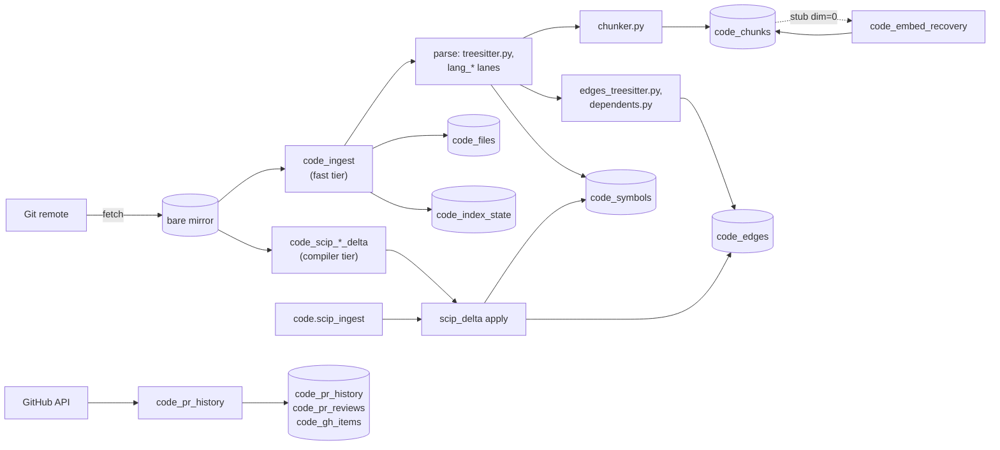

<!-- i18n: source=docs/architecture/code-index-architecture.md blob=9c0d2829f06e5917747d7848ef3ce0748e0c02d4 model=claude-sonnet-5-5 -->
> このページは[英語の原文](https://github.com/ClickHouse/loom/blob/main/docs/architecture/code-index-architecture.md)の機械翻訳です。内容は英語の原文が優先されます。
> Machine-translated from the [English page](https://github.com/ClickHouse/loom/blob/main/docs/architecture/code-index-architecture.md), which is authoritative.

# コードインデックスのアーキテクチャ

このページはコードインデックスの内部構造を説明します。ファイルがどのようにチャンク、シンボル、エッジになるか、そして 2 つのティアがどのように最新の状態を保つかを扱います。各 op が答える内容、対応言語とその解析の深さ、`as_of` の読み方については、[コードインデックスの概要](https://github.com/ClickHouse/loom/blob/main/docs/features/code-index/overview.md)と[鮮度](https://github.com/ClickHouse/loom/blob/main/docs/features/code-index/freshness.md)を参照してください。運用（クローン、バックフィル、コンパイラティア）については、[コードインデックスの運用](https://github.com/ClickHouse/loom/blob/main/docs/operations/code-index-operations.md)を参照してください。

## 目標と非目標

| 目標                                                                                                     | 非目標                                                                                               |
| -------------------------------------------------------------------------------------------------------- | ---------------------------------------------------------------------------------------------------- |
| ローカルのベアミラーをポーリングすることで、マージごとに高速ティアを最新に保つ。受信用の webhook は使わない。 | ワーキングツリーのインデックス化。コミットされていない変更やプッシュされていない変更がインデックスに入ることはない。 |
| コンパイラインデクサーがある言語では、呼び出し、オーバーライド、継承のエッジを正確に扱う。それ以外の言語では段階付きのヒューリスティクスを使う。 | サーバープロセス内でのコンパイラの実行。SCIP プロデューサーは workers プロセスのサブプロセスとして実行される。 |
| べき等な取り込み。バイト列が変わらなければ同じ行が得られ、埋め込みのコストもかからない。                 | 汎用のコードホスト。インデックスは名前空間をキーとする読み取り専用の参照データである。                 |
| すべての回答が、読み取ったコミットとティアを示し、回答が空の場合はその理由も示す。                       | 古さの隠蔽。遅れているティアは報告される。                                                           |
| 新しい言語を追加しても、他の言語を再インデックスする必要はない。                                         | すべての言語に同じ深さを提供すること（[言語](https://github.com/ClickHouse/loom/blob/main/docs/features/code-index/overview.md)）。 |

## 1つの名前空間、1つのブランチ

コード名前空間は、1つのリポジトリブランチの1つのコミットに対応します。`loom.namespaces` では `kind='code'` を持ち（`code/app/index/registry.py`、`ensure_registered`）、メモリは保持せず、すべての `code_*` 行を `(org, namespace)` をキーとして管理します。Loom はリポジトリごとに1つのベア git ミラーを保持します。これは ClickHouse に記録されたリモートのキャッシュです。存在しないミラーは `code_ingest` がクローンし（あらかじめ `loom code init` で作成することもできます）、取り込みのたびに fetch します。`server/code/app/index/gitrepo.py` は `git` をシェル経由で呼び出します。作業ツリーはなく、`fetch` 以外は何も書き込みません。同じリポジトリのブランチはミラーを共有します。

ミラーを持たないホストで履歴読み取り（`blame_range`、bisect、`first_build`、レッスンのコードチェック）を行うと、そのホストはバックグラウンドで一度だけクローンします（`server/code/app/index/mirrors.py`、`history_dir`）。op を指定した読み取りは、自身が開始したクローンを最大10秒、または op のレイテンシ予算の残りのうち短いほうの時間だけ待ちます。それ以外の読み取りは、クローンが完了するまで `no_git_mirror` を返します。クローン後、台帳にあるマージコミットのうちクローンに含まれないものは sha を指定して fetch し、固定します。上流で削除済みのステージングブランチ上で作られたマージは、ワーカーのミラー（プルーニングされない）には存在しますが、新規クローンには存在しません。ミラーがある場合はそのまま応答します。インデックス済みの head を持たないミラーは、バックグラウンドでブランチを fetch します。ブランチの head ではない head（PR の head）は fetch しません。

その結果、問い合わせを受けたすべての提供ホストに、各ミラーの完全なコピーが置かれます。これが狙いであり（移動やスケールアウトの後でも、どのホストも履歴読み取りに応答できる）、同時にコストでもあります（ホストごとにリポジトリ1つ分のディスク）。`LOOM_CODE_HISTORY_CLONE_ON_READ=false` にすると無効になります。その場合はワーカーのホストだけがクローンし、他のホストでの履歴読み取りは `no_git_mirror` を返します。

リポジトリのエントリは次の2つのソースから取得され、マージされます。

| ソース            | 読み取り元                        | 備考                                                                                                       |
| ----------------- | --------------------------------- | ---------------------------------------------------------------------------------------------------------- |
| 環境変数          | `code/domain/index/repos.py`      | `LOOM_CODE_REPOS_JSON`、またはスカラーの `LOOM_CODE_*` 設定。                                              |
| `loom.code_repos` | `code/app/index/repo_registry.py` | セルフサービスの行で、`row_kind` で区別されます（下記）。プライベートリモートのトークンは暗号化して保存され、返されることはありません。 |

`loom.code_repos` の行の `row_kind` は、その行が何であるかを示します。

- `page`: ページから追加されたブランチ。オペレーターのエントリが削除されているかどうかにかかわらず、その名前空間からオペレーターのエントリを除外した状態を保ちます。
- `access`: オペレーターのエントリの分類と参加ポリシー。
- `''`: この列が導入される前に書き込まれた行。オペレーターのエントリの名前空間ではアクセス行として、それ以外ではページから追加されたブランチとして読み取られます。

`configured_repos()` は、起動時、取り込みのたび、および追加の後に更新されるプロセス内スナップショットを読み取ります。スナップショットが最初に読み取られるまでは `RegistryUnread` を送出します（セルフサービスが有効な場合）。ページ名前空間がスキップするエントリがまだ分かっていないためです。アクセスを判定するモジュールは `config_entries()` を読み取り、この読み取りの前はどのエントリも組織から読み取り可能でないものとして一覧します（`tests/unit/test_repo_snapshot_contract.py`）。完全な一覧を必要とする op は、この間 503 を返します。メモリの読み取り、検索、`memory.for_file` は、コードへのリンクなしで応答します。名前空間を指定しないコード呼び出しは、メンバーがページからその名前空間を追加していない場合に限り、`LOOM_CODE_NAMESPACE` を既定とします。エントリを廃止すると（`code/app/index/retire.py`）、その行は無効化され、その名前空間のすべての `code_*` テーブルに対して消去サガが実行されます。また、呼び出しを処理したホストで他のエントリがそのミラーを使っていなければ、ミラーも削除されます。他のホストでは、それぞれのスイープが自分のコピーを削除します。

## すべてのレプリカにある Git ミラー

どのサービングプロセスも履歴読み取り（blame、bisect、引用、PR オーバーレイ、コミットカバレッジ）に応答できるため、各ホストはそれぞれ専用の bare ミラーを保持します（`code/app/index/mirrors.py`）。ミラーはリモートのキャッシュです。リモートを指定するのは ClickHouse であり、どのホストでもそこからミラーを再構築できます。

- **ウォームアップ。** 起動時に各プロセスは、インデックス済みエントリのうち持っていないもののミラーを、`LOOM_CODE_MIRROR_WARMUP_CONCURRENCY` 個ずつクローンします。クローンごとに最大 30 s のランダムな待機を入れるため、N 個のレプリカが同時に起動しても、すべてが一度に GitHub からクローンすることはありません。クローンはバックグラウンドで実行され、readiness はその完了を待ちません。
- **新しいディスクのコスト。** `LOOM_CODE_REPOS_ROOT` が空のホストは、履歴読み取りが応答するようになる前に、インデックス済みの全リポジトリの完全な bare クローンを作成します（大きなリポジトリでは数 GB）。新しいレプリカは運用者の手を介さずにキャッシュを構築する必要があるため、ウォームアップはデフォルトで有効のままです。`LOOM_CODE_REPOS_ROOT` をロールアウトをまたいで残るボリューム上に置けば、このコストは Pod ごとではなくボリュームごとに一度で済みます。クローンは `--filter=blob:none` ではなく完全なものです。部分クローンでは `git blame` の実行中に不足している blob をリモートから 1 つずつ取得するため、履歴読み取りがネットワーク読み取りになり、リポジトリジョブのサンドボックスの外でリモートに到達してしまいます。
- **ゲート。** すべての履歴読み取りは `mirrors.history_dir` を通ります。これはミラー、またはミラーがない理由を返します。ミラーが用意されるまで、読み取りは git エラーではなく `no_git_mirror: cloning <entry>`（またはここでクローンされない理由）を返し、クローンが実行中でなければ開始します。`LOOM_GIT_HISTORY=none` はホストの履歴を無効にし、その場合の読み取りは `no_git_history` を返します。
- **ホストループ。** リモートに変更を問い合わせるのはリーダーだけです（追加ブランチと PR ヘッドの `ls-remote`）。そのパスが取得した内容は ClickHouse にあります。各エントリのブランチ先端（`clone_head`）、オープンな PR のヘッド（`code_gh_items.head_sha`）、台帳のマージです。`LOOM_CODE_MIRROR_FETCH_INTERVAL_S` ごとに各ホストがこれらを読み、ミラーが別の sha で保持しているブランチと PR ヘッドだけを名前で fetch します。加えて、不足している台帳のマージを 1 ページ分取得します。最新のホストはネットワーク呼び出しを行いません。追加ブランチは他のホストでは追跡されません。新しいクローンにはリモートにあったすべてのブランチが含まれ、それらのブランチ上のマージは台帳経由で届きます。各ミラーのラウンドは、ホストごとに 1 つのプロセスが実行します。ミラーへのすべての fetch（パス、ホストループ、読み取りのもの）はミラーの `.fetch-lock` を保持し、パスの fetch は、その間隔におけるホストのラウンドとしても数えられます。同じループは、必要なときに `git gc --no-prune` を実行し、`LOOM_CODE_REPOS_ROOT` を掃除します。対象は、有効なエントリ（制限付きエントリを含む）のどれにも該当しないミラー、`checkout-*` ツリー、ミラーのロックファイル、および中途半端なクローンです。レジストリを読み取れないときは何も削除しません。
- **サンドボックス。** リポジトリジョブのサンドボックスがないホストは、ネットワークのリモートを持つ、ビューアが追加したエントリを、読み取りパスでもワーカーでもクローンも fetch もしません（`compiler_tier.unsandboxed_skip`）。
- **リモートが失ったマージ。** リモートがもう提供しない台帳のマージ（2 回の呼び出しで「not our ref」となった場合。一時的な拒否 1 回では数えません）は、ミラーに記録され（`loom-unpinned-merges`）、二度と要求されず、`/v1/health?include=mirrors`（`mirrors.unpinned_merges`）と `loom doctor` に集計されます。
- **リーダー**も、欠けているミラーをバックグラウンドでクローンします。そのため、1 つの長いクローンがパス内の他のエントリを止めることはありません。インデックス済みのエントリは、新しいホストでミラーが再びクローンされる間も、Repositories カードのステージを保ちます。
- **消去。** ミラーとチェックアウトはリポジトリの内容を保持しますが、メモリの内容は保持しません。消去の集計ではこれらを数えません。削除されたリポジトリのコピーは、各ホストでの掃除によって消えます。

`/v1/health?include=mirrors` は `mirrors` を返します。このホストのミラーのうち `ready` と `cloning` の数、および `failed` と `absent` の理由別の数です。トークンなしで応答するため、エントリ名は含まれません。ディスク使用量は、全ホストの全ミラーの合計サイズです。N 個のレプリカは N 個のコピーを保持します。

## コンポーネント

## 高速ティア：`code_ingest`

`server/code/workers/ingest.py` は `LOOM_CODE_INGEST_INTERVAL_SECONDS` ごとにポーリングします。`code.refresh` は CI からパスを起動します。各パスは、エントリごとに次の処理を行います。

1. ミラーを**フェッチ**し、`code_index_state` の `git_head` ウォーターマークから先端まで、first-parent のコミットを古い順にたどります。上限は `LOOM_CODE_INGEST_MAX_COMMITS_PER_PASS` です。
2. 各コミットで**変更されたファイルだけを再インデックス**します（`code/app/index/ingest.py` の `ingest_file`）。パース、チャンク化、シンボル、エッジ、呼び出しガード、ファイル行に加えて、コミットが指すマージ済み PR のコンテキストパックとレビューブリーフを作成します。その後 `git_head` を進めます。クラッシュした場合は、最後に完了したコミットから再実行されます。
3. `LOOM_CODE_INGEST_WALK_BUDGET_SHARE` が残す割合で**ウォーク**します。対象は、整合性回復による修復と、エクストラクタによる再チャンク化です（後述）。

| 上限                                    | 効果                                                                                                      |
| --------------------------------------- | --------------------------------------------------------------------------------------------------------- |
| `LOOM_CODE_INGEST_MAX_PASS_SECONDS`     | パスの長さ。                                                                                              |
| `LOOM_CODE_INGEST_PASS_BUDGET_FRACTION` | この割合を超えると、パスは新しい単位を開始せず、カーソルを保存して `partial: true` を返します。           |
| `LOOM_CODE_INGEST_SECONDS_PER_FILE`     | コミットのコストを予測します。超過すると予測されたコミットは、パスの先頭でのみ開始されます。              |
| `LOOM_CODE_INGEST_SLICE_SHARE`          | 巨大なコミットが複数パスに分割される前に、コミットフェーズのうち占有できる最大の割合。                    |
| `LOOM_CODE_INGEST_LANES`                | 並行して取り込むエントリ数（デフォルトは 1、最大 8）。1 つのエントリ内のコミットは順次処理されます。      |
| `LOOM_CODE_INGEST_ROUND_FILES`          | コミット内の 1 ラウンドあたりのファイル数。読み取りは 2 つのステートメントでプリフェッチし、書き込みはバッチ処理します。 |

レーンが有効なのは、レーンが待つのは CPU ではなく ClickHouse のラウンドトリップだからです。

**受け入れ判定。** ファイルは、パース前に次のいずれかに該当すると拒否されます。拒否リストに一致する（`code/app/index/denylist.py`、`LOOM_CODE_INGEST_EXCLUDE`、`LOOM_CODE_INGEST_IGNORE_FILE`）、バイナリである、`LOOM_CODE_INGEST_MAX_FILE_BYTES` を超える。したがって、grep の `coverage_floor: true` が意味するのは、すべてのバイトではなく、受け入れられたすべてのチャンクです。

### パーサーの選択

`ingest_parse.parse_for_ingest` は次の順に試します。この順序により、新しいファイル種別がエクストラクタのスタンプに入り込むことを防ぎます。

1. `treesitter.lang_for_path`：スタンプ済みのコア（`.h` を含む C/C++ は C++ 文法で処理、Python、シェル、SQL、ドキュメント、設定）。その後 `ingest_parse._lane_language` が CMake ファイルと TLC 設定を振り分け直します。
2. 設定ファイルのうち Helm と Kubernetes のマニフェスト（`lang_gotemplate`、`lang_k8s`）。
3. `lang_detect.detect_by_extension`（`LANG_BY_EXTENSION`）。
4. シバン。続いて、Linguist の名前と ShellCheck ディレクティブによるシェル検出（`lang_detect.detect_shell`）。
5. `LOOM_CODE_HOST_ISLANDS` を使うホストファイル（Dockerfile、Makefile、Jenkinsfile、CI の YAML）（`lang_hosts`）。
6. 期待出力のフィクスチャ。ファイルごとに埋め込みなしのチャンクを 1 つ作ります（`lang_reference`）。
7. その他のテキスト。シンボルなしでチャンク化します（`lang_text`）。

パーサーは `ingest_parse._PARSERS` から取得します。そのパースの失敗は、文法の欠如や、`code_parse_timeout_s` または `code_parse_memory_mb` を超える tree-sitter のパース（`bounded_parse`、同時に 1 パースのみ）を含め、チャンクのみのファイルに縮退し、`code_files.index_error` が設定されます。`code.index_errors` がそれを報告します。TLA+ 仕様の場合は代わりに正規表現リーダーにフォールバックします。それ以外の場所で上限を超えたパースは、呼び出し元のフォールバックに従い、エラーは記録されません。
tree-sitter のモジュールは遅延インポートされるため、コードワーカーを無効にしたサーバーは `code` エクストラなしで起動します。

### チャンク

`server/code/domain/extract/chunker.py` は、固定ウィンドウではなく意味的な単位で切り出します。

| チャンク         | 内容                                                                                                              |
| ---------------- | ----------------------------------------------------------------------------------------------------------------- |
| `function`       | 1 つの関数本体。巨大な場合はトップレベルの文で分割し、各断片の先頭にシグネチャを付けます。                        |
| `class_skeleton` | メソッド本体を省略したクラス。                                                                                    |
| `file_header`    | 先頭のコメントとインクルード。                                                                                    |
| `other`          | 残りをまとめたもの。                                                                                              |

ツリーのないファイルは、行単位のウィンドウにフォールバックします。文法のないレーンは、シンボルのスパンで切り出します（`lane_units.span_chunks`）。チャンク ID は `uuid5("loom://code/{namespace}/{path}#{scope}@{sha16}")` です。これはコンテンツアドレス方式なので、変更のないチャンクは ID とハッシュを保ち、埋め込みステップは検索なしでそれをスキップします。同一ファイル内の同一チャンクには、連番のサフィックスが付きます。

### シンボルとエッジ

シンボル ID は `treesitter.symbol_id(qualified_name, signature)` です。名前と正規化したシグネチャ（空白を圧縮し、デフォルト値を除去するため、オーバーロードは区別されます）に対する SHA-256 の先頭 128 ビットです。高速ティア、SCIP コンバーター、読み取りパスはすべてこれを呼び出すため、両ティアで共有されるシンボルは 1 つの ID に集約されます。Python とシェルは名前をモジュールパスで修飾するため、テストツリー内の多数の `main()` 関数も区別されたままです。

高速ティアのエッジ（`edges_treesitter.py`、`tier='treesitter'`）は名前で解決され、段階付けされます。

| 信頼度 | ルール                                                                      |
| ------ | --------------------------------------------------------------------------- |
| 1.0    | 同一ファイル内の一意な定義                                                  |
| 0.8    | 外側のクラスのメソッド                                                      |
| 0.6    | リポジトリ全体のシンボル名テーブルでの一意な一致                            |
| なし   | 曖昧または不明：エッジなし。`code_call_sites_unresolved` に記録されます     |

誤ったエッジは、欠けたエッジより悪いため、`code.callers` は件数から除外されたサイトの数を報告します。コンストラクタ呼び出し（`T x(...)`、`new T`、`make_unique<T>`）は `T::T` の呼び出しとして扱います。レシーバ型のモジュール（`cpp_receivers.py`、`py_receivers.py`、`ts_receivers.py`、`go_receivers.py`）がメンバー呼び出しを結び付けます。エッジの種類は `calls`、`includes`、`inherits`、`overrides`、`uses_type`、`fixture_use`、`reads`、`writes` です。

**依存先。** エッジはリポジトリ全体の名前テーブルに対して解決されるため、シンボルを追加、削除、またはシグネチャ変更するコミットは、そのシンボルを名指す未変更ファイルのエッジを変化させます。`code/app/index/dependents.py` は、同じコミットで、それらのファイルのエッジだけを再抽出します。上限は `LOOM_CODE_INGEST_DEPENDENTS_MAX_FILES` です。あふれた分は `code_index_state`（`dependents_pending`）で待機し、整合性回復を通じて消化されます。

### 埋め込みとベクトルテーブル

`code_ingest` は新しいチャンクをインラインで埋め込みます。コンテンツハッシュでメモ化され（`embed_reuse.py`）、テキストには上限があります（`embed_text.py`）。`LOOM_CODE_CONTEXT_DESCRIPTION_ENABLED`（デフォルトで有効）の場合、チャンクには LLM による 1 行の説明が埋め込み対象テキストの先頭に付加されます。これはベストエフォートで、予算による制限があります。プロバイダーが失敗すると `embedding_dim = 0` のスタブが残り、`code_embed_recovery` がそれを埋めます。テキスト単位のフォールバックがあり、`LOOM_CODE_EMBED_MAX_ATTEMPTS` 回の後に汚染として扱われます。名前空間のチャンクのうち `LOOM_CODE_READY_EMBED_COVERAGE` の割合にベクトルが付くまで、`code.search` は字句検索の経路から回答し、その旨を伝えます。

| テーブル                                  | 書き込み元                                         | 用途                                                                                                          |
| ----------------------------------------- | -------------------------------------------------- | ------------------------------------------------------------------------------------------------------------- |
| `code_summaries`                          | `code_summary`（週次、デフォルトでは無効）         | `code.map` 用のファイルカードとモジュールカード。入力ハッシュで制御され、`code_graph_stats` の PageRank を持ちます。 |
| 第 2 モデルのテーブル、`code_chunks_prefix` | `LOOM_CODE_VECTOR_TABLES`、`loom code vector-twin` | ベクトル経路は小さい方のツインで候補を絞り込み、提供されるベクトルで再スコアします（`prefix_twin.py`）。     |
| `code_answers`                            | `code.ask`                                         | 質問の埋め込みをキーとする回答キャッシュ。引用されたすべてのファイルのハッシュが最新の場合にのみ返されます。  |

バルクパスは、マージされるまでキーごとに余分なコピーを残します。`code/app/index/compaction.py` は、バルクパスの後にツインテーブルへ `OPTIMIZE … FINAL` を実行します。`code_chunks` は `loom code compact --table code_chunks --apply` でのみコンパクションされます。

## コンパイラティア: SCIP

コンパイラティアは `tier='scip'` のシンボルとエッジを保持します。サーバーは protobuf をパースしません。プロデューサーが SCIP の出力をバージョン付きの JSON デルタ（`scripts/scip_harness/scip_to_delta.py`）に変換し、`code/app/index/scip_delta.py` がそれを適用します。適用処理は、変更されたファイルごとに、デルタが出力する内容を upsert し、デルタが出力しなくなったそのファイルの `scip` 行を tombstone にします。削除されたファイルは丸ごと tombstone になります。デルタを再適用しても、有効な行の集合は同じになります。

| プロデューサー | 言語 | ウォーターマーク | ワーカー | 実行方法 |
| ----------------- | ----------------------- | ---------------- | ------------------------------------------------------ | ------------------------------------------------------------------------------------------------------------------------------------- |
| `scip-clang` | C++ | `scip_commit` | `code_scip_full`, `code_scip_delta`, `code_scip_apply` | 変更された TU（および変更されたヘッダーを含む TU。件数に上限あり）を `run_delta.sh` で処理します。`code_scip_full` がティアを初期化し、週次で再インデックスします。 |
| `scip-typescript` | TypeScript / JavaScript | `scip_commit_ts` | `code_scip_ts_delta` | 1 回のパスごとにワークスペース全体をインデックスし、コンバーターがそのウィンドウのファイルに絞り込みます。 |
| `scip-go` | Go | `scip_commit_go` | `code_scip_go_delta` | モジュールごとに 1 回ビルドします（`run_go_monorepo_delta.sh`）。 |
| `scip-python` | Python | `scip_commit_py` | `code_scip_py_delta`, `code_scip_apply` | マージごとのデルタです（`run_python_delta.sh`）。初回実行ではツリーをインデックスします。 |

`code/domain/index/compiler_tiers.py`（`TIERS`）は、プロデューサーごとのウォーターマーク、ラベル、ワーカーを定義する唯一のテーブルで、ステータスハンドラーとダッシュボードがこれを読み取ります。デルタワーカーは、自身のウォーターマークを `git_head` と比較し、チェックアウトを移動し（ネットワークではなくローカルミラーから fetch します）、サブプロセスでプロデューサーを実行して、`code.scip_ingest` が使うのと同じ経路でデルタを適用します。1 回のパスで、ウォーターマーク以降のすべてのマージをカバーします。

CI ジョブなどの外部プロデューサーは、`code.scip_ingest` でデルタを分割してアップロードできます。分割された部分は `code_scip_batches` / `code_scip_parts` にステージングされ、`code_scip_apply` が適用します。コンパイラティアのすべてのパスは、エントリごとのロックファイルを `LOOM_CODE_SCIP_LOCK_DIR` に作成し、ClickHouse のリースも取得します。このため、フル再インデックスとデルタが同じエントリに対して同時に実行されることはありません。`loom code scip-full` は C++ ティアを再構築し、`loom code scip-delta` はデルタのパスを 1 回実行します。

両方のティアに同じ行がある場合、読み取りではコンパイラの行が優先され、すべての回答は読み取ったティア（`scip` または `treesitter`）を明示します。

## エクストラクタースタンプ

コンテンツアドレス方式のチャンクとハッシュ化されたシンボル ID は、行を生成したコードではなく入力をキーとするため、チャンカーを修正しても既存の行には反映されません。`server/code/domain/extract/extractor_stamp.py` がこのギャップを埋めます。このモジュールは、すべてのエクストラクターモジュールのコードトークン（`logic_tokens`：コメント、空行、docstring を除き、import は束縛される名前だけに縮約するため、モジュールをパッケージ間で移動してもスタンプは変わりません）と、スタンプ対象グラマーのインストール済みバージョン（`STAMPED_GRAMMARS`：ベースライブラリ、C++、Python、bash）をハッシュします。

スタンプは 2 つの軸で分割されており、変更時に再導出する範囲を最小限に抑えます。

- **ステージ別**（`STAGES`：`chunk`、`symbol`、`edge`、`guard`、`STAGE_MODULES`）。ステージのスタンプは、そのステージのモジュールと、そのステージが読み取るステージ（`STAGE_INPUTS`）のモジュールを対象とします。

  | 変更されたモジュール                | 動くステージ                          |
  | --------------------------------- | ------------------------------------- |
  | `chunker.py`                      | `chunk`                               |
  | `edges_treesitter.py`             | `edge`、`chunk`、`guard`              |
  | `treesitter.py`, `lang_python.py` | すべて（`symbol` が残りに入力される） |
  | `call_guards.py`                  | `guard`                               |

- **言語ファミリー別**（`LANGUAGE_FAMILIES`：`python`、`shell`、`typescript`、`cpp`、`other`、`MODULE_LANGUAGES`）。Python のみの変更は `.py` ファイルを修復し、C++ には影響しません。TypeScript のエッジモジュール（`ts_receivers.py`、`ts_reexports.py`、`ts_config.py`、`ts_workspace.py`）が動かすのは `typescript` だけです。スタンプ対象のモジュールが `MODULE_LANGUAGES` にない場合は、すべてのファミリーが動きます。

各パスでは、実行中のスタンプを `code_index_state` に記録されたものと比較します。動いたステージは、インデックス済みのすべての名前空間にあるそのファミリーのすべてのファイルについて、ペース調整されたバッチで再導出されます（`LOOM_CODE_EXTRACTOR_RECHUNK_PER_PASS`、スイッチは `LOOM_CODE_EXTRACTOR_RECHUNK_ENABLED`）。記録されたスタンプが空の場合は記録するだけで、再導出は行いません。したがって次のようになります。

- `EXTRACTOR_MODULES` のモジュールにコード変更を加えると、影響を受けるファミリーのすべてのリポジトリが再インデックスされ、大規模なデプロイでは数時間かかります。コメントと docstring は自由に編集できます。
- これらのファイルはフォーマッターの対象から除外されており（`pyproject.toml`）、`tests/unit/test_code_extractor_stamp.py` が除外リストとモジュール一覧の整合性を保ちます。`server/code/domain/extract/` にあるどのステージにも属さないモジュールは、理由を添えてテストの `NON_EXTRACTOR_MODULES` に記載する必要があります。
- これらは抽出内容が変わる場合にのみ変更し、デプロイ後に再導出が行われることを想定してください。

**レーンモジュールはスタンプの対象外です。** レーンパーサー（`lang_typescript.py`、`lang_rust.py`、`lang_go.py`、`lane_units.py` など）、そのグラマー、ファイル選択モジュール（`lang_detect.py`、`denylist.py`）はスタンプを動かしません。上記の TypeScript エッジモジュールは例外です。レーンの修正は、その言語のファイルに対して `loom code backfill --paths-file` を実行して適用します。

## 照合

ウォーターマークが示すのは、どのコミットを走査したかであり、すべての行が最新であるかどうかではありません。`code/app/index/reconcile.py` がドリフトを測定します。`code_files` の行は `blob_sha` と `indexed_commit` を持ちます。`git ls-tree -r <head>` を 1 回実行し、blob が異なるパスを stale、存在しないパスを gone と判定します。blob を持たない行は、異なるコミットごとに `git diff --name-only` を 1 回実行する方法にフォールバックし、その上限は `LOOM_CODE_RECONCILE_MAX_COMMITS` です。

`code_ingest` の 1 時間ごとのチェック（`LOOM_CODE_RECONCILE_ENABLED`、`LOOM_CODE_RECONCILE_INTERVAL_SECONDS`）は、最大 `LOOM_CODE_RECONCILE_HEAL_PER_PASS` 件の stale なパスを `ingest_file` 経由で再取り込みします。埋め込みが行われるのは新しい内容のみです。手動で実行する場合は `loom code reconcile --heal` を使います。`loom.code.stale_files` ゲージが件数を報告します。

## ウォーターマークとカバレッジ

`code_index_state`（`ReplacingMergeTree(version)`、キーは `(org, namespace, state_key)`）には、`git_head`、プロデューサーごとの SCIP ウォーターマーク、エクストラクターのスタンプ、カーソル、`dependents_pending` が保持されます。すべての応答に含まれる `as_of` ブロックと `loom.code.tier_lag_seconds{tier}` は、プロデューサーのログからではなく、これらの行とミラーから算出されます。コミットごとのカバレッジ（`code/app/index/commit_coverage.py`）は、ウォーターマークの比較ではなく、ミラー上でティアごとに 1 回実行される `git merge-base --is-ancestor` によって判定されます。呼び出し側から見える内容については、[鮮度](https://github.com/ClickHouse/loom/blob/main/docs/features/code-index/freshness.md)を参照してください。

## PR 履歴、バックポート、トラッカーリンク

| テーブル                                               | ライター                                                    | 内容                                                                                               |
| ------------------------------------------------------ | ----------------------------------------------------------- | -------------------------------------------------------------------------------------------------- |
| `code_pr_history`, `code_pr_reviews`, `code_gh_items`  | `code_pr_history`（GitHub REST、`updated_at` のカーソル）   | ファイル、レビューコメント、issue を含むマージ済み PR。レート制限または 5xx の場合、カーソルは進みません。 |
| `code_context_packs`, `code_review_briefs`             | マージコミット時または要求時の `code_ingest`                | PR ごとのコンテキストパックとレビュアー向けブリーフ。                                              |
| `code_backport_gaps`                                   | `code_backport_gaps`（毎晩実行。`code_pr_history` が必要）  | backport ラベル付きのトランク PR ごとに、リリースブランチの名前空間 1 つにつき 1 行：対応済み、未対応、影響なし。 |
| `code_test_map`, `code_symbol_stats`, `code_unit_risk` | `code_graph_stats`（毎週）、`loom code crossref`            | テストとソースの対応表、シンボルのファンイン、ユニットごとのリスク。                               |
| `code_coverage_files`                                  | `code_coverage_import`（毎日）、`loom code coverage-import` | ソースファイルごとに、テスト単位のカバレッジ実行で実行された行範囲。                               |
| `qa_link_candidates`                                   | `tracker_links`（毎日）                                     | 最近の issue ごとの上位のマージ済み PR。BM25F、diff 内のスタックフレーム、クローズ言及でランク付けされます。 |
| `qa_item_embeddings`                                   | `tracker_embed`                                             | エンベディング対象期間内のトラッカー issue と PR のベクトル。キーとフィルタ用の事実のみで、テキストは含みません。 |

`code.repo.set_source` はリポジトリをトラッカーに順番にリンクします。最初のものがプライマリで、その番号がリポジトリの issue 番号と PR 番号になります。リンクは `code_index_state` の `qa_binding` 行であり、`(org, namespace)` で読み取られます。コード名前空間の名前はリポジトリとブランチから導出されるため、2 つの org が同じ名前を持つことがあります。オペレーターの `LOOM_TRACKER_CODE_NAMESPACE_BINDINGS_JSON` は、オペレーター自身のリポジトリ（`LOOM_CODE_REPOS_JSON` または `LOOM_CODE_REPO`）にのみ適用され、名前が glob に一致するセルフサービスのリポジトリには適用されません。トラッカーワーカーは各名前空間をそれ自身のソース経由で読み取るため、制限付き名前空間の行が標準の名前空間の下に入ることはありません。レコード契約は [トラッカーレコード契約](https://github.com/ClickHouse/loom/blob/main/docs/features/tracker/record-contract.md) にあります。

`code.repo.add_branch` は、ルートがオペレーターのリポジトリである場合に、ルートリポジトリ（ソース、またはソース自体がブランチの場合はソースのルート）を指す新しいブランチの `qa_branch_of` 行を書き込みます。これにより、後でオペレーターがルートの名前を設定しても、セルフサービスのルートのブランチがそのマップを読み始めることはありません。ルートがオペレーターのリポジトリである登録済みブランチは、読み取り時にそのリポジトリのリンクに従い、glob も含まれます。隣にセルフサービスのエントリがない `qa_branch_of` 行には従いません。オペレーターのリポジトリではないソースの場合、そのソース自身の `qa_binding` 行がブランチにコピーされ、クリア済みの行も含まれます。オペレーターのソースは自身がルートです。両方の行は、ソースの行を先に読み取り、`qa_branch_of` を最後に書き込む順で書かれるため、失敗してもブランチは何にも従わない状態になります。

`code.repo.remove` は、名前空間の切り離しパージの前に、2 つの行のうち値を持つ方を空にします。名前空間を登録すると、同名の削除済み名前空間が残した行が空になり、その名前が自プロセスのスナップショットから外されるため、新しい名前空間はどちらにも従いません。空にされた `qa_binding` は、トラッカーの管理者がリンクするまでクリア済みとして読み取られます。`qa_binding` 行がなかった名前空間には何も作成されないため、同じ名前で設定されたオペレーターのエントリには、引き続きオペレーターのマップが適用されます。削除された名前で設定されたオペレーターのエントリには、このようなクリーンアップは行われません。パージが実行されるまでは、該当する `qa_binding` 行があればそれを読み取り、ビルド N-1 での削除後は古いリンク、N での削除後はリンクなしになります。他のプロセスは、最大 `LOOM_CODE_REPOS_REFRESH_SECONDS` の間、読み取った行を保持します。

## ストレージ

| テーブル                                                       | エンジンとキー                                                                                         | 備考                                                                                          |
| -------------------------------------------------------------- | ------------------------------------------------------------------------------------------------------ | --------------------------------------------------------------------------------------------- |
| `code_files`                                                   | RMT(`version`), `(org, namespace, path)`                                                               | パスごとの最後のパース結果：言語、`blob_sha`、`indexed_commit`、`index_error`。               |
| `code_chunks`                                                  | RMT(`version`), `(org, namespace, embedding_model, path, chunk_id)`、`(org, namespace)` でパーティション分割 | コンテンツ、`lexemes`、ベクトル。テキストインデックス：`lower(content)` の 3-gram と、`lexemes` のトークン。 |
| `code_symbols`                                                 | RMT(`version`), `(org, namespace, tier, qualified_name, symbol_id)`                                    | シグネチャ、スパン、ドキュメントコメント、`scip_symbol` を持つ定義。名前には ngram スキップインデックスがあります。 |
| `code_symbol_names`, `code_symbol_ids`                         | RMT、`code_symbol_names_mv` / `code_symbol_ids_mv` が書き込み                                          | シンボルを短い名前と ID でキーし直したもの。                                                  |
| `code_edges`                                                   | RMT(`version`), `(org, namespace, tier, to_symbol_id, edge_kind, from_symbol_id, path, line)`          | 呼び出し元はキーの範囲として取得します。プロジェクション `by_from`（呼び出し先）と `by_path` があります。 |
| `code_call_sites_unresolved`, `code_caller_guards`             | RMT(`version`)                                                                                         | 呼び出し先の名前ごとの未解決の呼び出し箇所と、各呼び出し元の呼び出し箇所を囲むガード。        |
| `code_term_freq`, `code_doc_stats`                             | AMT、RMT。`code_term_freq_mv`、`code_doc_stats_mv` が書き込み                                          | 字句検索側のための BM25 統計。                                                                |
| `code_unit_signal`                                             | `SummingMergeTree((positive, negative))`                                                               | `code.outcome` から得られる、ユニットごとの結果カウンター。                                   |
| `code_search_trace`, `code_search_outcome`, `code_search_memo` | MT（TTL 180 日）、RMT（TTL 60 分）                                                                     | クエリごとのトレースと結果。返却した `code.search` レスポンスの短期メモ。                     |

すべてのカラムは、生成された[スキーマリファレンス](https://github.com/ClickHouse/loom/blob/main/docs/reference/schema.md)に記載されています。

## クエリパターン

| Op                               | パス                          | 方式                                                                                                                                                                                                                                                                                                                                                                                               |
| -------------------------------- | ----------------------------- | -------------------------------------------------------------------------------------------------------------------------------------------------------------------------------------------------------------------------------------------------------------------------------------------------------------------------------------------------------------------------------------------------- |
| `code.search`                    | `code/app/search/pipeline.py` | まずルーティング（パターン、パス、履歴に関する質問）を行い、その後 `gather.py` の締め切りの下で各レッグを実行する。レキシカル（idf で重み付けしたトークン数）、ベクトル（ベクトルインデックスを使わないスキャン、またはツインの候補リスト）、PR 履歴、あいまいなシンボル投票である。`fusion.py` は逆順位（k = 60）で統合し、`serve.py` はトークン予算に収まるようにページングするか、回答を差し控える。メモ期間内の繰り返しは `code_search_memo` の 1 回の読み取りで済む。 |
| `code.grep`                      | `code/store/index/grep.py`    | 3-gram インデックスでグラニュールを絞り込み、`position()` または `match()` で判定し、各ヒットを自身を含むユニットに結び付ける。`mode=presence` は最大 8 個のブランチ名前空間にまたがる。                                                                                                                                                                                                                                                                      |
| `code.symbol`                    | `code/app/symbol/`            | 修飾名は `code_symbols` のキープレフィックス読み取りになり、短い名前は `code_symbol_names` を経由する。複数の定義がある場合は `near_paths` またはレビュー中の PR でランク付けする。                                                                                                                                                                                                                                                           |
| `code.callers`, `code.impact`    | `code/store/index/edges.py`   | 呼び出し元は `code_edges` の `to_symbol_id` の範囲で、コンパイラの行を優先し、未解決の件数も返す。`code.impact` は diff のハンクをシードシンボルに対応付けて外側へたどる。たどった結果が空の場合は `no_indexed_paths`、`no_seeds_in_hunks`、`no_static_callers` のいずれかを返す。                                                                                                                                                                   |
| `code.outline`, `code.enclosing` | —                             | `code_symbols` と `code_chunks` のスパンをパスごとに読み取る。                                                                                                                                                                                                                                                                                                                                      |

## 不変条件

- コード名前空間は 1 つのブランチに対応する。すべての `code_*` 行は `(org, namespace)` をキーとする。
- `git_head` は、コミットの全ファイルが書き込まれた後にのみ進む。
- `treesitter.symbol_id` は唯一のシンボル ID 関数であり、両方のティアと読み取りパスで使われる。
- チャンク ID はコンテンツアドレス方式であり、変更のないチャンクは再埋め込みされない。
- スタンプ済みモジュールのコード変更は、すべての名前空間で、その言語ファミリーのステージを再導出する。コメントと docstring では再導出されない。
- デルタの適用は冪等であり、プロデューサーが出力しなくなったものは墓標（tombstone）として扱う。
- サーバーは SCIP の protobuf を一切パースしない。
- コミットごとのカバレッジは、ミラー上の祖先チェックで判定するものであり、ウォーターマークではない。
- 検索は `embedding_dim > 0` で絞り込む。スタブチャンクは字句検索でのみ検索できる。

## ソースのエントリポイント

| パス                                                                                                                               | 内容                                                                                          |
| ---------------------------------------------------------------------------------------------------------------------------------- | --------------------------------------------------------------------------------------------- |
| `server/code/app/index/ingest_pass.py`                                                                                             | 高速ティアのパス。                                                                            |
| `server/code/app/index/ingest.py`                                                                                                  | `ingest_file`、ファイルごとのステージ。                                                       |
| `server/code/app/index/ingest_parse.py`, `ingest_chunks.py`, `ingest_edges.py`, `ingest_resolve.py`, `ingest_reconcile.py`         | `parse_for_ingest` と `_PARSERS`、チャンク、エッジ、エッジ解決の読み取り、キー差分の書き込み。 |
| `server/code/domain/extract/treesitter.py`, `lang_detect.py`, `lang_*.py`, `lane_units.py`                                         | 言語。                                                                                        |
| `server/code/domain/extract/chunker.py`, `edges_treesitter.py`, `call_guards.py`; `server/code/app/index/dependents.py`            | チャンクとエッジ。                                                                            |
| `server/code/domain/extract/extractor_stamp.py`                                                                                    | スタンプ。                                                                                    |
| `server/code/app/index/reconcile.py`, `commit_coverage.py`, `scip_delta.py`; `server/code/domain/index/compiler_tiers.py`          | ドリフト、カバレッジ、ティア。                                                                |
| `server/code/workers/scip_*.py`, `scripts/scip_harness/`                                                                           | コンパイラティア。                                                                            |
| `server/code/workers/embed_recovery.py`, `summary.py`, `graph_stats.py`, `pr_history.py`, `backport_gaps.py`, `coverage_notify.py` | バックグラウンドワーカー。                                                                    |
| `server/code/domain/index/repos.py`; `server/code/app/index/repo_registry.py`, `registry.py`, `retire.py`, `gitrepo.py`            | エントリ、ミラー、名前空間。                                                                  |
| `server/code/app/search/`, `server/code/store/index/`                                                                              | 読み取りと書き込み。                                                                          |

## 関連ドキュメント

- [コードインデックスの概要](https://github.com/ClickHouse/loom/blob/main/docs/features/code-index/overview.md)（対応言語とティア）、[鮮度](https://github.com/ClickHouse/loom/blob/main/docs/features/code-index/freshness.md)、[履歴と PR](https://github.com/ClickHouse/loom/blob/main/docs/features/code-index/history-and-prs.md)。
- [コードインデックスの運用](https://github.com/ClickHouse/loom/blob/main/docs/operations/code-index-operations.md)。
- [言語サポートの追加](https://github.com/ClickHouse/loom/blob/main/docs/development/adding-language-support.md)。
- [ClickHouse](https://github.com/ClickHouse/loom/blob/main/docs/architecture/clickhouse.md)、[オペレーションリファレンス](https://github.com/ClickHouse/loom/blob/main/docs/reference/operations.md#code)。
