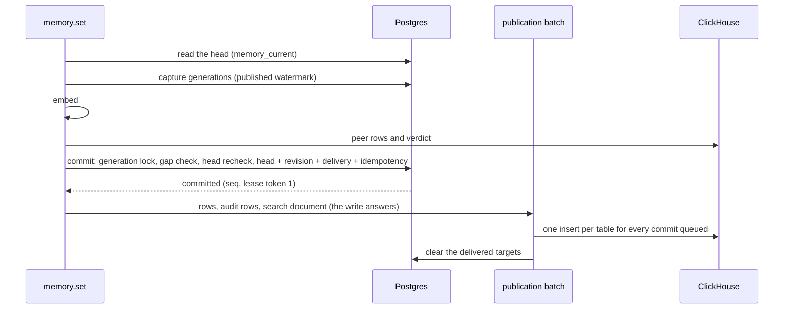

<!-- i18n: source=docs/architecture/storage-authority.md blob=ddfbb1e79149f5d1a03c9c3f7d95d4881dd6a2e6 model=claude-sonnet-5-5 -->
> このページは[英語の原文](https://github.com/ClickHouse/loom/blob/main/docs/architecture/storage-authority.md)の機械翻訳です。内容は英語の原文が優先されます。
> Machine-translated from the [English page](https://github.com/ClickHouse/loom/blob/main/docs/architecture/storage-authority.md), which is authoritative.

# ストレージオーソリティ：ライブメモリは Postgres、検索は ClickHouse

Loom は、デプロイごとに `LOOM_STORAGE_AUTHORITY` で選択する 2 つのメモリオーソリティのいずれかで動作します。`clickhouse`（デフォルト）の場合、[メモリアーキテクチャ](https://github.com/ClickHouse/loom/blob/main/docs/architecture/memory-architecture.md)で説明されているとおり、ClickHouse がすべてを保持します。`postgres` の場合、Postgres がすべてのメモリキーの現在の内容、コミット済みのすべてのリビジョン、各リビジョンが ClickHouse に対してまだ反映すべき内容、そしてすべてのナレッジドキュメントのヘッド（[ナレッジドキュメント](#knowledge-documents)）を保持します。ClickHouse はすべてのベクトル、すべての検索レッグ、履歴、アナリティクスを保持します。このページでは、Postgres オーソリティについて、そのテーブル、書き込みパスと読み取りパス、並行実行時のアドミッション、冪等性、消去、障害、および 2 つの Postgres デプロイプロファイルを説明します。

## 2つのストアを使う理由

メモリの書き込みには、順序付きのバージョン、compare-and-set、ロック、ピン確認が必要です。ClickHouse の insert は 1 つのパートを作り、パートにはマージのコストがかかります。メモリテーブルで 1 件ずつコミットすると、書き込みのたびにそのコストを払うことになり、並行する 2 つのライターは、判定を下す前にお互いの行を見ることができません。Postgres は行ロック付きの短いトランザクションを提供します。ClickHouse は得意なこと、つまりベクトルとテキストのスキャンに専念します。

| 状態                                                             | ストア                                                                                |
| ---------------------------------------------------------------- | ------------------------------------------------------------------------------------- |
| 現在のメモリの内容、バージョン、ロック、ピン、compare-and-set    | Postgres `loom.memory_current`                                                        |
| リビジョンジャーナルとその配信ジョブ                             | Postgres `loom.memory_revisions`、`loom.memory_deliveries`                            |
| べき等キーとリプレイ応答                                         | Postgres `loom.idempotency`                                                           |
| スコープジェネレーション（受け入れ制御）                         | Postgres `loom.scope_generations`                                                     |
| ナレッジドキュメントのヘッド、その配信ジョブ、削除の証跡         | Postgres `loom.knowledge_heads`、`loom.knowledge_deliveries`、`loom.erased_documents` |
| ナレッジの取り込みジョブ                                         | Postgres `loom.knowledge_jobs`                                                        |
| ナレッジデータセットのカタログ：提供スナップショット、スキーマ承認 | Postgres `loom.knowledge_datasets`                                                    |
| ベクトル、全文検索とベクトル検索、検索対象のメモリ行             | ClickHouse `loom.memory_embeddings`、`loom.memory`                                    |
| リビジョン履歴、監査証跡、使用量                                 | ClickHouse `loom.memory_versions`、`loom.audit_log`、使用量テーブル                   |

Postgres はベクトルを保存しません。ClickHouse の `loom.memory` と `loom.memory_embeddings` は、コミット済みのリビジョンから公開されるプロジェクションです。

コピーライター（ロック、タッチ、ステータスマーク、削除のトゥームストーン、有効期限）は、読み取りの後に、かつそのヘッドより上のバージョン（`rows.version_over`）を採番します。そのため、時計が進んでいるレプリカで書かれたヘッドに追い越されることはありません。機微度スイープの再ラベル付けは、スキャンしたヘッドより上、かつそのヘッドに対してのみ行われ、キーによる強い読み取りで読まれます。それ以降に書かれたヘッドは、検出器が読んでいないテキストか、ライター自身のラベルを持っているため、次のパスまで、配信が保留されている場合はその配信が再試行されるまで、そのまま残されます（[機微度スイープ](https://github.com/ClickHouse/loom/blob/main/docs/architecture/security.md#sensitivity)）。その読み取りの後に動いたヘッドは、Postgres ではコミットが拒否されます。`high` への再ラベル付けのフェンスはそのコミットの後に続くため、拒否された再ラベル付けがそのヘッドの上にフェンスを残すことはありません。ClickHouse では、再ラベル付けのバージョンより下で挿入されたものは、他のコピーライターと同様に追い越されます。エンティティパスとリストアは、読み取りの前にバージョンを採番し、それを読み取ったヘッドより上に引き上げます。そのため、それより上のバージョンを採番した書き込みが優先されます。ヘッドの上に書かれる値（`memory.set`、`memory.bulk_set`、`memory.update_by_id`）もそのヘッドより上になります。Postgres では、コミットが 2 つのうち新しいほうを保持するためです。削除されたソースの統合サマリーは、権威（そのヘッドと生きているソース）に基づいて検出および判定されます。各トゥームストーンまたはダウングレードは、判定されたソース（その後に含まれたコピーを含む）を依然として参照しているヘッドの上に置かれ、他のソースから再構築されたサマリーはそのまま残されます。それらのベクトルは各行のバージョンで書き込まれ、Postgres ではコミットのリースの範囲内で行われます。トゥームストーンはテキストなしでそれらを退役させ、ダウングレードはそのヘッド自身のハッシュを持つものだけをコピーします（ハッシュ導入前に書かれたヘッドには何もありません）。したがって、どちらも、別のバージョンのリダクションがパージ中かもしれないテキストを運びません。Postgres では、ダウングレードは ClickHouse がその検索ドキュメントを保持するまでそれを負い、保持しなければ配信ワーカーが構築します。ClickHouse では、コピーが残したベクトル行は、`loom reconcile-status` がミラーするまで古いステータスのままです。置き換え（supersession）は読み取りの前に採番され、引き上げられません。そのバージョンより上のヘッドは、後で採番された書き込みであれ、時計が進んでいるレプリカからの書き込みであれ、キーを保持します。判定済みの置き換えは、読み取ったバージョンより 1 つ上に置かれ、そのベクトル行にはステータスミラーが採番するバージョンが使われます（`mirror_status_to_embeddings(judged=True)`）。ClickHouse を権威とする場合、コピーは単純な insert です。読み取りと insert の間に行が着地した、より低いバージョンの書き込み（値、削除、`high` への再ラベル付け）はコピーに追い越され、何も報告されません。Postgres では、コピーは読み取ったヘッドに対してのみコミットされ（`heads_unchanged(exact=True)`）、その後に書かれたヘッドがあれば拒否されます。

## テーブル

スキーマは `schemas/pg_migrations/` にあります（[マイグレーション](#migrations)）。テナントのプライマリキーはすべて `org` で始まり、スイープや claim スキャン用のメンテナンスインデックスを除き、テナントのインデックスも同様です（[ストレージレイアウト](https://github.com/ClickHouse/loom/blob/main/docs/architecture/storage-layout.md#postgres)）。[ストレージレイアウト](https://github.com/ClickHouse/loom/blob/main/docs/architecture/storage-layout.md)には、どちらのストアのテーブルも、それを移行するウェーブも記載されています。

| テーブル                    | キー                                                       | 保持するもの                                                                                                                                                                                                                                                                                                                                                                            |
| --------------------------- | ---------------------------------------------------------- | --------------------------------------------------------------------------------------------------------------------------------------------------------------------------------------------------------------------------------------------------------------------------------------------------------------------------------------------------------------------------------------- |
| `loom.authority`            | シングルトン                                               | 記録されたストレージオーソリティ（正となるストレージバックエンド）、そのエポック、デプロイメント ID                                                                                                                                                                                                                                                                                     |
| `loom.scope_generations`    | `(org, scope)`                                             | 名前空間の最後のリビジョン番号、またはポリシー世代（`scope = '*'`。グローバルなものは org が `''`）                                                                                                                                                                                                                                                                                     |
| `loom.memory_current`       | `(org, namespace, agent, user_id, session_id, memory_key)` | 各キーのヘッド：JSON としての完全な `loom.memory` 行と、その横に `memory_id`、`version`、`seq`、`content_sha256`                                                                                                                                                                                                                                                                        |
| `loom.memory_revisions`     | `(org, namespace, seq)`                                    | コミットされたすべての行（追記専用。redaction は 1 行をその場で消去し、`LOOM_PG_PAYLOAD_CLEAR_ENABLED` を有効にするとクリアパスが配信済みリビジョンのペイロードをホライズンを過ぎてからクリアします：[ペイロードのクリア](#payload-clearing)）。ハッシュのみの監査行と、型付きカラムのメタデータ（[リビジョンのメタデータ](#revision-metadata)）を伴います                              |
| `loom.memory_deliveries`    | `(org, namespace, seq)`                                    | リビジョンがまだ ClickHouse に届けるべきターゲット（ビット：1 メモリ行、2 検索ドキュメント、4 監査行、8 削除された判定に属する記録、16 古いベクトル）、そのリースとフェンシングトークン。最後のターゲットが届いたら削除されます                                                                                                                                                         |
| `loom.idempotency`          | `(org, key_hash)`                                          | op のリクエストダイジェスト、その状態（`running`、`committed`、`done`）、コミットしたリビジョン、その応答、リース、そのトークン                                                                                                                                                                                                                                                         |
| `loom.erased_memories`      | `(org, namespace, memory_id)`                              | 削除の証跡：消去によって削除された各メモリの名前空間と ID、削除時刻、その publisher が静止する時刻。内容は含まず、`LOOM_PG_ERASURE_EVIDENCE_HOURS` の間保持されます                                                                                                                                                                                                                      |
| `loom.idempotency_fences`   | `org`                                                      | 消去が org のリプレイ応答を最後に削除した時刻：その残存物センサスの境界                                                                                                                                                                                                                                                                                                                 |
| `loom.audit_outbox`         | `(org, namespace, row_hash)`                               | ClickHouse が受け取る前に消去で削除された監査行、および置き換えた保持者がまだ挿入するかもしれないために claim が保留した監査行。配信パスが公開するまで保持されます。キーと ID のみで、値は含みません                                                                                                                                                                                    |
| `loom.knowledge_heads`      | `(org, namespace, source_uri)`                             | 各ナレッジソースのヘッド：完全な `loom.documents` 行（[ナレッジドキュメント](#knowledge-documents)）と、それが提供するチャンクのリビジョンおよびバージョン（[ナレッジ検索](#knowledge-search)）                                                                                                                                                                                          |
| `loom.knowledge_deliveries` | `(org, namespace, source_uri, version)`                    | ドキュメントのコミットがまだ ClickHouse に届けるべきもの（ビット：1 ドキュメント行（常に設定）、2 古いチャンクの廃止。まとめて公開されます）、その行、リース、トークン                                                                                                                                                                                                                   |
| `loom.erased_documents`     | `(org, namespace, doc_id)`                                 | 削除の証跡：消去によって削除された各ドキュメントの全バージョンの `doc_id`（ClickHouse のものを含む）。コミット時に拒否されます。内容は含まず、`LOOM_PG_ERASURE_EVIDENCE_HOURS` の間保持されます                                                                                                                                                                                          |
| `loom.knowledge_jobs`       | `(org, namespace, ingestion_id)`                           | 各インジェストジョブ：完全な `loom.knowledge_ingestions` 行、キューのカラム、その実行の読み取りと保存をフェンシングするトークン、キャンセルが要求された時刻（[インジェストジョブ](#ingestion-jobs)）                                                                                                                                                                                    |
| `loom.erasure_ledger`       | `(org, id)`                                                | デプロイメントに要求された消去：それぞれのスコープ、purge フラグ、緊急度、要求時刻、完了または中止の時刻、コミットされた Postgres のステップ（`pg_steps`。それぞれ自身のステップのトランザクション内）。最初の ClickHouse チェックポイントより前に書き込まれるため、どちらのストアを復元しても失われた分を再実行できます（`loom reconcile`）。内容は含まず、`LOOM_ERASURE_LEDGER_DAYS` の間保持されます |
| `loom.knowledge_datasets`   | `(org, namespace, source_uri, doc_version, dataset_id)`    | ドキュメントバージョンにおける各データセットのカタログ行：それを提供するスナップショット、そのスキーマと承認（[データセット](#datasets)）                                                                                                                                                                                                                                               |

ヘッドとは、`loom.memory FINAL` が返す行のことです。コミットがヘッドを置き換えるのは、`ReplacingMergeTree(version)` の判定により、そのバージョンが古くない場合に限られます。行全体を保持するため、`loom.memory` 行を構築する書き込みパスはすべて変更されません（`server/memory/store/rows.py`）。それらはすべて 1 つの挿入ファネル `insert_memory_versions` を通じてコミットに到達します。行は ClickHouse の精度（秒単位のナイーブ UTC datetime、Float32 の confidence）を保つため、Postgres からの読み取りは ClickHouse からの読み取りと同じ結果を返します。

保存された行（ヘッド、またはリビジョンのペイロード）は、`loom.memory` のデフォルト値のフィールドを省略してもかまいません。これは最初のバージョンで未設定のままにできるフィールドです（`rows.FIRST_VERSION_DEFAULTS`、`pg_memory.SPARSE_DEFAULTS`）。すべてのリーダーは、欠けたフィールドをそのデフォルトとして扱います。Python では `decode_row`、SQL では `coalesce`（または NULL を判定するテスト）を使います。それ以外のフィールドは、デフォルト値のものも含めて常に保存されます。このビルドはすべてのフィールドを保存します。

メモリ ID は org 内で一意ではありません。別の名前空間のスナップショットから復元された名前空間は、より新しいバージョンのもとで同じメモリ ID を保持します。そのため、ID でヘッドを読むときは必ず名前空間を指定します（`reads.get_by_id`）。ID だけで指定される op（`memory.get_by_id`、`memory.update_by_id`、`memory.verify`）は、まず呼び出し元が到達でき、その ID の有効なヘッドを持つ名前空間を 1 つ見つけます（`id_namespace.namespace_for_id`）。呼び出し元が複数の名前空間に到達できる場合は not found を返します。これは名前空間アクセスで数えるため、自分のユーザースコープの読み取りがコピーの 1 つを隠している場合も含みます。いずれかの保持者の許可を読めなかった場合も同様です（その場合、リクエストはサーバーの失敗になります）。別のエージェントのもとで自分自身に復元された名前空間は、同じ ID を 2 つ目のキーで保持します。この場合、ID による op はそれを保持する最新のヘッドに作用するため、そのようなコピーはキーで指定します。`memory.redact` は 1 行だけが保持するバージョンを指定し、その行のキーに作用します。

変更可能な配信の進捗は、リビジョンのペイロードとは別に `loom.memory_deliveries` に置かれるため、ターゲットをクリアしてもリビジョンの内容が書き換えられることはありません。

### リビジョンのメタデータ

リビジョンは、キー（`agent`、`session_id`、`memory_key`）、`status`、redaction の時刻と理由を、ペイロード（`row`）の横の型付きカラムに保持します。どのビルドのライターが設定した場合でも、トリガーが `row` からそれらを設定します。`row` に含まれないフィールドは `loom.memory` カラムのデフォルトにフォールバックします。`row` がクリアされても値は保持され、まだ NULL のものはクリアされるペイロードから補われます。カラムが存在する前に書き込まれたリビジョンは、カラムが NULL でペイロードがそのまま残っているため、リーダーは各値をカラムから、NULL の場合は `row` から取得します（`pg_memory._meta`）。マイグレーションはリビジョンを書き換えません。プロファイルの到達範囲（後述）を除くジャーナルのすべてのリーダーは、そのメタデータで照合し、リビジョンの内容に限って `row` を読みます。その内容は NULL の場合があります。

- その場合、古いバージョン（`namespace.rollback` が復元する行、`revisions_at`）は、同じキーの ClickHouse の `memory_versions` 行になり、カラムが redaction 済みであることを示していればスクラブ済みで提供されます。したがって、ClickHouse のスクラブがまだ届いていない redaction が提供されることはありません。ジャーナルがもう保持していないリビジョン（消去済み）は提供されません。
- そのようなリビジョンによる admission のギャップはジャーナルからはクリアされません。書き込みは、新たに読み直したピアに対して再び判定に到達します。
- redaction はそのようなリビジョンのカラムにマークを付け、ClickHouse のスクラブがそのテキストに届きます。

プロファイルのリビジョンはペイロードを恒久的に保持します。メモリから畳み込まれたプロファイルへの redaction の到達は `row` で照合され、これを部分インデックス `memory_revisions_profile` が提供します。

すべてのコミットがリビジョンのペイロードを設定し、ペイロードをクリアするのはペイロードクリアパスだけです。

`org` で始まらないメンテナンスインデックスが 11 個あります。`memory_deliveries (lease_until)` と `knowledge_deliveries (lease_until)` の `WHERE NOT settled`（テナントをまたぐ配信ワーカーのキュー）、同じ 2 つの `WHERE settled`、`audit_outbox (due_at)`、`idempotency (expires_at)`、`erased_memories (erased_at)`、`erased_documents (erased_at)`、`knowledge_jobs (updated_at)`、`erasure_ledger (requested_at)`（スイープ）、そして `memory_revisions_payload`（テナントをまたぐペイロードクリアパス）です。11 個はすべて Postgres データベース内に閉じており、テナントの行はこれまでどおりプライマリキーで見つかります。

### ペイロードのクリア

`LOOM_PG_PAYLOAD_CLEAR_ENABLED`（デフォルトはオフ）を有効にすると、`pg_payload_clear` ワーカーが、復元に使われうるすべての ClickHouse バックアップが保持しているリビジョンのペイロードを、メタデータを残してクリアします。これによりジャーナルのサイズは、メタデータに、直近のホライズン分、プロファイルリビジョン、まだ配信待ちのリビジョン、ClickHouse にないバージョンのペイロードを加えたものにとどまり、古いバージョンの内容は ClickHouse の `memory_versions` が提供します。

- **リビジョンが配信されたとき。** リビジョンのコミットから 15 分より後に配信を空にする完了処理は、配信を削除または settled にするのと同じステートメントで、リビジョンの `delivered_at` を設定します。15 分以内の完了ではジャーナルは変更されません。したがって、リビジョンの配信時刻は最大でも `coalesce(delivered_at, committed_at)` に 15 分を加えた時刻です。このスタンプのないビルドは、遅れて配信したものについてこの上限を破るため、[ローリングアップグレードのルール 43](https://github.com/ClickHouse/loom/blob/main/docs/architecture/rolling-upgrades.md#the-rules) がそれを待ち切ります。
- **クリアされるもの。** パスは、次のすべてが成り立つリビジョンをクリアします。
  - 配信時刻がホライズンを過ぎている
  - 配信行がない：parked または repaired の配信、およびスイープが挿入上限を過ぎて片付けるまでの settled の配信は、リビジョンのペイロードを保持させる
  - プロファイルリビジョンではない
  - `loom.memory_versions` が、同じ `memory_id` とコンテンツハッシュでそのキーとバージョンを保持している（逐次一貫性で読み取る）。redaction はハッシュを保持するため、redaction 済みのリビジョンもクリアされる

  ClickHouse にないバージョンは数えられ（ワーカーの結果の `missing_in_clickhouse`）、保持されます。パスは部分インデックス `memory_revisions_payload` を配信順に、前回のパスが止まった位置から（そのカーソルは `loom.worker_status` にあるため、新しいプロセスやカラーも続きから処理します）、`LOOM_PG_DELIVERY_BATCH_ROWS` 件のバッチ単位で、バッチが満たなくなるか、デッドラインの半分が経過するまで読みます。クリアは `FOR NO KEY UPDATE SKIP LOCKED` で行うため、redaction や消去がロックしているリビジョンは後のパスに回されます。

- **ホライズン** は `LOOM_PG_PAYLOAD_RESTORE_HORIZON_MINUTES` で、`LOOM_CH_BACKUP_INTERVAL_MINUTES` に 60 を加えた値、および挿入上限に 60 を加えた値を下回ることはありません。0（デフォルト）の場合は、バックアップ間隔の 2 倍に 60 を加えた値です。どちらの設定も LIVE で、パスごとに読み取られます。プロセスは、デプロイメントのオーバーライドを取り込むまで何もクリアしません。ホライズンがなぜ復元をカバーするのか、およびパスを先に停止する復元手順書は、[バックアップとリカバリ](https://github.com/ClickHouse/loom/blob/main/docs/operations/backup-and-recovery.md#the-postgres-journal-and-a-clickhouse-restore)にあります。
- **復元後。** クリアされたリビジョンがまだそのキーのヘッドである場合、その配信は `memory_current` からヘッドの行（同じバージョン）を送るため、`loom reconcile` は ClickHouse にない、または古いものを保持しているすべてのヘッドを再送します。その後に置き換えられたクリア済みリビジョンには送るものがありません。`loom reconcile` はそれを保持対象から除外し、それでも到達する配信（パスがクリアしたときに保持されていたもの）は claim の時点で parked になります（[配信](#delivery)）。
- **ナレッジドキュメント** はここではクリアされません。配信がスイープされた後、ドキュメントの置き換えられたバージョンは ClickHouse にのみ存在します。

### 却下したレイアウト

- **`loom.memory` の全カラムを持つ型付きテーブル。** 新しいカラムのたびに 2 回書くことになり、2 つのスキーマが乖離します。JSON 行は、ファネルがすでに検査している行です（`check_memory_rows`）。
- **ヘッドを Postgres に、内容を ClickHouse に置く構成。** すべてのポイント読み取りで 2 回目のルックアップが必要になり、ClickHouse が書き込みパスに残ります。
- **競合チェックの間ずっと保持される名前空間ごとのロック。** 推論と ClickHouse クエリの間、データベース接続またはトランザクションを保持することになります。

### テナントごとのデータベース

テナントは、Postgres ユニットごとに 1 つのデータベース内の 1 つのスキーマを共有し、すべてのキーとテナントのインデックスは `org` で始まります。分離が必要なテナントには、専用のデータベースではなく専用の[セル](https://github.com/ClickHouse/loom/blob/main/docs/architecture/cells.md)を割り当てます。テナントごとのデータベースは、各コストが何に比例して増えるかで検討しました。

| コスト                | テナントごとに 1 データベース                                                                                                                                                                                                | 共有スキーマ                                       |
| --------------------- | ---------------------------------------------------------------------------------------------------------------------------------------------------------------------------------------------------------------------------- | -------------------------------------------------- |
| 接続                  | 1 つの接続は 1 つのデータベースにのみ到達する（[Postgres](https://www.postgresql.org/docs/16/manage-ag-overview.html)）。プロセスごと、テナントごとにプール：プーラーの通常のデフォルトプールサイズで、テナント × プロセス × 20 のサーバー接続 | ユニットごとに 1 プール                            |
| 変更キャプチャ        | 論理スロットは 1 つのデータベースをデコードする（[Postgres](https://www.postgresql.org/docs/16/logicaldecoding-explanation.html)）：テナントごとにスロットと walsender が 1 つずつ必要で、それぞれが WAL 全体を読む        | ユニットごとに 1 つ                                |
| Vacuum と wraparound  | クラスタ全体でデフォルト 3 つの autovacuum ワーカー、naptime ごとにデータベース単位で起動、データベースごとの `datfrozenxid` ホライズン（[Postgres](https://www.postgresql.org/docs/16/routine-vacuuming.html)）          | 1 組のテーブル                                     |
| マイグレーション      | データベースごとに 1 回適用。起動時のアドバイザリロックは 1 つのデータベースだけをカバーし、途中までの実行ではテナントごとにスキーマが異なる状態になる                                                                        | ファイルごとに 1 トランザクション                  |
| 分離                  | なし：WAL、バッファ、IO、チェックポイント、vacuum ワーカーはクラスタのもの（[Postgres](https://www.postgresql.org/docs/16/manage-ag-overview.html)）                                                                         | 同じ。別ユニットなら分離できる                     |
| テナントの移動        | そのデータベースの `pg_dump` 1 回                                                                                                                                                                                            | 対象外（[セル](https://github.com/ClickHouse/loom/blob/main/docs/architecture/cells.md#operations)）               |
| 消去                  | `DROP DATABASE`。高速だが、トランザクション内では実行できず、スロットがそのデータベースを使用している間は拒否される（[Postgres](https://www.postgresql.org/docs/16/sql-dropdatabase.html)）。バックアップとアーカイブ済み WAL はどちらの場合もデータを保持する | スコープの世代ロックのもとで `org` により削除     |

唯一の利点である 1 回のダンプでのテナント移動は、それ以外のコストに見合わず、共有データベースが分離しないものを分離するわけでもありません。テナントごとのスキーマはマイグレーションとカタログのコストが同じで、トランザクションプーラーは接続ごとに必要な `search_path` を拒否します。規制対象のテナント向けに共有クラスタ上に専用データベースを置いても、そのクラスタの WAL、IO、バックアップを共有します。専用のセルならそうなりません。

### Postgres ブランチング

コピーオンライトのブランチ（ボリュームのスナップショットと、その上に数秒で作る新しい Postgres）は、ストレージオーソリティ（正となるストレージバックエンド）のコピーを作る場面ごとに検討しました。

| 用途                                                     | 判定                                                                                                                                                                                              |
| -------------------------------------------------------- | ------------------------------------------------------------------------------------------------------------------------------------------------------------------------------------------------- |
| ストレージオーソリティそのもの                           | 依存先にはしない：Loom は任意の Postgres 16+ で動作し、新しいブランチにはプライマリが 1 つあるだけでスタンバイがない                                                                               |
| 統合テスト                                               | 同期スタンバイ付きの `postgres:16` と `postgres:18` コンテナを実行ごとに起動する。アカウントもネットワークも不要で、ブランチにはないスタンバイをテストできる                                       |
| 隔離環境での復元                                         | 提供を始める前に消去を適用する、あるリカバリポイントのコピー：Managed Postgres のフォークや HA マネージャー配下のリカバリクラスタで可能。ブランチはコピーを作るより高速な方法                      |
| 本番データでのカットオーバーやマイグレーションのリハーサル | 最も強力な用途：フルサイズのコピーを数秒で作れる。後続の消去が届かない本番データを保持するため、リハーサルの間だけ存在させる。ポイントインタイムのフォークは、どの Postgres でも同じ              |
| プルリクエストごとのプレビュー                           | 本番データでは行わない：変更ごとのコピーは、消去が到達すべき対象を増やす                                                                                                                         |

したがって、ブランチはこれらの手順に必要なコピーを作るための任意の手段であり、前提条件ではありません。

## 書き込みパス

1. **読み取り。** ハンドラーはキーのヘッドを Postgres から読み取ります（`memory_repo.get_by_key`、`get_by_id`、`memory_rows_by_identity_keys` は、この権威ストレージの下では Postgres を読み取ります。`as_of` のリプレイは ClickHouse の履歴を読み取ります）。ガード（ロック、ピン、ブラックリスト、文字数制限）は ClickHouse を権威ストレージとする場合と同様に実行されます。
2. **キャプチャ。** アドミッションはポリシーの世代と、名前空間の公開ウォーターマークをキャプチャします。公開ウォーターマークとは、それ以下のすべてのリビジョンについて、メモリ行と検索ドキュメントが ClickHouse に存在する最後のリビジョン番号です。保留中のリビジョンは含まれず、スタブのドキュメントは存在するものとして数えられます（`pg_memory.capture`）。ここで待機は発生しません。
3. **判定。** エンベディングと競合チェックはトランザクションの外で実行されます。この権威ストレージの下では `memory.set` が自分でピア行を取得し（`conflicts.peer_rows`：`_writer_scope` 内の書き込み側のピア、ユーザーが指定されていればそのユーザーの行、およびすべてのピン留めされた行）、`check_on_commit` に渡します。そのため、後続のラウンドで行を追加できます。
4. **コミット。** 1 つのトランザクション（`pg_memory.commit_versions`）で、ロックは一定の順序で取得されます（ポリシースコープのアドバイザリロック（共有、ソート済み）、次に `(org, scope)` による世代行、次にキーによるヘッド、次に seq による配信）。各ロックの待機時間は最大 `LOOM_PG_COMMIT_LOCK_TIMEOUT_MS` です。
   - ポリシースコープはコミットまで共有で保持されます（ブラックリストやアクセスの変更は、それらを保持するコミットの後、かつ後ろにキューされたコミットの前に、排他で取得します）。その後、世代が専用のステートメントで読み取られて比較されます。キャプチャ以降に変更があれば、書き込みはチェックからやり直しになります。
   - 名前空間の世代は行数分だけ進められ、これによってロックされます。キャプチャした世代より先に進んでいた場合は、その差分でコミットされた行をこのトランザクション内で読み取り、それらに対してアドミッションのギャップチェックを実行します（[アドミッション](#admission-under-concurrency)）。
   - 書き込まれた各キーのヘッドはロックされ、書き込みが読み取った行に対して再チェックされます。書き込みが見ていない削除、ピン、ロック、ステータス、墨消しがあってはなりません。`if_match_sha256` を指定した場合は、そのバージョンそのものであることも確認されます（compare-and-set）。指定しない場合は、より新しい値を持っていてもかまいません（同じキーに対する 2 つの無条件書き込みでは、ClickHouse と同様に新しいバージョンが勝ちます）。それ以外の場合、書き込みはやり直しになります。
   - ヘッドが upsert され、リビジョンとその配信が挿入され、冪等キーがあればそのリースを保持するトークンの下で、リビジョンとともに `committed` にマークされます。
5. **公開。** 書き込み側は、コミットされた行、その監査行、および自身が構築した検索ドキュメントを、プロセスの公開バッチに渡します（[公開](#publication)）。バッチはそれらを、キューされている他のすべてのコミットとともに `loom.memory`（そのマテリアライズドビューが `loom.memory_versions` を維持します）、`loom.audit_log`、`loom.memory_embeddings` に挿入し、各コミットのリーストークンの下でそれらのターゲットをクリアします。生きているヘッドを持たないキー（新しいキー、またはその後に削除されたキー）に対する `memory.set` で、リレーションを指定せず `high` でないものは、コミットが返った時点で応答します（[公開](#publication)）。それ以外のすべての書き込み（`memory.bulk_set` を含む）はそのフラッシュを待つため、後続の処理は ClickHouse で自分の行を読み取れます。フラッシュが失敗した場合、またはそのリース（`LOOM_PG_REQUEST_LEASE_SECONDS` から `LOOM_PG_LEASE_MARGIN_SECONDS` を引いたもの）が先に切れた場合は、`committed: true` を付けて 503 `PUBLICATION_PENDING` を返します。

トランザクションは推論も ClickHouse へのクエリも行いません。コミット前に失敗した書き込みは何も書き込みません。コミット後に打ち切られた書き込みは永続化されており、その配信は別の主体によって完了されます（[配信](#delivery)）。

`memory.bulk_set` はバッチに対して同じ手順を踏みます。既存行の検索の前にキャプチャし、各キーのヘッドを再チェックしたうえですべての行を 1 つのトランザクションでコミットし、ベクトルを持つ行にのみ検索ドキュメントのターゲットを与えます。

### 公開

バージョン行の ClickHouse への挿入は、フェンス付きの `INSERT … SELECT FROM input()` であり、ClickHouse はこれをバッファできません（[バッチ挿入](https://github.com/ClickHouse/loom/blob/main/docs/architecture/clickhouse.md#batched-inserts)）。そのため、書き込みごとに 1 回挿入すると、書き込みごとに 1 パートが作られます。そこで各プロセスは、自分のコミットの公開を自分でバッチ処理します（`server/memory/store/pg_batch.py`）。フラッシュは、前回のフラッシュ以降にキューされたすべてのコミットを、名前空間や org に関係なく送信します。`loom.memory` と `loom.memory_embeddings` にそれぞれ 1 回ずつ挿入し、`created_at` の最大 100 か月ごとのブロックに分割します（これはテーブルのパーティションキーであり、ClickHouse Cloud は `max_partitions_per_insert_block` を 100 に固定しています）。監査行は `loom.audit_log` に 1 回のバッチ挿入で送信し、その後、反映されたものをクリアする Postgres トランザクションを 1 つ実行します。フラッシュは平均して 1 秒あたり最大 1000 / `LOOM_PG_PUBLISH_INTERVAL_MS`（250 なので 4。上限は `LOOM_PG_PROJECTION_WAIT_MS` の半分）回開始され、一度に最大 1 秒分（最低 1 回）まで開始されます。たまに書き込むプロセスは各書き込みをすぐに送信し、忙しいプロセスは各テーブルに対して 1 秒あたりその回数までしか挿入を送信しません。挿入は、その行がまたがるパーティションごとにパートを作ります。したがって、メモリテーブルには、デフォルトでは書き込み速度に関係なく、サービスを提供する各プロセス（各レプリカのすべての Web ワーカーとワーカーのプロセス）と、書き込まれた `created_at` の各月につき、書き込みから 1 秒あたり 4 パートが作られます。古いベクトルの廃棄（`OLD_VECTORS`）や、拒否されたフラッシュをコミットごとに再送する処理は、これとは別に独自のパートを追加します。

検索ドキュメントは、ClickHouse を権威ストレージとする場合と同様に、書き込み側がコミット前に構築し、そのベクトルも計算します。フラッシュされるまでは書き込み側のプロセス内に保持され、Postgres はベクトルを保存しません。フラッシュ前に停止したプロセスは、書き込みではなくドキュメントを失います。配信ワーカーは、リースが切れた時点でその配信を取得し、リビジョンのテキストを再度エンベディングします（[配信](#delivery)）。シャットダウン時のドレインは、キューされているものを最初に送信します。フラッシュがドキュメントを送信するのは、そのキーのヘッドがまだそれを提供している間だけです。つまり、ドキュメントの元になったリビジョン、またはそれと同じ内容を持つ新しいコピー（ピン、タッチ、競合マーク）で、そのコピー自身の配信がドキュメントを要求していないものです。この場合、フラッシュは書き込み側のベクトルをコピーのカラムとバージョンとともに引き継ぐため、テキストが再度エンベディングされることはありません。その後に削除、書き換え、墨消しされたものには独自の廃棄またはドキュメントがあり、これを送信するとそのドキュメントが生きた状態で上書きされてしまいます。フラッシュは、そのような配信、および ClickHouse が拒否したコミットのすべての配信について、書き込み側のリースをただちに終了します（`pg_memory.hand_over`）。これにより、配信ワーカー、またはそのバリアで待機している検索は、リースの満了を待たずにヘッドからドキュメントを構築するか、配信を完了させます。応答が得られなかったフラッシュはリースを終了しません。その挿入がまだ実行中である可能性があるためです。

フラッシュより前に応答するのは、生きているヘッドを持たないキーの書き込みだけです。そのフォローアップは ClickHouse を必要としないためです。改訂すべき自身のヘッドも、フェンスすべきリレーションもなく、エンティティ投影は応答と並行して実行されます。別のセッションでそのキーを後から書き込んでも、問題なくそれを見つけられます。同じキーを読む処理（`newest_wins` のスーパーセッション、別の場所に保持されているキーに対するリゾルバーの owed マーク、承認済みの事実に対する提案を拒否するガード、そして `memory.delete_version` による、そのキーの値が提供するチャンクのチェック（削除者自身のより新しいヘッドを含む））は、権威ストレージのヘッドを取得します（`pg_memory.live_key_heads`）。バルク書き込みの同一性による重複排除は、別のキーの下にある同じバイト列の保持者を、ClickHouse が保持しているものとまだ送信されていないもの（`pg_memory.unpublished_keepers`）の中から探し、それぞれを権威ストレージ上のヘッドと照合します。リビジョンはそのエッジを新しい行でフェンスし、リレーションを持つ書き込みはそのファクトをフェンスし、`high` 行のフェンス（`fence_high`）は ClickHouse のヘッドを再チェックします。これらはいずれも、自身のフラッシュを待ちます。

フラッシュ内のすべてのコミットは、その書き込み側が単独で送信する場合と同様に、それぞれのリースとトークンの下で送信されるため、以下の保証はそのまま成り立ちます。フラッシュはコミットのうち最も早いリースの下で実行され、キュー内でリースが切れたコミットについては何も送信しません。消去はそれらのリースが切れるのを待ちます。墨消しのフェンスはそれらを終了させます。ターゲットはコミットのトークンの下でのみクリアされます。ClickHouse に拒否されたフラッシュはコミットごとに再送されるため、拒否され続ける行が足止めするのはそのコミットだけです。ClickHouse が応答しなかったフラッシュは、そのまま配信ワーカーに任されます。ローリングアップグレード中は、各書き込みを単独で公開するビルド N-1 が N と並んで稼働します。どちらも同じ行を同じリースの下で送信します。N ではバリアで待機する（後述）N-1 の ClickHouse 読み取りは待機しないため、ロールアウトが終わるまでは、N が応答したキーの最初の `memory.set` が、N-1 のレプリカ上ではそれらの読み取りから最大 1 回のフラッシュ分だけ見えないことがあります。

Read-your-writes：`memory.get` やその他のポイント読み取りは、コミット時点で最新の Postgres から応答します。検索は、書き込みの後、最大でフラッシュの待機時間と挿入 1 回分だけ、フラッシュのためにバリアで待機します（[検索](#search)）。`memory.list`、`memory.history`、`memory.get` または `memory.get_by_id` の `as_of` リプレイ、および `namespace.rollback` のプランも同様です。グラフのフェンスは、`loom.memory` がその書き込みが値を保持していることを示している間だけ、書き込みのエッジとファクトを投影します（`graph_holders`）。応答と並行して実行される最初の書き込みのエンティティ投影は、まずその書き込みのフラッシュをリースの期限まで待ちます（`pg_batch.own_write_published`）。フラッシュが反映されなかった場合は、公開が保留中の書き込みの場合と同様に、値を保持する行が見つからず、行が反映された時点でエンティティ抽出器がその行を投影します。フェンスは、他の書き込みの行を ClickHouse が保持しているとおりに読み取ります。判定が他のヘッドのコピーを書き込む書き込み（競合のマーク、スーパーセッション、リファインメント）は、各コピーのフラッシュを待ちます。それは書き込み自身のフラッシュの終了を待ち、忙しいプロセスではペースも待ちます。ClickHouse のみを読む処理（`memory.keys` と、[消去](#erasure)が挙げるその他のもの）は、そのフラッシュが反映された時点で書き込みを表示します。

`loom.memory` の他のすべての書き込み側は `insert_memory_versions` を通じてコミットします。ここでは、バージョンが古くなければ新しいヘッド、リビジョン、配信、監査行が書き込まれます。読み取ったヘッドのコピーは `lifecycle.insert_versions_over_heads` を通じて、読み取ったバージョンの上にのみコミットされます。ヘッドを再チェックしない書き込み側は [墨消し](#redaction)に挙げられています。生きている行の検索ドキュメントを書き込むコピー（ロールバック、リストア、Undo）は、そのコミットのリースの下でドキュメントを書き込み、それまでは要求し続けます。そのため、リースや障害で途切れたドキュメントは配信ワーカーが構築します。ヘッドを再チェックしない期間ダイジェストの行は、同じ方法でドキュメントを書き込み（`lifecycle.insert_documented_versions`）、その行とドキュメントがコミット時に ClickHouse に到達した場合にのみ系譜をリンクします。ユーザー消去はそれを通じて系譜に到達します。保留のままの行、またはドキュメントが拒否された行は、書き換えられるまで系譜を持ちません。`memory.reject` と `memory.clear` は変更をリビジョンとして書き込み、それらのベクトルはリビジョンのバージョンで再送されます（書き込み側がまだ要求している古いバージョンの検索ドキュメントは、それらの下に反映されます）。保持設定が `loom.memory` と `loom.memory_embeddings` に設定するテーブル TTL（`LOOM_RETENTION_MEMORY_DAYS`、`LOOM_RETENTION_MEMORY_EMBEDDINGS_DAYS`、名前空間の `retention_days`）は ClickHouse 側のコピーだけを削除してしまうため、この権威ストレージの下ではどちらのテーブルにも適用されず、起動時にこの 2 つの設定は拒否されます。

### 監査

コミットされたすべての行のハッシュのみの監査行は、1 度だけ構築され、同じトランザクション内でリビジョンとともに保存され、`loom.audit_log` に配信されます。監査行の内容は `memory.revision`（キー、id、バージョン、コンテンツハッシュ、ソースクラス、ステータス、ピン、トゥームストーン、リクエスト id）で、アクターはトークンのプリンシパル、なければパイプラインステージのアクター、それもなければリクエスト内では `-`、Loom 自身のジョブでは `process:loom` です（コピーが持つ以前の書き込み側は使いません）。これは書き込みが応答する前に永続化されます。再試行される配信は、すでに保存されている監査行をそのハッシュによってスキップします。自身の行を残す書き込み op（`memory.set`、`memory.update`、`memory.update_by_id`、`memory.bulk_set`）は、これとは別に、判定とともに自身の行も残します。

## 並行書き込み下での受け入れ判定

ClickHouse で出した判定は、書き込みがコミットされる時点では誤っている可能性があります。チェックの実行中に作成されたピアは、読み取った行に含まれていないためです。返された候補のバージョンだけを確認してもこのピアは見逃され、Postgres の分離レベルは ClickHouse で評価された述語を追跡しません。Loom はこれを世代（generation）で追跡します。

- 名前空間内のすべてのコミットは、同じトランザクション内でその名前空間の世代を進め、リビジョンにその世代で番号を付けます。
- ブラックリストの変更は、そのスコープのポリシー世代を進めます。受け入れ判定はコミット時に両方を比較します。

名前空間の世代が進んでいた場合、ギャップ（取得した世代より後にコミットされたリビジョン）は、世代ロックを保持したコミット内で調べます。そのため、その間にギャップへ加わるコミットはありません。ギャップから欠けている seq は、消去されたか、消去自体による世代の進行であり、ピアになり得るものは残っていません。書き込む行を、消去によって削除されたメモリ（その canonical や conflict）に結び付ける判定は、ギャップの内容にかかわらずコミット時に拒否され、新たに読み直したピアに対して再び判定されます。

- ピアになり得ない行は除外されます。対象は、別のメモリタイプの行、書き込み側自身のキー（ヘッドロックの下で再確認）、チェックの到達範囲より遠いベクトルの行です。`memory.set` では、live でない行、active でない行、書き込み側のスコープ（`_writer_scope`）外でピン留めされていない行も除外されます（`memory.bulk_set` はそのような行もベクトルで判定します）。
- ベクトルは、このプロセスがコミットしたベクトルのコピーで測定します。明らかに到達範囲外にある行（ClickHouse に保存される精度が低いことを見込んだマージンを超えるもの）だけが、この方法で除外されます。
- `memory.set` は、判定に使ったピアのいずれかを変更したギャップを解消済みとはしません。

解消されたギャップは、新しい世代でコミットされます。ローカルのベクトルでは解消されないギャップがある場合、書き込みはトランザクションの外で判定からやり直しになります。`memory.set` はギャップの行が公開されるのを待ち、ClickHouse のコピーでそれらを測定し、到達範囲内にある行をピア行に加え（`pg_admission.absorb`）、ピアを読み直さずにそれらに対して再び判定します。`memory.bulk_set` は同じ方法でギャップを測定し、いずれかの行がエントリの到達範囲内にある場合、または、エントリと同じタイプで別のキーを持つ行に、測定対象となる埋め込みモデルの live なベクトルがない場合（削除済み、またはそのモデルでまだ埋め込まれていない場合）は、最初からやり直します。

したがって、互いにピアとなる書き込みは 1 件ずつコミットされ、それぞれが先行する書き込みを参照します。受け入れ判定が追いつかない名前空間では、書き込みが `LOOM_PG_ADMISSION_DEADLINE_MS` の間再チェックを続けた時点で 503 `ADMISSION_CONTENDED` を返します。超過した処理は拒否され、無制限にキューイングされることはありません。ヘッドが変わり続けた場合も、`LOOM_PG_ADMISSION_ROUNDS` 回のやり直しの後に同じ応答を返します。このため、1 つの名前空間のコミット速度はデプロイ全体の書き込み速度を超えません。その名前空間への同時書き込みがデッドラインより長く待たされると、超過分は `retry_after_s` 付きの 503 を返します。ClickHouse を権威とする方式では、同じ書き込みの応答がもっと後になります。デッドラインを長くすると、これらの拒否はレイテンシと引き換えに減ります。処理速度を上げるには、名前空間かレプリカを増やします。

時間に基づく状態は世代では追跡されません。ロックや有効期限が過ぎたかどうかは、その時点のヘッドに対してコミット時に判定されます。

## 検索

ClickHouse が取得とランキングを行い、Postgres が何が現行かを判定します（`server/memory/app/search/pg_validation.py`）。

- **バリア。** 検索は、読み取る名前空間ごとにその名前空間の現在の世代を記録し、そこまでのすべてのリビジョンが公開されてから取得します。通常、保留中のものはありません。書き込みの直後にフラッシュが続くか、負荷の高いプロセスでは公開のペースでフラッシュされるためです（[公開](#publication)）。そのためバリアは 1 回のクエリで済みます。保留中のものがある場合、検索は停止した書き込み側が残したものを公開します。その待機時間は、すべての名前空間を合わせて `LOOM_PG_PROJECTION_WAIT_MS` 以内です。間に合わなければ 503 `PROJECTION_BEHIND` を返します。待機した検索は ClickHouse を逐次一貫性で読み取ります。記録後にコミットされた書き込みはバリアを動かしません。バリアが保証するのはそこまでの網羅であり、2 つのストアにまたがるスナップショットではありません。
- **検証。** メモリのヒットが返されるのは、そのキー（org、namespace、agent、user_id、session_id、memory_key）自身のヘッドが有効で、ヒットの type と一致し、rejected でも `high` でも redacted でもなく、かつドキュメントの元になったリビジョン（ドキュメントのバージョン以下で最新のもの）がヘッドと同じコンテンツハッシュを持つ場合に限られます。タグ、confidence、有効期限の変更ではドキュメントは維持されます。別のコンテンツに対するヒット、削除済みまたは期限切れのメモリに対するヒット、レッグが識別情報を読み取らなかったヒットは破棄されます。チャンクの本文を示すヒット（チャンクをその行のヒットにしたもので、type を問わずその行で判定されるもの、またはチャンクの抜粋を持ち上げた行）が返されるのは、チャンクの書き込み元と親キーの有効なヘッド（セッションは問わない）が、このビルドの分割方法で今もその値をそのチャンクに切り出す場合に限られます（チャンカーまたは `LOOM_MEMORY_SET_CHUNK_MAX_CHUNKS` を変更すると、そのキーが再び書き込まれるまで本文は破棄されます）。レッグが行を特定しなかったヒットは、本文だけで判定されます。最新順とアンカー優先のティアの行も同様に検査されます。`as_of` リプレイ中も同じです（現行の読み取りであるため）。補充はされません。ティアは、ページの検査で破棄されたバージョンを再度数えず、ウィンドウの前に読み取った行を数えます。昇格された行（`loom.shared`）、単独のチャンクヒット（`source=chunk`）、サマリー、レコード、エンティティサマリー、現在状態のオブザベーションレッグ、`memory.timeline` は検査されません。ClickHouse の履歴を読む `as_of` リプレイのそれ以外の部分も同様です。`memory.search_trace` は同じバリアで待機し、`as_of` リプレイ以外では、オーソリティがもう返さない候補を除外して `stale_dropped` に数えます。補充はしません。`memory.ask` は、`as_of` リプレイ以外で、完成したプールを同じ規則で判定し、不合格のものを補充も計数もせずに破棄します。そのレッグ（識別子の注入、ブリッジとファセットの補完）は、検索のページが検査された後に ClickHouse を読み、追加する行には読み取った時点の識別情報とバージョンが付くためです。ClickHouse の書き込みマークから取得前に回答する先例の高速パスは無効です。先例は、検査済みのプールに対してのみ再利用されます。
- **補充。** 破棄されたヒットは、ランキング済みの残りから 1 ラウンド（最大 1 ページ分）で置き換えられます。このとき、アセンブラーのキーごと、セッションごと、トークンの上限は適用されません。レスポンスの `stale_dropped` がその数を示すため、ページが短い理由が分かります。保留されたページも同じ方法で検査され、古い行を越えて読み進めます。まだ足りないヒット 1 件につき最大 4 行までで、残りは次のページの分です。その合計は、保留リストの合計のままです。

## デリバリー

デリバリー行はコミットとともに作成され、トークン 1 のもとで `LOOM_PG_REQUEST_LEASE_SECONDS` の間、ライターにリースされます。リースが切れたデリバリーは、次のものが次のトークンで引き取ります。

- `pg_delivery` ワーカー。各パスで（`LOOM_PG_DELIVERY_*`）、リースが古いものから順に、`FOR UPDATE SKIP LOCKED` を使って引き取ります。
- 名前空間のバックログの公開を必要とするアドミッション（`pg_admission.wait_searchable`）。自身の名前空間について引き取ります。

どちらも、コミット済みのリビジョンから公開します。公開するのは、メモリ行、監査行、そして検索可能な書き込みの場合は検索ドキュメントです。検索ドキュメントは、そのバージョンでライターが作成したドキュメントを ClickHouse がすでに保持している場合を除き、リビジョンのテキストからここで埋め込みます。ここで作成したドキュメントは、リビジョン自身のテキストから埋め込まれます。そのため、ライターがコンテキスト付きのプレフィックスを付けて埋め込んだ `memory.bulk_set` のエントリは、`memory.set` が与えるはずだったプレーンテキストのベクトルを受け取ります。クレームは名前空間単位で公開され、名前空間のバッチが失敗した場合は 1 件ずつ公開されるため、ClickHouse が拒否し続けるリビジョンが保留するのはそのリビジョン自身だけです。公開の失敗が `LOOM_PG_DELIVERY_MAX_ATTEMPTS` 回に達すると（行の拒否、Postgres ステートメントの拒否、公開中のリース切れ）、検索ドキュメントのみを負っていてメモリ行は負っていないデリバリーは、埋め込みワーカーが後で埋めるスタブを公開します。それ以外のデリバリーはパークされます。パークされたデリバリーはもうクレームされず、公開済みウォーターマークから除外され、`GET /v1/health?include=postgres` が数えます（`postgres.parked_deliveries`）。リビジョンのペイロードがクリアされた（[ペイロードのクリア](#payload-clearing)）デリバリーは、そのリビジョンがまだヘッドであればキーのヘッド行を送ります。そうでなければ送るものがないため、クレーム時に `last_error` を "payload cleared, nothing to send" としてパークされます（対処：[Postgres の運用](https://github.com/ClickHouse/loom/blob/main/docs/operations/postgres.md#what-the-boot-checks)）。ワーカープロセスを終了させる公開も試行に数えられます。クレームは自身の公開の直前に開始済みとしてマークされ、そのマークは結果とともに消されます。そのため次のパスは、マークが残っているものを 1 回の試行として数え、単独で公開し、上限に達していればパークします（検索ドキュメントのみを負うデリバリーは代わりにスタブを受け取り、そのスタブでもプロセスが止まる場合はパークされます）。ワーカーは、名前空間の間、および 1 件ずつ公開する、または試行を超過してスタブにするクレームの間で、リースの時間が経過していれば現在のパスを止めます。このため、そのデッドラインで打ち切られるのは、それ自体が遅い公開だけです。クレームの結果が得られないままパスが終わった場合、そのマークは消され、何も数えられません。これに当たるのは、そのクレームの公開が始まる前にキャンセルされた場合（ワーカーのデッドライン、シャットダウン）と、Postgres の障害で中断された場合です。パスがキャンセルされたときにワーカーが実行中だった公開は、開始済みのマークを保持して試行として数えられます（そのバッチの各クレームは 1 回の試行として数えられ、単独で処理されます）。リースが切れた公開も同様です。名前空間のバックログを手伝うアドミッションは、クレームしたものをすべて解放します。ClickHouse が何も拒否していないとみなされるのは、ClickHouse が自然に解消する状態（マージのバックログ、読み取り専用テーブル、Keeper の喪失、クエリ過多、結果不明の挿入、サーバー全体のメモリ不足）を返した場合、プールされた接続がすべて使用中の場合、または公開が接続で失敗し、その後 ClickHouse がプローブに応答しない場合で、このときパスは停止します。ClickHouse が応答している状態での接続の失敗、タイムアウト、多すぎるパーティションにまたがる挿入ブロックは、行自身の問題として数えられます。そのため、常にそのように失敗するバッチは 1 行ずつ試され、失敗し続ける行はパークされます。行の 2 つ目のコピーは無害です。ClickHouse の 2 つのテーブルはどちらも `ReplacingMergeTree(version)` で、すべての行がそのリビジョンのバージョンを保持するため、コピーは最初のものに統合され、遅れて届いたものが新しい書き込みを上回ることはありません。ターゲットをクリアできるのは現在のトークンの保持者だけなので、追い越された公開側が、新しいクレームの作業を完了済みとしてマークすることはできません。

### 永続化されたリビジョンだけが公開される

同期スタンバイの待機がキャンセルされた（クライアントのタイムアウト、キャンセル）コミットは、プライマリ上だけでコミットされ、そこにあるすべてのセッションから見えます。フェイルオーバーでこれは失われ、新しいプライマリは別のリビジョンに同じ `seq` を採番します。そのため、行が ClickHouse に届くのは、同期スタンバイがそれを保持してからに限られます。行が見えるようになるのは、自身のコミットのスタンバイ待機が終わった後だけなので、WAL を書き込み自身の待機から戻った後続のコミットは、そのトランザクションが読んだすべての行をカバーします。

- デリバリーワーカー、監査アウトボックス、ナレッジデリバリーワーカーのクレームは、クレームする行の UPDATE です。そのためコミットはスタンバイを待ちます（ステートメントタイムアウトはコミットのスタンバイ待機をカバーしません）。クライアントのコマンドタイムアウトは、それを超える待機をキャンセルしてエラーを送出し、クレームされたものは何も送られません。
- ライターのフラッシュは、待機から戻った自身のコミットと、行のより新しいコピーの上に構築されたドキュメントを送ります。後者は、先に永続的に読み直されます。永続的な読み取りでもう見つからなくなったコピーは `stale` リストに入り、デリバリーワーカーが判断します。
- デリバリーがクレームしたリビジョンではないキーのヘッド（より新しいもの、編集済みのもの、消えたもの）や、レコードの廃止が保持するライブな decision のライターは、他のセッションのコミットです。これらは `pg.durable_transaction()` の中で読み直されます。その COMMIT はトランザクショナルな論理メッセージ（プレフィックス `loom.durable`）を運ぶため、読み取りを行った接続でスタンバイを待ちます。ドキュメントはその読み取りから構築または確定されます。コピー（ピン、タッチ）にはドキュメントが構築され、削除、別の内容、編集、消去があれば、クレームされたドキュメントは未送信のまま確定されます。
  読み取りが独自の接続で永続化されるのは、別の接続での確定コミットがそれをカバーできないためです。フェイルオーバー後、クレームされたリビジョンが再びヘッドになっているプライマリ上で、ドキュメントが完了済みとマークされてしまいます。
- `decision.record` は、レコードが書き込まれた後にこの方法でライターを確認し、decision の削除はそのフラッシュでこの方法によりレコードを廃止します。そのため、それぞれスタンバイへの往復がもう 1 回余分に待たれます。
- ClickHouse にないナレッジジョブのバージョンを ingest の実行が再び射影するのは、`pg_jobs.get(..., durable=True)` が同じバージョンを返したときだけです。プライマリだけが保持しているバージョンは、フェイルオーバーで失われた後、`pg_jobs.adopt` を通じて戻ってくることになります。

どの経路にも当てはまる規則：Postgres の読み取りを元にした ClickHouse への送信は、呼び出し元がコミットまたはクレームしたものだけを送るか、先に永続的に読み取ります。Postgres の状態を変えるだけの decision は、それをコミットするトランザクションが読み取りも行っていれば、そのコミットでカバーされます。
`tests/unit/test_pg_durable_reads.py` は、ジャーナル読み取りのすべての呼び出し元を、それが成り立つ理由とともに固定しています。

この保証が成り立つのは、フェイルオーバーで、最も高いフラッシュ位置を持つ同期セットのスタンバイが昇格する場合で、厳密な HA マネージャーはそうします（[Postgres の運用](https://github.com/ClickHouse/loom/blob/main/docs/operations/postgres.md#self-hosted-postgres)）。厳密でないマネージャーは、スタンバイが外れたときに `synchronous_standby_names` を空にします。その場合、コミットはプライマリだけのものになり、これはスタンバイを指定しない `LOOM_PG_DURABILITY=local` と同じです。フェイルオーバーで確認済みの書き込みが失われることがあり、ClickHouse がその行を保持し続けることもあり、リストア後のリコンサイルがそれらを削除します。

スタンバイが切り離されている間、クレームは `LOOM_PG_STATEMENT_TIMEOUT_MS` に 1 秒を加えた時間まで待ち、パスは Postgres の障害のときと同様に終了します。待機が打ち切られたクレームは、スタンバイが復帰した後に `LOOM_PG_DELIVERY_LEASE_SECONDS` が経過するまで、その行をリース状態に保ちます。それらの名前空間での検索は、バリアでそれを待ちます。クレームされたデリバリーをロックする編集や消去は、そのコミットの背後で最大 `LOOM_PG_COMMIT_LOCK_TIMEOUT_MS` まで待ち、その後、再試行可能な 503 を返します。これは、スタンバイが停止している間の自身のコミットと同じ動作です。

## 冪等性

この authority では、`Idempotency-Key` は `loom.idempotency` の1行であり、ClickHouse authority と同様に `(org, sha256(v3, org, subject, op, key))` をキーとします。また、フェイルクローズで動作します（Postgres が停止している場合は 503）。

| キーの行                                    | そのキーを持つリクエストの結果                                                                                                                                                                                                                               |
| ------------------------------------------- | ------------------------------------------------------------------------------------------------------------------------------------------------------------------------------------------------------------------------------------------------------------ |
| なし、または期限切れ                        | 実行され、行を保持する（`running`、60 s のリース、トークン）                                                                                                                                                                                                 |
| 別のリクエストダイジェスト                  | 409 `IDEMPOTENT_CONFLICT`                                                                                                                                                                                                                                    |
| `done`                                      | 保存済みの応答                                                                                                                                                                                                                                               |
| 有効なリース下の `running` または `committed` | 503 `IDEMPOTENT_IN_PROGRESS`、再試行可能                                                                                                                                                                                                                     |
| `committed`、リース終了                     | コミット済みリビジョンの識別情報（`memory_id`、`version`、`content_sha256`、`memory_key`）と `idempotent_replay: committed` を含む 200。`memory.bulk_set` では、`written` はバッチがコミットした行をコミット順に示し、エントリごとに1件の結果を返すものではない |
| `committed`、消去によりリビジョンが削除された | リクエスト全体に対して 404 `RESOURCE_NOT_FOUND`                                                                                                                                                                                                              |
| `running`、リース終了                       | 次のトークンで実行される                                                                                                                                                                                                                                     |

コミットは、リビジョンと同じトランザクション内でキーを `committed` にします。また、そのリクエストが保持するトークンの下でのみ行われます。再試行に引き継がれたリクエストは、そのキーでコミットできなくなり、503 `IDEMPOTENT_TAKEN_OVER` を返します。コミットせずに応答したリクエストは自身のクレームを削除するため、再試行はただちに実行されます。キーは24時間保持され、それ以降の再試行は新しいリクエストとして扱われます。

## 消去

消去を行う最初のステップは `pg_memory.delete`（`server/erasure/store/steps_pg.py`）です。名前空間の消去では、その前に名前空間のドキュメントソースを停止するだけです。`pg_memory.delete` は 1 つのトランザクション内で、影響を受けるすべての名前空間の世代を進めます（これによりロックされるため、そのスコープのコミットは待機し、削除したメモリにリンクする処理中の判定には再び到達します）。ClickHouse にまだ存在しない監査行を `loom.audit_outbox` に移し、スコープのリビジョン（およびそのデリバリー）とヘッドを削除し、削除したデリバリーのうち最新のリースを読み取ります。その後、そのリースを保持していたすべてのパブリッシャーが停止するまで待機します。パブリッシャーはリースを過ぎて何も送信せず、送信したすべての挿入はリース終了から転送許容時間以内にサーバー上で開始され（それより後のものは、テーブルを持っているかどうかにかかわらず拒否されます）、実行は最大で書き込み上限（ClickHouse の書き込みタイムアウト。0 の場合は 60 秒）までです。この待機が対象とするのは、ストレージ authority が公開するもの、つまりデリバリーが負っているメモリ行、検索ドキュメント、監査行、決定レコード、および古いベクトルの廃棄です。書き込み自身の公開後に行われる検索行の ClickHouse コピー（削除や期限切れによるベクトルの廃棄、フェンス、解除、ステータスや期限のミラー）と、そこから派生するもの（グラフ投影、競合判定、バックグラウンドワーカー）は、他の書き込みと同じ書き込みです。スコープの消去と競合するものは、ClickHouse authority の下での競合そのものであり、消去の ClickHouse ステップと残留調査が、調査までに反映されたものを対象にします。別のホルダーが引き継いで完了したデリバリーは、そのリースと `fenced_until` の両方の後、上記の許容時間が経過するまで完了済みのまま保持されます。置き換えられたパブリッシャーがまだ送信中の可能性があるためで、消去はこれも待機します。パーク状態のデリバリーは `fenced_until` まで待機します。これは、もはやそれを保持していないホルダーが送信できる最後の時点です（クレームによってパークされた場合は最後のホルダーのリース、公開に失敗した場合はその失敗時刻です）。ClickHouse のステップはこの待機の後に実行されます。この待機は、サーガを実行する場合の `erasure.request` の応答に含まれ、デフォルト設定では最新のリースからおよそ 80 秒後になります。削除された各 ID の `loom.erased_memories` にある証跡は `quiet_at` を保持します。これは、その実行が削除したものについて、どのパブリッシャーももう行を書き込めなくなる時刻です。行がすでになくなっていることを見つけた実行（先行する実行が行を削除して、待機の前に停止した場合）は、その時刻まで待機します。名前空間スコープではその名前空間の証跡、ユーザーのスコープでは組織の証跡を待ちます。組織の証跡にはユーザーが記録されないため、同じ組織内の別の消去の待機も待ち切ることになります。冪等性ステップは、処理中の組織のクレームをフェンスし（新しいトークン。どれも応答を保存しません）、その時刻を `loom.idempotency_fences` に記録します。この 2 つのステートメントの間だけ組織のクレームロックを保持します。ロックに当たったリクエストは `IDEMPOTENT_IN_PROGRESS` を返し、リトライします。その後、その時刻より前にクレームされた応答を削除します。これは調査でも数えられます。フェンスされたクレームを引き継ぐリトライは `created_at` を再開始するため、その応答は残留になりません。

監査証跡はメモリより長く残り、消去は ClickHouse がそれを取り込むのを待ちません。デリバリーパスは、それらの行をもうどのパブリッシャーも書き込めなくなった時点で、名前空間ごとに outbox を公開します。すでに `loom.audit_log` にある行はスキップし、公開したものを削除します。拒否された行は数えられてリトライされ、`LOOM_PG_DELIVERY_MAX_ATTEMPTS` の後にパークされます（`/v1/health?include=postgres` の `postgres.parked_audits`）。ClickHouse が利用できない場合や、クレームが期限切れになった場合は何も数えません。outbox にはキーと ID のみが入り、値は入りません。これは `loom.audit_log` と同じです。置き換えたリース（またはフェンス）から挿入上限以内にクレームされたデリバリーも、同じ方法で監査行を送信します。その行は、そのホルダーがもう書き込めなくなった時点が期限です。これにより、クレームによる `loom.audit_log` の読み取りが送信中のコピーを見逃し、行を二重に書き込むことがなくなります。

同じトランザクションは、削除したすべてのメモリの名前空間と ID を `loom.erased_memories` に保持します。名前空間ごとなのは、別の名前空間のスナップショットから復元された名前空間がメモリ ID を保持するためです。消去より前に読み取ったヘッドから作られた書き込み（touch、pin、ワーカー）は、消去が保持していた世代ロックの後のコミットで 404 により拒否されるため、メモリを復活させることはできません。証跡は `LOOM_PG_ERASURE_EVIDENCE_HOURS` の間保持され、読み取られる時点でその経過時間によって判断されます。デリバリーワーカーは期限切れの行を掃除して回収し、拒否がその掃除を待つことはありません。証跡が期限切れになった ID の消去は、最初からやり直されます。名前空間への `namespace.restore` は、証跡が保持されているスナップショットのメモリを除外し（それらの行は古い書き込み側のものと区別できません）、残りを復元して、除外した数を `counts.erased_skipped` に数えます。その `snapshot_id` の再実行は何も書き込まないため、それらを復活させることはありません（同じスナップショットを同時に 2 回復元すると両方が書き込みますが、証跡によってメモリは両方で除外されます）。証跡の期限切れ後に初めて復元されるスナップショットはそれらを書き込みます。これは、証跡を保持しない ClickHouse authority の下では、すべての復元がそうなるのと同じです。削除の証跡が保護するのは、消去がメモリを削除した名前空間のみで、保持されている間のみです。消去より前に取得したスナップショットは、どちらのストレージ authority でも、他の名前空間にそのメモリを復活させます。そのような復元の後は消去を再実行してください。復元は `LOOM_PG_RESTORE_BATCH_ROWS` 単位のバッチでコミットされ、各バッチはリクエストのリース内に収まります。1 つのバッチの公開が保留になると、残りはコミットされるだけで、デリバリーワーカーがすぐにクレームできるようになり、復元は `publication_pending` で完了します。ワーカーがそれらを公開するまで、その名前空間での検索やセマンティック書き込みは、待機を過ぎると `PROJECTION_BEHIND` を返します。復元のチェックとバッチの間に消去が入ると、そのバッチは 409 `PRECONDITION_FAILED` で拒否されます。それ以前のバッチは残り、リトライではそれらを除いたすべてのメモリが再び書き込まれます。消去が削除しなかったメモリ（消去の実行前に削除されたもの）を、消去がまだ実行中の間に復元が書き込むと、それはスコープ自身の行の残留となってサーガが失敗し、再実行されます。

残留調査は、ClickHouse のテーブルに加えて `pg:loom.memory_current`、`pg:loom.memory_revisions`、`pg:loom.idempotency` を、スコープ自身の行について数えます。消去された ID は、証跡が保持されている間はコミットが拒否されるため、復活できません。ユーザーの統合された依存物（`src:` タグが、その名前空間の行にユーザーが書いたキーと対にするサマリー）は、履歴、チャンク、エンティティベクトル、グラフリンクとともに ClickHouse で数えられ（[消去サーガ](https://github.com/ClickHouse/loom/blob/main/docs/architecture/memory-architecture.md#erasure-saga)）、Postgres では数えられません。メモリの内容を持たない Postgres のテーブルは、その理由（`PG_NO_MEMORY_CONTENT`）とともに列挙されます。ClickHouse authority の下では、サーガに Postgres のステップはなく、調査に Postgres の行もありません。

Postgres authority の下では、`namespace.snapshot` はストレージ authority が保持するヘッドを読み取るため、ClickHouse がまだ公開していない（あるいは今後も公開しない、パークされたデリバリーの）削除はスナップショットに含まれません。`namespace.inventory` のメモリ数は、ClickHouse がこれまでにコミットされたすべてのリビジョンを保持した後、検索と同じバリアで読み取られ（待機を過ぎると 503 `PROJECTION_BEHIND`）、その後は逐次的に読み取られます。パークされたデリバリーは待機されません。診断レポート（`namespace.audit`、`namespace.validate`、`namespace.tune`、`memory.inspect`、および `knowledge.inspect` の決定数とメモリの検出結果）は同じバリアから始まりますが、待機が尽きた場合や Postgres が応答しない場合でも失敗しません。ClickHouse が保持しているものを読み取り、`skipped` に `projection` を示します。audit と validate は `coverage` にも示し、その場合は `complete` になりません。検索の場合と同様に、待機中に別の書き込み側の期限切れデリバリーを公開することがあります。検出結果が、サンプリングした行を引用するのは、その行が、ClickHouse が読み取ったバージョンでそのキーの現在のライブヘッドであり、同じ墨消し状態で、`memory.get` がそこで返す値のハッシュと一致している間に限られます。その後に書き換え、削除、墨消しされた行は引用されません。ライブヘッドのないキーへの `memory.set`、書き込み側が読み取ったヘッドのコピー（`lifecycle.insert_versions_over_heads`：トゥームストーン、ステータス、pin、touch、あらゆる書き込みの置き換えとカスケード）、`memory.reject`、`memory.clear`、期間ダイジェストの行は、公開が保留中であっても、コミットされた時点で完了します。デリバリーワーカーがそれらを公開し、検索はヒットの内容をストレージ authority のヘッドが示している間のみそれを返し、ポイント読み取りはストレージ authority から応答します。書き込みは、一度挿入された行が残る ClickHouse authority と同様に続行されます。派生したものは廃棄され、webhook は送信され、失敗した ClickHouse のフォローアップは独自のエラーを返します。ID による書き込みはそのコミットによって確認され、より新しいバージョンが保持されます。読み取られたヘッドより古い行は上書きされます。それ以外のすべての書き込みは 503 `PUBLICATION_PENDING` を返します。`memory.bulk_get`（および、それを通じて値を読み取る OKF エクスポート）は、`memory.get` と同様にストレージ authority のヘッドから応答し、`erasure.export` のメモリセクションも同様です。`memory.list` は、どちらの順序でも、名前空間がコミットしたすべてのメモリ行を ClickHouse が保持した後に、検索のバリアで開始されます（待機を過ぎると 503 `PROJECTION_BEHIND`。`as_of` のリプレイも同様で、読み取る履歴は書き込みがフラッシュされた後にのみそれを保持するためです）。そのため、書き込みは応答した時点で一覧に現れます。ClickHouse の行は、そのバージョンでストレージ authority のライブヘッドである間のみ返され、墨消しされているかどうかは問いません（`lifecycle.served_rows`）。したがって、ClickHouse がまだ公開していない削除、書き換え、墨消しは読み戻されません。

モデルに渡される、またはプレーンな派生行に入るバックグラウンドの読み取りも、同じルールに従います。そのうち 2 つは、ストレージ authority のヘッドが ClickHouse の行のコピーにすぎない場合に、ClickHouse の行も保持します。期間行がソースのエンティティを（ClickHouse が読み取ったとおりに）取り込むのは、ストレージ authority のヘッドが、読み取られた行であるか、同じ ID とテキストを持つそのコピーで、アクティブかつ `high` でない場合のみです。ソースが除外されている間に書き込まれた期間行は、期間が書き換えられるまでそのソースのエンティティを含みません。以降のパスは、書き換えを求められない限り、すでに書き込まれた期間をスキップするためです。Postgres の下では、期間は、ClickHouse が行を持つ前でも、ストレージ authority がそのヘッドを保持した時点で書き込み済みと数えられます。期間のソースを読み取れないパスは期間を書き込まず、以降のパスが書き込みます。観察エクストラクターのセッションコンテキストは、ヘッドが、そのステートメントが選択する観察（つまり `high` でない）であり、同じ ID とテキストを持つ間、日付を含めて ClickHouse の行を保持します。たとえば先行するパスが DONE とマークしたものです。それが要約するバッチは、コピーライターの場合と同様に、ストレージ authority のヘッドから読み取られます（[墨消し](#redaction)）。競合リゾルバーは、デリバリーを ClickHouse がまだ公開していない、フラグ付きのピアを持つ行を、モデル呼び出しも試行回数のカウントもなしで、一度に `LOOM_PG_DELIVERY_LEASE_SECONDS` の間、脇に置きます。数えたファクトに満たない状態で構築された構造化プロファイルは `stale` と読み取られ、クールダウンの後に再構築されます。ファクトが遅れている間は、毎回モデル呼び出しが発生します。数えたファクトが 1 つも返されなかった構造化ビルドは、モデル呼び出しを行いません。返されたプロファイルをすべて `null` のものに置き換え、クールダウンのたびに再度書き込み、返されたプロファイルのないユーザーには何も書き込みません。

パークされたデリバリーが反映されるまで（`/v1/health?include=postgres` の `postgres.parked_deliveries` がその数を示します）、これらのルールで除外された行はバックグラウンドの読み取りから除外されたままであり、フラグ付きのピアがそのデリバリーにあるリゾルバー行も同様です。ファクトがすべて遅れていてプロファイルが返されないユーザーは、スキーマ上プロファイルを持たない他のユーザーとともに、残りより先にソートされ、パスはそのようなユーザーのファクトを名前空間のスキャンごとに 1 回、モデル呼び出しなしで読み取ります。それらのファクトのデリバリーがパークされている間、そのようなユーザーが、その名前空間に割り当てられた `LOOM_STRUCTURED_PROFILE_MAX_USERS_PER_PASS` の取り分と、パークされたものに続いてそのパスに残った分を、スキャンリストがそれらを通り過ぎるまで毎回のパスで占有することがあります。それらがスキャン全体を占めている間、その名前空間の他のユーザーはデリバリーを待つことになります。

リカバリー一覧（`include_tombstoned`）は削除された行も確認し、ストレージ authority が削除しただけの行（フィルタ対象に変更がなく、読み取るカラム、トレースやステータスのフィルタも同じで、`as_of` の下では決して該当しません）を、ClickHouse のテキストプレビューとともに、その削除されたヘッドとして一覧に出します（`lifecycle.recovered_rows`）。ClickHouse のコピー以降に復元された、またはそれ以外の変更がされた行は、ClickHouse がそれを保持した時点でどちらの一覧にも加わります。アイソレーションゲートに対して開かれているもの、つまり ClickHouse のみの読み取り（`memory.keys`、`memory.statuses`、`memory.related`、グラフウォークの最近のシード、`memory.aggregate` など）は、ストレージ authority が保持する書き込みを、公開された後に表示します。決定レコードの書き込み側は、ストレージ authority がその決定ヘッドを保持している場合のみライブと数えられます。ライブの決定がまだ提案中かどうかは、ClickHouse のみから読み取られます。

ブラックリストのスイープは、パターンのスコープでコミットされたメモリ行を ClickHouse が保持するまで待機し（待機を過ぎると 503 `PROJECTION_BEHIND`）、そこで逐次読み取りによってマッチさせ、その後、メモリ行を ClickHouse が拒否し続けているライブヘッド（パークされたデリバリー）を、デリバリーのキー順にページングして処理します。そのため、スイープは `GET /v1/health?include=postgres` が報告するパークされたバックログの分だけ長くかかります。トゥームストーン化する前に、ストレージ authority が保持する各ヘッドを同じ RE2 マッチで判定し、バージョンがトゥームストーンのバージョンより高いヘッドは残します。`matched` は、ClickHouse がマッチしたものと、トゥームストーン化したパークされたヘッドを数えます。マッチクエリの失敗は `error` で応答されます。トゥームストーン化中の失敗は、行が書き込まれた可能性が出るまではその呼び出しのエラーとなり、それ以降は、書き込まれたものを `error` を設定して応答します。`blacklist.add` は、どちらも `sweep_error` で報告し、パターンは保持されます。応答が失われたコミットは書き込まれている可能性があります。そのトゥームストーンは、それぞれの監査行とともにストレージ authority にあり、応答はそれらを数えません。それらの `memory.tombstoned` イベントと `memory_drops` の数は送信されません。

削除された決定のレコードは、そのトゥームストーンがコミットされた時点で、独自のデリバリーのターゲットとして廃棄されます（`DECISION_RECORD`。検索が待機するメモリ行とは別です）。リクエストの公開またはデリバリーワーカーがそれを廃棄し（`pg_publish.retire_decision_records`）、応答が失われたコミットでもそのレコードは失われます。廃棄は、ストレージ authority がライブとして保持する書き込み側のレコードを保持し、ライブの書き込み側を読み取る直前に採番するバージョン（すべてのバージョンと同様、ホストのクロックスキューの範囲内）より下のレコードのみをコピーするため、その後に再記録された決定はレコードを保持します。その ClickHouse コピーは、リース下のあらゆる挿入と同様に、リース終了から転送許容時間以内に、サーバー自身のクロックで確認される期限までに開始されるため、パブリッシャーの待機を終えた消去の後に書き込まれることはありません。失敗したものは未処理のまま残り、数えられ、`LOOM_PG_DELIVERY_MAX_ATTEMPTS` で単独でパークされます。ClickHouse authority の下では、削除が自らレコードを廃棄し、`memory.clear` のインプレース更新は何も廃棄しません。

ヘッドだったものの上にコミットされた、埋め込まれない行（'high' にされた、または検索対象でない型のもの）は、すべての書き込みパスで、そのヘッドのベクトルの廃棄を同様に負います（`OLD_VECTORS`）。コミットは、書き込みが読み取ったバージョンに関係なく、ロックしたヘッドからそれを決定します。公開は、行が入った後にそれらを廃棄してターゲットをクリアします。失敗した場合の応答は `PublicationPending` で、デリバリーワーカーがリースの下でそれらを廃棄します。どちらの場合も、廃棄の実行中にキーの墨消しがそれらの行をパージしている可能性があるため、そのトゥームストーンは各行のソートキーとパーティションのみを保持し、テキストやベクトルは持たず、2 回実行しても何も変わりません。そのようなキーの削除された行への `memory.restore` は、テキストもベクトルもない行をミラーし、廃棄より前の時点への `as_of` リプレイは、そのキーのベクトルを見つけられません。ClickHouse authority では、廃棄は廃棄された行をトゥームストーンとしてコピーするため、復元とリプレイはそれらのベクトルを保持します。

デリバリーワーカーは、キーのヘッドがそのリビジョン、または同じ内容のより新しいライブで埋め込み済み、墨消しされていないコピー（pin、touch、ステータス）である間、検索ドキュメントを構築します。これは自身のドキュメントを負わず、ドキュメントはそのヘッドの行から、ステータスとタグとともに構築されます。それ以外のより新しいヘッドの下では何も構築しません。構築すると、そのヘッドの廃棄より上にライブとして書き込まれてしまうためです。

`memory.import` は、ストレージ authority のヘッドからスキップするものを決定します。

## リダクション

`memory.redact` は、ヘッドとリビジョンジャーナルにあるバージョンのテキストを 1 つのトランザクションで消去します（`pg_memory.redact`）。同じトランザクションが、消去対象のリビジョンのデリバリーをロックし、そのリースの残り時間を読み取り、フェンスします。フェンスとは、新しいトークンの発行とリースの終了です。これにより、リースを保持していたパブリッシャーは、更新も完了もできなくなり、次のクレームでは消去後のリビジョンが公開されます。終了したリースは `fenced_until` として保持されます。それまでは、そのリースの保持者が古いテキストをまだ送信している可能性があるためです。最初の呼び出しが消去したコピーのデリバリーも読み取るリトライは、この時間が過ぎるのを待ちます。スコープの消去も同様です。スイープは、完了済みのデリバリーを、`fenced_until` と挿入の上限が過ぎるまで保持します。パーク状態のデリバリーはパークされたままです。待機が対象とするのは、その最後の保持者が送信しうる最終時刻である `fenced_until` で、ClickHouse がすでに持っているデータは ClickHouse 側の消去が対象とします。この消去は、消去処理と同じく（`pg.wait_out`）、すべての保持者の待機が済んでから実行されます。`memory.redact` はその待機の後に応答します。デフォルト設定では、そのキーのデリバリーを保持していたパブリッシャーのリースから約 80 秒後までかかります。デリバリーワーカーが保持していた場合は、30 秒のデリバリーリースも含まれます。

リダクションは、コミットと同様に、まず名前空間の世代ロックを取得します。そのため、そのステートメントの間にコミットが割り込むことはありません。対象となるのは、指定したバージョンのキーです（別の名前空間から復元された名前空間、または別のエージェントのもとで自身に復元された名前空間では、メモリの ID は同じまま、キーと新しいバージョンが別になります）。リダクションはトランザクション内で、ヘッドの行ロックのもと、チェック対象のロックを保持したまま、そのキーのライブヘッドを再確認します。その後に書き込まれた、または復元されたヘッドがあれば 503 を返します。読み取ったヘッドを再確認する書き込みは、その後にリダクションがあった場合、ヘッドが移動したものとして扱います。`memory.set`、`memory.bulk_set`、`memory.clear` は消去後のヘッドからやり直し、`memory.update_by_id` は 503 `ADMISSION_CONTENDED` を返し、そのリトライは消去後のヘッドを読み取ります。消去されたヘッドはコンテンツハッシュを保持し、再び書き込まれるまで検索には出てきません。その上に書き込まれた新しい値は消去されません。

削除、復元、およびすべてのコピーライターは、読み取ったヘッドをコピーします。そのため、消去されたバージョンの直後にあるそのキーのバージョンは、キーが別のテキストを持つ（同じ値の再記述もコピーにあたります）か、そのライブヘッドに到達するまで、そのテキストを保持します。これらは一緒に消去され（`redaction_lineage`）、そのように削除されたキーの復元は `redacted: true` を返し、何も書き込みません。後から新たに書かれたテキストは、その後のバージョンをリダクションすることで対象になります。指定したバージョンには最新のリダクションの時刻と理由が記録され、コピーには最初のものが残ります。リトライはすべてのコピーを再び指定するため、失敗した呼び出しが残したストアにも届き、`memory.redacted` はコピーごとに再度通知されます。コピーライター（ロック、タッチ、ピン解除、検証、移動、期限切れ、削除のトゥームストーン、ステータスマーク、スーパーセッション、カスケードのトゥームストーン、`memory.apply` によるラベルまたはデモート、提案の決定、エンティティまたは crystallize のタグ、復元）は、オーソリティが保持するヘッドから構築されます（読み取りが ClickHouse のものであった場合は `lifecycle.current_heads`。その後ヘッドが進んだ行は、新しいヘッドがまだ条件を満たす場合を除いて除外されます）。そして、まさにそのバージョンに対してのみコミットされます。その後に値、削除、ピン、ロック、ステータス、リダクションがあった場合は、呼び出し全体に対して 503 `ADMISSION_CONTENDED` が返り、リトライは新しいヘッドを読み取ります。`namespace.rollback` は、直前に読み取ったヘッドに対してバッチ単位でコミットします。そのため、ヘッドが移動した場合は、先のバッチが書き込み済みの状態で 503 が返り、その数は監査行にカウントされます。リトライは、その時点のヘッドから再び計画します。先のバッチがすでに元の内容に戻したキーは、同じ内容の新しいバージョンとして再び書き込まれます。Postgres では、ClickHouse がその名前空間でコミットされたすべてのメモリ行を保持するまで待ってから（待機を超えると 503 `PROJECTION_BEHIND`）、ClickHouse の履歴から計画します。そのため、直前に書き込まれたキーも計画に含まれます。復元する各バージョンは、オーソリティのリビジョンから読み取ります。リビジョンは ClickHouse のコピーより先に消去されるため、読み取り後にリダクションで消去されたものは、コミットが拒否します（503）。リダクション済みとして保持されているバージョンは、リダクション済みのまま戻り、検索ドキュメントを持ちません。復元されたバージョンはそのキーの新しいバージョンです。古いバージョンに対する後のリダクションは、そこには届きません。キーを削除してから、そのバージョンをリダクションしてください。

リタイアを取り消す `memory.restore` は、キーの、`superseded` ではない最新の過去バージョンのステータスから始めます（`memory_repo.status_before`）。照合には、メモリ ID に加えてキーも使います。`conflicted` に戻すのは、ピアがまだ conflicted のままである間だけで、その行を一覧に載せます。`duplicate` に戻すのは、繰り返し元のオリジナルがまだ提供されている間だけです。Postgres では、このステータスはオーソリティのリビジョンから読み取られます。ClickHouse の履歴には、公開が未了のものがまだ欠けている可能性があるためです。

`high` の行（`memory.set`、`memory.bulk_set`、`memory.update`、`memory.update_by_id`、`memory.restore`、`namespace.rollback`、コンソリデーションのサマリー、センシティビティスイープの再ラベル）は、そのコミットが成立した可能性があるときは常にフェンスされます。つまり、応答を受け取った場合、失われた場合、または COMMIT からキャンセルされた書き込みの場合です。応答が失われたものは、そのキーのヘッドを `FOR SHARE` で読み取って判定します（`pg_memory.settled_head_versions`）。同期スタンバイを待っている COMMIT はヘッドの行を保持しており、通常の読み取りにはまだ見えません。そのため、読み取りはそれを待ちます。各ヘッドのロックは、コミットのキー順に `LOOM_PG_COMMIT_LOCK_TIMEOUT_MS` の範囲内で待機し、その後ロールバックされるので、スタンバイそのものを待つことはありません。行は、それがヘッドである場合、またはキーにヘッドがない場合（最初の書き込みがまだ実行中で、読み取りでは待てない場合）にフェンスされます。それより下のヘッドは、その書き込みが反映されなかったことを意味し、上のヘッドは後の書き込みのものです。ヘッドを読み取れない場合は、すべての行がフェンスされ、`fenced_outcome_unknown` のドロップとして記録されます。成立しなかった書き込みの場合、そのキーの以前のヘッドは、キーが再び書き込まれるまで検索から外れたままになります。応答が失われた復元は、同じ方法でヘッドを読み戻します。それより下のヘッドは、成立しなかったことを確定させます（ヘッドは上にしか動かないため）。この場合は再試行可能な 503 として返されます。それより上のヘッド、またはヘッドがない場合は結果が不明のままとなり、`outcome_unknown` 付きで返されます。コミットが応答のないまま成立した可能性があるスイープの再ラベル（応答の喪失、またはパスが COMMIT からキャンセルされた場合）も、同じ方法でフェンスされます。フェンスは、リクエストがキャンセルされても最後まで実行されます。そのときフェンスが失敗した場合は、コミットと同様に応答します。古いベクターは、その公開とともに、または公開が失敗した場合はデリバリーワーカーを通じて、引き続きリタイアされ（`OLD_VECTORS`）、まだ実行中のコピーは、後の書き込みがそのキーをフェンスするまでフェンスされません。ドロップ台帳には、キーとともに `fence_failed`、またはコミット自体の応答が失われた場合は `fence_failed_outcome_unknown` が記録されます。ClickHouse オーソリティでは、フェンスの失敗はその書き込みのエラーとなります。ただしコンソリデーションのサマリーは例外で、そのフェンスの失敗は同じ方法で記録されます。

グラフは ClickHouse の行から判定され、ラベル付きの行を読み取るスキャンはその後ありません。そのため、センシティビティスイープは、'high' の再ラベルのファクト（そのテキストがグラフに与えたトリプルとエッジ）を、コミットの直前に `sensitivity_facts_owed` として、プロジェクションリペアに負債として記録します。再ラベルが反映され、ClickHouse がそれを保持すると、スイープはそれらをクローズして負債を解消します。そうでない場合（公開が保留中、応答の喪失、パスのキャンセル、クローズの失敗）は、ClickHouse でのそのキーのヘッドが再ラベルのバージョンに達した時点（その後の削除も含む）で、リペアがクローズします。オーソリティのヘッドがそれより下で確定した場合、またはキーに行がない場合は、何も負債になりません。リペアは、フォローインテントと同様に、10 分未満の負債には手を付けません。スイープによるクローズが失敗したものはその 10 分を待ち、リペアによるクローズが失敗したものは次回のパスで再試行されます。スイープとリペアは、オーソリティのヘッドを `FOR SHARE` で読み取るため（`pg_memory.settled_head_versions`）、同期スタンバイを待っている COMMIT は、存在しないものとして読まれるのではなく、待機の対象になります。`LOOM_PG_COMMIT_LOCK_TIMEOUT_MS` を超える待機は、その負債を次のパスに持ち越します。エッジのドロップとトリプルのクローズは、相手の結果にかかわらずそれぞれ実行されます。区間のリペアが失敗したフォールバックのリステートは、それ自体が負債になります（`triples_reconcile`。実行済みのクローズも含みます）。reconcile が負債にするのと同様です。反映された後で失敗またはキャンセルされた再ラベルは、それでも通知されます。応答が失われたものは通知されません。コミット後にキャンセルされた `medium` の再ラベルは、そのベクターにタグが付かないままになります。

ヘッドを再確認しないライターは、ClickHouse オーソリティの場合と同様に、読み取った内容をそのままコミットします。対象は、期間ダイジェスト（`loom period-digest`）、`observe.record`、`namespace.restore`、レッスンのインポート、`memory.delete_version` のトゥームストーン上へのライトバック、およびライトフェンスの解除です。リダクションと競合したものは、そのテキストを新しいバージョンとして書き戻すことがあります。キーを削除してから、そのバージョンをリダクションしてください。別のメモリの下のコピー（`memory.copy`、`memory.cross_promote`、`loom.shared` への昇格）や、別のキーの下のコピー（これから復元された名前空間、または別のエージェントのもとで自身に復元された名前空間）には、コピー元のリダクションは届きません。それらも同様にリダクションしてください。`namespace.restore` やレッスンのインポートは、ペイロードが持つテキストを書き込むため、リダクションより前に取得したペイロードは古いテキストを復活させます。`memory.consolidate` は、オーソリティが提供する行だけをマージし、サマリーのキーのヘッドに対してサマリーをコミットします。マージされた行はそのソースであり、それぞれが読み取ったバージョンでそのキーのライブヘッドのままである必要があります。読み取り以降に、マージされた行が削除、再書き込み、ピン、ロック、リダクション、または消去されていた場合、そのクラスターは拒否されます。リタイア中に `LOOM_PG_ADMISSION_ROUNDS` 回の読み取りを通じて動き続けるマージ済みの行は、サマリーと並んでライブのまま残ります（ドロップ台帳の `retire_contended`）。読み取り以降に保持された行も同様です（`merged_row_left_live`）。サマリーのベクターはコミットのリースのもとで書き込まれ、失敗した場合はデリバリーワーカーに委ねられます。マージ後にマージ元をリダクションしても、サマリーには届きません。サマリーも同様にリダクションしてください。

ライブヘッドのテキストを持たないそのキーの検索行は、バージョンの後に、ヘッドの読み取りに基づいて消去されます。リダクション済みのヘッドは、ライブヘッドなしとして扱われます。実際のコンテンツハッシュ（小文字 16 進 64 桁）を持つ埋め込み行は、オーソリティから読み取ったライブヘッドのハッシュと照合して判定されます。そのため Postgres では、ClickHouse がそのキーのライブ行としてまだ提供している古い行は削除されます。ハッシュがない行やプレースホルダー `'0'` の行は、書き込みと対応付けられないため、いつ書き込まれたものであっても、そのエクセルプトで判定されます。リダクションの開始後にスタンプされたハッシュ付きの埋め込み行（ヘッドを読み取る前に、そのレプリカのクロックで取得されたバージョンスタンプ）は、より新しい書き込みのものとして残ります。ただし、復元が古いエクセルプトをミラーする場合のように、リダクション対象バージョンのコンテンツハッシュを持つ行は除きます。したがって、リダクションと競合してリダクション対象のテキストを書き込んだ書き込みは、再び書き込まれるまで検索行を失います。リダクションが削除したプロファイルヘッドは、何の基準にもなりません。そのキーのすべてのプロファイル行が判定され、リダクションと競合したフォールドは、次のフォールドまで検索行を失います。チャンク行はバージョンを持ちません。Postgres では、長い `memory.set` 値のチャンクは、オーソリティから読み取った、どのセッションであってもそのキーのライブヘッドが書き込むチャンクで判定されます。古い値のチャンクは、ClickHouse がまだライブとして保持していても削除され、その間に書き込まれたものは、再び書き込まれるまでチャンクを失います。そのキーのそれ以外のチャンク（抽出がそれにリンクした会話チャンク）と、ClickHouse オーソリティ上のすべてのチャンクは、ClickHouse がライブとして保持するチャンクで判定されます。ClickHouse オーソリティでは、後の書き込みがリタイアできなかった、リダクション対象の値の `memory.set` チャンクは、ライブのまま読み取られて残ります。リダクションの前にキーを削除すれば、それも削除されます。デリバリーリースを持たず（埋め込みワーカー、再埋め込み、まだ埋め込み中の長い値のチャンク）、リダクションの前にテキストを読み取った埋め込みライターは、消去の後に自分の行を書き込むことがあります。パージの前に古いバージョンの行を読み取った、キーのライブベクター行のコピー（ステータスミラー、タッチ、検証、タグ、'high' の書き込みのフェンス後の再確認）も同様です。後の書き込みでその行は検索から隠されますが、そのテキストを削除できるのはリダクションのリトライだけです。チャンクのトゥームストーンは、リタイアするコンテンツを保持します。Postgres では、保持されるチャンクは、リダクションを行うビルドのチャンカーによって計画され、より高いチャンク上限で書き込まれたキーは、すべてのチャンクを保持します。フェンス行（エクセルプト、タームス、ベクターなし）はテキストを持たないため残ります。リダクションと競合する復元は、オーソリティによって決着します。Postgres では、リダクションは 503 を返し、そのリトライは復元されたヘッドをライブのまま残すので、削除して再度リダクションしてください。キーにロックを持たない ClickHouse オーソリティでは、リダクションがコピーを読み取る前に反映された復元はそれらとともに消去され、後から反映されたものはテキストを保持します。

Postgres では、リジェクトがコピーするのは、ヘッド自身のコンテンツハッシュを持つベクター行だけです。リダクション済み、ハッシュなし、'high'、検索不可のヘッドの行はコピーされず、そのバージョンより下の他のすべての行は、テキストなしでリタイアされます。リジェクトは各キーを 1 回だけ読み取ります（ClickHouse Cloud では逐次一貫性）。コミットのリースのもと、公開の前に読み取るため、リダクションはコピーが済むのを待ちます。コピーはリジェクトのバージョンに置かれ、後の 'high' の書き込みのフェンスより下になります。キーのエンティティベクターはそのままです。公開が反映されるまで、`memory_embeddings` はそのキーをリジェクト済みとして読み取りますが、`loom.memory` は読み取りません。`loom reconcile-status` は、Postgres でのそのキーのヘッドが `loom.memory` の行より新しい、または存在しない（消去がまだ ClickHouse に届いていない）行を保留し、カウントします。保留された行は `--limit` にカウントされるため、デリバリーがパークされている名前空間では、上限に達することがあります。パスがヘッドを読み取った後にコミットされ、そのコピーがパスのミラーによるベクターの再読み取りより前に反映されたリジェクトは、そのパスによって元に戻されることがあります。公開の後に実行する次回の `loom reconcile-status` が、それを再びミラーします。コピーが失敗したリジェクトは、古い行をライブのまま残します。`as_of` のリプレイ以外の検索は、それらを古いものとして除外し、後の書き込みがそれらをリタイアするまで続きます。

消去の対象外として、リダクションされたテキストは、Postgres が古い行イメージを保持する場所に残ります。具体的には、消去の `UPDATE` が vacuum まで残すデッドタプル、WAL、そのアーカイブ、およびベースバックアップです。保存されたべき等性の応答（`loom.idempotency`、24 時間保持）は、期限が切れるまでエクセルプトを引用していることがあります。

## ナレッジドキュメント

`loom.knowledge_heads` は、すべてのナレッジソースのヘッドを `(org, namespace, source_uri)` をキーとして保持します。保持するのは、読み取りが返す完全な `loom.documents` 行（そのバージョン、リビジョン、削除済みかどうかを含む）と、そのヘッドが提供するチャンクのリビジョンとバージョンです（[ナレッジ検索](#knowledge-search)）。`loom.knowledge_deliveries` は `(org, namespace, source_uri, version)` をキーとし、コミットがまだ ClickHouse に対して負っているもの（ビット: 1 は `loom.documents` 行、2 はそのソースの古いチャンクバージョンの廃止）、その行の独自のコピー、リースとそのトークンを保持します（`schemas/pg_migrations/002_knowledge_documents.sql`、`004_knowledge_chunk_heads.sql`）。

ドキュメントへのすべての書き込みは、単一の経路 `documents.insert_one` / `insert_many`（`server/knowledge/store/documents.py`）を通って Postgres に到達します。この経路は、書き込み側が読み取ったバージョン（`over`、なければ 0）を受け取ります。

1. 書き込み側は、ソース URI または書き込み側の ID に Postgres が保存できないテキストを含む行を拒否します（422 `VALIDATION_FAILED`。それ以外のテキストは、保存される行の中で base64 として、そのまま保持されます）。その後、新しいバージョンのチャンクを ClickHouse に挿入します。ClickHouse はチャンクが格納された時点から有効なものとして読み取ります。検索がそれらを提供するのは、コミットによってヘッドのチャンクになってからです（[ナレッジ検索](#knowledge-search)）。ドキュメントが格納されなかった書き込みは、それらのチャンクを廃止します（元になったものが消去によって削除された場合は、チャンクを削除します）。
2. コミットは、ソースのヘッドをキー順にロックし、各ヘッドを、書き込み側が読み取ったバージョンより新しくなく（1 つ後ろのものは採用されます）、かつ新しい行がその両方より上である場合にのみ置き換えます。すべての書き込み側は、読み取ったバージョンを超えるバージョンを付与するため、時計が遅れているホストでもヘッドより上に書き込めます。ヘッドが動いていた場合は、コミット全体が拒否されます（`HeadMoved`、409 `PRECONDITION_FAILED`）。書き込み側は自分のチャンクバージョンを廃止し、呼び出し側は新しい読み取りからやり直します。したがって、同一ソースへの 2 つの書き込みが両方とも公開されることはなく、各リビジョン番号は一度だけ採番されます。同じソースを 2 回指定した一括追加は、何かが書き込まれる前に拒否されます（422）。
3. 書き込み側はリースの下で `loom.documents` 行を挿入し、そのソースの古いチャンクバージョンを廃止します（チャンクを挿入するすべての書き込み側と削除が対象です。検索はヘッドのチャンクだけを提供し、ClickHouse をオーソリティとする場合は、追加と一括追加は古いチャンクを残し、どちらも提供されます）。その後、トークンを使って delivery を削除します。コミット後に停止した書き込み側は 503 `PUBLICATION_PENDING` を返します。`knowledge_pg_delivery` ワーカーは、リースが切れた delivery を引き取り、保存された行から公開します。`LOOM_PG_DELIVERY_MAX_ATTEMPTS` 回拒否された場合は、その delivery を保留にします（`GET /v1/health?include=postgres` の `postgres.parked_knowledge_deliveries`）。ClickHouse が利用できない場合は試行回数に数えません。2 つ目のコピーは 1 つ目に統合され（`ReplacingMergeTree(version)`）、繰り返された廃止は、それ以上何も廃止しません。

削除は、行が `superseded_at` を持つヘッドです。その delivery は、より古いすべてのチャンクバージョンを廃止するため、ヘッドを別の書き込みに奪われた削除は、その書き込みのチャンクには手を加えません。トゥームストーンの廃止は、その行が公開される前に実行されます。そのため、削除が見えるようになった時点で、そのチャンクはすでに廃止されています。ソースのクレームの下で削除を読み取る `knowledge.restore` は、そのソースの公開がまだ反映される可能性がある間（未処理のもの、またはワーカーが引き取ってリースの挿入上限内に完了したもの）は、再試行可能な 503 を返します。そうしないと、復元がチャンクを元に戻した後に、削除の廃止が反映される恐れがあるためです。

`knowledge.get` と書き込み側の読み取り（`get_one`、`get_many_by_uris`）は、各ソースのヘッドと最新の `loom.documents` 行を読み取り、新しいほうのバージョンを返します。ヘッドは ClickHouse にまだないコミットを提供し、ClickHouse はヘッドをコミットしないビルドが書いた行（名前空間にヘッドができる前に書かれた行や、[ローリングアップグレード](https://github.com/ClickHouse/loom/blob/main/docs/architecture/rolling-upgrades.md)中の古いレプリカが書いた行）を提供します。同じバージョンでは ClickHouse のコピーが応答します。それがヘッドと異なるのは、古いビルドの消去トゥームストーンや消去された原本のように、その場で付けられたスタンプだけです。そのソースの次のコミットは、その行の上にヘッドを挿入するか置き換えます。コミットが拒否されるのは、書き込み側が読み取ったものより新しいヘッドがある場合だけで、同時に行われた 2 つの最初のコミットのうち、後のほうが拒否されます。ClickHouse に対して何も負っていないヘッドで、そのバージョンの行が ClickHouse にない場合（パージによって古い書き込み側の行が残ることがあります）、逐次一貫性のある読み取りで確認できたものは（ClickHouse Cloud と単一サーバーでは正確です。レプリケートされたクラスターでは、すべての Loom プロセスを 1 つのレプリカに向けます。[ClickHouse](https://github.com/ClickHouse/loom/blob/main/docs/architecture/clickhouse.md)）、そのようなビルドによってパージされたものです。読み取りはそれを提供せず、削除します。`loom.documents` の保持 TTL（`LOOM_RETENTION_DOCUMENTS_DAYS`、名前空間の `retention_days`）は ClickHouse のコピーだけを削除し、テキストはヘッドに残るため、このオーソリティの下では適用されず、起動時にこの設定は拒否されます。名前空間の `retention_days` は、ドキュメントのチャンクも `loom.chunks` に残すため、検索は残っているドキュメントを引き続き見つけます。ソース URI または書き込み側の ID に、Postgres のキー列が保存できないテキストを含むドキュメントにはヘッドがありません。それは ClickHouse から読み取られ、そのドキュメントへのあらゆる書き込み（削除、メタデータの編集、復元）は拒否されるため（422）、消去だけがそれを取り除きます。

`knowledge.inspect` のドキュメントセクション（形式とスキームごとの合計、チャンク、一覧表示されたドキュメント）は ClickHouse を読み取るため、ClickHouse にまだないコミットを見逃すことがあります。レポートは、名前空間の未完了の delivery を一度だけ読み取ります（行は反映されたが古いチャンクバージョンがまだ廃止されていない delivery も数えます）。未処理または保留中の delivery はすべて `skipped` に数えられます（`documents.projection: …`）。delivery の読み取り、ジョブの比較、または一覧の確認が応答を得られなかった場合、最初にそうなったものが `documents.projection: POSTGRES_UNAVAILABLE: …` を追加し（メモリセクションも対象となり、それらは待機しません）、その呼び出しの中で Postgres に再度問い合わせることはありません。ジョブのセクションは、ジョブが比較されなかった場合、それぞれ自身の名前でそのことを示します。未処理または保留中のドキュメントの delivery、あるいは障害があると、`listed_complete` は false になります。ジョブの診断行自体は、これを false にしません。メモリセクション自身の待機が最初に見つけた障害は `projection: …` と名付けられます。一覧の行は、`get_many_by_uris` が ClickHouse が一覧したバージョンで有効なまま提供する間だけ保持されます。それ以降に Postgres で書き換えられたか削除されたドキュメントは一覧から外れ、`skipped` に数えられます（`listed.heads: …`）。

消去の `pg_knowledge.delete` ステップは、`pg_memory.delete` の後に、専用の接続で 1 つのトランザクションとして実行されます。

1. 各名前空間のドキュメントロック（`pg.KNOWLEDGE_LOCK_KEY`）だけを取得します。すべてのコミットがこれを共有で保持するため、ロックされた名前空間では、読み取りと削除の間にコミットが入ることはありません。ユーザーのスコープは、そのユーザーのヘッド、delivery、またはデータセットカタログ行を保持するすべての名前空間をロックし（他の場所で最初の Postgres 行を追加する承認は、残存データの調査で見つかります）、保持する名前空間がなくなるまで読み直します。ClickHouse の行しか持たないユーザーの名前空間は、ロックなしで証跡のために読み取られます。このステップ中にそこでコミットがあると、ユーザーの ID を持つヘッドができ、残存データの調査がそれを見つけるため、saga は失敗して再実行されます。トランザクションが終わるまで、ロックされた名前空間へのナレッジ書き込みは、どのユーザーのものであっても `LOOM_PG_COMMIT_LOCK_TIMEOUT_MS` だけ待機して 503 を返します。そのため、ClickHouse の履歴が長いスコープは、証跡の読み取りが終わるまでずっとそれらを保持します。
2. スコープのヘッドをコミットのキー順にロックし、delivery、ヘッド、取り込みジョブ（[取り込みジョブ](#ingestion-jobs)）、そして最後にデータセットカタログ行（[データセット](#datasets)）を削除します。また、ClickHouse が保持するものも含め、スコープのドキュメントのすべてのバージョンの `doc_id` を、`LOOM_PG_ERASURE_EVIDENCE_HOURS` の間 `loom.erased_documents` に保持します。ドキュメントの読み取りから作られた行は、その `doc_id` を保持します（削除のトゥームストーン、メタデータの編集）。有効なドキュメントの原本または作成者を持つ書き込みは、それを名指しします（`built_from`）。そのため、削除されたものから作られたコミットは、消去が保持するヘッドのロックの後に読み取られ、拒否されます（`DocumentErased`、404）。消去より前に、より新しい書き込みに置き換えられたバージョンから作られた書き込みも、そのバージョンの ID を保持するため、同様に拒否されます。消去の後に読み取る書き込みは ID を持たず（新しいバージョンは新しい ID を取り、削除されたドキュメントは ID を提供しません）、コミットされます。消去より前にマージで畳み込まれたバージョンは、ID を残しません。
3. 削除した delivery と、以前の実行の delivery のリースが切れるのを待ちます（`quiet_at`）。保留中の delivery には独自のリースがありません。待機は、それを保留にした送信を、その `fenced_until` から対象とします。ワーカーが引き取って完了した delivery は、挿入上限が過ぎるまで（置き換えた要求にはまだ挿入が進行中のものがある可能性があります）、リースが終わった状態で settled として保持されるため、待機はそれも対象とし、ユーザーのスコープではその `user_id` で、メモリと同様に行われます。

その後、ClickHouse のステップがドキュメントとチャンクを削除します。名前空間にヘッドができる前に書かれたソースにはロックするヘッドがなく、消去と競合するそのソースへの書き込みは、ClickHouse をオーソリティとする場合と同じ競合になります。delivery のパスは、期限切れの証跡を一掃します。

### ナレッジ検索

ClickHouse は、何かが廃止するまでチャンクを有効なものとして読み取ります。そのため、廃止が未処理の間は古いバージョンのチャンクを、トゥームストーンが未処理の間は削除されたドキュメントのチャンクを、そしてコミット前に書き込みが挿入したチャンク（まだコミットされていないもの、拒否されたもの、クリーンアップに失敗したもの）も、有効なものとして読み取ります。それらのうちどれが提供されるかは、ヘッドが決めます。チャンクを挿入した書き込み（追加、アップサート、一括追加、取り込みの公開）のコミットは、そのリビジョンとバージョンをヘッドに記録します（`chunks_revision`、`chunks_version`、`schemas/pg_migrations/004_knowledge_chunk_heads.sql`）。削除、メタデータの編集、復元はチャンクを挿入せず、記録を保持します。チャンクが提供されるのは、そのソースにヘッドがない場合（名前空間にヘッドができる前に書かれたドキュメント）、またはヘッドが削除されておらず、チャンクがヘッドのリビジョンのものであり、かつ `chunks_revision` がそのリビジョンである間は `chunks_version` のものである場合です（`server/knowledge/domain/serving.py`）。バージョンは、1 つのリビジョンに採番した 2 つの書き込み（2 つ目は拒否されたもの）を区別します。リビジョンを記録していないチャンクは、`chunks_revision` がヘッドのリビジョンである間はバージョンだけで判定され、それ以外では提供されます。

`knowledge.search` は、候補の各ページを、再ランク付け、統合、切り詰めの前に、1 回の Postgres の読み取りで確認します（`server/knowledge/app/pg_serving.py`）。候補を除外した満杯のページ（古いもの、または 1 つのチャンクの 2 つ目の提供バージョン）は、2 回目の読み取りで 2 倍の深さでもう一度取得され、`stale_dropped` は古いものの数を数えます。古いチャンクは、このオーソリティの下では一時的な状態です。以前のバージョンの上にソースのチャンクを挿入するすべての書き込みは、そのバージョンのチャンクを廃止します。統合はチャンクをそのバージョンでもキー付けするため、同じインデックスにある古いチャンクと提供されるチャンクは 2 つの候補になり、ページはチャンクごとに 1 件のヒットを残します。`knowledge.outline`、`knowledge.synthesize` が読み取るチャンク、`memory.stack` のナレッジセクションも同じ確認を行い、`context.pack` と `memory.ask` は `knowledge.search` を通して読み取ります。`knowledge.get` はヘッドそのものを提供します。ヘッドに到達できない検索、アウトライン、または合成の読み取りは、確認できないものを提供せずに、フェイルクローズして 503 `POSTGRES_UNAVAILABLE` を返します。その場合、`memory.stack` はナレッジセクションを省きます。チャンクを提供せずに数えるものは、ClickHouse が有効として読み取るすべてのチャンクを読み取ります。`knowledge.inspect`、`knowledge.list` の `chunk_count`、`knowledge.dedup_list`、アップサートの `duplicate_chunk_count` が該当します。

## 取り込みジョブ

`loom.knowledge_jobs` は、このストレージオーソリティにおける各 `knowledge.ingest` ジョブを `(org, namespace, ingestion_id)` をキーとして保持します。保持するのは、その場で更新される完全な `loom.knowledge_ingestions` 行と、キューが読み取るカラムです（`schemas/pg_migrations/005_knowledge_jobs.sql`、`server/knowledge/store/pg_jobs.py`）。`knowledge.ingest` がジョブをコミットし、`knowledge.ingest_status` と `knowledge.ingest_cancel` がそれを読み取ります。ingest ワーカーのキューは、`ingestions.due` が説明するルールでこのテーブルを読み取ります。

- **プロジェクション。** バージョンがコミットされると、そのバージョンは `loom.knowledge_ingestions` にも挿入されます。レポートと `knowledge.inspect` はこのテーブルを読み取ります。挿入はベストエフォートです。すべてのバージョンが行全体を持つため、反映されなかったバージョンは次回の保存で修復されます。また、ジョブの最後のバージョンより ClickHouse が遅れていることを実行が検出した場合（終了したジョブには次回の保存がありません）、永続的な読み取りからそれを再度プロジェクションします（[永続化されたリビジョンのみが公開されます](#only-durable-revisions-are-published)）。プライマリだけが保持するバージョンは、フェイルオーバーで失われたあとに ClickHouse 経由で戻ってきてしまうためです。`knowledge.inspect` は、名前空間のオープンなジョブ最大 1,000 件と、最近保存された非 pending ジョブ 1,000 件について、そのバージョンを ClickHouse のバージョンと比較します。各読み取りは部分インデックスの順序で行われます。ClickHouse が古いバージョンを保持している、またはまったく保持していないジョブは `skipped` に数えられます（`ingestions.projection: <n> ingestion job(s) …`）。ingestion セクションと一覧表示されるジョブには、それらが含まれないか、古い状態で表示される場合があります。いずれかの読み取りでページを超える件数が見つかった場合、`ingestions.projection: at most … were compared …` は比較が途中で打ち切られたことを示します。そうでなければ、有効なすべてのジョブが比較されています。ClickHouse は、ジョブのセクションが読み取るのと同じデフォルトの一貫性で読み取られます。単一サーバーまたはレプリケーションクラスタ（Loom プロセスごとに 1 レプリカ）では、遅延によって過大に数えることしかありません。一方、別のレプリカに読み取りが届きうる環境では、セクションが比較で見つかったものより古いジョブを表示することがあります。比較が失敗した場合、`ingestions.projection: <reason>: …` は何も比較されなかったことを示します（Postgres が応答しなかった場合は `POSTGRES_UNAVAILABLE`）。オリジナルのスイープと、ユーザー消去時の共有オリジナルのチェックも、オープンなジョブのオリジナルを Postgres から読み取ります（`owed_originals`）。そのため、プロジェクションが反映されていないジョブもオリジナルを保持し続けます。
- **フェンシング。** 実行は、ClickHouse の場合と同様に、ジョブ ID に対するデプロイメント全体のリースの下でジョブを取得し、その取得によってジョブの `lease_token` が引き上げられます。実行が対象とするジョブの各読み取りと各保存は、このトークンを指定します。別のトークンを見つけた場合は実行が停止し（`LeaseLost`）、行が見つからない場合は消去されたものとして停止します（`JobGone`）。したがって、実行中にリースが失効した実行は、それ以上何も保存せず、このビルドの後続の取得者のチャンクバージョンも退役させません。これらの読み取りの間では、チャンクとドキュメントの挿入は ClickHouse の場合と同様にリースで保護されます（`lease.held`）。このテーブルより前のビルドは、リースのみでジョブを取得します。
- **キャンセル。** キャンセルはジョブの `cancel_requested_at` を設定し、要求者とともに `loom.knowledge_ingest_cancels` にも書き込まれます。実行は両方を読み取ります。
- **消去。** `pg_knowledge.delete` は、スコープのジョブを head と delivery とともに削除します。実行の次の読み取りまたは保存では行が見つからず、停止します。`documents.tombstone` が ingestion 行を削除するまでは、実行は ClickHouse のみにあるジョブを見つけ、ClickHouse がストレージオーソリティである場合と同様にそこで実行します。Postgres は、一度削除されたジョブを再び保持することはありません。`documents.tombstone` のあとに反映されるプロジェクション（タイムアウトしたものの遅れて反映された挿入）は、残留物の調査で見つかり、saga が再度実行されます。
- **有効期限。** knowledge の delivery パスは、30 日間どの実行にも保存されなかったジョブを削除します。これは `loom.knowledge_ingestions` の TTL による削除と同じで、ingest ワーカーが動作しているかどうかに関係ありません。パスがそのジョブに到達するまでは、どちらのストアの読み取りもそのジョブを提示せず、待機もしません（ClickHouse の TTL は後続のマージ時にしか行を削除しません）。また、取得処理はそのジョブをプロジェクションし直さず、そのまま放置します。

このテーブルより前のビルドはジョブを ClickHouse のみに保持するため、読み取りは 2 つのストアのうち新しいほうのバージョンを採用します。Postgres が保持するジョブの実行は、ClickHouse のバージョンのほうが新しければ、まずそれを採用します。ClickHouse のみが保持するジョブは、そこで実行されます（[ローリングアップグレード](https://github.com/ClickHouse/loom/blob/main/docs/architecture/rolling-upgrades.md#the-rules)、ルール 40）。

## データセット

`loom.knowledge_datasets` は、このストレージオーソリティ（信頼できる情報源となるストレージバックエンド）の下でデータセットカタログを保持し、`(org, namespace, source_uri, doc_version, dataset_id)` をキーとします。各カタログ行（`loom.datasets` の完全な行）は、あるソースのあるドキュメントバージョンのデータセットを `loom.dataset_rows` のどのスナップショットが提供するかを示し、そのスキーマと承認も保持します（`schemas/pg_migrations/007_knowledge_datasets.sql`、`server/knowledge/store/pg_datasets.py`）。

- **書き込み。** カタログへの書き込みはすべて（取り込みの公開、承認、メタデータ編集の引き継ぎ）、`ReplacingMergeTree(version)` の規則に従い、行の古いバージョンに対してのみ、ここでコミットされます。その後、このテーブルより前のビルドとそこへのロールバックのために、ベストエフォートで `loom.datasets` に挿入されます。データセットの行は、ClickHouse の場合と同様に、それらを指すカタログ行より前に書き込まれます。
- **承認。** `knowledge.dataset_approve` は 1 つのトランザクションでコミットします。このトランザクションは、ドキュメントのコミットが共有し、消去が単独で保持する名前空間のロックの下で動作し、ソースの head を保持します（`FOR SHARE`）。切り替えは、次のいずれにも該当しない場合に反映されます。head がレビュー済みのドキュメントバージョンを越えて進んでいる（より新しいバージョンがある、またはそのバージョンが削除された）、消去によってそのドキュメントが削除された（`loom.erased_documents`）、承認者が読み取った後にカタログ行への書き込みが行われた。該当する場合は何も書き込まずに 409 `PRECONDITION_FAILED` を返します。head を持たないソース（名前空間に head ができる前に書き込まれたもの）も、同じ方法で承認されます。ソースのクレームは、引き続き承認と取り込みの公開を切り離しており、公開は実行中に承認が行われていないことを確認します。
- **読み取り。** カタログの読み取りはすべて（`datasets_repo.at_version`）、Postgres の行と、ClickHouse のみが保持する行を対象とします（呼び出し元は[ローリングアップグレード](https://github.com/ClickHouse/loom/blob/main/docs/architecture/rolling-upgrades.md#the-rules)のルール 42 に一覧があります）。
- **削除。** 後続の公開、削除、失敗した実行は、まずここでカタログ行を削除し、次に ClickHouse の行とスナップショットの行を削除します。どちらかのストアが名前を持つデータセットを使うため、プロジェクションが反映されなかったデータセットの行も削除されます。
- **Postgres が保存できないキー。** 名前空間に head ができる前に書き込まれたソースは、Postgres が保存できないソース URI やアップローダーを持つことがあります。そのカタログは ClickHouse のみに残り、このストレージオーソリティがない場合と同じように読み取りと承認が行われます。
- **消去。** `pg_knowledge.delete` は、スコープの head、配信、ジョブとともにカタログ行を削除し、カタログ行は最後に削除します。公開のカタログ書き込みは、同じトランザクションでそのジョブの行を読み取るため（`pg_datasets.upsert`）、消去がジョブを削除した後は何も書き込みません。後から来る消去は、その書き込みを待ってから、書き込まれたものを削除します。メタデータ編集の引き継ぎ、ClickHouse のみが保持するジョブの公開、ClickHouse のみが保持していたデータセットの承認には、読み取るべき Postgres の行がありません。消去の Postgres ステップから終了までの間に反映されたものは、残余の集計で検出され、saga が再度実行されます。

このテーブルより前のビルドは、カタログ行を ClickHouse のみに保持します。そのため読み取りではそれらの行も対象とし、データセットの新しいバージョンが優先されます。ClickHouse のみが保持するデータセットの承認は、その承認のコミットを通じて Postgres にコミットされます（[ローリングアップグレード](https://github.com/ClickHouse/loom/blob/main/docs/architecture/rolling-upgrades.md#the-rules)のルール 42）。

## 障害

| 障害                                                 | 影響                                                                                                                                                                                                                                                                                                                                                                                                                                                           |
| ---------------------------------------------------- | -------------------------------------------------------------------------------------------------------------------------------------------------------------------------------------------------------------------------------------------------------------------------------------------------------------------------------------------------------------------------------------------------------------------------------------------------------------- |
| Postgres に到達できない                              | 書き込み、ポイント読み取り、冪等リプレイ、バリアで待機する ClickHouse の読み取り（`memory.list`、`memory.history`、`as_of` のリプレイ、`namespace.rollback` のプラン）、ヘッドを確認する knowledge の読み取り（`knowledge.search`、`knowledge.outline`、`knowledge.synthesize`）、およびデータセット op（`knowledge.dataset_get`、`knowledge.dataset_approve`、`knowledge.query`）は 503 `POSTGRES_UNAVAILABLE` を返す。ClickHouse のコピーへのフォールバックは行わない |
| コミットの応答が失われた                             | `outcome_unknown: true` を伴う 503 `POSTGRES_UNAVAILABLE`。同じ冪等キーでリトライすると、コミット済みの内容がリプレイされる                                                                                                                                                                                                                                                                                                                                      |
| コミット後に ClickHouse に到達できない               | 書き込みは永続化されている。配信は ClickHouse が応答した時点で公開される。それまでの間、名前空間内のセマンティック admission、検索、バリアで待機する読み取りは 503 `PROJECTION_BEHIND` を返す                                                                                                                                                                                                                                                                      |
| ライターがコミット後に停止した                       | そのリースは `LOOM_PG_REQUEST_LEASE_SECONDS` 以内に失効する。名前空間内の次の admission またはワーカーがそのリビジョンを公開する                                                                                                                                                                                                                                                                                                                                  |
| 1 つの配信に 2 つのパブリッシャー                    | 両方のコピーは 1 つにまとめられる。ターゲットをクリアできるのは現在のトークンだけである                                                                                                                                                                                                                                                                                                                                                                         |
| ClickHouse が拒否し続ける行                          | `LOOM_PG_DELIVERY_MAX_ATTEMPTS` 回の公開失敗後に保留（park）される。その名前空間の他のリビジョンは公開される                                                                                                                                                                                                                                                                                                                                                     |
| 消去済みのメモリから作られた書き込み                 | 404 `RESOURCE_NOT_FOUND`。何もコミットされない。消去の削除証跡がコミット時にその書き込みを拒否する                                                                                                                                                                                                                                                                                                                                                              |
| NUL 文字または単独サロゲートを含む文字列             | コミット前に 422 `VALIDATION_FAILED`。Postgres の text と jsonb はそれを保存できない（knowledge ドキュメントはそのようなテキストを base64 で保持し、拒否するのはソース URI とライターの ID の場合のみ）                                                                                                                                                                                                                                                          |
| 消去の冪等フェンス                                   | その組織で `Idempotency-Key` を付けたリクエストは、フェンスの 2 つのステートメントの実行中は 503 `IDEMPOTENT_IN_PROGRESS` を返すので、リトライする                                                                                                                                                                                                                                                                                                              |

## 記録されたストレージオーソリティ

デプロイは初回起動時に、デプロイ全体のリース `storage_authority` の下で、自らのストレージオーソリティ（権威となるストレージバックエンド）を記録します。記録先は ClickHouse（`loom.storage_authority`。どちらのプロファイルのレプリカも読み取ります）と、Postgres の場合は同じデプロイ ID とエポックを持つ `loom.authority` です。次のいずれかの場合、レプリカは起動を拒否します。

- ClickHouse 向けに設定されていて記録が Postgres を示している場合、またはその逆の場合。
- Postgres 向けに設定されていて、この ClickHouse がすでに ClickHouse をストレージオーソリティとしてメモリを保持している場合。
- Postgres が別のデプロイを記録している場合、または ClickHouse が Postgres を記録しているのに Postgres に記録がない場合。
- セルの状態行の最初の読み取りが失敗し、保留中の Postgres マイグレーションがない場合（[セル](https://github.com/ClickHouse/loom/blob/main/docs/architecture/cells.md#the-tenancy-check-and-placement)、[トラブルシューティング](https://github.com/ClickHouse/loom/blob/main/docs/operations/troubleshooting.md#a-process-with-loom_cell-unset-is-gated)）。

`LOOM_BOOT_MIGRATE=0` のプロセスは、どちらのストアにもマイグレーションを適用せず、記録も書き込みません。すでにある記録を確認するだけです。ClickHouse を使うプロセスは、テーブルがまだマイグレーションされていなくてもテーブルなしで動作します。Postgres を使うプロセスは、マイグレーションを有効にした起動でストレージオーソリティが記録されるまで、起動を拒否します。スキップされた Postgres のファイルはログに出力され、`/v1/health` の `pending_migrations` に `pg:` プレフィックス付きで一覧表示されます（読み取れない台帳は `pg:<ledger unreadable>` と表示されます）。また `/v1/health/ready` は ready になりません。スキップされたファイルについては、適用後にプロセスを再起動するまで、スキップされた ClickHouse のファイルと同様に ready になりません。読み取れない台帳については、readiness プローブが読み取れるようになるまで ready になりません。台帳がビルドと一致しない場合は、起動が拒否されます。

CLI コマンドは、実行前に設定されたストレージオーソリティを ClickHouse の記録と比較し、不一致の場合（終了コード 2）、または Postgres 向けに設定されていて ClickHouse に記録がない場合は実行を拒否します。Postgres の場合、プール接続でも、消去ステップが開く専用接続でも、最初の接続では、いずれのステートメントよりも前に、`LOOM_PG_DSN` が指すデータベースがこのデプロイを記録していることも確認します。別のストア向けに設定されたシェルから消去やインポートを実行すると、そのストアの行が残ったり書き込まれたりします。トークンの失効のようにメモリに一切触れないコマンドは接続を開かないため、Postgres が停止中でも実行できます。

障害によって書き込みが別のストレージオーソリティに移ることはなく、設定によっても移りません。メモリを保持している ClickHouse デプロイは、ClickHouse をストレージオーソリティとして維持します。

## マイグレーション

`schemas/pg_migrations/NNN_*.sql` は、[ClickHouse ジャーナルのルール](https://github.com/ClickHouse/loom/blob/main/docs/development/migrations.md)に従います。ファイルには連番を付け、追加のみを行い、マージ後は編集しません。起動時には、未適用のファイルを Postgres のセッションアドバイザリロックの下で適用します。各ファイルは 1 つのトランザクションで実行され、その行が `loom.pg_migrations` に記録されます（ファイルの SHA-256）。適用済みのファイルが変更されている場合や、最後の番号より前にあるファイルの台帳行がこのビルドに存在しない場合は、起動を拒否します。より新しいビルドのファイルについては警告を出したうえで処理を続けるため、ビルド N-1 とビルド N は N のスキーマ上で動作します。

マイグレーションは専用の接続で実行します。この接続にはステートメントタイムアウトがないため、時間のかかる DDL も最後まで実行されます。また `lock_timeout = 5s` が設定されており、ロックを取得できないファイルは、そのテーブルへのすべての読み取りと書き込みを待たせ続けるのではなく、再試行されます。別のプロセスがマイグレーション中であることを検出した起動は、そのマイグレーションが終わるまでアドバイザリロックを待ちます。

## デプロイメントプロファイル

Postgres への接続は 1 つの DSN（`LOOM_PG_DSN`。複数の[セル](https://github.com/ClickHouse/loom/blob/main/docs/architecture/cells.md)で構成されるデプロイメントでは、セルごとに 1 つ）と、プールサイズ（`LOOM_PG_POOL_MIN_SIZE`、`LOOM_PG_POOL_MAX_SIZE`）で指定します。Postgres 16 以降が必要で、使用するのはコア機能のみです。拡張機能は不要です。すべての接続で `synchronous_commit = on` を設定します。起動時に Loom は `synchronous_standby_names` と `pg_stat_replication` を読み取ります。

| `LOOM_PG_DURABILITY`    | 同期スタンバイが設定されていない場合 | スタンバイは設定されているが、接続されていない場合 |
| ----------------------- | --------------------------------- | ----------------------------------- |
| `synchronous`（デフォルト） | 起動を拒否する                  | 警告を出す（コミットはスタンバイの接続を待つ） |
| `local`                 | 警告を出す                         | 警告を出す                             |

サーバー自体の `synchronous_commit` のデフォルト値は影響しません。Loom のセッションが値を設定するためです。

|                               | ClickHouse Managed Postgres                   | セルフホストの Postgres                                                                                                               |
| ----------------------------- | --------------------------------------------- | ---------------------------------------------------------------------------------------------------------------------------------- |
| 書き込み確認済みデータの耐久性 | 2 つの HA スタンバイ（1 つのスタンバイは非同期） | 別の障害ドメインにある同期スタンバイ：`synchronous_standby_names`。HA マネージャーが厳密な同期モードで設定する |
| 昇格                     | サービスのフェイルオーバー                        | HA マネージャーが旧プライマリをフェンシングする                                                                                            |
| Loom が確認する内容              | 同じ起動時チェック                           | 同じ起動時チェック                                                                                                               |

どちらもコードではなく、運用者の設定です（[Postgres の運用](https://github.com/ClickHouse/loom/blob/main/docs/operations/postgres.md)）。

## セル

デプロイメントは、組織を複数のセルに分散して配置できます。各セルは、独自の Postgres ユニット、ClickHouse サービス、バケットを備えた完結したデプロイメントです。このページで説明するすべての保証は、1 つのセル内で成り立ちます。組織の配置とルーティングの方法については、[セル](https://github.com/ClickHouse/loom/blob/main/docs/architecture/cells.md)を参照してください。

## リリースゲート

各ゲートのしきい値は、計測する前にここで固定します。ローカル qualification のデプロイプロファイルは、1 ホスト、Docker 上の ClickHouse latest、同期スタンバイを 1 台備えた `postgres:16`、fake embedder、並行数 5、1 操作あたり 30 秒です（`scripts/ops/benchmark.py`）。比較対象（control）は、同じビルドでの ClickHouse authority です。

| ゲート                    | しきい値                                                                                                                                                                                           |
| ------------------------- | -------------------------------------------------------------------------------------------------------------------------------------------------------------------------------------------------- |
| 分離と正確性              | スイート内で、情報漏えい、確認済み書き込みの消失、保護のスキップ、論理的効果の重複、消去済みコンテンツの復活がないこと                                                                             |
| セマンティック受け入れ    | 異なるキーで同一の事実を並行して書き込んだ場合：新規の事実はちょうど 1 件                                                                                                                          |
| `memory.get` レイテンシ   | p99 が control 以下、p50 が 15 ms 以下                                                                                                                                                             |
| `memory.set` レイテンシ   | p99 が control を下回ること                                                                                                                                                                        |
| `memory.bulk_set` レイテンシ | p99 が control の 1.10 倍以下                                                                                                                                                                   |
| パーツ                    | `memory.set` の実行中に作られる `loom.memory` と `loom.memory_embeddings` の新規パーツ：それぞれ、サービスを提供するプロセスごと、書き込まれた `created_at` の月ごとに、1 秒あたり 1000 / `LOOM_PG_PUBLISH_INTERVAL_MS` 個以下 |
| `memory.search` レイテンシ | p99 が control の 1.15 倍以下                                                                                                                                                                     |
| エラー                    | 明示的な過負荷応答を除き、5xx がないこと                                                                                                                                                           |
