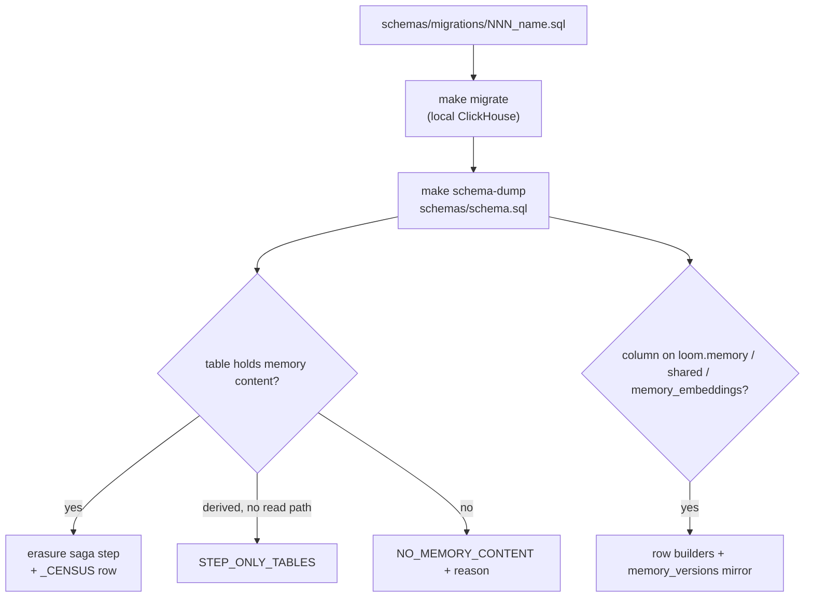

<!-- i18n: source=docs/development/adding-a-table.md blob=d8af79bee19277559de78fd0ef566e3df03ea7cb model=claude-sonnet-5-5 -->
> このページは[英語の原文](https://github.com/ClickHouse/loom/blob/main/docs/development/adding-a-table.md)の機械翻訳です。内容は英語の原文が優先されます。
> Machine-translated from the [English page](https://github.com/ClickHouse/loom/blob/main/docs/development/adding-a-table.md), which is authoritative.

# ClickHouse のテーブルまたはカラムを追加する

Loom の ClickHouse の状態は、`loom` データベースと `loom_telemetry` データベースのテーブルに保存されます。Postgres メモリオーソリティを使う場合、ライブのメモリ、ナレッジの状態、およびそれに付随するレコードは Postgres に保存されます。Postgres のテーブルは [ストレージオーソリティ](../architecture/storage-authority.md#the-tables) のページに一覧があります。デプロイ中は 2 つのビルドが同じスキーマを使うため、ClickHouse のスキーマは、番号付きの追加のみのマイグレーションを通してのみ変更します。以下の各ルールはテストで担保されています。テーブルファミリーについては [ClickHouse](https://github.com/ClickHouse/loom/blob/main/docs/architecture/clickhouse.md) で説明しています。

## 1. マイグレーションを書いてスキーマを再生成する

[マイグレーション](https://github.com/ClickHouse/loom/blob/main/docs/development/migrations.md)に規則がまとまっています。採番、加算的な変更とみなされるもの、ランナーディレクティブ、ソートキーの再構築、固定バージョンの ClickHouse に対する `make schema-dump` / `make schema-check` などです。要点は次のとおりです。

- 次の空き番号で `schemas/migrations/<NNN>_<what>.sql` を追加します。ヘッダコメントには、この変更の目的と、既存の行および古いビルドから何が見えるかを書きます。
- テーブルは `loom.<table>` の形で指定し、`IF NOT EXISTS` / `IF EXISTS` を付けます。Loom 自身のテーブルから派生するテレメトリは、代わりに `loom_telemetry` に置きます（[理由](https://github.com/ClickHouse/loom/blob/main/docs/architecture/clickhouse.md)）。preflight がそのデータベースの権限をすでに確認しており、消去の棚卸しではテーブル名をデータベース名付きで指定します。
- マージ済みのマイグレーションは編集も削除もしません。誤りは新しいファイルで修正します。
- `make migrate`、`make schema-dump` の順に実行し、続けて `python scripts/codegen/docs_reference.py` を実行して、[スキーマリファレンス](https://github.com/ClickHouse/loom/blob/main/docs/reference/schema.md)にそのテーブルが載るようにします。

デプロイメントがマイグレーションを適用するまでの間、クライアントのスキーマガードは、未適用のマイグレーションが作成するテーブルを指定した読み取りまたは書き込みを `SCHEMA_PENDING` で拒否します。

## 2. ReplacingMergeTree の書き込みパスですべてのカラムを引き継ぐ

`loom.memory`、`loom.shared`、`loom.memory_embeddings` は `ReplacingMergeTree(version)` テーブルであり、`FINAL` を付けて読み取ります。新しいバージョン行を書き込むすべてのハンドラ（set、tombstone、restore、touch、`update_by_id`、`bulk_set`、promote、demote）は、永続化される**すべての**カラムを次のバージョンへ引き継ぎます。後続のバージョン行でカラムを省略すると、`FINAL` の読み取り時にゼロとして読まれます。

これらのテーブルにカラムを追加するときは、次の手順に従います。

1. `server/memory/store/rows.py` の正規のカラムリスト（`MEMORY_PERSISTED_COLS` または `EMBEDDING_PERSISTED_COLS`）に追加します。
2. 同ファイルのビルダー（`build_memory_version_row`、`build_revision_row`、`build_first_version_row`、`build_embedding_row`）と、それらに入力を渡すすべてのプロジェクション（既存の行を読み込む `SELECT`）にカラムを含めます。
3. ハンドラ内でバージョン行を手作業で組み立てないでください。必ずビルダーを呼び出します。

`tests/unit/test_memory_write_path_mirror.py` と `tests/unit/test_embedding_mirror_carry.py` が、副次的な書き込みパスを検査します。

**履歴ミラー。** `loom.memory_versions` は `loom.memory` の追記専用のツインテーブルで、`memory_versions_mv` マテリアライズドビューによって埋められます。マージにより `ReplacingMergeTree` から置き換えられた行が削除されるため、`memory.history`、`memory.redact`、`namespace.rollback` はこのテーブルを読み取ります。`loom.memory` に新しいカラムを追加するときは、**同じマイグレーション内で** `loom.memory_versions` とビューの `SELECT` にも追加してください。`tests/unit/test_memory_versions_schema.py` は、`schema.sql` 内の両方のカラムリストを `MEMORY_PERSISTED_COLS` と比較します。

新しい書き込みパスでは、サーバーが付与する `actor` と `source_class`（`server.memory.domain.provenance`）を設定します。リクエストボディの値は決して使用しません。

## 3. 消去のためにテーブルを分類する

消去はサガ（`server/erasure/app/saga.py`）として実装されています。最後のステップは、読み取りパスが参照するすべてのテーブルに対する残存行の調査（residue census）で、対象範囲に有効な行が 1 行でも残っていれば、サガは失敗側に倒れて終了します。`tests/unit/test_every_table_is_classified.py` は、`schema.sql` 内の `CREATE TABLE` のうち、`server/erasure/store/census.py` にある 3 つのリストのいずれか 1 つだけに含まれていないものがあると失敗します。

| リスト              | テーブルを入れる条件                                                                                                                  | 追加で必要なもの                                                                                                                      |
| ------------------- | ------------------------------------------------------------------------------------------------------------------------------------- | ------------------------------------------------------------------------------------------------------------------------------------- |
| `_CENSUS`           | 読み取りパスが返すメモリの内容を保持しうる。                                                                                          | 対象範囲の行を削除するサガのステップと、範囲ごとにそのステップを指定する `Substrate(table, live, user_pred, ns_step, user_step)`。    |
| `STEP_ONLY_TABLES`  | サガのステップがテーブルを変更するが、調査では数えない（派生した台帳、エイリアスのマップなど）。理由は dict の上のコメントに書く。     | 名前をキーとするステップ。                                                                                                            |
| `NO_MEMORY_CONTENT` | 対象範囲にメモリの内容を保持しない（カウント、カーソル、公開データのキャッシュなど）。                                                | 1 行の理由。                                                                                                                          |

`_CENSUS` のテーブルについて：

- `live` は有効な行が満たす述語です（`tombstoned_at IS NULL`、またはすべての行を数える場合は `"1"`）。`user_pred` は、テーブルにユーザー軸がある場合は `user_id = {uid:String}`、名前空間のみのテーブルでは `None` です（この場合、名前空間スコープの消去でのみ数えられます）。
- ステップは `server/erasure/store/steps_*.py` の関数で、該当する各サガのテーブル（`server/erasure/app/saga_steps.py` の `NAMESPACE_STEPS`、`USER_STEPS`）にステップ名とともに登録します。通常の `MergeTree` では FINAL が使えないため、その `Substrate` には `final=False` を指定します。
- 再開されたサガは、直近の調査で行が見つかったテーブルの担当ステップを再実行します（`steps_to_reopen`）。そのため、ステップは冪等でなければなりません。
- `(org, namespace)` をキーとするコードプレーンのテーブルは、通常 `CODE_INDEX_STEP_ONLY_TABLES`（サガの `code_index.purge` ステップで削除）に入ります。このタプルがスキーマと一致していることは、ユニットテストで検証されます。

ステップの文の形は、`tests/unit/test_erasure_repo.py` や `tests/unit/test_erasure_late_steps.py` と同様に、スタブクライアントでテストします。

## 4. ミューテーションを分類する

`ALTER TABLE loom.<t> UPDATE|DELETE` は ClickHouse のミューテーションです。パーツを非同期に書き換え、トランザクションには対応していません。`tests/unit/test_clickhouse_mutation_inventory.py` は、`server/` 配下で見つかったミューテーションをすべて数え、`_EXPECTED_MUTATIONS` と照合します。新しいミューテーションを追加すると、理由を記したコメントとともにそこへ追記するまでテストは失敗します。

代わりに、`ReplacingMergeTree` への新しいバージョン行、トゥームストーン列、または軽量な `DELETE FROM` を使うことを推奨します。リクエストが待機する claim やロックとしてミューテーションを使ってはいけません。タスクインボックスは、代わりに `KeeperMap` のリーステーブルを通じて claim を行います。

## チェックリスト

- [ ] 新しい `schemas/migrations/<NNN>_<what>.sql` を追加する。追加のみで、冪等にする。マージ済みのファイルは編集しない。
- [ ] 新しいバージョン固定の ClickHouse に対して `make schema-dump` を実行し、`make schema-check` がエラーなく通ること。
- [ ] スキーマリファレンスのために `python scripts/codegen/docs_reference.py` を実行する。
- [ ] RMT のカラム：`rows.py` のカラムリスト、ビルダー、プロジェクションを更新する。`memory_versions` と `memory_versions_mv` は同じマイグレーションに含める。
- [ ] 消去の分類：`_CENSUS` と saga ステップ、`STEP_ONLY_TABLES`、または理由を付けた `NO_MEMORY_CONTENT` のいずれかにする。
- [ ] 新しいミューテーションはすべてインベントリテストに記載する。
- [ ] [ストレージレイアウト](https://github.com/ClickHouse/loom/blob/main/docs/architecture/storage-layout.md)に行を追加する。ClickHouse のテーブルはそのファミリーの表に、`_` で始まる名前は `_` テーブルのセクションに追加し、すべてのカラムを埋める。`tests/unit/test_storage_layout_rows.py` は、その行が存在すること（ClickHouse のテーブルの場合は、テーブルが削除されたら行もなくなっていること。削除された Postgres テーブルの行は手作業で削除する）を確認する。ClickHouse の行については、Today セルがスキーマと、Erasure セルが census と一致し、引用がそのテーブルを指していることも確認する。スキーマダンプが保留中の間は、ダンプが反映されるまでこのテストは失敗する。
- [ ] `make test-unit` を実行する（追加のみ、採番、ミラー、分類、インベントリの各テスト）。

## 関連ドキュメント

- [マイグレーション](https://github.com/ClickHouse/loom/blob/main/docs/development/migrations.md)
- [ClickHouse](https://github.com/ClickHouse/loom/blob/main/docs/architecture/clickhouse.md)
- [保持と消去](https://github.com/ClickHouse/loom/blob/main/docs/features/memory/retention-and-erasure.md)
- [アップグレード](https://github.com/ClickHouse/loom/blob/main/docs/operations/upgrades.md)
