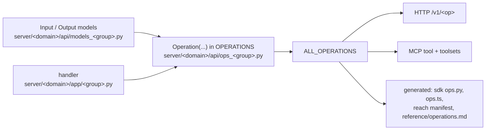

<!-- i18n: source=docs/development/adding-an-operation.md blob=32e9eb1349c29c12bc71e2adc8c55441a459025d model=claude-sonnet-5-5 -->
> このページは[英語の原文](https://github.com/ClickHouse/loom/blob/main/docs/development/adding-an-operation.md)の機械翻訳です。内容は英語の原文が優先されます。
> Machine-translated from the [English page](https://github.com/ClickHouse/loom/blob/main/docs/development/adding-an-operation.md), which is authoritative.

<a id="add-an-operation"></a>

# オペレーションの追加

オペレーションはレジストリ内で一度だけ宣言します。HTTP ルート（`POST /v1/<op>`）、OpenAPI スキーマ、MCP ツール（`loom_<op with dots as underscores>`）、カタログ（`/v1/operations`、`ops.capabilities`）、SDK のオペレーションテーブル、および[オペレーションリファレンス](https://github.com/ClickHouse/loom/blob/main/docs/reference/operations.md)は、すべてこの宣言から生成されます。モデル、ハンドラー、宣言、テストを自分で書き、残りは再生成します。



例として、最小規模のオペレーションの一つである `calibration.get` を取り上げます。関連ファイルは `server/memory/api/models_calibration.py`、`server/memory/api/ops_calibration.py`、`server/memory/app/calibration.py` です。

<a id="1-define-the-input-and-output-models"></a>

## 1. 入力モデルと出力モデルを定義する

モデルは、グループの models モジュール `server/<domain>/api/models_<group>.py` に置きます。models モジュールにはワイヤー形式の Pydantic モデルだけを置き、ハンドラーは import しません。

```python
from pydantic import BaseModel, Field


class CalibrationGetInput(BaseModel):
    org: str
    namespace: str


class CalibrationGetOutput(BaseModel):
    source: str  # "namespace" / "cluster" / "scalar"
    embedder_model: str = ""
    noise_floor: float
    ...
    similar_pairs_n: int = Field(default=0)
```

モデルのルール：

- **ID。** 名前空間を指定する op は `org` と `namespace` を受け取ります。行を書き込む op は、ID タプルの残りである `agent`、`user_id`、`session_id`、`run_id` も受け取ります（後ろの 3 つのデフォルトは `'-'` です）。MCP では、省略された ID フィールドをサーバーが接続のデフォルト値で補い、そのうえでボディが指定する `(org, namespace)` を認可します。
- **サーバーが設定するカラムをボディから受け取らない。** 書き込みパスが `actor`（`server.memory.app.provenance.writer_actor`）と `source_class`（`server.memory.domain.provenance.source_class_for`）を設定します。リクエストで宣言できるのは、`derived`、`external`、`imported` へのダウングレードだけです。
- **エージェントに無関係なフィールドを MCP から隠す。** ランキングのつまみやパイプラインのスイッチには `json_schema_extra=MCP_HIDDEN`（`server/operations/base.py`）を指定します。MCP スキーマからは除外されますが、op は引き続きそのフィールドを受け付けます。
- **読み取り入力にモデルレベルの「A または B のどちらか」バリデーターを置かない。** トランスポートは認可の前にボディを検証するため、例外を送出する `@model_validator` は、名前空間ゲートが拒否するはずのプリンシパルに op の内容を明かしてしまいます。ルールはハンドラーに書き、`server.core.errors.ValidationError` を送出してください。`tests/unit/test_op_inputs_after_gate.py` が、登録済みのすべての op を検査します。
- **フィールドを廃止するには**、削除します。そのフィールドをまだ送ってくるクライアントも処理され、そのフィールド名は `ignored_args` に入ります（[未知のフィールドと削除されたフィールド](https://github.com/ClickHouse/loom/blob/main/docs/reference/http-api.md#unknown-and-removed-fields)）。

<a id="2-write-the-handler"></a>

## 2. ハンドラを書く

ハンドラモジュールはグループごとに 1 つ、`server/<domain>/app/` に置きます。ハンドラは `async` で、入力モデルを受け取り、出力モデルを返します。ワイヤモデルはモジュールの先頭でインポートします。モデルがハンドラをインポートすることはないため、インポートは循環しません。

```python
from server.memory.api.models_calibration import CalibrationGetInput, CalibrationGetOutput


async def handle_calibration_get(input: CalibrationGetInput) -> CalibrationGetOutput:
    from server.memory.app.embedder_calibration import get_calibration, get_namespace_calibration

    ns_cal = await get_namespace_calibration(input.org, input.namespace)
    ...
```

- 純粋なロジックはドメインの `domain/` に、SQL は `store/` に置きます。ハンドラはそれらを組み合わせます。
- **拒否**は `server.core.errors.LoomServerError` のサブクラス（または `{"code", "message"}` を detail に持つ `HTTPException`）を送出します。トランスポートがこれをエラーエンベロープに変換し、MCP では `isError` の結果にします。新しいエラーコードは、生成される[エラーリファレンス](https://github.com/ClickHouse/loom/blob/main/docs/reference/errors.md)に掲載されます。
- **広範な `except` は理由を書きます:** `except Exception as e:  # noqa: BLE001 — <what must not fail>`。
- ClickHouse クエリへの `log_comment` の付与はトランスポートが行います。ハンドラは何もしません。
- 設定は `settings.<field>` として読み取り、`getattr(settings, ...)` は使いません。
- op が `loom.memory` または `loom.shared` に書き込む場合は、`server/memory/store/rows.py` のビルダーで行を組み立てます（[テーブルの追加](https://github.com/ClickHouse/loom/blob/main/docs/development/adding-a-table.md#2-mirror-every-column-on-replacingmergetree-write-paths)）。

<a id="ops-addressed-by-an-org-wide-id"></a>

### 組織全体の id で指定される op

`memory.get_by_id` や `memory.update_by_id` のように `(org, memory_id)` だけを受け取る op には、トランスポートから名前空間が渡されません。この op には `row_scoped=True` を宣言し、読み取りの前に呼び出し元が到達できる名前空間を解決し、他者の行は**隠します**。

```python
import server.memory.store as memory_repo
from server.memory.app.id_namespace import namespace_for_id

namespace = await namespace_for_id(input.org, input.memory_id, strong=False)
if namespace is None:
    return MemoryGetByIdOutput(found=False)
row = await memory_repo.get_by_id(input.memory_id, org=input.org, namespace=namespace, ...)
if row is None:
    return MemoryGetByIdOutput(found=False)
```

403 ではなく、行が存在しない場合と同じ応答を返します。403 を返すと、その id が別のテナントに存在することを確認させてしまうためです。書き込みでは、保持者を最新の状態で読むために、`namespace_for_id` に `Role.WRITER` と `strong=True` を渡します。`memory.redact` のように先に行を読み取る必要がある op は、取得後に `authz.row_in_scope` で検査します（[行スコープの操作](https://github.com/ClickHouse/loom/blob/main/docs/architecture/security.md#row-scoped-operations)）。

<a id="3-declare-the-operation"></a>

## 3. オペレーションを宣言する

```python
from server.operations.base import Operation, Role

calibration_get = Operation(
    name="calibration.get",
    maturity="experimental",
    input_model=CalibrationGetInput,
    output_model=CalibrationGetOutput,
    handler=handle_calibration_get,
    idempotent=True,
    required_role=Role.VIEWER,
    audit=False,
)

OPERATIONS: list[Operation] = [calibration_get]
```

レイテンシ予算は、すべての op の予算を定める `server/settings/catalog.py` の `OP_BUDGETS_P99_MS` に 1 エントリとして置きます。`"calibration.get": 60,` がその例です（op の設計目標 p99 をミリ秒で表したもので、これを超えた成功呼び出しは `budget.violated` イベントを発行します）。ハンドラが実行時に記録するリクエスト形状（`server.observability.budget_shape`）には、`OP_SHAPE_BUDGETS_P99_MS` に個別の予算を設定します。カタログにその一覧があります。エントリのない op は `tests/unit/test_op_budgets.py` で失敗します。デプロイ側では、1 つの op は `LOOM_LATENCY_BUDGET_OVERRIDES` で、すべての op は `LOOM_LATENCY_BUDGET_MULTIPLIER` で調整できます。

宣言は、グループの ops モジュール `server/<domain>/api/ops_<group>.py` に置きます。このモジュールがモデルとハンドラをインポートします。宣言はモジュールの `OPERATIONS` リストに追加してください。**新しいグループモジュール**は、`server/operations/registry.py` でインポートし、`_OPERATION_MODULES` に追加します。

| フィールド                    | 必須   | 意味                                                                                                                                                                                                                                                                                             |
| ----------------------------- | ------ | ------------------------------------------------------------------------------------------------------------------------------------------------------------------------------------------------------------------------------------------------------------------------------------------------ |
| `name`                        | はい   | `<group>.<verb>` の形のドット区切りの名前。HTTP パスは `/v1/<name>`、MCP ツールは `loom_<name with . → _>`。                                                                                                                                                                                      |
| `input_model`, `output_model` | はい   | Pydantic モデル。                                                                                                                                                                                                                                                                                |
| `handler`                     | はい   | 非同期の呼び出し可能オブジェクト。入力モデルを受け取り、出力モデルを返す。                                                                                                                                                                                                                       |
| `idempotent`                  | はい   | 一時的な失敗のときに安全に再試行できる。SDK とクライアントはこれに依存する。                                                                                                                                                                                                                     |
| `required_role`               | はい   | `Role.VIEWER`、`WRITER`、`ADMIN`、`ORG_ADMIN`、`PLATFORM_ADMIN` のいずれか。                                                                                                                                                                                                                     |
| `audit`                       | いいえ | `True` の場合、成功すると `loom.audit_log` に 1 行を書き込む。メモリ、権限付与、ポリシー、設定を変更するものには必ず設定する。                                                                                                                                                                    |
| `writes`                      | いいえ | viewer が呼び出せて再試行も安全だが、保存された状態を変更する op（フィードバック行、既読マーカーなど）。writer ロールや `audit=True` は、すでに「書き込む」ことを示している。                                                                                                                      |
| `maturity`                    | いいえ | `stable`（デフォルト）または `experimental`。[ステップ 5](#5-check-reach-and-maturity) を参照。                                                                                                                                                                                                   |
| `skip_namespace_authz`        | いいえ | 名前空間**に対して**作用する op（join、leave、register）や、対象をハンドラだけが解決できる op（id 指定の `memory.verify`、スコープ指定の `erasure.request`、呼び出し元ロールによる `erasure.list`）で、トランスポートの名前空間チェックを省略する。ハンドラが独自のルールを適用する。ロールチェックは引き続き実行される。 |
| `deployment_scoped`           | いいえ | op が名前空間のデータではなく、デプロイに関する事実（ビルド、レジストリ）を読む。スコープ付きトークンは、名前空間ごとのロールのうち最も高いものでパスする。                                                                                                                                       |
| `row_scoped`                  | いいえ | 組織全体の id で指定される。ハンドラが行のスコープを認可し（読み取り前は `namespace_for_id`、読み取り後は `row_in_scope`）、他スコープの行は存在しないものとして隠す。                                                                                                                            |

op が**読み取り専用**（MCP の `readOnlyHint`、`readonly` ツールセット）になるのは、`idempotent` であり、`required_role == Role.VIEWER` で、`audit` も `writes` も設定されていない場合に限ります（`Operation.read_only`）。読み取り専用ツールを自動承認するクライアントは、これらのフラグを信頼します。

<a id="4-decide-mcp-visibility"></a>

## 4. MCP での公開範囲を決める

`server/operations/toolsets.py` が、op をどこに一覧表示するかを決めます。

- **厳選されたロスター**（`_MCP_CORE_OPS`、`_MCP_CODING_OPS`、`_MCP_ATOMIC_OPS`、`_MCP_TASK_OPS`、`_MCP_TRACKER_OPS`、`_MCP_CODE_CORE_OPS`）に載せると、その `?toolset=` に op が一覧表示されます。一覧に載せたプロパティはすべて毎ターントークンを消費するため、そのアーキタイプが呼び出すものだけを追加してください。`tests/unit/test_mcp_listing_budget.py` が、一覧をトークン上限以下に保ちます。
- **一覧に載せない**（ほとんどの op）：どの一覧からでも `loom_op` を通して名前で呼び出せます（`readonly` では読み取りのみ。[MCP ツールセット](https://github.com/ClickHouse/loom/blob/main/docs/reference/mcp.md#toolsets)）。`?toolset=all` は `stable` の op を一覧表示し、`experimental` の op は core または atomic のロスターに載っている場合にのみ一覧表示します（`server/operations/toolsets.py` の `listed_under_all`）。
- **`_MCP_HIDDEN_OPS`**：MCP からは到達できません。`tests/unit/test_hidden_op_says_why.py` は、代わりに呼び出すべきものを示す拒否応答を要求します。

一覧に載せる op には、`server/transport/mcp_descriptions.py`（`TOOL_DESCRIPTIONS`）に説明が必要です。説明はモデル向けに書きます。ツールをいつ呼び出すか、何を返すか、何に使うべきでないかを書いてください。変更された事実に関する説明は、独自の記述を持たず、同じモジュールの `revision_policy()` を埋め込みます。別の op には、ドット区切りの op 名で言及します。各一覧は、一覧に載っている op をそのツール名に置き換え、載っていない op には印を付けます（[MCP リファレンス](https://github.com/ClickHouse/loom/blob/main/docs/reference/mcp.md#tool-list)）。op を呼び出し形式（`op(args)`）で書いたり、より長いコードスパンの中に入れたり、手書きの「(via loom_op)」を付けたりしないでください。フィールドの例の値として op 名を示す場合は、一重引用符で囲みます（`'memory.ask'`）。一覧はこれをそのまま残します。

<a id="5-check-reach-and-maturity"></a>

## 5. リーチと成熟度を確認する

op の**リーチ**は導出される値です（`Operation.reach`、`server/operations/reach.py`）。MCP ロスターへの所属に加えて、SDK、`examples/`、`dev/`、`scripts/` のコミット済みスキャン、プラグインのフック、ダッシュボードの `"/v1/<op>"` 呼び出し箇所から決まります。`{"http_only"}` は、生の `/v1/*` POST だけがその op に到達できることを意味します。

すべての op は、すべてのサーフェスに存在するか、存在しない理由をコード内で示します。HTTP はレジストリ内のすべての op を提供し、両方の SDK はレジストリから生成されます。`_MCP_HIDDEN_OPS` が人間やオペレーター向けに留めている場合を除き、MCP からも op に到達できます。ダッシュボードは、人が必要とするとき（管理、レビュー、確認、設定、確認付きの削除）にその op を呼び出します。この種の新しい op は、対応する操作 UI とともに提供されます。エージェントまたはクライアントプログラムだけが呼び出す op や、ダッシュボードが別の op を通じて提供する op は、理由とともに `NOT_IN_DASHBOARD`（`server/operations/dashboard.py`）に記載します。census の `--check`（`tests/unit/test_op_reach_census.py`）は、ダッシュボードの呼び出し箇所も `server/operations/dashboard.py` のエントリもない op があると失敗します。

- MCP から隠されていて、ほかにリーチ経路がない op（種類は `server/operations/reach.py` に一覧があります）は、`maturity="experimental"` を宣言します。
- `stable` の op は、[MCP の `all` ツールセットに掲載されている](https://github.com/ClickHouse/loom/blob/main/docs/reference/operations.md#mcp-all-listing)か、MCP から隠されている場合はほかのリーチ経路を持ち、本番の呼び出し元があることが前提です。呼び出し元があるかどうかは `python scripts/codegen/op_reach_census.py --call-counts --days 30` で確認できます。stable の op を置き換える場合を除き、新しい op は `experimental` と宣言してください。
- マニフェストを更新します：`python scripts/codegen/op_reach_census.py --write-manifest`（`server/operations/reach_manifest.py` に書き込みます）。

<a id="6-write-the-tests"></a>

## 6. テストを書く

| テスト                                                   | op に求められること                                                                                                                                                                                                                                                                                                          |
| -------------------------------------------------------- | ---------------------------------------------------------------------------------------------------------------------------------------------------------------------------------------------------------------------------------------------------------------------------------------------------------------------------- |
| `tests/unit/` 配下のユニットテスト                       | ハンドラーの拒否ケースと正常系を網羅します。                                                                                                                                                                                                                                                                                 |
| `tests/integration/test_cross_principal_leakage.py`      | 読み取り系の op をすべて、別のテナント（別の名前空間の writer と viewer、および別の組織）として実行し、canary nonce を埋め込みます。レスポンスにそれらが含まれてはならず、すべての呼び出しは 200（空）、403、404 のいずれかで終わり、500 になってはなりません。ペイロードは op の入力モデルから合成されるため、新しい読み取り op は登録したその日からプローブされます。 |
| `tests/integration/test_restricted_namespace_leakage.py` | 制限付き名前空間に対する同様のテストです。                                                                                                                                                                                                                                                                                   |
| `tests/unit/test_op_inputs_after_gate.py`                | 入力モデルが、モデルレベルの検証エラーなしで構築できること。                                                                                                                                                                                                                                                                 |
| `tests/unit/test_op_reach_census.py`                     | reach と maturity が一致し、マニフェストが最新であること。                                                                                                                                                                                                                                                                   |
| `tests/unit/test_mcp_listing_budget.py`                  | 一覧に載る op が一覧を予算内に収め、その説明がクライアントの呼び出せないツールを指していないこと。                                                                                                                                                                                                                           |

リークテストのスイートが op のボディを合成できない場合は、その旨が報告されます。スキップせず、ヒントを追加してください。呼び出し元自身の名前空間を変更する op は、スイートの `_SKIP_OPS` に入れ、writer ゲートは別のテストでカバーします。統合テストには稼働中のサーバー（`LOOM_BASE_URL`）が必要で、サーバーがない場合はスキップされます。トークンは、CI で有効になっていないセルフサインアップではなく、スイートのヘルパーで発行してください。

<a id="7-regenerate-and-run-the-gates"></a>

## 7. 再生成とゲートの実行

```bash
python scripts/codegen/sdk_py_gen.py                       # sdk/python/loom/ops.py
python scripts/codegen/sdk_py_client_gen.py                # sdk/python/loom/client.py
python scripts/codegen/sdk_ts_gen.py                       # sdk/typescript/src/generated/ops.ts
python scripts/codegen/op_reach_census.py --write-manifest # server/operations/reach_manifest.py
python scripts/codegen/docs_reference.py                   # generated regions of docs/reference/*.md
make format
make lint          # ruff, gates, every generator with --check, the reach census --check, Biome's dashboard accessibility rules
make typecheck
make test-unit     # reach census, MCP listing budget
```

生成ファイルが古い場合、CI は失敗します。生成された SDK ファイルにより、すべてのクライアントが op を一度に利用できます。Python と TypeScript の `agent.call("calibration.get", {...})` は、新しい TypedDict とインターフェースに対して型付けされます。SDK クライアント上の手書きメソッド（`sdk/python/loom/<group>.py`）は任意です。よく使う動詞には追加してください。これは到達パスとして数えられます。

`python scripts/codegen/wire_changelog.py <rev_a> <rev_b>` は、2 つのリビジョン間でクライアントに影響する変更を出力します。リリースノートはこの出力から作成されます。

<a id="before-you-open-the-pr"></a>

## PR を開く前に

- [ ] モデル、ハンドラ、宣言、`OPERATIONS` エントリ（新しいグループの場合は `_OPERATION_MODULES` も）。
- [ ] `required_role`、`idempotent`、`audit`、`writes`、`maturity` を意図して選んでいる。
- [ ] `row_scoped` の op は、他者の行を存在しない行として応答する。
- [ ] ツールセットへの配置、および一覧に載せる場合は説明。
- [ ] 上記のテストが通り、生成ファイルを再生成済みである。
- [ ] その op を扱う機能ページが、[operations リファレンス](https://github.com/ClickHouse/loom/blob/main/docs/reference/operations.md)内のそのアンカーにリンクしている。

<a id="related"></a>

## 関連ドキュメント

- [Loom の拡張](https://github.com/ClickHouse/loom/blob/main/docs/development/extending-loom.md)
- [システム概要](https://github.com/ClickHouse/loom/blob/main/docs/architecture/system-overview.md)：すべての op が通過するゲートの順序
- [HTTP API](https://github.com/ClickHouse/loom/blob/main/docs/reference/http-api.md)
- [コード生成](https://github.com/ClickHouse/loom/blob/main/docs/development/code-generation.md)
